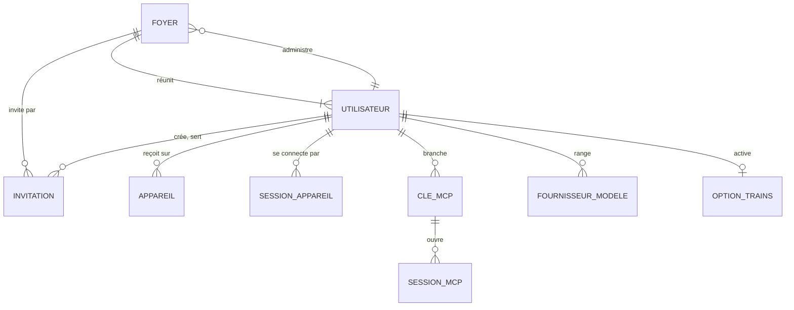
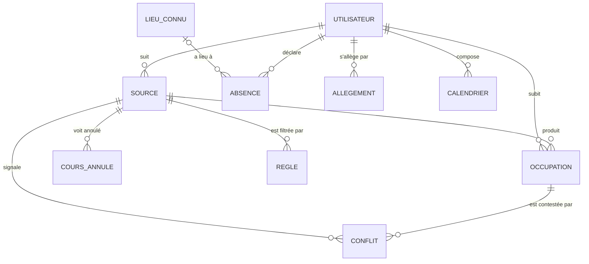
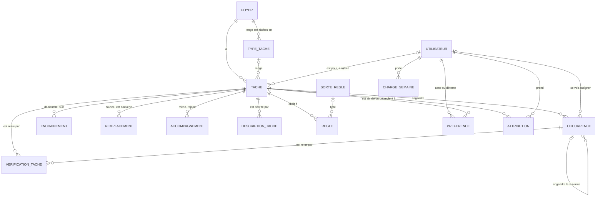
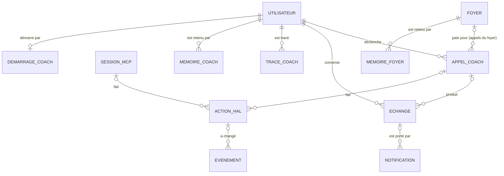
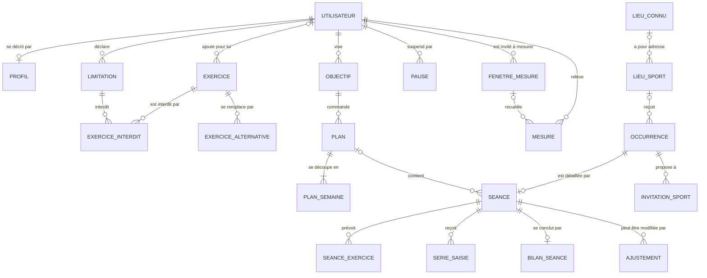
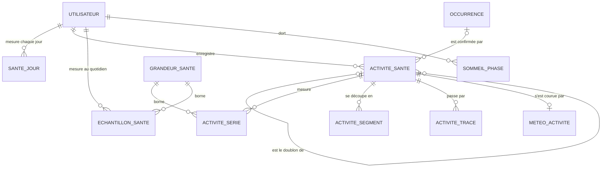
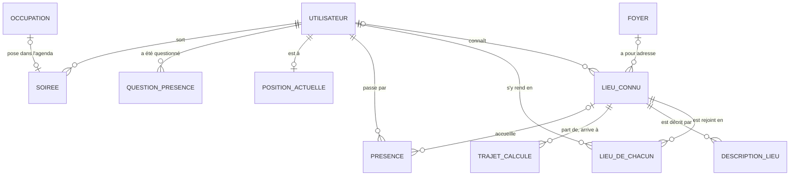

# HAL

Cahier des charges

Auteur : Thomas Mathis

Ce document décrit HAL tel qu'il doit être : l'application iPhone, le serveur qui la sert, et HAL, l'agent d'intelligence artificielle autour duquel tout tourne. Il se lit seul. Ce que l'application ne fait pas encore comme il le décrit est rassemblé dans la partie 12, « Modifications à apporter » ; l'avancement, les priorités et l'historique des travaux sont dans un document à part, le journal de bord (`journal-de-bord.md`).

## Comment lire ce document

**Les règles.** Chaque règle de gestion porte un code : trois lettres pour son domaine, un numéro (TAC-24, SPT-38). Le code source les cite en commentaire. Un code ne change jamais et n'est jamais réattribué : une famille peut donc avoir des numéros manquants, ce n'est pas une erreur. Une règle nouvelle prend le premier numéro libre de sa famille.

**Trois types de règles**, selon la manière dont elles sont tenues :

| Type | Ce qu'il veut dire | Qui la tient |
|---|---|---|
| **D** | Une règle sur les données | Le schéma de la base (`CHECK`, clé, contrainte d'exclusion) ou un réglage |
| **T** | Un traitement | Une fonction SQL, un déclencheur, le module de HAL ou l'appli |
| **M** | Un geste de l'utilisateur | L'utilisateur, dans l'appli ou en parlant à HAL |

Une règle de type T dont le texte commence par « HAL » est tenue par le modèle de langage, guidé par sa consigne et son dossier. Elle se vérifie par des scénarios rejoués, pas par une contrainte (section 11.3).

**Les renvois** s'écrivent avec le numéro de section : « section 4.12 ». Les numéros entre crochets, [3.8], renvoient aux écrans de la maquette Figma (fichier « Appli », page « V2 · Liquid Glass ») ; leur liste est en section 5.7. Quand la maquette et ce document divergent, c'est ce document qui fait foi.

**Ce document sert de base à l'écriture du code.** Une règle écrite ici est une obligation. Ce qui n'est pas écrit se décide en suivant les choix de la section 1.4 et les conventions du projet : les règles dans la base, une API mince, du SQL écrit à la main sans ORM, une fonction SQL par fichier.

## Sommaire

1. Présentation
2. Architecture et outils
3. Acteurs du système
4. Règles de gestion
5. L'application iPhone
6. Modèle de données
7. Contraintes d'intégrité
8. Description des opérations
9. Interfaces exposées
10. Ce qui est volontairement exclu
11. Risques et points ouverts
12. Modifications à apporter
- Annexe A : valeurs par défaut à calibrer
- Annexe B : glossaire

---

## 1. Présentation

### 1.1 Le projet en une page

**HAL est une application iPhone construite autour d'un agent d'intelligence artificielle, HAL lui aussi.** L'application montre la journée, la maison, le sport et la santé ; HAL les fait vivre.

**HAL organise le temps du foyer.** Il croise les emplois du temps de chacun (cours, travail, calendriers personnels, ce qu'on saisit à la main), pose les tâches de la maison dans les moments vraiment libres, les répartit entre les membres du foyer, et les adapte quand quelque chose change : un cours ajouté, un départ, une soirée, une tâche faite en avance. Après chaque changement qui touche une tâche, il vérifie qu'elle tient toujours.

**HAL est aussi un coach sportif.** Il aide chacun à atteindre ses objectifs (une course à une date, une charge à soulever, une mesure du corps à faire évoluer), lit les données de santé de l'iPhone et de l'Apple Watch (sommeil, fréquence cardiaque, séances), construit le plan d'entraînement et cale chaque séance dans l'emploi du temps. Il tient compte des particularités physiques de chacun : une douleur qui dure, un exercice interdit, un niveau, un âge.

**HAL s'adapte à tout, à tout moment.** On lui parle comme à quelqu'un, par écrit ou à la voix, depuis n'importe quel écran : « je pars chez mes parents vendredi », « j'ai mal au genou », « décale l'aspirateur à jeudi », « samedi je sors ». Chaque message déclenche un appel : HAL lit ce qu'il faut, agit avec ses outils, et dit ce qu'il a fait. Tout ce qu'un bouton de l'appli permet, on peut le lui demander. Ce qu'il a fait se défait pendant deux minutes, ou en lui disant simplement « non ».

**L'application est entièrement personnalisable.** Elle suit le style Liquid Glass d'iOS 26 : un fond photo choisi par chacun, changeable à tout moment, des couleurs au choix, et des widgets qu'on place, redimensionne et retire comme on veut sur chacun des trois onglets. Deux personnes du même foyer n'ont pas besoin d'avoir la même appli sous les yeux.

**Le serveur est auto-hébergé.** Les règles vivent dans PostgreSQL, HAL n'agit que par des outils qui appellent la base, et rien n'est envoyé ailleurs que ce qu'il faut au modèle pour répondre. On parle aussi à HAL depuis Claude Code ou tout client MCP, et il tourne sur l'abonnement Claude de chacun, l'API ne servant qu'en secours.

### 1.2 Rappel du sujet

**Le sujet de départ** était le système d'information d'un assistant de planification pour un foyer de deux personnes. Il devait croiser des emplois du temps venus de sources différentes (les cours de l'université, le planning de travail, les calendriers personnels, les saisies à la main), en déduire les moments réellement libres, et y placer automatiquement des tâches ménagères récurrentes, « passer l'aspirateur tous les deux à trois jours », en les répartissant entre les deux personnes selon qui est là. Le résultat se lisait dans un flux iCalendar, et se pilotait par un bot Telegram.

**Le projet ne repose plus sur ce cadre fixe.** Rien n'y est écrit pour une personne, un lieu ou un emploi du temps en particulier :

- un foyer compte **d'une à huit personnes**, et une personne seule a la même appli que les autres ;
- n'importe quel calendrier se suit, en collant son lien dans l'appli ; ce qu'on veut en retirer, on le dit à HAL, qui en fait une règle ;
- les tâches, leurs types, leurs liens, les lieux, les heures, les options se créent et se modifient **depuis l'appli**, ou en le demandant à HAL ;
- le sport, absent du sujet, est devenu une moitié du projet : HAL en construit le contenu à partir des objectifs et des données de santé ;
- tout passe par une application iPhone ; le bot Telegram ne sert qu'à l'administrateur du serveur.

Le socle du sujet reste : les règles métier dans la base, les plages horaires en `tstzrange`, des occurrences qui portent une fenêtre d'échéance plutôt qu'une date, une récurrence qui repart de la date réelle d'exécution, et une tâche impossible à placer qui reste visible avec son motif plutôt que de disparaître.

### 1.3 L'application et HAL : qui fait quoi

L'application et HAL sont deux choses différentes. **L'application** est l'ensemble déterministe : l'appli iPhone, le serveur, sa base et son moteur. Elle marche sans IA. **HAL** est l'agent : un modèle de langage, une consigne, et une liste fermée d'outils qui appellent la base. Il n'écrit jamais dans une table autrement que par ces outils, et la base refuse ce qui ne tient pas.

| | L'application (sans IA) | HAL (l'agent) |
|---|---|---|
| Emplois du temps | Collecte les calendriers, applique les règles de filtre, détecte les conflits | Crée les règles de filtre qu'on lui dicte (« retire l'espagnol de mon emploi du temps ») |
| Tâches | Génère les occurrences, les place dans les moments libres, les répartit, reporte ce qui n'est pas fait | Crée et modifie les tâches qu'on lui demande, traduit les consignes en règles, vérifie après chaque changement que les tâches tiennent, relit la semaine |
| Absences, soirées | Gèle le ménage d'un absent, redonne ses tâches aux autres | Demande si l'on reste quand on arrive chez ses parents, note une soirée annoncée et adapte les séances |
| Sport | Vérifie qu'une séance tient (cours, trajet, sécurité), la place, enregistre les séries | Construit le plan, propose les séances, ajuste selon la forme, la météo, une douleur, une séance libre |
| Santé | Reçoit tout ce que Santé contient, le range, calcule la charge et la forme | Lit ces données pour décider, et le dit dans sa synthèse du soir |
| Notifications | Envoie chaque changement avec sa raison, le bilan du matin, la relance du soir | Envoie sa synthèse du soir et ses questions |

Un compte peut couper HAL : l'application continue de tout faire, à la main.

### 1.4 Principaux choix

| Sujet | Décision | Règles |
|---|---|---|
| Interface | Une application iPhone, HAL, pour tout : la journée, la maison, le sport, la santé et l'agent | Partie 5 |
| Style | Liquid Glass d'iOS 26, le vrai (`glassEffect`), sans imitation pour les versions plus anciennes. Un rendu unique sur photo, sans mode clair ni sombre | THM |
| Personnalisation | Un fond photo par appareil, changeable à tout moment ; six duos de couleurs et une icône assortie ; des widgets placés, redimensionnés et retirés à la main sur Aujourd'hui, Sport et Maison | THM, WID |
| Un seul HAL | Chaque compte a son HAL, qui s'occupe de tout : la maison et le sport. Un aiguillage en Python choisit seulement les familles d'outils à lui donner pour chaque message | COA-1, AIG |
| HAL agit | Ce qu'on demande à HAL dans la conversation se fait tout de suite, par la même fonction que le bouton. On l'annule pendant deux minutes, ou en lui disant « non » | ACT |
| Clients MCP | Claude Code, Gemini CLI ou Claude Desktop parlent à HAL par MCP. Le client est l'utilisateur lui-même : il agit comme HAL dans l'appli, sans accord à donner | MCP |
| Fournisseur du modèle | Chacun branche son abonnement Claude ; l'API prend le relais quand il est épuisé, sous un plafond mensuel | FOU |
| Règles dictées | Ce qu'on veut retirer d'un calendrier ou imposer à une tâche se dit à HAL. Il en fait une règle typée quand une sorte de règle convient, une règle SQL sinon ; ce qu'aucune règle ne sait dire reste un texte, qu'il vérifie lui-même | RGL |
| Tâches | Toutes les tâches sont pareilles : un même formulaire, aucun réglage caché. Une tâche faite par un autre membre lui est créditée, et la personne prévue est prévenue | TAC, EXE |
| Vérification | HAL vérifie après chaque changement qui touche une tâche, et relit toute la semaine le lundi, sur l'abonnement de l'administrateur du foyer ; tout le foyer reçoit le résultat | VER |
| Foyer | D'une à huit personnes. Un foyer d'une personne n'a aucun réglage pour les autres. Quitter un foyer, ou en être retiré, ouvre un nouveau foyer d'une personne | FOY |
| Répartition | Au choix du foyer : le tour de rôle chaque matin, ou une répartition de la semaine qui donne à chacun la même charge | PLA-12, REP |
| Sport | HAL propose quatre semaines de séances, la semaine se valide en une fois. Le jour même, l'heure et le lieu se changent à la main ; le reste se demande à HAL | PLN |
| Note d'effort | Chaque séance a sa note d'effort de 1 à 10. La montre donne celle d'une course ou d'une séance de cardio ; on donne celle de la musculation, et celle d'une course faite sans la montre | SAI-4, MON-11 |
| Montre | Facultative. Sans elle, la course se court avec Strava ou une autre appli qui écrit dans Santé ; ce qui ne vit que par la montre disparaît de l'appli | MON |
| Santé | Envoi automatique de tout ce que Santé contient, sans bouton ni raccourci, sur tout l'historique | SAN |
| Lieux | Une adresse par lieu ; les trajets calculés depuis là où l'on sera ; une description par lieu, que HAL lit pour choisir où placer une séance | ADR |
| Position | Un cercle autour de chaque lieu connu ; pas de tracé ; HAL pose une question, il ne décide pas | POS |
| Soirée | Annoncée à HAL ou posée dans l'emploi du temps, repérée sinon à minuit. HAL évite une séance dure le lendemain, ou la place le plus tard possible | SOI |
| Météo | Une heure avant une séance dehors, des seuils fixes font appeler HAL, qui propose mieux | MTO |
| Notifications | Par le service d'Apple, chacune avec sa raison. Pas d'heures de silence : le mode Concentration de l'iPhone s'en charge | NOT |
| Options | Les trains et billets SNCF, avec les propositions de week-end, et la bulle de la gourde Yanga, s'activent dans Réglages | TRJ, BIL, WKD, SAI-21 |
| Administration | Un bot Telegram réservé à l'administrateur du serveur : alertes et quelques commandes | ADM |
| Accès | L'appli et les clients MCP passent par `tailscale funnel`, derrière une clé ; l'administration reste sur le réseau privé | CNX-5 |

### 1.5 Valeurs retenues

Ces valeurs se revoient à l'usage. Toutes les valeurs chiffrées sont réunies en annexe A.

| Point | Valeur | Règle |
|---|---|---|
| Taille d'un foyer | D'une à huit personnes | FOY-4 |
| Annulation d'une action de HAL | Deux minutes | ACT-2 |
| Décocher une tâche | Trente secondes avant l'envoi | APP-10 |
| Heures de chacun | Bilan 7 h, relance 21 h, récap de HAL 23 h ; la clôture des séances du jour suit l'heure du récap | NOT-15, PLN-9 |
| Vérification de la semaine | Le lundi à 6 h 30, réglable par le foyer | VER-5 |
| Série intermédiaire | −10 % s'il manque une ou deux répétitions, −20 % au-delà, arrondi à 2,5 kg | SAI-17 |
| Charge saisie | Au demi-kilo | SAI-20 |
| Gourde Yanga | Vingt minutes entre deux recharges | SAI-21 |
| Séance libre annoncée | Elle reste à son auteur, qui la déplace ou la supprime sans HAL | PLN-11 |
| Droits par défaut | Tous les membres ajoutent, modifient et arrêtent les tâches | FOY-6 |
| Couleurs tirées de la photo | En option | THM-4 |

---

## 2. Architecture et outils

### 2.1 Choix de conception

- **Les règles métier vivent dans PostgreSQL.** Contraintes `CHECK`, contraintes d'exclusion, vues, fonctions PL/pgSQL et déclencheurs. L'API ne fait qu'appeler et exposer : la base garantit la cohérence même si un script, une saisie à la main ou un modèle de langage la contourne.
- **Les plages horaires sont des `tstzrange`**, pas deux colonnes début et fin : les opérateurs de chevauchement, l'index GiST et les contraintes d'exclusion rendent un chevauchement impossible au niveau de la base.
- **Une occurrence porte une fenêtre d'échéance, pas une date.** Le système a le droit de choisir quand, dans les limites qu'on lui donne. C'est ce qui le distingue d'une liste de tâches.
- **La récurrence repart de la date réelle d'exécution**, jamais de la date théorique : une tâche faite avec deux jours de retard ne décale pas tout le reste.
- **Deux natures de tâches.** La plupart n'ont pas d'heure : ce sont des rappels dans la journée, des événements « journée entière » dans le calendrier. Seules les tâches contraintes par une heure reçoivent un créneau horaire.
- **Rien ne disparaît en silence.** Une tâche non plaçable reste visible avec son motif ; une tâche pas faite revient le lendemain, ou est abandonnée en le disant. Un planning faux sans le dire est pire qu'un planning incomplet.
- **HAL n'écrit jamais dans une table.** Il dispose d'une liste fermée d'outils, et chaque outil d'écriture appelle une fonction SQL, la même que le bouton de l'appli. Si le modèle se trompe, la base refuse et lui rend le motif.
- **HAL décide du contenu, la base décide de ce qui tient.** HAL choisit le jour, l'exercice, la charge, le lieu ; la base vérifie le cours, le trajet, la sécurité, et refuse.
- **L'appli ne porte aucune règle métier.** Elle affiche ce que l'API rend et envoie ce que l'utilisateur fait, sauf ce qui doit marcher sans réseau ou ne regarde que l'appareil (APP-11).
- **Une réponse de HAL a une forme fixe** : un message, et la liste typée de ce qu'il a fait. Cette liste vient de la base, jamais du modèle : un bouton n'existe que si ce qu'il déclenche existe.
- **Le serveur est allumé en permanence.** Un ordonnanceur qui déclenche à 7 h et à minuit n'a de sens que sur une machine qui ne dort pas.
- **Sont écartés** : les ORM, les files de messages, les frameworks de migration, les reverse proxies, les jetons à durée de vie, les bases vectorielles et les cadres d'agents. À l'échelle d'un foyer, ils ajoutent de la configuration sans rien résoudre.

### 2.2 Outils retenus

| Outil | Rôle | Pourquoi celui-là |
|---|---|---|
| PostgreSQL 16 | Données **et** règles métier | Types range, contraintes d'exclusion, PL/pgSQL |
| Python 3.12 | Langage du serveur | Un seul langage pour l'API, la collecte, l'ordonnanceur et HAL |
| FastAPI, Pydantic | Couche HTTP | Documentation OpenAPI générée, validation des entrées |
| psycopg 3 | Accès à la base | SQL écrit à la main, sans ORM : c'est le SQL qui porte les règles |
| httpx, icalendar, recurring-ical-events | Collecte des calendriers | Légers, sans navigateur ; un calendrier personnel écrit « tous les lundis » en une ligne, qu'il faut développer |
| icalendar | Flux du planning | Le flux `.ics` qu'une application de calendrier lit |
| APScheduler | Ordonnanceur | Dans le processus du travailleur, avec le fuseau passé à chaque déclencheur |
| SDK `anthropic` | HAL par l'API d'Anthropic | Outils déclarés en JSON, cache de la partie fixe de la consigne |
| Claude Sonnet 5.5 | Modèle de HAL | Tient un long jeu de règles à la fois. Le nom du modèle est un réglage, pas du code |
| Claude Haiku 4.5 | Petits travaux | L'aiguillage, le choix des paquets du dossier, la reconnaissance d'un exercice. Un réglage permet de lui confier la synthèse d'un jour sans séance |
| SDK MCP `mcp` 2.3 | Serveur MCP de HAL, sur `/mcp` | Le protocole de Claude Code, Claude Desktop et Gemini CLI |
| `claude-agent-sdk` | HAL sur l'abonnement Claude de chacun | Seule voie officielle pour faire travailler un abonnement par un programme |
| Gemini CLI | Un fournisseur de plus, et un client MCP | Un mode sans écran où sa consigne se remplace |
| `cryptography` (Fernet) | Chiffrement des jetons, des clés et des mots de passe de boîte en base | Chiffrement symétrique authentifié ; la clé vit hors de la base |
| Service de notifications d'Apple | Notifications | Seule voie pour qu'un serveur prévienne un iPhone |
| Géoplateforme de l'IGN | Coordonnées d'une adresse | Service public, gratuit, sans clé |
| OSRM sur OpenStreetMap | Temps de trajet à pied, à vélo, en voiture | Gratuit, sans clé |
| Open-Meteo | Prévisions et météo passée | Gratuit, sans clé, modèles de Météo-France |
| API SNCF (Navitia), `imaplib` | Option trains : horaires, confirmations d'achat | Source officielle ; la boîte s'ouvre en lecture seule |
| python-telegram-bot | Bot d'administration | Alertes et commandes de l'administrateur du serveur |
| SwiftUI, iOS 26, XcodeGen | Application iPhone | Le vrai Liquid Glass, WidgetKit, ActivityKit, WorkoutKit, HealthKit, Core Location ; le projet Xcode se régénère depuis `project.yml` |
| Docker Compose | Exécution | Trois conteneurs : la base, l'API, le travailleur |
| Tailscale | Accès distant et HTTPS | Aucun port ouvert sur la box ; `tailscale funnel` publie les seules routes de l'appli et de MCP |
| systemd | Déploiement | Un minuteur interroge GitHub et déploie ce qui a été poussé |
| TestFlight | Distribution de l'appli | Testeurs internes, sans vérification d'Apple |
| pytest, ruff | Tests et style | Surtout sur les fonctions SQL, le placement et HAL |

### 2.3 Schéma d'ensemble

```
   SOURCES                              LE SERVEUR                                 SORTIES
   ───────                              ──────────                                 ───────

   Calendriers (liens ICS) ─┐   ┌──────────────── conteneur api ────────────────┐
   Saisies dans l'appli ────┤   │ routes de l'appli ──► HAL (agent)             │──► Appli HAL
   Santé (iPhone, montre) ──┤   │ /mcp : outils de HAL                          │    (JSON)
   Position (iPhone) ───────┼──►│                                               │
   Géoplateforme, OSRM ─────┤   └───────────────────────┬───────────────────────┘──► Flux .ics
   Open-Meteo ──────────────┤   ┌──────────── conteneur travailleur ────────────┐
   SNCF, boîtes (option) ───┘   │ ordonnanceur, collecte, notifications,        │──► Notifications
                                │ appels planifiés de HAL, bot d'administration │    (Apple)
                                └───────────────────────┬───────────────────────┘
   Claude Code, Gemini CLI ──── /mcp ──┐                │ SQL                   ──► Bot Telegram
   (machine de l'utilisateur)          ▼                ▼                           (administrateur)
                                ┌──────────────────────────────┐
                                │          PostgreSQL          │◄── modèle de langage
                                │ tables, contraintes, vues,   │    (Anthropic, Google),
                                │ fonctions, déclencheurs,     │    par les outils de HAL
                                │ règles créées par HAL        │
                                └──────────────────────────────┘
```

L'API est mince : elle reçoit une requête, appelle une fonction SQL ou lit une vue, et renvoie le résultat. Le calcul des disponibilités, le placement, la génération des occurrences, l'application des règles et le contrôle des transitions se font dans la base.

### 2.4 Exécution et déploiement

**Le serveur.** Un portable sous Debian 13, allumé en permanence. Trois conteneurs Docker, avec `restart: unless-stopped` : `planif-db` (PostgreSQL), `planif-api` (l'API, qui sert l'appli et les clients MCP) et `planif-travailleur` (l'ordonnanceur, les appels planifiés de HAL, le bot). L'API et le travailleur partagent la même image : un déploiement, un plantage ou un appel de HAL de plusieurs minutes ne touche qu'un des deux.

**Le fuseau.** Les conteneurs vivent en UTC et tout horodatage est stocké en UTC. La conversion vers `Europe/Paris` se fait à l'affichage et au déclenchement des tâches planifiées.

**L'accès.** Aucun port n'est ouvert sur la box. `tailscale serve` fournit le HTTPS sur le réseau privé ; `tailscale funnel` publie sur le port 8443 les routes de l'appli et `/mcp`, et elles seules. Chacune exige une clé (CNX-4). Les routes d'administration restent sur le réseau privé (CNX-5).

**Le déploiement.** Un minuteur systemd lance `outils/deployer.sh` toutes les deux minutes : il compare `origin/main` au dernier commit déployé avec succès, applique les migrations, recharge `sql/definitions/` (fonctions, vues, déclencheurs), reconstruit les conteneurs et vérifie que l'API répond sur `/sante`. Un `git push` met donc le serveur à jour ; un échec est annoncé une fois au bot et réessayé tous les quarts d'heure.

**Le schéma.** Les migrations (`sql/NNN_*.sql`) ne portent que les tables, les contraintes et les données, et ne s'appliquent qu'une fois. Les fonctions, les vues et les déclencheurs ont chacun leur fichier dans `sql/definitions/`, rechargé en entier à chaque déploiement. `sql/SCHEMA.md` est dessiné depuis le catalogue de PostgreSQL et un test refuse qu'il prenne du retard.

**L'appli.** Un push sur `main` qui touche `ios/` part sur TestFlight, pour les testeurs internes. L'adresse du serveur est intégrée à la compilation, hors du dépôt public (CNX-10).

**Le développement.** On teste en local avant de pousser, puisque chaque push est déployé. `outils/tests.sh` lance les tests dans le conteneur, sur une base `planif_test` à part et avec un environnement vide. `outils/fausse_base.sh` construit une base `planif_maquette` entièrement inventée, aux dates du jour, sur laquelle l'appli tourne dans le simulateur sans données réelles ni appel payant. `outils/local.sh scenarios` rejoue les scénarios de HAL (section 11.3).

### 2.5 Ce qui tourne tout seul

L'ordonnanceur vit dans le travailleur. Les heures sont celles de Paris, et le fuseau est passé à chaque déclencheur. Chaque passage ouvre une opération au journal : ce qu'il change se lit sous son nom dans l'Historique (JRN-4).

| Quand | Tâche planifiée | Ce qu'elle fait | Règles |
|---|---|---|---|
| Au démarrage, puis toutes les heures | Collecte des sources dues | Relit chaque calendrier dont la fréquence est écoulée, applique ses règles de filtre | COL, RGL |
| Toutes les minutes | Notifications de l'appli | Envoie ce qui attend, par le service d'Apple | NOT-2, NOT-16 |
| Toutes les 5 minutes | Heures de chacun | Le bilan du matin, la relance du soir et le récap de HAL, à l'heure de chacun ; la clôture des séances du jour avant le récap | NOT-1, NOT-15, PLN-9 |
| Toutes les 5 minutes | Présence et météo | Les questions de présence, et le contrôle météo d'une heure avant une séance dehors | POS, MTO |
| Toutes les 5 minutes | Surveillance | Les alertes de l'administrateur du serveur | ADM |
| Toutes les 10 minutes | Ajustements | Applique ou rend caducs les ajustements restés sans réponse au début de leur séance | PLN-19 |
| Toutes les 15 minutes | Vérifications de HAL | La file des tâches à revoir ; la relecture de la semaine à son jour et son heure | VER-4, VER-5 |
| Toutes les 2 heures | Relève des billets (option trains) | Lit les boîtes des comptes qui ont l'option et déclare les voyages | BIL |
| 6 h 55 | Rattrapage | La synthèse de HAL qui a échoué la veille | COA-11 |
| 7 h 00 | Placement du matin | Refait le placement de chaque foyer ; le lundi, calcule la répartition de la semaine | PLA, REP |
| 7 h 10 | Propositions de week-end (option trains) | Repère, inscrit, annonce | WKD |
| 0 h 00 | Soirées | Note une soirée probable pour qui n'est pas rentré | SOI-1 |
| 0 h 05 | Report d'office | Reporte ou oublie ce qui n'est pas fait, clôt les conflits passés, expire les fenêtres de mesure, lève les pauses arrivées à terme, fait le roulement des mémoires, purge le journal | EXE-6, TAC-24, COL-19, MES-3, PAU-6, MEM-6, JRN-8 |

### 2.6 Comment fonctionne HAL

**Le principe.** Un modèle de langage ne retient rien d'un appel à l'autre et ne peut rien faire seul : il reçoit du texte et rend du texte. HAL est donc fait de quatre choses, dont une seule est le modèle.

| Élément | Ce que c'est | Où il vit |
|---|---|---|
| La consigne | Le texte envoyé au début de chaque appel : qui est HAL, ses règles, ce qu'il sait de la personne et du foyer | Assemblée par le module, à partir de la consigne, du dossier sportif et de la base |
| Les outils | La liste fermée des actions que le modèle peut demander, rangées en familles | Déclarés par le module, exécutés par la base |
| La boucle | Le va-et-vient entre le module et le modèle, jusqu'à la réponse | Module HAL (`api/coach/`) |
| Le modèle | Lit la consigne, demande des outils, rédige | Chez le fournisseur : l'abonnement Claude, l'API, ou Gemini |

Le modèle ne touche jamais la base. Il demande un outil, « déplace l'aspirateur à jeudi », et c'est le module qui appelle la fonction de la base, puis lui rend le résultat ou le motif du refus.

**Un seul HAL, des familles d'outils.** Chaque compte a un HAL et une seule conversation avec lui. Pour chaque message, un aiguillage écrit en Python décide seulement quelles familles d'outils et quels morceaux de contexte joindre à l'appel : la maison, le sport, ou les deux (AIG). Ce choix ne change ni la personne à qui l'on parle, ni la conversation, ni la mémoire : il évite de payer à chaque message le dossier sportif quand on parle de vaisselle. Si HAL s'aperçoit qu'il lui manque une famille, il la demande, et l'appel reprend avec les deux (AIG-12).

**Ce que contient la consigne, dans cet ordre**

| Rang | Contenu | Change quand |
|---|---|---|
| 1 | La consigne de HAL : son rôle, sa façon d'agir, ses limites | Elle est modifiée |
| 2 | Avec la famille sport : le socle du dossier sportif, son sommaire, et les paquets choisis pour cet appel (DOS) | Le sujet change |
| 3 | Le contexte : le foyer et ses membres ; avec la famille sport, le profil, les limitations, les objectifs, la feuille de route, le plan ; les lieux ; la mémoire de la personne et celle du foyer (MEM) | Un de ces éléments change |
| 4 | Les dix derniers échanges ; les anciens messages de HAL y sont raccourcis (MEM-10) | À chaque appel |
| 5 | Le message du moment : ce qui déclenche l'appel, ce que l'appli affiche, le texte de l'utilisateur, et ce que le moment lit à coup sûr (COA-28) | À chaque appel |

L'ordre va du plus stable au plus changeant : le fournisseur facture moins cher une partie déjà vue, qui doit donc rester identique d'un appel à l'autre, au caractère près.

**Un appel, pas à pas**

1. Un déclencheur arrive : un message de l'utilisateur, l'ordonnanceur, une fonction de la base.
2. L'aiguillage choisit les familles (pour un message de l'utilisateur).
3. Le module vérifie qu'aucun autre appel n'est en cours pour ce compte, enregistre l'appel et ouvre une opération au journal, sous l'acteur « coach » (COA-21, COA-22, JRN-4).
4. Il assemble la consigne et prend le premier fournisseur disponible du compte (FOU-4).
5. Tant que le modèle demande un outil, le module l'exécute et lui rend le résultat. Un refus de la base est un résultat comme un autre : le modèle lit le motif et corrige. Chaque outil d'écriture valide sa propre transaction (COA-23).
6. Quand le modèle rend un texte, la boucle s'arrête.
7. Le module construit la réponse : le texte du modèle, et la liste de ce que l'opération a réellement écrit en base, avec pour chaque action le bouton « Annuler » (COA-17, COA-18, ACT-2).
8. Il enregistre l'échange et la notification, et rend la réponse.
9. L'appel est clos, avec son fournisseur, ses tours, ses tokens et sa durée.

**Exemple : un message qui touche les deux côtés.** Mercredi, 18 h, depuis Aujourd'hui : « Je suis chez mes parents de vendredi à dimanche, décale ma séance de jeudi à mardi prochain et mets les poubelles avant de partir. » L'aiguillage trouve des mots des deux côtés : les deux familles. HAL déclare l'absence (geste de la maison), retire la séance de jeudi et en propose une mardi (sport), écrit sur la tâche des poubelles la règle « avant un départ qui vide l'appartement », que le moteur applique aussitôt, et répond en trois lignes, chacune avec « Annuler ». Le placement qui suit repasse ses tâches aux autres membres, et la séance du samedi se refait avec ce qui se pratique chez ses parents.

**Deux façons d'être appelé**

| Façon | Déclencheur | Qui attend |
|---|---|---|
| À la demande | Un message, « Demander un changement », un bilan de séance, un objectif créé, une séance libre annoncée | L'appli attend la réponse, 90 secondes au plus (COA-16) |
| Planifiée | La synthèse du soir, la révision du dimanche, la construction du plan, la vérification des tâches, une question de présence, de soirée ou de météo | Personne : la réponse part en notification et se lit dans la conversation |

---

## 3. Acteurs du système

| Acteur | Type | Rôle |
|---|---|---|
| Membre du foyer | Principal | Utilise l'appli : donne ses calendriers et ses adresses, consulte et règle le planning, coche, reporte et ajoute des tâches selon les droits du foyer, déclare ses absences, fixe ses objectifs, valide ses semaines de sport, saisit ses séances, parle à HAL |
| Administrateur du foyer | Principal | Un membre : invite, retire un membre, règle les droits sur les tâches, la répartition et le jour de la vérification, passe son rôle. Les appels automatiques de HAL pour le foyer passent par son abonnement |
| Administrateur du serveur | Principal | La personne qui héberge le serveur : reçoit les alertes du bot, lit la partie technique du journal, joint les routes privées. Il ne lit pas les données privées des autres comptes |
| HAL | Principal | L'agent : assemble la consigne, appelle le modèle, exécute les outils, enregistre l'échange et la notification |
| Modèle de langage | Secondaire | Reçoit la consigne et le contexte, demande des outils, rend un texte. Ne voit que ce qu'on lui envoie et n'écrit que par les outils |
| Petit modèle | Secondaire | Choisit les familles d'outils quand les mots ne suffisent pas, choisit les paquets du dossier, reconnaît un exercice inconnu |
| Système | Secondaire | La base et son moteur : calcule les disponibilités, applique les règles, place et répartit, contrôle les transitions, vérifie la sécurité d'une séance, tient le journal |
| Ordonnanceur | Principal | Déclenche collectes, placement, notifications, appels planifiés de HAL, contrôles de présence et de météo (section 2.5) |
| Collecteur | Secondaire | Lit les calendriers et les normalise en occupations |
| Application HAL | Principal | L'interface de tout le système pour chaque membre ; envoie Santé, la position et ce qu'on fait sans réseau |
| iPhone et Apple Watch | Secondaire | Santé fournit les séances, le sommeil, la fréquence cardiaque, la note d'effort ; Core Location surveille les lieux connus |
| Client MCP | Programme de l'utilisateur | Claude Code, Gemini CLI, Claude Desktop, sur la machine de l'utilisateur : lit et agit pour son titulaire |
| Applications de calendrier | Secondaire | Publient les calendriers suivis, affichent le flux iCalendar du planning |
| Géoplateforme, OSRM, Open-Meteo | Services extérieurs | Coordonnées d'une adresse, trajets, météo |
| SNCF et boîtes de courriel | Services extérieurs | Option trains : horaires, confirmations d'achat |
| Service de notifications d'Apple | Secondaire | Porte les notifications jusqu'aux iPhone |
| Telegram | Secondaire | Porte les alertes et les commandes de l'administrateur du serveur, et rien d'autre |

---

## 4. Règles de gestion

Les règles sont rangées par domaine. Le type de chaque règle (D, T, M) est expliqué en tête du document.

### 4.1 Comptes et connexion

#### 4.1.1 Comptes : `UTI`

| Code | Type | Règle |
|---|---|---|
| UTI-1 | D | Le système gère des comptes. Chacun appartient à un foyer (FOY-1), a une clé d'API et peut avoir un mot de passe (CNX-1). Un compte porte en plus le rôle d'administrateur du serveur (FOY-11), le seul à garder un identifiant Telegram (ADM-1) |
| UTI-2 | D | L'abonnement au calendrier s'authentifie par un jeton distinct de la clé d'API. Cette adresse vit en clair dans le téléphone : elle n'ouvre que la lecture du planning |
| UTI-3 | T | Renouveler le jeton de calendrier invalide les abonnements en place, sans toucher à la clé d'API ni aux sessions |

#### 4.1.2 Connexion de l'application : `CNX`

Taper une clé de quarante-huit caractères sur un téléphone n'est pas raisonnable. Le mot de passe, ou « Se connecter avec Apple », ne sert qu'à ouvrir une session, dont la clé est gardée ensuite dans le trousseau.

| Code | Type | Règle |
|---|---|---|
| CNX-1 | D | Un compte peut avoir un mot de passe. Il n'est jamais stocké, seulement son empreinte scrypt. Sans mot de passe, la connexion par mot de passe est fermée pour ce compte |
| CNX-2 | M | Le mot de passe se choisit en rejoignant un foyer (FOY-3), puis se change dans Réglages, Compte. Dix caractères au moins |
| CNX-3 | T | `POST /connexion` reçoit le pseudo et le mot de passe, ouvre une session et rend sa clé (CNX-11). Après cinq échecs d'affilée, le compte refuse tout essai pendant quinze minutes, même le bon mot de passe. Un pseudo inconnu et un mauvais mot de passe ne se distinguent ni par la réponse ni par sa durée |
| CNX-4 | D | `/connexion`, `/connexion/apple`, l'acceptation d'une invitation (FOY-3) et la page de son lien sont les seules routes ouvertes sans clé. La page du lien ne lit rien en base : elle ouvre l'appli avec le code et l'adresse du serveur. `/mcp` exige une clé MCP (MCP-2) ; toute autre route exige la clé d'une session ou du compte |
| CNX-5 | D | Les routes de l'appli et `/mcp` passent par `tailscale funnel`. Les routes d'administration restent sur le réseau privé : collecte forcée, replacement, déclenchement du bilan, de la relance et du report, relève et relecture des courriels, synthèse forcée. L'API les refuse (403) à toute requête venue du funnel, reconnue à l'en-tête `Tailscale-Funnel-Request` ou au port publié |
| CNX-6 | M | Se déconnecter, dans Réglages, retire l'appareil de la liste des notifications, révoque sa session et efface la clé du trousseau. Les autres appareils restent connectés ; une session se ferme aussi depuis un autre appareil. Changer de mot de passe ne ferme aucune session |
| CNX-7 | T | « Se connecter avec Apple » : l'appli envoie le jeton d'identité d'Apple à `POST /connexion/apple`. Le serveur vérifie sa signature par les clés publiées par Apple, l'émetteur, le destinataire et l'expiration, puis ouvre une session du compte relié à son identifiant (`sub`). Un jeton refusé ne compte pas dans les échecs de CNX-3 |
| CNX-8 | M | Un identifiant Apple ouvre un seul compte. Il se relie la première fois en donnant le pseudo et le mot de passe avec le jeton, ou dans Réglages, qui permet aussi de le délier. Relié à un autre compte, il quitte le premier |
| CNX-9 | M | On rejoint un foyer avec Apple, sans mot de passe : le code et le pseudo suffisent. Le mot de passe se choisit plus tard si on le veut |
| CNX-10 | D | L'adresse du serveur est intégrée à l'appli à la compilation, hors du dépôt public. L'écran de connexion ne la demande que si l'on choisit « Autre serveur » |
| CNX-11 | D | Chaque connexion ouvre une session : une clé à elle, montrée une seule fois, avec le nom de l'appareil. La base n'en garde que l'empreinte SHA-256. Une session révoquée, ou celle d'un compte désactivé, n'ouvre plus rien. La clé du compte reste valable pour les scripts et le bot d'administration |
| CNX-12 | D | Aucune clé d'API n'est gardée en clair. Une clé écrite dans `utilisateur.cle_api` est hachée dans `empreinte_cle_api` par un déclencheur, et la colonne repart vide |

### 4.2 Le foyer : `FOY`

| Code | Type | Règle |
|---|---|---|
| FOY-1 | D | Un foyer réunit les personnes qui vivent ensemble et partagent la maison, ses tâches et le planning. Un compte appartient toujours à un foyer, et à un seul |
| FOY-2 | D | Un foyer a un administrateur, et un seul. Celui qui ouvre le foyer l'est |
| FOY-3 | M | L'administrateur invite par un lien ou un code, valable 48 heures et à usage unique. La personne l'ouvre dans l'appli, choisit son pseudo et son mot de passe, ou se connecte avec Apple, et arrive dans le foyer. Un lien expiré ou déjà servi est refusé avec son motif. L'administrateur peut annuler une invitation pas encore servie. Un compte qui accepte une invitation quitte son foyer d'avant (FOY-7) |
| FOY-4 | D | Un foyer compte d'une à huit personnes. Une invitation encore valable réserve une place ; un foyer plein ne peut plus inviter |
| FOY-5 | M | L'administrateur retire un membre, après confirmation. Les tâches à venir du membre repassent à ceux qui restent ; ce qu'il a fait reste au journal du foyer. Le membre retiré arrive dans un foyer neuf (FOY-13) |
| FOY-6 | M | L'administrateur règle, pour le foyer, qui peut ajouter des tâches, et qui peut les modifier, les arrêter et les effacer : tout le monde, ou lui seul. Par défaut, tout le monde. Cocher, déclarer faite et reporter restent ouverts à tous |
| FOY-7 | M | L'administrateur passe son rôle à un autre membre. Il ne quitte le foyer qu'après l'avoir fait, sauf s'il y est seul. Quitter un foyer mène dans un foyer neuf (FOY-13). Le dernier qui part ferme le foyer : ses tâches s'arrêtent, son historique reste |
| FOY-8 | D | Ce qui est à chacun ne sort pas de son compte : le profil, les limitations, les objectifs, le plan et les séances, la santé, les mesures, la position, les lieux personnels, les soirées, la mémoire personnelle de HAL et la conversation avec lui. Le foyer voit les créneaux de sport et les séances à deux, pas leur contenu |
| FOY-9 | D | Ce qui se partage se partage dans le foyer, et seulement dans le foyer : le journal (JRN-6), les calendriers des autres membres (NOT-9), les absences, les tâches. Deux foyers ne voient rien l'un de l'autre |
| FOY-10 | D | Appartiennent au foyer : ses tâches, leurs liens, leurs règles et leurs descriptions, ses types de tâches, la mémoire du foyer, l'adresse du foyer, ses réglages (droits, répartition, vérification). Ce sont des données, pas du code : chaque foyer a les siennes |
| FOY-11 | D | Un compte porte le rôle d'administrateur du serveur. C'est le seul que le bot écoute (ADM-1), le seul qui lit la partie technique du journal (JRN-6) et qui joint les routes privées (CNX-5). Ce rôle est distinct de celui d'administrateur d'un foyer |
| FOY-13 | T | Un compte qui quitte son foyer, ou qui en est retiré, arrive aussitôt dans un foyer neuf dont il est le seul membre et l'administrateur. Il garde ce qui est à lui (FOY-8), ses calendriers suivis et ses absences ; ce qui est au foyer (FOY-10) reste au foyer quitté. L'appli lui demande l'adresse de son nouveau foyer et lui propose les tâches courantes, comme au premier lancement (TAC-20, DEM-9) |
| FOY-14 | T | Un compte naît dans un foyer : celui de l'invitation qu'il accepte, ou un foyer neuf d'une personne quand l'administrateur du serveur le crée |
| FOY-15 | T | Un foyer d'une personne n'a rien de ce qui suppose un autre membre : ni tour de rôle ni balance (PLA-12), ni répartition de la semaine (REP), ni mode allégé (PLA-16), ni « pour qui » dans le formulaire d'une tâche, ni notification d'une tâche faite par un autre (EXE-16), ni séance à deux (SPT-31), ni calendrier d'un autre membre (NOT-9), ni widget Équilibre. L'appli n'en montre aucun écran ni aucun bouton. Tout revient dès qu'un deuxième membre arrive |

### 4.3 Sources et collecte : `COL`

| Code | Type | Règle |
|---|---|---|
| COL-1 | D | Une occupation est une plage horaire subie : un cours, un service, un rendez-vous, une soirée. Elle appartient à un compte et provient d'une source |
| COL-2 | D | Deux occupations de type cours ou travail ne peuvent pas se chevaucher pour un même compte |
| COL-3 | D | Une source déclare son mode de collecte et sa fréquence, et garde la date de sa dernière collecte réussie |
| COL-4 | D | Une occupation collectée porte une clé externe, unique pour sa source, qui permet de la retrouver à la collecte suivante plutôt que de la dupliquer |
| COL-5 | D | Une source déclare le type d'occupation qu'elle produit (cours, travail, perso) et son horizon. Ce sont des données, pas du code |
| COL-7 | M | Un calendrier se suit en collant son lien dans l'appli, Réglages, Calendriers. L'appli vérifie que le lien répond et montre le prochain événement avant de l'enregistrer. L'URL n'est jamais versionnée ni journalisée, et l'API ne la renvoie jamais : elle contient souvent un jeton d'accès personnel |
| COL-8 | T | Une collecte rend compte de chaque événement lu : gardé, écarté par une règle (avec la règle), annulé, hors horizon, en conflit. Si les compteurs ne s'équilibrent pas, l'écart est signalé |
| COL-9 | T | Une source dont la dernière collecte réussie remonte à plus de deux fois sa fréquence est en panne ; l'administrateur du serveur en est averti, et le propriétaire de la source le voit dans Réglages |
| COL-10 | T | Une occupation refusée pour cause de chevauchement est gardée en conflit plutôt que perdue |
| COL-11 | T | Un conflit qui commence dans plus de deux semaines n'est pas soumis à arbitrage : l'emploi du temps sera vraisemblablement corrigé d'ici là |
| COL-12 | M | Pour un conflit plus proche, l'utilisateur choisit laquelle des deux occupations garder, dans le widget Conflit qui passe en tête d'Aujourd'hui (WID-6). Le choix est mémorisé |
| COL-13 | M | Une occupation se saisit à la main depuis le « + » : un rendez-vous, un créneau pris, une soirée (SOI-7). Elle est de type « autre », ou « soirée » : elle occupe l'agenda pour le placement, sans se heurter à la contrainte réservée aux cours et au travail |
| COL-14 | D | Une source sans URL naît inactive, sans quoi elle passerait pour en panne. Une URL `webcal://` est ramenée à `https://` |
| COL-15 | D | Les occupations d'un calendrier personnel échappent à la contrainte d'exclusion : un rendez-vous posé sur une plage plus large est ordinaire |
| COL-16 | T | Un calendrier suivi appartient au membre pour qui il a été ajouté. Un membre peut ajouter un calendrier pour un autre membre de son foyer |
| COL-18 | T | Un relevé qui ne rend aucun événement ne supprime rien tant que la source a des occupations à venir : une page injoignable, un site refondu ou une session expirée produisent tous zéro événement derrière un code 200. La collecte est refusée et la source finit par apparaître en panne |
| COL-19 | T | Un conflit dont la période a commencé est clos comme caduc, et non supprimé : la journée a eu lieu |
| COL-20 | T | Un conflit qu'une collecte ne reproduit plus est clos comme caduc. Une règle de filtre qui écarte l'une des deux versions fait disparaître la question |
| COL-21 | M | Un calendrier peut cesser d'être suivi : il n'est plus collecté, ses occupations à venir sont retirées du planning, et les passées restent. Le calendrier doit toujours dire ce qu'on faisait tel jour |
| COL-22 | T | Un événement annulé dans le flux, marqué « STATUS:CANCELLED », est écarté comme s'il en avait disparu |
| COL-23 | T | « Voir plus tard » cache un conflit. S'il n'est pas réglé, il revient de lui-même sept jours avant sa date, et ne se cache plus ensuite |
| COL-24 | T | Un titre ou un lieu trop long pour la base est mis sur une ligne et coupé d'un « … », jamais refusé : un événement mal saisi n'arrête pas la collecte d'un calendrier entier |

### 4.4 Les règles créées par HAL : `RGL`

Ce que le formulaire d'une tâche ou la fiche d'un calendrier ne savent pas dire se dit à HAL, en langage courant. HAL n'en garde pas un texte qu'il relirait à chaque fois : il en fait, autant qu'il le peut, une règle que le système applique tout seul. Il n'y a pas d'écran pour saisir une règle.

| Code | Type | Règle |
|---|---|---|
| RGL-1 | D | Une règle porte sur une cible : une source (ce qu'on garde ou écarte d'un calendrier) ou une tâche (quand elle peut ou doit avoir lieu). Elle garde la phrase dite par l'utilisateur, qui l'a dite, quand, et l'appel de HAL qui l'a écrite. Une règle de source appartient au propriétaire de la source ; une règle de tâche, au foyer |
| RGL-2 | T | HAL choisit d'abord une **règle typée** : une sorte prise dans une liste fermée (section 4.4.1), avec ses paramètres. La base vérifie la sorte et ses paramètres avant de l'enregistrer |
| RGL-3 | T | Si aucune sorte ne convient, HAL écrit une **règle SQL** : une condition, écrite sur une vue fixe et documentée, qui dit si un événement est gardé ou si un jour convient à une tâche (section 4.4.2) |
| RGL-4 | T | Si HAL ne peut pas écrire de règle SQL, ou si elle échoue, ce qui a été dit devient une **description** de la tâche : un texte que HAL relit et applique lui-même (MTA, VER). Une source n'a pas de description : HAL dit ce qu'il ne sait pas filtrer |
| RGL-5 | T | Une règle est essayée avant d'être gardée : sur les événements de la source pour une règle de filtre, sur les quatre semaines à venir pour une règle de tâche. HAL voit ce qu'elle aurait écarté ou permis, et le dit en une phrase dans sa réponse (« J'écarte 12 cours d'espagnol jusqu'à juin ») |
| RGL-6 | T | Une règle de source s'applique à chaque collecte, avant l'écriture des occupations : un événement qu'elle écarte n'entre pas au planning et compte dans le bilan de la collecte (COL-8) |
| RGL-7 | T | Une règle de tâche s'applique à chaque placement : le moteur ne pose une occurrence que sur un jour, ou un créneau, que toutes les règles de la tâche permettent. Une règle qui demande une occurrence de plus (avant un départ, au retour) la fait poser par le moteur. Sans jour permis dans la fenêtre, l'occurrence reste à placer avec le motif de la règle (PLA-8) |
| RGL-8 | T | Une règle SQL qui échoue à l'exécution, ou qui dépasse son temps, est mise en échec : elle cesse de s'appliquer, sa phrase passe dans la description de la tâche, et HAL est appelé à la vérification suivante pour la remplacer. Une règle typée ne peut pas échouer |
| RGL-9 | M | Une règle se change ou se retire en le disant à HAL. Elle se lit dans le détail de la tâche ou du calendrier, avec sa phrase et sa sorte, sans y être modifiable |
| RGL-10 | T | Une règle retirée ou changée garde sa version d'avant, avec qui l'a changée. Le journal suit les règles comme les tâches (JRN-1) |
| RGL-11 | D | Une règle de tâche suit sa tâche : arrêtée, elle cesse de s'appliquer ; reprise, elle revient ; effacée, elle disparaît avec elle |
| RGL-12 | T | Quand HAL crée une règle qui ne concerne que certains membres (« quand je suis libre »), il règle aussi « pour qui » de la tâche, comme le bouton |
| RGL-16 | T | Une règle `jours_du_mois` peut dire à elle seule quand une tâche revient (« les 19 et 23 du mois, un mois sur deux ») : la tâche revient alors « selon ses règles », et le moteur pose une occurrence sur chaque jour qu'elle désigne, quatre semaines à l'avance. Le détail de la tâche le montre « Quand : les 19 et 23, un mois sur deux » |

#### 4.4.1 Les sortes de règles typées

| Cible | Sorte | Paramètres | Exemple dit à HAL |
|---|---|---|---|
| Source | `ecarter_titre` | des mots ou expressions, sans égard à la casse ni aux accents | « retire l'espagnol de mon emploi du temps » |
| Source | `garder_titre` | des mots : seul ce qui en contient l'un est gardé, parmi les événements qui en ont une famille (groupe, option) | « je suis dans le groupe 2 de TD » |
| Source | `ecarter_lieu` | des mots du lieu | « tout ce qui est à l'annexe, je n'y vais pas » |
| Source | `ecarter_creneau` | des jours de la semaine, une plage d'heures | « les cours du samedi matin sont facultatifs » |
| Source | `ecarter_periode` | deux dates | « je ne suis pas les cours du 3 au 14 mars, je suis en stage » |
| Tâche | `jours_interdits` | des jours de la semaine | « l'aspirateur jamais le mardi » |
| Tâche | `jours_permis` | des jours de la semaine | « les vitres seulement le week-end » |
| Tâche | `jours_du_mois` | des jours du mois, un mois sur N | « les 19 et 23 du mois, un mois sur deux » |
| Tâche | `journee_libre` | qui doit être libre : la personne, ou tout le foyer | « trier les papiers un jour où je n'ai rien » |
| Tâche | `pas_le_meme_jour` | une autre tâche, ou un type | « une seule machine par jour » |
| Tâche | `avant_depart` | heure limite du départ, et ce qui se fait la veille au soir au-delà | « sortir les poubelles avant de partir, la veille si on part avant 17 h » |
| Tâche | `au_retour` | durée d'absence minimale, heure après laquelle c'est le lendemain | « changer l'eau du chat au retour si on est partis plus de deux jours » |
| Tâche | `a_plusieurs` | combien de membres présents ensemble | « le grand nettoyage se fait à deux » |
| Tâche | `quand_absent` | le membre qui doit être absent | « les vitres quand mon colocataire n'est pas là » |
| Tâche | `ne_se_decale_pas` | aucun | « à faire le jour prévu, jamais décalé » |

La liste est une donnée de la base (`sorte_regle`), avec la description de chaque paramètre que lit HAL. Une sorte nouvelle s'ajoute par une migration et une fonction d'application, sans toucher au reste.

#### 4.4.2 Les règles SQL

| Code | Type | Règle |
|---|---|---|
| RGL-13 | D | Une règle SQL est une condition booléenne, sans point-virgule, écrite sur une vue d'entrée fixe : `v_regle_evenement` pour une source (titre, lieu, description, début, fin, jour de la semaine, durée) ; `v_regle_jour` pour une tâche (le jour, son jour de la semaine et du mois, sa semaine et son mois, les occupations et les absences de chacun ce jour-là, les autres occurrences prévues). Ces vues sont décrites à HAL dans sa consigne |
| RGL-14 | T | La base compile la condition dans une fonction `STABLE` qui ne lit que la vue d'entrée, sous un rôle en lecture seule, avec un délai d'exécution de 200 ms. Une condition qui ne compile pas, qui touche une autre table, ou qui appelle une fonction hors d'une liste permise est refusée à l'enregistrement, avec le motif, que HAL lit pour corriger |
| RGL-15 | T | Une règle SQL ne peut qu'écarter ou permettre : elle n'écrit rien. Elle ne peut pas demander une occurrence de plus ; ce qui demande d'en poser une passe par une règle typée, ou par la description |

### 4.5 Tâches et occurrences : `TAC`

| Code | Type | Règle |
|---|---|---|
| TAC-1 | D | Une tâche appartient à un foyer. Elle déclare un nom, un type (TAC-25), une durée et une priorité de 1 à 5. Elle revient d'une seule façon : par un rythme, une périodicité minimale et maximale en jours ; par des dates (TAC-22) ; après une autre tâche (TAC-27) ; selon une règle de calendrier (RGL-16) ; ou selon sa description (MTA-8). La tâche ne porte aucune date : ce sont ses occurrences qui en ont |
| TAC-2 | D | Une tâche est soit un rappel dans la journée, sans heure, soit une tâche à heure imposée qui déclare sa plage horaire (TAC-23). C'est la plage qui le dit |
| TAC-4 | D | Une occurrence est une exécution concrète d'une tâche. Elle porte une fenêtre d'échéance, et non une date unique |
| TAC-5 | D | Le créneau placé d'une occurrence est inclus dans sa fenêtre et dure au moins le temps prévu |
| TAC-6 | D | Deux occurrences à heure imposée ne se chevauchent pas pour un même compte. Les rappels d'une même journée cohabitent |
| TAC-7 | D | Une tâche peut en déclencher une autre dans un délai : une lessive déclenche l'étendage dans les 12 h, l'étendage le pliage entre 12 et 48 h plus tard |
| TAC-8 | D | Une tâche peut n'exister que par enchaînement : étendre le linge ne revient pas tout seul, seulement après une lessive |
| TAC-10 | T | Une tâche peut en couvrir une autre : la valider solde aussi, à la même date, ce qui était dû de la tâche couverte. Vider la litière vaut ramassage |
| TAC-14 | T | Une tâche née d'un « Ensuite » revient à qui le tour désigne, quel que soit celui qui a fait la première : avoir lancé le lave-vaisselle n'oblige pas à le vider |
| TAC-15 | T | Une tâche peut en entraîner une autre le même jour, pour la même personne, avant ou après elle. C'est l'occurrence prévue la plus proche qui se déplace ; on n'en pose une de plus que si aucune n'est à portée |
| TAC-16 | T | Une occurrence qui en accompagne une autre porte un titre qui dit sa place : « Passer l'aspirateur (avant de récurer) ». Les titres se refont à chaque placement |
| TAC-19 | T | Ce qu'une tâche couvre disparaît du planning sans attendre qu'on la coche : pas de ramassage le jour d'un vidage. Un ramassage en retard reste tant que le vidage est à venir |
| TAC-20 | M | Une tâche s'ajoute depuis le « + » d'Aujourd'hui ou de Maison, sur un seul écran [4.3] : son nom, son type, sa durée, quand (une fois, régulière, ou après une autre tâche), ce qu'elle devient si elle n'est pas faite (TAC-24), à quelle heure (TAC-23), pour qui (soi, un autre membre, à tour de rôle ; sans objet dans un foyer d'une personne). Un foyer sans tâche se voit proposer les tâches courantes, à ajouter d'un geste : des tâches ordinaires, sans règle. Ce que l'écran ne sait pas dire se dit à HAL (RGL) |
| TAC-21 | M | Toute tâche se modifie dans l'appli [4.2] : son nom, son type, sa durée, sa fréquence, ce qu'elle devient si elle n'est pas faite, son heure, pour qui, ses liens. Elle s'arrête aussi : elle quitte le planning et rejoint les tâches arrêtées avec son historique (TAC-30). Qui peut ajouter, modifier et arrêter se règle par le foyer (FOY-6). Les autres membres sont prévenus du changement (NOT-17) |
| TAC-22 | M | Une tâche faite une fois se date de deux façons. « Aujourd'hui », d'un geste. « Du … au … » : pas avant le premier jour, au plus tard le second ; deux dates égales disent un jour précis. Entre les deux, le moteur choisit le jour le moins chargé (PLA-4). Aucune des deux dates n'est passée, et la seconde ne précède pas la première |
| TAC-23 | D | Toute tâche a l'une de trois heures. Sans heure : un rappel dans la journée. « À 18 h 30 » : elle commence à cette heure et dure sa durée. « Entre 18 h et 21 h » : le moteur choisit dans la plage. Une plage ne passe pas minuit et contient au moins la durée. Une heure occupée laisse la tâche à placer avec son motif, jamais posée par-dessus |
| TAC-24 | M | Toute tâche dit ce qu'elle devient si sa fenêtre passe sans qu'elle soit faite. « La reporter », par défaut : elle revient chaque jour, en retard, jusqu'à être faite ou refusée. « L'oublier » : le report de minuit qui suit la fin de sa fenêtre l'abandonne, et la personne prévue en est prévenue. Pour une tâche ponctuelle, la fenêtre finit à sa dernière date ; pour une tâche régulière, avec sa périodicité maximale |
| TAC-25 | D | Les types de tâches sont des données du foyer : un nom, une couleur, une icône, une durée, une priorité et une pénibilité par défaut. Cinq types de base existent dans tout foyer : Ménage, Linge, Vaisselle, Animaux, Administratif. Ils se renomment, se recolorent et changent leurs valeurs par défaut, mais ne se suppriment pas. On en crée d'autres, autant qu'on veut. Une tâche nouvelle prend les valeurs de son type, qu'on peut changer. Le sport n'est pas un type |
| TAC-26 | M | Un type se crée depuis le formulaire d'une tâche, en un geste, ou dans Réglages, Maison, Types de tâches [4.9, 4.10], et s'y modifie. Un type créé par le foyer se supprime s'il ne porte plus aucune tâche active ; ses tâches arrêtées passent à Ménage. Deux types d'un foyer ne portent pas le même nom, sans égard à la casse ni aux accents. Créer, modifier et supprimer un type suivent le droit de modifier les tâches |
| TAC-27 | M | Les liens entre tâches se posent dans l'appli, depuis le détail d'une tâche [4.2, 4.11]. Trois sortes : « Ensuite », faire celle-ci fait naître l'autre dans un délai (le jour même, le lendemain, ou entre deux nombres d'heures, deux semaines au plus) ; « Le même jour », quand celle-ci est prévue l'autre vient le même jour, avant ou après, pour la même personne ; « Vaut aussi », la faire solde l'autre. Une tâche créée « après une autre » n'a pas de rythme propre |
| TAC-28 | T | Un lien se refuse avec son motif : vers la tâche elle-même, vers une tâche arrêtée ou le sport, en double, en boucle, ou réciproque pour « Vaut aussi ». Retirer le dernier « Ensuite » d'une tâche qui n'existe que par lui est refusé : elle ne reviendrait plus |
| TAC-29 | D | Toutes les tâches sont pareilles : aucune n'a de réglage que le formulaire ne montre pas, et aucune n'est traitée à part par le code. Ce qui distingue une tâche d'une autre est dans son formulaire, ses liens, ses règles (RGL) et sa description (MTA). Une tâche recréée avec les mêmes réglages, règles et description se comporte de la même façon |
| TAC-30 | M | Les tâches arrêtées se retrouvent dans Toutes les tâches, Tâches arrêtées [4.13], avec la date de l'arrêt et le nombre de fois qu'elles ont été faites. « Reprendre » remet une tâche au planning telle qu'elle était, avec ses réglages, ses liens, ses règles et sa description. Une tâche régulière reprise est due dès aujourd'hui ; une tâche née d'une autre revient la prochaine fois que l'autre est faite. Une tâche ponctuelle dont la dernière date est passée ne se reprend pas |
| TAC-31 | M | Une tâche arrêtée s'efface définitivement depuis les tâches arrêtées, après confirmation : la tâche, ses occurrences, ses liens, ses règles et sa description disparaissent, et l'équilibre ne compte plus ce qu'elle a pesé. Le journal en garde une ligne. C'est le seul geste sur les tâches qui ne se défait pas, et il reste au bouton (ACT-5) |

### 4.6 Placement : `PLA`

| Code | Type | Règle |
|---|---|---|
| PLA-1 | T | Les disponibilités d'un membre sont l'horizon moins ses occupations, moins les créneaux déjà placés |
| PLA-2 | T | Les occurrences sont placées par priorité croissante, puis par échéance croissante, dans la première disponibilité assez longue, compatible avec la plage horaire de la tâche et avec ses règles (RGL-7) |
| PLA-3 | T | Une tâche sans heure imposée est affectée à un jour, pas à une heure : seul le temps libre total de la journée est vérifié |
| PLA-4 | T | Un rappel va sur le jour le moins chargé de sa fenêtre, et à charge égale sur le plus libre. Prendre le premier jour venu entasserait tout le même soir |
| PLA-5 | T | Un créneau déjà annoncé ou épinglé n'est plus déplacé par un placement ultérieur |
| PLA-6 | T | Un créneau prévu dans les sept jours ne bouge plus : on ne s'organise pas autour d'un planning qui se dérobe. Une absence l'emporte sur ce gel (ABS-5) |
| PLA-7 | T | Le planning est établi quatre semaines à l'avance. Au-delà de la prochaine, les occurrences sont des prévisions : une validation réelle les efface et la chaîne se refait |
| PLA-8 | T | Une occurrence sans créneau reste à placer, avec un motif lisible, et n'est jamais supprimée |
| PLA-10 | T | Seules les tâches de la maison entrent dans la répartition. Le sport n'y entre pas : on ne paie pas ses séances en heures de ménage |
| PLA-11 | T | Le bilan du matin ne signale une occurrence sans créneau que si son échéance tombe entre deux jours et une semaine. En deçà il est trop tard, au-delà ce n'est pas encore un problème |
| PLA-12 | T | Sans la répartition de la semaine (REP-1), le tour de rôle : une tâche revient, parmi les membres présents, à celui qui l'a eue le moins récemment, faite ou seulement prévue. La balance reprend la main quand l'écart de charge entre le plus chargé et le moins chargé dépasse une heure : la tâche va au moins chargé. Le sport n'entre pas dans cette charge |
| PLA-13 | T | Faire la tâche d'un autre rouvre la semaine à la répartition : ce qui n'a pas encore été annoncé se redistribue avec les charges à jour. Ce qui est épinglé, annoncé ou nominatif ne bouge pas |
| PLA-14 | D | La priorité dit qui passe en premier quand deux tâches veulent la même place : 1 n'attend pas, 5 peut attendre. Elle vient du type et se change tâche par tâche |
| PLA-15 | T | Ce qu'on fait parce que tous les autres membres sont partis ne compte ni dans la balance ni dans le tour : celui qui reste vit dans le logement. Les autres ne rattrapent rien à leur retour |
| PLA-16 | M | Le mode allégé : pendant la durée qu'il donne, de 1 à 14 jours, celui qui l'active fait un quart de sa part des tâches partagées ; le reste se répartit entre les autres membres présents. Ce qui lui est réservé lui reste. Si tous les membres présents sont allégés le même jour, l'allègement ne joue pas ce jour-là. Les jours allégés ne comptent pas dans la balance. Les autres sont prévenus à l'activation et à l'arrêt. Il n'existe pas dans un foyer d'une personne (FOY-15) |

### 4.7 Exécution et suivi : `EXE`

| Code | Type | Règle |
|---|---|---|
| EXE-1 | T | Valider une occurrence enregistre la date réelle d'exécution et crée la suivante à partir de cette date |
| EXE-2 | T | Valider déclenche les tâches enchaînées. Si une occurrence de la tâche suivante existe déjà dans le délai, elle est repositionnée plutôt que dupliquée |
| EXE-3 | T | Une tâche déclenchée par enchaînement n'est jamais placée avant celle qui l'a déclenchée |
| EXE-4 | T | Une occurrence est en retard si sa fenêtre est dépassée ou si elle a subi au moins un report. C'est la base qui le calcule, jamais l'affichage |
| EXE-5 | D | Le statut d'une occurrence ne régresse pas : faite, reportée et abandonnée sont terminaux. Seule l'annulation d'une action dans ses deux minutes (ACT-2) remet une occurrence dans l'état d'avant |
| EXE-6 | T | Une occurrence du jour non validée le soir est reportée d'office au lendemain et re-notifiée. Le compteur de relances croît tant qu'elle n'est pas faite |
| EXE-7 | M | On valide, reporte ou refuse une occurrence dans l'appli (la ligne de la tâche, le widget À cocher, la notification) ou en le disant à HAL |
| EXE-8 | M | La validation peut être rétroactive : avoir fait la tâche la veille |
| EXE-9 | T | Une occurrence épinglée n'est plus déplacée par le moteur. L'administrateur du serveur épingle à la main ; HAL épingle ce qu'il place selon une description (VER-1) |
| EXE-10 | M | L'administrateur du serveur peut déclencher une collecte ou un replacement à tout moment, par les routes privées ou le bot |
| EXE-11 | M | Une tâche faite sans être prévue ce jour-là se déclare : elle reprend l'occurrence ouverte s'il en existe une, sinon elle en crée une déjà validée. La récurrence repart de la date déclarée |
| EXE-12 | T | Une tâche pas faite à la fin de sa fenêtre suit ce qu'elle dit (TAC-24). Une séance de sport sans nouvelle, pour un compte sans HAL, est abandonnée au bout de trois jours : elle ne se rattrape pas. L'abandon est notifié, la récurrence suivante n'est pas touchée |
| EXE-13 | D | Effacer une occurrence ne bute pas sur ce qui la référence : la notification déjà envoyée garde sa trace et perd seulement le lien |
| EXE-14 | M | N'importe quel membre coche n'importe quelle tâche : celui qui la valide est celui qui l'a faite, et elle lui est créditée |
| EXE-15 | T | Déclarer une tâche faite reprend l'occurrence ouverte la plus proche, quel que soit son assigné, et le planning se refait aussitôt : une tâche faite en avance décale la suite |
| EXE-16 | T | Faire une tâche prévue pour un autre membre le lui dit : il reçoit une notification qui nomme la tâche et celui qui l'a faite, et le rappel qui l'attendait part avec. Il n'y a pas d'échange à demander : on fait la tâche, l'autre est prévenu |
| EXE-17 | M | « C'est fait » accepte aussi une tâche faite en plus, qui n'existait pas : elle est créée ponctuelle et déjà validée, à la date dite, et compte dans l'équilibre |
| EXE-18 | M | « Je m'en charge », sur une tâche en retard ou prévue pour un autre, la prend pour soi sans la valider : elle change d'assigné, s'épingle à soi, et l'autre est prévenu |

### 4.8 Absences et présence : `ABS`

| Code | Type | Règle |
|---|---|---|
| ABS-1 | D | Une absence est une période hors du logement. Deux absences d'une même personne ne se chevauchent pas. Elle peut désigner un lieu connu (ADR-13) |
| ABS-2 | T | Aucune tâche de la maison n'est placée pour quelqu'un un jour entièrement couvert par son absence |
| ABS-3 | T | Les tâches sans assigné fixe reviennent aux membres présents. Entre plusieurs, le tour de rôle et la balance décident (PLA-12) |
| ABS-4 | T | Quand personne n'est présent sur toute la fenêtre, la tâche attend le retour au lieu d'être donnée à un absent |
| ABS-5 | T | Une absence déclarée l'emporte sur le gel des créneaux à sept jours. Le gel protège un plan tenable, pas un plan devenu impossible |
| ABS-6 | M | Le retour se déclare à la main et ferme l'absence à l'instant présent. Avec le suivi de la position, HAL le demande en voyant qu'on est rentré, et le retour se ferme à l'heure d'arrivée (POS-8) |
| ABS-7 | M | Un départ peut se déclarer sans date de retour. L'absence court alors jusqu'à la prochaine obligation connue |

### 4.9 La répartition de la semaine : `REP`

La répartition de la semaine est un choix du foyer, à la place du tour de rôle de chaque matin (PLA-12). Elle n'existe pas dans un foyer d'une personne.

| Code | Type | Règle |
|---|---|---|
| REP-1 | M | L'administrateur du foyer active la répartition de la semaine, dans Réglages, Maison. Activée, elle remplace le tour de rôle et la balance. Arrêtée, ils reprennent dès le lendemain |
| REP-2 | T | Elle se calcule le lundi à 7 h, après la vérification de la semaine (VER-5) et le placement, du lundi au dimanche. Elle porte sur les tâches de la maison sans « pour qui » fixe |
| REP-3 | D | La charge d'une occurrence est sa durée multipliée par sa pénibilité, de 1 à 3 : des points. Chaque type a une pénibilité, et une tâche peut avoir la sienne. On la dit à HAL : « récurer, c'est dur » |
| REP-4 | T | Chaque membre a la même cible sur la semaine, en proportion des jours où il est là, corrigée de l'écart de la semaine passée : celui qui en a fait plus en fait d'autant moins. L'écart se compte sur ce qui a été fait, hors des jours allégés et de ce qu'on a fait seul (PLA-15), plafonné à 120 points, et ne remonte qu'à la semaine passée |
| REP-5 | T | Une absence réduit la cible, au prorata des jours présents. Le mode allégé donne à l'allégé un quart de sa cible pour ses jours allégés (PLA-16) |
| REP-6 | T | Chacun dit à HAL ce qu'il aime et ce qu'il déteste faire. HAL le note, pour cette personne et cette tâche. Personne d'autre ne voit ces préférences ; on n'en voit que l'effet |
| REP-7 | T | À trente points près de la cible, la répartition donne à chacun ce qu'il préfère. Une tâche que tous détestent, ou que tous aiment, tourne d'une semaine à l'autre |
| REP-8 | T | Elle décide aussi qui prendra les occurrences qui ne sont pas encore nées : celles des enchaînements, et celles que la récurrence recrée après une validation. Pour chaque tâche, la k-ième occurrence de la semaine revient à quelqu'un ; une de plus revient au moins chargé |
| REP-9 | T | Une fois calculée, la semaine ne change plus de mains, sauf : absence déclarée, coup de main (PLA-13), mode allégé, tâche ajoutée en cours de semaine. Seul ce qui n'est pas fait, sur les jours qui restent, est redonné. Une tâche décrite qui change de mains entre dans la file des vérifications (VER-3) |
| REP-10 | T | Chaque attribution garde son motif : « à toi cette semaine : ta charge restait sous celle des autres ». Le motif ne cite jamais la préférence d'un autre |
| REP-11 | T | Le lundi, l'annonce de la semaine part à chaque membre, à l'heure de son bilan : ses tâches jour par jour, sa charge et celle des autres, l'écart reporté, et ce que HAL a placé ou déplacé selon les règles et les descriptions. Elle remplace le bilan du lundi |
| REP-12 | D | Maison a un bloc « Ma semaine » : mes tâches jour par jour, ma charge et celle des autres en points, l'écart reporté. Toucher une tâche montre son motif |
| REP-13 | D | Réglages, Maison : la répartition, le jour et l'heure de la vérification (l'administrateur les règle), la mémoire du foyer. Ni préférences ni pénibilité : on les dit à HAL |

### 4.10 Option trains et week-ends

Les trains sont une option, qui s'active compte par compte dans Réglages, comme la bulle Yanga. Désactivée, rien de cette section n'apparaît dans l'appli et rien ne tourne pour ce compte.

#### 4.10.1 Trajets en train : `TRJ`

| Code | Type | Règle |
|---|---|---|
| TRJ-12 | M | Activer l'option demande deux gares : celle du départ, près de chez soi, et celle d'arrivée, là où l'on part en week-end (chez ses parents, par exemple), avec le nom qu'on donne à ce lieu. Elles se cherchent par leur nom et se changent dans Réglages |
| TRJ-1 | D | Une fenêtre de départ est un creux d'au moins 48 h sans cours ni travail. En deçà, le trajet coûte plus que le séjour ne rapporte |
| TRJ-2 | T | Un aller ne se propose que s'il part au moins 30 min après la dernière obligation ; un retour doit ramener 30 min avant la suivante |
| TRJ-3 | T | Les retours se cherchent à partir de l'heure limite d'arrivée, du dernier train possible vers les plus tôt |
| TRJ-4 | D | Un horaire proposé vient de la SNCF et n'est gardé que le temps d'être choisi ou écarté |
| TRJ-5 | T | Retenir un aller et un retour crée l'absence correspondante, du départ à l'arrivée du retour |
| TRJ-6 | T | Les autres horaires proposés sont écartés, non supprimés |
| TRJ-7 | T | Un aller retenu sans retour gèle jusqu'à la prochaine obligation connue |
| TRJ-8 | M | L'achat du billet reste à faire dans l'application de la SNCF. Une proposition retenue est une intention, pas une réservation |
| TRJ-9 | D | La destination est celle du compte : les gares et le nom choisis à l'activation (TRJ-12) |
| TRJ-10 | T | Un voyage ne déclare une absence que s'il passe une nuit dehors. Parti et rentré le même jour, on dort chez soi |
| TRJ-11 | T | Un trajet retenu s'affiche au planning en occupation ordinaire. Annuler le voyage retire les trains avec l'absence |

#### 4.10.2 Billets lus par courriel : `BIL`

| Code | Type | Règle |
|---|---|---|
| BIL-10 | M | Pour que ses billets soient lus, chacun donne, dans l'option trains, la boîte où arrivent ses confirmations SNCF : son adresse et un mot de passe d'application. Ils sont chiffrés en base (FOU-3), et la boîte n'est ouverte qu'en lecture. Un billet est rattaché au compte de la boîte, jamais à celui qui lance la relève |
| BIL-1 | D | Un courriel n'est lu qu'une fois. Son en-tête `Message-ID` lui tient lieu d'identité |
| BIL-2 | D | Seuls les courriels des domaines officiels de SNCF Connect sont analysés |
| BIL-3 | D | Quand le corps ne porte aucun trajet, le sujet est lu : il nomme les deux gares, le sens et la date, jamais l'heure |
| BIL-4 | T | Le sens d'un trajet se juge sur ses deux gares : revenir à la gare de départ du compte est un retour, en partir est un aller ; pour un trajet qui ne la touche pas, la gare d'arrivée tranche |
| BIL-5 | T | Un billet lu crée l'aller, le retour s'il figure, puis l'absence, par le même chemin qu'un trajet retenu dans l'appli |
| BIL-6 | T | Un billet sans horaire vers la gare d'arrivée ouvre l'absence au lendemain, et un billet qui en revient la ferme au matin. Seules les journées certaines sont gelées |
| BIL-7 | T | Un retour acheté seul ferme l'absence en cours, à son heure d'arrivée |
| BIL-8 | T | Un courriel d'expéditeur légitime qu'on n'a pas su lire est gardé avec son motif : le format ne nous appartient pas et changera |
| BIL-9 | T | Une absence déclarée sans qu'on l'ait demandée est annoncée, avec de quoi l'annuler |
| BIL-11 | T | Tout voyage lu est annoncé, quelle que soit sa destination, avec son lieu, ses dates, et ce qu'il gèle ou non |
| BIL-12 | T | Une confirmation qui ne donne que le départ : l'arrivée est estimée d'après la liaison, et signalée comme telle |
| BIL-13 | T | Le sens se déduit des gares, jamais du mot « Aller », qui figure sur les deux courriels d'un aller-retour |
| BIL-14 | T | Une gare inconnue nommée par le sujet est acceptée sous son nom |
| BIL-15 | T | Un retour acheté à part raccorde l'absence ouverte par l'aller sur son heure réelle. Un retour le jour du départ l'efface |
| BIL-16 | T | Une confirmation arrive en texte brut et en HTML : les deux sont lues, dans l'ordre de préférence |
| BIL-17 | T | Un billet dont le voyage est terminé est classé sans rien déclarer. La relève regarde un mois en arrière |
| BIL-18 | T | Une relève dit ce qu'elle a vu même quand elle n'a rien à déclarer : combien de courriels relevés, déjà vus, passés |
| BIL-19 | M | La relecture, réservée à l'administrateur du serveur, rouvre les courriels récents, y compris ceux déjà classés, et rend les absences à venir qui en étaient nées |
| BIL-20 | T | Un voyage se liste une fois, avec les références de tous les billets qui le composent |
| BIL-21 | T | L'heure d'arrivée est demandée à la SNCF pour le train qui part à la minute lue sur le billet. Sans réponse, l'estimation reste |

#### 4.10.3 Propositions de week-end : `WKD`

| Code | Type | Règle |
|---|---|---|
| WKD-1 | D | Une proposition est un week-end libre repéré pour partir vers la destination du compte (TRJ-9). C'est une suggestion, non une absence : elle s'affiche au calendrier et n'a aucun effet sur le placement |
| WKD-2 | T | Deux propositions vivantes ne se chevauchent pas |
| WKD-3 | T | Une proposition couverte par une absence est soldée. Passée, elle est périmée |
| WKD-4 | T | Un week-end décliné ne revient jamais |
| WKD-5 | T | Une relance, quand elle est activée, suppose une annonce antérieure faite un autre jour, et n'a jamais lieu deux fois. Elle est coupée par défaut |
| WKD-6 | T | Une proposition couverte par une absence devient le week-end : elle reste au calendrier, sans point d'interrogation |
| WKD-7 | T | Repérer n'est pas annoncer. Le creux s'inscrit au calendrier quinze jours avant, en silence, et la notification part une semaine avant |
| WKD-8 | T | Un week-end confirmé s'affiche sur les dates du voyage, pas sur celles du creux repéré |
| WKD-9 | T | Une proposition se revérifie à chaque changement de l'emploi du temps. Elle ne peut que rétrécir, ou disparaître |
| WKD-10 | T | Une proposition déjà annoncée qui change ou disparaît est corrigée par un message, un seul, qui nomme ce qui s'est mis en travers |

### 4.11 Notifications et calendriers : `NOT`

| Code | Type | Règle |
|---|---|---|
| NOT-1 | T | Chaque matin, à l'heure de chacun (NOT-15), une notification annonce la journée et ce qui est en retard |
| NOT-2 | T | Une notification est enregistrée en base avant d'être envoyée. Un échec d'envoi la laisse en attente et ne la perd pas |
| NOT-3 | T | Le flux iCalendar expose les occupations et les occurrences placées. Une tâche sans heure devient un événement journée entière, une tâche à heure imposée un événement horaire |
| NOT-4 | T | Le bilan du matin annonce la journée entière : cours, travail, rendez-vous, tâches, séances, propositions, avec horaires et lieu. S'il n'y a rien de prévu, ni retard, ni semaine à valider, aucune notification n'est créée |
| NOT-5 | M | Un calendrier abonné se compose : une ou plusieurs personnes du foyer, une ou plusieurs familles de contenu, et une adresse d'abonnement à lui |
| NOT-6 | D | Six familles de contenu, cochables une par une : cours, travail, perso, tâches, sport, week-ends |
| NOT-7 | M | Supprimer un calendrier composé coupe son adresse et rien d'autre. On ne supprime que les siens |
| NOT-8 | D | Deux sortes de jetons ouvrent le flux : celui d'un compte, qui se restreint dans l'URL, et celui d'un calendrier composé, qui donne exactement ce qu'il déclare et ne s'élargit jamais par l'URL |
| NOT-9 | M | Chacun peut composer un calendrier qui montre les autres membres du foyer. Dans un calendrier à plusieurs, chaque événement porte le nom de la personne |
| NOT-10 | T | Un événement personnel garde le titre qu'on lui a donné, sans préfixe de catégorie |
| NOT-11 | D | Une notification de type « coach », le nom technique de HAL, porte les messages de HAL. Elle suit NOT-2 |
| NOT-12 | T | Le bilan du matin dit quand une semaine de sport attend d'être validée |
| NOT-13 | D | Dans le flux iCalendar, une séance proposée porte la mention « à valider » ; le contenu d'une séance n'y figure jamais |
| NOT-15 | M | Chacun règle ses heures dans l'appli : le bilan du matin (7 h par défaut), la relance du soir (21 h), le récap de HAL (23 h). La clôture des séances du jour se fait à l'heure du récap (PLN-9). Le placement du matin et le report d'office restent communs. Il n'y a pas d'heures de silence : une notification part quand elle est prête, et le mode Concentration de l'iPhone décide de la montrer |
| NOT-16 | T | Les notifications passent par le service de notifications d'Apple, vers chaque iPhone où le compte est connecté |
| NOT-17 | T | Chaque changement du planning qui touche quelqu'un part avec sa raison, en une phrase : « L'aspirateur passe à jeudi : absence mercredi ». Un changement fait par HAL le dit : « demandé à HAL par Thomas ». Les changements d'une même action partent en une seule notification |
| NOT-18 | T | Le récap du soir, un ajustement de HAL en attente, une question de HAL et une réponse arrivée panneau fermé mettent un « ! » sur l'orbe, jusqu'à ce qu'on l'ouvre (ORB-4) |
| NOT-19 | D | Une notification ouvre l'appli au bon endroit : la tâche, la séance, le conflit, la semaine à valider, le panneau de HAL |

### 4.12 Journal des événements : `JRN`

Presque toutes les questions posées au système ont la même forme : « pourquoi ça a fait ça ? ». Le journal y répond sans relire le code, et c'est lui qui permet de défaire une action de HAL (ACT-2).

| Code | Type | Règle |
|---|---|---|
| JRN-1 | T | Tout changement sur une table suivie est noté : occurrences, tâches, liens, règles, descriptions, types, absences, modes allégés, occupations, conflits, sources, notifications, réglages d'un compte et du foyer, propositions et trains. L'événement garde l'état complet de la ligne avant et après |
| JRN-2 | T | Une ligne par objet et par action, quel que soit le nombre de retouches. Une ligne revenue à son état d'avant ne laisse aucune trace |
| JRN-3 | T | Seules les colonnes suivies font un événement. Chaque ligne garde un libellé en clair, pour rester lisible après la suppression de l'objet. L'URL d'une source n'est jamais suivie |
| JRN-4 | T | Chaque événement porte son auteur, son origine et un numéro d'opération. Un appel de l'API, un appel de HAL, une session MCP ou un passage de l'ordonnanceur forment une opération : tout ce qu'elle change partage le même numéro |
| JRN-5 | T | Le journal ne fait jamais échouer ce qu'il observe. Une erreur d'écriture au journal devient un avertissement |
| JRN-6 | D | La vie du foyer se lit à tous ses membres : chacun voit les mêmes événements, y compris ceux des autres. Le technique, sources en panne et déploiements, est réservé à l'administrateur du serveur |
| JRN-7 | T | Les faits qui ne changent aucune ligne sont notés à part : un déploiement, un démarrage, une relève de la boîte |
| JRN-8 | T | Le journal garde 90 jours. La purge passe chaque nuit avec le report d'office |
| JRN-9 | M | L'écran Historique, dans Réglages, rend les dernières actions avec ce que chacune a changé, en phrases. Une recherche ne garde que les actions qui parlent d'un mot, sans tenir compte des accents |
| JRN-10 | D | Ce qui est à chacun (FOY-8) et qu'un geste peut changer, les objectifs, le plan, les séances et leur contenu, les limitations, les lieux personnels, est noté avec son propriétaire et ne se lit que par lui : il sert à défaire une action (ACT-2), jamais à le montrer aux autres. Les créneaux des séances se lisent à tous, comme au planning. Ne passent jamais au journal : les séries, la santé, les mesures, le profil, la position, les soirées, la mémoire et les échanges avec HAL |

### 4.13 HAL, l'agent : `COA`

Une règle dont le texte commence par « HAL » est tenue par le modèle, guidé par sa consigne et son dossier : elle se vérifie par les scénarios (section 11.3). Les autres sont tenues par le module ou par la base.

| Code | Type | Règle |
|---|---|---|
| COA-1 | D | Chaque compte a son HAL, actif par défaut, qui s'occupe à la fois de la maison et du sport. La partie sport (plan, synthèse du soir, séances proposées) commence avec le démarrage (DEM). Un compte peut couper HAL : l'appli continue de tout faire à la main, les règles typées et SQL s'appliquent toujours, seules les descriptions attendent (VER-9) |
| COA-2 | T | Ce qui déclenche un appel : un message de l'utilisateur, « Demander un changement » (COA-32), un objectif créé ou modifié, un plan à construire, la synthèse du soir, la révision du dimanche, un bilan de séance demandé, une séance libre annoncée, une vérification des tâches (VER), une question de présence, de séance manquée, de soirée ou de météo (POS, SOI, MTO) |
| COA-3 | T | Chaque appel reçoit la consigne de HAL, le contexte du foyer et de la personne, sa mémoire et celle du foyer, les dix derniers échanges, et, avec la famille sport, le socle du dossier sportif, son sommaire et les paquets choisis (DOS) |
| COA-4 | T | HAL n'agit que par une liste fermée d'outils. Un outil d'écriture appelle une fonction SQL, la même que le bouton de l'appli, et rien d'autre |
| COA-5 | D | Chaque moment a ses outils. Un message de l'utilisateur reçoit toutes les familles choisies par l'aiguillage (AIG), gestes compris : HAL peut tout faire à la demande, maison comme sport. Les moments planifiés n'ont que ce qui leur sert (section 9.3) |
| COA-6 | T | Un appel est une opération du journal, sous l'acteur « coach », le nom technique de HAL. Tout ce qu'il change partage son numéro, et l'Historique le rend en phrases |
| COA-7 | T | Un appel est borné à douze tours d'outils, trente pour la construction du plan, la révision du dimanche et la vérification de la semaine. Au-delà, il est arrêté, rien de plus n'est écrit, et l'échec est dit |
| COA-8 | D | La consigne et le dossier sportif vivent dans le dépôt. Ils ne nomment personne et ne décrivent aucun cas personnel. Le nom du modèle est un réglage. Les deux sont notés dans chaque échange |
| COA-9 | T | HAL, à la synthèse du soir, couvre la journée entière : séances faites, pas faites ou non validées, données de santé et leur fraîcheur, mesures attendues, soirées, déplacements faits par l'utilisateur, objectifs échus, et ce qui attend demain |
| COA-10 | T | Une douleur, une fatigue ou un contretemps dits à HAL sont traités tout de suite, dans la conversation, avec les outils pour ajuster : rien n'attend le soir |
| COA-11 | T | Un appel planifié qui échoue est réessayé trois fois, à 5, 20 et 50 minutes. Après le dernier échec, un message le dit, et la synthèse est rattrapée à 6 h 55 |
| COA-12 | T | Un message qui ne peut pas être traité, faute de réponse du modèle, reçoit tout de suite un message fixe : HAL est injoignable, le texte est gardé et sera traité dès que possible |
| COA-13 | D | Aucun mot du texte de l'utilisateur n'est filtré par le code. Le chapitre de sécurité du dossier part à chaque appel et le modèle l'applique seul |
| COA-14 | M | Avant tout changement de modèle, de fournisseur, de consigne ou d'un chapitre du socle, les scénarios de HAL sont rejoués, ceux de sécurité en premier |
| COA-15 | D | Le contenu d'un appel est tout ce qui sort du serveur. Il ne contient ni clé, ni jeton. Des autres membres du foyer, il ne contient que leurs créneaux pris (sans titre ni lieu), leurs absences et leurs tâches |
| COA-16 | T | Un appel à la demande est synchrone : l'API ne répond qu'une fois HAL terminé, 90 secondes au plus. L'échange est enregistré avant d'être rendu : une réponse perdue en route se relit dans la conversation et arrive en notification |
| COA-17 | D | Toute réponse de HAL a la même forme : un message, et une liste d'éléments. Chaque élément a un type pris dans une liste fermée, l'identifiant de ce qu'il désigne, et les actions qu'on peut faire dessus |
| COA-18 | T | Les éléments ne viennent pas du modèle. Le module les construit à partir de ce que l'opération a réellement écrit en base. Le modèle ne fournit que le texte du message |
| COA-19 | D | L'appli affiche le message, puis un bloc par élément avec ses boutons. Un type qu'elle ne connaît pas est ignoré, jamais une erreur |
| COA-20 | D | Un refus de l'API a une forme fixe : un code stable, un message lisible, et le motif rendu par la base quand il y en a un. L'appli l'affiche tel quel |
| COA-21 | D | Chaque appel est enregistré : son moment, ses familles, ce qui l'a déclenché, son état, son fournisseur, son nombre de tours, ses tokens, sa durée, le modèle. C'est le suivi du coût, et le plafond de l'API se calcule dessus (FOU-7) |
| COA-22 | T | Un compte n'a qu'un appel en cours à la fois. Un deuxième attend la fin du premier, dans la limite de son délai |
| COA-23 | T | Chaque outil d'écriture valide sa propre transaction. Ce qu'un outil a écrit reste, même si l'appel échoue ensuite. Aucune connexion à la base n'est tenue pendant que le modèle réfléchit |
| COA-24 | T | Un nouvel essai ne repart pas de zéro. Il garde le numéro d'opération de l'appel échoué, et le message du moment dit au modèle ce qui est déjà écrit : il termine, il ne recommence pas |
| COA-26 | D | La clé de l'appareil d'une demande est gardée avec l'appel. La même clé renvoyée rend l'échange déjà produit, ou fait attendre l'appel encore en cours, sans rappeler le modèle |
| COA-27 | T | Une réponse coupée par la limite de sortie a son dernier appel d'outil tronqué. Il n'est pas exécuté : le modèle est prévenu et le renvoie en entier |
| COA-28 | T | Ce que chaque moment lit à coup sûr est joint d'office à son premier message : la semaine, la santé, les dernières courses étape par étape, la forme, les mesures, l'emploi du temps, les soirées, la météo, le catalogue pour un plan. Une lecture qui échoue est sautée, le modèle peut la refaire |
| COA-29 | T | Plusieurs séances se proposent en un seul appel d'outil. Chacune est vérifiée seule et garde son résultat ou son refus |
| COA-30 | T | Quand un appel a posé ou changé des séances d'un plan, son message est relu une fois contre ce qui est vraiment en base, et le modèle le corrige au besoin |
| COA-31 | T | Un jour sans séance prévue ni faite, la synthèse est courte, sans outils de séance. Un réglage peut lui donner un modèle moins cher |
| COA-32 | M | « Demander un changement », sur une séance, une course, une semaine ou une tâche, ouvre le panneau de HAL avec cet élément joint. On explique, HAL fait ou propose. Sur une séance validée, ce qu'il propose est un ajustement (PLN-18) |
| COA-33 | D | Le message du moment dit à HAL ce que l'appli affiche : l'onglet, et l'élément ouvert. C'est une information, pas une permission |
| COA-34 | T | Les appels automatiques qui concernent tout le foyer, la vérification de la semaine, la file des vérifications et l'annonce de la répartition, passent par la chaîne de fournisseurs de l'administrateur du foyer. Leur message va à chaque membre, dans sa conversation, avec une notification |
| COA-35 | T | Un message est payé par la chaîne de fournisseurs de celui qui l'écrit (FOU-4) |
| COA-36 | D | La conversation avec HAL est à celui qui l'a. Ce qu'elle produit de concret pour le foyer (une tâche, une règle, un déplacement) se voit dans Maison et dans l'Historique |

### 4.14 L'aiguillage : `AIG`

| Code | Type | Règle |
|---|---|---|
| AIG-1 | T | Chaque message passe par l'aiguillage, un script Python, qui rend « maison », « sport » ou « les deux » : les familles d'outils et le contexte joints à l'appel. Il ne choisit pas qui répond : c'est toujours HAL, dans la même conversation. La famille commune (lecture du planning, absences, lieux, soirées, mémoire, annulation) est toujours là |
| AIG-2 | T | Un élément joint impose sa famille : une séance, une course ou une semaine de sport, le sport ; une tâche, la maison. Les mots du message peuvent y ajouter l'autre famille |
| AIG-3 | T | Les mots-clés de `coach/aiguillage.json`, sans égard à la casse ni aux accents, mot entier, l'expression la plus longue d'abord. Un côté l'emporte s'il a des mots et l'autre aucun ; des mots des deux côtés donnent « les deux ». Un mot qui a un sens des deux côtés (« machine », « retour », « départ », « courses », « repos », « plan ») n'y figure pas : il ne décide rien seul |
| AIG-4 | T | Sans indice suffisant, un appel très court au petit modèle, qui lit le message et la dernière réponse de HAL, et répond d'un mot : maison, sport, les deux, ou aucun. S'il hésite, ne répond pas à temps, ou dit « aucun », l'appel reçoit les deux familles. On ne demande jamais à l'utilisateur de choisir |
| AIG-5 | T | « Les deux » donne à l'appel les deux familles et les deux contextes. HAL fait chaque part avec ses outils et répond en un seul message |
| AIG-6 | T | Ce qui touche les deux, une absence, un départ, un retour, une soirée, une adresse, est dans la famille commune |
| AIG-7 | D | La décision et ce qui l'a prise (élément, mots, onglet, question, modèle, relance) sont gardées avec l'échange. Un message mal aiguillé se corrige en changeant le fichier de mots, pas le code |
| AIG-8 | T | Un client MCP n'est pas aiguillé : il a toutes les familles |
| AIG-10 | T | Une réponse à une question de HAL, posée il y a moins de douze heures et restée sans réponse, prend la famille de la question, si l'élément joint et les mots ne tranchent pas |
| AIG-11 | T | L'onglet affiché n'est qu'un indice. Il ne décide que si ni l'élément joint, ni les mots, ni une question en attente ne tranchent : un message sur le sport écrit depuis Maison va au sport |
| AIG-12 | T | HAL qui n'a pas l'outil qu'il lui faut appelle `ouvrir_famille` : le module relance l'appel avec les deux familles, dans la même opération, en lui disant ce qui est déjà fait. L'utilisateur ne reçoit qu'une réponse |

### 4.15 Ce qu'on demande à HAL : `ACT`

| Code | Type | Règle |
|---|---|---|
| ACT-1 | D | Chaque geste qu'un bouton de l'appli permet a son outil chez HAL. L'outil appelle la même fonction que le bouton, avec les mêmes droits (FOY-6) et les mêmes refus |
| ACT-2 | T | Une action demandée dans la conversation s'exécute tout de suite : les écrans la montrent aussitôt. La réponse la présente, un bloc par action, avec « Annuler » pendant deux minutes. Annuler remet en base l'état d'avant l'action, tel que le journal l'a gardé (JRN-1), et les membres qui avaient été prévenus reçoivent la correction. « Tout annuler » défait toutes les actions de l'appel |
| ACT-3 | T | Si la demande laisse un doute (quelle tâche, quel jour, pour qui), HAL demande avant d'agir, avec des réponses prêtes (ORB-9). Il ne devine pas une action |
| ACT-4 | T | De lui-même, sans qu'on le lui demande, HAL ne fait que : appliquer les descriptions des tâches (VER), proposer des séances et des ajustements (PLN), et poser ses questions (POS, SOI, MTO). Le reste, il le suggère dans son message |
| ACT-5 | D | Restent aux boutons seuls : l'administration du foyer (inviter, retirer un membre, passer son rôle, régler les droits), le compte (mot de passe, connexion, clés MCP, fournisseurs), l'envoi des données de santé, et l'effacement définitif d'une tâche, qui ne se défait pas (TAC-31) |
| ACT-6 | T | Un client MCP agit comme HAL dans l'appli : ses gestes s'exécutent tout de suite, sans accord à donner dans l'appli, puisque le client est l'utilisateur lui-même. Ils se lisent dans l'Historique, se défont pendant deux minutes depuis l'Historique ou en le disant au client (`annuler_action`) |
| ACT-7 | D | Ce que HAL a fait s'affiche dans sa réponse, un bloc par action, avec son résumé écrit par la base et « Annuler » pendant deux minutes (ORB-6) |
| ACT-8 | T | Dire « non », « annule » ou « ce n'est pas ça » à HAL juste après une action a le même effet : HAL appelle `annuler_action` sur ce qu'il vient de faire, puis demande ce qui était voulu. Passé deux minutes, ou si quelqu'un a changé ces objets depuis, l'annulation est refusée avec son motif, et HAL propose le geste inverse |
| ACT-9 | T | Une action de HAL qui touche un autre membre le prévient, avec la raison « demandé à HAL par Thomas » (NOT-17) |

### 4.16 La description des tâches : `MTA`

| Code | Type | Règle |
|---|---|---|
| MTA-1 | D | Une tâche peut avoir une description : un texte libre de 1 000 caractères au plus, que tient HAL. Elle ne dit que ce qu'aucune règle typée ni SQL ne sait dire (RGL-4). Rien d'autre que HAL ne la lit |
| MTA-2 | T | HAL écrit la description telle qu'il la comprend, en une ou deux phrases. Une nouvelle consigne complète ou remplace l'ancienne : HAL la réécrit en entier. Ce que le formulaire sait dire, HAL le règle par le geste ; ce qu'une règle sait dire, il en fait une règle. Si la tâche n'existe pas encore, il la crée dans le même geste |
| MTA-3 | T | Dès qu'une description est écrite ou changée, HAL place les occurrences à venir de la tâche selon elle, sans attendre la vérification de la semaine |
| MTA-4 | D | La description est au foyer : tous les membres la voient, dans le détail de la tâche, « HAL retient : … », sans pouvoir l'y modifier. Pour la changer, on le dit à HAL. Chaque version est gardée, avec qui l'a dite, et passe au journal |
| MTA-6 | T | Une tâche arrêtée garde sa description et la retrouve si on la reprend. Effacée, elle la perd |
| MTA-8 | T | Une description peut dire à elle seule quand la tâche revient, si aucune règle ne sait le dire. HAL règle alors la tâche « selon sa description » : aucune génération ne l'engendre, et c'est HAL qui en pose chaque occurrence sur les quatre semaines à venir, épinglée. Le détail la montre « Quand : selon HAL » |

### 4.17 Les vérifications de HAL : `VER`

Une tâche qui n'a que des réglages, des liens et des règles est tenue par le système seul. Une tâche qui a une description est tenue par HAL : il vérifie après chaque changement qui la touche, et relit toute la semaine.

| Code | Type | Règle |
|---|---|---|
| VER-1 | D | Une occurrence que HAL place selon la description de sa tâche est épinglée par HAL. Le moteur ne la déplace plus, et elle porte le motif écrit par HAL : « samedi 24 : ta seule journée vide du mois » |
| VER-2 | T | Une occurrence épinglée par HAL un jour d'absence de celui à qui elle revient est désépinglée et replacée par le moteur, puis vérifiée (VER-3). Déplacée à la main, elle reste où on l'a mise : celui qui la déplace a le dernier mot |
| VER-3 | T | Après chaque changement qui touche une tâche décrite, elle entre dans la file des vérifications : une occupation ajoutée, retirée, ou qui change vraiment d'heure ou de personne sur le jour d'une de ses occurrences ; une absence déclarée, changée ou retirée ; une description écrite ; une tâche qui change de mains ; une règle mise en échec (RGL-8). Une collecte qui réécrit un cours à l'identique ne compte pas. Ce que HAL écrit lui-même pendant un appel n'y entre pas |
| VER-4 | T | La file part au plus une fois par quart d'heure, en un seul appel, moment « vérification », sur la chaîne de l'administrateur du foyer (COA-34), avec chaque tâche, sa description et ce qui l'a fait entrer. HAL laisse, déplace en épinglant, ou pose et retire ce que la description demande. Une file vide ne fait aucun appel |
| VER-5 | T | Chaque semaine, au jour et à l'heure réglés pour le foyer, le lundi à 6 h 30 par défaut, HAL relit toutes les tâches décrites et les règles en échec, sur les quatre semaines à venir, moment « semaine ». Il place ce qui manque, corrige ce qui ne respecte pas la description, et transforme en règle ce qui peut l'être. Son message va à tous les membres (COA-34). Sans tâche décrite ni règle en échec, pas d'appel |
| VER-6 | T | Quand HAL déplace une occurrence, celui à qui elle revient est prévenu avec la raison, en une phrase : « Trier les papiers passe au dimanche 8 : tu as cours samedi 24 ». Les messages d'une même vérification partent ensemble |
| VER-7 | T | Si aucun jour ne respecte la description, HAL le dit à la personne concernée et propose un compromis. L'occurrence reste où elle est jusqu'à sa réponse |
| VER-8 | M | L'administrateur du foyer règle le jour et l'heure de la vérification de la semaine, dans Réglages, Maison |
| VER-9 | T | Une vérification qui échoue est réessayée comme un appel planifié (COA-11). Si HAL reste injoignable, ou si HAL est coupé, rien ne bouge et la file est gardée : les tâches épinglées restent où elles sont, et ce qu'une description demande de plus n'est pas posé |
| VER-10 | T | Pour suivre une description, HAL peut poser une occurrence de plus que le rythme, d'origine « hal », épinglée, avec son motif, ou retirer une prévision que la description exclut. Il ne retire jamais une occurrence annoncée, faite ou placée à la main |

### 4.18 La mémoire : `MEM`, `CAR`, `DOS`

#### 4.18.1 La mémoire de HAL : `MEM`

HAL garde deux mémoires, en base : celle de chaque personne, privée, et celle du foyer, commune. Plus on remonte loin, moins il y a de détail.

| Étage | Ce qu'il couvre | Taille | Qui l'écrit |
|---|---|---|---|
| Globale | Tout ce qui précède les trois derniers mois | 4 000 caractères | Le résumé de la nuit, HAL pour un fait durable, l'utilisateur |
| Trois mois | Un résumé par mois fini | 3 × 1 500 | Le résumé de la nuit |
| Mois | Le mois en cours, nourri par les semaines finies | 3 000 | Le résumé de la nuit |
| Semaine | La semaine en cours | 3 000 | HAL |

| Code | Type | Règle |
|---|---|---|
| MEM-1 | T | Les étages de la mémoire de la personne et ceux de la mémoire du foyer sont rendus au modèle à chaque appel. Réglages les montre : la mémoire personnelle dans HAL et sport, celle du foyer dans Maison |
| MEM-2 | D | Chaque écriture ajoute une version, elle n'écrase rien. Un texte identique au précédent n'en crée pas |
| MEM-3 | D | Chaque étage a sa longueur maximale. La fonction refuse un texte trop long : c'est la limite qui oblige à résumer |
| MEM-4 | D | Chaque version dit qui l'a écrite : HAL, l'utilisateur, le résumé de la nuit. HAL n'écrit que la semaine et la globale ; le mois et les archives se font par résumé |
| MEM-5 | M | L'utilisateur corrige n'importe quel étage de sa mémoire, et tout membre ceux de la mémoire du foyer ; une ancienne version se remet en vigueur. Rien n'est effacé |
| MEM-6 | T | À 0 h 05, chaque étage absorbe ce qui est fini en dessous de lui, pour chaque personne et pour chaque foyer. Le roulement lit l'état de la base, pas l'heure : une nuit manquée se rattrape la suivante |
| MEM-7 | T | Un résumé tient sous la limite de son étage. S'il déborde, un seul nouvel essai |
| MEM-8 | D | Chaque échange a une importance de 1 à 3, calculée en base d'après ce que son opération a écrit. Un résumé garde toujours le 3 et ne fait que compter le 1 |
| MEM-9 | T | HAL ajoute une ligne à la semaine sans la réécrire : un fait dit par l'utilisateur, une décision. La mémoire ne recopie pas l'état de la base, qu'il relit à chaque appel |
| MEM-10 | T | Dans les derniers échanges, les anciens messages de HAL sont coupés à 500 caractères ; le dernier reste entier. Ce que l'utilisateur a écrit reste mot pour mot |
| MEM-11 | D | La mémoire du foyer garde ce qui touche la maison en général (« le chat vomit si on change sa litière trop tard »). HAL y écrit ce qu'un membre lui dit de la maison ; tous les membres la lisent et la corrigent |

#### 4.18.2 Les échanges : `CAR`

| Code | Type | Règle |
|---|---|---|
| CAR-6 | D | Tous les échanges sont gardés : messages, réponses, synthèses, questions. Chacun porte son moment, ses familles, son numéro d'opération, le modèle utilisé et la version du dossier |
| CAR-7 | T | Les dix derniers échanges sont rendus au modèle à chaque appel. Les autres restent en base et se cherchent par un outil |
| CAR-8 | D | La mémoire personnelle et les échanges sont privés : seul leur propriétaire les lit |

#### 4.18.3 Le dossier sportif en paquets : `DOS`

Le dossier sportif est le savoir de HAL en entraînement : un fichier Markdown par chapitre, dans `coach/dossier/`. Il décrit des méthodes, valables pour n'importe qui. Envoyer tout le dossier à chaque appel coûterait cher et noierait la règle utile : le socle part toujours, le reste en paquets par sujet (santé, musculation, course, cardio, alimentation, planification, objectifs, cadre), réglés dans `coach/paquets.json`.

| Code | Type | Règle |
|---|---|---|
| DOS-1 | D | Le socle part à chaque appel de la famille sport, en entier : chapitres 1.1, 1.2, 2.4, 10.2 et 10.3 |
| DOS-2 | T | Pour chaque appel, chaque paquet part en résumé, en entier, ou pas du tout. Le choix est noté avec l'appel |
| DOS-3 | D | Un paquet en résumé part avec le texte de `coach/dossier/resumes/<code>.md`, environ 15 % du texte complet. Pour un même choix, le texte est identique au caractère près |
| DOS-4 | T | Pour un message libre, le petit modèle lit le texte, et la question de HAL à laquelle il répond, puis choisit les paquets |
| DOS-5 | T | Si le petit modèle ne répond pas à temps, les mots-clés de chaque paquet décident |
| DOS-6 | T | Le moment et les disciplines en jeu décident aussi ; la source la plus généreuse l'emporte. Un chapitre manquant se lit avec `lire_chapitre` : un mauvais choix coûte un tour, pas une erreur |
| DOS-7 | T | Certains chapitres ne partent en entier que s'ils servent : 3.1, 3.2 et 7.2 jamais, 7.1 avec plusieurs disciplines, 5.3 pour un trail, 5.8 à moins de 21 jours d'une course |

### 4.19 HAL hors de l'appli

#### 4.19.1 Le serveur MCP : `MCP`

| Code | Type | Règle |
|---|---|---|
| MCP-1 | D | HAL expose un serveur MCP sur `/mcp`, en HTTP en flux, dans le processus de l'API. Il n'y a pas de deuxième serveur |
| MCP-2 | D | Un client s'authentifie par une clé MCP propre à ce client, dans l'en-tête `X-Cle-Mcp` ou en jeton porteur. Elle se crée dans Réglages, porte un nom (« Claude Code du Mac »), n'ouvre que `/mcp`, et se révoque seule. Seule son empreinte est gardée ; la clé n'est montrée qu'une fois |
| MCP-3 | D | Le compte de la clé est l'utilisateur de tous les outils. Aucun outil ne prend un identifiant d'utilisateur : le modèle ne choisit jamais de qui il parle |
| MCP-4 | D | Deux profils. **Interne** : une course du module HAL, authentifiée par un jeton de course (FOU-12), qui n'a que les outils de son moment. **Externe** : un client de l'utilisateur, qui a toutes les familles : lecture, gestes, règles, mémoire, mesures, propositions de séance, ajustements |
| MCP-5 | D | Le catalogue est fermé. Un outil lit une vue ou appelle une fonction SQL, rien d'autre. Il n'y a ni requête SQL libre ni outil d'administration ; seule la condition d'une règle s'écrit en SQL, et la base la compile sous ses contraintes (RGL-14) |
| MCP-6 | T | À la connexion, le serveur rend une consigne courte : qui est HAL, le chapitre de sécurité en résumé, la règle de mémoire et celle de MCP-12. La consigne complète est disponible en invite MCP `hal` |
| MCP-7 | D | Le dossier sportif est exposé en ressources MCP, un chapitre par ressource (`hal://dossier/4.2`), en lecture seule |
| MCP-8 | D | Chaque outil porte ses annotations MCP : lecture seule, ou écriture |
| MCP-9 | T | Un refus de la base est un résultat d'outil marqué en erreur, avec le code stable et le motif |
| MCP-10 | T | Une session de client est enregistrée : la clé, le nom et la version du client, le début, le dernier appel, les outils appelés. Elle a son numéro d'opération au journal, sous l'acteur « agent » |
| MCP-11 | D | Ce qu'un client lit sort du serveur vers son fournisseur à lui. Le périmètre est celui de COA-15 : des autres membres, seuls leurs créneaux pris, leurs absences et leurs tâches |
| MCP-12 | T | HAL, par la consigne, demande au client de finir une conversation qui a appris quelque chose par `noter_conversation` : un résumé de quelques lignes, entré dans les échanges avec le nom du client |
| MCP-13 | D | Une clé MCP a une limite de débit : soixante appels d'outil par minute. Au-delà, l'outil est refusé avec le code `trop_d_appels` |
| MCP-14 | D | `/mcp` passe par `tailscale funnel`, derrière la clé. Le jeton de course n'est accepté que depuis le conteneur lui-même |

#### 4.19.2 Les fournisseurs du modèle : `FOU`

| Code | Type | Règle |
|---|---|---|
| FOU-1 | D | Chaque compte a une liste rangée de fournisseurs : `claude_code` (son abonnement Claude), `api` (une clé de l'API d'Anthropic) et `gemini_cli` (son compte Google ou une clé de l'API Gemini). Un compte sans liste utilise la clé d'API du serveur. Brancher un premier fournisseur ne la lui retire pas : elle reste derrière lui, en secours, avec son plafond ; elle se coupe d'un interrupteur, ou se remplace par une clé à soi |
| FOU-2 | D | Un abonnement est personnel. Un compte ne branche que le sien, par un jeton créé sur sa machine avec `claude setup-token`. Il ne sert qu'aux appels de ce compte, et aux appels automatiques de son foyer s'il en est l'administrateur (COA-34) |
| FOU-3 | D | Les jetons, les clés et les mots de passe de boîte sont chiffrés en base, avec une clé qui vit hors de la base. Ils ne sont jamais rendus par l'API (seuls leurs quatre derniers caractères), jamais écrits dans un journal, un échange ou un appel |
| FOU-4 | T | Un appel essaie les fournisseurs dans l'ordre, en sautant ceux qui sont de côté. Il passe au suivant sur une limite d'usage, un jeton refusé, un plafond atteint ou un client injoignable. Il n'y passe pas sur un refus de la base, ni sur un dépassement de tours |
| FOU-5 | T | Une limite d'usage met le fournisseur de côté jusqu'à l'heure de reprise annoncée, à défaut pour une heure |
| FOU-6 | T | Un jeton refusé met le fournisseur « à reconnecter ». L'utilisateur est prévenu une fois, et Réglages le montre jusqu'à ce qu'un nouveau jeton soit collé |
| FOU-7 | D | Le fournisseur `api` a un plafond mensuel en dollars, réglé par le compte, de 10 $ par défaut. La dépense se calcule sur ses appels et sur une table des tarifs. Plafond atteint, l'API est de côté jusqu'au premier du mois suivant |
| FOU-8 | T | Quand tous les fournisseurs sont de côté, un appel à la demande reçoit le message fixe de COA-12, qui dit jusqu'à quand. Un appel planifié suit COA-11 |
| FOU-9 | D | Chaque appel et chaque échange gardent le fournisseur qui a répondu. L'appli le montre discrètement sous le message quand ce n'est pas le premier de la liste |
| FOU-10 | T | Avec Claude Code ou Gemini CLI, la consigne est celle de l'API ; elle remplace la leur. Les bornes sont les mêmes : tours, délai, limite de sortie |
| FOU-11 | D | Sur le serveur, Claude Code et Gemini CLI n'ont aucun outil intégré : ni shell, ni fichiers, ni web, ni sous-agents. Ils tournent dans un dossier vide et jetable, sans réglages de l'utilisateur, sans reprise d'une session passée. Leurs seuls outils sont ceux de HAL permis pour le moment |
| FOU-12 | D | Un jeton de course est tiré au hasard pour un appel. Il désigne l'état de la course, tenu en mémoire : le compte, le moment, l'opération, les outils permis, les tours restants. Il disparaît avec la course et n'est jamais gardé en base |
| FOU-13 | T | La relance d'un appel avec une famille de plus (AIG-12) termine la course ; le module en relance une dans la même opération |
| FOU-14 | T | Les tokens rendus par Claude Code sont enregistrés comme ceux de l'API, avec le fournisseur. Ils ne comptent pas dans le plafond |
| FOU-15 | T | Les petits travaux (aiguillage, paquets, exercice inconnu) doivent répondre en quelques secondes : ils ne prennent que l'API de la chaîne. Les résumés de la mémoire suivent la chaîne |
| FOU-16 | D | Le serveur fait tourner au plus deux courses à la fois. Une troisième attend, dans la limite de son délai |
| FOU-17 | M | Avant de brancher un modèle ou un fournisseur nouveau pour tous, les scénarios de HAL sont rejoués avec lui (COA-14). Gemini CLI se branche dans Réglages dès qu'il est installé sur le serveur ; l'écran dit tant que ses scénarios n'ont pas été rejoués |
| FOU-18 | M | Un fournisseur se branche, se range, se coupe et se retire dans Réglages, Intelligence, avec son état en clair. Un jeton ou une clé collés sont essayés par un appel minimal avant d'être gardés |
| FOU-19 | D | Réglages, Intelligence a trois blocs : les fournisseurs, rangés par glissement, avec leur état et la dépense API du mois face au plafond ; les clients MCP et leurs clés ; les dernières sessions des clients |

### 4.20 Le sport

HAL apporte le contenu : à partir des objectifs, du profil, du dossier sportif et des données réelles (séances saisies, Santé, emploi du temps), il construit un plan sur quatre semaines, propose chaque séance avec ses exercices, suit ce qui est fait, et ajuste. La base apporte la sûreté : elle vérifie que chaque séance tient dans l'emploi du temps et respecte trois règles de sécurité vérifiables sans jugement. HAL couvre la musculation, la course à pied et les machines cardio.

Les choix qui tiennent cette partie :

- **HAL décide du contenu, la base décide de ce qui tient.** HAL choisit le type de séance, les exercices, les charges, la durée, le lieu et le jour. La base vérifie le créneau, ajoute le trajet et le battement, et applique les règles de sécurité.
- **Une séance de HAL est proposée, puis validée.** La semaine se valide en une fois. Une séance validée est épinglée : HAL n'y touche plus seul, il dépose un ajustement que l'utilisateur accepte ou refuse.
- **Le plan se détaille une semaine à la fois.** La semaine à valider a ses exercices ; les trois autres sont des esquisses (jour, lieu, type, durée, intensité). Une feuille de route relie les plans jusqu'à l'échéance de l'objectif.
- **L'utilisateur peut faire autre chose que le plan.** Une séance libre n'est ni refusée ni comptée comme manquée : HAL la lit, donne son avis et refait la suite autour.
- **Le soir, une séance est faite ou pas faite**, d'après ce qui a été saisi ou enregistré.
- **Pas de questionnaire médical.** HAL ne demande ni dépistage ni avis médical pour commencer, et ne parle de médecin que pour une douleur dans la poitrine ou un malaise, ou un complément qui le justifie.
- **La montre est facultative.** Sans elle, la course se court avec une autre appli qui écrit dans Santé, ou se déclare à la main.
- **Le dossier ne contient rien de personnel.** Ce qui concerne une personne (sa limitation, son historique) vit en base, dans son compte.

#### 4.20.1 Objectifs : `OBJ`

| Code | Type | Règle |
|---|---|---|
| OBJ-1 | D | Un objectif appartient à un compte. Il a un type : un pilier (force, physique, endurance), une course à une date, une performance à atteindre, une mesure du corps à faire évoluer |
| OBJ-2 | D | Un compte a au plus un objectif principal actif. C'est lui qui commande le plan |
| OBJ-3 | D | Le nombre d'objectifs secondaires n'est pas limité. Ils portent un rang d'affichage |
| OBJ-4 | D | Une course exige une date et une distance. Une performance et une mesure exigent une cible chiffrée et son unité. Un pilier n'exige rien |
| OBJ-5 | T | HAL, à la création ou à la modification d'un objectif, rend un avis : réaliste, ambitieux ou irréaliste, avec l'ajustement qu'il propose. L'avis ne bloque rien |
| OBJ-6 | T | HAL alerte quand les objectifs sont trop nombreux ou se contredisent, et dit lequel il mettrait en pause. Il ne le fait jamais lui-même |
| OBJ-7 | M | L'utilisateur ajoute, modifie, met en pause, reprend, abandonne et reclasse ses objectifs, et désigne le principal |
| OBJ-8 | T | Sans objectif principal actif, aucun plan n'est construit : HAL demande d'en définir un. Les séances déjà validées restent |
| OBJ-9 | D | Un objectif clos, atteint ou abandonné, ne se rouvre pas : on en crée un autre |
| OBJ-10 | T | Un objectif dont l'échéance est passée est signalé dans la synthèse. C'est l'utilisateur qui le clôt |
| OBJ-11 | D | L'objectif principal porte une feuille de route : le texte que HAL écrit pour aller d'aujourd'hui à l'échéance, par grandes phases. Elle relie un plan au suivant |
| OBJ-12 | T | HAL écrit la feuille de route au premier plan et la révise à chaque nouveau plan. Elle lui est rendue à chaque appel |
| OBJ-13 | T | Le jour d'une course objectif est une séance comme les autres : HAL la propose à sa date, et elle se valide avec sa semaine. L'affûtage avant et la récupération après relèvent de HAL |

#### 4.20.2 Plan et séances de HAL : `PLN`

| Code | Type | Règle |
|---|---|---|
| PLN-1 | D | Un plan couvre quatre semaines, du lundi au dimanche. Un compte n'a qu'un plan en cours. Le plan porte une trame et un rôle pour chaque semaine : calibrage, charge, allégée, test, affûtage, reprise |
| PLN-2 | T | Un plan naît d'un objectif principal. Il est reconstruit quand il arrive à son terme ou quand le principal change |
| PLN-3 | D | Une séance de HAL est une occurrence de sport qui porte en plus son contenu : discipline, type, intensité, durée, séance clé ou secondaire, groupes sollicités, consigne, et la liste de ses exercices |
| PLN-4 | D | Une séance de HAL est proposée ou validée. Proposée, elle occupe son créneau, pour que le ménage ne s'y mette pas, mais n'est pas épinglée. Validée, elle est épinglée |
| PLN-5 | T | HAL propose une séance par une seule fonction. Il donne le lieu, le jour et une plage d'heures : la base choisit dans la plage le début qui tient (SPT-8), vérifie le placement en mode strict (pas sur un cours ni un travail, sans déborder, deux séances par jour au plus), puis la sécurité (SEC), et ajoute le trajet et le battement. Un refus rend son motif |
| PLN-6 | M | L'utilisateur valide une semaine en une fois : toutes ses séances proposées deviennent validées. Il peut les ajuster avant |
| PLN-7 | T | HAL ne modifie ni ne retire seul une séance validée. La fonction le refuse. Il dépose un ajustement (PLN-18) |
| PLN-8 | T | Le dimanche, à l'heure du récap, HAL révise les semaines non validées selon l'emploi du temps, la forme et les soirées annoncées, détaille la semaine à venir et la propose à la validation |
| PLN-9 | T | À l'heure du récap, toute séance du jour restée ouverte se juge sur ce qui a été fait, validée ou seulement proposée : faite si une séance de la même discipline a été saisie ou reçue de Santé ce jour-là, pas faite sinon. HAL décide de la suite (PLN-10). Une séance qui n'est pas finie à cette heure attend le soir suivant |
| PLN-10 | T | Une séance pas faite est close et n'est pas replacée d'office. À la synthèse, HAL décide : une séance clé est proposée à nouveau s'il reste un jour qui tient, une séance secondaire est abandonnée |
| PLN-11 | M | L'utilisateur garde la main sur ses séances : le jour même, il en décale l'heure (SPT-24), et il en change le lieu quand il veut (LIE-5). Changer de jour, de durée ou de contenu, ou supprimer, se demande à HAL, qui refait la semaine autour. Une séance libre annoncée reste à son auteur : il la déplace ou la supprime à la main |
| PLN-12 | T | Quand un déplacement fait par l'utilisateur enfreint une règle de sécurité, la base avertit et laisse faire. HAL réajuste la suite à la synthèse |
| PLN-13 | D | La durée d'une séance de HAL lui est propre, de 15 à 240 minutes. Celle du lieu ne sert que de valeur par défaut à une séance posée à la main |
| PLN-14 | M | L'utilisateur peut fixer un maximum de séances par semaine. La base refuse une proposition qui le dépasse |
| PLN-15 | T | Une absence retire les séances proposées qu'elle couvre et qu'on ne peut pas faire là où l'on va (SPT-38), et signale les séances validées dans ce cas |
| PLN-16 | T | HAL reçoit la charge de chaque journée, calculée par la base : légère, moyenne, lourde. Ce qu'il en fait relève du dossier |
| PLN-17 | M | Une séance de HAL se propose à un autre membre comme n'importe quelle séance (SPT-31). L'invité reçoit le créneau, pas le contenu |
| PLN-18 | T | Pour changer une séance validée, HAL dépose un ajustement : alléger, modifier le contenu, déplacer ou retirer, avec son motif. L'utilisateur accepte ou refuse d'un bouton. Une séance n'a qu'un ajustement en attente à la fois |
| PLN-19 | T | Un ajustement accepté passe par les mêmes vérifications qu'une proposition. Resté sans réponse quand la séance commence, il s'applique s'il allège ou retire la séance, et devient caduc s'il la modifie ou la déplace : le silence ne peut qu'alléger |
| PLN-20 | T | La première semaine du premier plan est une semaine de calibrage. Ses séances de musculation ne portent pas de charge : l'utilisateur choisit celle où il lui reste deux ou trois répétitions en réserve |
| PLN-21 | T | Par la suite, HAL ne fixe pas de charge sur un exercice que l'utilisateur n'a jamais saisi |
| PLN-22 | D | Une séance de HAL est une esquisse ou une séance détaillée. L'esquisse porte tout sauf les exercices ; elle occupe son créneau et compte pour la règle des séances dures |
| PLN-23 | T | HAL détaille la première semaine qui n'est pas validée, et seulement elle. Les autres restent en esquisses, détaillées une à une à la révision du dimanche |
| PLN-24 | T | Une semaine ne se valide que si toutes ses séances de HAL sont détaillées |

#### 4.20.3 Séances libres : `LIB`

| Code | Type | Règle |
|---|---|---|
| LIB-1 | D | Une séance libre a pour auteur l'utilisateur, en musculation, en course ou sur les machines cardio. Son contenu est ce qui a été fait |
| LIB-2 | M | L'utilisateur y saisit les exercices du catalogue qu'il veut, dans l'ordre qu'il veut. Pour une course, la séance reçue de Santé suffit ; sans rien qui l'enregistre, elle se déclare à la main (MON-12) |
| LIB-3 | M | Une séance libre s'annonce d'avance, au bouton ou à HAL : le jour, la discipline, et ce qu'on compte faire. Elle se pose comme une séance posée à la main (SPT-17) |
| LIB-4 | T | Une annonce appelle HAL tout de suite : il dit ce qu'il conseille d'éviter ce jour-là et ajuste la suite |
| LIB-5 | T | Sans annonce, une séance libre se reconnaît : une saisie hors de toute séance prévue, ou une séance de Santé qu'aucune séance prévue n'explique. HAL la découvre à la synthèse |
| LIB-6 | T | Une séance libre faite le jour d'une séance de HAL de la même discipline la remplace : la séance prévue est close « remplacée par une séance libre », pas « pas faite ». D'une autre discipline, elle s'ajoute |
| LIB-7 | M | Depuis une séance prévue, « faire autre chose » la transforme en séance libre : même créneau, contenu vide |
| LIB-8 | T | HAL compare une séance libre à ce que le plan demandait et rend un avis : conforme, acceptable, ou à éviter la prochaine fois, avec la raison |
| LIB-9 | T | HAL ne refuse pas une séance libre et ne la compte jamais comme manquée |
| LIB-10 | T | Après une séance libre, HAL refait la suite de la semaine : il compense ou il allège. Les séances proposées se modifient directement, les validées par un ajustement |
| LIB-11 | D | Une séance libre laisse le choix des exercices, pas celui d'enfreindre une limitation : un exercice interdit y est refusé (SEC-1). La règle des séances dures y avertit sans empêcher (SEC-4) |
| LIB-12 | D | L'intensité d'une séance libre se déduit de sa note d'effort : 7 ou plus en fait une séance dure. Sans note, de la fréquence cardiaque de Santé. Sans l'une ni l'autre, elle est tenue pour dure, par prudence |
| LIB-13 | T | HAL, quand les séances libres reviennent au même moment, le note en mémoire et construit le plan autour |

#### 4.20.4 Séances de sport et lieux : `SPT`

| Code | Type | Règle |
|---|---|---|
| SPT-4 | T | Le créneau réservé à une séance comprend le trajet aller et retour, calculé depuis là où l'on sera ce jour-là (ADR-9) |
| SPT-7 | T | Une séance qui finit après l'heure tardive d'un lieu, s'il en déclare une, exige un repos avant la prochaine obligation |
| SPT-8 | D | Chaque lieu dit s'il faut chercher au plus tôt ou au plus tard dans la plage donnée. Par défaut, au plus tôt |
| SPT-9 | D | Un lieu a une durée de séance par défaut, pour une séance posée à la main sans durée |
| SPT-10 | D | Un lieu exige un battement libre avant et après la séance, en plus du trajet : quinze minutes par défaut |
| SPT-17 | M | Une séance posée à la main, ou une séance libre annoncée, se pose à l'heure exacte voulue : le trajet et le battement s'ajoutent autour, et elle est épinglée. Le refus est motivé si elle tombe sur un cours ou un travail |
| SPT-24 | M | Pour décaler l'heure d'une séance le jour même, les heures qui tiennent sont proposées au quart d'heure, douze au plus |
| SPT-25 | T | Une séance se dit faite, faite sans saisie, arrêtée en cours ou pas faite, jamais « plus tard ». Elle ne se reporte pas |
| SPT-29 | T | Chaque compte a ses quatre semaines de sport : les séances viennent de HAL ou de l'utilisateur |
| SPT-31 | M | Choisir une séance à deux crée la sienne et invite un autre membre, qui répond « je viens » ou « pas cette fois ». Accepter crée sa propre séance, aux mêmes règles : elle peut être refusée si son emploi du temps a changé. On ne répond qu'une fois |
| SPT-32 | T | Une invitation refusée ou sans réponse ne défait rien. Deux séances distinctes, une par personne : annuler la sienne retire seulement l'invitation encore en attente |
| SPT-33 | T | L'organisation du sport porte sur quatre semaines, du lundi au dimanche : la semaine en cours et les trois suivantes |
| SPT-34 | D | Une séance porte sa propre durée. Faute de durée propre, celle du lieu s'applique |
| SPT-35 | D | Une séance de sport a trois origines : séance libre, proposée par HAL, acceptée sur invitation |
| SPT-36 | T | Une séance déclarée pas faite est close. La semaine ne se recomplète pas d'elle-même |
| SPT-37 | T | Un jour porte au plus deux séances, de disciplines différentes : une course le matin et de la musculation le soir. L'écart entre les deux relève de HAL |
| SPT-38 | T | Une absence dit où l'on est, elle n'interdit pas le sport. Pendant une absence, la course dehors se fait partout ; un lieu qui a une adresse seulement s'il est à moins de 15 km du lieu de l'absence. Une absence sans lieu connu ne laisse que la course dehors. On juge à l'heure de la séance : le jour du départ, la salle reste possible avant de partir |

#### 4.20.5 Catalogue d'exercices et limitations : `EXO`

| Code | Type | Règle |
|---|---|---|
| EXO-1 | D | Un exercice du catalogue a un code stable, une discipline, un groupe musculaire principal, des groupes secondaires, un matériel, et dit s'il se fait un côté à la fois. Il déclare ce qu'on y mesure : charge et répétitions, durée, ou distance |
| EXO-2 | D | Un exercice déclare ses alternatives, dans un ordre de préférence : ce qu'on fait quand la machine est prise |
| EXO-3 | D | Un exercice ne se supprime pas, il se désactive : les saisies passées s'y réfèrent |
| EXO-4 | M | L'administrateur du serveur tient le catalogue commun, par migration, d'après le dossier sportif |
| EXO-5 | T | HAL ne compose une séance qu'avec des exercices actifs du catalogue ou de ceux du compte. Quand il lui en manque un, il le dit au lieu d'en inventer un |
| EXO-6 | D | Une limitation permanente appartient à un compte : une zone du corps, un côté, une description. Elle porte la liste des exercices qu'elle interdit, chacun avec son motif |
| EXO-7 | T | Les alternatives présentées pendant une séance excluent les exercices interdits à ce compte |
| EXO-8 | M | L'utilisateur déclare ses limitations et les exercices qu'elles interdisent, dans Réglages ou en le disant à HAL. HAL peut proposer d'en ajouter une, il ne l'ajoute pas sans qu'on le lui demande |
| EXO-9 | D | Une limitation et ses exercices interdits sont les données d'un compte, jamais d'une migration ni du dossier : le dépôt est public |
| EXO-10 | T | La fiche d'une limitation peut avoir un résumé, puis la marque `<!-- complet -->`, puis le détail. Le résumé part à chaque appel de la famille sport ; le détail seulement quand une séance de musculation se construit ou se commente |
| EXO-11 | M | Un exercice absent du catalogue s'ajoute par son nom, depuis la recherche d'exercice d'une séance. Le petit modèle le lit : un exercice du catalogue écrit autrement (« bench ») renvoie à celui-ci ; sinon il en déduit la discipline, le groupe, le matériel et la mesure, vérifiés par la base, et l'exercice rejoint le catalogue de ce compte seul |

#### 4.20.6 Règles de sécurité tenues par la base : `SEC`

Elles ne remplacent pas le dossier. Elles rattrapent une erreur du modèle sur trois points où l'erreur se vérifie sans jugement.

| Code | Type | Règle |
|---|---|---|
| SEC-1 | T | Un exercice interdit par une limitation active est refusé partout : dans une séance proposée par HAL, dans un ajustement, et à la saisie, séance libre comprise. C'est la seule règle de sécurité sans mode souple |
| SEC-2 | D | Un exercice porte une seule charge, un seul nombre de séries et de répétitions, qui valent pour les deux côtés |
| SEC-3 | T | Deux séances dures qui sollicitent un même groupe sont séparées d'au moins 48 heures, de début à début. La course et les machines cardio forment un groupe à elles. Le délai est un réglage du compte |
| SEC-4 | T | La règle des séances dures a deux forces : stricte pour une proposition ou un ajustement de HAL, qui est refusé ; souple pour un geste de l'utilisateur, qui est averti |
| SEC-5 | T | Un refus de sécurité est rendu à HAL avec son motif et noté au journal. HAL qui se heurte souvent à la même règle signale un dossier à corriger |

#### 4.20.7 Saisie et bilan d'une séance : `SAI`

| Code | Type | Règle |
|---|---|---|
| SAI-1 | M | Pendant la séance, l'utilisateur saisit chaque série : la charge et les répétitions, ou la durée, ou la distance, selon l'exercice |
| SAI-2 | D | Une série saisie se rattache à un exercice, et à la ligne prévue quand il y en a une. Un exercice fait à la place d'un autre garde le lien avec celui qu'il remplace |
| SAI-3 | M | Changer de machine ne demande aucun appel au modèle : les alternatives sont dans le catalogue |
| SAI-4 | M | Chaque séance a une note d'effort de 1 à 10. En musculation, l'utilisateur la donne en fin de séance, avec la durée réelle et un commentaire s'il en a un. Pour une course ou une séance de cardio, c'est la montre qui la donne : la note que l'Apple Watch enregistre dans Santé à la fin de la séance devient celle de la séance. Sans montre, ou si la montre n'en a pas, la note se demande (MON-11) |
| SAI-5 | T | Enregistrer le bilan valide la séance comme faite. Une séance faite sans aucune série saisie reste faite : la saisie est un service, pas une condition |
| SAI-6 | M | Une séance qui n'était pas prévue se saisit quand même, comme séance libre |
| SAI-7 | M | « Bilan » sur une séance appelle HAL tout de suite |
| SAI-8 | T | Une série se corrige ou se supprime jusqu'à la synthèse du soir. Ensuite elle est figée |
| SAI-9 | D | Chaque série, chaque bilan et chaque séance libre porte une clé créée par l'appareil. Renvoyer la même clé ne crée rien de plus |
| SAI-10 | M | La saisie se fait sans réseau. L'appli charge d'avance la séance du jour, ses exercices et leurs alternatives, garde les saisies et les envoie au retour du réseau |
| SAI-11 | T | Un envoi groupé est accepté dans n'importe quel ordre. Chaque saisie garde l'heure où elle a été faite |
| SAI-12 | T | Une saisie qui arrive après la synthèse du soir est acceptée : elle s'ajoute, elle ne modifie rien de figé |
| SAI-13 | D | Une séance sans note d'effort n'a pas de charge. C'est une donnée absente, pas un zéro : elle n'entre pas dans les sommes |
| SAI-15 | M | Une séance en cours se ferme de quatre façons : tout est saisi ; arrêtée ici, faite mais incomplète ; faite sans rien saisir ; pas faite. Les trois premières mènent au bilan |
| SAI-16 | M | Une séance de musculation prévue peut se dire « déjà faite, sans saisie » sans l'ouvrir |
| SAI-17 | T | « J'ai bloqué avant » : l'utilisateur dit à combien de répétitions il s'est arrêté. La série est notée telle quelle, et une série intermédiaire s'ajoute : même nombre de répétitions, poids baissé de 10 % s'il manquait une ou deux répétitions, de 20 % au-delà, arrondi à 2,5 kg. Calculée sur le téléphone, sans réseau |
| SAI-18 | T | Valider une série lance le repos prévu, visible sur l'écran verrouillé et dans la Dynamic Island, avec un retour haptique à la fin |
| SAI-19 | M | Une séance lancée par erreur s'annule entière. Une séance libre ouverte ainsi disparaît ; une séance prévue reste à faire, sans les séries de ce lancement |
| SAI-20 | M | Pendant un exercice, l'appli montre trois poids : celui que HAL a prévu, le plus lourd jamais soulevé sur cet exercice, et le plus lourd tenu sur au moins dix répétitions. La charge se règle au demi-kilo |
| SAI-21 | T | Une option, dans Réglages, Options : la bulle de la gourde Yanga. Pendant la séance et le repos, elle dit quand la gourde peut se recharger : la machine des clubs n'en sert qu'une toutes les vingt minutes. On la touche au retour de la machine, elle compte les minutes ; une notification le dit si le téléphone est rangé. Tout reste sur le téléphone |
| SAI-22 | M | Pendant une séance de musculation, un exercice se corrige sans perdre ce qui est fait : « Changer » garde les séries déjà faites ; « Annuler la dernière série » ; « Retirer cet exercice » ; « Passer à l'exercice suivant ». Tout marche sans réseau |

#### 4.20.8 Données de santé : `SAN`

| Code | Type | Règle |
|---|---|---|
| SAN-1 | D | Chaque jour porte au plus une ligne par compte : pas, fréquence cardiaque de repos, variabilité cardiaque, durée de sommeil |
| SAN-2 | D | Chaque séance reçue de Santé est gardée avec tout son détail : type, début et fin, durée, distance, dénivelé, énergie, fréquence cardiaque, allure, cadence, note d'effort. Ce que le schéma ne nomme pas est gardé tel quel |
| SAN-3 | D | Une séance reçue porte la clé que lui donne Santé, unique par compte. La renvoyer la met à jour |
| SAN-4 | T | Une séance reçue se rattache à la séance prévue du même jour et de la même discipline, ou posée à la main dans un lieu de cette discipline. Faute de séance prévue, elle devient une séance libre, si elle a moins de 28 jours |
| SAN-5 | D | Une donnée absente n'est pas un zéro. Un jour sans envoi n'a pas de ligne |
| SAN-6 | T | La date du dernier envoi est donnée à HAL, pour qu'il dise quand ses données sont vieilles |
| SAN-7 | D | Les données de santé ne sortent du serveur que dans le contenu d'un appel au modèle de leur propriétaire. Elles ne figurent ni dans le flux iCalendar, ni dans ce qu'un autre membre peut lire |
| SAN-8 | T | Une séance reçue de plus de 28 jours est gardée pour HAL, mais ne se rattache à rien et ne crée aucune séance libre |
| SAN-9 | T | Chaque soir, avant la clôture, une séance reçue restée seule rejoint la séance du même jour et de la même discipline |
| SAN-10 | T | L'envoi depuis Santé est automatique : l'appli s'abonne aux nouvelles données et les envoie en tâche de fond. Elle ne lit que ce qui est coché dans Réglages et n'écrit rien dans Santé. Le premier envoi remonte tout l'historique, par morceaux, et reprend là où il s'était arrêté |
| SAN-11 | D | Chaque mesure prise pendant une séance est gardée brute, avec son heure : FC, vitesse, cadence, puissance, longueur de foulée, temps de contact au sol, oscillation verticale, distance |
| SAN-12 | D | Chaque grandeur a son unité et ses bornes plausibles, écrites en données. Une mesure hors bornes, inconnue, venue du futur, ou à plus de dix minutes de sa séance est écartée. Un envoi porte au plus 5 000 lignes |
| SAN-13 | D | Une séance garde son découpage : les kilomètres, les étapes (avec ce que HAL avait prévu pour chacune), les tours, les pauses |
| SAN-14 | D | Une séance garde son tracé GPS, point par point. Il ne sort du serveur que vers le modèle de son propriétaire |
| SAN-15 | T | Tout ce que Santé contient est lu, toutes sources, et gardé avec sa source et son appareil. La montre passe d'abord : une mesure d'une autre source qui recouvre une mesure de la montre de la même grandeur est laissée de côté. Une séance reçue de deux applications n'est comptée qu'une fois : celle de la montre, sinon celle d'une appli, sinon la première reçue ; une séance déclarée à la main passe toujours après |
| SAN-16 | D | Le sommeil est gardé phase par phase, avec sa source. La montre donne les phases ; l'iPhone seul, la durée |
| SAN-17 | T | HAL lit une course étape par étape, jamais ses mesures brutes : chaque étape avec son temps, son allure, sa FC, et l'écart au prévu ; les fractions en une ligne ; la dérive cardiaque d'une sortie continue ; les kilomètres, les zones, la dynamique de course, la FC de récupération, la météo et le vent (MTO-8) |

#### 4.20.9 La course, avec ou sans Apple Watch : `MON`

| Code | Type | Règle |
|---|---|---|
| MON-1 | T | Une course ou une séance de cardio prévue s'envoie à la montre : l'appli crée la séance pour l'app Exercice de l'Apple Watch, avec ses étapes et ses alertes d'allure et de fréquence cardiaque |
| MON-2 | D | Une course n'a pas de bouton « Commencer » dans l'appli. On la lance sur la montre, ou dans une autre appli ; à la fin, elle arrive par Santé et valide la séance prévue toute seule |
| MON-3 | D | Pas d'application Apple Watch propre : la montre sert par l'app Exercice |
| MON-4 | D | Une course faite s'affiche comme dans l'app Forme : distance, durée, allure, FC, dénivelé, énergie, cadence, temps au kilomètre, zones, courbes, note d'effort, puis l'avis de HAL |
| MON-5 | D | L'envoi à la montre est le seul envoi d'une séance hors de l'appli |
| MON-6 | M | Changer une course prévue se demande à HAL |
| MON-7 | M | Chaque compte dit s'il a une Apple Watch, d'un interrupteur, dans Réglages et au premier lancement. Le réglage est gardé sur le serveur, pour que HAL le lise |
| MON-8 | D | Sans montre, l'appli retire ce qui ne vit que par elle : l'envoi à la montre, les widgets Montre et FC du jour, la FC de repos et la VFC, la nuit en détail, la VO2max et la FC de récupération |
| MON-9 | D | Sans montre, une course prévue montre ses étapes en clair, à courir avec une autre appli qui écrit dans Santé |
| MON-10 | M | Strava, ou une autre appli, écrit ses activités dans Santé quand on l'y autorise, et l'appli les lit de là. Une activité reçue de deux sources ne compte qu'une fois |
| MON-11 | T | Une course ou une séance de cardio qui compte et n'a pas de note d'effort de la montre la demande, de 1 à 10 : une notification une fois, et la carte « Effort à donner » sur Aujourd'hui et Sport pendant trois jours. La note devient le bilan de la séance, avec la durée reçue |
| MON-12 | M | Une course ou une séance de cardio faite sans rien qui l'enregistre se déclare à la main : le départ, la durée, la distance si on la connaît, le terrain, la note d'effort |
| MON-13 | T | Une séance déclarée à la main passe après une séance reçue de Santé : si la même course arrive ensuite, c'est celle-ci qui compte ; la note d'effort reste |
| MON-14 | D | Sans montre, le sommeil est la durée que l'iPhone estime, sans phases, et l'appli le dit |
| MON-15 | T | HAL sait si le compte a une montre. Sans montre, il dose la course à l'allure et à l'effort perçu, pas à la fréquence cardiaque, et lit le sommeil comme une estimation |

#### 4.20.10 Mesures et tests : `MES`

| Code | Type | Règle |
|---|---|---|
| MES-1 | T | HAL ouvre une fenêtre de mesure : un type, une période de deux ou trois jours, une consigne |
| MES-2 | M | L'utilisateur saisit sa mesure pendant la fenêtre, ou dit qu'il ne peut pas : la fenêtre est reportée et HAL en rouvre une plus tard |
| MES-3 | T | Une fenêtre qui se ferme sans mesure est close comme expirée. HAL le relève à la synthèse |
| MES-4 | M | Une mesure se saisit aussi hors de toute fenêtre |
| MES-5 | D | Un compte n'a qu'une fenêtre ouverte à la fois pour un même type de mesure |
| MES-6 | T | Un test de course ou de force est une séance du plan, de type test. Son résultat est enregistré comme une mesure, et sa fenêtre se rattache à la séance |
| MES-7 | T | Une mesure dite à HAL, « je pèse 70 kg », est enregistrée comme une mesure |
| MES-8 | T | Une mesure qui arrive par Santé, d'une balance connectée par exemple, remplit la fenêtre ouverte de son type |

#### 4.20.11 Profil : `PRO`

| Code | Type | Règle |
|---|---|---|
| PRO-1 | D | Un compte qui a HAL a un profil : date de naissance, sexe, taille, niveau en musculation et en course, moment préféré pour s'entraîner, jours sans sport, accord pour parler de compléments, régime alimentaire. Le poids est une mesure |
| PRO-2 | M | Le profil se remplit au démarrage, par des questions fermées avec un champ libre, et se modifie ensuite dans Réglages ou en le disant à HAL |
| PRO-4 | T | Aucun plan n'est construit tant que le profil n'est pas rempli. La base refuse, et HAL dit ce qui manque |
| PRO-7 | D | HAL ne prend pas en charge le sport d'une personne de moins de 18 ans. La base le refuse d'après la date de naissance |
| PRO-8 | D | Le profil est privé |
| PRO-9 | T | Toutes les huit semaines, à la révision, HAL propose de revoir le profil |

#### 4.20.12 Lieux d'une discipline : `LIE`

| Code | Type | Règle |
|---|---|---|
| LIE-1 | D | Les lieux de chaque discipline se déduisent des adresses : tous les lieux de sport du compte pour la musculation, le cardio et la course ; la course dehors, sans adresse, pour la course. Rien n'est rangé à la main |
| LIE-2 | T | HAL choisit le lieu de chaque séance parmi ceux de sa discipline, d'après la description de chacun et là où l'on sera. La base refuse un lieu qui n'en fait pas partie |
| LIE-3 | T | Les lieux sont rendus à HAL avec leur description et leur trajet depuis le foyer, depuis l'école ou le travail, et depuis là où l'on est. Les heures d'ouverture, l'affluence et ce qu'on préfère y faire sont dans la description |
| LIE-4 | M | L'utilisateur donne ses adresses au démarrage, puis en ajoute ou en change dans Réglages, Lieux, ou en le disant à HAL |
| LIE-5 | M | L'utilisateur change le lieu d'une séance sans passer par HAL. Les lieux de la discipline lui sont proposés, les plus proches d'abord |
| LIE-6 | T | Aucun plan n'est construit pour une discipline sans lieu. HAL dit laquelle |

#### 4.20.13 Pause : `PAU`

| Code | Type | Règle |
|---|---|---|
| PAU-1 | M | L'utilisateur met le sport de HAL en pause, avec un motif libre et une date de fin s'il la connaît, depuis Réglages, le bandeau de Sport, ou en le disant à HAL |
| PAU-2 | T | Pendant la pause, HAL ne propose aucune séance et ne dépose aucun ajustement : la base le refuse. Les séances proposées de la période sont retirées ; les validées sont signalées |
| PAU-3 | T | Pendant la pause, la synthèse n'a lieu qu'un soir sur trois. La révision du dimanche est suspendue |
| PAU-4 | T | Un message, un bilan et une séance libre restent possibles : la pause espace HAL, elle ne le coupe pas. La maison n'est pas touchée |
| PAU-5 | T | Les soirs sans synthèse, la clôture des séances du jour et le figeage des séries se font quand même |
| PAU-6 | T | À la fin de la pause, HAL est appelé tout de suite : il relit ce qui s'est passé et propose une semaine de reprise. Une pause arrivée à sa date de fin se lève d'elle-même à 0 h 05 |
| PAU-7 | D | Une pause n'est pas une absence : l'une dit qu'on ne suit pas le plan, l'autre où l'on est |
| PAU-8 | D | La pause ne clôt pas le plan. Au retour, HAL le reprend, ou en construit un autre |

#### 4.20.14 Démarrage : `DEM`

| Code | Type | Règle |
|---|---|---|
| DEM-1 | T | Tant que le profil, les adresses ou l'objectif principal manquent, l'appli propose le démarrage du sport, depuis Sport ou l'orbe. Il se fait écran par écran, avec des réponses à toucher et un champ libre à chaque étape. « Plus tard » laisse l'appli utilisable sans plan |
| DEM-2 | D | Les réponses en cours sont gardées en base, et ne deviennent un profil, un lieu ou un objectif qu'à la fin de leur bloc, par les routes habituelles |
| DEM-3 | T | Le démarrage demande une fois s'il y a une douleur ou une limitation qui dure : zone, côté, description. Les exercices qu'elle interdit se règlent ensuite |
| DEM-4 | M | « Reprendre le démarrage » repart de là où on s'était arrêté |
| DEM-5 | M | « Repartir de zéro », dans Réglages, efface tout ce que HAL sait et a fait pour le sport du compte, après confirmation : profil, limitations, objectifs, plans, séances, mesures, mémoire personnelle, échanges, et les données de santé sauf si on demande à les garder. Restent le compte, ses adresses, son foyer et la maison |
| DEM-6 | T | Le démarrage finit par un récapitulatif où chaque ligne se corrige, puis l'avis de HAL sur l'objectif, le plan et la semaine de calibrage à valider. Le récap du soir commence le soir même |
| DEM-7 | M | L'étape des adresses [7.9] demande celle du foyer (montrée si un autre membre l'a déjà donnée), un ou plusieurs lieux de sport, et d'autres adresses (l'école, le travail, là où l'on dort ailleurs), chacune avec son nom et sa description facultative. Chaque adresse est cherchée à l'enregistrement |
| DEM-9 | T | Un compte qui arrive dans un foyer neuf (FOY-13, FOY-14) a un court démarrage de la maison : l'adresse du foyer, puis les tâches courantes à ajouter d'un geste (TAC-20). Il se reprend depuis Maison tant qu'il n'est pas fini |

### 4.21 Lieux, position, soirée et météo

#### 4.21.1 Lieux connus : `ADR`

| Code | Type | Règle |
|---|---|---|
| ADR-1 | D | Un lieu connu a un nom, une adresse et ses coordonnées. Le foyer est commun à ses membres ; les autres lieux sont à un compte : deux membres qui vont à la même salle l'ont chacun, avec sa description. Deux lieux d'un même propriétaire ne portent pas le même nom |
| ADR-2 | D | Chaque lieu a une nature : foyer, sport, études, travail, séjour, autre. Un lieu de séjour est un lieu où l'on dort ailleurs (chez ses parents). Un foyer a un seul lieu de nature foyer |
| ADR-3 | D | Un lieu a un rayon, 50 m par défaut, de 30 à 500 m |
| ADR-4 | T | Une adresse donnée est cherchée à la Géoplateforme. HAL répète l'adresse trouvée dans sa réponse, pour qu'une erreur se voie. Une adresse introuvable ou trop vague est refusée avec son motif. Un lieu se pose aussi « ici », à la dernière position reçue |
| ADR-5 | D | Un lieu de sport est un lieu connu de nature sport. On en a autant qu'on veut. Le créer crée son lieu de sport pour le placement, relié à son adresse. La course dehors n'a pas d'adresse : elle se pratique là où l'on est |
| ADR-6 | M | Réglages, Lieux montre chaque lieu connu du compte : nom, adresse, nature, mode de trajet, description. Tout s'y modifie, et l'adresse est cherchée avant d'être gardée. On y ajoute le foyer s'il manque, un lieu de sport ou une autre adresse |
| ADR-7 | D | Chaque compte a un mode de trajet par lieu : à pied, à vélo ou en voiture. Sans mode dit, à pied jusqu'à 2 km du foyer à vol d'oiseau, en voiture au-delà. Un trajet de plus de 5 km à pied ou de 20 km à vélo se compte en voiture |
| ADR-8 | T | Le trajet entre deux lieux connus est calculé par le serveur, pour le mode de la destination, et gardé. Il se recalcule quand une adresse ou un mode change. Un calcul impossible garde l'ancien ; à défaut, une estimation à vol d'oiseau, marquée comme telle |
| ADR-9 | T | Une séance part de là où l'on sera ce jour-là : le lieu de l'absence qui couvre la journée, l'école ou le travail un jour de cours ou de travail, sinon le foyer. C'est ce trajet qui entre dans le bloc de la séance |
| ADR-10 | T | HAL reçoit, pour chaque lieu, le trajet depuis le foyer, depuis l'école ou le travail, et depuis là où l'on est. Il juge de ce qui est trop loin |
| ADR-11 | D | Un lieu a une description pour chaque compte : un texte libre de 1 000 caractères au plus, écrit au démarrage puis tenu par HAL. Elle dit ce que le lieu est pour soi : « ouvert 24 h sur 24, mes séances de muscu », « chez mes parents, je me repose ». Chaque écriture ajoute une version |
| ADR-12 | T | La description de chaque lieu de sport est jointe aux appels de la famille sport : c'est elle qui fait choisir le lieu d'une séance. Celle du lieu où l'on est, et du lieu où l'on sera, est jointe à tous les appels |
| ADR-13 | D | Une absence peut désigner un lieu connu, en plus de son nom libre. HAL le pose quand il déclare une absence dans un lieu qu'il connaît |
| ADR-14 | D | L'écran Lieux et position se modifie comme l'étape des adresses du démarrage ; la description se change là ou en le disant à HAL |
| ADR-15 | T | Un lieu de sport créé avec son adresse est, pour la base, ouvert de 0 h à 24 h, avec quinze minutes de battement, et cherché au plus tôt dans la plage que HAL donne |
| ADR-16 | T | Les horaires, l'affluence et les préférences d'un lieu de sport sont dans sa description, tenue par HAL : la base ne les vérifie pas. Elle vérifie le reste : le trajet, le battement, les cours et le travail, la sécurité |
| ADR-17 | T | Les lieux de chaque discipline se déduisent des adresses (LIE-1) : rien n'est rangé à la main. Sans aucun lieu de sport avec adresse, l'adresse du foyer suffit pour courir dehors ; sans aucune adresse, le démarrage les demande (DEM-7) |

#### 4.21.2 Position : `POS`

| Code | Type | Règle |
|---|---|---|
| POS-1 | M | Le suivi de la position se met en marche dans Réglages, Lieux, avec l'autorisation « Toujours » d'iOS et la position exacte. Sans elle, rien de cette section ni de la soirée repérée ne s'applique |
| POS-2 | T | L'iPhone surveille un cercle autour de chaque lieu connu du compte, vingt au plus, les plus proches du foyer d'abord. À chaque entrée, chaque sortie et chaque ouverture de l'appli, il relève une position précise et l'envoie au serveur. En secours, les changements de position importants d'iOS envoient aussi une position, si l'on a bougé de 200 m ou toutes les vingt minutes au plus |
| POS-3 | T | Le serveur rattache la position au lieu connu le plus proche, si elle est dans son rayon, élargi de la précision du relevé jusqu'à 100 m. Sinon, on est « ailleurs ». Un relevé moins précis que 200 m ne change rien |
| POS-4 | D | Le serveur garde la présence, une ligne par passage, et la dernière position reçue, écrasée à chaque envoi. Pas de tracé. Les présences de plus de 90 jours sont effacées |
| POS-5 | D | La position, les présences, les lieux personnels et les soirées sont au compte seul. Les autres membres ne les voient ni dans l'appli, ni par MCP, ni par HAL. Ils voient les absences |
| POS-6 | T | La position est « sue » si l'autorisation est donnée et que l'appli a écrit depuis moins de 48 h. Une position qui n'est pas sue ne fait poser aucune question |
| POS-7 | T | Arrivé dans un lieu de séjour sans absence en cours, HAL demande si l'on y reste, et jusqu'à quand. Il déclare l'absence sur la réponse, avec le lieu. Une seule question par arrivée |
| POS-8 | T | Rentré au foyer avec une absence en cours, HAL demande s'il faut la clore. Sur oui, elle se ferme à l'heure d'arrivée |
| POS-9 | T | Quinze minutes après le début d'une séance dans un lieu qui a une adresse, si l'on n'y est pas et qu'elle n'est pas commencée dans l'appli, HAL demande si l'on y va. Il décale l'heure ou déclare la séance pas faite selon la réponse. Une seule question par séance |
| POS-10 | T | Quinze minutes après le début d'un cours, si l'on n'est pas à l'école et qu'aucune absence ne couvre le moment, HAL demande si le cours a lieu. Une seule question par demi-journée |
| POS-11 | T | Un cours dit annulé est retiré du planning et ne revient pas à la collecte suivante : son créneau se libère |
| POS-13 | T | Une question de présence est un message de HAL : elle arrive en notification, avec des réponses prêtes. Ne pas répondre ne change rien |
| POS-14 | D | Réglages, Lieux montre l'état du suivi : en marche, autorisation à donner, ou position approximative à rendre exacte, et où le serveur me croit maintenant |

#### 4.21.3 Soirée : `SOI`

Boire et se coucher tard changent la forme du lendemain. HAL doit le savoir, le mieux d'avance.

| Code | Type | Règle |
|---|---|---|
| SOI-1 | T | À minuit, un compte dont la position est sue, qui n'est ni au foyer, ni dans un lieu de séjour, ni en voyage, est noté en soirée probable pour la nuit qui commence, s'il n'en a pas déjà une |
| SOI-2 | M | Une soirée se dit à HAL, avant ou après : « samedi soir je sors », « hier soir j'ai fait la fête » |
| SOI-3 | T | Au réveil, HAL demande comment s'est passée la soirée : ce qu'on a bu, l'heure du coucher, comment on se sent. Le réveil est la fin de la nuit lue dans Santé ; au plus tard, l'heure du bilan du matin. Une seule question par soirée, et aucune si elle a déjà été racontée |
| SOI-4 | D | Une soirée garde ce qu'on a répondu : le nombre de verres d'alcool, l'heure du coucher, le ressenti de 1 à 5, un mot libre. « Ce n'était pas une soirée » l'écarte |
| SOI-5 | T | HAL lit les soirées des 14 derniers jours avec la forme. Il s'en sert aussi pour lire une séance moins bonne |
| SOI-6 | T | HAL ne fait pas la morale : il constate et ajuste. Il ne parle des soirées qu'à leur auteur |
| SOI-7 | M | Une soirée prévue se pose dans l'emploi du temps : depuis le « + », comme un créneau de nature « soirée », ou en le disant à HAL, qui la pose. C'est une occupation : le ménage ne s'y place pas. Les autres membres voient un créneau pris, sans le mot « soirée » |
| SOI-8 | T | HAL, dès qu'une soirée est prévue, adapte les séances : pas de séance le soir même à l'heure de la soirée ; le lendemain, pas de séance dure le matin : il la déplace à un autre jour, l'allège, ou la place le plus tard possible dans la journée. Sur une séance validée, il dépose un ajustement ; sur une séance proposée, il la change directement |
| SOI-9 | T | Une soirée prévue vaut soirée pour la nuit : elle ne se repère pas une deuxième fois à minuit, et la question du réveil se pose quand même |

#### 4.21.4 Météo : `MTO`

| Code | Type | Règle |
|---|---|---|
| MTO-1 | D | La météo vient d'Open-Meteo, heure par heure : température, ressenti, pluie et sa probabilité, vent moyen, rafales et direction, humidité |
| MTO-2 | D | Un lieu de sport dit s'il est dehors : la course dehors l'est, la salle et la piscine ne le sont pas. Le point d'une séance dehors est l'adresse de son lieu, sinon là où l'on sera |
| MTO-3 | T | Une heure avant une séance dehors, le système relit la prévision sur la durée de la séance et applique des seuils fixes : pluie, gel, vent fort, canicule. Une seule fois par séance |
| MTO-4 | T | Un seuil franchi fait appeler HAL, avec ce qui est franchi et la prévision de la journée. Il cherche mieux : un créneau plus tard, le tapis de la salle, une autre séance, et le propose. Rien ne change sans l'utilisateur. Aucun seuil franchi : aucun appel |
| MTO-5 | T | À la synthèse du soir et à la révision, HAL reçoit la prévision du lendemain pour chaque séance dehors, et peut proposer de changer |
| MTO-6 | T | Une course dehors reçue de Santé, avec son tracé, a sa météo relevée une fois et gardée : celle de l'heure et du lieu de son départ |
| MTO-7 | T | Le vent est rapporté au tracé : sur chaque segment, face (moins de 45°), dos (plus de 135°) ou travers. On garde la part de la distance de chaque sorte, la composante moyenne de face, et l'allure face au vent et dos au vent. Sous 10 km/h, le vent n'est pas rapporté |
| MTO-8 | T | HAL lit cette météo avec la course et juge si la chaleur, le froid ou le vent expliquent un écart à l'allure prévue. Il ne change pas un objectif sur une course que le vent explique |
| MTO-9 | D | L'appli montre la météo sur la carte d'une séance dehors, à l'heure prévue, et dans le détail d'une course faite |
| MTO-10 | T | Sans réponse d'Open-Meteo, rien ne bloque : la séance reste ce qu'elle est, et le contrôle réessaie au passage suivant |
| MTO-11 | D | La carte d'une séance dehors porte une ligne météo : icône, température, pluie, vent. Le détail d'une course a une carte « Météo » : température et ressenti, vent, part du parcours face au vent, allures face et dos au vent |

### 4.22 Administration du serveur : `ADM`

| Code | Type | Règle |
|---|---|---|
| ADM-1 | D | Le bot Telegram ne parle qu'à l'administrateur du serveur. Un message d'un autre compte reçoit une seule phrase : tout est dans l'appli |
| ADM-2 | T | Il prévient l'administrateur : une source en panne, un déploiement raté, HAL injoignable après ses essais, des notifications qu'Apple refuse, des erreurs répétées de l'API, une base ou un disque qui sature |
| ADM-3 | M | Il garde quelques commandes : `/etat` (le serveur, les sources, le dernier déploiement), `/erreurs` (les erreurs du jour), `/collecter`, `/placer`, `/billets` et `/billets relire`, `/hal` (l'état de HAL par compte et ce qu'il a consommé), `/aide` |
| ADM-4 | T | Une alerte qui dure ne se répète pas plus d'une fois par heure ; une source en panne, une fois par jour. Quand le problème est réglé, un message le dit |
| ADM-5 | D | Le bot ne porte aucune notification d'un membre du foyer |

---

## 5. L'application iPhone

L'application s'appelle HAL, comme l'agent. Elle est la seule interface du système pour les membres d'un foyer. Elle suit la maquette Figma, fichier « Appli », page « V2 · Liquid Glass » ; les numéros entre crochets renvoient à ses écrans.

### 5.1 Choix de l'application

- **iOS 26 au minimum, SwiftUI, et le vrai Liquid Glass d'Apple** (`glassEffect`, `GlassEffectContainer`, les styles de bouton en verre). L'appli a l'allure du système d'aujourd'hui : le verre réfracte le fond, se déforme d'un élément à l'autre, et suit le mouvement. Pas d'imitation pour les versions plus anciennes : elles ne sont pas visées.
- **Une appli 100 % à soi.** Le fond est une photo que chacun choisit et change à tout moment ; six duos de couleurs habillent les boutons, l'orbe, les widgets et l'icône même de l'appli ; chaque onglet se compose de widgets qu'on place, redimensionne et retire. Deux membres d'un même foyer peuvent avoir deux applis qui ne se ressemblent pas, avec les mêmes fonctions.
- **Un seul rendu, sur photo.** Pas de mode clair ni de mode sombre : la photo, assombrie et floutée pour rester lisible, fait le fond de tout.
- **HAL est au centre.** L'orbe est au milieu de la barre d'onglets et s'ouvre par-dessus n'importe quel écran : on parle à HAL d'où l'on est, et il sait ce qu'on regarde.
- **Le quotidien se fait aussi à la main.** Tout ce qu'on peut demander à HAL a son bouton, et tout bouton a son outil chez HAL (ACT-1).
- **L'appli ne porte aucune règle métier** (APP-11).
- **Tout est fait de composants réutilisables.** Un écran assemble des composants ; une fonction est un module qui déclare son widget et ses écrans (WID-1).
- **L'appli n'explique pas ses règles à l'écran.** Pas de légende qui dit pourquoi elle fait ce qu'elle fait : le pourquoi est dans ce document. Elle garde ce qui dit quoi faire : un format, les étapes pour obtenir un lien ou une autorisation, une erreur, un état vide, ce qu'une suppression fait perdre.
- **Le compte développeur Apple payant est un prérequis** : notifications du serveur, widgets qui partagent les données, « Se connecter avec Apple », TestFlight.

### 5.2 Structure : `APP`

La barre d'onglets compte trois onglets et Réglages, avec l'orbe de HAL au milieu.

| Place | Onglet | Ce qu'il contient |
|---|---|---|
| 1 | Aujourd'hui | Le tableau de bord : la journée, ce qui est à faire, ce qui attend une réponse [1.1] |
| 2 | Sport | La forme du jour, le plan, la semaine, la charge, l'évolution, les progrès, les séances reçues [3.1] |
| Centre | HAL | L'orbe : il ouvre le panneau de HAL, par-dessus n'importe quel onglet [2.1] |
| 3 | Maison | Les tâches du jour, l'équilibre, ce qui arrive, les absences [4.1] |
| 4 | Réglages | Apparence, planning, maison, HAL et sport, options, appareil, foyer et compte [5.1] |

| Code | Type | Règle |
|---|---|---|
| APP-1 | D | L'orbe n'est pas un onglet : il ouvre un panneau qui vit au-dessus des onglets (ORB-1). Un onglet n'est qu'une icône, sans libellé dessous ; le nom reste pour VoiceOver |
| APP-2 | T | L'appli garde les dernières données reçues et s'ouvre sans réseau. Un bandeau dit alors que le serveur est injoignable et l'heure des données affichées [8.9] |
| APP-3 | T | Ce qu'on fait sans réseau est gardé sur le téléphone et envoyé au retour, dans l'ordre et avec l'heure où on l'a fait : cocher une tâche, déclarer une tâche faite, saisir une série, clore une séance, saisir une mesure. Chaque envoi porte une clé créée par l'appareil : renvoyer ne crée rien de plus |
| APP-4 | D | Une donnée absente s'affiche par un tiret, jamais par 0. Un graphique laisse vide un jour sans données |
| APP-5 | T | Un refus de l'API s'affiche avec son motif, tel que la base l'a écrit |
| APP-6 | D | Les données gardées sur le téléphone sont chiffrées par iOS tant que le téléphone est verrouillé. La clé de session vit dans le trousseau |
| APP-7 | M | Tout geste se fait à la main ou se demande à HAL, au choix. Il n'y a pas de bouton « demander à HAL » sur une tâche : on le lui dit dans le panneau, ou on touche « Demander un changement » |
| APP-8 | D | Chaque écran est fait des composants de la section 5.4. Une couleur, un arrondi ou une taille de texte se change à un seul endroit |
| APP-9 | M | Le « + » d'Aujourd'hui et de Maison ouvre l'ajout rapide : ajouter une tâche, déclarer une tâche faite, poser un créneau ou une soirée, une absence, une séance libre, une course faite, une mesure, ou passer en mode allégé [1.5] |
| APP-10 | M | Une tâche cochée attend trente secondes avant de partir au serveur. Jusque-là, la toucher de nouveau la décoche ; la ligne montre le temps qui reste. Si l'appli passe en arrière-plan, l'envoi part tout de suite |
| APP-11 | D | Ce que l'appli calcule elle-même se limite à ce qui doit marcher sans réseau ou ne regarde que l'appareil : la série intermédiaire (SAI-17), la file hors réseau (APP-3), la disposition des onglets (WID-4), l'apparence (THM) et la bulle Yanga (SAI-21) |
| APP-12 | D | Un foyer d'une personne ne voit aucun écran, aucun bouton ni aucun widget qui suppose un autre membre (FOY-15) |

### 5.3 Apparence : `THM`

| Code | Type | Règle |
|---|---|---|
| THM-1 | M | Une photo de fond pour toute l'appli, choisie dans la photothèque, changeable à tout moment dans Réglages, Apparence [5.2]. Une photo par défaut est fournie |
| THM-2 | T | La photo est floutée, assombrie et désaturée pour que le texte reste lisible, quelle qu'elle soit. Les trois réglages ont une valeur par défaut et se règlent au curseur, avec l'aperçu en direct |
| THM-3 | D | Six duos de couleurs au choix : Corail · Ambre (par défaut), Rose · Prune, Forêt · Citron, Menthe · Lilas, Océan · Indigo, Neige · Ardoise. Ils changent les boutons, l'orbe, les anneaux, les cases cochées, les accents, les couleurs des catégories, les widgets et l'icône de l'appli. Les textes, le verre et l'alerte (rouge) ne changent pas [8.16, 8.17] |
| THM-4 | M | En option, les couleurs se déduisent de la photo au lieu d'un duo |
| THM-5 | D | Le verre sert à ce qui flotte : la barre d'onglets, les boutons, l'orbe, le panneau de HAL, les feuilles. Les widgets sont des cartes plus opaques, pour que le contenu se lise. Trois styles de verre : widget, contrôle, orbe |
| THM-6 | D | L'apparence est un réglage de l'appareil, pas du compte : elle ne part pas au serveur |
| THM-7 | T | L'icône de l'appli suit le duo choisi : chaque duo a son icône, que l'appli met en place d'elle-même |

### 5.4 Composants

Chacun existe une fois dans la maquette, sur la planche de composants, et une fois dans le code.

| Composant | Variantes ou réglages | Sert à |
|---|---|---|
| Fond | La photo et son voile | Le fond de chaque écran |
| Coquille de widget | Petit, Moyen, Grand | Le cadre commun de tous les widgets |
| Bouton | Accent, Verre, Verre accent, Danger ; libellé | Toutes les actions |
| Bouton rond | Icône | « + », crayon, fermer, retour |
| Puce | Couleur de catégorie | Catégorie, statut, « dans 40 min » |
| Anneau | Valeur, couleur | Les séances de la semaine, l'avancée d'un objectif |
| Ligne événement | Catégorie, heure | La journée, le planning |
| Ligne tâche | Cochée ou non, pour qui | À cocher, Maison |
| Ligne réglage | Flèche, interrupteur ou valeur | Réglages |
| Mesure | Valeur, unité, tendance | Sommeil, FC de repos, VFC, poids |
| Compteur | Valeur, pas | Charge et répétitions pendant la séance |
| Curseur | Valeur | Flou, assombrissement, note d'effort |
| Interrupteur | Activé ou non | Réglages |
| Segmenté | Deux à quatre choix | 7, 30 ou 90 jours ; Petit, Moyen, Grand |
| Barre de titre | Titre, sous-titre, boutons | Le haut des écrans poussés |
| Barre de navigation | Onglet actif | La barre d'onglets avec l'orbe |
| Orbe | Repos, Active, Récap | HAL, dans la barre et dans le panneau |
| Message | Moi, HAL | La conversation |
| Bloc d'action | Action, « Annuler », temps restant | Ce que HAL vient de faire (ACT-2) |
| Champ IA | Vide, en saisie, dictée | La zone de saisie du panneau |
| Panneau IA | Mi-hauteur, plein écran | Le panneau de HAL |
| Barres, courbe | Série de valeurs | Les graphiques |
| Pastille thème | Un duo | Le choix des couleurs |
| Avatar | Initiale, couleur de la personne | Les membres du foyer |
| Icône | Nom d'un symbole SF | Toutes les icônes |

Les couleurs, les espacements, les arrondis et les styles de texte sont des variables : la collection « Tokens » pour ce qui ne change pas, la collection « Thème » pour les duos. Le code reprend les mêmes noms dans un seul fichier de thème. Le texte est en SF Pro.

### 5.5 Modules et widgets : `WID`

| Code | Type | Règle |
|---|---|---|
| WID-1 | D | Une fonction de l'appli est un module. Un module déclare, dans un seul dossier du code : son widget et les tailles qu'il accepte, sa vue agrandie, son écran complet s'il en a un, ses actions, et ce que HAL peut en lire. Il s'inscrit à un registre unique. Ajouter une fonction, c'est ajouter un module |
| WID-2 | D | Un widget existe en Petit (un carré, un quart de largeur sur deux lignes), Moyen (toute la largeur) ou Grand (toute la largeur, double hauteur). Chaque module dit les tailles qu'il accepte |
| WID-3 | M | Le crayon d'un onglet passe en mode édition : les widgets bougent légèrement, on les déplace, « − » en retire un, le coin change sa taille, « + » ouvre la galerie des modules avec un aperçu [1.9, 1.10]. Un nouveau module apparaît dans la galerie tout seul |
| WID-4 | D | Aujourd'hui, Sport et Maison se composent chacun : chaque onglet a sa disposition, gardée sur l'appareil, et chacun compose les siennes [1.11]. Chaque onglet a une disposition par défaut, qui suit la maquette, et « Revenir à la disposition d'origine » la remet |
| WID-5 | T | Toucher un widget l'agrandit sur place et floute le reste [1.7, 1.8, 8.15]. Les widgets qui ont une page complète l'ouvrent à la place |
| WID-6 | T | Certains widgets passent devant la disposition choisie, tant que leur raison dure, dans cet ordre : les bandeaux d'état (hors réseau, mode allégé, absence, pause de HAL) ; un conflit à régler ; un ajustement de HAL en attente ; une question de HAL ; une mesure demandée ; un effort de course à donner ; le jour d'une séance de musculation, « Lancer la séance ». Ils disparaissent seuls quand leur raison disparaît |
| WID-7 | D | Le widget « Séance libre », en Petit, est l'entrée d'une séance non prévue. Il est sur Aujourd'hui par défaut et se déplace comme les autres |
| WID-8 | D | Un widget montre ce que l'API rend, rien de calculé dans l'appli. Un widget sans données dit ce qui manque et comment l'obtenir, en un bouton [8.6, 8.7, 8.8] |
| WID-9 | D | Un widget qui dépend d'une option (trains, Yanga), de la montre (MON-8) ou d'un autre membre (FOY-15) quitte les onglets et la galerie tant que sa condition manque, et revient avec elle |

**Les widgets**

| Widget | Tailles | Ce qu'il montre | Toucher ouvre |
|---|---|---|---|
| Maintenant | Moyen | L'événement en cours ou le prochain, et ce qui suit | La vue agrandie |
| Ta journée | Moyen, Grand | La journée heure par heure, toutes catégories | Le planning [1.12] |
| À cocher | Petit, Moyen | Les tâches du jour du foyer, à cocher | La vue agrandie [1.8] |
| Sport | Petit | Les séances de la semaine en anneau, la prochaine | La vue agrandie [1.7] |
| En retard | Petit | La tâche la plus en retard, « Je m'en charge » | Ce qui traîne [4.5] |
| HAL | Moyen | La dernière chose que HAL a dite, avec ses boutons | Le panneau de HAL |
| Forme | Petit, Moyen | Sommeil, FC de repos, VFC, pas | Le détail [3.16] |
| Objectif | Petit | L'objectif principal et les jours qui restent | Objectifs [3.18] |
| Type de tâche | Petit | Ce qui est dû dans un type choisi (Animaux, Linge…) | Maison |
| Équilibre | Petit | Le temps passé par chacun aux tâches, sur la période | Maison |
| Ma semaine | Moyen, Grand | Mes tâches de la semaine et les charges (REP-12) | Maison |
| Séance en cours | Moyen | L'exercice et la série en cours, le repos | La séance [3.5] |
| Montre | Petit | La dernière séance de la montre | Le détail [3.14] |
| Semaine | Grand | Les sept jours, tout compris | Le planning [1.12] |
| Séance libre | Petit | « + Séance libre » | La recherche d'exercice [3.10] |
| Lancer la séance | Moyen | La séance de musculation du jour, « Lancer » | La séance prévue [3.3] |
| Conflit | Moyen | Deux cours qui se chevauchent, celui à garder | La vue agrandie [8.15] |
| Ajustement HAL | Moyen | Ce que HAL propose de changer et pourquoi, Accepter, Refuser, En parler | Le détail [3.21] |
| FC du jour | Moyen | La fréquence cardiaque de la journée | La courbe sur 24 h [3.15] |
| Dernière course | Moyen | Distance, durée, allure, effort de la dernière course | Le détail [3.14] |
| Mesure demandée | Moyen | La mesure que HAL attend, jusqu'à quand | Saisir une mesure [3.19] |
| Effort à donner | Moyen | Une course reçue sans note d'effort, et la note en un geste | La séance [3.27] |
| Week-end | Moyen | Option trains : le prochain week-end libre | Les trains [1.13] |
| Train | Petit | Option trains : le prochain train retenu | Les trains [1.13] |

### 5.6 HAL dans l'appli : `ORB`

| Code | Type | Règle |
|---|---|---|
| ORB-1 | D | L'orbe est au centre de la barre d'onglets. Le toucher ouvre le panneau de HAL, qui pousse le contenu vers le haut au lieu de le recouvrir [2.1] |
| ORB-2 | T | Le panneau garde la conversation quand on change d'onglet [2.3]. Il se ferme d'un geste vers le bas ; la conversation est retrouvée à la réouverture. Il n'y a qu'une conversation, quel que soit le sujet |
| ORB-3 | T | HAL sait ce qui est affiché : l'onglet, et l'élément ouvert (COA-33). Le panneau montre ce contexte en haut, « Voit : Sport » |
| ORB-4 | D | L'orbe a trois états. Repos. Active : HAL réfléchit, l'iris tourne. Récap : un « ! » remplace l'iris, l'orbe pulse, jusqu'à ce qu'on l'ouvre (NOT-18) [2.5] |
| ORB-5 | M | Un appui long sur l'orbe lance la dictée. Le texte s'écrit en direct ; carré pour envoyer, croix pour annuler, bulle pour passer au clavier [2.2] |
| ORB-6 | T | Une réponse de HAL affiche son message, puis un bloc par élément avec ses boutons. Chaque action faite a son bloc, avec « Annuler » et le temps qui reste sur les deux minutes ; « Tout annuler » quand il y en a plusieurs (ACT-2) [2.4] |
| ORB-7 | T | Pendant que HAL répond : trois points animés et une phrase qui dit ce qu'il regarde. On peut fermer le panneau : la réponse arrive en notification [8.10] |
| ORB-8 | T | Si l'appel échoue, le message reste, avec « Réessayer » et « Plus tard ». Rien n'est perdu [8.11] |
| ORB-9 | D | Quand HAL pose une question, les réponses courantes sont proposées en boutons, et le texte libre reste possible [2.8] |
| ORB-10 | M | « Demander un changement », sur une séance, une course, une semaine ou une tâche, ouvre le panneau avec cet élément joint en haut (COA-32) [2.7] |
| ORB-11 | M | Une douleur, une fatigue ou un contretemps se disent à HAL : il pose ses questions avec des réponses prêtes, puis ajuste [2.8] |
| ORB-12 | M | Le panneau a deux hauteurs : la moitié de l'écran, et tout l'écran au-dessus de la barre. On l'étend en tirant la poignée vers le haut, on le ramène vers le bas ; tiré vers le bas à mi-hauteur, il se ferme |
| ORB-13 | M | Le clavier se range sans fermer HAL : on touche en dehors du champ, on fait défiler la conversation, ou on tire l'en-tête vers le bas. Clavier sorti, la barre d'onglets s'efface et le panneau prend toute la place au-dessus du clavier |

### 5.7 Les écrans

**1 · Aujourd'hui**

| Écran | Ce qu'il fait | Règles |
|---|---|---|
| 1.1 Tableau de bord | La page entière, qui défile. « + » ajoute, le crayon compose l'onglet | APP-9, WID-3 |
| 1.2 Jour de muscu | « Lancer la séance » passe en tête | WID-6 |
| 1.3 Conflit en premier | Deux cours se chevauchent : on touche celui à garder, ou « Voir plus tard » | COL-12, COL-23 |
| 1.4 Ajustement de HAL en premier | Accepter, refuser, en parler | PLN-18 |
| 1.5 Bouton + | L'ajout rapide | APP-9 |
| 1.6 Ajouter un créneau | Un rendez-vous, un créneau pris, une soirée | COL-13, SOI-7 |
| 1.7 Widget Sport agrandi | La séance du jour, ses exercices, la consigne de HAL | WID-5 |
| 1.8 Widget À cocher agrandi | Les tâches du foyer ; cocher celle d'un autre la crédite à qui l'a faite, et il est prévenu. Trente secondes pour décocher | EXE-14, EXE-16, APP-10 |
| 1.9 Mode édition | Déplacer, retirer, redimensionner | WID-3 |
| 1.10 Ajouter un widget | La galerie des modules | WID-1, WID-3 |
| 1.11 Autre disposition | Chacun compose ses onglets | WID-4 |
| 1.12 Planning de la semaine | Un jour à la fois, filtre par personne, couleurs par catégorie | NOT-17 |
| 1.13 Trains | Option trains : les départs conseillés, ajout en un geste ; l'achat se fait dans l'app SNCF | TRJ, WKD |

**2 · HAL**

| Écran | Ce qu'il fait | Règles |
|---|---|---|
| 2.1 HAL ouvert | Le panneau, la conversation, le champ | ORB-1 |
| 2.2 Écoute vocale | La dictée | ORB-5 |
| 2.3 Dans Sport | Même conversation, autre contexte | ORB-2, ORB-3 |
| 2.4 Action faite | Le bloc de l'action, « Annuler » et le temps restant | ORB-6, ACT-2 |
| 2.5 Récap | L'orbe en état Récap | ORB-4, NOT-18 |
| 2.6 Récap du soir ouvert | Ce qui a été fait, demain, ce qui attend une réponse | COA-9 |
| 2.7 Changer avec HAL | L'élément joint en haut du panneau | COA-32, ORB-10 |
| 2.8 Signaler une douleur | Questions et réponses prêtes, puis ajustement | COA-10, ORB-11 |

**3 · Sport et santé**

| Écran | Ce qu'il fait | Règles |
|---|---|---|
| 3.1 Sport | Les widgets de l'onglet, à composer | WID-4, SAN |
| 3.2 Semaine à valider | Une validation pour toute la semaine ; « Demander un changement » | PLN-6, PLN-24, COA-32 |
| 3.3 Séance prévue | Les exercices, changer ou réordonner, « Lancer », « Déjà faite, sans saisie » | SAI-3, SAI-16 |
| 3.4 Changer un exercice | Les alternatives, ou une recherche ; un nom absent du catalogue s'ajoute | EXO-2, EXO-7, EXO-11 |
| 3.5 Séance en cours | Gros boutons, saisie hors réseau, « J'ai bloqué avant », la bulle Yanga | SAI-1, SAI-10, SAI-17, SAI-21 |
| 3.5b Corriger un exercice | Passer, annuler la dernière série, retirer, changer en gardant les séries | SAI-22 |
| 3.6 Série bloquée | La série intermédiaire | SAI-17 |
| 3.7 Repos entre séries | Le minuteur, sur l'écran verrouillé et la Dynamic Island | SAI-18, IOS-3 |
| 3.8 Terminer ou arrêter | Tout saisi, arrêter ici, faite sans saisie, pas faite | SAI-15 |
| 3.9 Bilan de séance | Note d'effort, durée, commentaire ; HAL répond tout de suite | SAI-4, SAI-7 |
| 3.10 Séance libre | Chercher un exercice, l'ajouter, réordonner ; les interdits sont grisés | LIB-1, LIB-2, SEC-1 |
| 3.11 Annoncer une séance libre | Discipline, jour, heure, contenu | LIB-3, LIB-4 |
| 3.12 Course prévue | Avec la montre, l'envoyer ; sans, ses étapes en clair ; « Je l'ai faite » | MON-1, MON-2, MON-9, MON-12 |
| 3.13 Envoyer à la montre | La séance pour l'app Exercice | MON-1 |
| 3.14 Course faite | Le détail, la note d'effort de la montre, l'avis de HAL, la source | MON-4, SAN-2 |
| 3.15 FC de la journée | La courbe sur 24 h, les séances et le planning en face | SAN |
| 3.16 Sommeil et récupération | Courbe sur 7, 30 ou 90 jours | SAN-5, MON-14 |
| 3.17 Progression d'un exercice | Meilleure charge, historique | EXO-2 |
| 3.18 Objectifs | Le principal, l'avis de HAL, la feuille de route, les secondaires | OBJ |
| 3.19 Saisir une mesure | Poids, tours, tests ; « Je ne peux pas » | MES |
| 3.20 Séance à deux | « Je viens » ou « pas cette fois » | SPT-31 |
| 3.21 Ajustement proposé | Alléger, modifier, déplacer, retirer, avec le motif | PLN-18 |
| 3.22 Course fractionnée | La carte colorée par étape, le prévu face au fait, les fractions, les zones, la météo | SAN-13, SAN-14, MTO-11 |
| 3.23 Parcours en grand | La carte en plein écran | SAN-14 |
| 3.24 Nuit en détail | Les phases heure par heure, la FC, la respiration | SAN-16 |
| 3.25 Forme et corps | VO2max, FC de récupération, poids, moyennes | SAN-15 |
| 3.26 Course faite à la main | Départ, durée, distance, terrain, note d'effort | MON-12 |
| 3.27 Effort d'une course | La course reçue sans note, et la note de 1 à 10 | MON-11 |

**4 · Maison**

| Écran | Ce qu'il fait | Règles |
|---|---|---|
| 4.1 Maison | Les widgets de l'onglet : tâches du jour, équilibre, ma semaine, ce qui arrive, « Toutes les tâches » | WID-4 |
| 4.2 Détail d'une tâche | Nom, type, durée, quand, si pas faite, heure, pour qui ; « HAL retient : … » (règles et description) ; liens ; « Je l'ai faite » ; « Je m'en charge » ; « Demander un changement » ; « Arrêter » | TAC-21, RGL-9, MTA-4, EXE-18 |
| 4.3 Nouvelle tâche | Le formulaire | TAC-20, TAC-22 à TAC-24 |
| 4.4 C'est fait | Aujourd'hui, hier ou un autre jour, même pour un autre, ou une tâche faite en plus | EXE-8, EXE-11, EXE-17 |
| 4.5 Ce qui traîne | Les retards et leur nombre de reports | EXE-4, EXE-6 |
| 4.6 Mode allégé | De 1 à 14 jours | PLA-16 |
| 4.7 Absences et voyages | Les absences, les voyages lus dans les billets | ABS, BIL |
| 4.8 Je pars, je suis rentré | Départ maintenant, retour inconnu ou daté ; ce qui sera posé avant le départ | ABS-6, ABS-7, RGL-7 |
| 4.9 Types de tâches | Les types du foyer, leur couleur, leur icône, leur nombre de tâches | TAC-25, TAC-26 |
| 4.10 Type de tâche | Nom, couleur, icône, durée, priorité et pénibilité par défaut ; « Supprimer » pour un type créé par le foyer | TAC-25, TAC-26 |
| 4.11 Ajouter un lien | La sorte, l'autre tâche, le délai ou la place, et la phrase qui en résulte | TAC-27, TAC-28 |
| 4.12 Toutes les tâches | Les tâches actives, rangées par type ; « Tâches arrêtées » en bas | TAC-21, TAC-30 |
| 4.13 Tâches arrêtées | Date de l'arrêt, nombre de fois faite ; « Reprendre » ; « Effacer définitivement » | TAC-30, TAC-31 |
| 4.14 Démarrage de la maison | L'adresse du foyer, les tâches courantes à ajouter d'un geste | DEM-9 |

**5 · Réglages**

| Écran | Ce qu'il fait | Règles |
|---|---|---|
| 5.1 Réglages | Les groupes : Apparence ; Planning ; Maison ; HAL et sport ; Options ; Appareil ; Foyer et compte | 5.8 |
| 5.2 Fond et couleurs | Photo, flou, assombrissement, saturation, duo, couleurs de la photo | THM |
| 5.3 Calendriers suivis | Les calendriers, leur état, leurs règles en phrases ; arrêter, reprendre | COL-7, COL-21, RGL-9 |
| 5.4 Ajouter un calendrier | Coller le lien, vérifier, dire ce que c'est et à qui | COL-7, COL-16 |
| 5.5 Profil sportif | Questions fermées, maximum de séances par semaine | PRO, PLN-14 |
| 5.6 Limitations | Zone, côté, description, exercices interdits | EXO-6 à EXO-9 |
| 5.7 Lieux et position | Les adresses, leur fiche, l'état du suivi | ADR-6, POS-14 |
| 5.8 Mémoire de HAL | Les étages de ma mémoire, corriger, revenir à une version | MEM-1, MEM-5 |
| 5.9 Mettre le sport en pause | Motif, date de fin | PAU-1 |
| 5.10 Santé et Apple Watch | Ce qui est lu case par case, l'avancée de l'historique, « J'ai une Apple Watch » | SAN-10, MON-7 |
| 5.11 Notifications | Mes heures (bilan, relance, récap), ce qui prévient | NOT-15 |
| 5.12 Calendriers abonnés | Composer, copier le lien, renouveler le jeton | NOT-5 à NOT-9, UTI-3 |
| 5.13 Serveur et connexion | Adresse, état, mot de passe, Apple, appareils connectés | CNX |
| 5.14 Connexion | Apple, pseudo et mot de passe, ou une invitation | CNX-3, CNX-7, FOY-3 |
| 5.15 Le foyer | Les membres, inviter, les droits, passer l'admin, retirer, quitter | FOY-2 à FOY-7 |
| 5.16 Inviter dans le foyer | Le code et le lien, valables 48 h ; partager, copier, annuler | FOY-3 |
| 5.17 Historique | Les actions du foyer jour par jour, avec ce qu'elles ont changé, une recherche ; « Annuler » sur une action de HAL ou d'un client de moins de deux minutes | JRN-9, ACT-6 |
| 5.18 Rejoindre un foyer | Le code prérempli, le pseudo et le mot de passe | FOY-3 |
| 5.19 Maison | Répartition de la semaine, jour de la vérification, mémoire du foyer | REP-13, VER-8, MEM-11 |
| 5.20 Intelligence | Fournisseurs, clients MCP, sessions | FOU-19 |
| 5.21 Options | Trains (gares, boîte des billets), bulle Yanga | TRJ-12, BIL-10, SAI-21 |

**6 · Hors de l'appli**

| Écran | Ce qu'il fait | Règles |
|---|---|---|
| 6.1 Notifications | Chaque changement avec sa raison ; les messages de HAL ; la tâche faite par un autre | NOT-16 à NOT-19 |
| 6.2 Écran verrouillé | Anneau Sport et prochain événement, raccourci vers l'orbe, Live Activity du repos | IOS-2, IOS-3 |
| 6.3 Écran d'accueil iOS | Les widgets de la galerie en widgets iOS | IOS-1 |
| 6.4 Dynamic Island | La séance en cours | IOS-3 |

**7 · Démarrage du sport**

| Écran | Ce qu'il fait | Règles |
|---|---|---|
| 7.1 Bienvenue | Les étapes ; « Plus tard » | DEM-1 |
| 7.2 à 7.5 Profil | Identité, niveaux, disponibilités, alimentation, un champ libre à chaque étape | PRO-1, PRO-2, PRO-7 |
| 7.6 à 7.8 Limitation | Y en a-t-il une, où et quoi, exercices à éviter | DEM-3, EXO-8 |
| 7.9 Tes adresses | Le foyer, les lieux de sport, les autres adresses | DEM-7 |
| 7.10 à 7.12 Objectif | Le type, la course et le temps visé, les objectifs à côté | OBJ-1, OBJ-3, OBJ-4 |
| 7.13 Récapitulatif | Tout sur un écran, chaque ligne se corrige | DEM-6 |
| 7.14 à 7.16 Le plan | L'avis de HAL, la feuille de route, la semaine de calibrage à valider | OBJ-5, PLN-1, PLN-20 |
| 7.17 C'est parti | Retour à Aujourd'hui | DEM-6 |
| 7.18 Démarrage pas fini | Reprendre là où on en était | DEM-4 |

**8 · Premier lancement et états**

| Écran | Ce qu'il fait | Règles |
|---|---|---|
| 8.1 à 8.5 Premier lancement | Santé et la question de la montre, les notifications, la position, les calendriers, rencontrer HAL | PRE |
| 8.6 à 8.8 Onglets vides | Ce qui manque et comment l'obtenir | WID-8 |
| 8.9 Serveur injoignable | Le bandeau et l'heure des données | APP-2 |
| 8.10 HAL réfléchit | Les trois points et ce qu'il regarde | ORB-7 |
| 8.11 HAL ne répond pas | Réessayer, plus tard | ORB-8 |
| 8.12 Sport en pause | Le bandeau de Sport, « Reprendre » | PAU-1 |
| 8.13 États en cours | Mode allégé, absences | WID-6 |
| 8.14 Mesure demandée | Le widget en tête tant que la fenêtre est ouverte | MES-1 |
| 8.15 Conflit agrandi | Les deux cours, le choix, « Voir plus tard » | COL-12, COL-23 |
| 8.16, 8.17 Thèmes | Le même tableau de bord dans deux autres duos | THM-3 |

### 5.8 Réglages

| Groupe | Ce qu'on y trouve |
|---|---|
| Apparence | Fond et couleurs [5.2] |
| Planning | Calendriers suivis [5.3, 5.4], calendriers abonnés [5.12], Historique [5.17] |
| Maison | Types de tâches [4.9], répartition, vérification, mémoire du foyer [5.19] |
| HAL et sport | Profil [5.5], limitations [5.6], lieux et position [5.7], mémoire [5.8], pause [5.9], reprendre ou refaire le démarrage, Intelligence [5.20], couper HAL |
| Options | Trains et billets, bulle Yanga [5.21] |
| Appareil | Santé et Apple Watch [5.10], notifications et heures [5.11] |
| Foyer et compte | Le foyer, ses membres, l'invitation et les droits [5.15, 5.16], le serveur et la connexion [5.13], se déconnecter |

### 5.9 La séance de musculation, pas à pas

1. Le jour d'une séance, « Lancer la séance » passe en tête d'Aujourd'hui (WID-6). On le touche, ou on passe par Sport.
2. La séance prévue montre ses exercices [3.3]. On en change un d'un geste, sans HAL, ou on les réordonne. Pour changer la séance elle-même, on le demande à HAL. Si elle est déjà faite sans l'appli : « Déjà faite, sans saisie ».
3. « Lancer » ouvre le mode séance [3.5] : tout est déjà sur le téléphone, et marche sans réseau.
4. Au-dessus de la série, trois poids : celui que HAL a prévu, le record, et le record sur dix répétitions ; en toucher un le met dans le compteur. Chaque série se valide d'un bouton, la charge et les répétitions préremplies. Valider lance le repos [3.7]. La bulle Yanga, si l'option est active, compte les minutes jusqu'à la prochaine recharge.
5. Une série ratée : « J'ai bloqué avant », la série intermédiaire s'ajoute [3.6].
6. « Bilan » ou la croix ouvre la fin de séance [3.8] : tout saisi, arrêter ici, faite sans rien saisir, pas faite.
7. Le bilan [3.9] : note d'effort, durée réelle, commentaire. L'enregistrer valide la séance et appelle HAL, dont la réponse s'affiche dessous et dans le panneau.

Une séance libre suit le même chemin depuis le widget « Séance libre » [3.10].

### 5.10 Intégration à iOS : `IOS`

| Code | Type | Règle |
|---|---|---|
| IOS-1 | D | Les widgets de la galerie existent aussi en widgets iOS, pour l'écran d'accueil, à leurs tailles. Toucher un widget iOS ouvre l'appli au bon endroit. Ils lisent les données que l'appli a gardées, sans appel de leur côté |
| IOS-2 | D | Sur l'écran verrouillé : l'anneau Sport, le prochain événement, et un raccourci qui ouvre directement le panneau de HAL |
| IOS-3 | T | Pendant une séance de musculation, une Live Activity montre l'exercice, la série et le repos, sur l'écran verrouillé et dans la Dynamic Island |
| IOS-4 | D | Pas de Raccourcis à installer : l'envoi de Santé est automatique |

### 5.11 Premier lancement : `PRE`

| Code | Type | Règle |
|---|---|---|
| PRE-1 | M | On se connecte avec Apple, ou avec son pseudo et son mot de passe, ou on rejoint un foyer avec une invitation |
| PRE-2 | T | Viennent ensuite, dans cet ordre : l'accès à Santé avec la question de la montre, les notifications, la position, les calendriers, la rencontre avec HAL [8.1 à 8.5]. Chacun explique avant que la fenêtre d'iOS ne s'ouvre |
| PRE-3 | M | Chaque étape a « Plus tard ». Ce qui est passé se rallume dans Réglages, et l'onglet concerné le rappelle tant que c'est vide |
| PRE-4 | T | La dernière étape enchaîne sur le démarrage de la maison s'il n'est pas fait (DEM-9), puis sur celui du sport (DEM-1), ou laisse découvrir l'appli d'abord |

---

## 6. Modèle de données

Ce modèle est celui que le cahier vise. Les tables, les colonnes et les valeurs qui n'existent pas encore dans la base, ou qui doivent en partir, sont marquées **(à créer)**, **(à changer)** ou **(à retirer)** et reprises dans la partie 12. `sql/SCHEMA.md`, dessiné depuis la base elle-même, montre à tout moment le schéma réel.

Conventions : les noms de tables et de colonnes sont en minuscules, sans accent, au singulier. Les noms techniques gardent le mot « coach » pour la partie sport de HAL (`appel_coach`, `coach_actif`, l'auteur `coach` d'un échange) : c'est le nom d'origine du module, qui ne vaut pas d'être renommé partout. Les horodatages sont en `TIMESTAMPTZ`, stockés en UTC. « séquence » veut dire une clé tirée d'une séquence ou d'une colonne d'identité.

### 6.1 Vue d'ensemble

| Domaine | Tables |
|---|---|
| Comptes et foyer | utilisateur, foyer, invitation, appareil, session_appareil, cle_mcp, session_mcp, fournisseur_modele, tarif_modele, option_trains |
| Emplois du temps | source, occupation, conflit, cours_annule, absence, allegement, calendrier |
| Tâches | type_tache, tache, occurrence, enchainement, remplacement, accompagnement, description_tache, verification_tache, sorte_regle, regle, preference, attribution, charge_semaine |
| Notifications et journal | notification, passage, evenement, curseur, alerte_admin, erreur_recente |
| HAL | appel_coach, echange, trace_coach, action_hal, memoire_coach, memoire_foyer, demarrage_coach |
| Sport | lieu_sport, profil, limitation, exercice, exercice_alternative, exercice_interdit, objectif, plan, plan_semaine, seance, seance_exercice, serie_saisie, bilan_seance, ajustement, invitation_sport, pause, fenetre_mesure, mesure |
| Santé | sante_jour, activite_sante, activite_serie, activite_segment, activite_trace, grandeur_sante, echantillon_sante, sommeil_phase |
| Lieux, position, soirée, météo | lieu_connu, lieu_de_chacun, description_lieu, trajet_calcule, presence, position_actuelle, question_presence, soiree, meteo_heure, meteo_activite |
| Option trains | trajet, proposition, courriel |

Sont retirées de la base, parce qu'elles ne servent plus : `depistage` (le questionnaire médical, écarté), `note_coach` (remplacée par la mémoire), `tache_lieu` et `discipline_lieu` (les lieux se déduisent des adresses), `ouverture` et `fermeture` (les horaires d'un lieu sont dans sa description), `demande` (remplacée par `action_hal`) **(à retirer)**.

### 6.2 Comptes et foyer



#### Table : utilisateur

Un compte : une personne. Il appartient toujours à un foyer (FOY-1). Les colonnes de HAL sport, de connexion et d'heures sont ici, parce qu'elles valent pour le compte entier.

| Attribut | Type | NULL ? | Contrainte domaine | Unicité | Défaut | PK | FK |
|---|---|---|---|---|---|---|---|
| id_utilisateur | INTEGER | non | | oui | séquence | oui | |
| pseudo | VARCHAR(50) | non | | oui | | | |
| nom | VARCHAR(50) | non | | | | | |
| role | VARCHAR(20) | non | 'admin' (administrateur du serveur), 'standard' | | 'standard' | | |
| fuseau | VARCHAR(50) | non | | | 'Europe/Paris' | | |
| cle_api | VARCHAR(64) | oui | toujours vide après écriture (CNX-12) | oui | | | |
| empreinte_cle_api | CHAR(64) | oui | SHA-256 de la clé du compte | oui si renseignée | | | |
| jeton_calendrier | VARCHAR(64) | non | | oui | UUID aléatoire | | |
| id_telegram | BIGINT | oui | renseigné pour l'administrateur du serveur seul | oui | | | |
| actif | BOOLEAN | non | | | TRUE | | |
| date_creation | DATE | non | | | CURRENT_DATE | | |
| id_foyer | INTEGER | non **(à changer : nullable aujourd'hui)** | | | | | foyer |
| mot_de_passe | TEXT | oui | empreinte scrypt, jamais le mot de passe | | | | |
| echecs_connexion | INTEGER | non | ≥ 0 | | 0 | | |
| bloque_jusqu_a | TIMESTAMPTZ | oui | | | | | |
| identifiant_apple | TEXT | oui | le `sub` d'Apple | oui si renseigné | | | |
| hal_actif | BOOLEAN | non **(à créer)** | faux : HAL coupé pour ce compte (COA-1) | | TRUE | | |
| coach_actif | BOOLEAN | non | vrai une fois le démarrage du sport fait (DEM) ; exige un profil | | FALSE | | |
| a_une_montre | BOOLEAN | non | MON-7 | | TRUE | | |
| repos_dur_heures | SMALLINT | non | > 0 (SEC-3) | | 48 | | |
| seances_max_semaine | SMALLINT | oui | de 1 à 14 (PLN-14) | | | | |
| besoin_sommeil_minutes | SMALLINT | non | > 0 | | 480 | | |
| heure_bilan | TIME | non | NOT-15 | | 07:00 | | |
| heure_relance | TIME | non | NOT-15 | | 21:00 | | |
| heure_recap | TIME | non | NOT-15, PLN-9 | | 23:00 | | |
| orbe_vu_le | TIMESTAMPTZ | oui | dernière ouverture du panneau de HAL (NOT-18) | | | | |

Retirées **(à retirer)** : `silence_debut` et `silence_fin` (il n'y a plus d'heures de silence, NOT-15), `lieu_famille` et `gare_famille` (dans `option_trains`).

#### Table : foyer

Les personnes qui vivent ensemble (FOY-1), de une à huit (FOY-4), et les réglages communs de la maison.

| Attribut | Type | NULL ? | Contrainte domaine | Unicité | Défaut | PK | FK |
|---|---|---|---|---|---|---|---|
| id_foyer | INTEGER | non | | oui | séquence | oui | |
| nom | VARCHAR(60) | non | de 1 à 60 caractères | | 'Le foyer' | | |
| id_administrateur | INTEGER | non | un membre du foyer | | | | utilisateur |
| ajout_taches | VARCHAR(10) | non | 'tous', 'admin' (FOY-6) | | 'tous' | | |
| modif_taches | VARCHAR(10) | non | 'tous', 'admin' (FOY-6) | | 'tous' | | |
| repartition_semaine | BOOLEAN | non **(à créer)** | REP-1 | | FALSE | | |
| verification_jour | SMALLINT | non | de 1 (lundi) à 7 (VER-8) | | 1 | | |
| verification_heure | TIME | non | | | 06:30 | | |
| semaine_relue_le | DATE | oui | la dernière vérification de la semaine faite | | | | |
| cree_le | TIMESTAMPTZ | non | | | now() | | |
| ferme_le | TIMESTAMPTZ | oui | le dernier membre est parti (FOY-7) | | | | |

Retirée **(à retirer)** : `hal_actif` (il n'y a plus de HAL du foyer à part ; chaque compte coupe le sien, COA-1).

#### Table : invitation

Un code pour rejoindre un foyer, valable 48 heures et à usage unique (FOY-3). Une invitation encore valable réserve une place (FOY-4).

| Attribut | Type | NULL ? | Contrainte domaine | Unicité | Défaut | PK | FK |
|---|---|---|---|---|---|---|---|
| id_invitation | INTEGER | non | | oui | séquence | oui | |
| id_foyer | INTEGER | non | | | | | foyer |
| empreinte_code | CHAR(64) | non | SHA-256 du code ; le code n'est montré qu'une fois | oui | | | |
| cree_par | INTEGER | non | | | | | utilisateur |
| cree_le | TIMESTAMPTZ | non | | | now() | | |
| expire_le | TIMESTAMPTZ | non | après `cree_le` | | | | |
| servie_le | TIMESTAMPTZ | oui | renseignée avec `servie_par` | | | | |
| servie_par | INTEGER | oui | | | | | utilisateur |
| annulee_le | TIMESTAMPTZ | oui | jamais avec `servie_le` | | | | |

#### Table : appareil

Un iPhone du compte, avec son jeton de notification Apple (NOT-16).

| Attribut | Type | NULL ? | Contrainte domaine | Unicité | Défaut | PK | FK |
|---|---|---|---|---|---|---|---|
| id_appareil | INTEGER | non | | oui | séquence | oui | |
| id_utilisateur | INTEGER | non | | | | | utilisateur (cascade) |
| jeton_notification | VARCHAR(200) | non | hexadécimal, de 32 à 200 caractères | oui | | | |
| nom | VARCHAR(80) | oui | | | | | |
| environnement | VARCHAR(20) | non | 'production', 'developpement' | | 'production' | | |
| enregistre_le | TIMESTAMPTZ | non | | | now() | | |
| vu_le | TIMESTAMPTZ | non | | | now() | | |

#### Table : session_appareil

Une connexion de l'appli, avec sa clé à elle, dont la base ne garde que l'empreinte (CNX-11).

| Attribut | Type | NULL ? | Contrainte domaine | Unicité | Défaut | PK | FK |
|---|---|---|---|---|---|---|---|
| id_session | INTEGER | non | | oui | séquence | oui | |
| id_utilisateur | INTEGER | non | | | | | utilisateur (cascade) |
| empreinte | CHAR(64) | non | SHA-256 en hexadécimal | oui | | | |
| nom | VARCHAR(80) | oui | le nom de l'appareil | | | | |
| ouverte_le | TIMESTAMPTZ | non | | | now() | | |
| vue_le | TIMESTAMPTZ | non | le dernier appel, à l'heure près | | now() | | |
| revoquee_le | TIMESTAMPTZ | oui | après `ouverte_le` (CNX-6) | | | | |

#### Table : cle_mcp

La clé d'un client MCP (MCP-2).

| Attribut | Type | NULL ? | Contrainte domaine | Unicité | Défaut | PK | FK |
|---|---|---|---|---|---|---|---|
| id_cle | INTEGER | non | | oui | identité | oui | |
| id_utilisateur | INTEGER | non | | avec le nom, sans casse, pour une clé non révoquée | | | utilisateur (cascade) |
| nom | VARCHAR(40) | non | non vide | | | | |
| empreinte | CHAR(64) | non | SHA-256 de la clé | oui | | | |
| cree_le | TIMESTAMPTZ | non | | | now() | | |
| dernier_usage | TIMESTAMPTZ | oui | | | | | |
| revoquee_le | TIMESTAMPTZ | oui | | | | | |

#### Table : session_mcp

Les appels d'une clé jusqu'à trente minutes de silence : une session de client (MCP-10).

| Attribut | Type | NULL ? | Contrainte domaine | Unicité | Défaut | PK | FK |
|---|---|---|---|---|---|---|---|
| id_session | UUID | non | | oui | UUID aléatoire | oui | |
| id_cle | INTEGER | non | | | | | cle_mcp (cascade) |
| client | VARCHAR(60) | non | nom et version annoncés par le client | | | | |
| operation | TEXT | non | son numéro d'opération au journal | | | | |
| debut | TIMESTAMPTZ | non | | | now() | | |
| dernier_appel | TIMESTAMPTZ | non | | | now() | | |
| appels | INTEGER | non | ≥ 0 | | 0 | | |
| deroule | JSONB | non | tableau : les outils appelés et le début de leur résultat | | '[]' | | |

#### Table : fournisseur_modele

Les fournisseurs du modèle d'un compte, rangés (FOU-1).

| Attribut | Type | NULL ? | Contrainte domaine | Unicité | Défaut | PK | FK |
|---|---|---|---|---|---|---|---|
| id_fournisseur | INTEGER | non | | oui | identité | oui | |
| id_utilisateur | INTEGER | non | | avec `type` ; avec `rang` | | | utilisateur (cascade) |
| type | VARCHAR(12) | non | 'claude_code', 'api', 'gemini_cli' | | | | |
| rang | SMALLINT | non | > 0 | | | | |
| secret | BYTEA | oui | chiffré (FOU-3) ; vide seulement pour l'API qui prend la clé du serveur | | | | |
| secret_fin | CHAR(4) | oui | renseigné avec `secret` | | | | |
| etat | VARCHAR(14) | non | 'actif', 'de_cote', 'a_reconnecter', 'coupe' | | 'actif' | | |
| de_cote_jusqu_a | TIMESTAMPTZ | oui | renseigné si et seulement si `etat` = 'de_cote' | | | | |
| motif | TEXT | oui | | | | | |
| plafond_mensuel | NUMERIC(7,2) | oui | > 0 ; pour le type 'api' seul | | | | |
| dernier_usage | TIMESTAMPTZ | oui | | | | | |
| cree_le | TIMESTAMPTZ | non | | | now() | | |

#### Table : tarif_modele

Le prix d'un modèle, en dollars par million de tokens, pour calculer la dépense de l'API (FOU-7). Un modèle absent compte au tarif le plus cher.

| Attribut | Type | NULL ? | Contrainte domaine | Unicité | Défaut | PK | FK |
|---|---|---|---|---|---|---|---|
| modele | VARCHAR(60) | non | | oui | | oui | |
| entree | NUMERIC(8,4) | non | ≥ 0 | | | | |
| cache_lu | NUMERIC(8,4) | non | ≥ 0 | | | | |
| cache_ecrit | NUMERIC(8,4) | non | ≥ 0 | | | | |
| sortie | NUMERIC(8,4) | non | ≥ 0 | | | | |

#### Table : option_trains **(à créer)**

L'option trains d'un compte (TRJ-12, BIL-10). Sans ligne, l'option est coupée.

| Attribut | Type | NULL ? | Contrainte domaine | Unicité | Défaut | PK | FK |
|---|---|---|---|---|---|---|---|
| id_utilisateur | INTEGER | non | | oui | | oui | utilisateur (cascade) |
| active | BOOLEAN | non | | | TRUE | | |
| gare_depart | VARCHAR(40) | non | code de la gare chez Navitia | | | | |
| gare_depart_nom | VARCHAR(80) | non | | | | | |
| gare_arrivee | VARCHAR(40) | non | code de la gare chez Navitia | | | | |
| gare_arrivee_nom | VARCHAR(80) | non | | | | | |
| lieu_arrivee | VARCHAR(60) | non | le nom qu'on donne à ce lieu (« chez mes parents ») | | | | |
| boite_adresse | VARCHAR(200) | oui | l'adresse où arrivent les confirmations | | | | |
| boite_serveur | VARCHAR(200) | oui | le serveur IMAP, déduit de l'adresse si possible | | | | |
| boite_secret | BYTEA | oui | mot de passe d'application, chiffré (FOU-3) ; renseigné avec `boite_adresse` | | | | |
| boite_secret_fin | CHAR(4) | oui | | | | | |
| derniere_releve | TIMESTAMPTZ | oui | | | | | |

### 6.3 Emplois du temps



#### Table : source

Un calendrier suivi (COL-3). L'URL n'est jamais écrite dans le code ni rendue par l'API : elle contient souvent un jeton (COL-7).

| Attribut | Type | NULL ? | Contrainte domaine | Unicité | Défaut | PK | FK |
|---|---|---|---|---|---|---|---|
| id_source | INTEGER | non | | oui | séquence | oui | |
| code | VARCHAR(30) | non | | oui | | | |
| libelle | VARCHAR(100) | non | | | | | |
| mode_collecte | VARCHAR(20) | non | 'ics', 'manuelle' **(à changer : 'scraping' à retirer)** | | | | |
| url | TEXT | oui | `webcal://` ramené à `https://` (COL-14) | | | | |
| frequence_heures | INTEGER | non | > 0 | | 24 | | |
| derniere_collecte | TIMESTAMPTZ | oui | dernière collecte réussie (COL-9) | | | | |
| etat | VARCHAR(20) | non | 'ok', 'en_panne' | | 'ok' | | |
| configuration | JSONB | non | le type d'occupation produit et l'horizon (COL-5). Les filtres sont des règles (RGL) **(à changer : langues, groupe et cours écartés à retirer)** | | '{}' | | |
| id_utilisateur | INTEGER | oui | le membre à qui appartient le calendrier (COL-16) | | | | utilisateur |
| active | BOOLEAN | non | faux sans URL (COL-14) | | TRUE | | |

La source manuelle, qui porte les saisies à la main, n'a pas d'URL et ne se collecte pas.

#### Table : occupation

Une plage horaire subie (COL-1).

| Attribut | Type | NULL ? | Contrainte domaine | Unicité | Défaut | PK | FK |
|---|---|---|---|---|---|---|---|
| id_occupation | INTEGER | non | | oui | séquence | oui | |
| id_utilisateur | INTEGER | non | | | | | utilisateur |
| id_source | INTEGER | non | | avec `cle_externe` | | | source |
| type | VARCHAR(20) | non | 'cours', 'travail', 'sommeil', 'autre', 'soiree' **(à changer : 'soiree' à ajouter)** | | | | |
| libelle | VARCHAR(150) | non | coupé d'un « … » au-delà (COL-24) | | | | |
| periode | TSTZRANGE | non | non vide, bornée | | | | |
| lieu | VARCHAR(100) | oui | coupé d'un « … » au-delà (COL-24) | | | | |
| details | TEXT | oui | enseignant, salle, description du flux | | | | |
| cle_externe | VARCHAR(200) | oui | l'identifiant de l'événement dans sa source (COL-4) | avec `id_source` | | | |
| date_collecte | TIMESTAMPTZ | non | | | now() | | |

Contrainte d'exclusion : deux occupations de type cours ou travail d'un même compte ne se chevauchent pas (COL-2).

#### Table : conflit

Une version qu'une source voulait mettre à la place d'une occupation déjà en place, refusée par la contrainte d'exclusion (COL-10). Le choix est mémorisé pour que la collecte suivante ne repose pas la question.

| Attribut | Type | NULL ? | Contrainte domaine | Unicité | Défaut | PK | FK |
|---|---|---|---|---|---|---|---|
| id_conflit | INTEGER | non | | oui | séquence | oui | |
| id_occupation | INTEGER | non | ce qui est déjà au planning | avec `id_source`, `cle_externe` | | | occupation (cascade) |
| id_source | INTEGER | non | | | | | source |
| cle_externe | VARCHAR(200) | non | | | | | |
| libelle | VARCHAR(150) | non | la version refusée | | | | |
| periode | TSTZRANGE | non | | | | | |
| lieu | VARCHAR(100) | oui | | | | | |
| details | TEXT | oui | | | | | |
| statut | VARCHAR(20) | non | 'en_attente', 'resolu', 'caduc' | | 'en_attente' | | |
| choix | VARCHAR(20) | oui | 'existante', 'nouvelle' ; obligatoire si résolu | | | | |
| motif_caducite | VARCHAR(30) | oui | 'passe', 'sans_objet' ; obligatoire si caduc | | | | |
| cache_jusqu_a | TIMESTAMPTZ | oui **(à créer)** | « Voir plus tard » : sept jours avant la date au plus (COL-23) | | | | |
| date_detection | TIMESTAMPTZ | non | | | now() | | |
| date_resolution | TIMESTAMPTZ | oui | obligatoire hors 'en_attente' | | | | |

#### Table : cours_annule

Un cours dit annulé (POS-11). La collecte saute sa clé, comme celle d'un conflit tranché.

| Attribut | Type | NULL ? | Contrainte domaine | Unicité | Défaut | PK | FK |
|---|---|---|---|---|---|---|---|
| id_source | INTEGER | non | | | | oui | source (cascade) |
| cle_externe | VARCHAR(200) | non | | | | oui | |
| id_utilisateur | INTEGER | non | | | | | utilisateur (cascade) |
| libelle | VARCHAR(150) | non | | | | | |
| periode | TSTZRANGE | non | | | | | |
| annule_le | TIMESTAMPTZ | non | | | now() | | |

#### Table : absence

Une période hors du logement (ABS-1). Une absence n'est pas une occupation : être en cours empêche de faire le ménage à ce moment-là, être parti dispense de le faire.

| Attribut | Type | NULL ? | Contrainte domaine | Unicité | Défaut | PK | FK |
|---|---|---|---|---|---|---|---|
| id_absence | INTEGER | non | | oui | séquence | oui | |
| id_utilisateur | INTEGER | non | | | | | utilisateur |
| periode | TSTZRANGE | non | non vide, bornée | | | | |
| lieu | VARCHAR(100) | oui | le nom libre du lieu | | | | |
| id_lieu_connu | INTEGER | oui | ADR-13 | | | | lieu_connu (mise à nul) |
| origine | VARCHAR(20) | non | 'manuelle', 'trajet' | | 'manuelle' | | |
| commentaire | TEXT | oui | | | | | |
| date_creation | TIMESTAMPTZ | non | | | now() | | |

Contrainte d'exclusion : deux absences d'une même personne ne se chevauchent pas.

#### Table : allegement

Une période de mode allégé (PLA-16). Arrêter avant la fin ferme la période à l'instant présent au lieu de l'effacer.

| Attribut | Type | NULL ? | Contrainte domaine | Unicité | Défaut | PK | FK |
|---|---|---|---|---|---|---|---|
| id_allegement | INTEGER | non | | oui | séquence | oui | |
| id_utilisateur | INTEGER | non | | | | | utilisateur |
| periode | TSTZRANGE | non | non vide, bornée, de 1 à 14 jours | | | | |
| date_creation | TIMESTAMPTZ | non | | | now() | | |

Contrainte d'exclusion : deux modes allégés d'une même personne ne se chevauchent pas.

#### Table : calendrier

Un calendrier abonné composé : des personnes, des familles de contenu, et un jeton à lui (NOT-5). `personnes` est un tableau et non une table de liaison : on lit un calendrier d'un bloc.

| Attribut | Type | NULL ? | Contrainte domaine | Unicité | Défaut | PK | FK |
|---|---|---|---|---|---|---|---|
| id_calendrier | INTEGER | non | | oui | séquence | oui | |
| jeton | VARCHAR(64) | non | | oui | UUID aléatoire | | |
| libelle | VARCHAR(60) | non | non vide | avec `id_proprietaire` | | | |
| id_proprietaire | INTEGER | non | | | | | utilisateur (cascade) |
| personnes | INTEGER[] | non | au moins une, du même foyer | | | | |
| contenus | TEXT[] | non | au moins un, parmi 'cours', 'travail', 'perso', 'taches', 'sport', 'weekends' | | | | |
| date_creation | TIMESTAMPTZ | non | | | now() | | |

### 6.4 Tâches



#### Table : type_tache

Un type de tâches du foyer (TAC-25) : un nom, une couleur, une icône, et ce qu'une tâche nouvelle de ce type prend par défaut.

| Attribut | Type | NULL ? | Contrainte domaine | Unicité | Défaut | PK | FK |
|---|---|---|---|---|---|---|---|
| id_type_tache | INTEGER | non | | oui | séquence | oui | |
| id_foyer | INTEGER | non **(à créer)** | | | | | foyer |
| libelle | VARCHAR(40) | non | de 1 à 40 caractères | avec `id_foyer`, sans casse ni accents | | | |
| couleur | VARCHAR(7) | non | `#RRGGBB` | | | | |
| icone | VARCHAR(60) | non | un symbole SF | | 'checklist' | | |
| duree_minutes | SMALLINT | non | de 1 à 480 | | 15 | | |
| priorite | SMALLINT | non | de 1 à 5 | | 4 | | |
| penibilite | SMALLINT | non **(à créer)** | de 1 à 3 (REP-3) | | 2 | | |
| ordre | SMALLINT | non | ordre d'affichage | | 0 | | |
| base | VARCHAR(10) | oui | 'menage', 'linge', 'vaisselle', 'animal', 'admin' ; vide pour un type créé par le foyer | avec `id_foyer` si renseigné | | | |
| date_creation | TIMESTAMPTZ | non | | | now() | | |

`base` désigne les cinq types de base, qui ne se suppriment pas ; il ne change pas quand on renomme le type.

#### Table : tache

Une tâche du foyer, ou la tâche du sport, la seule sans type. La tâche ne porte aucune date : ce sont ses occurrences qui en ont (TAC-1).

| Attribut | Type | NULL ? | Contrainte domaine | Unicité | Défaut | PK | FK |
|---|---|---|---|---|---|---|---|
| id_tache | INTEGER | non | | oui | séquence | oui | |
| id_foyer | INTEGER | oui **(à créer)** | obligatoire pour une tâche de la maison ; vide pour la tâche du sport | | | | foyer |
| libelle | VARCHAR(100) | non | de 2 à 100 caractères | | | | |
| id_type_tache | INTEGER | oui | vide pour la tâche du sport seule | | | | type_tache |
| priorite | SMALLINT | non | de 1 (n'attend pas) à 5 (peut attendre) | | 3 | | |
| duree_minutes | INTEGER | non | de 1 à 480 | | | | |
| penibilite | SMALLINT | oui **(à créer)** | de 1 à 3 ; vide : celle du type (REP-3) | | | | |
| revient | VARCHAR(12) | oui | 'rythme', 'dates', 'apres', 'regles', 'description' **(à changer : 'regles' à ajouter)** ; vide pour la tâche du sport | | | | |
| periodicite_min_jours | INTEGER | oui | > 0 ; renseignée si et seulement si `revient` = 'rythme' | | | | |
| periodicite_max_jours | INTEGER | oui | ≥ `periodicite_min_jours` | | | | |
| heure_min | TIME | oui | début de la plage horaire (TAC-23) | | | | |
| heure_max | TIME | oui | fin de la plage ; avec `heure_min`, après elle, et la plage contient la durée | | | | |
| si_pas_faite | VARCHAR(8) | non | 'reporter', 'oublier' (TAC-24) | | 'reporter' | | |
| id_utilisateur_defaut | INTEGER | oui | « pour qui » ; vide : à tour de rôle | | | | utilisateur |
| ajoutee_par | INTEGER | oui | qui a créé la tâche | | | | utilisateur |
| active | BOOLEAN | non | faux si et seulement si `arretee_le` est renseignée | | TRUE | | |
| arretee_le | TIMESTAMPTZ | oui | TAC-30 | | | | |
| rappel_journee | BOOLEAN | | calculée : `heure_min` est vide (TAC-2) | | | | |
| recurrente | BOOLEAN | | calculée : `revient` = 'rythme' | | | | |

#### Table : occurrence

Une exécution concrète d'une tâche, avec sa fenêtre d'échéance (TAC-4). Une séance de sport est une occurrence de la tâche du sport, que `seance` prolonge.

| Attribut | Type | NULL ? | Contrainte domaine | Unicité | Défaut | PK | FK |
|---|---|---|---|---|---|---|---|
| id_occurrence | INTEGER | non | | oui | séquence | oui | |
| id_tache | INTEGER | non | | | | | tache |
| id_utilisateur | INTEGER | oui | l'assigné ; vide tant que personne n'est choisi | | | | utilisateur |
| fenetre | TSTZRANGE | non | non vide, bornée | | | | |
| creneau | TSTZRANGE | oui | inclus dans `fenetre` (TAC-5) | | | | |
| debut_seance | TIMESTAMPTZ | oui | sport : le début de la séance elle-même ; le créneau ajoute trajet et battement | | | | |
| statut | VARCHAR(20) | non | 'a_placer', 'planifiee', 'notifiee', 'faite', 'reportee', 'abandonnee' | | 'a_placer' | | |
| origine | VARCHAR(20) | non | 'recurrence', 'manuelle', 'enchainement', 'regle', 'hal', 'coach' **(à changer : 'regle' à ajouter ; 'stock', 'quota', 'depart', 'retour' à retirer)** | | 'recurrence' | | |
| epinglee | BOOLEAN | non | | | FALSE | | |
| epinglee_par | VARCHAR(5) | oui | 'admin' (à la main), 'hal' ; renseigné si et seulement si `epinglee` | | | | |
| rappel_journee | BOOLEAN | non | recopié de la tâche par déclencheur, pour la contrainte d'exclusion | | TRUE | | |
| nb_relances | INTEGER | non | ≥ 0 (EXE-6) | | 0 | | |
| motif | TEXT | oui | la raison du placement ou de l'échec (PLA-8) | | | | |
| titre | TEXT | oui | le titre quand elle en accompagne une autre (TAC-16) | | | | |
| date_faite | TIMESTAMPTZ | oui | obligatoire si 'faite', jamais dans le futur | | | | |
| id_occurrence_source | INTEGER | oui | celle qui l'a engendrée | | | | occurrence (mise à nul) |
| id_lieu | INTEGER | oui | sport : le lieu de la séance | | | | lieu_sport (mise à nul) |
| rang_semaine | SMALLINT | oui **(à créer)** | REP-8 : la k-ième occurrence de sa tâche dans la semaine | | | | |
| date_creation | TIMESTAMPTZ | non | | | now() | | |

Contrainte d'exclusion : deux occurrences à heure imposée, planifiées ou annoncées, d'un même compte ne se chevauchent pas (TAC-6).

#### Table : enchainement

« Ensuite » : faire une tâche fait naître l'autre dans un délai (TAC-7).

| Attribut | Type | NULL ? | Contrainte domaine | Unicité | Défaut | PK | FK |
|---|---|---|---|---|---|---|---|
| id_enchainement | INTEGER | non | | oui | séquence | oui | |
| id_tache_source | INTEGER | non | différente de `id_tache_suivante` | avec `id_tache_suivante` | | | tache (cascade) |
| id_tache_suivante | INTEGER | non | | | | | tache (cascade) |
| delai_min_heures | INTEGER | non | ≥ 0 | | 0 | | |
| delai_max_heures | INTEGER | non | > `delai_min_heures`, deux semaines au plus | | 24 | | |

#### Table : remplacement

« Vaut aussi » : faire l'une solde l'autre (TAC-10). La relation n'est pas symétrique.

| Attribut | Type | NULL ? | Contrainte domaine | Unicité | Défaut | PK | FK |
|---|---|---|---|---|---|---|---|
| id_remplacement | INTEGER | non | | oui | séquence | oui | |
| id_tache_faite | INTEGER | non | différente de `id_tache_couverte` | avec `id_tache_couverte` | | | tache (cascade) |
| id_tache_couverte | INTEGER | non | | | | | tache (cascade) |

#### Table : accompagnement

« Le même jour » : quand une tâche est prévue, l'autre vient le même jour, avant ou après (TAC-15).

| Attribut | Type | NULL ? | Contrainte domaine | Unicité | Défaut | PK | FK |
|---|---|---|---|---|---|---|---|
| id_accompagnement | INTEGER | non | | oui | séquence | oui | |
| id_tache | INTEGER | non | celle qui mène et décide du jour ; différente de `id_tache_jointe` | avec `id_tache_jointe` | | | tache (cascade) |
| id_tache_jointe | INTEGER | non | | | | | tache (cascade) |
| place | VARCHAR(5) | non | 'avant', 'apres' | | | | |
| mention | VARCHAR(60) | oui | ce qu'on lit à côté de la tâche jointe : « avant de récurer » | | | | |

#### Table : description_tache

La description d'une tâche, ce qu'aucune règle ne sait dire (MTA-1). Une ligne par version ; la dernière est en vigueur, et une version vide efface la description.

| Attribut | Type | NULL ? | Contrainte domaine | Unicité | Défaut | PK | FK |
|---|---|---|---|---|---|---|---|
| id_description_tache | BIGINT | non | | oui | identité | oui | |
| id_tache | INTEGER | non | | | | | tache (cascade) |
| texte | TEXT | non | 1 000 caractères au plus | | | | |
| dite_par | INTEGER | oui | le membre dont vient la consigne | | | | utilisateur |
| id_appel | BIGINT | oui | l'appel qui l'a écrite | | | | appel_coach (mise à nul) |
| quand | TIMESTAMPTZ | non | | | now() | | |

#### Table : sorte_regle **(à créer)**

Le catalogue des règles typées (RGL-2, section 4.4.1). Une donnée, remplie par migration.

| Attribut | Type | NULL ? | Contrainte domaine | Unicité | Défaut | PK | FK |
|---|---|---|---|---|---|---|---|
| code | VARCHAR(24) | non | | oui | | oui | |
| cible | VARCHAR(6) | non | 'source', 'tache' | | | | |
| libelle | VARCHAR(80) | non | | | | | |
| description | TEXT | non | ce que HAL lit pour la choisir, avec ses paramètres | | | | |
| parametres | JSONB | non | le schéma JSON des paramètres, vérifié à l'enregistrement d'une règle | | '{}' | | |
| pose_occurrence | BOOLEAN | non | vrai : la règle fait poser des occurrences (`jours_du_mois`, `avant_depart`, `au_retour`) | | FALSE | | |

#### Table : regle **(à créer)**

Une règle dictée à HAL (RGL-1). Une règle changée garde sa version d'avant : la nouvelle ligne remplace l'ancienne, qui reçoit `retiree_le` et `remplacee_par` (RGL-10).

| Attribut | Type | NULL ? | Contrainte domaine | Unicité | Défaut | PK | FK |
|---|---|---|---|---|---|---|---|
| id_regle | BIGINT | non | | oui | identité | oui | |
| id_tache | INTEGER | oui | l'une des deux, `id_tache` ou `id_source` | | | | tache (cascade) |
| id_source | INTEGER | oui | | | | | source (cascade) |
| sorte | VARCHAR(24) | oui | une sorte de la même cible ; l'une des deux, `sorte` ou `condition_sql` | | | | sorte_regle |
| parametres | JSONB | non | conformes au schéma de la sorte | | '{}' | | |
| condition_sql | TEXT | oui | une condition booléenne sur la vue d'entrée (RGL-13) | | | | |
| fonction | VARCHAR(63) | oui | la fonction compilée de la condition ; renseignée avec `condition_sql` | oui | | | |
| phrase | VARCHAR(500) | non | ce que l'utilisateur a dit, et que l'appli montre | | | | |
| dite_par | INTEGER | oui | | | | | utilisateur |
| id_appel | BIGINT | oui | | | | | appel_coach (mise à nul) |
| etat | VARCHAR(10) | non | 'active', 'en_echec', 'retiree' | | 'active' | | |
| motif_echec | TEXT | oui | renseigné si et seulement si 'en_echec' (RGL-8) | | | | |
| creee_le | TIMESTAMPTZ | non | | | now() | | |
| retiree_le | TIMESTAMPTZ | oui | renseignée si et seulement si 'retiree' | | | | |
| remplacee_par | BIGINT | oui | la version suivante | | | | regle |

#### Table : verification_tache

Ce que HAL doit relire au prochain quart d'heure : une occurrence d'une tâche décrite, ou la tâche entière (VER-3).

| Attribut | Type | NULL ? | Contrainte domaine | Unicité | Défaut | PK | FK |
|---|---|---|---|---|---|---|---|
| id_verification | BIGINT | non | | oui | identité | oui | |
| id_occurrence | INTEGER | oui | l'une des deux, `id_occurrence` ou `id_tache` | une seule en attente par occurrence | | | occurrence (cascade) |
| id_tache | INTEGER | oui | | une seule en attente par tâche | | | tache (cascade) |
| raison | VARCHAR(16) | non | 'occupation', 'absence', 'conflit', 'repartition', 'description', 'a_placer', 'regle' **(à changer : 'regle' à ajouter ; 'creee', 'deplacee' à retirer)** | | | | |
| cree_le | TIMESTAMPTZ | non | | | now() | | |
| traitee_le | TIMESTAMPTZ | oui | | | | | |
| id_appel | BIGINT | oui | l'appel qui l'a traitée | | | | appel_coach (mise à nul) |

#### Table : preference **(à créer)**

Ce qu'un membre aime ou déteste faire (REP-6). Une ligne absente vaut « égal ». Aucune vue ni aucun outil ne rend les préférences d'un autre que l'appelant.

| Attribut | Type | NULL ? | Contrainte domaine | Unicité | Défaut | PK | FK |
|---|---|---|---|---|---|---|---|
| id_utilisateur | INTEGER | non | | | | oui | utilisateur (cascade) |
| id_tache | INTEGER | non | | | | oui | tache (cascade) |
| note | VARCHAR(8) | non | 'aime', 'egal', 'deteste' | | 'egal' | | |
| maj | TIMESTAMPTZ | non | | | now() | | |

#### Table : attribution **(à créer)**

Qui prend la k-ième occurrence d'une tâche dans la semaine (REP-8).

| Attribut | Type | NULL ? | Contrainte domaine | Unicité | Défaut | PK | FK |
|---|---|---|---|---|---|---|---|
| lundi | DATE | non | un lundi | | | oui | |
| id_tache | INTEGER | non | | | | oui | tache (cascade) |
| rang | SMALLINT | non | > 0 | | | oui | |
| id_utilisateur | INTEGER | non | | | | | utilisateur |
| motif | TEXT | non | REP-10 | | | | |
| rouverte_le | TIMESTAMPTZ | oui | redonnée par un imprévu (REP-9) | | | | |

#### Table : charge_semaine **(à créer)**

La charge de chaque membre sur une semaine (REP-4).

| Attribut | Type | NULL ? | Contrainte domaine | Unicité | Défaut | PK | FK |
|---|---|---|---|---|---|---|---|
| id_utilisateur | INTEGER | non | | | | oui | utilisateur (cascade) |
| lundi | DATE | non | un lundi | | | oui | |
| cible | INTEGER | non | ≥ 0, en points | | | | |
| prevue | INTEGER | non | ≥ 0 | | 0 | | |
| faite | INTEGER | non | ≥ 0, tenue à jour à chaque validation | | 0 | | |
| ecart_reporte | INTEGER | non | de −120 à 120 | | 0 | | |

### 6.5 Notifications et journal

#### Table : notification

Écrite avant d'être envoyée (NOT-2) ; un échec d'envoi laisse la ligne en attente.

| Attribut | Type | NULL ? | Contrainte domaine | Unicité | Défaut | PK | FK |
|---|---|---|---|---|---|---|---|
| id_notification | INTEGER | non | | oui | séquence | oui | |
| id_utilisateur | INTEGER | non | | | | | utilisateur |
| type | VARCHAR(30) | non | 'rappel', 'bilan', 'alerte', 'sport', 'coach', 'changement', 'semaine', 'administration' **(à changer : 'semaine' à ajouter, 'demande' à retirer)** | | | | |
| contenu | TEXT | non | | | | | |
| statut | VARCHAR(20) | non | 'a_envoyer', 'envoyee', 'echec' | | 'a_envoyer' | | |
| date_creation | TIMESTAMPTZ | non | | | now() | | |
| date_envoi | TIMESTAMPTZ | oui | obligatoire si 'envoyee' | | | | |
| apple_statut | VARCHAR(14) | non | 'a_envoyer', 'envoyee', 'sans_appareil', 'echec', 'perimee', 'ancienne' | | 'a_envoyer' | | |
| apple_essais | SMALLINT | non | | | 0 | | |
| apple_envoyee_le | TIMESTAMPTZ | oui | | | | | |
| operation | TEXT | oui | l'opération du journal qu'elle raconte (NOT-17) | | | | |
| id_occurrence | INTEGER | oui | | | | | occurrence (mise à nul) |
| id_proposition | BIGINT | oui | | | | | proposition (cascade) |
| id_invitation | INTEGER | oui | | | | | invitation_sport (cascade) |
| id_echange | BIGINT | oui | | | | | echange (mise à nul) |

Retirée **(à retirer)** : `id_demande`.

#### Table : passage

Le bilan, la relance ou le récap d'un compte, déjà servi pour ce jour (NOT-15) : l'ordonnanceur passe toutes les cinq minutes, chaque moment ne part qu'une fois.

| Attribut | Type | NULL ? | Contrainte domaine | Unicité | Défaut | PK | FK |
|---|---|---|---|---|---|---|---|
| id_utilisateur | INTEGER | non | | | | oui | utilisateur (cascade) |
| moment | VARCHAR(10) | non | 'bilan', 'relance', 'recap' | | | oui | |
| jour | DATE | non | | | | oui | |
| servi_le | TIMESTAMPTZ | non | | | now() | | |

#### Table : evenement

Le journal (JRN) : ce qui a changé, qui l'a déclenché, et dans quelle opération. `objet` et `id_objet` désignent la ligne sans clé étrangère : l'événement doit survivre à la suppression de ce qu'il décrit. `avant` vide veut dire créé, `apres` vide veut dire supprimé.

| Attribut | Type | NULL ? | Contrainte domaine | Unicité | Défaut | PK | FK |
|---|---|---|---|---|---|---|---|
| id_evenement | BIGINT | non | | oui | identité | oui | |
| quand | TIMESTAMPTZ | non | | | clock_timestamp() | | |
| operation | TEXT | non | | avec `objet`, `id_objet` | | | |
| id_action | BIGINT | oui **(à créer)** | l'action de HAL ou du client qui a fait ce changement (ACT-2) | | | | action_hal (mise à nul) |
| acteur | TEXT | non | un pseudo, 'ordonnanceur', 'coach' (HAL), 'agent' (client MCP), 'deploiement', 'direct' | | | | |
| origine | TEXT | oui | | | | | |
| objet | TEXT | non | la table | | | | |
| id_objet | BIGINT | oui | | | | | |
| libelle | TEXT | oui | en clair, lisible après suppression | | | | |
| avant | JSONB | oui | la ligne complète avant | | | | |
| apres | JSONB | oui | la ligne complète après | | | | |
| detail | TEXT | oui | | | | | |
| technique | BOOLEAN | non | réservé à l'administrateur du serveur (JRN-6) | | FALSE | | |
| proprietaire | INTEGER | oui **(à créer)** | un compte : l'événement ne se lit que par lui (JRN-10) | | | | utilisateur (cascade) |

#### Table : curseur

Le dernier événement du journal déjà traité, par lecteur : c'est ce qui permet de tirer les notifications de changement du journal sans en oublier ni en doubler.

| Attribut | Type | NULL ? | Contrainte domaine | Unicité | Défaut | PK | FK |
|---|---|---|---|---|---|---|---|
| nom | VARCHAR(30) | non | | oui | | oui | |
| dernier | BIGINT | non | | | | | |

#### Table : alerte_admin

Un problème signalé à l'administrateur du serveur (ADM-4). Ouvert tant que `reglee_le` est vide.

| Attribut | Type | NULL ? | Contrainte domaine | Unicité | Défaut | PK | FK |
|---|---|---|---|---|---|---|---|
| cle | VARCHAR(60) | non | | oui | | oui | |
| texte | TEXT | non | | | | | |
| ouverte_le | TIMESTAMPTZ | non | | | now() | | |
| annoncee_le | TIMESTAMPTZ | non | | | now() | | |
| reglee_le | TIMESTAMPTZ | oui | | | | | |

#### Table : erreur_recente

Les erreurs écrites au journal par l'API ou le travailleur, gardées une journée, que lit `/erreurs` (ADM-3).

| Attribut | Type | NULL ? | Contrainte domaine | Unicité | Défaut | PK | FK |
|---|---|---|---|---|---|---|---|
| id_erreur | INTEGER | non | | oui | séquence | oui | |
| quand | TIMESTAMPTZ | non | | | now() | | |
| processus | VARCHAR(20) | non | 'api', 'travailleur' | | | | |
| module | VARCHAR(120) | non | | | | | |
| message | TEXT | non | | | | | |

### 6.6 HAL



#### Table : appel_coach

Un appel à HAL (COA-21) : le suivi de ce qu'il a coûté, et le verrou d'un appel à la fois par compte (COA-22).

| Attribut | Type | NULL ? | Contrainte domaine | Unicité | Défaut | PK | FK |
|---|---|---|---|---|---|---|---|
| id_appel | BIGINT | non | | oui | identité | oui | |
| id_utilisateur | INTEGER | non | celui qui parle, ou l'administrateur du foyer pour un appel du foyer | un seul 'en_cours' **(à changer : aujourd'hui un par HAL)** | | | utilisateur |
| id_foyer | INTEGER | oui | renseigné pour un appel du foyer (COA-34) | | | | foyer |
| moment | VARCHAR(12) | non | 'conversation', 'changement', 'faisabilite', 'plan', 'revision', 'synthese', 'bilan', 'semaine', 'verification', 'presence', 'absent', 'soiree', 'meteo' **(à changer : 'chat', 'signalement', 'maison' fondus dans 'conversation')** | | | | |
| familles | VARCHAR(9) | oui | 'maison', 'sport', 'les_deux' **(à changer : remplace `hal`)** | | | | |
| declencheur | VARCHAR(12) | non | 'ordonnanceur', 'utilisateur', 'systeme' | | | | |
| operation | TEXT | non | | | | | |
| statut | VARCHAR(10) | non | 'en_cours', 'termine', 'echoue' ; `fin` obligatoire hors 'en_cours' | | 'en_cours' | | |
| essai | SMALLINT | non | > 0 | | 1 | | |
| cle_client | UUID | oui | la clé de l'appareil (COA-26) | oui | | | |
| debut | TIMESTAMPTZ | non | | | now() | | |
| fin | TIMESTAMPTZ | oui | | | | | |
| tours | SMALLINT | non | ≥ 0 | | 0 | | |
| tokens_entree | INTEGER | non | ≥ 0 | | 0 | | |
| tokens_cache | INTEGER | non | ≥ 0 | | 0 | | |
| tokens_cache_ecrit | INTEGER | non | ≥ 0 | | 0 | | |
| tokens_sortie | INTEGER | non | ≥ 0 | | 0 | | |
| modele | VARCHAR(60) | non | | | | | |
| fournisseur | VARCHAR(12) | oui | 'claude_code', 'api', 'gemini_cli', 'serveur' | | | | |
| paquets | TEXT[] | oui | les paquets du dossier joints (DOS-2) | | | | |
| deroule | JSONB | non | les outils appelés, les fournisseurs essayés | | '[]' | | |
| motif_echec | TEXT | oui | | | | | |

#### Table : echange

Un message de la conversation avec HAL, de l'utilisateur, de HAL, d'un client MCP ou du système (CAR-6).

| Attribut | Type | NULL ? | Contrainte domaine | Unicité | Défaut | PK | FK |
|---|---|---|---|---|---|---|---|
| id_echange | BIGINT | non | | oui | identité | oui | |
| id_utilisateur | INTEGER | non | | | | | utilisateur |
| quand | TIMESTAMPTZ | non | | | now() | | |
| auteur | VARCHAR(12) | non | 'utilisateur', 'coach' (HAL), 'systeme', 'client' | | | | |
| moment | VARCHAR(12) | non | ceux de `appel_coach`, et 'externe' pour un client | | | | |
| familles | VARCHAR(9) | oui | **(à changer : remplace `hal`)** | | | | |
| aiguillage | VARCHAR(11) | oui | ce qui a choisi les familles : 'element', 'mots', 'onglet', 'question', 'modele', 'relance' (AIG-7) **(à changer)** | | | | |
| contenu | TEXT | non | non vide ; 2 000 caractères au plus pour un client | | | | |
| elements | JSONB | non | tableau d'éléments typés (COA-17) | | '[]' | | |
| id_occurrence | INTEGER | oui | l'élément joint | | | | occurrence (mise à nul) |
| operation | TEXT | oui | | | | | |
| id_appel | BIGINT | oui | | | | | appel_coach (mise à nul) |
| modele | VARCHAR(60) | oui | obligatoire pour HAL | | | | |
| version_dossier | VARCHAR(40) | oui | obligatoire pour HAL | | | | |
| fournisseur | VARCHAR(12) | oui | | | | | |
| client | VARCHAR(60) | oui | renseigné si et seulement si l'auteur est un client | | | | |
| importance | SMALLINT | non | de 1 à 3 (MEM-8) | | 1 | | |

#### Table : trace_coach

Ce qu'un appel de HAL a écrit, objet par objet : c'est d'elle que se construisent les éléments d'une réponse (COA-18) et l'importance d'un échange (MEM-8).

| Attribut | Type | NULL ? | Contrainte domaine | Unicité | Défaut | PK | FK |
|---|---|---|---|---|---|---|---|
| id_trace | BIGINT | non | | oui | identité | oui | |
| operation | TEXT | non | | | | | |
| id_utilisateur | INTEGER | non | | | | | utilisateur (cascade) |
| quand | TIMESTAMPTZ | non | | | clock_timestamp() | | |
| type | VARCHAR(20) | non | ce qui a été écrit : séance, ajustement, fenêtre, avis… | | | | |
| id_objet | BIGINT | oui | | | | | |
| detail | JSONB | non | | | '{}' | | |

#### Table : action_hal **(à créer)**

Une action faite par HAL dans l'appli ou par un client MCP (ACT-2, ACT-6) : ce qui se montre avec « Annuler » et se défait pendant deux minutes. Elle remplace la table `demande`.

| Attribut | Type | NULL ? | Contrainte domaine | Unicité | Défaut | PK | FK |
|---|---|---|---|---|---|---|---|
| id_action | BIGINT | non | | oui | identité | oui | |
| id_utilisateur | INTEGER | non | celui au nom de qui l'action est faite | | | | utilisateur (cascade) |
| operation | TEXT | non | l'opération de l'appel ou de la session | | | | |
| origine | VARCHAR(6) | non | 'hal', 'client' | | | | |
| id_appel | BIGINT | oui | renseigné pour 'hal' | | | | appel_coach (mise à nul) |
| id_session | UUID | oui | renseigné pour 'client' | | | | session_mcp (mise à nul) |
| outil | VARCHAR(40) | non | le geste (ACT-1) | | | | |
| parametres | JSONB | non | | | '{}' | | |
| resume | TEXT | non | ce qui a été fait, en une phrase écrite par la base, jamais par le modèle | | | | |
| faite_le | TIMESTAMPTZ | non | | | now() | | |
| annulable_jusqu_a | TIMESTAMPTZ | non | `faite_le` + 2 minutes | | | | |
| annulee_le | TIMESTAMPTZ | oui | | | | | |
| annulee_par | VARCHAR(10) | oui | 'bouton', 'parole' (ACT-8) ; renseigné avec `annulee_le` | | | | |

#### Table : memoire_coach

La mémoire de HAL pour une personne, en quatre étages (MEM). Une ligne par version ; la dernière d'un étage, pour une période, est en vigueur.

| Attribut | Type | NULL ? | Contrainte domaine | Unicité | Défaut | PK | FK |
|---|---|---|---|---|---|---|---|
| id_memoire | BIGINT | non | | oui | identité | oui | |
| id_utilisateur | INTEGER | non | | | | | utilisateur (cascade) |
| niveau | VARCHAR(12) | non | 'globale', 'archive_mois', 'mois', 'semaine' | | | | |
| periode | DATE | oui | vide pour la globale ; un lundi pour une semaine ; un 1er du mois pour un mois | | | | |
| texte | TEXT | non | sous la limite de son étage (MEM-3) | | | | |
| auteur | VARCHAR(12) | non | 'coach' (HAL), 'utilisateur', 'resume' **(à changer : 'reprise' à retirer)** | | | | |
| couvre_jusqu_au | DATE | oui | ce que le résumé a absorbé | | | | |
| quand | TIMESTAMPTZ | non | | | now() | | |
| modele | VARCHAR(60) | oui | pour un résumé | | | | |
| tokens_entree | INTEGER | oui | | | | | |
| tokens_sortie | INTEGER | oui | | | | | |

#### Table : memoire_foyer

La mémoire du foyer (MEM-11), commune à ses membres, avec les mêmes étages, sans les archives.

| Attribut | Type | NULL ? | Contrainte domaine | Unicité | Défaut | PK | FK |
|---|---|---|---|---|---|---|---|
| id_memoire | BIGINT | non | | oui | identité | oui | |
| id_foyer | INTEGER | non | | | | | foyer |
| niveau | VARCHAR(12) | non | 'globale', 'mois', 'semaine' | | | | |
| periode | DATE | oui | comme `memoire_coach` | | | | |
| texte | TEXT | non | sous la limite de son étage | | | | |
| auteur | VARCHAR(12) | non | 'hal', 'utilisateur', 'resume' | | | | |
| id_auteur | INTEGER | oui | le membre, si et seulement si l'auteur est 'utilisateur' | | | | utilisateur |
| couvre_jusqu_au | DATE | oui | | | | | |
| quand | TIMESTAMPTZ | non | | | now() | | |
| modele | VARCHAR(60) | oui | | | | | |

#### Table : demarrage_coach

Les réponses en cours du démarrage (DEM-2), gardées jusqu'à la fin de leur bloc.

| Attribut | Type | NULL ? | Contrainte domaine | Unicité | Défaut | PK | FK |
|---|---|---|---|---|---|---|---|
| id_utilisateur | INTEGER | non | | oui | | oui | utilisateur (cascade) |
| etape | VARCHAR(30) | non | | | | | |
| reponses | JSONB | non | | | '{}' | | |
| maj | TIMESTAMPTZ | non | | | now() | | |

### 6.7 Sport



#### Table : lieu_sport

Le lieu de placement d'une séance : ce que la base sait du trajet, du battement et de la durée. Il naît d'un lieu connu de nature sport (ADR-5), ou c'est la course dehors, sans adresse.

| Attribut | Type | NULL ? | Contrainte domaine | Unicité | Défaut | PK | FK |
|---|---|---|---|---|---|---|---|
| id_lieu | INTEGER | non | | oui | séquence | oui | |
| code | VARCHAR(30) | non | | oui | | | |
| libelle | VARCHAR(100) | non | | | | | |
| id_lieu_connu | INTEGER | oui | l'adresse ; vide : là où l'on est (course dehors) | | | | lieu_connu (mise à nul) |
| dehors | BOOLEAN | non | MTO-2 | | FALSE | | |
| heure_min | TIME | non | borne du bon sens | | 00:00 pour un lieu avec adresse | | |
| heure_max | TIME | non | après `heure_min` | | 24:00 | | |
| heure_tardive | TIME | oui | SPT-7 | | | | |
| repos_heures | SMALLINT | non | ≥ 0 ; > 0 exige `heure_tardive` | | 0 | | |
| preference | VARCHAR(8) | non | 'tot', 'tard' (SPT-8) **(à changer : 'apres' à retirer)** | | 'tot' | | |
| duree_minutes | SMALLINT | oui | > 0 ; durée par défaut d'une séance posée à la main (SPT-9) | | | | |
| marge_minutes | SMALLINT | non | ≥ 0 ; le battement (SPT-10) | | 15 | | |

Retirées **(à retirer)** : `minutes_domicile` et `minutes_fac` (les trajets sont calculés, ADR-8), `heure_defaut`, `url_horaires`, `configuration` et `horaires_releves_le` (le relevé des horaires du SUAPS est écarté).

#### Table : profil

Le profil sportif d'un compte (PRO-1). Privé.

| Attribut | Type | NULL ? | Contrainte domaine | Unicité | Défaut | PK | FK |
|---|---|---|---|---|---|---|---|
| id_utilisateur | INTEGER | non | | oui | | oui | utilisateur |
| date_naissance | DATE | non | 18 ans au moins (PRO-7) | | | | |
| sexe | VARCHAR(8) | non | 'homme', 'femme' | | | | |
| taille_cm | SMALLINT | non | de 100 à 250 | | | | |
| niveau_musculation | VARCHAR(14) | non | 'debutant', 'intermediaire', 'avance' | | | | |
| niveau_course | VARCHAR(14) | non | 'debutant', 'intermediaire', 'avance' | | | | |
| moment_prefere | VARCHAR(12) | non | 'matin', 'soir', 'indifferent' | | 'indifferent' | | |
| jours_sans_sport | SMALLINT[] | non | parmi 1 à 7 | | '{}' | | |
| accord_complements | BOOLEAN | non | | | FALSE | | |
| regime | TEXT | oui | | | | | |
| date_maj | DATE | non | | | CURRENT_DATE | | |

#### Table : limitation

Une douleur ou une limitation qui dure (EXO-6). Elle s'enregistre par l'API, jamais par une migration (EXO-9).

| Attribut | Type | NULL ? | Contrainte domaine | Unicité | Défaut | PK | FK |
|---|---|---|---|---|---|---|---|
| id_limitation | INTEGER | non | | oui | séquence | oui | |
| id_utilisateur | INTEGER | non | | | | | utilisateur |
| libelle | VARCHAR(100) | non | | | | | |
| zone | VARCHAR(30) | non | | | | | |
| cote | VARCHAR(8) | non | 'gauche', 'droite', 'deux' | | | | |
| description | TEXT | non | résumé, puis `<!-- complet -->`, puis détail (EXO-10) | | | | |
| active | BOOLEAN | non | | | TRUE | | |
| date_creation | DATE | non | | | CURRENT_DATE | | |

#### Table : exercice

Le catalogue (EXO-1) : les exercices communs, et ceux qu'un compte a ajoutés pour lui (EXO-11). Un exercice ne se supprime pas, il se désactive (EXO-3).

| Attribut | Type | NULL ? | Contrainte domaine | Unicité | Défaut | PK | FK |
|---|---|---|---|---|---|---|---|
| id_exercice | INTEGER | non | | oui | séquence | oui | |
| code | VARCHAR(40) | non | | oui | | | |
| libelle | VARCHAR(100) | non | | avec `id_utilisateur`, sans casse, pour un exercice personnel | | | |
| discipline | VARCHAR(12) | non | 'musculation', 'course', 'cardio' | | | | |
| groupe_principal | VARCHAR(20) | non | 'pectoraux', 'dos', 'epaules', 'biceps', 'triceps', 'avant_bras', 'abdominaux', 'lombaires', 'fessiers', 'quadriceps', 'ischios', 'adducteurs', 'mollets', 'cardio' | | | | |
| groupes_secondaires | TEXT[] | non | | | '{}' | | |
| materiel | VARCHAR(16) | non | 'machine', 'poulie', 'halteres', 'barre', 'poids_du_corps', 'cardio', 'aucun' | | | | |
| unilateral | BOOLEAN | non | | | FALSE | | |
| mesure | VARCHAR(12) | non | 'charge_reps', 'duree', 'distance' | | | | |
| consigne | TEXT | oui | | | | | |
| actif | BOOLEAN | non | | | TRUE | | |
| id_utilisateur | INTEGER | oui | vide pour le catalogue commun | | | | utilisateur |

#### Table : exercice_alternative

Ce qu'on fait quand la machine est prise (EXO-2).

| Attribut | Type | NULL ? | Contrainte domaine | Unicité | Défaut | PK | FK |
|---|---|---|---|---|---|---|---|
| id_exercice | INTEGER | non | différent de `id_alternative` | | | oui | exercice (cascade) |
| id_alternative | INTEGER | non | | | | oui | exercice (cascade) |
| rang | SMALLINT | non | > 0 | | 1 | | |

#### Table : exercice_interdit

Un exercice qu'une limitation interdit, avec son motif (EXO-6, SEC-1).

| Attribut | Type | NULL ? | Contrainte domaine | Unicité | Défaut | PK | FK |
|---|---|---|---|---|---|---|---|
| id_limitation | INTEGER | non | | | | oui | limitation (cascade) |
| id_exercice | INTEGER | non | | | | oui | exercice |
| motif | TEXT | non | | | | | |

#### Table : objectif

Un objectif sportif (OBJ-1).

| Attribut | Type | NULL ? | Contrainte domaine | Unicité | Défaut | PK | FK |
|---|---|---|---|---|---|---|---|
| id_objectif | INTEGER | non | | oui | séquence | oui | |
| id_utilisateur | INTEGER | non | | un seul principal actif (OBJ-2) | | | utilisateur |
| type | VARCHAR(12) | non | 'pilier', 'course', 'performance', 'mesure' | | | | |
| libelle | VARCHAR(120) | non | | | | | |
| pilier | VARCHAR(10) | oui | 'force', 'physique', 'endurance' ; obligatoire pour un pilier | | | | |
| distance_m | INTEGER | oui | > 0 ; obligatoire pour une course | | | | |
| echeance | DATE | oui | obligatoire pour une course | | | | |
| cible_valeur | NUMERIC(8,2) | oui | obligatoire pour une performance ou une mesure | | | | |
| cible_unite | VARCHAR(12) | oui | avec `cible_valeur` | | | | |
| id_exercice | INTEGER | oui | l'exercice d'une performance | | | | exercice |
| type_mesure | VARCHAR(20) | oui | obligatoire pour une mesure | | | | |
| principal | BOOLEAN | non | | | FALSE | | |
| rang | SMALLINT | non | > 0 | | 1 | | |
| statut | VARCHAR(12) | non | 'actif', 'en_pause', 'atteint', 'abandonne' ; clos, il ne se rouvre pas (OBJ-9) | | 'actif' | | |
| avis | VARCHAR(12) | oui | 'realiste', 'ambitieux', 'irrealiste' (OBJ-5) | | | | |
| avis_detail | TEXT | oui | | | | | |
| feuille_de_route | TEXT | oui | OBJ-11 | | | | |
| date_creation | DATE | non | | | CURRENT_DATE | | |
| date_cloture | DATE | oui | obligatoire si atteint ou abandonné | | | | |

#### Table : plan

Un plan de quatre semaines (PLN-1).

| Attribut | Type | NULL ? | Contrainte domaine | Unicité | Défaut | PK | FK |
|---|---|---|---|---|---|---|---|
| id_plan | INTEGER | non | | oui | séquence | oui | |
| id_utilisateur | INTEGER | non | | un seul en cours | | | utilisateur |
| id_objectif | INTEGER | non | | | | | objectif |
| periode | DATERANGE | non | 28 jours, à partir d'un lundi | | | | |
| trame | TEXT | non | non vide | | | | |
| statut | VARCHAR(10) | non | 'en_cours', 'clos' | | 'en_cours' | | |
| date_creation | TIMESTAMPTZ | non | | | now() | | |

#### Table : plan_semaine

Une semaine d'un plan, avec son rôle (PLN-1) ; un plan en a exactement quatre.

| Attribut | Type | NULL ? | Contrainte domaine | Unicité | Défaut | PK | FK |
|---|---|---|---|---|---|---|---|
| id_plan | INTEGER | non | | | | oui | plan (cascade) |
| lundi | DATE | non | un lundi | | | oui | |
| role | VARCHAR(10) | non | 'calibrage', 'charge', 'allegee', 'test', 'affutage', 'reprise' | | | | |
| intention | TEXT | oui | | | | | |
| validee_le | TIMESTAMPTZ | oui | PLN-6 | | | | |

#### Table : seance

Le contenu d'une séance de sport, qui prolonge son occurrence sans la remplacer (PLN-3) : le placement, la validation et l'invitation marchent comme pour toute occurrence.

| Attribut | Type | NULL ? | Contrainte domaine | Unicité | Défaut | PK | FK |
|---|---|---|---|---|---|---|---|
| id_occurrence | INTEGER | non | une occurrence de la tâche du sport | oui | | oui | occurrence (cascade) |
| id_plan | INTEGER | oui | | | | | plan (mise à nul) |
| auteur | VARCHAR(12) | non | 'coach' (HAL), 'utilisateur' | | | | |
| etat | VARCHAR(10) | non | 'proposee', 'validee' (PLN-4) | | 'proposee' | | |
| libre | BOOLEAN | non | vrai pour un auteur 'utilisateur' seulement (LIB-1) | | FALSE | | |
| annoncee | BOOLEAN | non | vrai pour une séance libre seulement (LIB-3) | | FALSE | | |
| discipline | VARCHAR(12) | non | 'musculation', 'course', 'cardio' | | | | |
| type_seance | VARCHAR(40) | non | | | | | |
| intensite | VARCHAR(8) | oui | 'legere', 'moderee', 'dure' ; obligatoire pour HAL | | | | |
| cle | BOOLEAN | non | séance clé ou secondaire (PLN-10) | | FALSE | | |
| est_test | BOOLEAN | non | MES-6 | | FALSE | | |
| duree_minutes | SMALLINT | non | de 15 à 240 (PLN-13) | | | | |
| groupes | TEXT[] | non | au moins un pour HAL (SEC-3) | | '{}' | | |
| consigne | TEXT | oui | | | | | |
| id_occurrence_remplacee | INTEGER | oui | LIB-6, PLN-10 | | | | occurrence (mise à nul) |
| cle_client | UUID | oui | SAI-9 | oui | | | |
| avis_libre | VARCHAR(12) | oui | 'conforme', 'acceptable', 'a_eviter' ; séance libre seulement (LIB-8) | | | | |
| avis_detail | TEXT | oui | | | | | |

#### Table : seance_exercice

Un exercice prévu dans une séance (PLN-3).

| Attribut | Type | NULL ? | Contrainte domaine | Unicité | Défaut | PK | FK |
|---|---|---|---|---|---|---|---|
| id_seance_exercice | INTEGER | non | | oui | séquence | oui | |
| id_occurrence | INTEGER | non | | avec `rang` | | | seance (cascade) |
| rang | SMALLINT | non | > 0 | | | | |
| id_exercice | INTEGER | non | actif (EXO-5), non interdit (SEC-1) | | | | exercice |
| series | SMALLINT | non | > 0 | | 1 | | |
| repetitions_min | SMALLINT | oui | > 0 | | | | |
| repetitions_max | SMALLINT | oui | ≥ `repetitions_min` | | | | |
| charge_kg | NUMERIC(5,1) | oui | ≥ 0 ; une seule pour les deux côtés (SEC-2) | | | | |
| duree_secondes | INTEGER | oui | > 0 | | | | |
| distance_m | INTEGER | oui | > 0 | | | | |
| repos_secondes | SMALLINT | oui | ≥ 0 | | | | |
| marge_repetitions | SMALLINT | oui | de 0 à 5 (répétitions en réserve) | | | | |
| cible | VARCHAR(60) | oui | une allure, une FC | | | | |
| consigne | TEXT | oui | | | | | |

#### Table : serie_saisie

Une série faite (SAI-1). Figée après la synthèse du soir (SAI-8).

| Attribut | Type | NULL ? | Contrainte domaine | Unicité | Défaut | PK | FK |
|---|---|---|---|---|---|---|---|
| id_serie | BIGINT | non | | oui | identité | oui | |
| id_occurrence | INTEGER | non | | avec `id_exercice`, `numero` | | | seance (cascade) |
| id_exercice | INTEGER | non | permis au compte, non interdit (LIB-11) | | | | exercice |
| id_seance_exercice | INTEGER | oui | la ligne prévue (SAI-2) | | | | seance_exercice (mise à nul) |
| numero | SMALLINT | non | > 0 | | | | |
| charge_kg | NUMERIC(5,1) | oui | ≥ 0 ; selon la mesure de l'exercice (SAI-1) | | | | |
| repetitions | SMALLINT | oui | ≥ 0 | | | | |
| duree_secondes | INTEGER | oui | > 0 | | | | |
| distance_m | INTEGER | oui | > 0 | | | | |
| marge_repetitions | SMALLINT | oui | de 0 à 5 | | | | |
| saisie_le | TIMESTAMPTZ | non | l'heure de l'appareil, jamais dans le futur (SAI-11) | | now() | | |
| cle_client | UUID | non | SAI-9 | oui | | | |
| figee | BOOLEAN | non | SAI-8 | | FALSE | | |

#### Table : bilan_seance

La fin d'une séance : la note d'effort, la durée, le commentaire (SAI-4). L'insérer passe la séance à faite (SAI-5).

| Attribut | Type | NULL ? | Contrainte domaine | Unicité | Défaut | PK | FK |
|---|---|---|---|---|---|---|---|
| id_occurrence | INTEGER | non | | oui | | oui | seance (cascade) |
| effort | SMALLINT | non | de 1 à 10 | | | | |
| source_effort | VARCHAR(8) | non **(à créer)** | 'saisie', 'montre' (SAI-4) | | 'saisie' | | |
| duree_minutes | SMALLINT | non | > 0 | | | | |
| commentaire | TEXT | oui | | | | | |
| date_bilan | TIMESTAMPTZ | non | | | now() | | |
| cle_client | UUID | oui | | oui | | | |

#### Table : ajustement

Ce que HAL propose de changer sur une séance validée (PLN-18).

| Attribut | Type | NULL ? | Contrainte domaine | Unicité | Défaut | PK | FK |
|---|---|---|---|---|---|---|---|
| id_ajustement | INTEGER | non | | oui | séquence | oui | |
| id_occurrence | INTEGER | non | | un seul 'propose' par séance | | | seance (cascade) |
| nature | VARCHAR(10) | non | 'alleger', 'modifier', 'deplacer', 'retirer' | | | | |
| contenu | JSONB | oui | obligatoire sauf pour 'retirer' | | | | |
| motif | TEXT | non | non vide | | | | |
| statut | VARCHAR(10) | non | 'propose', 'accepte', 'refuse', 'caduc' | | 'propose' | | |
| date_creation | TIMESTAMPTZ | non | | | now() | | |
| date_reponse | TIMESTAMPTZ | oui | obligatoire si accepté ou refusé | | | | |

#### Table : invitation_sport

Une séance proposée à un autre membre (SPT-31). L'invitation dépend de la séance de celui qui invite ; la séance créée en réponse n'en dépend pas (SPT-32).

| Attribut | Type | NULL ? | Contrainte domaine | Unicité | Défaut | PK | FK |
|---|---|---|---|---|---|---|---|
| id_invitation | INTEGER | non | | oui | séquence | oui | |
| id_occurrence | INTEGER | non | | avec `id_invite` | | | occurrence (cascade) |
| id_invite | INTEGER | non | un membre du même foyer | | | | utilisateur (cascade) |
| statut | VARCHAR(10) | non | 'attente', 'acceptee', 'refusee' | | 'attente' | | |
| id_occurrence_reponse | INTEGER | oui | | | | | occurrence (mise à nul) |
| date_creation | TIMESTAMPTZ | non | | | now() | | |
| date_reponse | TIMESTAMPTZ | oui | | | | | |

#### Table : pause

Une pause du sport de HAL (PAU-1).

| Attribut | Type | NULL ? | Contrainte domaine | Unicité | Défaut | PK | FK |
|---|---|---|---|---|---|---|---|
| id_pause | INTEGER | non | | oui | séquence | oui | |
| id_utilisateur | INTEGER | non | | | | | utilisateur |
| periode | DATERANGE | non | non vide ; sans fin : jusqu'à ce qu'on la lève | | | | |
| motif | TEXT | oui | | | | | |
| date_creation | TIMESTAMPTZ | non | | | now() | | |

Contrainte d'exclusion : deux pauses d'un même compte ne se chevauchent pas.

#### Table : fenetre_mesure

Une fenêtre où HAL attend une mesure (MES-1).

| Attribut | Type | NULL ? | Contrainte domaine | Unicité | Défaut | PK | FK |
|---|---|---|---|---|---|---|---|
| id_fenetre | INTEGER | non | | oui | séquence | oui | |
| id_utilisateur | INTEGER | non | | une seule ouverte par type (MES-5) | | | utilisateur |
| type_mesure | VARCHAR(20) | non | 'poids', 'tour_taille', 'tour_bras', 'tour_avant_bras', 'tour_cuisse', 'tour_poitrine', 'test_course', 'test_force' | | | | |
| periode | DATERANGE | non | sept jours au plus | | | | |
| statut | VARCHAR(10) | non | 'ouverte', 'faite', 'reportee', 'expiree' | | 'ouverte' | | |
| consigne | TEXT | oui | | | | | |
| id_occurrence | INTEGER | oui | la séance de test (MES-6) | | | | occurrence (mise à nul) |
| date_creation | TIMESTAMPTZ | non | | | now() | | |

#### Table : mesure

Une mesure du corps ou un résultat de test (MES).

| Attribut | Type | NULL ? | Contrainte domaine | Unicité | Défaut | PK | FK |
|---|---|---|---|---|---|---|---|
| id_mesure | INTEGER | non | | oui | séquence | oui | |
| id_utilisateur | INTEGER | non | | | | | utilisateur |
| type_mesure | VARCHAR(20) | non | comme `fenetre_mesure` | | | | |
| valeur | NUMERIC(8,2) | non | > 0 | | | | |
| unite | VARCHAR(12) | non | | | | | |
| cote | VARCHAR(8) | oui | 'gauche', 'droite' | | | | |
| date_mesure | DATE | non | jamais dans le futur | | aujourd'hui | | |
| id_fenetre | INTEGER | oui | rattachée seule à la fenêtre ouverte de son type | | | | fenetre_mesure (mise à nul) |
| id_exercice | INTEGER | oui | pour un test de force | | | | exercice |

### 6.8 Santé



Aucune table de santé n'est suivie au journal, ni lue par le flux iCalendar, ni rendue à un autre compte (SAN-7).

#### Table : sante_jour

Une ligne par compte et par jour (SAN-1). Une donnée absente n'a pas de valeur par défaut (SAN-5).

| Attribut | Type | NULL ? | Contrainte domaine | Unicité | Défaut | PK | FK |
|---|---|---|---|---|---|---|---|
| id_utilisateur | INTEGER | non | | | | oui | utilisateur |
| jour | DATE | non | jamais dans le futur | | | oui | |
| pas | INTEGER | oui | ≥ 0 | | | | |
| fc_repos | SMALLINT | oui | de 25 à 150 | | | | |
| vfc_ms | NUMERIC(5,1) | oui | > 0 | | | | |
| sommeil_minutes | SMALLINT | oui | de 0 à 1 440 | | | | |
| recue_le | TIMESTAMPTZ | non | | | now() | | |

#### Table : activite_sante

Une séance reçue de Santé : de la montre, d'une autre appli, ou déclarée à la main (SAN-2).

| Attribut | Type | NULL ? | Contrainte domaine | Unicité | Défaut | PK | FK |
|---|---|---|---|---|---|---|---|
| id_activite | BIGINT | non | | oui | identité | oui | |
| id_utilisateur | INTEGER | non | | avec `cle_externe` | | | utilisateur |
| cle_externe | VARCHAR(64) | non | la clé donnée par Santé (SAN-3) | | | | |
| type | VARCHAR(40) | non | | | | | |
| discipline | VARCHAR(12) | non | 'musculation', 'course', 'cardio', 'autre' | | | | |
| periode | TSTZRANGE | non | non vide, bornée | | | | |
| duree_secondes | INTEGER | non | > 0 | | | | |
| distance_m | INTEGER | oui | ≥ 0 | | | | |
| denivele_m | INTEGER | oui | ≥ 0 | | | | |
| energie_kcal | INTEGER | oui | ≥ 0 | | | | |
| fc_moyenne | SMALLINT | oui | de 25 à 250 | | | | |
| fc_max | SMALLINT | oui | ≥ `fc_moyenne` | | | | |
| allure_s_km | SMALLINT | oui | > 0 | | | | |
| cadence | SMALLINT | oui | > 0 | | | | |
| effort | SMALLINT | oui **(à créer)** | de 1 à 10 : la note d'effort de la montre (SAI-4) | | | | |
| details | JSONB | non | tout ce que le schéma ne nomme pas (source, appareil, zones, intervalles) | | '{}' | | |
| id_occurrence | INTEGER | oui | la séance qu'elle confirme (SAN-4) ; vide pour un doublon | | | | occurrence (mise à nul) |
| doublon_de | BIGINT | oui | la séance qui compte à sa place (SAN-15) | | | | activite_sante (mise à nul) |
| recue_le | TIMESTAMPTZ | non | | | now() | | |

#### Table : activite_serie

Chaque mesure brute d'une séance, avec son heure (SAN-11).

| Attribut | Type | NULL ? | Contrainte domaine | Unicité | Défaut | PK | FK |
|---|---|---|---|---|---|---|---|
| id_activite | BIGINT | non | | | | oui | activite_sante (cascade) |
| grandeur | VARCHAR(24) | non | | | | oui | grandeur_sante |
| debut | TIMESTAMPTZ | non | | | | oui | |
| fin | TIMESTAMPTZ | oui | ≥ `debut` | | | | |
| valeur | DOUBLE PRECISION | non | dans les bornes de la grandeur (SAN-12) | | | | |

#### Table : activite_segment

Le découpage d'une séance : kilomètres, étapes, tours, pauses (SAN-13).

| Attribut | Type | NULL ? | Contrainte domaine | Unicité | Défaut | PK | FK |
|---|---|---|---|---|---|---|---|
| id_activite | BIGINT | non | | | | oui | activite_sante (cascade) |
| sorte | VARCHAR(10) | non | 'kilometre', 'etape', 'tour', 'pause' | | | oui | |
| rang | SMALLINT | non | ≥ 1 | | | oui | |
| periode | TSTZRANGE | non | non vide | | | | |
| distance_m | NUMERIC(8,1) | oui | ≥ 0 | | | | |
| libelle | VARCHAR(60) | oui | | | | | |
| prevu | JSONB | oui | ce que HAL avait prévu pour cette étape | | | | |
| details | JSONB | non | | | '{}' | | |

#### Table : activite_trace

Le tracé GPS d'une séance, point par point (SAN-14).

| Attribut | Type | NULL ? | Contrainte domaine | Unicité | Défaut | PK | FK |
|---|---|---|---|---|---|---|---|
| id_activite | BIGINT | non | | | | oui | activite_sante (cascade) |
| instant | TIMESTAMPTZ | non | | | | oui | |
| latitude | NUMERIC(9,6) | non | de −90 à 90 | | | | |
| longitude | NUMERIC(9,6) | non | de −180 à 180 | | | | |
| altitude_m | NUMERIC(6,1) | oui | | | | | |
| precision_m | NUMERIC(6,1) | oui | ≥ 0 | | | | |
| vitesse_ms | NUMERIC(5,2) | oui | ≥ 0 | | | | |

#### Table : grandeur_sante

Les grandeurs connues, avec leur unité et leurs bornes plausibles (SAN-12). Une donnée, remplie par migration.

| Attribut | Type | NULL ? | Contrainte domaine | Unicité | Défaut | PK | FK |
|---|---|---|---|---|---|---|---|
| code | VARCHAR(24) | non | | oui | | oui | |
| libelle | VARCHAR(60) | non | | | | | |
| unite | VARCHAR(12) | non | | | | | |
| portee | VARCHAR(10) | non | 'seance', 'quotidien', 'les_deux' | | | | |
| minimum | DOUBLE PRECISION | non | < `maximum` | | | | |
| maximum | DOUBLE PRECISION | non | | | | | |

#### Table : echantillon_sante

Une mesure du quotidien, une par une, toutes sources (SAN-15).

| Attribut | Type | NULL ? | Contrainte domaine | Unicité | Défaut | PK | FK |
|---|---|---|---|---|---|---|---|
| id_utilisateur | INTEGER | non | | | | oui | utilisateur |
| cle_externe | VARCHAR(64) | non | | | | oui | |
| grandeur | VARCHAR(24) | non | | | | | grandeur_sante |
| periode | TSTZRANGE | non | bornée au début | | | | |
| valeur | DOUBLE PRECISION | non | dans les bornes de la grandeur | | | | |
| source | VARCHAR(80) | oui | | | | | |
| appareil | VARCHAR(40) | oui | | | | | |
| de_la_montre | BOOLEAN | | calculée d'après `appareil` | | | | |
| recue_le | TIMESTAMPTZ | non | | | now() | | |

#### Table : sommeil_phase

Le sommeil, phase par phase (SAN-16).

| Attribut | Type | NULL ? | Contrainte domaine | Unicité | Défaut | PK | FK |
|---|---|---|---|---|---|---|---|
| id_utilisateur | INTEGER | non | | | | oui | utilisateur |
| cle_externe | VARCHAR(64) | non | | | | oui | |
| phase | VARCHAR(10) | non | 'au_lit', 'endormi', 'eveille', 'leger', 'profond', 'paradoxal' | | | | |
| periode | TSTZRANGE | non | non vide, bornée à la fin | | | | |
| source | VARCHAR(80) | oui | | | | | |
| appareil | VARCHAR(40) | oui | | | | | |
| de_la_montre | BOOLEAN | | calculée d'après `appareil` | | | | |
| recue_le | TIMESTAMPTZ | non | | | now() | | |

### 6.9 Lieux, position, soirée et météo



#### Table : lieu_connu

Un lieu nommé, avec son adresse et ses coordonnées (ADR-1) : commun au foyer, ou à un seul compte.

| Attribut | Type | NULL ? | Contrainte domaine | Unicité | Défaut | PK | FK |
|---|---|---|---|---|---|---|---|
| id_lieu_connu | INTEGER | non | | oui | identité | oui | |
| id_foyer | INTEGER | oui | l'un des deux, `id_foyer` ou `id_utilisateur` ; renseigné pour le foyer | avec le nom, sans casse ; un seul de nature foyer | | | foyer |
| id_utilisateur | INTEGER | oui | renseigné pour un lieu personnel, obligatoire pour séjour, études, travail | avec le nom, sans casse | | | utilisateur (cascade) |
| nom | VARCHAR(60) | non | non vide | | | | |
| nature | VARCHAR(10) | non | 'foyer', 'sport', 'etudes', 'travail', 'sejour', 'autre' | | 'autre' | | |
| adresse | VARCHAR(200) | non | telle que la Géoplateforme l'écrit | | | | |
| latitude | NUMERIC(9,6) | non | de −90 à 90 | | | | |
| longitude | NUMERIC(9,6) | non | de −180 à 180 | | | | |
| rayon_m | SMALLINT | non | de 30 à 500 | | 50 | | |
| cree_le | TIMESTAMPTZ | non | | | now() | | |
| modifie_le | TIMESTAMPTZ | non | | | now() | | |

#### Table : lieu_de_chacun

Le mode de trajet dit par chacun pour un lieu (ADR-7). Sans ligne, le mode par défaut.

| Attribut | Type | NULL ? | Contrainte domaine | Unicité | Défaut | PK | FK |
|---|---|---|---|---|---|---|---|
| id_utilisateur | INTEGER | non | | | | oui | utilisateur (cascade) |
| id_lieu_connu | INTEGER | non | | | | oui | lieu_connu (cascade) |
| mode_trajet | VARCHAR(8) | non | 'pied', 'velo', 'voiture' | | | | |

#### Table : description_lieu

La description d'un lieu pour un compte (ADR-11). Une ligne par version ; la dernière est en vigueur.

| Attribut | Type | NULL ? | Contrainte domaine | Unicité | Défaut | PK | FK |
|---|---|---|---|---|---|---|---|
| id_description_lieu | BIGINT | non | | oui | identité | oui | |
| id_utilisateur | INTEGER | non | | | | | utilisateur (cascade) |
| id_lieu_connu | INTEGER | non | | | | | lieu_connu (cascade) |
| texte | TEXT | non | 1 000 caractères au plus | | | | |
| auteur | VARCHAR(12) | non | 'coach' (HAL), 'utilisateur' **(à changer : 'hal_foyer' à retirer)** | | | | |
| quand | TIMESTAMPTZ | non | | | now() | | |

#### Table : trajet_calcule

Le temps de trajet entre deux lieux connus (ADR-8).

| Attribut | Type | NULL ? | Contrainte domaine | Unicité | Défaut | PK | FK |
|---|---|---|---|---|---|---|---|
| id_depart | INTEGER | non | différent de `id_arrivee` | | | oui | lieu_connu (cascade) |
| id_arrivee | INTEGER | non | | | | oui | lieu_connu (cascade) |
| mode | VARCHAR(8) | non | 'pied', 'velo', 'voiture' | | | oui | |
| minutes | SMALLINT | non | ≥ 0 | | | | |
| metres | INTEGER | non | ≥ 0 | | | | |
| estime | BOOLEAN | non | vrai : à vol d'oiseau, faute de calcul | | FALSE | | |
| calcule_le | TIMESTAMPTZ | non | | | now() | | |

#### Table : presence

Un passage dans un lieu connu, ou ailleurs (POS-4). Ouverte : en cours.

| Attribut | Type | NULL ? | Contrainte domaine | Unicité | Défaut | PK | FK |
|---|---|---|---|---|---|---|---|
| id_presence | BIGINT | non | | oui | identité | oui | |
| id_utilisateur | INTEGER | non | | | | | utilisateur (cascade) |
| id_lieu_connu | INTEGER | oui | vide : ailleurs | | | | lieu_connu (mise à nul) |
| periode | TSTZRANGE | non | non vide ; sans chevauchement pour un même compte | | | | |

#### Table : position_actuelle

La dernière position reçue, une par compte, écrasée à chaque envoi (POS-4, POS-6).

| Attribut | Type | NULL ? | Contrainte domaine | Unicité | Défaut | PK | FK |
|---|---|---|---|---|---|---|---|
| id_utilisateur | INTEGER | non | | oui | | oui | utilisateur (cascade) |
| latitude | NUMERIC(9,6) | oui | de −90 à 90 | | | | |
| longitude | NUMERIC(9,6) | oui | de −180 à 180 | | | | |
| precision_m | NUMERIC(7,1) | oui | ≥ 0 | | | | |
| releve_le | TIMESTAMPTZ | oui | | | | | |
| autorisation | VARCHAR(12) | non | 'toujours', 'utilisation', 'refusee', 'inconnue' | | 'inconnue' | | |
| precise | BOOLEAN | non | la position exacte est permise | | FALSE | | |
| ecrit_le | TIMESTAMPTZ | non | le dernier envoi de l'appli | | now() | | |

#### Table : question_presence

Une question de HAL ou un contrôle déjà faits, pour ne pas les refaire (POS-7 à POS-10, SOI-3, MTO-3).

| Attribut | Type | NULL ? | Contrainte domaine | Unicité | Défaut | PK | FK |
|---|---|---|---|---|---|---|---|
| id_question | BIGINT | non | | oui | identité | oui | |
| id_utilisateur | INTEGER | non | | avec `nature`, `cle` | | | utilisateur (cascade) |
| nature | VARCHAR(10) | non | 'sejour', 'retour', 'seance', 'cours', 'soiree', 'meteo' | | | | |
| cle | VARCHAR(40) | non | ce sur quoi porte la question : la présence, la séance, la demi-journée, la nuit | | | | |
| posee_le | TIMESTAMPTZ | non | | | now() | | |
| detail | JSONB | oui | ce qui l'a déclenchée | | | | |

#### Table : soiree

Une soirée, prévue, repérée ou racontée (SOI). Au compte seul.

| Attribut | Type | NULL ? | Contrainte domaine | Unicité | Défaut | PK | FK |
|---|---|---|---|---|---|---|---|
| id_soiree | BIGINT | non | | oui | identité | oui | |
| id_utilisateur | INTEGER | non | | avec `nuit` | | | utilisateur (cascade) |
| nuit | DATE | non | le jour où la soirée commence | | | | |
| origine | VARCHAR(16) | non | 'position', 'dite', 'emploi_du_temps' **(à changer : 'emploi_du_temps' à ajouter)** | | | | |
| statut | VARCHAR(10) | non | 'prevue', 'probable', 'racontee', 'ecartee' **(à changer : 'prevue' à ajouter)** | | 'probable' | | |
| id_occupation | INTEGER | oui **(à créer)** | le créneau posé dans l'emploi du temps (SOI-7) | | | | occupation (mise à nul) |
| verres | SMALLINT | oui | de 0 à 40 | | | | |
| couche_a | TIMESTAMPTZ | oui | | | | | |
| ressenti | SMALLINT | oui | de 1 (au plus mal) à 5 (en forme) | | | | |
| commentaire | TEXT | oui | 500 caractères au plus | | | | |
| cree_le | TIMESTAMPTZ | non | | | now() | | |
| racontee_le | TIMESTAMPTZ | oui | | | | | |

#### Table : meteo_heure

Les prévisions lues chez Open-Meteo, heure par heure, au centième de degré. Effacées après 48 heures (MTO-1).

| Attribut | Type | NULL ? | Contrainte domaine | Unicité | Défaut | PK | FK |
|---|---|---|---|---|---|---|---|
| latitude | NUMERIC(5,2) | non | | | | oui | |
| longitude | NUMERIC(5,2) | non | | | | oui | |
| heure | TIMESTAMPTZ | non | | | | oui | |
| temperature | NUMERIC(4,1) | oui | | | | | |
| ressenti | NUMERIC(4,1) | oui | | | | | |
| pluie_mm | NUMERIC(5,1) | oui | ≥ 0 | | | | |
| pluie_proba | SMALLINT | oui | de 0 à 100 | | | | |
| vent_kmh | NUMERIC(4,1) | oui | ≥ 0 | | | | |
| rafales_kmh | NUMERIC(4,1) | oui | ≥ 0 | | | | |
| direction_deg | SMALLINT | oui | de 0 à 360, d'où vient le vent | | | | |
| humidite | SMALLINT | oui | de 0 à 100 | | | | |
| code_temps | SMALLINT | oui | code WMO, pour l'icône | | | | |
| releve_le | TIMESTAMPTZ | non | | | now() | | |

#### Table : meteo_activite

La météo du départ d'une course, et le vent rapporté à son tracé (MTO-6, MTO-7).

| Attribut | Type | NULL ? | Contrainte domaine | Unicité | Défaut | PK | FK |
|---|---|---|---|---|---|---|---|
| id_activite | BIGINT | non | | oui | | oui | activite_sante (cascade) |
| temperature | NUMERIC(4,1) | oui | | | | | |
| ressenti | NUMERIC(4,1) | oui | | | | | |
| humidite | SMALLINT | oui | de 0 à 100 | | | | |
| pluie_mm | NUMERIC(5,1) | oui | ≥ 0 | | | | |
| vent_kmh | NUMERIC(4,1) | oui | ≥ 0 | | | | |
| rafales_kmh | NUMERIC(4,1) | oui | ≥ 0 | | | | |
| direction_deg | SMALLINT | oui | de 0 à 360 | | | | |
| code_temps | SMALLINT | oui | | | | | |
| part_face | NUMERIC(4,3) | oui | de 0 à 1 | | | | |
| part_dos | NUMERIC(4,3) | oui | de 0 à 1 | | | | |
| part_travers | NUMERIC(4,3) | oui | de 0 à 1 | | | | |
| composante_face_kmh | NUMERIC(4,1) | oui | | | | | |
| allure_face_s | INTEGER | oui | > 0, secondes au kilomètre | | | | |
| allure_dos_s | INTEGER | oui | > 0 | | | | |
| releve_le | TIMESTAMPTZ | non | | | now() | | |

### 6.10 Option trains

#### Table : trajet

Un horaire proposé ou retenu (TRJ-4). Une fenêtre de départ, elle, n'a pas de table : c'est le résultat d'un calcul sur les occupations.

| Attribut | Type | NULL ? | Contrainte domaine | Unicité | Défaut | PK | FK |
|---|---|---|---|---|---|---|---|
| id_trajet | BIGINT | non | | oui | identité | oui | |
| id_utilisateur | INTEGER | non | | | | | utilisateur (cascade) |
| sens | VARCHAR(10) | non | 'aller', 'retour' | | | | |
| periode | TSTZRANGE | non | non vide, bornée | | | | |
| origine | VARCHAR(100) | non | | | | | |
| destination | VARCHAR(100) | non | | | | | |
| correspondances | SMALLINT | non | ≥ 0 | | 0 | | |
| resume | VARCHAR(200) | oui | | | | | |
| statut | VARCHAR(20) | non | 'proposee', 'retenue', 'ecartee' | | 'proposee' | | |
| id_trajet_aller | BIGINT | oui | seulement sur un retour | | | | trajet (cascade) |
| id_absence | INTEGER | oui | l'absence née du voyage | | | | absence (mise à nul) |
| date_creation | TIMESTAMPTZ | non | | | now() | | |

#### Table : proposition

Un week-end repéré, pas encore décidé (WKD-1). `annoncee_le` sépare repérer et annoncer (WKD-7).

| Attribut | Type | NULL ? | Contrainte domaine | Unicité | Défaut | PK | FK |
|---|---|---|---|---|---|---|---|
| id_proposition | BIGINT | non | | oui | identité | oui | |
| id_utilisateur | INTEGER | non | | | | | utilisateur (cascade) |
| periode | TSTZRANGE | non | non vide, bornée | | | | |
| lieu | VARCHAR(100) | oui | | | | | |
| statut | VARCHAR(20) | non | 'proposee', 'ecartee', 'realisee', 'perimee' | | 'proposee' | | |
| annoncee_le | TIMESTAMPTZ | oui | | | | | |
| relancee_le | TIMESTAMPTZ | oui | une relance au plus (WKD-5) | | | | |
| date_creation | TIMESTAMPTZ | non | | | now() | | |

Contrainte d'exclusion : deux propositions vivantes d'une même personne ne se chevauchent pas (WKD-2).

#### Table : courriel

Ce qu'on a fait d'un courriel lu, pas le courriel lui-même (BIL-1). La différence entre `ignore` et `illisible` porte tout l'intérêt de la table : un courriel légitime devenu illisible signale que le format a changé (BIL-8).

| Attribut | Type | NULL ? | Contrainte domaine | Unicité | Défaut | PK | FK |
|---|---|---|---|---|---|---|---|
| id_courriel | BIGINT | non | | oui | identité | oui | |
| identifiant | VARCHAR(255) | non | le `Message-ID` | oui | | | |
| expediteur | VARCHAR(255) | non | | | | | |
| sujet | VARCHAR(500) | oui | | | | | |
| recu_le | TIMESTAMPTZ | oui | | | | | |
| statut | VARCHAR(20) | non | 'traite', 'ignore', 'illisible', 'refuse' | | | | |
| motif | TEXT | oui | | | | | |
| reference | VARCHAR(20) | oui | la référence du billet | | | | |
| id_utilisateur | INTEGER | oui | le titulaire de la boîte (BIL-10) | | | | utilisateur (mise à nul) |
| id_absence | INTEGER | oui | | | | | absence (mise à nul) |
| traite_le | TIMESTAMPTZ | non | | | now() | | |

### 6.11 Vues

Une vue donne une seule définition à ce que plusieurs clients lisent : il n'existe qu'une façon d'être « en retard ».

| Vue | Ce qu'elle rend | Règles |
|---|---|---|
| `v_planning` | Occupations, occurrences placées et propositions de week-end dans une seule liste, avec le drapeau `journee_entiere` du flux iCalendar | NOT-3, NOT-4 |
| `v_occurrence` | Les occurrences, avec ce qu'un client ne recalcule pas : le retard, son nombre de jours, les échéances, les actions possibles | EXE-4 |
| `v_taches_en_retard` | Les occurrences en retard, par priorité puis par échéance | EXE-4 |
| `v_lien_tache` | Les trois sortes de liens d'une seule liste, avec la phrase qui les dit depuis chacune des deux tâches | TAC-27 |
| `v_description_tache` | La description en vigueur de chaque tâche décrite, et qui l'a dite | MTA-4 |
| `v_regle` **(à créer)** | Les règles actives de chaque tâche et de chaque source, avec leur phrase et leur sorte | RGL-9 |
| `v_regle_evenement`, `v_regle_jour` **(à créer)** | Les vues d'entrée des règles SQL | RGL-13 |
| `v_semaine_maison` **(à créer)** | La répartition de la semaine : attributions, charges, écart, motifs, sans les préférences | REP-12 |
| `v_source_sante` | L'état calculé de chaque calendrier : en panne au-delà de deux fois sa fréquence | COL-9 |
| `v_conflit` | Les conflits avec leurs deux versions, et le drapeau `a_arbitrer` | COL-11, COL-19 |
| `v_charge_journee` | Pour chaque jour : heures de cours et de travail, début, fin, niveau de charge | PLN-16 |
| `v_charge_entrainement` | Charge sur 7 et 28 jours et leur rapport, et les séances sans bilan | SAI-13 |
| `v_score_forme` | Le score de forme du jour et ses composantes, avec celles qui manquent | SAN-5 |
| `v_seance_coach` | Chaque séance de sport : occurrence, contenu, état, lieu, effort, et sa situation en un mot | PLN-4, PLN-6 |
| `v_progression` | Par exercice et par semaine : meilleure charge, volume | OBJ-1 |
| `v_sante_fraicheur` | La date du dernier envoi de Santé | SAN-6 |
| `v_sante_reception` | Ce que le serveur a reçu de Santé, pour suivre l'envoi de l'historique | SAN-10 |
| `v_echantillon_sante` | Les mesures du quotidien telles qu'on les lit : la montre d'abord | SAN-15 |
| `v_memoire_coach`, `v_memoire_foyer` | La version en vigueur de chaque étage, avec sa longueur et sa limite | MEM-2 |
| `v_cout_coach` | Par jour et par moment : appels, échecs, tours, tokens, coût estimé | COA-21 |
| `v_trajet` | Option trains : les horaires proposés encore valables | TRJ-4 |
| `v_courriel_a_revoir` | Option trains : les courriels légitimes qu'on n'a pas su lire | BIL-8 |

Retirées **(à retirer)** : `v_journees_travail` (plus lue) et `v_lieu_a_relever` (le relevé du SUAPS est écarté).

Trois fonctions lisent le détail de Santé pour l'appli : `detail_course()` nomme les étapes d'une course et calcule ses zones cardiaques ; `nuit_sante()` range une nuit au jour où elle finit ; `forme_sante()` rend la forme sur une période.

---

## 7. Contraintes d'intégrité

Les contraintes sont tenues par la base : `CHECK`, clés, contraintes d'exclusion, déclencheurs et fonctions. Elles sont rangées par domaine, puis par règle visée. Le type dit leur force : **statique** quand elle porte sur l'état d'une ligne, **dynamique** quand elle porte sur un changement ; **forte** quand la base refuse, **faible** quand elle signale. Les règles tenues par le modèle n'ont pas de contrainte : elles ont des scénarios (section 11.3). Ce qui est **(à créer)** l'est dans la partie 12.

### 7.1 Comptes, connexion et foyer

| Règle visée | Description | Type |
|---|---|---|
| UTI-1 | `role` ∈ {admin, standard} ; `id_foyer` non nul **(à créer)** | Statique forte |
| UTI-2 | `jeton_calendrier` unique et non nul, engendré à la création du compte | Statique forte |
| UTI-3 | Le flux iCalendar n'accepte qu'un jeton de calendrier ; la clé d'API y est refusée, et réciproquement | Dynamique forte |
| CNX-1 | `mot_de_passe` ne contient qu'une empreinte `scrypt$n$r$p$sel$empreinte`, comparée en temps constant | Statique forte |
| CNX-2 | Un mot de passe de moins de dix caractères est refusé avant d'être haché | Dynamique forte |
| CNX-3 | `echecs_connexion` compte les échecs d'affilée ; au cinquième, `bloque_jusqu_a` reçoit quinze minutes plus tard | Dynamique forte |
| CNX-4 | Toute route hors des routes ouvertes exige une clé de session ou du compte ; `/mcp` exige une clé MCP | Dynamique forte |
| CNX-5 | Une route d'administration appelée avec l'en-tête `Tailscale-Funnel-Request`, ou sur le port du funnel, répond 403 | Dynamique forte |
| CNX-11 | Deux connexions rendent deux clés distinctes, gardées en empreinte. Révoquer l'une ne coupe ni l'autre ni la clé du compte | Dynamique forte |
| CNX-12 | `utilisateur.cle_api` est vide sur toutes les lignes, même après un `INSERT` ou un `UPDATE` qui y écrit : déclencheur | Dynamique forte |
| FOY-2 | `foyer.id_administrateur` désigne un membre actif du foyer | Dynamique forte |
| FOY-3 | `invitation` : `expire_le` après `cree_le` ; servie et annulée ne vont pas ensemble ; un code se compare par son empreinte | Statique forte |
| FOY-4 | `places_libres()` : huit places, moins les membres actifs et les invitations encore valables ; `inviter_au_foyer()` refuse sans place **(à changer : deux places aujourd'hui)** | Dynamique forte |
| FOY-6 | Les fonctions qui créent, modifient, arrêtent ou effacent une tâche vérifient le droit du foyer | Dynamique forte |
| FOY-7 | `quitter_le_foyer()` refuse à l'administrateur qui n'est pas seul ; le dernier qui part ferme le foyer et annule ses invitations | Dynamique forte |
| FOY-9 | Toute lecture d'une donnée partagée filtre sur le foyer de l'appelant : aucune vue ni aucune route ne mêle deux foyers **(à créer pour les tâches et les types)** | Dynamique forte |
| FOY-13 | `sortir_du_foyer()` crée le foyer neuf, y passe le compte, ses lieux personnels et ses sources, et laisse au foyer quitté ce qui est à lui **(à créer : le compte est mis en pause aujourd'hui)** | Dynamique forte |
| FOU-1 | Un type de fournisseur par compte, un rang par compte : unicités | Statique forte |
| FOU-3 | Aucun secret en clair : le module chiffre avant d'écrire, la colonne est `BYTEA`, aucune vue ne la rend | Statique forte |
| FOU-7 | Plafond seulement pour l'API : `CHECK (type = 'api' OR plafond_mensuel IS NULL)` | Statique forte |
| MCP-2 | Une clé révoquée n'ouvre plus rien | Dynamique forte |

### 7.2 Emplois du temps

| Règle visée | Description | Type |
|---|---|---|
| COL-1 | Une occupation référence un compte et une source ; `periode` non vide et bornée | Statique forte |
| COL-2 | Deux occupations de type cours ou travail d'un même compte ne se chevauchent pas : contrainte d'exclusion GiST partielle | Statique forte |
| COL-3 | `frequence_heures > 0` ; `etat` ∈ {ok, en_panne} | Statique forte |
| COL-4 | (`id_source`, `cle_externe`) unique | Statique forte |
| COL-8 | Le total des compteurs d'une collecte égale le nombre d'événements lus | Dynamique faible |
| COL-9 | Une source est en panne quand sa dernière collecte réussie a plus de deux fois sa fréquence : vue `v_source_sante` | Dynamique faible |
| COL-10 | Une occupation refusée par la contrainte d'exclusion est enregistrée en conflit | Dynamique forte |
| COL-11 | `v_conflit.a_arbitrer` exige un conflit à venir et à moins de deux semaines | Dynamique faible |
| COL-12 | Un conflit résolu porte son choix et sa date ; tranché pour l'existant, la version rejetée est écartée durablement | Statique forte |
| COL-14 | Une URL `webcal://` est ramenée à `https://` avant d'être stockée | Dynamique forte |
| COL-19, COL-20 | Un conflit caduc porte son motif et sa date, jamais un choix : `conflit_resolution_coherente` | Statique forte |
| COL-21 | `arreter_source()` désactive la source et supprime ses occupations à venir, jamais les passées | Dynamique forte |
| COL-22 | Un événement `STATUS:CANCELLED` ne produit aucune occupation | Dynamique forte |
| COL-23 | Un conflit caché revient sept jours avant sa date : `cache_jusqu_a` ≤ début − 7 jours **(à créer)** | Statique forte |
| COL-24 | Le titre est ramené à 150 caractères et le lieu à 100 avant toute écriture | Dynamique forte |
| ABS-1 | Deux absences d'une même personne ne se chevauchent pas : contrainte d'exclusion ; `periode` non vide et bornée | Statique forte |
| ABS-6 | Fermer une absence qui commence à l'instant donné l'efface, faute de quoi la période serait vide | Dynamique forte |
| ABS-7 | Un départ est refusé si une absence est déjà en cours | Dynamique forte |
| PLA-16 | Deux modes allégés d'une même personne ne se chevauchent pas ; durée de 1 à 14 jours ; refusé dans un foyer d'une personne **(à créer)** | Statique forte |
| NOT-5 | `calendrier` : jeton unique, au moins une personne et un contenu, libellé unique par propriétaire | Statique forte |
| NOT-6 | `contenus` n'accepte que les six familles | Statique forte |
| NOT-8 | Un jeton de calendrier composé ne s'élargit pas par l'URL | Dynamique forte |

### 7.3 Règles créées par HAL

| Règle visée | Description | Type |
|---|---|---|
| RGL-1 | `regle` vise une tâche ou une source, l'une des deux exactement ; une règle de tâche n'a pas de source, et inversement | Statique forte **(à créer)** |
| RGL-2 | Une règle typée a une sorte de la même cible que la sienne, et des paramètres conformes au schéma de la sorte : `enregistrer_regle()` | Dynamique forte **(à créer)** |
| RGL-3 | Une règle a une sorte ou une condition SQL, jamais les deux ni aucune | Statique forte **(à créer)** |
| RGL-8 | `etat` ∈ {active, en_echec, retiree} ; `motif_echec` si et seulement si en échec ; `retiree_le` si et seulement si retirée | Statique forte **(à créer)** |
| RGL-14 | `compiler_regle()` crée la fonction de la condition, sous un rôle en lecture seule, n'acceptant que la vue d'entrée et une liste de fonctions permises ; elle refuse un point-virgule, une sous-requête vers une autre table, un appel hors liste | Dynamique forte **(à créer)** |
| RGL-14 | Chaque règle SQL s'exécute avec `statement_timeout` de 200 ms ; une erreur ou un dépassement la passe en échec (RGL-8) | Dynamique forte **(à créer)** |
| RGL-5 | `essayer_regle()` rend, sans rien écrire, ce que la règle aurait écarté ou permis | Dynamique faible **(à créer)** |

### 7.4 Tâches, placement, exécution

| Règle visée | Description | Type |
|---|---|---|
| TAC-1 | `priorite` de 1 à 5, `duree_minutes` > 0 ; `revient` dans sa liste, vide pour la tâche du sport seule ; les périodicités renseignées si et seulement si elle revient par un rythme, la maximale ≥ la minimale | Statique forte |
| TAC-1 | Une tâche de la maison a un foyer, la tâche du sport n'en a pas **(à créer)** | Statique forte |
| TAC-2 | Une plage horaire a ses deux bornes, la fin après le début ; `rappel_journee` de la tâche est calculé, et recopié sur l'occurrence par déclencheur | Statique forte |
| TAC-4, TAC-5 | `fenetre` non vide et bornée ; `creneau` inclus dans `fenetre`, et au moins aussi long que la tâche | Statique forte |
| TAC-6 | Deux occurrences à heure imposée, planifiées ou annoncées, d'un même compte ne se chevauchent pas : contrainte d'exclusion | Statique forte |
| TAC-7, TAC-10, TAC-15 | Un enchaînement, un remplacement, un accompagnement ne sont pas réflexifs, et leur couple est unique | Statique forte |
| TAC-10 | Valider une tâche solde ce que la tâche couverte avait de dû ce jour-là | Dynamique forte |
| TAC-19 | `absorber_les_couvertes()` efface une occurrence couverte jamais annoncée, et clôt une annoncée avec le motif « Couverte par » | Dynamique forte |
| TAC-20 | `creer_tache()` exige une seule façon de revenir ; nom de 2 à 100 caractères ; rythme de 1 à 730 jours ; durée de 1 minute à 8 heures. C'est la seule fonction qui crée une tâche de la maison : la route, l'appli et HAL l'appellent | Dynamique forte |
| TAC-22 | `creer_tache()` refuse une date passée et une fin avant le début | Dynamique forte |
| TAC-23 | La plage contient la durée : `tache_plage_contient_la_duree` ; `regler_heure_tache()` change l'heure et remet à placer ce qui n'est ni fait, ni annoncé, ni épinglé | Statique forte |
| TAC-24 | `si_pas_faite` ∈ {reporter, oublier} ; le report de minuit abandonne une tâche à oublier dont la fenêtre est passée, avant tout report | Dynamique forte |
| TAC-25 | `type_tache` : nom unique par foyer sans casse ni accents ; couleur `#RRGGBB` ; durée de 1 à 480 ; priorité de 1 à 5 ; pénibilité de 1 à 3 ; cinq types de base par foyer, chacun une fois | Statique forte |
| TAC-26 | `supprimer_type_tache()` refuse un type de base et un type qui porte une tâche active | Dynamique forte |
| TAC-28 | `lier_taches()` refuse un lien réflexif, vers une tâche arrêtée ou le sport, en double, réciproque pour « Vaut aussi », ou qui ferme une boucle ; `delier_taches()` refuse de retirer le dernier « Ensuite » d'une tâche qui n'existe que par lui | Dynamique forte |
| TAC-30 | `reprendre_tache()` réactive une tâche arrêtée ; elle refuse une tâche ponctuelle dont la dernière date est passée | Dynamique forte |
| TAC-31 | `effacer_tache()` refuse une tâche active et la tâche du sport ; elle note l'effacement au journal avant de supprimer | Dynamique forte |
| PLA-2, RGL-7 | Le placement ne pose une occurrence que sur un jour que permettent toutes les règles actives de sa tâche **(à créer)** | Dynamique forte |
| PLA-5 | Une occurrence annoncée ou épinglée n'est pas déplacée par le placement | Dynamique forte |
| PLA-6 | Le replacement ne libère que les créneaux au-delà du délai de stabilité, sauf absence | Dynamique forte |
| PLA-8 | Une occurrence non plaçable garde le statut à placer et reçoit un motif | Dynamique faible |
| PLA-12 | `choisir_assigne()` : parmi les présents, celui qui a eu la tâche le moins récemment, sauf écart de charge de plus d'une heure **(à changer : écrit pour deux)** | Dynamique forte |
| PLA-16 | `choisir_assigne()` donne à l'allégé un quart de sa part normale **(à changer : écrit pour deux)** | Dynamique forte |
| EXE-1 | `date_faite` renseignée dès que le statut passe à faite, jamais dans le futur ; la suivante est créée depuis cette date : déclencheur | Dynamique forte |
| EXE-2, EXE-3 | Le passage à faite crée ou repositionne les occurrences enchaînées, jamais avant leur source | Dynamique forte |
| EXE-5 | Les statuts faite, reportée et abandonnée sont terminaux : déclencheur. Seule `annuler_action()` les fait revenir, dans les deux minutes | Dynamique forte |
| EXE-6 | `nb_relances` ≥ 0, et n'augmente que d'une unité par report d'office | Dynamique forte |
| EXE-12 | Une occurrence abandonnée sans assigné prévient l'assigné par défaut de la tâche, sinon l'administrateur du foyer | Dynamique forte |
| EXE-14, EXE-15 | `valider_occurrence()` réassigne l'occurrence à celui qui la valide ; `declarer_faite()` reprend l'occurrence ouverte la plus proche | Dynamique forte |
| EXE-16 | La notification part à l'ancien assigné, s'il existe et diffère de celui qui valide | Dynamique forte |
| VER-1 | `epinglee_par` renseigné si et seulement si `epinglee` | Statique forte |
| VER-3 | Une seule vérification en attente par occurrence, ou par tâche : unicités partielles | Statique forte |
| MTA-1 | Une description de 1 000 caractères au plus | Statique forte |
| REP-3 | Pénibilité de 1 à 3, sur le type et la tâche **(à créer)** | Statique forte |
| REP-4 | `ecart_reporte` entre −120 et 120 **(à créer)** | Statique forte |
| REP-6 | `v_preference` filtrée sur l'appelant ; aucun outil ne rend la préférence d'un autre **(à créer)** | Dynamique forte |

### 7.5 HAL et le journal

| Règle visée | Description | Type |
|---|---|---|
| ACT-1 | Un outil de HAL a les droits du geste : il appelle la fonction du bouton, qui vérifie FOY-6 | Dynamique forte |
| ACT-2 | `annuler_action()` refuse au-delà de `annulable_jusqu_a`, et si un objet de l'action a changé depuis par une autre opération ; sinon elle remet chaque ligne dans l'état `avant` du journal, dans l'ordre inverse, en une transaction **(à créer)** | Dynamique forte |
| ACT-2 | Une action annulée porte `annulee_le` et `annulee_par`, renseignés ensemble **(à créer)** | Statique forte |
| COA-17 | `echange.elements` est un tableau d'éléments typés de la liste fermée | Statique faible |
| COA-18 | `elements_operation()` relit ce que l'opération a écrit ; le module ne lit aucun élément dans la sortie du modèle | Dynamique forte |
| COA-21 | `statut` dans sa liste ; `fin` obligatoire hors 'en_cours' | Statique forte |
| COA-22 | Un seul appel en cours par compte : unicité partielle **(à changer : par compte et par HAL aujourd'hui)** | Statique forte |
| COA-23 | Le module ouvre et valide une transaction par outil d'écriture | Dynamique forte |
| COA-26 | `cle_client` unique sur `appel_coach` | Statique forte |
| CAR-6 | `modele` et `version_dossier` renseignés quand l'auteur est HAL | Statique forte |
| MEM-2 | `ecrire_memoire()` ajoute une version et ne réécrit rien ; un texte identique n'en crée pas | Dynamique forte |
| MEM-3 | `ecrire_memoire()` refuse un texte plus long que la limite de son étage | Dynamique forte |
| MEM-4 | HAL n'écrit que la semaine et la globale | Dynamique forte |
| MEM-11 | `memoire_foyer` : l'auteur 'utilisateur' porte son membre | Statique forte |
| JRN-1 | Un déclencheur `journal_<table>` par table suivie, sur la fonction `trg_journal()` ; l'état complet de la ligne est gardé avant et après | Dynamique forte |
| JRN-2 | Au plus une ligne par (opération, objet, identifiant) ; elle disparaît si l'état revient à celui d'avant | Dynamique forte |
| JRN-4 | L'auteur, l'origine, l'opération et l'action viennent des réglages de transaction `planif.acteur`, `planif.origine`, `planif.operation`, `planif.action` | Dynamique forte |
| JRN-5 | `trg_journal()` rattrape toute erreur et la rend en avertissement | Dynamique forte |
| JRN-8 | `purger_journal()` supprime les événements de plus de 90 jours | Dynamique forte |
| JRN-10 | Un événement d'une table privée porte son `proprietaire` ; l'Historique ne le rend qu'à lui **(à créer)** | Dynamique forte |
| MCP-13 | Soixante appels d'outil par minute et par clé ; au-delà, refus | Dynamique forte |

### 7.6 Sport

| Règle visée | Description | Type |
|---|---|---|
| PRO-1 | Un profil au plus par compte ; ses valeurs dans leurs listes | Statique forte |
| PRO-4, OBJ-8 | `construire_plan()` refuse sans profil ou sans objectif principal actif | Dynamique forte |
| PRO-7 | `date_naissance` à 18 ans au moins ; passer `coach_actif` à vrai exige un profil | Statique forte |
| OBJ-2 | Un seul objectif principal actif par compte : unicité partielle | Statique forte |
| OBJ-4 | Par type : date et distance pour une course ; cible et unité pour une performance ou une mesure ; pilier pour un pilier | Statique forte |
| OBJ-9 | Un objectif atteint ou abandonné ne change plus de statut ; `date_cloture` obligatoire | Dynamique forte |
| OBJ-11 | `ecrire_feuille_de_route()` refuse un objectif qui n'est pas le principal actif | Dynamique forte |
| PLN-1 | `periode` de 28 jours à partir d'un lundi ; un seul plan en cours par compte ; quatre semaines exactement | Statique forte |
| PLN-4 | `etat` validée épingle l'occurrence, proposée la désépingle : déclencheur | Dynamique forte |
| PLN-5 | `proposer_seance()` refuse un lieu hors de ceux de la discipline, cherche un début dans la plage, appelle `obstacle_seance()` puis `obstacle_sportif()` en mode strict, et rend le premier motif de refus | Dynamique forte |
| PLN-6, PLN-24 | `valider_semaine()` passe en validées les séances proposées de la semaine en une transaction, et refuse tant qu'une esquisse reste | Dynamique forte |
| PLN-7 | `modifier_seance_proposee()` et `retirer_seance_proposee()` refusent une séance validée | Dynamique forte |
| PLN-9 | `clore_seances_du_jour()` : une séance ouverte dont le bloc est fini passe à faite si une saisie ou une activité s'y rattache, à pas faite sinon | Dynamique forte |
| PLN-13 | `duree_minutes` de 15 à 240 | Statique forte |
| PLN-14 | `proposer_seance()` refuse au-delà de `seances_max_semaine` | Dynamique forte |
| PLN-15, SPT-38 | Une absence retire les séances proposées qu'on ne peut pas faire là-bas ; `obstacle_seance()` refuse un lieu à plus de 15 km du lieu de l'absence | Dynamique forte |
| PLN-18 | Un seul ajustement proposé par séance ; `proposer_ajustement()` refuse une séance non validée ou commencée, et un allègement qui alourdit | Dynamique forte |
| PLN-19 | `accepter_ajustement()` rejoue les vérifications strictes ; `solder_ajustements()` applique au début de la séance un allègement ou un retrait, rend caduc le reste | Dynamique forte |
| PLN-20, PLN-21 | `proposer_seance()` refuse une charge en semaine de calibrage, et sur un exercice jamais saisi | Dynamique forte |
| SPT-37 | `obstacle_seance()` refuse une troisième séance le même jour, et une deuxième de la même discipline | Dynamique forte |
| LIB-1 | `libre` seulement pour l'auteur utilisateur ; `annoncee` et `avis_libre` seulement pour une séance libre | Statique forte |
| LIB-6 | Clore une séance libre un jour où une séance de HAL de même discipline est ouverte abandonne celle-ci, « remplacée par une séance libre » : déclencheur | Dynamique forte |
| LIB-12 | `deduire_intensite()` : l'effort, à défaut la FC moyenne rapportée à la FC maximale connue, à défaut dure | Dynamique forte |
| EXO-1 | `code` unique ; discipline, matériel, mesure et groupe dans leurs listes | Statique forte |
| EXO-3 | Aucun `DELETE` sur `exercice` : déclencheur | Dynamique forte |
| EXO-5 | `seance_exercice.id_exercice` désigne un exercice actif et permis au compte | Dynamique forte |
| EXO-11 | `ajouter_exercice_personnel()` rend l'exercice déjà ajouté sous ce nom | Dynamique forte |
| SEC-1 | `obstacle_sportif()` refuse un exercice interdit par une limitation active ; un déclencheur sur `serie_saisie` fait de même | Dynamique forte |
| SEC-2 | Aucune colonne ne distingue la gauche de la droite dans `seance_exercice` ni `serie_saisie` | Statique forte |
| SEC-3, SEC-4 | `obstacle_sportif()` cherche une séance dure qui partage un groupe à moins de `repos_dur_heures` : refus en mode strict, avertissement en mode souple | Dynamique forte |
| SAI-1 | Une série renseigne les colonnes que demande la mesure de son exercice, et pas les autres : déclencheur | Dynamique forte |
| SAI-4 | `effort` de 1 à 10 ; `duree_minutes` > 0 ; `source_effort` ∈ {saisie, montre} **(à créer)** | Statique forte |
| SAI-5 | Insérer un bilan passe la séance à faite : déclencheur | Dynamique forte |
| SAI-8 | Une série figée refuse toute modification : déclencheur | Dynamique forte |
| SAI-9 | `cle_client` unique sur `serie_saisie`, `bilan_seance`, `seance` ; renvoyer rend la ligne en place | Statique forte |
| SAI-11 | `saisie_le` jamais dans le futur | Statique forte |
| SAI-13 | Une séance sans bilan n'a pas de charge : les sommes l'ignorent | Statique forte |
| PAU-1 | Deux pauses d'un même compte ne se chevauchent pas : contrainte d'exclusion | Statique forte |
| PAU-2 | Les fonctions de proposition et d'ajustement refusent un jour de pause ; une pause retire les séances proposées couvertes | Dynamique forte |
| MES-1, MES-5 | Une fenêtre dure sept jours au plus ; une seule ouverte par compte et par type | Statique forte |
| MES-2 | Une mesure insérée pendant une fenêtre ouverte de son type s'y rattache et la passe à faite : déclencheur | Dynamique forte |
| MES-3 | Le report de minuit passe en expirée les fenêtres finies | Dynamique forte |

### 7.7 Santé, lieux, soirée, météo

| Règle visée | Description | Type |
|---|---|---|
| SAN-1 | (`id_utilisateur`, `jour`) clé de `sante_jour` ; `jour` jamais dans le futur | Statique forte |
| SAN-3 | (`id_utilisateur`, `cle_externe`) unique ; `recevoir_activite()` insère ou met à jour | Statique forte |
| SAN-4 | `rattacher_activite()` : même compte, même jour, même discipline, séance sans activité déjà rattachée ; à défaut, une séance libre | Dynamique forte |
| SAN-5 | Aucune colonne de mesure n'a de valeur par défaut | Statique forte |
| SAN-7 | Les vues lues par le flux iCalendar ne joignent aucune table de santé | Statique forte |
| SAN-12 | Les fonctions `recevoir_*` écartent ce qui sort des bornes de `grandeur_sante` ; un envoi de plus de 5 000 lignes est refusé | Dynamique forte |
| SAN-15 | `departager_activite()` pose `doublon_de` ; un doublon n'a pas de séance | Statique forte |
| ADR-1, ADR-2 | Un lieu appartient au foyer ou à un compte, l'un des deux ; un seul lieu de nature foyer par foyer ; nom unique par propriétaire | Statique forte |
| ADR-3 | `rayon_m` de 30 à 500 | Statique forte |
| ADR-8 | Changer une adresse efface les trajets du lieu, qui se recalculent | Dynamique forte |
| ADR-11 | Une description de 1 000 caractères au plus ; une version par écriture | Statique forte |
| POS-4 | Deux présences d'un même compte ne se chevauchent pas : contrainte d'exclusion | Statique forte |
| POS-7 à POS-10 | (`id_utilisateur`, `nature`, `cle`) unique sur `question_presence` : une question n'est posée qu'une fois | Statique forte |
| SOI-4 | `verres` de 0 à 40 ; `ressenti` de 1 à 5 ; une soirée par compte et par nuit | Statique forte |
| SOI-7 | Une soirée prévue dans l'emploi du temps porte son occupation, de type soirée **(à créer)** | Statique forte |
| MTO-1 | Les prévisions de plus de 48 heures sont effacées à 0 h 05 | Dynamique forte |

### 7.8 Option trains

| Règle visée | Description | Type |
|---|---|---|
| TRJ-4 | `sens` ∈ {aller, retour}, `statut` ∈ {proposee, retenue, ecartee} ; `id_trajet_aller` seulement sur un retour | Statique forte |
| TRJ-5 | Le retour ne part pas avant l'arrivée de l'aller ; deux trajets retenus qui se chevauchent butent sur la contrainte d'exclusion des absences | Dynamique forte |
| TRJ-10 | `retenir_trajet()` ne crée aucune absence quand le retour arrive le jour du départ | Dynamique forte |
| BIL-1 | `identifiant` unique sur `courriel` | Statique forte |
| BIL-2 | Le domaine de l'expéditeur est comparé en entier à la liste blanche | Dynamique forte |
| BIL-8 | `statut` ∈ {traite, ignore, illisible, refuse} | Statique forte |
| BIL-10 | Un billet est rattaché au compte de la boîte qui l'a reçu **(à changer : boîtes réglées dans `.env` aujourd'hui)** | Dynamique forte |
| WKD-1 | `statut` ∈ {proposee, ecartee, realisee, perimee} | Statique forte |
| WKD-2 | Deux propositions vivantes d'une même personne ne se chevauchent pas : contrainte d'exclusion | Statique forte |
| WKD-5 | Une relance suppose une annonce antérieure, faite un autre jour, et jamais deux | Dynamique forte |
| TRJ-12 | Rien de l'option ne tourne pour un compte sans ligne active dans `option_trains` **(à créer)** | Dynamique forte |

---

## 8. Description des opérations

Chaque opération garde son identifiant, que le code cite : un numéro pour le planning, une lettre et un numéro pour le reste.

### 8.1 Emplois du temps et tâches

#### Opération 1 : Collecte d'une source

| | |
|---|---|
| **Objectif** | Lire un calendrier suivi et l'enregistrer comme occupations, sans ce que ses règles écartent |
| **Acteurs** | Ordonnanceur ou administrateur du serveur (principal), collecteur et calendrier (secondaires) |
| **Déclencheur** | La fréquence de la source est écoulée, un lien vient d'être donné ou changé, ou l'administrateur force la collecte |
| **Pré-conditions** | La source est active et a une URL |
| **Actions** | 1. Lire le flux sur une fenêtre glissante<br>2. En faire des événements, chacun avec sa clé externe ; développer les récurrences ; fusionner les doublons de clé en gardant la version la plus informative<br>3. Écarter les événements annulés (COL-22), hors horizon, et ceux que les règles actives de la source écartent (RGL-6) ; écarter les cours dits annulés (POS-11)<br>4. Pour chaque événement gardé : mettre à jour l'occupation de même clé, sinon l'insérer<br>5. Supprimer les occupations à venir de la source qui ne sont plus dans le flux<br>6. Clore les conflits que le flux ne reproduit plus (COL-20)<br>7. Mettre à jour `derniere_collecte` et repasser l'état à ok<br>8. Si une occupation a vraiment changé, mettre en file les tâches décrites touchées (VER-3) et déclencher l'opération 4 |
| **Actions alternatives** | Une source injoignable ou illisible ne change rien ; la vue de santé signalera la panne (COL-9).<br>Un chevauchement de cours ou de travail part en conflit au lieu de faire échouer la collecte (opération 11).<br>Un relevé vide alors que la source a des occupations à venir est refusé (COL-18).<br>Une règle SQL qui échoue passe en échec et cesse de filtrer ; la collecte continue sans elle (RGL-8) |
| **Post-conditions** | Les occupations reflètent le calendrier, sans doublon. Le bilan de collecte dit ce qui a été écarté, et par quelle règle |

#### Opération 2 : Génération des occurrences

| | |
|---|---|
| **Objectif** | Tenir, pour chaque tâche active qui revient d'elle-même, ses occurrences jusqu'à l'horizon |
| **Acteurs** | Système |
| **Déclencheur** | Le placement (opération 4) |
| **Pré-conditions** | Aucune |
| **Actions** | 1. Pour chaque tâche active qui revient par un rythme : partir de la fin de sa dernière occurrence ouverte, ou de sa dernière exécution réelle, ou d'aujourd'hui si elle n'a jamais été faite ; prolonger la chaîne jusqu'à quatre semaines, chaque fenêtre allant de la fin de la précédente plus la périodicité minimale à la fin de la précédente plus la périodicité maximale<br>2. Pour chaque tâche qui revient selon ses règles (RGL-16) : poser une occurrence sur chaque jour que sa règle désigne dans les quatre semaines<br>3. Pour chaque règle qui demande une occurrence de plus (`avant_depart`, `au_retour`), la poser si son événement est là : un départ qui vide le logement, un retour après l'absence voulue<br>4. Donner à chaque occurrence l'assigné par défaut de la tâche, s'il existe |
| **Actions alternatives** | Une tâche arrêtée, ponctuelle, née d'une autre ou selon sa description n'est pas engendrée ici. Une chaîne qui atteint l'horizon n'est pas prolongée |
| **Post-conditions** | Chaque tâche qui revient d'elle-même a ses occurrences jusqu'à l'horizon ; au-delà de la prochaine, ce sont des prévisions (PLA-7) |

#### Opération 4 : Placement des tâches

| | |
|---|---|
| **Objectif** | Donner une personne et un jour, ou un créneau, à chaque occurrence en attente, dans chaque foyer |
| **Acteurs** | Système (principal), ordonnanceur ou utilisateur (déclencheur) |
| **Déclencheur** | Le placement du matin, une collecte qui a changé une occupation, une validation, une absence, un geste sur une tâche, ou une demande de l'administrateur |
| **Pré-conditions** | Aucune |
| **Actions** | 1. Exécuter l'opération 2<br>2. Solder les propositions de week-end qu'une absence couvre (WKD-3)<br>3. Libérer le créneau des occurrences planifiées ni épinglées, ni annoncées, ni prévues dans les sept jours ; libérer quand même celles d'un assigné absent ce jour-là (ABS-5, VER-2)<br>4. Retirer ce qu'une autre tâche couvre (TAC-19) ; compter comme pris les créneaux des séances de sport (PLN-4)<br>5. Trier par priorité, puis par fin de fenêtre, puis par durée décroissante<br>6. Choisir l'assigné parmi les présents : la répartition de la semaine si elle est active (REP), sinon le tour de rôle et la balance (PLA-12), le mode allégé (PLA-16) ; dans un foyer d'une personne, elle<br>7. Rappel : le jour le moins chargé de la fenêtre que toutes les règles de la tâche permettent (PLA-4, RGL-7). Heure imposée : la première disponibilité assez longue, dans la plage, que les règles permettent<br>8. Enregistrer le créneau, le statut planifiée et le motif<br>9. Retirer de nouveau ce qui est couvert, puis rapprocher ce qui va le même jour (TAC-15, TAC-16)<br>10. Mettre en file les tâches décrites dont une occurrence a changé de personne (VER-3) |
| **Actions alternatives** | Personne de présent sur toute la fenêtre : l'occurrence attend le retour (ABS-4).<br>Aucune place que les règles permettent : l'occurrence reste à placer, avec le motif de la règle (PLA-8), et est signalée au bilan (PLA-11) |
| **Post-conditions** | Chaque occurrence plaçable a une personne et un jour ou un créneau. Aucune tâche à heure imposée n'en chevauche une autre. Les autres restent visibles avec leur motif |

#### Opération 5 : Validation d'une occurrence

| | |
|---|---|
| **Objectif** | Enregistrer qu'une tâche a été faite, et enchaîner |
| **Acteurs** | Membre (principal), système |
| **Déclencheur** | Une tâche cochée (après ses trente secondes, APP-10), la notification, HAL, ou l'API |
| **Pré-conditions** | L'occurrence existe et n'est pas terminée ; tout membre peut la valider (EXE-14) |
| **Actions** | 1. Vérifier que la date d'exécution n'est pas dans le futur ; à défaut, maintenant<br>2. Passer à faite, enregistrer la date, créditer celui qui valide<br>3. Si elle était prévue pour un autre, le prévenir et rouvrir la semaine à la répartition (EXE-16, PLA-13)<br>4. Effacer les prévisions de la tâche, créer la suivante depuis la date réelle<br>5. Pour chaque « Ensuite », repositionner l'occurrence suivante qui croise le délai, ou en créer une<br>6. Solder ce que la tâche couvre ce jour-là (TAC-10)<br>7. Déclencher l'opération 4 |
| **Actions alternatives** | Une occurrence déjà terminée est refusée : une deuxième validation fausserait la récurrence.<br>Une tâche faite sans être prévue se déclare par son nom ; une tâche qui n'existe pas se crée faite (EXE-11, EXE-17) |
| **Post-conditions** | La tâche est soldée, la suivante attend son placement, les enchaînées sont programmées sans doublon |

#### Opération 6 : Report ou refus d'une occurrence

| | |
|---|---|
| **Objectif** | Repousser une tâche, ou la rendre |
| **Acteurs** | Membre |
| **Déclencheur** | Le bouton reporter ou refuser, ou HAL |
| **Pré-conditions** | L'occurrence n'est pas terminée |
| **Actions** | **Report** : repasser à placer, libérer le créneau, faire courir la fenêtre de maintenant à la nouvelle échéance, ou un jour après l'ancienne.<br>**Refus** : passer l'occurrence à abandonnée et en créer une de remplacement, même fenêtre, sans assigné, pour un autre membre. Puis l'opération 4 |
| **Actions alternatives** | Une échéance demandée dans le passé est refusée. Dans un foyer d'une personne, refuser vaut reporter d'un jour. Une séance de sport ne se reporte ni ne se refuse : elle se dit pas faite (SPT-25) |
| **Post-conditions** | La tâche reste due sous une autre forme. Rien ne disparaît sans trace |

#### Opération 7 : Bilan du matin

| | |
|---|---|
| **Objectif** | Dire à chacun sa journée et ses retards |
| **Acteurs** | Ordonnanceur (principal), système |
| **Déclencheur** | L'heure du bilan de chacun ; le lundi, l'annonce de la semaine le remplace si la répartition est active (REP-11) |
| **Pré-conditions** | Aucune |
| **Actions** | 1. Prendre le planning à jour<br>2. Lister la journée entière : cours, travail, rendez-vous, tâches, séances, propositions, avec horaires et lieu (NOT-4)<br>3. Ajouter les retards, avec depuis combien de jours ; les occurrences sans place à échéance proche (PLA-11) ; la semaine de sport à valider (NOT-12)<br>4. Passer les tâches annoncées au statut notifiée, ce qui fige leur affectation<br>5. Écrire la notification et l'envoyer par Apple |
| **Actions alternatives** | Rien de prévu, ni retard, ni semaine à valider : aucune notification |
| **Post-conditions** | Chacun sait ce qu'il a à faire ; ce qui est annoncé ne bouge plus |

#### Opération 8 : Relance du soir et report d'office

| | |
|---|---|
| **Objectif** | Faire revenir le lendemain ce qui n'est pas fait, sans jamais le perdre |
| **Acteurs** | Ordonnanceur |
| **Déclencheur** | L'heure de la relance de chacun, puis 0 h 05 |
| **Pré-conditions** | Aucune |
| **Actions** | 1. À la relance, rappeler les tâches annoncées du jour pas encore faites<br>2. À 0 h 05, pour celles qui restent : reporter au lendemain, étendre la fenêtre, incrémenter les relances, repasser à planifiée<br>3. Abandonner les tâches à oublier dont la fenêtre est passée, et prévenir (TAC-24)<br>4. Clore les conflits passés, expirer les fenêtres de mesure, lever les pauses arrivées à terme, faire le roulement des mémoires, purger le journal, les présences et les prévisions |
| **Actions alternatives** | Une tâche à heure imposée dont l'heure est passée est reportée sans relance.<br>Une séance de sport ne se reporte pas (SPT-25) ; une séance sans nouvelle d'un compte sans HAL est abandonnée au bout de trois jours (EXE-12) |
| **Post-conditions** | Rien de ce qui n'est pas fait ne disparaît sans qu'on le sache |

#### Opération 9 : Consultation du planning

| | |
|---|---|
| **Objectif** | Montrer le planning, dans l'appli et dans n'importe quelle application de calendrier |
| **Acteurs** | Membre (principal), application de calendrier |
| **Déclencheur** | L'appli s'ouvre, ou le calendrier du téléphone relit son abonnement |
| **Pré-conditions** | Une clé valide ; pour le flux, un jeton de calendrier (UTI-2, NOT-8) |
| **Actions** | 1. Lire `v_planning` pour les personnes du foyer, les familles et la période demandées<br>2. En JSON, rendre occupations et occurrences avec leur statut, leur retard et leurs actions<br>3. En iCalendar, un `VEVENT` horaire par occupation et tâche à heure imposée, journée entière par rappel et proposition |
| **Actions alternatives** | Sans clé ni jeton valide, refuser. Un jeton composé ne s'élargit pas |
| **Post-conditions** | Le planning se lit partout ; il se règle dans l'appli |

#### Opération 10 : Saisie d'une occupation à la main

| | |
|---|---|
| **Objectif** | Noter une contrainte que les calendriers ne donnent pas : un rendez-vous, un créneau pris, une soirée |
| **Acteurs** | Membre, ou HAL à sa demande |
| **Déclencheur** | « + », Ajouter un créneau [1.6], ou un message à HAL |
| **Pré-conditions** | Aucune |
| **Actions** | 1. Vérifier que la période est valide et bornée<br>2. L'enregistrer sur la source manuelle, de type « autre », ou « soirée » (COL-13, SOI-7)<br>3. Pour une soirée, noter la soirée prévue et appeler HAL pour adapter les séances (SOI-8)<br>4. Mettre en file les tâches décrites touchées, puis l'opération 4 |
| **Actions alternatives** | Une saisie de type cours ou travail qui en chevauche une autre est refusée |
| **Post-conditions** | Le planning en tient compte, même quand les collectes sont en panne |

#### Opération 11 : Arbitrage d'un conflit horaire

| | |
|---|---|
| **Objectif** | Décider laquelle de deux occupations simultanées est la bonne |
| **Acteurs** | Membre (principal), système |
| **Déclencheur** | Une collecte a rencontré un chevauchement à moins de deux semaines |
| **Pré-conditions** | Le conflit n'est pas tranché |
| **Actions** | 1. Enregistrer la version refusée à côté de celle en place, et la montrer en tête d'Aujourd'hui<br>2. **Garder l'existante** : la version rejetée est écartée durablement<br>3. **Garder la nouvelle** : remplacer l'occupation en place<br>4. **Voir plus tard** : cacher le conflit jusqu'à sept jours avant sa date (COL-23)<br>5. Puis l'opération 4 |
| **Actions alternatives** | Un conflit commencé, ou que la collecte ne reproduit plus, est clos comme caduc |
| **Post-conditions** | Une seule occupation tient le créneau, et le choix est mémorisé |

#### Opération R1 : Dicter une règle à HAL

| | |
|---|---|
| **Objectif** | Transformer ce qu'on dit d'un calendrier ou d'une tâche en règle que le système applique seul |
| **Acteurs** | Membre (principal), HAL, système |
| **Déclencheur** | Un message : « retire l'espagnol de mon emploi du temps », « l'aspirateur jamais le mardi », « les 19 et 23 du mois, un mois sur deux » |
| **Pré-conditions** | Le droit de modifier les tâches (FOY-6), pour une règle de tâche ; être propriétaire de la source, pour une règle de source |
| **Actions** | 1. HAL lit la tâche ou la source, ses réglages et ses règles<br>2. Ce que le formulaire sait dire, il le règle par le geste (MTA-2)<br>3. Sinon il cherche une sorte de règle typée qui convient, et en remplit les paramètres (RGL-2)<br>4. À défaut, il écrit une condition SQL sur la vue d'entrée (RGL-3)<br>5. La base vérifie, compile et essaie la règle (RGL-5, RGL-14) ; HAL lit ce qu'elle aurait fait<br>6. La règle est enregistrée ; une collecte (opération 1) ou un placement (opération 4) l'applique aussitôt<br>7. HAL répond : la règle en une phrase, ce qu'elle change, avec « Annuler » (ACT-2) |
| **Actions alternatives** | La base refuse : HAL lit le motif et corrige, ou passe au niveau suivant.<br>Ni règle typée ni règle SQL ne conviennent : pour une tâche, la phrase devient sa description, que HAL applique et vérifie (MTA, VER) ; pour une source, HAL dit ce qu'il ne sait pas filtrer.<br>La demande est ambiguë : HAL demande avant d'agir (ACT-3) |
| **Post-conditions** | Ce qui a été dit est appliqué sans IA à chaque collecte et chaque placement, ou relu par HAL s'il n'a pu en faire une règle |

#### Opération Q1 : Quitter un foyer, ou en être retiré

| | |
|---|---|
| **Objectif** | Faire sortir un membre sans rien lui faire perdre de ce qui est à lui, ni au foyer de ce qui est au foyer |
| **Acteurs** | Membre ou administrateur du foyer (principal), système |
| **Déclencheur** | « Quitter le foyer », « Retirer » sur un membre, ou l'acceptation d'une invitation vers un autre foyer |
| **Pré-conditions** | L'administrateur ne quitte qu'après avoir passé son rôle, sauf s'il est seul (FOY-7) |
| **Actions** | 1. Rendre aux autres les tâches à venir du membre : sans assigné par défaut, à replacer<br>2. Créer un foyer neuf dont il est le seul membre et l'administrateur, sauf s'il rejoint un foyer par invitation<br>3. Y passer le compte, ses lieux personnels, ses calendriers suivis, ses absences ; le reste du foyer quitté y reste (FOY-10)<br>4. Si le foyer quitté n'a plus personne, le fermer : ses tâches s'arrêtent, son historique reste<br>5. Sinon, replacer les tâches du foyer quitté<br>6. Dans l'appli du membre, ouvrir le démarrage de la maison (DEM-9) |
| **Actions alternatives** | Un membre retiré est prévenu ; les autres membres voient le départ dans l'Historique |
| **Post-conditions** | Le compte a un foyer à lui, son sport et sa santé intacts ; l'ancien foyer continue sans lui |

#### Opération D1 : Démarrage de la maison

| | |
|---|---|
| **Objectif** | Rendre la maison utile à un foyer neuf en deux écrans |
| **Acteurs** | Membre |
| **Déclencheur** | Un foyer neuf (FOY-13, FOY-14), ou « Reprendre » depuis Maison |
| **Pré-conditions** | Aucune |
| **Actions** | 1. Demander l'adresse du foyer, la chercher et la garder (ADR-4)<br>2. Proposer les tâches courantes, à ajouter d'un geste, chacune avec son type et son rythme courant (TAC-20)<br>3. Créer les tâches choisies et déclencher l'opération 4 |
| **Actions alternatives** | « Plus tard » laisse Maison vide, avec ce qui manque et comment l'obtenir (WID-8) |
| **Post-conditions** | Le foyer a son adresse et ses premières tâches |

### 8.2 HAL

#### Opération C1 : Un appel à HAL

| | |
|---|---|
| **Objectif** | Faire raisonner le modèle sur une situation et appliquer ce qu'il décide, sans qu'il touche à la base autrement que par ses outils |
| **Acteurs** | HAL (principal), modèle, système |
| **Déclencheur** | L'un des déclencheurs de COA-2 |
| **Pré-conditions** | HAL n'est pas coupé pour le compte (COA-1) |
| **Actions** | 1. Pour un message : choisir les familles (AIG) et garder le texte avant tout<br>2. Vérifier qu'aucun appel n'est en cours pour ce compte, enregistrer l'appel, ouvrir l'opération (COA-21, COA-22)<br>3. Lire le contexte, les mémoires, les dix derniers échanges ; choisir les paquets du dossier si la famille sport est là (DOS)<br>4. Assembler la consigne et le message du moment, avec les lectures faites d'office (COA-28)<br>5. Prendre le premier fournisseur disponible (FOU-4)<br>6. Tant que le modèle demande un outil : l'exécuter dans sa transaction, avec son numéro d'action pour un geste, et lui rendre le résultat ou le motif<br>7. Construire les éléments depuis ce que l'opération a écrit (COA-18), avec « Annuler » sur chaque action (ACT-2)<br>8. Enregistrer l'échange et la notification ; clore l'appel |
| **Actions alternatives** | Il manque une famille : relancer avec les deux (AIG-12).<br>Le fournisseur cède : passer au suivant, dans la même opération (FOU-4).<br>Borne de tours dépassée : arrêter ; ce qui est écrit reste (COA-7).<br>Modèle injoignable : message fixe pour un appel à la demande (COA-12), nouveaux essais pour un appel planifié (COA-11) |
| **Post-conditions** | L'échange est gardé ; tout ce que HAL a changé porte le même numéro d'opération, et chaque geste son numéro d'action |

#### Opération A1 : Annuler une action de HAL

| | |
|---|---|
| **Objectif** | Défaire ce que HAL ou un client a fait, quand ce n'était pas ce qu'on voulait |
| **Acteurs** | Membre (principal), HAL, système |
| **Déclencheur** | « Annuler » sur le bloc d'une action, « Tout annuler », « Annuler » dans l'Historique, ou « non » dit à HAL juste après (ACT-8) |
| **Pré-conditions** | L'action a moins de deux minutes, et n'est pas déjà annulée |
| **Actions** | 1. Lire les événements du journal de l'action<br>2. Vérifier qu'aucun des objets n'a changé depuis, par une autre opération<br>3. Remettre chaque ligne dans son état d'avant, dans l'ordre inverse, en une transaction : recréer ce qui a été effacé, effacer ce qui a été créé, rétablir les valeurs<br>4. Marquer l'action annulée, par le bouton ou par la parole<br>5. Prévenir les membres qui avaient reçu une notification de l'action<br>6. Relancer le placement |
| **Actions alternatives** | Plus de deux minutes, ou un objet changé depuis : refus avec son motif ; HAL propose le geste inverse |
| **Post-conditions** | La base est revenue à l'état d'avant l'action, et le journal garde l'action et son annulation |

#### Opération C0 : Démarrage du sport

| | |
|---|---|
| **Objectif** | Réunir ce qu'il faut pour construire un premier plan sans risque |
| **Acteurs** | Membre (principal), HAL |
| **Déclencheur** | Le compte n'a pas de profil, d'adresse ou d'objectif principal : l'appli propose le démarrage (DEM-1) |
| **Pré-conditions** | Le compte a 18 ans au moins, une fois le profil rempli (PRO-7) |
| **Actions** | 1. Le profil, écran par écran, avec un champ libre à chaque étape<br>2. Une limitation qui dure, et ses exercices interdits (DEM-3)<br>3. Les adresses : le foyer, les lieux de sport, les autres (DEM-7)<br>4. L'objectif principal ; pour une course, le temps visé<br>5. Le récapitulatif ; puis l'avis de HAL (C2) et le plan (C3), avec une semaine de calibrage à valider (PLN-20) |
| **Actions alternatives** | « Plus tard » laisse l'appli sans plan. Sans Santé, HAL démarre sur les saisies seules et le dit |
| **Post-conditions** | Un profil, des lieux, un objectif principal, un plan |

#### Opération C2 : Avis sur un objectif

| | |
|---|---|
| **Objectif** | Dire si un objectif est réaliste avant de bâtir un plan dessus |
| **Acteurs** | Membre, HAL |
| **Déclencheur** | Un objectif créé, ou sa cible ou son échéance changée |
| **Pré-conditions** | L'objectif est actif |
| **Actions** | 1. Opération C1, moment « faisabilite »<br>2. HAL lit le niveau, les mesures, les meilleures séances, l'emploi du temps<br>3. Il enregistre son avis et l'ajustement qu'il propose ; il dit si les objectifs se contredisent (OBJ-6)<br>4. Si c'est le principal et qu'il n'y a pas de plan, l'opération C3 |
| **Actions alternatives** | Sans données pour juger, HAL propose un test au lieu d'un avis |
| **Post-conditions** | L'objectif porte un avis ; rien n'est changé sans l'utilisateur |

#### Opération C3 : Construction du plan

| | |
|---|---|
| **Objectif** | Produire quatre semaines de séances à partir de l'objectif principal |
| **Acteurs** | HAL, système |
| **Déclencheur** | Un objectif principal sans plan, un plan arrivé à son terme, un changement de principal |
| **Pré-conditions** | Profil rempli, objectif principal actif, un lieu par discipline visée, pas de pause |
| **Actions** | 1. Clore le plan précédent<br>2. Écrire ou réviser la feuille de route<br>3. Écrire la trame et le rôle de chaque semaine<br>4. Lire la charge des journées, les soirées prévues, la météo à venir<br>5. Proposer les séances : détaillées la première semaine, en esquisses ensuite (opération C4)<br>6. Ouvrir les fenêtres de mesure utiles<br>7. Relire son message contre la base (COA-30) et demander la validation de la première semaine |
| **Actions alternatives** | Emploi du temps inconnu au-delà de deux semaines : placer ce qu'on sait. Les séances validées ne sont pas touchées |
| **Post-conditions** | Un plan en cours, des séances proposées |

#### Opération C4 : Proposition d'une séance

| | |
|---|---|
| **Objectif** | Faire entrer une séance au planning, à condition qu'elle tienne |
| **Acteurs** | HAL, système |
| **Déclencheur** | HAL appelle `proposer_seances` |
| **Pré-conditions** | Un plan en cours, ou une séance pas faite à remplacer ; pas de pause |
| **Actions** | 1. Vérifier le lieu (LIE-2) et les exercices (EXO-5)<br>2. Chercher dans la plage le début qui tient (SPT-8)<br>3. Calculer le bloc : la séance, le trajet du jour, le battement<br>4. Vérifier le placement en mode strict, puis la sécurité, puis le maximum de la semaine<br>5. Créer l'occurrence d'origine « coach », non épinglée, puis la séance et ses exercices |
| **Actions alternatives** | Au premier contrôle qui échoue, rien n'est créé et le motif est rendu : « jeudi 18 h tombe sur un cours » |
| **Post-conditions** | La séance est proposée et occupe son créneau |

#### Opération C5 : Validation de la semaine

| | |
|---|---|
| **Objectif** | Transformer les propositions d'une semaine en engagements |
| **Acteurs** | Membre |
| **Déclencheur** | « Valider la semaine », ou le dire à HAL |
| **Pré-conditions** | Au moins une séance proposée, plus aucune esquisse |
| **Actions** | 1. Montrer les séances : jour, heure, type, durée<br>2. Laisser ajuster : heure, lieu, supprimer, demander un changement<br>3. Passer les séances proposées en validées et les épingler ; dater la validation |
| **Actions alternatives** | Une semaine non validée se juge le soir de chaque jour sur ce qui a été fait (PLN-9) |
| **Post-conditions** | Les séances sont épinglées ; HAL ne les change plus que par ajustement |

#### Opération C6 : Déroulement et saisie d'une séance

| | |
|---|---|
| **Objectif** | Garder ce qui a été fait, sans appel au modèle et sans réseau |
| **Acteurs** | Membre, appli, système |
| **Déclencheur** | « Lancer la séance », ou une séance libre |
| **Pré-conditions** | La séance est chargée sur le téléphone |
| **Actions** | 1. Montrer les exercices, séries, répétitions, charges, repos, et les trois poids (SAI-20)<br>2. Enregistrer chaque série, avec sa clé et son heure ; sans réseau, la garder pour plus tard<br>3. Machine prise : les alternatives permises<br>4. Le bilan : note d'effort, durée, commentaire ; passer la séance à faite<br>5. Appeler HAL si « Bilan » est demandé |
| **Actions alternatives** | Faite sans série, arrêtée en cours, pas faite (SAI-15, SAI-16) |
| **Post-conditions** | Les séries et le bilan sont en base ; la charge se calcule |

#### Opération C7 : Réception des données de santé

| | |
|---|---|
| **Objectif** | Faire entrer ce que Santé contient, sans doublon et sans rien perdre |
| **Acteurs** | Appli, système |
| **Déclencheur** | Une donnée nouvelle dans Santé, en tâche de fond, ou l'ouverture de l'appli |
| **Pré-conditions** | La session du compte ; les cases cochées dans Réglages |
| **Actions** | 1. Envoyer les jours, les séances avec leur détail et leur note d'effort de la montre, leurs mesures, leur découpage, leur tracé, le quotidien, le sommeil<br>2. Insérer ou mettre à jour par clé ; écarter ce qui sort des bornes<br>3. Départager les doublons (SAN-15)<br>4. Rattacher chaque séance à la séance prévue, ou en faire une séance libre (SAN-4)<br>5. La note d'effort de la montre devient le bilan d'une course ou d'un cardio (SAI-4)<br>6. Relever la météo d'une course dehors (MTO-6) |
| **Actions alternatives** | Un envoi partiel est accepté ; une séance de plus de 28 jours ne se rattache à rien |
| **Post-conditions** | Les données sont en base ; un renvoi ne change rien |

#### Opération C8 : Déplacement d'une séance par l'utilisateur

| | |
|---|---|
| **Objectif** | Laisser l'utilisateur organiser sa journée, en lui disant ce qu'il risque |
| **Acteurs** | Membre, système |
| **Déclencheur** | Décaler l'heure le jour même, changer le lieu |
| **Pré-conditions** | La séance n'est ni faite ni close |
| **Actions** | 1. Proposer les heures qui tiennent au quart d'heure, ou les lieux de la discipline<br>2. Vérifier le placement en mode souple (cours, travail)<br>3. Vérifier la sécurité en mode souple<br>4. Déplacer la séance avec son contenu |
| **Actions alternatives** | Une règle de sécurité enfreinte : avertir, demander confirmation, garder l'avertissement pour la synthèse |
| **Post-conditions** | La séance est à sa nouvelle place |

#### Opération C9 : Synthèse du soir et révision du dimanche

| | |
|---|---|
| **Objectif** | Faire le point de la journée, décider de la suite, et le dimanche préparer la semaine |
| **Acteurs** | Ordonnanceur, HAL, système |
| **Déclencheur** | L'heure du récap de chacun |
| **Pré-conditions** | La partie sport de HAL est démarrée |
| **Actions** | 1. Rattacher les séances reçues restées seules, puis clore les séances du jour (PLN-9)<br>2. Opération C1, moment « synthese », ou « revision » le dimanche<br>3. HAL lit la journée, la santé, les soirées, la météo du lendemain<br>4. Pour chaque séance pas faite : la reproposer ou l'abandonner<br>5. Pour chaque séance libre : un avis, puis compenser ou alléger<br>6. Le dimanche : réviser les esquisses, détailler la semaine à venir, la proposer<br>7. Ajouter à la mémoire ce qui compte ; figer les séries du jour |
| **Actions alternatives** | En pause, un soir sur trois ; échec, les essais de COA-11 |
| **Post-conditions** | L'utilisateur a sa synthèse ; le dimanche, une semaine attend sa validation |

#### Opération C10 : Douleur, fatigue ou contretemps

| | |
|---|---|
| **Objectif** | Répondre tout de suite à ce qui change la suite |
| **Acteurs** | Membre, HAL |
| **Déclencheur** | Un message qui en parle, depuis n'importe où (COA-10) |
| **Pré-conditions** | Aucune |
| **Actions** | 1. Opération C1 avec la famille sport<br>2. HAL applique d'abord le chapitre de sécurité, puis celui de la douleur ou du contretemps<br>3. Il change les séances proposées, dépose un ajustement sur les validées, propose ce qui remplace<br>4. Il peut proposer une limitation ; il la crée si on le lui demande |
| **Actions alternatives** | HAL injoignable : message fixe ; le texte est repris à l'appel suivant |
| **Post-conditions** | L'utilisateur a une réponse ; la suite tient compte de ce qu'il a dit |

#### Opération C12 : Fenêtre de mesure

| | |
|---|---|
| **Objectif** | Obtenir une mesure au bon moment, sans harceler |
| **Acteurs** | HAL, membre |
| **Déclencheur** | HAL juge une mesure utile, au plan ou à la révision |
| **Pré-conditions** | Aucune fenêtre ouverte de ce type |
| **Actions** | 1. Ouvrir la fenêtre : type, période, consigne<br>2. L'annoncer ; le widget passe en tête<br>3. La mesure saisie, ou reçue de Santé, la remplit |
| **Actions alternatives** | « Je ne peux pas » la reporte ; sans mesure, elle expire |
| **Post-conditions** | Une mesure datée, ou une fenêtre close avec son motif |

#### Opération C13 : Séance libre

| | |
|---|---|
| **Objectif** | Laisser faire autre chose que le plan, et en tenir compte |
| **Acteurs** | Membre, HAL, système |
| **Déclencheur** | Une annonce, « faire autre chose », ou une saisie ou une séance reçue sans séance prévue |
| **Pré-conditions** | Aucune |
| **Actions** | 1. Créer la séance libre, validée, à son jour<br>2. Annoncée : appeler HAL tout de suite (LIB-4)<br>3. Saisir ce qui est fait, sans exercice interdit<br>4. Au bilan, déduire l'intensité et les groupes<br>5. Remplacer la séance de HAL de même discipline du jour<br>6. À la synthèse, l'avis et l'ajustement de la suite |
| **Actions alternatives** | Une séance libre qui rend dangereuse une séance validée du lendemain : ajustement tout de suite |
| **Post-conditions** | La séance compte, porte un avis, et ne fait manquer aucune séance |

#### Opération C14 : Ajustement d'une séance validée

| | |
|---|---|
| **Objectif** | Revenir sur une séance validée sans passer au-dessus de l'utilisateur |
| **Acteurs** | HAL, membre, système |
| **Déclencheur** | Une séance libre, une douleur, une forme basse, une soirée, la météo, un emploi du temps changé |
| **Pré-conditions** | La séance est validée, n'a pas commencé, sans ajustement en attente |
| **Actions** | 1. HAL dépose l'ajustement : nature, nouvelle version, motif<br>2. La base le vérifie en mode strict<br>3. L'appli montre l'existant et le proposé, Accepter et Refuser<br>4. Accepté : appliquer, la séance reste validée ; refusé : rien ne change |
| **Actions alternatives** | Sans réponse au début de la séance : un allègement ou un retrait s'applique, le reste devient caduc (PLN-19) |
| **Post-conditions** | La séance est dans la version choisie |

#### Opération C15 : Pause et reprise

| | |
|---|---|
| **Objectif** | Suspendre le sport de HAL sans le couper ni perdre le plan |
| **Acteurs** | Membre, système, HAL |
| **Déclencheur** | Mettre en pause, lever la pause, ou sa date de fin |
| **Pré-conditions** | Pas d'autre pause en cours |
| **Actions** | 1. Enregistrer la pause ; retirer les séances proposées, signaler les validées<br>2. Chaque soir, clore et figer sans le modèle ; un soir sur trois, la synthèse<br>3. À la fin, HAL relit et propose une semaine de reprise |
| **Actions alternatives** | Un message, un bilan ou une séance libre restent possibles |
| **Post-conditions** | Une semaine de reprise attend sa validation |

#### Opération F1 : Brancher un abonnement

| | |
|---|---|
| **Objectif** | Faire tourner HAL sur l'abonnement Claude du compte |
| **Acteurs** | Membre |
| **Déclencheur** | Un jeton collé dans Réglages, Intelligence |
| **Pré-conditions** | Un jeton créé par `claude setup-token` |
| **Actions** | Un appel minimal par Claude Code avec ce jeton ; s'il répond, le jeton est chiffré et gardé, et le fournisseur prend son rang |
| **Actions alternatives** | Un jeton refusé n'est pas gardé |
| **Post-conditions** | Le fournisseur, son état et ses quatre derniers caractères |

#### Opération F2 : Appel par la chaîne des fournisseurs

| | |
|---|---|
| **Objectif** | Répondre par le premier fournisseur disponible |
| **Acteurs** | HAL |
| **Déclencheur** | Un appel (opération C1) |
| **Pré-conditions** | Aucune |
| **Actions** | Prendre le premier fournisseur qui n'est pas de côté ; passer au suivant sur une limite, un jeton refusé ou un plafond, dans la même opération, en disant au modèle ce qui est déjà écrit |
| **Actions alternatives** | Tous de côté : message fixe, ou nouveaux essais pour un appel planifié |
| **Post-conditions** | La réponse, avec le fournisseur qui l'a donnée |

#### Opération F3 : Session d'un client MCP

| | |
|---|---|
| **Objectif** | Laisser l'utilisateur parler à HAL depuis son ordinateur |
| **Acteurs** | Client MCP, système |
| **Déclencheur** | Le client se connecte à `/mcp` avec sa clé |
| **Pré-conditions** | Une clé non révoquée |
| **Actions** | 1. Ouvrir la session et son opération ; rendre la consigne courte et le catalogue<br>2. Exécuter chaque outil pour le titulaire de la clé ; un geste se fait tout de suite, avec son numéro d'action (ACT-6)<br>3. Noter chaque outil au déroulé |
| **Actions alternatives** | Au-delà de soixante appels par minute, refus |
| **Post-conditions** | Ce que le client a fait se lit dans l'Historique et se défait pendant deux minutes |

#### Opération G2 : Vérification après un changement

| | |
|---|---|
| **Objectif** | Vérifier qu'une tâche décrite tient toujours après un changement qui la touche |
| **Acteurs** | Ordonnanceur, HAL |
| **Déclencheur** | Toutes les quinze minutes, une file non vide (VER-4) |
| **Pré-conditions** | Une tâche décrite ou une règle en échec dans la file |
| **Actions** | 1. Un appel, moment « verification », sur la chaîne de l'administrateur du foyer<br>2. HAL laisse, déplace en épinglant, pose ou retire ce que la description demande ; remplace une règle en échec<br>3. Les personnes concernées sont prévenues, avec la raison ; la file est close |
| **Actions alternatives** | HAL injoignable : rien ne bouge, la file attend |
| **Post-conditions** | Les tâches décrites respectent leur description |

#### Opération G3 : Vérification de la semaine

| | |
|---|---|
| **Objectif** | Relire chaque semaine tout ce qui n'est pas tenu par une règle |
| **Acteurs** | Ordonnanceur, HAL |
| **Déclencheur** | Le jour et l'heure du foyer, le lundi 6 h 30 par défaut |
| **Pré-conditions** | Au moins une tâche décrite ou une règle en échec |
| **Actions** | 1. Un appel, moment « semaine », sur la chaîne de l'administrateur du foyer<br>2. HAL place ce qui manque sur quatre semaines, corrige, transforme en règle ce qui peut l'être<br>3. Son message va à chaque membre, avec une notification ; la file est close |
| **Actions alternatives** | Rien à relire : pas d'appel, la semaine compte comme relue |
| **Post-conditions** | Le foyer sait ce que HAL a placé ou changé |

#### Opération G4 : Répartition de la semaine

| | |
|---|---|
| **Objectif** | Donner à chaque membre la même charge sur la semaine |
| **Acteurs** | Système |
| **Déclencheur** | Lundi 7 h, si le foyer l'a activée ; un imprévu (REP-9) |
| **Pré-conditions** | Un foyer de deux membres au moins |
| **Actions** | 1. Compter les occurrences de la semaine et celles qui en naîtront<br>2. Calculer la cible de chacun : présence, allègement, écart de la semaine passée<br>3. Ranger chaque occurrence attendue, préférences départagées à trente points près<br>4. Écrire les attributions, leurs motifs et les charges<br>5. Annoncer la semaine à chacun (REP-11) |
| **Actions alternatives** | Un imprévu ne redonne que ce qui n'est pas fait sur les jours qui restent |
| **Post-conditions** | Chacun sait ce qu'il fait cette semaine, et pourquoi |

### 8.3 Lieux, position, soirée, météo

#### Opération H1 : Donner une adresse

| | |
|---|---|
| **Objectif** | Poser un lieu connu et ses trajets |
| **Acteurs** | Membre, HAL, système |
| **Déclencheur** | Le démarrage, Réglages, Lieux, ou un message à HAL |
| **Pré-conditions** | Aucune |
| **Actions** | 1. Chercher l'adresse à la Géoplateforme<br>2. Créer le lieu connu, et son lieu de sport s'il est de nature sport<br>3. Calculer les trajets depuis les autres lieux du compte<br>4. Répéter l'adresse trouvée dans la réponse |
| **Actions alternatives** | Adresse introuvable ou trop vague : refus avec son motif |
| **Post-conditions** | Le lieu a ses coordonnées, ses trajets, et son cercle au prochain envoi de l'iPhone |

#### Opération H2 : Réception d'une position

| | |
|---|---|
| **Objectif** | Savoir dans quel lieu connu on est |
| **Acteurs** | iPhone, système |
| **Déclencheur** | Une entrée ou une sortie de cercle, l'ouverture de l'appli, un changement de position important |
| **Pré-conditions** | Le suivi est en marche |
| **Actions** | 1. Rattacher la position au lieu le plus proche dans son rayon, ou « ailleurs »<br>2. Clore la présence en cours et ouvrir la nouvelle si le lieu change<br>3. Écraser la dernière position |
| **Actions alternatives** | Un relevé trop imprécis ne change rien |
| **Post-conditions** | Le serveur sait où l'on est, sans tracé |

#### Opération H3 : Contrôles de présence

| | |
|---|---|
| **Objectif** | Poser la bonne question au bon moment |
| **Acteurs** | Ordonnanceur, HAL |
| **Déclencheur** | Toutes les cinq minutes |
| **Pré-conditions** | La position est sue |
| **Actions** | Arrivée dans un lieu de séjour : « tu y restes ? » ; retour au foyer avec une absence : « je la clos ? » ; séance commencée depuis quinze minutes, pas sur place : « tu y vas ? » ; cours commencé, pas à l'école : « le cours a lieu ? ». Une question par chose, avec des réponses prêtes |
| **Actions alternatives** | Sans réponse, rien ne change |
| **Post-conditions** | La réponse, dans la conversation, déclare l'absence, la clôt, décale la séance ou annule le cours |

#### Opération H4 : Soirée

| | |
|---|---|
| **Objectif** | Tenir compte d'une soirée, d'avance si possible |
| **Acteurs** | Membre, HAL, ordonnanceur |
| **Déclencheur** | Une soirée posée dans l'emploi du temps ou dite à HAL ; minuit, pas rentré ; le réveil |
| **Pré-conditions** | Pour la soirée repérée, la position est sue |
| **Actions** | 1. Annoncée : noter la soirée prévue, poser son créneau, et HAL adapte les séances du soir et du lendemain (SOI-8)<br>2. À minuit, sans soirée notée et pas rentré : soirée probable<br>3. Au réveil : HAL demande comment elle s'est passée, et ajuste la séance du jour |
| **Actions alternatives** | « Ce n'était pas une soirée » l'écarte |
| **Post-conditions** | La soirée est gardée, au compte seul, et la forme en tient compte |

#### Opération H5 : Contrôle météo d'une heure avant

| | |
|---|---|
| **Objectif** | Éviter une séance dehors sous la pluie, le gel, le vent ou la canicule |
| **Acteurs** | Ordonnanceur, HAL |
| **Déclencheur** | Une heure avant une séance dehors |
| **Pré-conditions** | Aucune |
| **Actions** | 1. Relire la prévision sur la durée de la séance<br>2. Appliquer les seuils<br>3. Un seuil franchi : appeler HAL, moment « meteo », qui propose mieux |
| **Actions alternatives** | Open-Meteo muet : réessayer au passage suivant |
| **Post-conditions** | L'utilisateur garde sa séance ou prend ce que HAL propose |

#### Opération H6 : Météo d'une course

| | |
|---|---|
| **Objectif** | Savoir si le vent ou la chaleur ont joué |
| **Acteurs** | Système |
| **Déclencheur** | Une course dehors reçue avec son tracé |
| **Pré-conditions** | Aucune |
| **Actions** | 1. Relever la météo de l'heure et du lieu du départ<br>2. Rapporter le vent à chaque segment du tracé<br>3. Garder les parts face, dos et travers, et les allures face et dos au vent |
| **Actions alternatives** | Vent faible : pas de rapport au tracé |
| **Post-conditions** | HAL lit la course avec sa météo |

---

## 9. Interfaces exposées

### 9.1 Routes de l'API

La documentation interactive les liste sur `/documentation`. Toutes exigent une clé (CNX-4), sauf les routes ouvertes marquées « sans clé ». Les routes d'administration ne répondent que par le réseau privé (CNX-5). Chaque route ne rend que ce qui appartient à l'appelant ou à son foyer.

```
Connexion et compte
  POST   /connexion                                  Pseudo et mot de passe : ouvre une session      sans clé
  POST   /connexion/apple                            Se connecter avec Apple : ouvre une session     sans clé
  PUT    /mot-de-passe                               Choisir ou changer son mot de passe
  GET    /moi                                        Mon compte
  GET    /moi/sessions                               Les appareils connectés
  DELETE /moi/session                                Se déconnecter
  DELETE /moi/sessions/{id_session}                  Déconnecter un autre appareil
  GET    /moi/apple | PUT /moi/apple | DELETE /moi/apple    L'identifiant Apple relié
  POST   /moi/appareils                              Enregistrer l'iPhone et son jeton de notification
  DELETE /moi/appareils/{jeton}                      L'oublier
  GET    /moi/heures | PATCH /moi/heures             Mes heures : bilan, relance, récap (sans silence, à changer)
  GET    /moi/orbe | POST /moi/orbe/vu               Le « ! » de l'orbe
  PUT    /moi/hal                                    Couper ou rallumer HAL (à créer)

Foyer
  GET    /foyer | PATCH /foyer                       Le foyer, ses membres, ses droits, ses réglages (répartition, vérification)
  POST   /foyer/invitations                          Inviter : un code de 48 heures
  DELETE /foyer/invitations/{id}                     Annuler une invitation
  POST   /invitations/{code}/accepter                Rejoindre un foyer                              sans clé
  GET    /rejoindre/{code}                           La page du lien d'invitation                    sans clé
  DELETE /foyer/membres/{id}                         Retirer un membre
  POST   /foyer/administrateur                       Passer son rôle
  POST   /foyer/quitter                              Quitter le foyer : un foyer neuf
  GET    /foyer/memoire | PUT /foyer/memoire         La mémoire du foyer (à changer : /hal-foyer/memoire)

Calendriers et emploi du temps
  GET    /appli/calendriers                          Les calendriers suivis, leur état et leurs règles
  POST   /appli/calendriers/essai                    Essayer un lien sans rien garder
  POST   /appli/calendriers                          Suivre un calendrier
  PUT    /appli/calendriers/{id}/lien                Changer le lien
  PATCH  /appli/calendriers/{id}                     Le renommer (à changer : groupe et UE écartées à retirer)
  POST   /appli/calendriers/{id}/arreter | /reprendre
  GET    /occupations | POST /occupations | DELETE /occupations/{id}    Les créneaux, dont les soirées
  GET    /conflits | POST /conflits/{id}/resoudre
  POST   /conflits/{id}/plus-tard                    « Voir plus tard » (à créer)
  GET    /planning                                   Le planning consolidé
  GET    /planning.ics                               Le flux iCalendar                               jeton dans l'URL
  GET    /moi/calendrier | POST /moi/calendrier/renouveler
  GET    /moi/calendriers | POST /moi/calendriers | DELETE /moi/calendriers/{id}    Calendriers abonnés

Absences
  GET    /absences | POST /absences | DELETE /absences/{id}
  POST   /absences/depart | POST /absences/retour
  GET    /absences/presence                          Qui est là, jour par jour

Tâches
  GET    /appli/aujourdhui                           Tout ce qu'Aujourd'hui et Maison affichent, en un appel
  GET    /taches                                     Les tâches du foyer, leurs règles et leur description
  POST   /taches/nouvelle                            Créer une tâche
  PATCH  /taches/{id} | DELETE /taches/{id}          La modifier, l'arrêter
  POST   /taches/{id}/reprendre                      La reprendre
  DELETE /taches/{id}/definitivement                 L'effacer
  GET    /taches/{id}/liens | POST /taches/{id}/liens | DELETE /taches/liens/{sorte}/{id}
  GET    /taches/{id}/regles                         Ses règles, en phrases (à créer)
  GET    /types-taches | POST | PATCH /{id} | DELETE /{id}
  GET    /occurrences | GET /occurrences/en-retard | GET /occurrences/{id}
  POST   /occurrences/faite                          C'est fait, prévue ou non, ou faite en plus (à changer : en plus)
  POST   /occurrences/{id}/valider | /reporter | /refuser
  POST   /occurrences/{id}/m-en-charger              Je m'en charge (à créer)
  GET    /allegement | PUT /allegement | DELETE /allegement
  GET    /maison/semaine                             La répartition de la semaine (à créer)

HAL
  POST   /hal/message                                Un message : texte, élément joint, écran, clé d'appareil (à créer : remplace
                                                     /coach/question, /coach/signalement, /coach/changement)
  GET    /hal/echanges                               La conversation (à changer : /coach/echanges et /hal-foyer/echanges)
  GET    /hal/actions                                Les actions récentes de HAL et des clients, annulables ou non (à créer)
  POST   /hal/actions/{id}/annuler                   Annuler une action (à créer)
  POST   /hal/operations/{operation}/annuler         Tout annuler (à créer)
  GET    /coach/memoire | PUT /coach/memoire/{niveau} | versions | restaurer | rouler    Ma mémoire
  GET    /coach/pause | POST /coach/pause | DELETE /coach/pause
  DELETE /coach/donnees                              Repartir de zéro (sport)
  GET    /moi/fournisseurs | PUT ordre | PUT api/plafond | PUT /{type} | POST /{type}/couper | /reprendre | DELETE /{type}
  GET    /moi/cles-mcp | POST /moi/cles-mcp | DELETE /moi/cles-mcp/{id} | GET /moi/sessions-mcp
  /mcp                                               Le serveur MCP                                  clé MCP

Sport
  GET    /appli/sport | GET /appli/semaine           Ce que l'onglet Sport affiche
  GET    /profil | PUT /profil
  GET    /objectifs | POST | PATCH /{id} | POST /{id}/principal | /pause | /reprendre | /clore
  GET    /plan | GET /plan/semaine | POST /plan/semaine/valider | POST /plan/reconstruire
  GET    /seances/aujourd-hui                        Les séances du jour, à charger d'avance
  POST   /seances/libre | POST /seances/libre/annoncer | POST /seances/course-a-la-main
  GET    /seances/{id} | DELETE /seances/{id}
  POST   /seances/{id}/liberer | /valider | /deplacer | /remplacer | /pas-faite | /bilan | /inviter
  POST   /seances/{id}/series | PATCH /seances/{id}/series/{id} | DELETE /seances/{id}/series/{id}
  POST   /seances/{id}/series/changer-exercice | /annuler-saisie
  POST   /seances/par-cle/{cle}/series | /bilan | /series/changer-exercice | /annuler-saisie | DELETE /seances/par-cle/{cle}
  POST   /seances/invitations/{id}/repondre          Séance à deux
  GET    /ajustements | POST /ajustements/{id}/accepter | /refuser
  GET    /exercices | POST /exercices | GET /exercices/{code}/derniere-fois | /records
  GET    /limitations | POST | PATCH /{id} | PUT /{id}/interdits
  GET    /mesures | POST /mesures | GET /mesures/fenetres | POST /mesures/fenetres/{id}/reporter
  GET    /progression | GET /appli/progression | GET /appli/mesures
  GET    /appli/demarrage | PUT brouillon | POST limitations-faites | adresses-faites | activer
  PUT    /appli/seances-max | PUT /appli/montre

Santé
  PUT    /donnees-sante/jours/{jour}
  PUT    /donnees-sante/activites/{cle} | /series | /segments | /trace
  PUT    /donnees-sante/echantillons | /sommeil
  GET    /donnees-sante/reception | /fraicheur | /jours
  GET    /appli/sante | /appli/sante/nuit | /appli/sante/forme | /appli/seances/{id}/course

Lieux, position, météo
  GET    /appli/lieux | POST /appli/lieux | PATCH /appli/lieux/{id}
  POST   /appli/position | GET /appli/position
  GET    /appli/meteo/seances | GET /appli/meteo/activite/{id}

Option trains
  GET    /appli/options/trains | PUT /appli/options/trains | DELETE /appli/options/trains    (à créer)
  GET    /trajets | POST /trajets/aller | POST /trajets/retour | POST /trajets/retenir | DELETE /trajets/absence/{id}
  GET    /trajets/fenetres | GET /trajets/propositions | DELETE /trajets/propositions/{id}
  GET    /trajets/courriels/a-revoir

Journal et système
  GET    /journal                                    L'Historique, avec la recherche
  GET    /sante                                      Sonde d'infrastructure                          sans clé

Administration (réseau privé)
  POST   /sources/{code}/collecter | PATCH /sources/{code} | GET /sources
  POST   /planning/placer
  POST   /notifications/bilan | /relance | /report | GET /notifications | POST /notifications/{id}/envoyee
  POST   /trajets/propositions/tour | POST /trajets/courriels | DELETE /trajets/courriels | DELETE /trajets/courriels/a-revoir
  POST   /coach/synthese | GET /coach/appels | POST /coach/activer
  POST   /occurrences                                Créer une occurrence à la main
```

Retirées **(à retirer)** : `/demandes` et ses actions (les clients n'ont plus d'accord à demander), `/disciplines/lieux` et `/disciplines/{discipline}/lieux` (les lieux se déduisent des adresses), `/hal-foyer/echanges` (une seule conversation).

L'authentification se fait par l'en-tête `X-Cle-Api`. Le flux iCalendar s'ouvre avec un jeton de calendrier dans l'URL, parce que les applications de calendrier ne savent pas envoyer d'en-tête ; ce jeton n'ouvre que la lecture du planning.

### 9.2 Ce que le flux iCalendar montre

Un calendrier abonné est en lecture seule, et un `VTODO` ne s'affiche pas dans l'application Calendrier d'iOS. Les tâches sont donc des événements : le calendrier sert à voir, l'appli à agir.

| Élément | Composant | Rendu |
|---|---|---|
| Cours, travail, rendez-vous, soirée, train retenu | `VEVENT` avec heure | Événement dans la grille ; une soirée s'y lit « Pris » pour les autres |
| Séance de sport | `VEVENT` avec heure | « à valider » tant qu'elle est proposée ; jamais son contenu |
| Tâche à heure imposée | `VEVENT` avec heure | À l'heure de son créneau |
| Tâche sans heure | `VEVENT` journée entière | Bandeau en haut du jour |
| Tâche en retard | `VEVENT` journée entière | Titre marqué du nombre de jours de retard |
| Proposition de week-end | `VEVENT` journée entière | « Week-end libre ? », puis « Week-end à … » une fois confirmé |

### 9.3 Les outils de HAL

C'est l'interface que voit le modèle. Chaque outil appelle une fonction SQL ou lit une vue, pour l'utilisateur de l'appel et lui seul.

**Famille commune**, toujours là

| Outil | Ce qu'il fait |
|---|---|
| `lire_aujourdhui`, `lire_planning`, `lire_absences` | La journée, l'emploi du temps et la charge des journées, les absences (des autres : créneaux et absences seulement, COA-15) |
| `lire_lieux` | Mes lieux, leur description, les trajets, où je suis |
| `lire_memoire`, `lire_echanges` | Les mémoires, la recherche dans les échanges |
| `ecrire_memoire`, `ajouter_memoire`, `marquer_important` | Ma mémoire (MEM-4, MEM-9) |
| `noter_lieu`, `ecrire_description_lieu` | Un lieu, son adresse, son mode, sa description (ADR) |
| `noter_soiree` | Une soirée, prévue ou racontée, ou écartée (SOI) |
| `declarer_absence`, `poser_creneau` | Les gestes d'absence, de départ, de retour, et d'un créneau à la main (soirée comprise) |
| `lire_regles`, `ecrire_regle`, `ecrire_regle_sql`, `retirer_regle` | Les règles d'une source ou d'une tâche (RGL) |
| `annuler_action` | Défait une action de moins de deux minutes (ACT-8) |
| `ouvrir_famille` | Relance l'appel avec les deux familles (AIG-12) |

**Famille maison**

| Outil | Ce qu'il fait |
|---|---|
| `lire_taches`, `lire_occurrences`, `lire_conflits`, `lire_semaine_maison` | Les tâches, leurs liens, leurs règles et leur description ; les occurrences ; les conflits ; la répartition |
| `creer_tache`, `modifier_tache`, `arreter_tache`, `reprendre_tache`, `lier_taches`, `regler_type_tache` | Les gestes sur les tâches et leurs types |
| `declarer_faite`, `reporter_tache`, `refuser_tache`, `m_en_charger` | Les gestes sur les occurrences |
| `regler_mode_allege`, `trancher_conflit`, `annuler_cours` | Les autres gestes de la maison |
| `ecrire_description_tache` | La description d'une tâche (MTA-2) |
| `placer_occurrence`, `retirer_prevision` | Poser et épingler, ou retirer, selon une description (VER-1, VER-10) |
| `noter_preference`, `regler_penibilite` | La répartition (REP-3, REP-6) |
| `lire_memoire_foyer`, `ecrire_memoire_foyer`, `ajouter_memoire_foyer` | La mémoire du foyer (MEM-11) |

**Famille sport**

| Outil | Ce qu'il fait |
|---|---|
| `lire_contexte`, `lire_semaine`, `lire_seance`, `lire_courses`, `lire_sante`, `lire_forme`, `lire_mesures`, `lire_progression`, `lire_catalogue`, `lire_chapitre`, `lire_meteo` | Ce que HAL lit pour le sport (SAN-17, MTO) |
| `rendre_avis`, `ecrire_feuille_de_route`, `ecrire_trame` | L'objectif et le plan |
| `proposer_seances`, `modifier_seance_proposee`, `retirer_seance_proposee` | Les séances proposées (PLN-5) |
| `proposer_ajustement` | Un ajustement sur une séance validée (PLN-18) |
| `rendre_avis_libre` | L'avis sur une séance libre (LIB-8) |
| `ouvrir_fenetre_mesure`, `noter_mesure` | Les mesures (MES) |
| `valider_semaine`, `valider_seance`, `deplacer_ou_supprimer_seance`, `declarer_seance_pas_faite`, `poser_seance_libre`, `regler_pause` | Les gestes de l'onglet Sport |
| `regler_limitation`, `regler_profil` | Les gestes de Réglages, HAL et sport (PRO-2, EXO-8) |

**Client externe** : `noter_conversation` (MCP-12).

**Les outils permis selon le moment**

| Moment | Familles | Ce qui est fermé |
|---|---|---|
| conversation, changement | Celles de l'aiguillage | Rien : tout geste se fait à la demande |
| faisabilite | Sport | Gestes, trame, séances |
| plan, revision | Sport | Gestes |
| synthese, bilan | Sport | Gestes, trame (sauf plan à son terme) |
| semaine, verification | Maison | Gestes, préférences ; restent la lecture, la description, `placer_occurrence`, `retirer_prevision`, les règles et la mémoire du foyer |
| presence | Commune | Tout sauf la lecture : il pose sa question, la réponse vient en conversation |
| absent, soiree | Sport | Tout sauf la lecture et `noter_soiree` |
| meteo | Sport | Gestes ; restent la lecture, `lire_meteo`, les séances proposées et les ajustements |

En pause, les séances et les ajustements sont fermés pour tous les moments, sauf à la reprise (PAU-2). Le message à l'utilisateur n'est pas un outil : c'est le texte que le modèle rend à la fin.

### 9.4 Ce que l'API reçoit et rend

**Un message à HAL** (`POST /hal/message`)

| Champ | Obligatoire | Contenu |
|---|---|---|
| `texte` | oui | Ce que l'utilisateur a écrit ou dicté, tel quel |
| `element` | non | L'élément joint : une séance, une course, une semaine, une tâche |
| `ecran` | non | L'onglet et l'écran affichés (COA-33) |
| `cle_client` | oui | La clé de l'appareil : la même demande renvoyée rend la même réponse |

**Une réponse de HAL** : la même forme pour un message, une synthèse, une question (COA-17).

| Champ | Contenu |
|---|---|
| `id_echange` | L'échange enregistré |
| `moment` | Le moment de l'appel |
| `familles` | Maison, sport, les deux |
| `auteur` | HAL, ou le système quand le modèle n'a pas répondu |
| `message` | Le texte du modèle, ou le message fixe |
| `elements` | Ce que HAL a fait, dans l'ordre ; vide s'il n'a fait que parler |
| `fournisseur` | Qui a répondu, quand ce n'est pas le premier de la liste (FOU-9) |

**Les types d'élément**, liste fermée

| Type | Quand | Actions |
|---|---|---|
| `action` | HAL a fait un geste : son résumé, l'objet, le temps restant | Annuler (ACT-2) |
| `seance_proposee` | HAL a proposé ou modifié une séance | Voir, déplacer, changer de lieu, supprimer |
| `seance_retiree` | HAL a retiré une séance proposée | Aucune |
| `semaine_a_valider` | Une semaine a des séances proposées | Valider la semaine |
| `ajustement` | HAL a déposé un ajustement | Accepter, refuser |
| `regle` | HAL a créé, changé ou retiré une règle : sa phrase et ce qu'elle change | Annuler |
| `fenetre_mesure` | HAL a ouvert une fenêtre | Saisir, reporter |
| `avis_objectif` | HAL a rendu un avis | Modifier l'objectif |
| `avis_seance_libre` | HAL a jugé une séance libre | Aucune |
| `plan` | HAL a écrit ou réécrit la trame | Voir le plan |
| `question` | HAL pose une question avec des réponses prêtes | Une réponse par bouton |

Une action est décrite par son libellé et la route à appeler : l'appli n'a aucune adresse en dur pour les boutons d'un message.

**Un refus** : toute route rend la même forme (COA-20).

| Champ | Contenu |
|---|---|
| `code` | Un mot stable : `creneau_pris`, `lieu_non_permis`, `exercice_interdit`, `seances_dures_collees`, `maximum_semaine`, `seance_validee`, `seance_a_detailler`, `coach_en_pause`, `profil_incomplet`, `coach_inactif`, `coach_injoignable`, `exercice_non_reconnu`, `regle_invalide`, `annulation_impossible`, `foyer_plein`, `introuvable`, `non_autorise`, `trop_d_appels` |
| `message` | Une phrase lisible |
| `motif` | Le motif rendu par la base : « jeudi 18 h tombe sur un cours » |

Un avertissement n'est pas un refus : un déplacement contre une règle de sécurité se fait, et la réponse porte `avertissements` (PLN-12).

**L'envoi groupé des saisies.** Les routes de séries et de bilan acceptent une liste (SAI-11). La réponse dit, pour chaque clé reçue, si elle a été créée, si elle existait déjà, ou pourquoi elle est refusée.

### 9.5 Brancher un client MCP

Dans Réglages, Intelligence, « Ajouter un client » crée une clé MCP et affiche la commande à copier. Pour Claude Code :

```
claude mcp add --transport http hal https://<nom-du-serveur>.ts.net:8443/mcp --header "X-Cle-Mcp: <la clé>"
```

Pour Gemini CLI :

```
gemini mcp add --scope user --transport http hal https://<nom-du-serveur>.ts.net:8443/mcp --header "X-Cle-Mcp: <la clé>"
```

Le serveur MCP ne prend pas OAuth : les connecteurs de claude.ai ne s'y branchent pas ; Claude Code, Claude Desktop et Gemini CLI acceptent une clé.

---

## 10. Ce qui est volontairement exclu

**Le quotidien**
- L'achat des billets de train : le système propose des horaires et en tire les conséquences ; l'achat se fait dans l'application de la SNCF.
- La gestion du budget, des courses alimentaires, des heures travaillées et du salaire.
- Des heures de silence : le mode Concentration de l'iPhone décide de ce qui s'affiche.
- L'échange de tâches entre membres : on fait la tâche de l'autre, ou on la prend pour soi (EXE-16, EXE-18).
- Un écran pour saisir une règle, ou pour modifier une description à la main : on le dit à HAL (RGL, MTA).
- Des trajets en transports en commun : à pied, à vélo ou en voiture.

**Le sport et la santé**
- Le vélo et la natation dans le plan : le dossier les couvre, HAL ne les planifie pas. Une séance de piscine se pose à la main.
- Le suivi de l'alimentation : HAL répond aux questions, rien n'est saisi ni calculé.
- Une application Apple Watch propre : la montre sert par l'app Exercice.
- Tout diagnostic, tout questionnaire médical ; le ressenti du matin dans le score de forme.
- Un type de séance à part pour une course objectif : c'est une séance du plan (OBJ-13).
- Un filtre de mots pour les signaux graves : le chapitre de sécurité part à chaque appel (COA-13).

**HAL et le serveur**
- Une requête SQL libre ou un outil d'administration dans les outils de HAL ; seule la condition d'une règle s'écrit en SQL, sous contrainte (RGL-14).
- Claude Code ou Gemini CLI avec un shell, des fichiers ou le web sur le serveur (FOU-11) ; la mémoire propre de Claude Code.
- Prêter son abonnement à un autre compte (FOU-2).
- OAuth sur le serveur MCP, et donc HAL dans les connecteurs de claude.ai.
- Un écran du coût de chaque appel dans l'appli : il se lit par le bot (ADM-3) ; Intelligence montre la dépense de l'API du mois.
- L'exposition des routes d'administration sur internet (CNX-5).

**La position**
- Un tracé des déplacements ; voir où est un autre membre ; une absence déclarée sans le demander ; un changement de séance fait seul à cause de la météo.

---

## 11. Risques et points ouverts

### 11.1 Ce que la base ne vérifie pas

La base tient trois règles de sécurité sportive (SEC). Tout le reste du dossier repose sur le modèle : la progression des charges, le choix des exercices, la lecture de la forme, le ton. C'est un choix : ces règles demandent du jugement, et les figer en SQL ferait passer pour sûrs des seuils que le dossier lui-même dit incertains. De même, une description de tâche n'est vérifiée que par HAL : c'est pour cela que HAL la transforme en règle dès qu'il le peut (VER-5).

### 11.2 La sécurité repose sur le modèle

Aucun mot n'est filtré par le code (COA-13). Si le modèle lit mal un message grave, rien d'autre ne le rattrape. Trois choses limitent le risque : le chapitre de sécurité part à chaque appel de la famille sport, les scénarios de sécurité sont rejoués avant chaque changement (COA-14), et le message fixe de COA-12 dit au moins que le texte n'a pas été lu. Une douleur dans la poitrine ou un malaise est le seul cas où HAL dit d'appeler le 15.

### 11.3 Comment on vérifie les règles tenues par le modèle

Les scénarios du chapitre 10.5 du dossier sportif, et ceux de la maison, sont des tests rejouables : une situation, ce que HAL doit faire, ce qu'il ne doit pas faire. Ils tournent contre une base de test, avec le vrai modèle (`outils/local.sh scenarios`). On ne compare pas des textes : on vérifie des faits, les outils appelés, ce qui a été écrit en base, la présence des consignes obligatoires. Un scénario de sécurité doit passer à chaque passage, sur plusieurs passages. Il en faut pour chaque famille : sport, maison, règles dictées, aiguillage, annulation.

### 11.4 Points ouverts

| Point | Ce qui manque | Conséquence tant que ce n'est pas réglé |
|---|---|---|
| Règles SQL écrites par HAL | Une condition écrite par un modèle reste du code venu d'ailleurs | Vue d'entrée fixe, rôle en lecture seule, liste de fonctions permises, délai de 200 ms, essai avant enregistrement (RGL-14). À relire de près au premier mois ; une règle en échec retombe en description |
| Annulation par le journal | Défaire une action suppose que le journal garde l'état complet de chaque table qu'un geste touche | Tables suivies à étendre (JRN-1) ; une action qu'on ne sait pas défaire ne propose pas « Annuler » |
| Aiguillage | Un mot ou un modèle peuvent se tromper de famille | Sans indice sûr, les deux familles ; HAL peut ouvrir l'autre (AIG-12). Mesurer le surcoût d'un appel à deux familles |
| Plusieurs foyers sur un serveur | Les tâches et les types n'ont pas encore de foyer | Tant que ce n'est pas fait, le serveur ne sert qu'un foyer, et quitter met le compte en pause (partie 12) |
| Données d'un compte | L'export et la suppression en bloc ne sont pas faits | À construire avant d'ouvrir le serveur à un autre foyer |
| Conditions de l'abonnement | Faire travailler son abonnement Claude par un programme à soi, pour soi, est l'usage de `claude setup-token` ; les conditions évoluent | À relire de temps en temps ; si elles changent, chaque compte repasse sur l'API |
| Limites partagées | L'abonnement de l'administrateur sert aussi au développement et aux appels du foyer | Un soir chargé peut faire passer la synthèse sur l'API ; le plafond borne la dépense |
| Mémoire vive du serveur | Chaque Claude Code est un processus | Deux courses au plus à la fois (FOU-16) |
| Précision d'iOS | Un cercle de 50 m peut manquer un passage court, ou arriver en retard | Relevé précis à chaque passage ; question de séance après quinze minutes ; position non sue, pas de question |
| Services gratuits | Géoplateforme, OSRM et Open-Meteo n'ont pas d'engagement de service | Tout est gardé en base ; un service muet ne bloque rien |
| Données de la montre le soir | iOS ne garantit pas l'heure d'une tâche de fond | La synthèse peut raisonner sur des données de la veille ; elle le dit (SAN-6) |
| Appel à la demande | L'appli attend jusqu'à 90 secondes ; le réseau peut couper | La réponse se relit dans la conversation et arrive en notification |
| Texte venu d'ailleurs | Un titre de calendrier ou un courriel peut contenir des instructions | HAL n'agit que par ses outils, la base refuse ce qui ne tient pas, et toute action se défait pendant deux minutes |
| Score de forme | Le ressenti du matin n'est pas recueilli | Les poids du score sont ramenés à 100 % sans lui ; à recalibrer |
| Journée très lourde | L'emploi du temps ne dit pas ce qu'est un examen | HAL l'apprend par un message ou par sa mémoire |
| Dépôt public | Le dossier, les consignes et ce cahier sont lisibles par tous | Rien de personnel n'y entre (COA-8, EXO-9) |

---

## 12. Modifications à apporter

Cette partie dit ce que l'application ne fait pas encore comme ce cahier le décrit. Chaque ligne nomme ce que le cahier veut, ce que fait l'appli aujourd'hui, et ce qu'il faut changer. L'ordre de réalisation, les priorités et l'avancement sont tenus dans le journal de bord (`journal-de-bord.md`), qui reprend ces lignes par leur numéro.

### 12.1 HAL

| N° | Le cahier veut | L'appli aujourd'hui | Ce qu'il faut changer | Règles |
|---|---|---|---|---|
| M1 | Un seul HAL par compte, une seule conversation, qui fait la maison et le sport | Deux HAL : le HAL sport de chacun et le HAL du foyer, avec deux conversations (`echange.hal`), deux verrous, des moments à part (« maison ») et deux consignes | Fusionner les consignes (`coach/consigne.md`, `coach/consigne_foyer.md`) en une consigne commune et des blocs par famille ; un seul verrou par compte ; une seule conversation ; `hal` devient `familles` dans `appel_coach` et `echange` ; `/hal/echanges` remplace les deux lectures | COA-1, COA-22, COA-36, AIG-1 |
| M2 | L'aiguillage choisit des familles d'outils, sans jamais demander « Maison ou Sport ? » ; l'onglet n'est qu'un indice ; sans indice sûr, les deux | L'onglet Maison ou Sport tranche seul ; le petit modèle hésite et l'appli fait choisir par deux boutons ; des mots ambigus du côté maison (« machine », « retour », « départ », « courses », « plan », « repos ») envoient des messages de sport à la maison | Réécrire `api/aiguillage.py` : élément, mots, question, onglet, modèle, puis les deux ; retirer les mots ambigus de `coach/aiguillage.json` ; ajouter l'outil `ouvrir_famille` ; retirer les boutons de choix de l'appli | AIG-1 à AIG-12 |
| M3 | Tout message peut tout faire : plus de requalification en signalement ni de moment « chat » sans outils | Le moment « chat » n'a pas les outils de séance ; HAL doit appeler `requalifier_en_signalement` pour agir | Un moment « conversation » avec toutes les familles choisies ; retirer la requalification ; une route `/hal/message` | COA-5, COA-10 |
| M4 | Une action de HAL se fait tout de suite et s'annule pendant deux minutes, par le bouton ou en disant « non » ; l'annulation remet la base dans l'état d'avant | Un geste est une demande acceptée seule huit secondes après la réponse ; « Annuler » n'est montré que cinq secondes et ne fait que refuser la demande avant qu'elle parte ; rien ne se défait une fois fait | Exécuter le geste aussitôt, avec un numéro d'action ; table `action_hal` ; `annuler_action()` qui rejoue l'état `avant` du journal ; étendre le journal aux tables touchées par un geste, avec l'état complet ; outil `annuler_action` ; bloc d'action avec compte à rebours de deux minutes dans l'appli ; « Annuler » dans l'Historique | ACT-2, ACT-8, ORB-6, JRN-1, JRN-10 |
| M5 | Un client MCP agit sans accord à donner dans l'appli | Un client dépose des demandes, qui attendent l'accord dans l'appli (écran Demandes, notification à deux boutons, bandeau d'Aujourd'hui) | Les outils `demander_…` deviennent les gestes directs ; retirer la table `demande`, les routes `/demandes`, l'écran et la notification ; l'Historique permet d'annuler deux minutes | ACT-6, MCP-4 |
| M6 | Les appels automatiques du foyer passent par l'abonnement de l'administrateur et leur message va à tous les membres | La vérification de la semaine passe bien par la chaîne de l'administrateur, mais son message n'est montré à personne (écrit comme déjà affiché) | Écrire le message de la semaine dans la conversation de chaque membre, avec une notification | COA-34, VER-5 |
| M7 | HAL peut être coupé par compte, et l'appli continue à la main | Le HAL du foyer se coupe pour le foyer (`foyer.hal_actif`), le HAL sport n'existe qu'après démarrage (`coach_actif`) | Colonne `utilisateur.hal_actif` et réglage ; retirer `foyer.hal_actif` | COA-1 |
| M8 | La note d'effort d'une course ou d'un cardio vient de la montre | L'appli ne lit pas la note d'effort que l'Apple Watch écrit dans Santé ; une course de la montre n'a donc aucune note, et pas de charge | Lire la note d'effort de la séance dans HealthKit, l'envoyer avec la séance (`activite_sante.effort`), en faire le bilan (`source_effort` = 'montre') ; la demander seulement sans elle | SAI-4, MON-11, SAN-2 |
| M9 | Les scénarios couvrent le HAL unique | Les scénarios ont été écrits pour deux HAL ; ceux des règles et de l'annulation n'existent pas | Réécrire et rejouer les scénarios après M1 à M5 | COA-14, 11.3 |

### 12.2 Règles dictées à HAL

| N° | Le cahier veut | L'appli aujourd'hui | Ce qu'il faut changer | Règles |
|---|---|---|---|---|
| M10 | Ce qu'on retire d'un calendrier se dit à HAL, qui en fait une règle de filtre | Les filtres sont écrits dans le collecteur : langues suivies, espagnol retiré en dur en alternance, groupe de TD reconnu par une expression, UE écartées dans la configuration de la source, réglés par un écran de l'appli | Tables `sorte_regle` et `regle` ; sortes de source ; application à la collecte ; reprise des réglages actuels en règles ; retrait du code des langues, du groupe et des UE, et de leurs champs dans l'appli | RGL, COL-8 |
| M11 | Une consigne sur une tâche devient une règle typée, sinon une règle SQL, sinon une description vérifiée par HAL | Toute consigne devient une description, relue par HAL après chaque changement et chaque lundi | Sortes de tâche et leur application au placement et à la génération ; règles SQL compilées et essayées ; `revient` = 'regles' ; transformation des descriptions existantes en règles quand c'est possible ; écran du détail qui montre les règles en phrases | RGL, TAC-29, MTA-1, VER-5 |
| M12 | Une règle en échec retombe en description et fait appeler HAL | Sans objet | Mise en échec, file de vérification, remplacement par HAL | RGL-8 |

### 12.3 Foyer

| N° | Le cahier veut | L'appli aujourd'hui | Ce qu'il faut changer | Règles |
|---|---|---|---|---|
| M13 | Plusieurs foyers sur un même serveur, chacun avec ses tâches et ses types | Les tâches et les types n'ont pas de foyer ; le moteur compte tous les comptes actifs ; les vérifications s'arrêtent au premier foyer | `id_foyer` sur `tache` et `type_tache` ; types de base par foyer ; placement, génération, répartition, vérifications et vues par foyer ; filtres de lecture | FOY-9, FOY-10, TAC-1, TAC-25 |
| M14 | Un foyer de une à huit personnes | Deux places en dur ; tour de rôle, balance, allègement et présence écrits pour deux | `places_libres()` à huit ; tour de rôle par ancienneté parmi les présents ; balance entre le plus et le moins chargé ; allègement au quart de sa part ; textes de l'appli au pluriel | FOY-4, PLA-12, PLA-15, PLA-16, ABS-3, EXE-16 |
| M15 | Un foyer d'une personne n'a rien qui suppose un autre membre | Les écrans du foyer, l'équilibre, « pour qui », le mode allégé et la séance à deux s'affichent quel que soit le nombre de membres | Masquer dans l'appli ce qui suppose un autre membre ; refuser l'allègement côté serveur | FOY-15, APP-12, WID-9 |
| M16 | Quitter un foyer, ou en être retiré, mène dans un foyer neuf, avec ses données à soi | Le compte qui sort est désactivé (« mis en pause ») et n'a plus de foyer | `sortir_du_foyer()` crée le foyer neuf et y passe ce qui est au compte ; `id_foyer` obligatoire ; démarrage de la maison | FOY-13, FOY-14, DEM-9 |
| M17 | La mémoire du foyer a son roulement de nuit comme la mémoire personnelle | La mémoire du foyer garde ses semaines sans les résumer | Étendre le roulement de 0 h 05 à `memoire_foyer` | MEM-6, MEM-11 |

### 12.4 Planning, tâches et notifications

| N° | Le cahier veut | L'appli aujourd'hui | Ce qu'il faut changer | Règles |
|---|---|---|---|---|
| M18 | Pas d'heures de silence | Rien ne part entre 23 h 30 et 7 h 30, sauf HAL en conversation ; les questions de présence attendent ; réglage dans l'appli | Retirer `en_silence()`, les colonnes `silence_debut` et `silence_fin`, le réglage de l'écran Notifications et des routes | NOT-15 |
| M19 | La répartition de la semaine, au choix du foyer | Rien n'est construit (ni préférences, ni pénibilité, ni attributions, ni annonce du lundi) | Tables `preference`, `attribution`, `charge_semaine`, colonnes de pénibilité, calcul du lundi, imprévus, annonce, bloc « Ma semaine », réglage | REP |
| M20 | « Voir plus tard » sur un conflit revient sept jours avant | Le conflit n'est caché que dans l'appli, jusqu'au prochain chargement | `conflit.cache_jusqu_a` et la route `/conflits/{id}/plus-tard` | COL-23 |
| M21 | « Je m'en charge » prend une tâche sans la valider | Le bouton du widget En retard n'a pas de route | Route `/occurrences/{id}/m-en-charger` et outil `m_en_charger` | EXE-18 |
| M22 | « C'est fait » accepte une tâche faite en plus, qui n'existait pas | Seule une tâche existante peut être déclarée faite | Créer la tâche ponctuelle déjà validée | EXE-17 |
| M23 | Le type de base « Animaux » et un widget « Type de tâche » au choix | Le type de base s'appelle « Chat » dans la base actuelle, et le widget Chat lit ce type | Renommer le libellé par défaut ; widget générique où l'on choisit le type | TAC-25, 5.5 |
| M24 | Un foyer sans tâche se voit proposer les tâches courantes, à ajouter d'un geste, valables pour tout foyer | Rien n'est proposé : Maison affiche seulement « Aucune tâche dans le foyer » | Une liste générale de tâches courantes, chacune avec son type et son rythme, dans Maison et au démarrage de la maison ; les tâches d'animaux seulement si le foyer en parle à HAL | TAC-20, DEM-9 |
| M25 | Les soirées s'annoncent et se posent dans l'emploi du temps, et HAL adapte les séances | Une soirée se dit à HAL et se note pour la nuit, mais ne se pose pas dans l'emploi du temps et ne déclenche aucune adaptation | Type d'occupation « soirée », statut « prevue », lien `soiree.id_occupation` ; « Soirée » dans le « + » ; appel de HAL à l'annonce, avec SOI-8 dans la consigne | SOI-7 à SOI-9, COL-13 |

### 12.5 Application

| N° | Le cahier veut | L'appli aujourd'hui | Ce qu'il faut changer | Règles |
|---|---|---|---|---|
| M26 | Sport et Maison se composent comme Aujourd'hui | Seul Aujourd'hui a une disposition ; Sport et Maison ont un ordre fixe | Une disposition par onglet, ses modules et sa disposition par défaut ; les cartes de Sport et de Maison deviennent des modules | WID-4 |
| M27 | Un bloc d'action avec « Annuler » pendant deux minutes | Un bandeau de cinq secondes | Composant « Bloc d'action », compte à rebours, « Tout annuler » | ORB-6 |
| M28 | Réglages, Options : trains et Yanga | La bulle Yanga est dans HAL et sport ; les trains n'ont pas de réglage, les gares et les boîtes sont dans la configuration du serveur | Groupe Options ; écran des trains (gares, boîte) ; widgets Week-end et Train seulement avec l'option | 5.8, TRJ-12, WID-9 |

### 12.6 Option trains

| N° | Le cahier veut | L'appli aujourd'hui | Ce qu'il faut changer | Règles |
|---|---|---|---|---|
| M29 | Les trains sont une option par compte : sa gare de départ, sa gare d'arrivée, sa boîte | Les gares famille sont des colonnes du compte, à défaut celles du serveur ; les boîtes de courriel sont réglées dans `.env` ; tout tourne pour tous | Table `option_trains` ; relève des boîtes de chaque compte qui a l'option ; propositions de week-end seulement avec l'option ; retirer `lieu_famille`, `gare_famille` et les réglages du serveur | TRJ-9, TRJ-12, BIL-4, BIL-10, WKD-1 |

### 12.7 Nettoyage

| N° | Le cahier veut | L'appli aujourd'hui | Ce qu'il faut changer | Règles |
|---|---|---|---|---|
| M30 | Pas de relevé des horaires de la piscine du SUAPS | Le collecteur du SUAPS tourne chaque matin à 6 h 50 ; `ouverture`, `fermeture`, `v_lieu_a_relever` et les colonnes de relevé de `lieu_sport` servent à lui seul | Retirer le collecteur, la tâche planifiée, les tables et les colonnes ; garder la piscine comme lieu ordinaire, décrit | ADR-16, SPT |
| M31 | Plus de lieux rangés par discipline | `discipline_lieu` et `tache_lieu` servent encore aux comptes sans adresse ; les routes `/disciplines` existent | Retirer les tables, les routes et le repli ; un compte sans adresse passe par le démarrage | LIE-1, ADR-17 |
| M32 | Pas de code mort | `api/coach/telegram.py` (les écrans du bot pour les membres) ; les tables `depistage` et `note_coach` ; `v_journees_travail` ; les valeurs d'origine 'stock', 'quota', 'depart', 'retour' ; `lieu_sport.preference` 'apres', `heure_defaut`, `minutes_domicile`, `minutes_fac` ; `mode_collecte` 'scraping' | Retirer, en gardant les deux aides que le démarrage utilise (`lire_jour`, `message_d_erreur`) dans un module à elles | 6.1 |
| M33 | Les commentaires du code citent les règles de ce cahier | Des commentaires citent des règles retirées (HDF, ACC, COA-25, NOT-14, ADR-18, SPT-14) ou d'anciennes formulations | Revoir les commentaires au fil des changements ; la correspondance des codes est dans le journal | — |
| M34 | La description technique et la vitrine décrivent l'appli telle que ce cahier la veut | Le README décrit un foyer de deux personnes, un HAL « personnel », des clients qui attendent un accord, le silence de la nuit et les parties A à F de l'ancien cahier | Mettre à jour le README et les `LISEZMOI` après les changements | — |

---

## Annexe A : valeurs par défaut à calibrer

Chacune est un réglage ou une constante nommée, jamais un nombre perdu dans le code.

| Valeur | Défaut | Règle |
|---|---|---|
| Taille d'un foyer | De 1 à 8 personnes | FOY-4 |
| Invitation | 48 heures, usage unique | FOY-3 |
| Annulation d'une action de HAL ou d'un client | 2 minutes | ACT-2 |
| Décocher une tâche | 30 secondes | APP-10 |
| Heures de chacun | Bilan 7 h, relance 21 h, récap 23 h | NOT-15 |
| Placement du matin, report d'office | 7 h, 0 h 05 | 2.5 |
| Horizon du planning | 4 semaines ; gel à 7 jours | PLA-6, PLA-7 |
| Tour de rôle : balance | Au-delà d'une heure d'écart | PLA-12 |
| Mode allégé | De 1 à 14 jours ; un quart de sa part | PLA-16 |
| Conflit | Arbitré à moins de 2 semaines ; caché, revient 7 jours avant | COL-11, COL-23 |
| Source en panne | Au-delà de deux fois sa fréquence | COL-9 |
| Règle SQL | 200 ms au plus par exécution | RGL-14 |
| Description d'une tâche ou d'un lieu | 1 000 caractères | MTA-1, ADR-11 |
| Vérification de la semaine | Lundi 6 h 30, réglable ; quatre semaines relues | VER-5 |
| File des vérifications | Au plus un appel par quart d'heure | VER-4 |
| Pénibilité | De 1 à 3 ; 2 par défaut | REP-3 |
| Écart reporté d'une semaine à l'autre | 120 points au plus | REP-4 |
| Marge laissée aux préférences | 30 points | REP-7 |
| Appel à la demande | 90 secondes | COA-16 |
| Tours d'outils par appel | 12 ; 30 pour le plan, la révision et la semaine | COA-7 |
| Nouveaux essais | À 5, 20 et 50 minutes, puis 6 h 55 | COA-11 |
| Échanges rendus au modèle | 10 ; anciens messages de HAL coupés à 500 caractères | CAR-7, MEM-10 |
| Limite de sortie d'un appel | 16 000 tokens | COA-27 |
| Taille de la mémoire | Globale 4 000, trois mois 3 × 1 500, mois 3 000, semaine 3 000 caractères | MEM-3 |
| Question de HAL qui oriente l'aiguillage | Moins de 12 heures | AIG-10 |
| Courses de Claude Code en même temps | 2 | FOU-16 |
| Plafond de l'API | 10 $ par mois | FOU-7 |
| Débit d'une clé MCP | 60 appels d'outil par minute | MCP-13 |
| Connexion | Blocage de 15 minutes après 5 échecs ; mot de passe de 10 caractères au moins | CNX-2, CNX-3 |
| Repos entre deux séances dures d'un même groupe | 48 heures | SEC-3 |
| Journée légère, moyenne, lourde | Moins de 4 h de cours ou de travail ; de 4 à 7 h ; 7 h ou plus, ou de 9 h à 18 h 30 | PLN-16 |
| Durée d'une séance | De 15 à 240 minutes | PLN-13 |
| Séances par jour | 2 au plus, de disciplines différentes | SPT-37 |
| Battement d'un lieu de sport | 15 minutes | SPT-10, ADR-15 |
| Lieu de sport pendant une absence | À moins de 15 km du lieu de l'absence | SPT-38 |
| Intensité d'une séance libre | Dure à partir d'un effort de 7, ou d'une FC moyenne de 80 % de la maximale ; modérée de 4 à 6, ou de 65 % | LIB-12 |
| Série intermédiaire | −10 % s'il manque une ou deux répétitions, −20 % au-delà, palier de 2,5 kg | SAI-17 |
| Charge saisie | Au demi-kilo | SAI-20 |
| Gourde Yanga | 20 minutes entre deux recharges ; bulle affichée par défaut | SAI-21 |
| Fenêtre de mesure | 2 ou 3 jours, 7 au plus | MES-1 |
| Synthèse en pause | Un soir sur trois | PAU-3 |
| Semaines détaillées d'avance | Une | PLN-23 |
| Séance reçue rattachée | Moins de 28 jours | SAN-8 |
| Envoi de Santé | 5 000 lignes au plus | SAN-12 |
| Effort à donner | Une notification ; la carte trois jours | MON-11 |
| Besoin de sommeil | 8 heures | score de forme |
| Historique minimal pour le rapport de charge | 4 semaines | `v_charge_entrainement` |
| Rayon d'un lieu connu | 50 m, de 30 à 500 m | ADR-3 |
| Mode de trajet par défaut | À pied jusqu'à 2 km du foyer, en voiture au-delà ; plus de 5 km à pied ou 20 km à vélo comptent en voiture | ADR-7 |
| Trajet estimé à vol d'oiseau | Distance × 1,3, à 5 km/h à pied, 15 à vélo, 50 en voiture | ADR-8 |
| Précision d'un relevé | Rayon élargi jusqu'à 100 m ; ignoré au-delà de 200 m | POS-3 |
| Position sue | Dernier envoi de moins de 48 heures | POS-6 |
| Présences gardées | 90 jours | POS-4 |
| Question de séance ou de cours | 15 minutes après le début | POS-9, POS-10 |
| Soirées lues par HAL | Les 14 derniers jours | SOI-5 |
| Contrôle météo | Une heure avant une séance dehors | MTO-3 |
| Seuils météo | Pluie : 0,5 mm sur une heure, ou 70 % de probabilité avec 0,2 mm ; froid : ressenti de 0 °C ou moins ; vent : 40 km/h, ou rafales de 60 km/h ; canicule : 30 °C ou plus | MTO-3 |
| Vent rapporté au tracé | Face sous 45°, dos au-delà de 135° ; pas sous 10 km/h | MTO-7 |
| Prévisions gardées | 48 heures | MTO-1 |
| Journal | 90 jours | JRN-8 |
| Fenêtre de départ en train | 48 heures au moins ; 30 minutes de marge de part et d'autre | TRJ-1, TRJ-2 |
| Week-end | Inscrit 15 jours avant, annoncé 7 jours avant | WKD-7 |

## Annexe B : glossaire

| Terme | Sens dans ce document |
|---|---|
| Action (de HAL) | Un geste fait par HAL ou par un client MCP, qui se défait pendant deux minutes |
| Aiguillage | Le script Python qui choisit les familles d'outils d'un message |
| Ajustement | Ce que HAL propose de changer sur une séance validée ; l'utilisateur l'accepte ou le refuse |
| Annoncée (occurrence) | Notifiée au bilan du matin : elle ne change plus de main |
| Créneau | La plage horaire posée d'une occurrence, dans sa fenêtre |
| Description (d'une tâche) | Ce qu'aucune règle ne sait dire d'une tâche, que HAL lit et applique |
| Épinglée | Une occurrence que le moteur ne déplace plus |
| Esquisse | Une séance de HAL sans ses exercices, détaillée plus tard |
| Famille d'outils | Un lot d'outils de HAL : commune, maison, sport |
| Fenêtre | La période pendant laquelle une occurrence doit être faite |
| Foyer | Les personnes qui vivent ensemble, de une à huit |
| Lieu connu | Un lieu avec une adresse ; de séjour, quand on y dort ailleurs que chez soi |
| Moment | La raison d'un appel à HAL : conversation, synthèse, plan, vérification… |
| Occurrence | Une exécution concrète d'une tâche, avec sa fenêtre |
| Opération | Tout ce qu'une action de l'appli, un appel de HAL ou un passage de l'ordonnanceur change, sous un même numéro au journal |
| Rappel | Une tâche sans heure, à faire dans la journée |
| Règle typée, règle SQL | Une règle dictée à HAL et appliquée par le système : prise dans une liste de sortes, ou écrite en condition SQL |
| Séance libre | Une séance que HAL n'a pas écrite |
| Séance proposée, validée | Une séance de HAL avant et après la validation de la semaine |
| Soirée prévue, probable, racontée | Annoncée d'avance ; repérée à minuit ; dite au réveil |
| Tâche décrite | Une tâche qui a une description, relue par HAL |
