# HAL

Cahier des charges

Auteur : Thomas Mathis

Version du 22 octobre 2026 (migration 079 ; partie G : lots 16 et 17 construits)

Ce document décrit l'ensemble du projet : le planning du foyer, HAL le coach sportif, l'application iPhone, le foyer, l'ouverture de HAL par MCP et par abonnement, et le HAL du foyer. Il remplace [`cahier-des-charges.md`](archive/cahier-des-charges.md) et [`cahier-des-charges-coach.md`](archive/cahier-des-charges-coach.md), dont il reprend et met à jour le contenu, et intègre les choix faits avec la maquette de l'application. Les deux anciens fichiers sont rangés dans [`archive/`](archive/), pour l'historique.

## Comment lire ce document

Chaque règle porte un code, que le code source cite en commentaire. **Les codes n'ont pas changé** : SPT-17 reste SPT-17, même réécrite. Un code n'est jamais réattribué. Une règle retirée ou réécrite garde son ancien texte en annexe : l'annexe 5 pour la version d'octobre 2026, les suivantes pour les retouches faites depuis.

Trois types, selon la manière dont la règle est tenue : **D** pour une règle sur les données, garantie par le schéma ou par un réglage ; **T** pour un traitement, réalisé par une fonction, un trigger, le module HAL ou l'appli ; **M** pour un geste de l'utilisateur.

Les renvois s'écrivent avec la lettre de la partie : « section A.2.3 », « section B.9.1 ». Les numéros entre crochets, [3.8], renvoient aux écrans de la maquette Figma (fichier « Appli », page « V2 · Liquid Glass »).

Ce document sert de base à l'écriture du code. Une règle écrite ici est une obligation. Ce qui n'est pas écrit se décide en suivant les choix effectués de chaque partie et les conventions du système : règles dans la base, API mince, SQL sans ORM, un fichier par fonction.

## Sommaire

0. Présentation
- Partie A. Le planning du foyer
- Partie B. HAL, le coach sportif
- Partie C. L'application HAL
- Partie D. Foyer, comptes et administration
- Partie E. Plan de réalisation
- Partie F. HAL par MCP et par abonnement
- Partie G. Le HAL du foyer
- Annexes

---

## 0. Présentation

### 0.1 Le projet en une page

HAL est un assistant pour un foyer. Il croise les emplois du temps de chacun (cours, calendriers personnels, saisies à la main), place tout seul les tâches de la maison en les répartissant entre les deux, organise les départs en train, et construit avec une IA, HAL, le contenu des séances de sport à partir des objectifs de chacun et des données de l'Apple Watch.

Tout passe par une application iPhone, HAL elle aussi, dans le style Liquid Glass d'iOS 26 : quatre onglets (Aujourd'hui, Sport, Maison, Réglages) et l'orbe de HAL au milieu. Les tâches et le planning se règlent à la main, ou se demandent à HAL, qui ne change rien sans accord ; le contenu du sport passe par HAL. Le serveur est auto-hébergé, les règles vivent dans PostgreSQL, et le bot Telegram ne sert plus qu'à l'administration.

HAL est aussi un serveur MCP : on lui parle depuis Claude Code ou tout client qui parle MCP, et il fait tourner ses appels sur l'abonnement de chacun, l'API ne servant plus qu'en secours (partie F).

La maison a son propre HAL, commun au foyer. Tout ce que font les boutons de l'appli, on peut le lui demander, et il le fait. On lui dit aussi les consignes particulières d'une tâche, « une fois par mois, un jour où je suis libre » : il les retient dans la mémoire de la tâche, place la tâche en conséquence, et vérifie chaque semaine et après chaque changement que c'est respecté. Le ménage peut se répartir équitablement chaque lundi (partie G).

### 0.2 Principaux choix

| Sujet | Décision | Règles |
|---|---|---|
| Interface | Une seule application iPhone, HAL, remplace le bot pour les membres et la bêta Coach Santé | Partie C |
| Nom | L'IA et l'appli s'appellent HAL. « Coach » ne reste que dans les noms techniques | Partie B |
| Bot Telegram | Administration seulement : alertes du serveur, erreurs, quelques commandes | ADM |
| Foyer | Un administrateur ouvre le foyer, invite par lien ou code, règle les droits sur les tâches, retire un membre, passe son rôle. Un seul foyer pour l'instant, deux personnes au plus, prévu pour en accueillir d'autres | FOY |
| HAL et le foyer | HAL est personnel : chaque membre a le sien | COA-1, FOY-8 |
| Ancien sport | Réservations « à déterminer », minimum, habitudes, alerte du lundi, `/sport` et `/organiser` retirés pour tous les comptes | Annexe 2, SPT |
| Changer une séance | Le jour même, l'heure se décale à la main, et le lieu se change à la main. Changer de jour, de durée, de contenu, ou supprimer, passe par HAL | PLN-11, LIE-5, COA-32 |
| Tâches | Pas d'échange : on fait la tâche de l'autre, il est prévenu. Une tâche se modifie dans l'appli, une tâche faite en plus se déclare. Une tâche cochée attend trente secondes avant de partir, pour pouvoir la décocher | EXE-16, TAC-21, EXE-17, APP-10 |
| Conflits | En widget, en tête d'Aujourd'hui. « Voir plus tard » revient une semaine avant | COL-12, COL-23 |
| Notifications | Par Apple, avec la raison de chaque changement ; le « ! » de l'orbe pour le récap et les ajustements ; heures réglables par chacun | NOT-15 à NOT-19 |
| « Pourquoi ? » | Remplacé par la raison jointe aux notifications et l'écran Historique | NOT-17, JRN-9 |
| Accès | Toutes les routes de l'appli par le funnel, derrière la clé ; l'administration reste privée | CNX-5 |
| Séance de musculation | Arrêter en cours, faite sans saisie, série intermédiaire à −10 ou −20 %, repos en Live Activity. Pendant l'exercice, le poids prévu par HAL, le record et le record sur dix répétitions ; la charge au demi-kilo. Une bulle dit quand la gourde Yanga peut se recharger | SAI-15 à SAI-18, SAI-20, SAI-21 |
| Note d'effort | Seulement pour la musculation : la montre donne celle de la course | SAI-4 |
| Course | Envoyée à la montre, sans bouton « Commencer », validée par Santé. Pas d'app Apple Watch. Pas d'export PDF ni JSON | MON |
| Santé | Envoi automatique, sans Raccourcis ni bouton. Tout le détail est gardé, brut : chaque mesure d'une séance, ses étapes, son tracé, le quotidien mesure par mesure, le sommeil par phases, sur tout l'historique | SAN-10 à SAN-16 |
| Démarrage de HAL | Dans l'appli, écran par écran, un champ libre à chaque étape | DEM-1, DEM-6 |
| Réglages | Profil, limitations, lieux, mémoire et pause y sont ; pas d'écran du coût de HAL | C.12 |
| Compte Apple | Le compte développeur payant devient un prérequis | E.1 |
| Clients de HAL | HAL est un serveur MCP : Claude Code, Gemini CLI ou Claude Desktop le lisent et lui demandent des changements, avec une clé par client | MCP |
| Fournisseur du modèle | Chacun branche son abonnement Claude ; l'API prend le relais quand il est épuisé, dans un plafond mensuel | FOU |
| Accords | Un client externe dépose une demande ; rien ne change sans l'accord de l'utilisateur, donné dans l'appli. Dans l'appli, HAL fait directement ce qu'on lui demande | ACC, ACT |
| HAL du foyer | Un HAL commun pour la maison, à côté du HAL sport de chacun ; un aiguillage en Python envoie chaque message à l'un, à l'autre ou aux deux | HDF, AIG |
| Consignes des tâches | Dites à HAL en langage libre, notées dans la mémoire de la tâche, lisibles dans son détail. HAL place selon elles et épingle ; il vérifie chaque semaine et après chaque déplacement | MTA, VER |
| Répartition | Au choix du foyer, le lundi à 7 h : même charge en minutes × pénibilité, écart reporté, préférences dites à HAL | REP |

### 0.3 Valeurs retenues

Ces choix sont fixés pour la première version de l'application et se revoient à l'usage. Les valeurs chiffrées sont aussi en annexe 3.

| Point | Valeur retenue | Règle |
|---|---|---|
| Série intermédiaire | −10 % s'il manque une ou deux répétitions, −20 % au-delà, arrondi à 2,5 kg | SAI-17 |
| Charge saisie | Au demi-kilo, au clavier ou en restant appuyé sur + et − | SAI-20 |
| Gourde Yanga | Vingt minutes entre deux recharges, le délai de la machine Yanga Sports Water des clubs Basic-Fit | SAI-21 |
| Décocher une tâche | Trente secondes avant l'envoi | APP-10 |
| Heure du récap | Quand elle change, la clôture des séances du jour suit la même heure | NOT-15, PLN-9 |
| Silence de la nuit | Réglable comme les autres heures | NOT-15 |
| Accueil modifiable | Aujourd'hui seulement ; Sport et Maison gardent un ordre fixe | WID-4 |
| Widgets prioritaires | Bandeaux d'état, conflit, ajustement, mesure demandée, puis « Lancer la séance » | WID-6 |
| Séance libre annoncée | Elle reste à son auteur, qui la déplace ou la supprime sans HAL | PLN-11 |
| Taille du foyer | Deux personnes au plus, tant que les règles du ménage sont écrites pour deux | FOY-4 |
| Droits par défaut | Tous les membres ajoutent, modifient et arrêtent les tâches, jusqu'à restriction par l'administrateur | FOY-6 |
| Membre retiré | Ses tâches repassent aux autres ; son compte est mis en pause, avec son planning et son HAL | FOY-5 |
| Annulation d'une action de HAL | Cinq secondes | ORB-6 |
| Couleurs tirées de la photo | Disponibles en option | THM-4 |
| Bêta Coach Santé | Rangée dans `anciennes_fonctionnalites/coach_sante/` à la bascule | Partie E, lot 10 |

---

## Partie A. Le planning du foyer

Cette partie reprend le cahier des charges du système de planification, mis à jour. Les codes n'ont pas bougé. Le dictionnaire de données et les contraintes d'intégrité (A.6, A.7) décrivent la base telle qu'elle est, depuis le retrait de l'ancien sport (migration 065, annexe 2).

### A.1 Rappel du sujet et choix effectués

#### A.1.1 Rappel du sujet

Le projet consiste à concevoir et implanter le système d'information d'un assistant de planification personnelle, pour un foyer de deux personnes. Le système croise des emplois du temps qui viennent de sources différentes : les cours à l'IDMC, les calendriers personnels de chacun, ce qui est saisi à la main, et jusqu'en septembre 2026 les services chez McDonald's. Il en déduit les moments réellement libres.

À partir de ces moments libres, le système place automatiquement des tâches récurrentes : ménage, litière du chat, lessives, vaisselle, séances de sport. Ces tâches n'ont pas de date fixe mais une périodicité, « passer l'aspirateur tous les 2 à 3 jours », ce qui laisse au système une marge pour choisir le bon jour. Il les répartit entre les deux personnes, en tenant compte de qui est là.

Le résultat se consulte et se règle dans l'application iPhone HAL, et s'affiche aussi dans un flux iCalendar que n'importe quelle application de calendrier peut lire. Le bot Telegram ne sert plus qu'à l'administration du serveur (partie D).

Depuis octobre 2026, HAL construit le contenu des séances de sport (partie B), et l'application HAL réunit tout : planning, maison, sport et santé (partie C).

Le système sert un foyer de deux personnes. L'une d'elles administre le foyer et le serveur. Il est prévu pour accueillir d'autres foyers plus tard, sans les ouvrir encore (partie D).

#### A.1.2 Choix effectués

Voici les choix effectués pour compléter le sujet.

- **Les règles métier vivent dans PostgreSQL.** Contraintes `CHECK`, contraintes d'exclusion, vues, fonctions PL/pgSQL et triggers. L'API ne fait qu'appeler et exposer. C'est un choix pédagogique autant que technique : la base garantit la cohérence même si un jour un script ou une saisie manuelle contourne l'API.
- **Les plages horaires sont modélisées avec le type `tstzrange`** plutôt qu'avec deux colonnes début et fin. Cela permet d'utiliser les opérateurs de chevauchement, l'indexation GiST et surtout les contraintes d'exclusion, qui rendent un chevauchement impossible au niveau de la base.
- **Une occurrence porte une fenêtre d'échéance, pas une date.** C'est ce qui distingue ce système d'une liste de tâches classique : le système a le droit de choisir quand, dans les limites qu'on lui donne.
- **La récurrence repart de la date réelle d'exécution**, jamais de la date théorique. Une tâche faite avec deux jours de retard ne doit pas décaler tout le reste du planning.
- **Deux natures de tâches.** La plupart des tâches ménagères n'ont pas d'heure : ce sont des rappels dans la journée. Elles sont exposées en événement journée entière dans le flux iCalendar. Seules les tâches réellement contraintes par une heure, comme les machines qui doivent tourner en heures creuses, reçoivent un créneau horaire.
- **Une tâche du jour non validée le soir est reportée d'office au lendemain**, et re-notifiée, autant de fois qu'il le faut. Le nombre de relances est conservé : c'est ce qui permet de dire « en retard depuis trois jours » plutôt que de laisser la tâche disparaître.
- **Une tâche non plaçable n'est jamais supprimée silencieusement.** Elle reste visible avec son motif d'échec. Un planning faux sans le dire est pire qu'un planning incomplet.
- **L'authentification est une clé d'API par utilisateur**, transmise dans un en-tête. Pour deux personnes, les jetons à durée de vie et les mécanismes de rafraîchissement sont du décor. L'application iPhone obtient cette clé une fois, avec le pseudo et un mot de passe (CNX), puis la garde dans le trousseau.
- **Le sport, les déplacements en train et HAL étaient hors périmètre de la première version.** Ils ont été ajoutés ensuite, sur le même socle et sans le remettre en cause. La section A.10 dit ce que chacun a apporté.
- **Le système tourne sur un serveur allumé en permanence.** Un ordonnanceur qui déclenche à 7 h et à minuit n'a aucun intérêt sur une machine qui dort. Le déploiement fait donc partie du sujet, et non de la mise en production.

---

### A.2 Outils et architecture

#### A.2.1 Outils retenus

| Outil | Rôle | Pourquoi celui-là |
|---|---|---|
| PostgreSQL 16 | Données **et** règles métier | Types range, contraintes d'exclusion, PL/pgSQL : tout ce qu'il faut pour porter la logique |
| Python 3.12 | Langage unique du projet | Un seul langage pour l'API, la collecte et le bot |
| FastAPI | Couche HTTP | Documentation OpenAPI générée automatiquement, validation des entrées par Pydantic |
| psycopg 3 | Accès à la base | SQL écrit à la main, sans ORM : c'est le SQL qui porte les règles |
| httpx + icalendar | Collecte des flux ICS, relevé des horaires du SUAPS | Bibliothèques légères, pas de navigateur nécessaire |
| recurring-ical-events | Récurrences des calendriers personnels | Un calendrier personnel écrit « tous les lundis » en une ligne : il faut la développer |
| icalendar | Export du planning | Génère le flux `.ics` consommé par les applications de calendrier |
| imaplib (standard) | Lecture des confirmations SNCF | Fait partie de Python, et la boîte est ouverte en lecture seule |
| API SNCF (Navitia) | Horaires de train | Source officielle, interrogeable par heure de départ ou d'arrivée |
| python-telegram-bot | Bot d'administration | Les alertes et les commandes de l'administrateur du serveur (ADM). Il portait les notifications et la validation jusqu'en octobre 2026 |
| Service de notifications d'Apple | Notifications | Seule voie pour qu'un serveur prévienne un iPhone (NOT-16) |
| SwiftUI, iOS 26 | Application HAL | Le vrai Liquid Glass, WidgetKit, Live Activity, WorkoutKit (partie C) |
| APScheduler | Déclenchement périodique | Collectes et traitement quotidien, dans le même processus que l'API |
| Docker Compose | Exécution | Deux conteneurs : `db` et `api` |
| Tailscale | Accès distant et HTTPS | Aucun port ouvert sur la box. `tailscale serve` fournit le HTTPS sur le réseau privé, `tailscale funnel` publie les seuls chemins de l'application iPhone |
| API d'Anthropic | HAL | Décrite en section B.2.1 |
| MCP et Claude Code | HAL pour d'autres clients, et sur l'abonnement de chacun | Décrits en section F.2.1 |
| systemd | Déploiement automatique | Un minuteur interroge GitHub et déploie ce qui a été poussé |
| pytest | Tests | Surtout sur les fonctions SQL et le placement |

**Un scraper était initialement prévu** pour le planning de travail, avec Playwright. Il s'est avéré inutile : le portail de l'employeur publiait un flux iCalendar personnel, qui se collectait comme celui de l'université. Ce flux n'est plus suivi depuis septembre 2026 (COL-21). La valeur `'scraping'` reste acceptée par la colonne `mode_collecte` mais n'est utilisée par aucune source.

Sont volontairement écartés : les ORM, les files de messages, les frameworks de migration, les reverse proxies et les systèmes d'authentification à jetons. À l'échelle de deux utilisateurs et de quelques dizaines d'événements par jour, ils ajoutent de la configuration sans rien résoudre.

#### A.2.2 Schéma d'ensemble

```
   SOURCES EXTERNES                LE SYSTÈME                     SORTIES
   ────────────────                ──────────                     ───────

   ICS de l'ADE   ────┐        ┌──────────────────┐
   Calendriers perso ─┤        │   API FastAPI    │──────────►  Flux .ics
   Site du SUAPS  ────┼───────►│  collecte        │             (calendrier
   API SNCF       ────┤        │  endpoints HTTP  │              du téléphone)
   Boîtes IMAP    ────┤        │  ordonnanceur    │
   Saisie manuelle ───┘        └────────┬─────────┘──────────►  Notifications
                                        │                       (rappels et
                                        │ SQL                    validation)
                               ┌────────▼─────────┐
                               │   PostgreSQL     │──────────►  JSON
                               │  tables          │             (application
                               │  contraintes     │              iPhone)
                               │  vues            │
                               │  fonctions       │
                               │  triggers        │
                               └──────────────────┘
```

Le module HAL et l'application iPhone se branchent sur ce schéma sans le changer : la partie B donne le sien, section B.2.2.

L'API est mince : elle reçoit une requête, appelle une fonction SQL ou lit une vue, et renvoie le résultat. Le calcul des disponibilités, le placement des tâches, la génération des occurrences et le contrôle des transitions se font dans la base.

#### A.2.3 Exécution et déploiement

Le système tourne sur un serveur dédié : un portable de récupération sous Debian 13, allumé en permanence. Le point est important pour le fonctionnement : l'ordonnanceur déclenche le bilan à 7 h, la relance à 21 h et le report juste après minuit, ce qu'une machine qui dort ne permet pas. Les fonctions de rattrapage existent mais ne sont plus qu'un filet de sécurité.

Deux conteneurs Docker, `planif-db` et `planif-api`, avec `restart: unless-stopped` : ils repartent seuls après une coupure, sans service systemd à écrire.

**Accès distant.** Aucun port n'est ouvert sur la box. L'API passe par Tailscale : `tailscale serve` fournit le HTTPS et son certificat sur le réseau privé, et l'abonnement au calendrier utilise le nom du tailnet, qui reste le même d'un réseau Wi-Fi à l'autre. Une adresse IP locale, elle, cesse de fonctionner dès qu'on change de réseau.

L'application iPhone ne demande pas le client Tailscale. `tailscale funnel` publie sur le port 8443 toutes les routes de l'application, et elles seules (CNX-5). Chacune exige la clé d'API, sauf `/connexion`, qui la rend contre le mot de passe et se bloque après cinq échecs (CNX-3), et l'acceptation d'une invitation (FOY-3). Les routes d'administration restent sur le tailnet.

**Fuseau horaire.** Les conteneurs vivent en UTC et tous les horodatages sont stockés en UTC. La conversion vers `Europe/Paris` se fait à l'affichage et au déclenchement des tâches planifiées, ce qui évite d'avoir à traiter le changement d'heure dans les comparaisons de dates.

**Déploiement.** Un minuteur systemd exécute `outils/deployer.sh` toutes les deux minutes : il compare `origin/main` au dernier commit déployé avec succès, et s'il y a du nouveau, applique les migrations, recharge `sql/definitions/` (fonctions, vues, déclencheurs), reconstruit l'API, puis vérifie qu'elle répond sur `/sante`. Un `git push` suffit donc à mettre le serveur à jour. Un échec est annoncé une fois sur Telegram et réessayé tous les quarts d'heure. Le serveur interroge GitHub au lieu de recevoir un webhook, ce qui évite d'ouvrir un port et rattrape les push faits pendant qu'il était éteint.

#### A.2.4 Ce qui tourne tout seul

L'ordonnanceur vit dans le même processus que l'API. Les heures sont celles de Paris.

| Quand | Tâche planifiée | Ce qu'elle fait |
|---|---|---|
| Au démarrage, puis toutes les heures | Collecte des sources dues | Relit chaque flux dont la fréquence est écoulée : 12 h pour l'université, 6 h pour un calendrier personnel |
| Toutes les 2 heures | Relève des confirmations SNCF | Lit les boîtes configurées et déclare les voyages (BIL-1 à BIL-21) |
| 6h50 | Relevé des horaires de sport | Relit la page du SUAPS (SPT-14, SPT-15) |
| 7h00 | Placement du matin | Refait le placement pour tous les comptes |
| Toutes les 5 minutes | Bilan du matin et relance du soir | Envoie à chacun, à l'heure qu'il a réglée, l'annonce de la journée et le rappel de ce qui n'est pas validé (NOT-1, NOT-4, EXE-6, NOT-15) |
| 7h10 | Propositions de week-end | Repère, annonce, relance (WKD-1 à WKD-10) |
| 0h05 | Report d'office | Reporte ou abandonne ce qui n'est pas fait, clôt les conflits passés, purge le journal (EXE-6, EXE-12, COL-19, JRN-8) |

Chaque passage ouvre une opération au journal : ce qu'il change se retrouve sous son nom dans l'Historique (JRN-4, JRN-9).

HAL ajoute ses propres tâches : la synthèse du soir à 23 h, la révision du dimanche, le roulement de sa mémoire la nuit. Elles sont en section B.2.4.

Pendant les heures de silence, de 23h30 à 7h30 par défaut, rien ne part : les notifications attendent le matin (NOT-14, NOT-15).

---

### A.3 Règles de gestion

Les règles sont regroupées par domaine. Chaque code est stable : ajouter une règle n'oblige jamais à renuméroter les autres, ni à reprendre les commentaires du code qui les citent. Un numéro absent d'un tableau est celui d'une règle remplacée ou retirée : elle est en annexe 1, 2 ou 5.

Trois types, selon la manière dont la règle est tenue : **D** pour une règle sur les données, garantie par le schéma ou par un réglage ; **T** pour un traitement, réalisé par une fonction ou un trigger ; **M** pour une procédure manuelle, à la charge de l'utilisateur.

#### A.3.1 Utilisateurs et accès : `UTI`

| Code | Type | Règle |
|---|---|---|
| UTI-1 | D | Le système gère des comptes, réunis en foyer (FOY-1). Chacun possède une clé d'API et un mot de passe (CNX-1). Un compte porte en plus le rôle d'administrateur du serveur (FOY-11), le seul à garder un identifiant Telegram (ADM-1) |
| UTI-2 | D | L'abonnement au calendrier s'authentifie par un jeton distinct de la clé d'API. Cette adresse vit en clair dans le téléphone : elle ne doit ouvrir que la lecture du planning |
| UTI-3 | T | Renouveler le jeton de calendrier invalide les abonnements en place, sans toucher à la clé d'API ni à l'appairage du bot |

#### A.3.2 Sources et collecte : `COL`

| Code | Type | Règle |
|---|---|---|
| COL-1 | D | Une occupation est une plage horaire subie : cours, service, sommeil. Elle appartient à un utilisateur et provient d'une source |
| COL-2 | D | Deux occupations de type cours ou travail ne peuvent pas se chevaucher pour un même utilisateur |
| COL-3 | D | Une source déclare son mode de collecte et sa fréquence, et conserve la date de sa dernière collecte réussie |
| COL-4 | D | Une occupation collectée porte une clé externe, unique pour sa source, qui permet de la retrouver à la collecte suivante plutôt que de la dupliquer |
| COL-5 | D | Une source déclare son profil de lecture, le type d'occupation qu'elle produit et son horizon. Ces réglages sont des données, pas du code |
| COL-6 | D | En alternance, l'espagnol sort des langues suivies. C'est un drapeau de configuration |
| COL-7 | M | L'URL d'un flux se colle dans l'appli, Réglages, Calendriers, et n'est jamais versionnée ni journalisée : celle d'un planning de travail contient un jeton d'accès personnel. L'appli vérifie que le lien répond et montre le prochain événement avant de l'enregistrer |
| COL-8 | T | Une collecte rend compte de chaque séance lue. Si les compteurs ne s'équilibrent pas, l'écart est signalé |
| COL-9 | T | Une source dont la dernière collecte réussie remonte à plus de deux fois sa fréquence est déclarée en panne, et l'administrateur en est averti |
| COL-10 | T | Une occupation refusée pour cause de chevauchement est conservée en conflit plutôt que perdue |
| COL-11 | T | Un conflit qui commence dans plus de deux semaines n'est pas soumis à arbitrage : l'emploi du temps sera vraisemblablement corrigé d'ici là |
| COL-12 | M | Pour un conflit plus proche, l'utilisateur choisit laquelle des deux occupations garder, dans le widget Conflit qui passe en tête d'Aujourd'hui (WID-6). Le choix est mémorisé |
| COL-13 | M | Les occupations peuvent être saisies à la main, depuis le « + » d'Aujourd'hui, ce qui permet au système de fonctionner quand une collecte échoue. Une saisie manuelle est de type « autre » : elle occupe l'agenda pour le placement, sans se heurter à la contrainte de non-chevauchement réservée aux cours et aux shifts |
| COL-14 | D | Chacun publie son calendrier personnel depuis son application et en donne le lien. Une source sans URL naît inactive, sans quoi elle passerait pour en panne |
| COL-15 | D | Les occupations d'un calendrier personnel échappent à la contrainte d'exclusion : un rendez-vous posé sur une plage plus large est ordinaire |
| COL-16 | T | Un calendrier personnel appartient à la personne que son code désigne. Ce rattachement précède l'assignation générale, qui donnerait sinon toute source orpheline à l'administrateur |
| COL-17 | D | Les UE au choix arrivent toutes dans le même flux. La configuration de la source porte la liste des cours que l'on ne suit pas ; un libellé qui en contient un est écarté, sans égard à la casse ni aux accents |
| COL-18 | T | Un relevé qui ne rend aucun événement ne supprime rien tant que la source a des occupations à venir : une page injoignable, un site refondu et une session expirée produisent tous zéro événement derrière un code 200. La collecte est refusée et la source finit par apparaître en panne. Un agenda qui se vide légitimement le déclare dans sa configuration |
| COL-19 | T | Un conflit dont la période a commencé n'est plus soumis à arbitrage : la journée a eu lieu, quel que soit le choix. Il est clos comme caduc, et non supprimé : l'historique des collectes doit rester lisible |
| COL-20 | T | Un conflit qu'une collecte ne reproduit plus est clos comme caduc. Choisir un groupe de TD ou écarter une UE au choix fait disparaître la séance rejetée du flux filtré : la question ne se pose plus, et la reposer ferait arbitrer un chevauchement qui n'existe pas |
| COL-21 | M | Un emploi du temps peut cesser d'être suivi : il n'est plus collecté, ses occupations à venir sont retirées du planning, et les passées restent. Une démission n'efface pas les mois travaillés, le calendrier doit toujours dire ce qu'on faisait tel jour |
| COL-22 | T | Un cours annulé dans le flux, marqué « STATUS:CANCELLED », est écarté comme s'il en avait disparu : il quitte le planning et le calendrier. ADE et les applications de calendrier gardent souvent l'événement au lieu de le retirer, et le lire comme un cours ordinaire laissait au planning un cours qui n'a pas lieu |
| COL-23 | T | « Voir plus tard » cache un conflit. S'il n'est pas réglé, il revient de lui-même sept jours avant sa date, et ne peut plus être caché ensuite |
| COL-24 | T | Un titre ou un lieu trop long pour la base est mis sur une ligne et coupé d'un « … », jamais refusé : un seul événement mal saisi ne doit pas arrêter la collecte d'un calendrier entier |

#### A.3.3 Tâches et occurrences : `TAC`

| Code | Type | Règle |
|---|---|---|
| TAC-1 | D | Une tâche récurrente déclare une catégorie, une durée, une priorité de 1 à 5 et une périodicité minimale et maximale en jours. Elle ne porte aucune date |
| TAC-2 | D | Une tâche est soit un rappel dans la journée, sans heure, soit une tâche à heure imposée déclarant sa fenêtre horaire |
| TAC-3 | D | Une tâche déclare si elle mobilise la machine à laver, ressource unique du logement |
| TAC-4 | D | Une occurrence est une exécution concrète d'une tâche. Elle porte une fenêtre d'échéance, et non une date unique |
| TAC-5 | D | Le créneau placé d'une occurrence est inclus dans sa fenêtre et dure au moins le temps prévu |
| TAC-6 | D | Deux occurrences à heure imposée ne peuvent pas se chevaucher pour un même utilisateur. Les rappels d'une même journée, eux, cohabitent |
| TAC-7 | D | Une tâche peut en déclencher une autre dans un délai maximal : une lessive déclenche l'étendage dans les 12 h, et l'étendage le pliage entre 12 et 48 h plus tard |
| TAC-8 | D | Une tâche peut n'exister que par enchaînement. Étendre le linge ne revient pas tous les jours, seulement après une lessive |
| TAC-9 | D | Une tâche peut exiger la présence des deux utilisateurs. Elle est alors nécessairement à heure imposée : un rappel « dans la journée » ne dit rien de la simultanéité |
| TAC-10 | T | Une tâche peut en couvrir une autre : la valider solde aussi, à la même date, ce qui était dû de la tâche couverte. Vider la litière vaut ramassage ; laver la fontaine vaut changer l'eau |
| TAC-11 | D | Les poubelles sortent tous les quatre jours au plus tard, sans report : un sac oublié quatre jours de plus se sent. Les draps se changent toutes les deux semaines, plus longue et reportable, parce que la décaler d'un jour ne coûte rien |
| TAC-12 | T | Une tâche peut être marquée « avant le départ » : quand l'appartement se vide, elle est posée avant que la dernière personne parte, en plus de sa récurrence. Les poubelles et la litière ne peuvent pas attendre le retour, et il n'y a plus personne pour s'en occuper. La liste est en TAC-18 |
| TAC-13 | D | Les poubelles se sortent à partir de 17h et pas avant : le ramassage passe à l'aube, un sac sorti le matin attend dehors toute la journée. Un départ avant 17h fait donc tomber la corvée la veille au soir |
| TAC-14 | T | Le lave-vaisselle lancé le soir se vide dans la journée qui suit. La tâche n'a pas de récurrence propre : elle naît de la validation du lancement, et revient à qui le roulement désigne, quel que soit celui qui a lancé |
| TAC-15 | T | Une tâche peut en entraîner une autre le même jour, pour la même personne, avant ou après elle. Récurer emmène l'aspirateur, avant. La poussière l'emmène, après. C'est l'aspirateur prévu le plus près qui se déplace ; on n'en pose un de plus que si aucun n'est à portée. Un aspirateur passé la veille ne l'empêche pas : un passage de trop vaut mieux qu'un de moins, et l'aspirateur se cale sur le jour du récurage |
| TAC-16 | T | Une occurrence qui en accompagne une autre porte un titre qui dit sa place : « Passer l'aspirateur (avant de récurer) », « Nettoyage 2/3 : Passer l'aspirateur ». Les titres se refont à chaque placement |
| TAC-17 | T | Un jour sans cours ni travail, la poussière et le récurage se rejoignent et forment le bloc « Nettoyage » : poussière, aspirateur, récurage. Il ne se forme que si l'une des deux était déjà due ce jour-là, et n'avance jamais l'autre de plus du tiers de sa période |
| TAC-18 | T | Avant un départ qui vide l'appartement : les poubelles, le lave-vaisselle lancé, la caisse du chat changée en entier. Ces tâches viennent en plus du roulement, même faites deux jours plus tôt, et reviennent au dernier à partir. Partis ensemble, elles se répartissent |
| TAC-19 | T | Ce qu'une tâche couvre disparaît du planning sans attendre qu'on la coche : pas de ramassage le jour d'un vidage, et un ramassage oublié s'efface quand le vidage est dû. Un ramassage en retard reste tant que le vidage est à venir. Même règle pour l'eau et la fontaine |
| TAC-20 | M | Une tâche s'ajoute depuis le « + » d'Aujourd'hui ou de Maison, sur un seul écran [4.3] : son nom, son type (TAC-25), sa durée, quand (une fois, régulière, ou après une autre tâche), à quelle heure (TAC-23), pour qui (soi, l'autre, à tour de rôle). Un foyer sans tâche se voit proposer les tâches courantes, à ajouter d'un geste. Une tâche ponctuelle ne s'abandonne pas toute seule, sauf si on l'a demandé à sa création (TAC-24) : elle reste en retard jusqu'à être faite ou refusée |
| TAC-21 | M | Toute tâche du foyer se modifie dans l'appli [4.2] : son nom, son type, sa durée, sa fréquence, son heure, pour qui, ses liens (TAC-27). Elle s'arrête aussi : désactivée, elle garde son historique. Qui peut ajouter, modifier et arrêter se règle par le foyer (FOY-6). L'autre est prévenu du changement (NOT-17) |
| TAC-22 | M | Une tâche faite une fois se date de deux façons. « Aujourd'hui », d'un geste : elle est due dans la journée. « Du … au … » : pas avant le premier jour, au plus tard le second. Le premier jour vaut aujourd'hui par défaut, ce qui donne « avant le … » ; deux dates égales disent un jour précis. Entre les deux, le moteur choisit le jour le moins chargé (PLA-4). Aucune des deux dates n'est passée, et la seconde ne précède pas la première |
| TAC-23 | D | Toute tâche, ponctuelle ou régulière, a l'une de trois heures. Sans heure : un rappel dans la journée (TAC-2). « À 18h30 » : la tâche commence à cette heure-là et dure sa durée ; elle est à heure imposée, et sa plage est exactement sa durée. « Entre 18h et 21h » : le moteur choisit dans la plage, comme il le fait pour le lave-vaisselle. Une plage ne passe pas minuit et contient au moins la durée. Une heure occupée par un cours laisse la tâche à placer avec son motif (PLA-8), jamais posée par-dessus |
| TAC-24 | M | Une tâche ponctuelle dit, à sa création, ce qu'elle devient si sa dernière date passe sans qu'elle soit faite. « La reporter » : elle revient chaque jour, en retard, jusqu'à être faite ou refusée (TAC-20). « L'oublier » : le report de minuit qui suit sa dernière date l'abandonne, et la personne à qui elle revenait en est prévenue (EXE-12). Arroser une plante avant de partir n'a plus de sens le lendemain ; rendre un colis en a toujours. Tant que sa dernière date n'est pas passée, elle se reporte comme les autres dans sa fenêtre |
| TAC-25 | D | Les types de tâches sont des données du foyer, pas une liste du code : un nom, une couleur, une icône, une durée et une priorité par défaut. Les familles d'origine en deviennent : Ménage, Linge, Vaisselle, Chat, Administratif. Ils se renomment (« Chat » devient « Sassy ») et se recolorent ; on en crée autant qu'on veut (« Cours » pour les devoirs, « Plantes »). Une tâche nouvelle prend la durée et la priorité de son type, qu'on peut changer. Le sport n'est pas un type : il a son onglet et ses règles (SPT) |
| TAC-26 | M | Un type se crée depuis le formulaire d'une tâche, en un geste, ou dans Réglages, Planning, Types de tâches [4.9, 4.10]. Il se modifie au même endroit, et se supprime seulement s'il ne porte plus aucune tâche active : on déplace d'abord ses tâches vers un autre type. Deux types d'un foyer ne portent pas le même nom, sans égard à la casse ni aux accents. Créer, modifier et supprimer un type suivent le droit de modifier les tâches (FOY-6) |
| TAC-27 | M | Les liens entre tâches se posent dans l'appli, depuis le détail d'une tâche [4.2, 4.11], sans passer par la base. Trois sortes, qui existaient déjà : « Ensuite », faire celle-ci fait naître l'autre dans un délai : le jour même (dans les 12 h), le lendemain (de 12 à 36 h après) ou entre deux nombres d'heures, deux semaines au plus (TAC-7, EXE-2) ; « Le même jour », quand celle-ci est prévue l'autre vient le même jour, avant ou après, pour la même personne (TAC-15) ; « Vaut aussi », la faire solde l'autre (TAC-10, TAC-19). Une tâche créée « après une autre » n'a pas de rythme propre : elle ne naît que du lien, comme vider le lave-vaisselle (TAC-8, TAC-14) |
| TAC-28 | T | Un lien se refuse avec son motif : vers la tâche elle-même, vers une tâche arrêtée ou un sport, en double, en boucle (A fait naître B qui fait naître A), ou réciproque pour « Vaut aussi » (A vaut B et B vaut A s'annuleraient). Retirer le dernier « Ensuite » d'une tâche qui n'existe que par lui est refusé : elle ne reviendrait plus jamais. On lui donne d'abord un rythme, ou on l'arrête |

#### A.3.4 Placement : `PLA`

| Code | Type | Règle |
|---|---|---|
| PLA-1 | T | Les disponibilités d'un utilisateur sont l'horizon moins ses occupations, moins les créneaux déjà placés |
| PLA-2 | T | Les occurrences sont placées par priorité croissante, puis par échéance croissante, dans la première disponibilité assez longue et compatible avec la fenêtre horaire de la tâche |
| PLA-3 | T | Une tâche sans heure imposée est affectée à un jour, pas à une heure : seul le temps libre total de la journée est vérifié |
| PLA-4 | T | Un rappel va sur le jour le moins chargé de sa fenêtre, et à charge égale sur le plus libre. Prendre le premier jour venu entasserait tout le même soir |
| PLA-5 | T | Un créneau déjà notifié n'est plus déplacé par un placement ultérieur |
| PLA-6 | T | Un créneau prévu dans les sept jours ne bouge plus : on ne s'organise pas autour d'un planning qui se dérobe |
| PLA-7 | T | Le planning est établi un mois à l'avance. Au-delà de la prochaine, les occurrences sont des prévisions : une validation réelle les efface et la chaîne se refait |
| PLA-8 | T | Une occurrence sans créneau reste à placer, avec un motif lisible, et n'est jamais supprimée |
| PLA-9 | T | Une tâche à deux se place sur une intersection des disponibilités. Faute d'intersection, le système notifie au lieu de placer au hasard |
| PLA-10 | T | Seules les tâches domestiques entrent dans la répartition équitable. Compter le sport reviendrait à payer ses séances de piscine en heures de ménage |
| PLA-11 | T | Le bilan du matin ne signale une occurrence sans créneau que si son échéance tombe entre deux jours et une semaine. En deçà il est trop tard pour réorganiser, au-delà ce n'est pas encore un problème, et une liste d'échéances déjà dépassées fait sauter la lecture du bilan entier |
| PLA-12 | T | Sans la répartition de la semaine (REP-1), la répartition alterne : une tâche revient à qui ne l'a pas eue la dernière fois, faite ou seulement prévue. La balance reprend la main au-delà d'une heure d'écart de charge, pour ne pas charger celui qui croule au motif que c'était son tour. Une tâche à deux et le sport n'entrent pas dans cette charge. Avec elle, qui fait quoi se décide le lundi (REP-2) |
| PLA-13 | T | Reprendre une tâche à quelqu'un rouvre la semaine à la répartition : ce qui n'a pas encore été annoncé repasse à placer et se redistribue avec les charges à jour. Sans cela, le gel de sept jours empêcherait la balance de tenir compte du coup de main. Ce qui est épinglé, annoncé ou nominatif ne bouge pas |
| PLA-14 | D | Les priorités disent qui passe en premier quand deux tâches veulent la même place. 1 : les animaux et le linge à étendre, qui n'attendent pas. 2 : poubelles, lave-vaisselle, lessives, tâches ponctuelles. 3 : draps, récurage. 4 : aspirateur, poussière, linge à plier. 5 : grand nettoyage, cycles longs ajoutés |
| PLA-15 | T | Ce qu'on fait seul parce que l'autre est parti ne compte ni dans la balance ni dans le tour, pas plus que les tâches de départ et de retour. Celui qui reste vit dans l'appartement, il est normal qu'il s'en occupe : celui qui rentre ne rattrape rien, et le tour reprend là où il s'était arrêté |
| PLA-16 | M | Le mode allégé : pendant la durée qu'il donne, de 1 à 14 jours, celui qui l'active fait un quart des tâches partagées et l'autre trois quarts. Ce qui lui est réservé lui reste. Activé par les deux le même jour, il s'annule ce jour-là : on ne vit pas dans la crasse. Les jours allégés ne comptent pas dans la balance, pour que la part cédée ne se rattrape pas ensuite. L'autre est prévenu à l'activation et à l'arrêt |

#### A.3.5 Exécution et suivi : `EXE`

| Code | Type | Règle |
|---|---|---|
| EXE-1 | T | Valider une occurrence enregistre la date réelle d'exécution et crée la suivante à partir de cette date, jamais de l'échéance théorique |
| EXE-2 | T | Valider déclenche les tâches enchaînées. Si une occurrence de la tâche suivante existe déjà dans le délai, elle est repositionnée plutôt que dupliquée |
| EXE-3 | T | Une tâche déclenchée par enchaînement n'est jamais placée avant celle qui l'a déclenchée |
| EXE-4 | T | Une occurrence est en retard si sa fenêtre est dépassée ou si elle a subi au moins un report. C'est le système qui le calcule, jamais l'affichage |
| EXE-5 | D | Le statut d'une occurrence ne régresse pas : une occurrence faite ne redevient pas planifiée |
| EXE-6 | T | Une occurrence du jour non validée le soir est reportée d'office au lendemain et re-notifiée. Le compteur de relances croît tant qu'elle n'est pas faite |
| EXE-7 | M | L'utilisateur valide, reporte ou refuse une occurrence dans l'appli : depuis la ligne de la tâche, le widget À cocher ou la notification |
| EXE-8 | M | La validation peut être rétroactive : déclarer avoir fait la tâche la veille |
| EXE-9 | M | L'administrateur du serveur peut épingler un créneau, qui n'est alors plus déplacé. HAL épingle aussi ce qu'il place selon la mémoire d'une tâche (VER-1) |
| EXE-10 | M | L'administrateur du serveur peut déclencher une collecte ou un replacement à tout moment, par les routes privées ou le bot (ADM-3) |
| EXE-11 | M | Une tâche faite spontanément peut être déclarée sans qu'elle ait été prévue ce jour-là. Elle reprend l'occurrence ouverte s'il en existe une, sinon elle en crée une déjà validée. Dans les deux cas la récurrence repart de la date déclarée |
| EXE-12 | T | Au-delà d'un délai de retard propre à la tâche, l'occurrence est abandonnée au lieu d'être reportée une fois de plus : cinq jours pour une tâche ordinaire, trois pour une séance de sport, qui ne se rattrape pas. Un délai nul dit que la tâche ne s'abandonne jamais. L'abandon est notifié, la récurrence suivante n'est pas touchée |
| EXE-13 | D | Effacer une occurrence ne bute pas sur ce qui la référence : la notification déjà envoyée garde sa trace et perd seulement le lien. Une prévision effacée à la validation ne doit pas faire échouer cette validation |
| EXE-14 | M | N'importe lequel des deux coche n'importe quelle tâche : celui qui la valide est celui qui l'a faite, et elle lui est recréditée. Refuser la validation d'une tâche assignée à l'autre obligeait à laisser au planning une tâche déjà faite |
| EXE-15 | T | Déclarer une tâche faite reprend l'occurrence ouverte la plus proche, quel que soit son assigné, et le planning se refait aussitôt : une tâche faite en avance décale la suite sans attendre le placement de la nuit |
| EXE-16 | T | Faire une tâche prévue pour l'autre le lui dit : il reçoit une notification qui nomme la tâche et celui qui l'a faite, et le rappel qui attendait encore part avec. Il n'y a pas d'échange à demander : on fait la tâche, l'autre est prévenu. Une tâche qui disparaît sans un mot laisse croire à un bug |
| EXE-17 | M | « C'est fait » accepte aussi une tâche faite en plus, qui n'existait pas au planning : elle est créée ponctuelle et déjà validée, à la date dite, et compte dans l'équilibre (PLA-12) |

#### A.3.6 Absences et présence : `ABS`

| Code | Type | Règle |
|---|---|---|
| ABS-1 | D | Une absence est une période hors du logement. Deux absences d'une même personne ne se chevauchent pas |
| ABS-2 | T | Aucune tâche domestique n'est placée un jour entièrement couvert par une absence : on ne salit pas un logement où l'on n'est pas |
| ABS-3 | T | Les tâches sans assigné fixe reviennent à la personne présente. Si les deux le sont, à celle qui porte le moins de minutes |
| ABS-4 | T | Quand personne n'est présent sur toute la fenêtre, la tâche attend le retour au lieu d'être assignée à un absent |
| ABS-5 | T | Une absence déclarée l'emporte sur le gel des créneaux à sept jours. Le gel protège un plan tenable, pas un plan devenu impossible |
| ABS-6 | M | Le retour se déclare à la main et ferme l'absence à l'instant présent : on rentre en voiture, ou plus tôt que prévu |
| ABS-7 | M | Un départ peut se déclarer sans date de retour. L'absence court alors jusqu'à la prochaine obligation connue |
| ABS-8 | T | Quand l'appartement est resté vide plus de deux jours, l'eau du chat se change au retour : elle a stagné. C'est une occurrence en plus, pour le premier rentré, posée le jour du retour ou le lendemain s'il rentre après 21 heures |

#### A.3.7 Trajets en train : `TRJ`

| Code | Type | Règle |
|---|---|---|
| TRJ-1 | D | Une fenêtre de départ est un creux d'au moins 48 h sans cours ni travail. En deçà, le trajet coûte plus que le séjour ne rapporte |
| TRJ-2 | T | Un aller ne se propose que s'il part au moins 30 min après la dernière obligation ; un retour doit ramener 30 min avant la suivante |
| TRJ-3 | T | Les retours se cherchent à partir de l'heure limite d'arrivée, du dernier train possible vers les plus tôt. Avec un cours à 16h30, le train attendu est celui de 14h42 |
| TRJ-4 | D | Un horaire proposé n'est pas une donnée du système : il vient de la SNCF et n'est conservé que le temps d'être choisi ou écarté |
| TRJ-5 | T | Retenir un aller et un retour crée l'absence correspondante, du départ à l'arrivée du retour |
| TRJ-6 | T | Les autres horaires proposés sont écartés, non supprimés : relire ce qui avait été proposé aide à comprendre un choix |
| TRJ-7 | T | Un aller retenu sans retour gèle jusqu'à la prochaine obligation connue |
| TRJ-8 | M | L'achat du billet reste manuel. Une proposition retenue est une intention, pas une réservation |
| TRJ-9 | D | La destination est celle de la personne : le lieu tel qu'elle le nomme, et la gare où elle descend. Sans réglage sur le compte, celle du serveur. Proposer à quelqu'un la destination d'un autre sonne faux et n'apprend rien |
| TRJ-10 | T | Un voyage ne déclare une absence que s'il passe une nuit dehors. Parti et rentré le même jour, on dort chez soi : les tâches du soir restent dues, et le voyage se signale quand même |
| TRJ-11 | T | Un trajet retenu s'affiche au planning en occupation ordinaire, qui peut recouvrir un cours ou un service : partir pendant un cours est un choix, pas une erreur à empêcher. Annuler le voyage retire les trains avec l'absence |

#### A.3.8 Billets lus par courriel : `BIL`

| Code | Type | Règle |
|---|---|---|
| BIL-1 | D | Un courriel n'est lu qu'une fois. Son en-tête `Message-ID` lui tient lieu d'identité |
| BIL-2 | D | Seuls les courriels des domaines officiels de SNCF Connect sont analysés. Les faux courriels au nom de la SNCF sont répandus |
| BIL-3 | D | Quand le corps ne porte aucun trajet, le sujet est lu : il nomme les deux gares, le sens et la date, jamais l'heure |
| BIL-4 | T | Le sens d'un trajet se juge sur ses deux gares : rentrer au domicile est un retour, en partir est un aller, et pour les trajets qui ne le touchent pas, la gare famille tranche. On ne part pas toujours de la même gare |
| BIL-5 | T | Un billet lu crée l'aller, le retour s'il figure, puis l'absence, par le même chemin qu'un trajet retenu dans l'appli |
| BIL-6 | T | Un billet sans horaire vers la gare famille ouvre l'absence au lendemain, et un billet qui en revient la ferme au matin. Seules les journées certaines sont gelées |
| BIL-7 | T | Un retour acheté seul ferme l'absence en cours, à son heure d'arrivée |
| BIL-8 | T | Un courriel d'expéditeur légitime qu'on n'a pas su lire est conservé avec son motif : le format ne nous appartient pas et changera |
| BIL-9 | T | Une absence déclarée sans qu'on l'ait demandée est annoncée, avec de quoi l'annuler |
| BIL-10 | T | Chacun reçoit ses confirmations dans sa boîte : la relève fait le tour des boîtes configurées et rattache chaque billet au compte de sa boîte. Un billet rattaché à la mauvaise personne gèlerait le planning de quelqu'un qui n'est pas parti. C'est la boîte qui désigne le titulaire, jamais la personne qui lance la relève : celle-ci ne sert que de repli pour une boîte sans propriétaire déclaré |
| BIL-11 | T | Tout voyage lu est annoncé, quelle que soit sa destination, avec son lieu, ses dates, et ce qu'il gèle ou non. Un billet pour ailleurs que la famille compte autant que les autres |
| BIL-12 | T | Une confirmation actuelle ne décrit qu'un trajet : les deux gares dans le sujet, l'heure de départ sur une ligne du corps, et rien sur l'arrivée. Celle-ci est estimée d'après la liaison, et signalée comme telle : assez pour afficher le train et geler les bonnes journées, pas assez pour être annoncée comme un horaire |
| BIL-13 | T | Le mot « Aller » figure sur les deux courriels d'un aller-retour : chaque trajet est un voyage pour la SNCF. Le sens se déduit des gares, jamais de ce mot |
| BIL-14 | T | Une gare inconnue nommée par le sujet est acceptée sous son nom : un billet pour une autre ville doit se dire même si l'on n'y cherchera jamais d'horaire |
| BIL-15 | T | Un retour acheté à part raccorde l'absence ouverte par l'aller sur son heure réelle, qu'il faille l'allonger ou la raccourcir. Un retour le jour du départ l'efface : les trains restent au planning, les tâches du soir restent dues |
| BIL-16 | T | Une confirmation est envoyée en deux versions : un texte brut muet et un HTML qui porte le récapitulatif. Les deux sont lues, dans l'ordre de préférence. S'arrêter à la première, c'est ne jamais voir l'heure de départ |
| BIL-17 | T | Un billet dont le voyage est terminé est classé sans rien déclarer ni annoncer. La relève regarde un mois en arrière : rejouer ces billets créerait des absences dans le passé et annoncerait des voyages dont on est revenu |
| BIL-18 | T | Une relève dit ce qu'elle a vu même quand elle n'a rien à déclarer : combien de courriels relevés, déjà vus, passés. Un « rien de neuf » muet ne distingue pas une boîte vide d'une boîte qu'on ne sait plus lire |
| BIL-19 | M | La relecture, réservée à l'administrateur du serveur (ADM-3), rouvre tous les courriels récents, y compris ceux classés traités, et rend les absences à venir qui en étaient nées. Un courriel mal lu mais classé ne se signale nulle part et ne reviendrait jamais |
| BIL-20 | T | Un voyage se liste une fois, avec les références de tous les billets qui le composent. L'aller et le retour arrivent séparément : deux lignes donneraient deux boutons pour annuler la même absence |
| BIL-21 | T | L'heure d'arrivée est demandée à la SNCF pour le train qui part à la minute lue sur le billet, parce qu'elle dépend du train et qu'aucun courriel ne la donne. Sans réponse, ou pour une gare que Navitia ignore, l'estimation reste : mieux vaut une fin approximative qu'un voyage non déclaré |

#### A.3.9 Propositions de week-end : `WKD`

| Code | Type | Règle |
|---|---|---|
| WKD-1 | D | Une proposition est une suggestion, non une absence. Elle s'affiche au calendrier et n'a aucun effet sur le placement |
| WKD-2 | T | Deux propositions vivantes ne se chevauchent pas. Sans cette règle, un cours ajouté ferait reproposer le même week-end à chaque collecte |
| WKD-3 | T | Une proposition couverte par une absence est soldée, quelle qu'en soit l'origine. Passée, elle est périmée |
| WKD-4 | T | Un week-end décliné ne revient jamais : revenir à la charge est le meilleur moyen de faire couper les notifications |
| WKD-5 | T | Une relance, quand elle est activée, suppose une annonce antérieure faite un autre jour, et n'a jamais lieu deux fois. Elle est coupée par défaut |
| WKD-6 | T | Une proposition couverte par une absence devient le week-end : elle reste au calendrier, sans point d'interrogation, et l'entretien tourne à chaque placement pour qu'un billet acheté suffise à la confirmer |
| WKD-7 | T | Repérer n'est pas annoncer. Le creux s'inscrit au calendrier quinze jours avant, en silence, et la notification part une semaine avant, quand le billet se décide. Annoncer deux week-ends quinze jours à l'avance faisait du bruit pour une question qui ne se posait pas encore |
| WKD-8 | T | Un week-end confirmé s'affiche sur les dates du voyage, pas sur celles du creux repéré : le train du retour part le dimanche, le lundi n'est pas du week-end. La période est recalculée à l'affichage, pour suivre un retour qui change |
| WKD-9 | T | Une proposition se revérifie à chaque changement de l'emploi du temps, quel que soit le chemin qui l'a écrit. Elle ne peut que rétrécir : elle garde le plus long morceau encore libre, ou disparaît s'il ne reste plus de quoi partir. Elle ne s'allonge jamais, pour qu'un cours annulé ne fasse pas bouger le calendrier dans l'autre sens |
| WKD-10 | T | Une proposition déjà annoncée qui change ou disparaît est corrigée par un message, un seul, qui nomme ce qui s'est mis en travers. Sans annonce préalable il n'y a rien à corriger, et un message pas encore parti est remplacé plutôt que doublé |

#### A.3.10 Séances de sport : `SPT`

| Code | Type | Règle |
|---|---|---|
| SPT-1 | D | Une séance se fait dans un lieu, et un lieu a des heures d'ouverture. Proposer un créneau hors ouverture reviendrait à proposer une porte close |
| SPT-2 | D | Un lieu sans aucun horaire déclaré est ouvert en permanence, dans ses bornes de bon sens. Mais « aucune plage ce jour-là » n'est pas « ouvert en permanence » |
| SPT-3 | D | Un lieu peut être fermé sur une période entière : un SUAPS ferme l'été, aux vacances et entre deux semestres |
| SPT-4 | T | Le créneau réservé comprend le trajet aller et retour, dont la durée dépend du jour : cinq minutes depuis la fac, vingt depuis le logement |
| SPT-7 | T | Une séance qui finit après l'heure tardive d'un lieu exige un repos avant la prochaine obligation. La règle ne vise que la nuit |
| SPT-8 | D | Chaque lieu déclare s'il faut chercher au plus tôt ou au plus tard dans le creux : la piscine n'ouvre que deux heures à midi, la salle est ouverte tout le jour |
| SPT-8b | D | Les lieux ont un ordre de préférence : le moteur propose le premier qui tient dans la journée. Un sport qu'on ne pratique plus se met en dernier recours plutôt que d'être supprimé, ce qui garde ses horaires et son historique. La piscine y est depuis octobre |
| SPT-9 | D | La durée d'une séance dépend du lieu et non de la tâche : une heure de piscine, une demi-heure de course à pied |
| SPT-10 | D | Chaque lieu déclare un battement libre exigé avant et après la séance, en plus du trajet. Trente minutes pour la piscine et la salle, quinze pour la course |
| SPT-11 | D | Chaque lieu déclare l'heure à laquelle commencer une journée sans aucune obligation |
| SPT-12 | T | Une séance « après » se place au premier moment tenable qui suit le dernier **cours** du jour. Le travail n'entre pas dans l'ancre : un service du soir la rendrait inatteignable et la séance deviendrait impossible tous les jours travaillés. Le service occupe l'agenda par ailleurs, une séance ne peut pas le chevaucher. Faute de cours, la séance se place à l'heure par défaut du lieu, et non en fin de journée |
| SPT-14 | D | Un lieu peut déclarer la page publique d'où ses créneaux sont relevés, avec le site et les publics qui le concernent. Un lieu sans page garde une saisie manuelle |
| SPT-15 | T | Le relevé remplace en bloc les créneaux du lieu : un créneau supprimé à la source doit disparaître. Mais un relevé vide ou en échec conserve les horaires précédents et le signale, plutôt que de vider le planning |
| SPT-17 | M | Une séance libre annoncée (LIB-3) se pose à l'heure exacte voulue : l'heure donnée est celle de la séance, le trajet et les marges s'ajoutent autour, et la séance est épinglée. Le refus est motivé si le bloc tombe sur un cours ou un service |
| SPT-24 | M | Pour décaler l'heure d'une séance le jour même, les heures qui tiennent sont proposées au quart d'heure, douze au plus. Changer de jour passe par HAL (PLN-11) |
| SPT-25 | T | Une séance se dit faite, faite sans saisie, arrêtée en cours ou pas faite, jamais « plus tard » (SAI-15, SAI-16). Pas faite, elle est close (SPT-36) |
| SPT-29 | T | Chaque compte actif a ses quatre semaines de sport, sans proposition ni réservation du moteur : les séances viennent de HAL ou de l'utilisateur |
| SPT-31 | M | Choisir une séance à deux crée la sienne et invite l'autre, qui reçoit une notification et répond « je viens » ou « pas cette fois ». Accepter crée sa propre séance, aux mêmes règles qu'un choix ordinaire : elle peut donc être refusée si son emploi du temps a changé depuis. On ne répond qu'une fois |
| SPT-32 | T | Une invitation refusée ou sans réponse ne défait rien : la séance de celui qui a invité tient, et il peut y aller seul. Deux séances distinctes, une par personne : annuler la sienne n'annule pas celle de l'autre, mais retire l'invitation restée en attente |

#### A.3.11 Machine à laver : `UNI`

Le stock d'uniforme a été retiré en septembre 2026, avec le planning de travail qui le justifiait. Ses règles (UNI-1 à UNI-11, UNI-13 à UNI-15) sont conservées dans `anciennes_fonctionnalites/stock_uniforme/`. Les migrations 001 à 015, qui font l'historique du schéma, les citent encore. Reste celle qui ne lui devait rien.

| Code | Type | Règle |
|---|---|---|
| UNI-12 | T | Deux occurrences mobilisant la machine ne sont pas placées le même jour |

#### A.3.12 Notifications et calendrier : `NOT`

| Code | Type | Règle |
|---|---|---|
| NOT-1 | T | Chaque matin, à l'heure que chacun a réglée (7h par défaut, NOT-15), une notification annonce la journée et ce qui est en retard |
| NOT-2 | T | Une notification est enregistrée en base avant d'être envoyée. Un échec d'envoi la laisse en attente et ne la perd pas |
| NOT-3 | T | Le flux iCalendar expose les occupations et les occurrences placées. Une tâche sans heure devient un événement journée entière, une tâche à heure imposée un événement horaire |
| NOT-4 | T | Le bilan du matin annonce la journée entière : cours, services, tâches et propositions, avec horaires et lieu. Il ne lisait que les tâches, et une journée de cours n'y apparaissait pas alors qu'elle figurait dans le planning et sur le téléphone |
| NOT-5 | M | Un calendrier se compose : une ou plusieurs personnes, une ou plusieurs familles de contenu, et une adresse d'abonnement à lui. On en tient autant qu'on veut, chacun nommé d'après ce qu'il montre |
| NOT-6 | D | Six familles de contenu, cochables une par une : cours, travail, perso, tâches, sport, week-ends. Un flux qui mêle les cours, les rendez-vous, la litière et le sport ne se lit plus |
| NOT-7 | M | Supprimer un calendrier composé coupe son adresse et rien d'autre : les autres abonnements continuent, et le jeton personnel n'est pas renouvelé. On ne supprime que les siens |
| NOT-8 | D | Deux sortes de jetons ouvrent le flux : celui d'un compte, qui donne tout son planning et se restreint dans l'URL par `qui` et `quoi`, et celui d'un calendrier composé, qui donne exactement ce qu'il déclare. Un jeton composé ne s'élargit jamais par l'URL, sans quoi donner les cours de quelqu'un reviendrait à donner tout son planning |
| NOT-9 | M | Chacun peut composer le calendrier de l'autre : on vit à deux, et un planning que l'autre ne peut pas consulter oblige à le redemander tous les jours. Dans un calendrier à plusieurs, chaque événement porte le nom de la personne |
| NOT-10 | T | Un événement personnel garde le titre qu'on lui a donné. Le préfixe de catégorie ne s'applique qu'aux familles qui en ont un : « autre : rendez-vous » n'apprend rien à personne |
| NOT-14 | T | Pendant les heures de silence, de 23h30 à 7h30 par défaut et réglables par chacun (NOT-15), aucune notification ne part : elles attendent la fin du silence. Une seule exception, HAL d'un compte en pleine conversation avec lui, c'est-à-dire qui lui a écrit il y a moins de trente minutes. Retenue jusqu'au matin, sa réponse arrivait après d'autres qui l'avaient déjà rendue fausse |
| NOT-15 | M | Chacun règle ses heures dans l'appli : le bilan du matin (7h par défaut), la relance du soir (21h), le récap de HAL (23h) et le silence (23h30 à 7h30). La clôture des séances du jour se fait à l'heure du récap (PLN-9). Le placement du matin et le report d'office restent communs : 7h et juste après minuit |
| NOT-16 | T | Les notifications passent par le service de notifications d'Apple, vers chaque iPhone où le compte est connecté. Le bot n'en porte plus aucune, sauf les alertes de l'administrateur du serveur (ADM-2). NOT-2 reste : une notification est écrite en base avant d'être envoyée |
| NOT-17 | T | Chaque changement du planning qui touche quelqu'un part avec sa raison, en une phrase : « L'aspirateur passe à jeudi : absence mercredi ». C'est ce qui remplace « /pourquoi » au quotidien. Les changements d'une même action partent en une seule notification |
| NOT-18 | T | Le récap du soir, un ajustement de HAL en attente, et une réponse de HAL arrivée panneau fermé mettent un « ! » sur l'orbe de la barre d'onglets, jusqu'à ce qu'on l'ouvre (ORB-4) |
| NOT-19 | D | Une notification ouvre l'appli au bon endroit : la tâche, la séance, le conflit, la semaine à valider, le panneau de HAL |

NOT-11 à NOT-13 sont en section B.3.12.

#### A.3.13 Journal des événements : `JRN`

Presque toutes les questions posées au système ont la même forme : « pourquoi ça a fait ça ? ». Le journal y répond sans relire le code : il note ce qui change, qui l'a déclenché, et dans quelle action.

| Code | Type | Règle |
|---|---|---|
| JRN-1 | T | Tout changement sur une table suivie est noté : occurrences, absences, modes allégés, propositions de week-end, trains retenus, courriels lus, occupations, conflits, notifications, tâches, réglages d'un compte, sources. L'événement garde l'état des colonnes suivies avant et après |
| JRN-2 | T | Une ligne par objet et par action, quel que soit le nombre de retouches. Le placement défait ce qui n'est pas gelé avant de le reposer : une tâche revenue à sa place ne laisse aucune ligne. Un journal qui note chaque geste ne se lit plus |
| JRN-3 | T | Seules les colonnes suivies font un événement : une collecte qui réécrit des cours identiques ne note rien. Chaque ligne garde un libellé en clair, pour rester lisible après la suppression de l'objet. L'URL d'une source n'est jamais suivie, elle peut contenir un jeton |
| JRN-4 | T | Chaque événement porte son auteur, son origine et un numéro d'opération. Une commande du bot, un appel de l'API ou un passage de l'ordonnanceur forment une action : tout ce qu'elle change partage le même numéro, et la cause se lit à côté de l'effet |
| JRN-5 | T | Le journal ne fait jamais échouer ce qu'il observe. Une erreur d'écriture au journal devient un avertissement, et l'opération se termine normalement |
| JRN-6 | D | La vie du foyer se lit à deux : chacun voit les mêmes événements, y compris ceux de l'autre, puisque ce sont eux qui expliquent ses propres tâches. Le technique, sources en panne et déploiements, est réservé à l'administrateur du serveur (FOY-11). Tout cela se lit dans le foyer, jamais d'un foyer à l'autre (FOY-9) |
| JRN-7 | T | Les faits qui ne changent aucune ligne sont notés à part : un déploiement réussi ou raté, un démarrage de l'API, une relève de la boîte. La relève automatique ne s'inscrit que si elle a vu un courriel neuf ; demandée à la main, elle s'inscrit toujours |
| JRN-8 | T | Le journal garde 90 jours. Il dit quand l'appartement était vide et qui a fait quoi : rien ne justifie de le conserver au-delà. La purge passe chaque nuit avec le report d'office |
| JRN-9 | M | L'écran Historique, dans Réglages, rend les dernières actions avec ce que chacune a changé. Une recherche ne garde que les actions qui parlent d'un mot, sans tenir compte des accents, et montre à côté ce qui s'est passé d'autre dans la même action. Il remplace « /pourquoi » |

#### A.3.14 Connexion de l'application : `CNX`

Taper une clé de quarante-huit caractères sur un téléphone n'est pas raisonnable. Le mot de passe ne sert qu'à une chose : rendre la clé d'API à l'application, qui la garde ensuite dans le trousseau et l'envoie comme avant.

| Code | Type | Règle |
|---|---|---|
| CNX-1 | D | Un compte peut avoir un mot de passe. Il n'est jamais stocké, seulement son empreinte scrypt. Sans mot de passe, la connexion par mot de passe est fermée pour ce compte |
| CNX-2 | M | Le mot de passe se choisit en rejoignant le foyer (FOY-3), puis se change dans Réglages, Compte, ou par l'API avec sa clé. Dix caractères au moins |
| CNX-3 | T | `POST /connexion` reçoit le pseudo et le mot de passe et rend la clé d'API. Après cinq échecs d'affilée, le compte refuse tout essai pendant quinze minutes, même le bon mot de passe. Un pseudo inconnu et un mauvais mot de passe ne se distinguent pas, ni par la réponse ni par sa durée |
| CNX-4 | D | `/connexion`, l'acceptation d'une invitation (FOY-3) et la page de son lien (5.16) sont les seules routes ouvertes sans clé. La page ne lit rien en base : elle ouvre l'appli avec le code et l'adresse du serveur. Chaque autre route exige la clé d'API |
| CNX-5 | D | Toutes les routes de l'application passent par `tailscale funnel`, derrière la clé. Les routes d'administration restent sur le tailnet : collecte forcée, replacement, déclenchement du bilan, de la relance et du report, tour des week-ends, relève et relecture des courriels. L'API refuse ces routes (403) à toute requête venue du funnel, reconnue à l'en-tête `Tailscale-Funnel-Request` ou au port publié |
| CNX-6 | M | Se déconnecter, dans Réglages, efface la clé du trousseau et retire l'appareil de la liste des notifications. Changer de mot de passe ne change pas la clé ; la renouveler déconnecte tous les appareils |

---

### A.4 Acteurs du système

| Acteur | Type | Rôle |
|---|---|---|
| Administrateur | Principal | Membre et administrateur du foyer : invite, retire un membre, règle les droits sur les tâches (FOY). Administrateur du serveur : lit la partie technique du journal, reçoit les alertes du bot, joint les routes privées et déclenche à la main bilan, relance, report, collecte et relève des billets (FOY-11) |
| Membre | Principal | Membre du foyer. Donne ses calendriers, consulte le planning, valide, reporte ou refuse une tâche, ajoute et modifie des tâches selon les droits du foyer, déclare ses absences, compose ses calendriers. Il a son HAL, comme l'administrateur |
| Système | Secondaire | Calcule les disponibilités, place les occurrences, répartit les tâches, contrôle les transitions de statut, génère les occurrences suivantes et les notifications, tient le journal |
| Collecteur | Secondaire | Récupère les données des sources externes et les normalise en occupations |
| Ordonnanceur | Principal | Déclenche les collectes selon leur fréquence, le bilan, la relance, le report d'office et les relevés (section A.2.4) |
| ADE de l'Université de Lorraine | Secondaire | Fournit l'emploi du temps universitaire sous forme de fichier iCalendar |
| Applications de calendrier | Secondaire | Publient les calendriers personnels que le système collecte, et affichent le flux iCalendar qu'il produit |
| SNCF | Secondaire | Fournit les horaires de train par son API, et les confirmations d'achat par courriel |
| Site du SUAPS | Secondaire | Publie les créneaux de sport, relevés chaque matin |
| Telegram | Secondaire | Transporte les alertes et les commandes de l'administrateur du serveur, et rien d'autre (ADM) |
| Service de notifications d'Apple | Secondaire | Porte les notifications du système jusqu'aux iPhone des membres (NOT-16) |
| Application HAL | Principal | L'interface de tout le système pour chaque membre : planning, maison, sport, santé et HAL. Se connecte par mot de passe ou par invitation, reçoit les notifications, envoie Santé (partie C) |
| Portail de l'employeur | Secondaire | Fournissait les shifts prévisionnels. Plus suivi depuis septembre 2026 (COL-21) ; l'historique reste |

---

### A.5 Diagramme des données

Les 23 tables et leurs 38 clés étrangères. `EVENEMENT` n'est relié à rien, et c'est voulu : un événement du journal doit survivre à la suppression de ce qu'il décrit. `choix_sport` n'y est plus : elle est passée dans le schéma `archive` avec les réservations (migration 065). Les tables de HAL sont en section B.5.

```mermaid
erDiagram
    UTILISATEUR      |o--o{  SOURCE : "possède"
    UTILISATEUR      ||--o{  OCCUPATION : "subit"
    SOURCE           ||--o{  OCCUPATION : "produit"
    OCCUPATION       ||--o{  CONFLIT : "est contestée par"
    SOURCE           ||--o{  CONFLIT : "signale"
    UTILISATEUR      |o--o{  TACHE : "est responsable par défaut de"
    UTILISATEUR      |o--o{  TACHE : "a ajouté"
    TYPE_TACHE       |o--o{  TACHE : "range"
    TACHE            ||--o{  ENCHAINEMENT : "déclenche"
    TACHE            ||--o{  ENCHAINEMENT : "est déclenchée par"
    TACHE            ||--o{  REMPLACEMENT : "couvre"
    TACHE            ||--o{  REMPLACEMENT : "est couverte par"
    TACHE            ||--o{  ACCOMPAGNEMENT : "mène"
    TACHE            ||--o{  ACCOMPAGNEMENT : "rejoint"
    TACHE            ||--o{  OCCURRENCE : "engendre"
    UTILISATEUR      |o--o{  OCCURRENCE : "se voit assigner"
    OCCURRENCE       |o--o{  OCCURRENCE : "engendre la suivante"
    UTILISATEUR      ||--o{  ALLEGEMENT : "s'allège par"
    UTILISATEUR      ||--o{  ABSENCE : "déclare"
    UTILISATEUR      ||--o{  TRAJET : "retient"
    TRAJET           |o--o{  TRAJET : "a pour retour"
    ABSENCE          |o--o{  TRAJET : "naît de"
    UTILISATEUR      |o--o{  COURRIEL : "reçoit"
    ABSENCE          |o--o{  COURRIEL : "est déclarée par"
    UTILISATEUR      ||--o{  PROPOSITION : "se voit proposer"
    LIEU_SPORT       ||--o{  OUVERTURE : "ouvre"
    LIEU_SPORT       ||--o{  FERMETURE : "ferme"
    TACHE            ||--o{  TACHE_LIEU : "se pratique à"
    LIEU_SPORT       ||--o{  TACHE_LIEU : "accueille"
    LIEU_SPORT       |o--o{  OCCURRENCE : "reçoit"
    OCCURRENCE       ||--o{  INVITATION_SPORT : "propose à"
    UTILISATEUR      ||--o{  INVITATION_SPORT : "est invité par"
    OCCURRENCE       |o--o{  INVITATION_SPORT : "répond à"
    UTILISATEUR      ||--o{  CALENDRIER : "compose"
    UTILISATEUR      ||--o{  NOTIFICATION : "reçoit"
    OCCURRENCE       |o--o{  NOTIFICATION : "motive"
    PROPOSITION      |o--o{  NOTIFICATION : "est annoncée par"
    INVITATION_SPORT |o--o{  NOTIFICATION : "est portée par"

    UTILISATEUR {
        serial  id_utilisateur PK
        varchar pseudo UK
        varchar role
        varchar cle_api UK
        varchar jeton_calendrier UK
        bigint  id_telegram UK
        text    mot_de_passe
    }
    SOURCE {
        serial  id_source PK
        varchar code UK
        integer id_utilisateur FK
        varchar mode_collecte
        integer frequence_heures
        varchar etat
    }
    OCCUPATION {
        serial    id_occupation PK
        integer   id_utilisateur FK
        integer   id_source FK
        varchar   type
        tstzrange periode
        varchar   cle_externe
    }
    CONFLIT {
        serial    id_conflit PK
        integer   id_occupation FK
        integer   id_source FK
        tstzrange periode
        varchar   statut
        varchar   choix
    }
    TACHE {
        serial   id_tache PK
        varchar  code UK
        varchar  categorie
        smallint priorite
        integer  duree_minutes
        integer  periodicite_min_jours
        integer  periodicite_max_jours
        boolean  rappel_journee
        boolean  utilise_machine
        integer  id_utilisateur_defaut FK
        integer  ajoutee_par FK
        integer  id_type_tache FK
        varchar  si_pas_faite
    }
    TYPE_TACHE {
        serial   id_type_tache PK
        varchar  libelle UK
        varchar  couleur
        varchar  icone
        smallint duree_minutes
        smallint priorite
    }
    ENCHAINEMENT {
        serial  id_enchainement PK
        integer id_tache_source FK
        integer id_tache_suivante FK
        integer delai_min_heures
        integer delai_max_heures
    }
    REMPLACEMENT {
        serial  id_remplacement PK
        integer id_tache_faite FK
        integer id_tache_couverte FK
    }
    ACCOMPAGNEMENT {
        serial  id_accompagnement PK
        integer id_tache FK
        integer id_tache_jointe FK
        varchar place
        boolean journee_libre
        varchar bloc
    }
    OCCURRENCE {
        serial      id_occurrence PK
        integer     id_tache FK
        integer     id_utilisateur FK
        integer     id_lieu FK
        integer     id_occurrence_source FK
        tstzrange   fenetre
        tstzrange   creneau
        varchar     statut
        varchar     origine
        integer     nb_relances
        timestamptz date_faite
    }
    ALLEGEMENT {
        serial    id_allegement PK
        integer   id_utilisateur FK
        tstzrange periode
    }
    ABSENCE {
        serial    id_absence PK
        integer   id_utilisateur FK
        tstzrange periode
        varchar   origine
    }
    TRAJET {
        bigint    id_trajet PK
        integer   id_utilisateur FK
        bigint    id_trajet_aller FK
        integer   id_absence FK
        varchar   sens
        tstzrange periode
        varchar   statut
    }
    COURRIEL {
        bigint  id_courriel PK
        varchar identifiant UK
        integer id_utilisateur FK
        integer id_absence FK
        varchar statut
    }
    PROPOSITION {
        bigint      id_proposition PK
        integer     id_utilisateur FK
        tstzrange   periode
        varchar     statut
        timestamptz annoncee_le
    }
    LIEU_SPORT {
        serial   id_lieu PK
        varchar  code UK
        smallint minutes_domicile
        smallint minutes_fac
        varchar  preference
        smallint duree_minutes
    }
    OUVERTURE {
        serial   id_ouverture PK
        integer  id_lieu FK
        smallint jour_semaine
        time     heure_debut
        time     heure_fin
    }
    FERMETURE {
        serial    id_fermeture PK
        integer   id_lieu FK
        daterange periode
    }
    TACHE_LIEU {
        integer  id_tache PK, FK
        integer  id_lieu PK, FK
        smallint rang
    }
    INVITATION_SPORT {
        serial  id_invitation PK
        integer id_occurrence FK
        integer id_invite FK
        integer id_occurrence_reponse FK
        varchar statut
    }
    CALENDRIER {
        serial  id_calendrier PK
        varchar jeton UK
        varchar libelle
        integer id_proprietaire FK
        integer personnes
        text    contenus
    }
    NOTIFICATION {
        serial      id_notification PK
        integer     id_utilisateur FK
        integer     id_occurrence FK
        bigint      id_proposition FK
        integer     id_invitation FK
        varchar     type
        varchar     statut
        timestamptz date_envoi
    }
    EVENEMENT {
        bigint      id_evenement PK
        timestamptz quand
        text        operation
        text        acteur
        text        objet
        bigint      id_objet
        jsonb       avant
        jsonb       apres
    }
```



---

### A.6 Dictionnaire de données

Les tables sont rangées par domaine. Dans chaque table, les colonnes suivent l'ordre du schéma.

#### A.6.1 Comptes

#### Table : Utilisateur

| Attribut | Type | NULL ? | Contrainte domaine | Unicité | Défaut | PK | FK |
|---|---|---|---|---|---|---|---|
| id_utilisateur | SERIAL | non | | oui | | oui | |
| pseudo | VARCHAR(50) | non | | oui | | | |
| nom | VARCHAR(50) | non | | | | | |
| role | VARCHAR(20) | non | 'admin', 'standard' | | 'standard' | | |
| fuseau | VARCHAR(50) | non | | | 'Europe/Paris' | | |
| cle_api | VARCHAR(64) | non | longueur >= 32 | oui | | | |
| jeton_calendrier | VARCHAR(64) | non | | oui | UUID sans tirets | | |
| id_telegram | BIGINT | oui | | oui | | | |
| actif | BOOLEAN | non | | | TRUE | | |
| date_creation | DATE | non | | | CURRENT_DATE | | |
| lieu_famille | VARCHAR(60) | oui | | | | | |
| gare_famille | VARCHAR(40) | oui | | | | | |
| mot_de_passe | TEXT | oui | empreinte scrypt, jamais le mot de passe | | | | |
| echecs_connexion | INTEGER | non | | | 0 | | |
| bloque_jusqu_a | TIMESTAMPTZ | oui | | | | | |

HAL ajoute ses propres colonnes à cette table : section B.6.1.

#### Table : Calendrier

| Attribut | Type | NULL ? | Contrainte domaine | Unicité | Défaut | PK | FK |
|---|---|---|---|---|---|---|---|
| id_calendrier | SERIAL | non | | oui | | oui | |
| jeton | VARCHAR(64) | non | | oui | UUID sans tirets | | |
| libelle | VARCHAR(60) | non | non vide | par propriétaire | | | |
| id_proprietaire | INTEGER | non | | | | | Utilisateur (suppression en cascade) |
| personnes | INTEGER[] | non | au moins une | | | | |
| contenus | TEXT[] | non | parmi cours, travail, perso, taches, sport, weekends | | | | |
| date_creation | TIMESTAMPTZ | non | | | now() | | |

Un calendrier composé : de qui, et quoi (NOT-5, NOT-6). `personnes` est un tableau et non une table de liaison, parce qu'on n'y accède jamais autrement que d'un bloc : on lit un calendrier entier ou pas du tout. Le jeton est distinct de celui du compte, et meurt avec la ligne : couper une adresse ne doit pas obliger à renouveler le jeton personnel, ni casser les autres abonnements (NOT-7).

#### A.6.2 Sources et emplois du temps

#### Table : Source

| Attribut | Type | NULL ? | Contrainte domaine | Unicité | Défaut | PK | FK |
|---|---|---|---|---|---|---|---|
| id_source | SERIAL | non | | oui | | oui | |
| code | VARCHAR(30) | non | | oui | | | |
| libelle | VARCHAR(100) | non | | | | | |
| mode_collecte | VARCHAR(20) | non | 'ics', 'scraping', 'manuelle' | | | | |
| url | TEXT | oui | | | | | |
| frequence_heures | INTEGER | non | > 0 | | 24 | | |
| derniere_collecte | TIMESTAMPTZ | oui | | | | | |
| etat | VARCHAR(20) | non | 'ok', 'en_panne' | | 'ok' | | |
| configuration | JSONB | non | | | '{}' | | |
| id_utilisateur | INTEGER | oui | | | | | Utilisateur |
| active | BOOLEAN | non | | | TRUE | | |

L'URL n'est jamais écrite dans le code ni dans le dépôt : celle du planning de travail contient un jeton d'accès personnel. Elle est fournie à l'exécution, depuis l'appli (COL-7), et l'API ne la renvoie jamais.

`configuration` porte les réglages du collecteur : profil de lecture, type d'occupation produit, horizon, et pour l'emploi du temps universitaire le groupe de TD et les langues suivies. Ce sont des données : changer de groupe au second semestre ne doit demander qu'une mise à jour, pas un redéploiement.

`id_utilisateur` dit à qui appartient la source. Un calendrier personnel appartient à la personne que son code désigne (COL-16) ; une source sans propriétaire revient à l'administrateur.

#### Table : Occupation

| Attribut | Type | NULL ? | Contrainte domaine | Unicité | Défaut | PK | FK |
|---|---|---|---|---|---|---|---|
| id_occupation | SERIAL | non | | oui | | oui | |
| id_utilisateur | INTEGER | non | | | | | Utilisateur |
| id_source | INTEGER | non | | | | | Source |
| type | VARCHAR(20) | non | 'cours', 'travail', 'sommeil', 'autre' | | | | |
| libelle | VARCHAR(150) | non | | | | | |
| periode | TSTZRANGE | non | non vide, bornée | | | | |
| lieu | VARCHAR(100) | oui | | | | | |
| details | TEXT | oui | | | | | |
| cle_externe | VARCHAR(200) | oui | | oui avec id_source | | | |
| date_collecte | TIMESTAMPTZ | non | | | now() | | |

`details` garde ce que le flux dit en plus du titre : l'enseignant, le groupe, la description de l'événement. `cle_externe` est l'identifiant de l'événement dans sa source (COL-4).

#### Table : Conflit

| Attribut | Type | NULL ? | Contrainte domaine | Unicité | Défaut | PK | FK |
|---|---|---|---|---|---|---|---|
| id_conflit | SERIAL | non | | oui | | oui | |
| id_occupation | INTEGER | non | | | | | Occupation (suppression en cascade) |
| id_source | INTEGER | non | | | | | Source |
| cle_externe | VARCHAR(200) | non | | oui avec id_source et id_occupation | | | |
| libelle | VARCHAR(150) | non | | | | | |
| periode | TSTZRANGE | non | non vide, bornée | | | | |
| lieu | VARCHAR(100) | oui | | | | | |
| details | TEXT | oui | | | | | |
| statut | VARCHAR(20) | non | 'en_attente', 'resolu', 'caduc' | | 'en_attente' | | |
| choix | VARCHAR(20) | oui | 'existante', 'nouvelle' ; obligatoire si résolu | | | | |
| date_detection | TIMESTAMPTZ | non | | | now() | | |
| date_resolution | TIMESTAMPTZ | oui | obligatoire si résolu ou caduc | | | | |
| motif_caducite | VARCHAR(30) | oui | obligatoire si caduc | | | | |

`id_occupation` désigne ce qui est déjà au planning ; les colonnes `libelle`, `periode`, `lieu` et `details` décrivent la version que la source voudrait mettre à la place et que la contrainte d'exclusion a refusée.

Le champ `choix` est mémorisé pour que la collecte suivante ne repose pas la même question. Sans lui, garder l'existante ne servirait à rien : la version rejetée reviendrait toutes les douze heures.

Un conflit caduc n'a pas été tranché : la question ne se pose plus. `motif_caducite` dit pourquoi, « passe » quand la journée a eu lieu (COL-19), « sans_objet » quand la collecte ne le reproduit plus (COL-20).

#### A.6.3 Tâches

#### Table : Tache

| Attribut | Type | NULL ? | Contrainte domaine | Unicité | Défaut | PK | FK |
|---|---|---|---|---|---|---|---|
| id_tache | SERIAL | non | | oui | | oui | |
| code | VARCHAR(30) | non | | oui | | | |
| libelle | VARCHAR(100) | non | | | | | |
| categorie | VARCHAR(20) | non | 'menage', 'linge', 'vaisselle', 'animal', 'admin', 'sport' | | | | |
| priorite | SMALLINT | non | entre 1 et 5 | | 3 | | |
| duree_minutes | INTEGER | non | > 0 | | | | |
| periodicite_min_jours | INTEGER | non | > 0 | | | | |
| periodicite_max_jours | INTEGER | non | >= periodicite_min_jours | | | | |
| rappel_journee | BOOLEAN | non | FALSE si une fenêtre horaire est définie | | TRUE | | |
| heure_min | TIME | oui | | | | | |
| heure_max | TIME | oui | > heure_min si définie | | | | |
| utilise_machine | BOOLEAN | non | | | FALSE | | |
| requiert_les_deux | BOOLEAN | non | implique NOT rappel_journee | | FALSE | | |
| reportable | BOOLEAN | non | | | TRUE | | |
| recurrente | BOOLEAN | non | | | TRUE | | |
| id_utilisateur_defaut | INTEGER | oui | | | | | Utilisateur |
| active | BOOLEAN | non | | | TRUE | | |
| quota_hebdomadaire | SMALLINT | oui | > 0 | | | | |
| abandon_apres_jours | SMALLINT | non | >= 0 ; zéro : jamais abandonnée | | 5 | | |
| avant_depart | BOOLEAN | non | | | FALSE | | |
| au_retour_apres_jours | SMALLINT | oui | > 0 | | | | |
| ajoutee_par | INTEGER | oui | | | | | Utilisateur |
| id_type_tache | INTEGER | oui | obligatoire pour une tâche active hors sport, vide pour un sport | | | | TypeTache (mise à nul) |
| si_pas_faite | VARCHAR(8) | non | 'reporter', 'oublier' | | 'reporter' | | |

La priorité 1 est la plus forte. Elle est réservée à ce qui n'attend pas : les animaux et le linge à étendre (PLA-14).

`rappel_journee` distingue les deux natures de tâches de la règle TAC-2. Une tâche cochée à vrai n'a pas d'heure : elle sortira en événement journée entière dans le calendrier. Une tâche cochée à faux doit déclarer sa fenêtre horaire.

`recurrente` à faux dit qu'une tâche ne revient pas d'elle-même : elle naît d'un enchaînement (TAC-8) ou d'un ajout ponctuel (TAC-20). `quota_hebdomadaire` portait le minimum de séances du sport (SPT-5, retirée, annexe 2) : plus rien ne la lit. `abandon_apres_jours` est le délai au bout duquel un retard est oublié (EXE-12). `ajoutee_par` distingue les tâches ajoutées par un membre de celles du départ. Depuis octobre 2026, toutes se modifient et s'arrêtent dans l'appli, selon les droits du foyer (TAC-21, FOY-6).

`categorie` reste la famille technique, celle que lisent les règles : le sport (SPT), le chat (widget Chat), la machine. L'utilisateur ne la voit plus : il voit le type, `id_type_tache`, qui porte le nom, la couleur et l'icône (TAC-25). Une tâche créée dans un type d'origine prend sa famille ; une tâche d'un type créé par le foyer est de la famille « menage », celle des tâches domestiques qui entrent dans la répartition (PLA-10). `si_pas_faite` dit ce que devient une tâche ponctuelle dont la dernière date est passée (TAC-24). « À une heure » n'a pas de colonne : c'est une plage horaire de la longueur exacte de la tâche (TAC-23).

#### Table : TypeTache

| Attribut | Type | NULL ? | Contrainte domaine | Unicité | Défaut | PK | FK |
|---|---|---|---|---|---|---|---|
| id_type_tache | SERIAL | non | | oui | | oui | |
| libelle | VARCHAR(40) | non | de 1 à 40 caractères | oui, sans égard à la casse ni aux accents | | | |
| couleur | VARCHAR(7) | non | `#RRGGBB` | | | | |
| icone | VARCHAR(60) | non | nom d'un symbole SF | | 'checklist' | | |
| duree_minutes | SMALLINT | non | de 1 à 480 | | 15 | | |
| priorite | SMALLINT | non | entre 1 et 5 | | 4 | | |
| categorie | VARCHAR(20) | non | 'menage', 'linge', 'vaisselle', 'animal', 'admin' | | 'menage' | | |
| ordre | SMALLINT | non | | | 0 | | |
| date_creation | TIMESTAMPTZ | non | | | now() | | |

Un type de tâche (TAC-25). La couleur est libre, choisie au sélecteur d'iOS ; l'icône est un symbole SF, choisi dans une grille. `duree_minutes` et `priorite` préremplissent le formulaire d'une tâche nouvelle, sans rien imposer ensuite. `categorie` est la famille qu'il donne à ses tâches : celle d'origine pour les cinq types de départ, « menage » pour les autres. Comme les tâches, les types n'ont pas encore de colonne de foyer : le serveur n'en tient qu'un (FOY-10).

#### Table : Enchainement

| Attribut | Type | NULL ? | Contrainte domaine | Unicité | Défaut | PK | FK |
|---|---|---|---|---|---|---|---|
| id_enchainement | SERIAL | non | | oui | | oui | |
| id_tache_source | INTEGER | non | | oui avec id_tache_suivante | | | Tache |
| id_tache_suivante | INTEGER | non | ≠ id_tache_source | | | | Tache |
| delai_min_heures | INTEGER | non | >= 0 | | 0 | | |
| delai_max_heures | INTEGER | non | > 0 et > delai_min_heures | | 24 | | |

La tâche suivante est due entre `delai_min_heures` et `delai_max_heures` après la validation de la première (TAC-7). Le délai minimum évite de plier le linge qu'on vient d'étendre.

#### Table : Remplacement

| Attribut | Type | NULL ? | Contrainte domaine | Unicité | Défaut | PK | FK |
|---|---|---|---|---|---|---|---|
| id_remplacement | SERIAL | non | | oui | | oui | |
| id_tache_faite | INTEGER | non | | oui avec id_tache_couverte | | | Tache |
| id_tache_couverte | INTEGER | non | ≠ id_tache_faite | | | | Tache |

« Faire ceci vaut avoir fait cela ». La relation n'est pas symétrique : vider la litière dispense du ramassage, laver la fontaine dispense de changer l'eau, l'inverse est faux.

#### Table : Accompagnement

| Attribut | Type | NULL ? | Contrainte domaine | Unicité | Défaut | PK | FK |
|---|---|---|---|---|---|---|---|
| id_accompagnement | SERIAL | non | | oui | | oui | |
| id_tache | INTEGER | non | | oui avec id_tache_jointe | | | Tache |
| id_tache_jointe | INTEGER | non | ≠ id_tache | | | | Tache |
| place | VARCHAR(5) | non | 'avant', 'apres' | | | | |
| mention | VARCHAR(60) | oui | | | | | |
| journee_libre | BOOLEAN | non | | | FALSE | | |
| bloc | VARCHAR(40) | oui | renseigné si et seulement si journee_libre | | | | |

« Quand ceci est prévu, cela vient le même jour ». `id_tache` mène et décide du jour, `id_tache_jointe` la rejoint. La `mention` est ce qu'on lit à côté de la tâche jointe : « avant de récurer ». Avec `journee_libre`, la règle ne joue que les jours sans cours ni travail, et les tâches réunies portent le nom du `bloc`.

#### Table : Occurrence

| Attribut | Type | NULL ? | Contrainte domaine | Unicité | Défaut | PK | FK |
|---|---|---|---|---|---|---|---|
| id_occurrence | SERIAL | non | | oui | | oui | |
| id_tache | INTEGER | non | | | | | Tache |
| id_utilisateur | INTEGER | oui | | | | | Utilisateur |
| fenetre | TSTZRANGE | non | non vide, bornée | | | | |
| creneau | TSTZRANGE | oui | inclus dans fenetre | | | | |
| statut | VARCHAR(20) | non | 'a_placer', 'planifiee', 'notifiee', 'faite', 'reportee', 'abandonnee' | | 'a_placer' | | |
| origine | VARCHAR(20) | non | 'recurrence', 'manuelle', 'enchainement', 'quota', 'depart', 'retour', 'stock' (historique : lessives du stock d'uniforme retiré) | | 'recurrence' | | |
| epinglee | BOOLEAN | non | | | FALSE | | |
| rappel_journee | BOOLEAN | non | recopié de la tâche | | TRUE | | |
| utilise_machine | BOOLEAN | non | recopié de la tâche | | FALSE | | |
| nb_relances | INTEGER | non | >= 0 | | 0 | | |
| motif | TEXT | oui | | | | | |
| date_faite | TIMESTAMPTZ | oui | obligatoire si statut = 'faite', jamais dans le futur | | | | |
| id_occurrence_source | INTEGER | oui | | | | | Occurrence |
| date_creation | TIMESTAMPTZ | non | | | now() | | |
| id_lieu | INTEGER | oui | | | | | LieuSport |
| debut_seance | TIMESTAMPTZ | oui | sport : début de la séance, sans trajet ni marges | | | | |
| titre | TEXT | oui | ce qu'on affiche quand l'occurrence en accompagne une autre | | | | |

Le champ `motif` conserve la raison du placement ou de l'échec : « placée à 18h, dernier créneau de 40 min avant l'échéance » ou « aucun créneau libre avant le 12 ». C'est ce qui rend le système compréhensible plutôt qu'arbitraire.

Le champ `nb_relances` compte les reports d'office. Il ne sert pas à limiter les relances, c'est le délai d'abandon de la tâche qui le fait (EXE-12), mais à afficher « en retard depuis 3 jours » et à repérer les tâches qu'on ne fait jamais, qui méritent d'être revues plutôt que répétées.

Une occurrence d'origine `quota` était une séance de sport « à déterminer », réservée pour tenir le minimum de la semaine (SPT-18). Les réservations sont retirées (annexe 2) : la valeur reste pour l'historique. Une séance de HAL est d'origine `coach` (section B.6.10), une séance posée à la main d'origine `manuelle`.

Les deux drapeaux `rappel_journee` et `utilise_machine` sont recopiés de la tâche à la création de l'occurrence, par trigger. C'est une dénormalisation assumée : une contrainte d'exclusion ne sait pas lire une table liée, et ce sont ces drapeaux qui conditionnent les contraintes de chevauchement et de machine unique.

#### Table : Allegement

| Attribut | Type | NULL ? | Contrainte domaine | Unicité | Défaut | PK | FK |
|---|---|---|---|---|---|---|---|
| id_allegement | SERIAL | non | | oui | | oui | |
| id_utilisateur | INTEGER | non | | | | | Utilisateur |
| periode | TSTZRANGE | non | bornée des deux côtés, sans chevauchement pour une même personne | | | | |
| date_creation | TIMESTAMPTZ | non | | | now() | | |

Une ligne par période de mode allégé. Arrêter avant la fin ferme la période à l'instant présent au lieu de l'effacer : ce qui a été réparti pendant qu'elle courait garde son explication.

#### A.6.4 Absences et trajets

#### Table : Absence

| Attribut | Type | NULL ? | Contrainte domaine | Unicité | Défaut | PK | FK |
|---|---|---|---|---|---|---|---|
| id_absence | SERIAL | non | | oui | | oui | |
| id_utilisateur | INTEGER | non | | | | | Utilisateur |
| periode | TSTZRANGE | non | non vide, bornée ; sans chevauchement pour un même utilisateur | | | | |
| lieu | VARCHAR(100) | oui | | | | | |
| origine | VARCHAR(20) | non | 'manuelle', 'trajet' | | 'manuelle' | | |
| commentaire | TEXT | oui | | | | | |
| date_creation | TIMESTAMPTZ | non | | | now() | | |

Une absence n'est pas une occupation. Être en cours empêche de faire le ménage à ce moment-là ; être parti dispense de le faire, puisqu'on ne salit pas un logement où l'on n'est pas.

Un jour n'est compté absent que s'il est entièrement couvert : partir vendredi soir laisse la journée de vendredi utilisable, et la geler créerait un retard fictif.

#### Table : Trajet

| Attribut | Type | NULL ? | Contrainte domaine | Unicité | Défaut | PK | FK |
|---|---|---|---|---|---|---|---|
| id_trajet | BIGINT | non | | oui | identité | oui | |
| id_utilisateur | INTEGER | non | | | | | Utilisateur |
| sens | VARCHAR(10) | non | 'aller', 'retour' | | | | |
| periode | TSTZRANGE | non | non vide, bornée | | | | |
| origine | VARCHAR(100) | non | | | | | |
| destination | VARCHAR(100) | non | | | | | |
| correspondances | SMALLINT | non | >= 0 | | 0 | | |
| resume | VARCHAR(200) | oui | | | | | |
| statut | VARCHAR(20) | non | 'proposee', 'retenue', 'ecartee' | | 'proposee' | | |
| id_trajet_aller | BIGINT | oui | renseigné seulement si sens = 'retour' | | | | Trajet |
| id_absence | INTEGER | oui | | | | | Absence |
| date_creation | TIMESTAMPTZ | non | | | now() | | |

Une fenêtre de départ, elle, n'a pas de table. C'est le résultat d'un calcul sur les occupations, et lui donner une clé obligerait à la tenir à jour à chaque collecte, pour un objet dont la durée de vie utile se compte en secondes.

Un trajet retenu n'est pas un billet. Le système propose des horaires et gèle le ménage en conséquence ; l'achat reste manuel (TRJ-8).

#### Table : Courriel

| Attribut | Type | NULL ? | Contrainte domaine | Unicité | Défaut | PK | FK |
|---|---|---|---|---|---|---|---|
| id_courriel | BIGINT | non | | oui | identité | oui | |
| identifiant | VARCHAR(255) | non | | oui | | | |
| expediteur | VARCHAR(255) | non | | | | | |
| sujet | VARCHAR(500) | oui | | | | | |
| recu_le | TIMESTAMPTZ | oui | | | | | |
| statut | VARCHAR(20) | non | 'traite', 'ignore', 'illisible', 'refuse' | | | | |
| motif | TEXT | oui | | | | | |
| reference | VARCHAR(20) | oui | | | | | |
| id_utilisateur | INTEGER | oui | | | | | Utilisateur |
| id_absence | INTEGER | oui | | | | | Absence |
| traite_le | TIMESTAMPTZ | non | | | now() | | |

Cette table ne stocke pas les courriels, seulement ce qu'on en a fait. Les quatre statuts se lisent ainsi : **traite**, une absence en est née ; **ignore**, expéditeur non reconnu ou courriel sans billet ; **illisible**, expéditeur légitime mais analyse échouée ; **refuse**, billet compris mais absence rejetée par la base, le plus souvent parce qu'elle en chevauche une autre.

La distinction entre *ignore* et *illisible* porte tout l'intérêt de la table. Un prospectus ignoré ne demande rien à personne. Un courriel légitime devenu illisible signale que le format a changé. Sans lui, le jour où plus aucune absence ne se déclare, rien n'indiquerait pourquoi (BIL-8).

#### Table : Proposition

| Attribut | Type | NULL ? | Contrainte domaine | Unicité | Défaut | PK | FK |
|---|---|---|---|---|---|---|---|
| id_proposition | BIGINT | non | | oui | identité | oui | |
| id_utilisateur | INTEGER | non | | | | | Utilisateur (suppression en cascade) |
| periode | TSTZRANGE | non | non vide, bornée ; sans chevauchement entre propositions vivantes d'une même personne | | | | |
| lieu | VARCHAR(100) | oui | | | | | |
| statut | VARCHAR(20) | non | 'proposee', 'ecartee', 'realisee', 'perimee' | | 'proposee' | | |
| annoncee_le | TIMESTAMPTZ | oui | | | | | |
| relancee_le | TIMESTAMPTZ | oui | | | | | |
| date_creation | TIMESTAMPTZ | non | | | now() | | |

Un week-end repéré, pas encore décidé (WKD-1). `annoncee_le` reste vide tant que la proposition n'est qu'inscrite au calendrier : c'est ce qui sépare repérer et annoncer (WKD-7), et ce qui décide si un changement mérite un message de correction (WKD-10). `relancee_le` garantit qu'une relance n'a jamais lieu deux fois (WKD-5).

#### A.6.5 Sport

#### Table : LieuSport

| Attribut | Type | NULL ? | Contrainte domaine | Unicité | Défaut | PK | FK |
|---|---|---|---|---|---|---|---|
| id_lieu | SERIAL | non | | oui | | oui | |
| code | VARCHAR(30) | non | | oui | | | |
| libelle | VARCHAR(100) | non | | | | | |
| minutes_domicile | SMALLINT | non | >= 0 | | | | |
| minutes_fac | SMALLINT | non | >= 0 | | | | |
| heure_min | TIME | non | | | '07:00' | | |
| heure_max | TIME | non | > heure_min | | '22:00' | | |
| heure_tardive | TIME | oui | obligatoire si repos_heures > 0 | | | | |
| repos_heures | SMALLINT | non | >= 0 | | 0 | | |
| preference | VARCHAR(8) | non | 'tot', 'tard', 'apres' | | 'tot' | | |
| duree_minutes | SMALLINT | oui | > 0 | | | | |
| marge_minutes | SMALLINT | non | >= 0 | | 30 | | |
| heure_defaut | TIME | non | | | '10:00' | | |
| url_horaires | TEXT | oui | | | | | |
| configuration | JSONB | non | | | '{}' | | |
| horaires_releves_le | TIMESTAMPTZ | oui | | | | | |

Deux distances, parce qu'on ne part pas toujours du même endroit : `minutes_fac` un jour de cours, `minutes_domicile` sinon (SPT-4). `heure_min` et `heure_max` sont les bornes du bon sens, même pour un lieu ouvert jour et nuit. `duree_minutes` vide laisse la durée de la tâche (SPT-9). `url_horaires` et `configuration` désignent la page d'où les créneaux sont relevés, et `horaires_releves_le` la date du dernier relevé réussi (SPT-14, SPT-15).

#### Table : Ouverture

| Attribut | Type | NULL ? | Contrainte domaine | Unicité | Défaut | PK | FK |
|---|---|---|---|---|---|---|---|
| id_ouverture | SERIAL | non | | oui | | oui | |
| id_lieu | INTEGER | non | | avec jour_semaine et heure_debut | | | LieuSport (suppression en cascade) |
| jour_semaine | SMALLINT | non | entre 1 (lundi) et 7 | | | | |
| heure_debut | TIME | non | | | | | |
| heure_fin | TIME | non | > heure_debut | | | | |

Un lieu sans aucune ligne est ouvert en permanence, dans ses bornes (SPT-2). Le relevé remplace ces lignes en bloc (SPT-15).

#### Table : Fermeture

| Attribut | Type | NULL ? | Contrainte domaine | Unicité | Défaut | PK | FK |
|---|---|---|---|---|---|---|---|
| id_fermeture | SERIAL | non | | oui | | oui | |
| id_lieu | INTEGER | non | | | | | LieuSport (suppression en cascade) |
| periode | DATERANGE | non | non vide ; sans chevauchement pour un même lieu | | | | |
| motif | VARCHAR(200) | oui | | | | | |

Des jours pleins, saisis à la main : vacances universitaires, jours fériés (SPT-3).

#### Table : TacheLieu

| Attribut | Type | NULL ? | Contrainte domaine | Unicité | Défaut | PK | FK |
|---|---|---|---|---|---|---|---|
| id_tache | INTEGER | non | | avec id_lieu | | oui | Tache (suppression en cascade) |
| id_lieu | INTEGER | non | | avec id_tache | | oui | LieuSport (suppression en cascade) |
| rang | SMALLINT | non | | | 1 | | |

Où une tâche peut se pratiquer, par ordre de préférence (SPT-8b). Un sport qu'on ne pratique plus prend un rang élevé au lieu d'être supprimé.

#### Table : InvitationSport

| Attribut | Type | NULL ? | Contrainte domaine | Unicité | Défaut | PK | FK |
|---|---|---|---|---|---|---|---|
| id_invitation | SERIAL | non | | oui | | oui | |
| id_occurrence | INTEGER | non | | avec id_invite | | | Occurrence (suppression en cascade) |
| id_invite | INTEGER | non | | avec id_occurrence | | | Utilisateur (suppression en cascade) |
| statut | VARCHAR(10) | non | 'attente', 'acceptee', 'refusee' | | 'attente' | | |
| id_occurrence_reponse | INTEGER | oui | | | | | Occurrence (mise à nul) |
| date_creation | TIMESTAMPTZ | non | | | now() | | |
| date_reponse | TIMESTAMPTZ | oui | | | | | |

Une séance proposée à quelqu'un d'autre (SPT-31). La cascade dit le reste : l'invitation dépend de la séance de celui qui invite, la séance créée en réponse n'en dépend pas. Annuler la sienne retire donc l'invitation en attente, sans toucher à la séance de qui avait déjà dit oui (SPT-32).

#### A.6.6 Suivi

#### Table : Notification

| Attribut | Type | NULL ? | Contrainte domaine | Unicité | Défaut | PK | FK |
|---|---|---|---|---|---|---|---|
| id_notification | SERIAL | non | | oui | | oui | |
| id_utilisateur | INTEGER | non | | | | | Utilisateur |
| id_occurrence | INTEGER | oui | | | | | Occurrence (mise à nul) |
| type | VARCHAR(30) | non | 'rappel', 'bilan', 'alerte', 'sport' | | | | |
| contenu | TEXT | non | | | | | |
| statut | VARCHAR(20) | non | 'a_envoyer', 'envoyee', 'echec' | | 'a_envoyer' | | |
| date_creation | TIMESTAMPTZ | non | | | now() | | |
| date_envoi | TIMESTAMPTZ | oui | obligatoire si statut = 'envoyee' | | | | |
| id_proposition | BIGINT | oui | | | | | Proposition (suppression en cascade) |
| id_invitation | INTEGER | oui | | | | | InvitationSport (suppression en cascade) |

Une notification est écrite avant d'être envoyée (NOT-2). `id_proposition` et `id_invitation` rattachent le message à ce qu'il annonce, pour pouvoir le corriger ou le retirer : un week-end (WKD-10), une invitation à une séance (SPT-31). Effacer une occurrence ne supprime pas la notification, qui perd seulement son lien (EXE-13).

#### Table : Evenement

| Attribut | Type | NULL ? | Contrainte domaine | Unicité | Défaut | PK | FK |
|---|---|---|---|---|---|---|---|
| id_evenement | BIGINT | non | | oui | identité | oui | |
| quand | TIMESTAMPTZ | non | | | horloge | | |
| operation | TEXT | non | | | | | |
| acteur | TEXT | non | | | | | |
| origine | TEXT | oui | | | | | |
| objet | TEXT | non | | | | | |
| id_objet | BIGINT | oui | | | | | |
| libelle | TEXT | oui | | | | | |
| avant | JSONB | oui | | | | | |
| apres | JSONB | oui | | | | | |
| detail | TEXT | oui | | | | | |
| technique | BOOLEAN | non | | | FALSE | | |

`objet` et `id_objet` désignent la ligne concernée sans clé étrangère : l'événement doit survivre à la suppression de ce qu'il décrit. `avant` vide veut dire créé, `apres` vide veut dire supprimé. `acteur` est un pseudo, ou « ordonnanceur », « bot », « deploiement », « direct » pour une requête tapée à la main.

#### A.6.7 Vues

Une vue donne une seule définition à ce que plusieurs clients lisent : il n'existe qu'une façon d'être « en retard ».

| Vue | Ce qu'elle rend | Règles |
|---|---|---|
| `v_planning` | Occupations, tâches placées et propositions de week-end dans une seule liste. C'est elle que lisent le bilan du matin, l'appli et le flux iCalendar | NOT-3, NOT-4, WKD-6 |
| `v_occurrence` | Les occurrences, avec ce qu'un client ne doit pas recalculer : le retard, son nombre de jours, les échéances | EXE-4 |
| `v_taches_en_retard` | Les occurrences en retard, par priorité puis par échéance | EXE-4 |
| `v_source_sante` | L'état calculé de chaque source : en panne au-delà de deux fois sa fréquence | COL-9 |
| `v_conflit` | Les conflits avec leurs deux versions, et le drapeau `a_arbitrer` | COL-11, COL-19 |
| `v_trajet` | Les horaires proposés encore valables : un train parti n'est plus une proposition | TRJ-4, TRJ-6 |
| `v_courriel_a_revoir` | Les courriels SNCF légitimes qu'on n'a pas su exploiter | BIL-8 |
| `v_lieu_a_relever` | Les lieux de sport qui déclarent une page d'horaires, avec la date du dernier relevé | SPT-14 |
| `v_journees_travail` | Les journées de travail à venir. Elle servait au stock d'uniforme et n'est plus lue depuis son retrait | |

---

### A.7 Contraintes d'intégrité

Ces contraintes sont traduites en `CHECK`, contraintes d'exclusion, fonctions et triggers. Elles sont rangées par domaine, puis par règle visée.

#### A.7.1 Utilisateurs et accès

| Règle visée | Description | Type |
|---|---|---|
| UTI-1 | `role` appartient à {admin, standard}, `cle_api` unique et d'au moins 32 caractères | Statique forte |
| UTI-2 | `jeton_calendrier` est unique et non nul, engendré par défaut à la création du compte | Statique forte |
| UTI-3 | Le flux iCalendar n'accepte que `jeton_calendrier` ; la clé d'API y est refusée, et réciproquement | Dynamique forte |

#### A.7.2 Sources et collecte

| Règle visée | Description | Type |
|---|---|---|
| COL-1 | Une occupation référence un utilisateur et une source existants | Statique forte |
| COL-1 | `periode` est non vide et bornée des deux côtés | Statique forte |
| COL-2 | Deux occupations de type cours ou travail ne se chevauchent pas pour un même utilisateur : contrainte d'exclusion GiST partielle | Statique forte |
| COL-3 | `frequence_heures > 0`, `etat` appartient à {ok, en_panne} | Statique forte |
| COL-4 | Le couple (`id_source`, `cle_externe`) est unique quand la clé externe est renseignée | Statique forte |
| COL-5 | `configuration` est un JSONB, validé à l'usage par le collecteur | Statique faible |
| COL-8 | Le total des compteurs de collecte égale le nombre de séances lues | Dynamique faible |
| COL-9 | Une source est en panne quand `now() - derniere_collecte > 2 × frequence_heures` : vue | Dynamique faible |
| COL-10 | Une occupation refusée par la contrainte d'exclusion est enregistrée en conflit, avec la version déjà en place | Dynamique forte |
| COL-11 | Un conflit à plus de deux semaines n'est pas enregistré : vue `v_conflit`, colonne `a_arbitrer` | Dynamique faible |
| COL-12 | Un conflit résolu porte son choix et sa date de résolution | Statique forte |
| COL-12 | Un conflit tranché en faveur de l'existant écarte durablement la version rejetée | Dynamique forte |
| COL-14 | Une URL `webcal://` est ramenée à `https://` avant d'être stockée | Dynamique forte |
| COL-15 | `type` d'une occupation personnelle vaut 'autre', hors du champ de la contrainte d'exclusion | Statique forte |
| COL-16 | Le code d'un calendrier personnel s'écrit `PERSO_<PSEUDO>` et détermine son propriétaire | Statique faible |
| COL-19 | `a_arbitrer` exige une période à venir ; `perimer_les_conflits()` clôt le reste chaque nuit | Dynamique forte |
| COL-19, COL-20 | Un conflit caduc porte son motif et sa date, jamais un choix : contrainte `conflit_resolution_coherente` | Statique forte |
| COL-20 | `perimer_les_conflits_absents()` clôt, en fin de collecte, les conflits que le flux filtré ne reproduit pas | Dynamique forte |
| COL-21 | `arreter_source()` désactive la source et supprime ses occupations dont le début est à venir, jamais les autres | Dynamique forte |
| COL-22 | Un événement portant `STATUS:CANCELLED` ne produit aucune séance, et la réconciliation retire l'occupation devenue orpheline | Dynamique forte |
| COL-22 | Une collecte demandée à la main ignore la fréquence des sources | Dynamique faible |
| COL-24 | `ics.borner()` ramène le titre à 150 caractères et le lieu à 100, la taille de leurs colonnes, avant toute écriture | Dynamique forte |

#### A.7.3 Tâches et occurrences

| Règle visée | Description | Type |
|---|---|---|
| TAC-1 | `priorite` entre 1 et 5, `duree_minutes > 0`, `periodicite_max_jours >= periodicite_min_jours` | Statique forte |
| TAC-2 | Une tâche à heure imposée déclare ses deux bornes horaires avec `heure_max > heure_min` ; une tâche de type rappel n'en déclare aucune | Statique forte |
| TAC-2 | `rappel_journee` et `utilise_machine` sont recopiés de la tâche vers l'occurrence : trigger | Dynamique forte |
| TAC-4 | `fenetre` est non vide et bornée | Statique forte |
| TAC-5 | `creneau` est inclus dans `fenetre` | Statique forte |
| TAC-5 | La durée du créneau est au moins égale à `duree_minutes` de la tâche | Statique forte |
| TAC-6 | Deux occurrences à heure imposée ne se chevauchent pas pour un même utilisateur : contrainte d'exclusion GiST partielle sur `NOT rappel_journee` et les statuts planifiée et notifiée | Statique forte |
| TAC-7 | Un enchaînement n'est pas réflexif, et le couple (source, suivante) est unique | Statique forte |
| TAC-8 | Une tâche non récurrente n'est jamais engendrée par la génération périodique | Dynamique forte |
| TAC-9 | `requiert_les_deux` exclut `rappel_journee` | Statique forte |
| TAC-10 | Un remplacement n'est pas réflexif, et le couple (faite, couverte) est unique | Statique forte |
| TAC-10 | Valider une tâche solde, des tâches qu'elle couvre, ce qui était dû ce jour-là ou déjà annoncé. Les prévisions à venir ne sont pas marquées faites : la chaîne repart de la date réelle | Dynamique forte |
| TAC-12 | Les fenêtres où l'appartement se vide sont l'intersection des absences de tous les comptes actifs : une seule personne présente suffit à l'annuler | Dynamique forte |
| TAC-12 | Une occurrence « depart » est unique par tâche et par départ, et disparaît si le départ disparaît | Dynamique forte |
| TAC-13 | Une tâche à heure imposée déclare ses deux bornes et une périodicité ouverte : bornes égales, la fenêtre serait vide | Statique forte |
| TAC-15 | Un accompagnement n'est pas réflexif, et le couple (tâche, tâche jointe) est unique | Statique forte |
| TAC-15 | `poser_les_accompagnements()` ne déplace ni une occurrence annoncée ni une occurrence épinglée, et seulement des rappels de journée | Dynamique forte |
| TAC-17 | Une règle de journée libre nomme son bloc, et inversement : contrainte `accompagnement_bloc_nomme` | Statique forte |
| TAC-17 | `journee_libre()` : aucune occupation de type cours ou travail ce jour-là | Dynamique forte |
| TAC-18 | Une occurrence « depart » va à celui dont l'absence commence à l'instant où l'appartement se vide, s'il est seul dans ce cas | Dynamique forte |
| TAC-19 | `absorber_les_couvertes()` efface une occurrence jamais annoncée, et clôt une occurrence annoncée avec le motif « Couverte par » | Dynamique forte |
| TAC-20 | `creer_tache()` exige une seule façon de revenir : un rythme, des dates, ou une tâche après laquelle venir ; nom de 2 à 100 caractères, rythme de 1 à 730 jours, durée de 1 minute à 8 heures. `ajouter_tache()`, celle du bot, l'appelle | Dynamique forte |
| TAC-20 | `arreter_tache()` ne touche qu'une tâche dont `ajoutee_par` est renseigné | Dynamique forte |
| TAC-20 | Une tâche ponctuelle a `abandon_apres_jours` à zéro : le report d'office ne l'abandonne jamais au nom du retard (EXE-12) | Dynamique forte |
| TAC-22 | `creer_tache()` refuse une date passée et une fin avant le début. La fenêtre de l'occurrence va du début du premier jour à la fin du second | Dynamique forte |
| TAC-23 | Une plage horaire déclarée tient dans la journée et contient la durée : contrainte `tache_plage_contient_la_duree`. « À une heure » s'écrit `heure_max = heure_min + duree_minutes` | Statique forte |
| TAC-23 | `verifier_plage_horaire()` refuse une plage à moitié donnée, qui passe minuit, ou plus courte que la tâche, avant que la contrainte ne le fasse | Dynamique forte |
| TAC-23 | `regler_heure_tache()` change l'heure et la durée d'une même mise à jour, puis remet à placer les occurrences ni faites, ni annoncées, ni épinglées : leur drapeau `rappel_journee` suit la tâche (TAC-2) | Dynamique forte |
| TAC-24 | `si_pas_faite` appartient à {reporter, oublier} | Statique forte |
| TAC-24 | `reporter_taches_du_jour()` passe une occurrence d'une tâche à oublier à `oublier_occurrence()` dès que sa fenêtre est passée, avant tout report : abandonnée, avec un message qui ne parle pas de retard | Dynamique forte |
| TAC-25 | `type_tache` : nom de 1 à 40 caractères, unique sans égard à la casse (index `type_tache_libelle_unique`) ; couleur `#RRGGBB` ; durée de 1 à 480 minutes ; priorité de 1 à 5 ; famille parmi les cinq domestiques | Statique forte |
| TAC-25 | Toute tâche active hors sport a un type ; un sport n'en a pas : contrainte `tache_type_hors_sport` | Statique forte |
| TAC-25 | `changer_type_tache()` range une tâche dans un autre type, et sa famille technique suit | Dynamique forte |
| TAC-26 | `enregistrer_type_tache()` crée ou modifie un type ; il compare les noms sans accents, par `cle_de_libelle()`, ce qu'un index ne sait pas faire sans l'extension unaccent | Dynamique forte |
| TAC-26 | `supprimer_type_tache()` refuse un type qui porte une tâche active, et le dernier type de ménage ; les tâches arrêtées qu'il porte perdent leur type et gardent leur historique | Dynamique forte |
| TAC-27 | `lier_taches()` pose l'une des trois sortes de lien et rend son numéro ; `delier_taches()` le retire | Dynamique forte |
| TAC-28 | `lier_taches()` refuse un lien réflexif, vers une tâche arrêtée ou un sport, en double, réciproque pour « Vaut aussi », ou qui ferme une boucle d'« Ensuite » : recherche récursive sur `enchainement` | Dynamique forte |
| TAC-28 | `delier_taches()` refuse de retirer le dernier « Ensuite » vers une tâche active et non récurrente | Dynamique forte |

#### A.7.4 Placement

| Règle visée | Description | Type |
|---|---|---|
| PLA-1 | La disponibilité se calcule sur la somme des calendriers d'une personne : deux calendriers personnels creusent deux trous | Dynamique forte |
| PLA-2 | Le placement respecte la fenêtre horaire de la tâche | Dynamique forte |
| PLA-5 | Une occurrence notifiée ou épinglée n'est pas déplacée par le placement | Dynamique forte |
| PLA-6 | Le replacement ne libère que les créneaux au-delà du délai de stabilité | Dynamique forte |
| PLA-7 | La validation efface les occurrences prévisionnelles de la même tâche | Dynamique forte |
| PLA-8 | Une occurrence non plaçable garde le statut à placer et reçoit un motif | Dynamique faible |
| PLA-9 | Le créneau d'une tâche à deux est libre pour tous les utilisateurs actifs simultanément : intersection de multirange | Dynamique forte |
| PLA-9 | L'absence d'intersection produit une notification d'alerte, jamais un placement arbitraire | Dynamique faible |
| PLA-12 | `dernier_a_faire()` rend la personne de la dernière occurrence de la tâche, faite ou prévue | Dynamique forte |
| PLA-12 | `choisir_assigne()` rend l'autre que le dernier tant que l'écart de charge reste sous une heure | Dynamique forte |
| PLA-12 | `charge_domestique()` ignore le sport et les tâches à deux | Dynamique forte |
| PLA-13 | `reequilibrer()` ne libère que des occurrences planifiées, non épinglées, sans assigné fixe, sans notification déjà créée, et à venir dans la semaine | Dynamique forte |
| PLA-15 | `seul_ce_jour()` : tous les autres comptes actifs sont absents la journée entière | Dynamique forte |
| PLA-16 | Deux modes allégés d'une même personne ne se chevauchent pas : contrainte d'exclusion. Relancer remplace | Statique forte |
| PLA-16 | `activer_allegement()` refuse une durée hors de 1 à 14 jours | Dynamique forte |
| PLA-16 | `est_allege()` : la personne est allégée ce jour-là et au moins un autre compte actif ne l'est pas | Dynamique forte |
| PLA-16 | `choisir_assigne()` donne la tâche à l'allégé seulement si trois fois ses minutes sur la période restent sous celles de l'autre | Dynamique forte |

#### A.7.5 Exécution et suivi

| Règle visée | Description | Type |
|---|---|---|
| EXE-1 | `date_faite` est renseignée dès que le statut passe à faite, et n'est jamais dans le futur | Statique forte |
| EXE-1 | Le passage au statut faite crée l'occurrence suivante : trigger | Dynamique forte |
| EXE-2 | Le passage au statut faite crée ou repositionne les occurrences enchaînées : trigger | Dynamique forte |
| EXE-3 | Une occurrence issue d'un enchaînement a une fenêtre qui commence à la date d'exécution de sa source | Dynamique forte |
| EXE-5 | Le statut ne régresse pas : les statuts faite, reportée et abandonnée sont terminaux : trigger | Dynamique forte |
| EXE-6 | `nb_relances >= 0`, et il n'augmente que d'une unité par report d'office : trigger | Dynamique forte |
| EXE-12 | Une occurrence abandonnée sans assigné prévient l'assigné par défaut de la tâche, sinon l'administrateur : le report de minuit ne doit jamais échouer faute de destinataire | Dynamique forte |
| EXE-14 | `valider_occurrence()` réassigne l'occurrence à celui qui la valide | Dynamique forte |
| EXE-15 | `declarer_faite()` reprend l'occurrence ouverte la plus proche sans regarder son assigné, et n'en crée une que s'il n'y en a aucune | Dynamique forte |
| EXE-15 | Une validation, par l'appli comme par l'API, relance le placement | Dynamique faible |
| EXE-16 | La notification part à l'ancien assigné, et seulement s'il existe et diffère de celui qui valide | Dynamique forte |

#### A.7.6 Absences et présence

| Règle visée | Description | Type |
|---|---|---|
| ABS-1 | Deux absences d'une même personne ne se chevauchent pas : contrainte d'exclusion | Statique forte |
| ABS-1 | `periode` est non vide et bornée | Statique forte |
| ABS-2 | La recherche de jour et de créneau saute les jours d'absence | Dynamique forte |
| ABS-3 | L'assigné est choisi au placement parmi les présents, par charge croissante | Dynamique forte |
| ABS-4 | Une occurrence sans personne disponible reste sans assigné, avec un motif | Dynamique faible |
| ABS-5 | Le replacement libère les créneaux gelés dont l'assigné est absent ce jour-là | Dynamique forte |
| ABS-6 | Fermer une absence qui commence à l'instant donné l'efface, faute de quoi la période serait vide | Dynamique forte |
| ABS-7 | Un départ est refusé si une absence est déjà en cours à cet instant | Dynamique forte |
| ABS-8 | `au_retour_apres_jours` est nul ou strictement positif | Statique forte |
| ABS-8 | Une occurrence « retour » est unique par tâche et par retour, et disparaît si le retour disparaît | Dynamique forte |

#### A.7.7 Trajets en train

| Règle visée | Description | Type |
|---|---|---|
| TRJ-1 | Une fenêtre n'est pas stockée : c'est le résultat de `fenetres_de_depart`, filtré sur sa durée | Dynamique forte |
| TRJ-2 | Les bornes `depart_au_plus_tot` et `retour_au_plus_tard` sont calculées, jamais saisies | Dynamique forte |
| TRJ-3 | La recherche de retour interroge la SNCF par heure d'arrivée, non par heure de départ | Dynamique forte |
| TRJ-4 | `sens` appartient à {aller, retour}, `statut` à {proposee, retenue, ecartee}, `periode` est bornée et non vide | Statique forte |
| TRJ-4 | Un `id_trajet_aller` n'est renseigné que sur un trajet de sens 'retour' | Statique forte |
| TRJ-5 | Le retour ne peut pas partir avant l'arrivée de l'aller | Dynamique forte |
| TRJ-5 | Deux trajets retenus qui se chevauchent sont refusés par la contrainte d'exclusion sur `absence` | Statique forte |
| TRJ-7 | Sans retour, la fin de l'absence est déduite de la prochaine obligation | Dynamique faible |
| TRJ-7 | Une absence sans billet de retour est présentée comme telle : sa fin est une supposition, pas une date lue | Dynamique faible |
| TRJ-9 | `destination()` rend le réglage du compte, sinon celui du serveur | Dynamique forte |
| TRJ-10 | `retenir_trajet()` rend NULL, et ne crée aucune absence, quand le retour arrive le jour du départ | Dynamique forte |
| TRJ-11 | Les trains posés sont de type « autre », donc hors contrainte d'exclusion ; leur clé externe porte l'identifiant du trajet | Statique forte |

#### A.7.8 Billets lus par courriel

| Règle visée | Description | Type |
|---|---|---|
| BIL-1 | `identifiant` est unique sur la table Courriel | Statique forte |
| BIL-2 | Le domaine de l'expéditeur est comparé en entier à la liste blanche : un suffixe ne suffit pas | Dynamique forte |
| BIL-3 | Un sujet est retenu s'il contient « voyage », deux gares distinctes et une date | Dynamique forte |
| BIL-5 | Un billet passe par `retenir_trajet`, donc se heurte aux mêmes refus qu'une réservation manuelle | Dynamique forte |
| BIL-6 | Les courriels d'une relève sont traités dans l'ordre du voyage, non dans celui de la boîte | Dynamique forte |
| BIL-8 | `statut` appartient à {traite, ignore, illisible, refuse} | Statique forte |
| BIL-10 | Une boîte sans pseudo rattache ses billets à l'administrateur ; un pseudo inconnu aussi, avec une trace dans le journal | Dynamique faible |
| BIL-10 | Tout le `.env` entre dans le conteneur de l'API par `env_file` ; seuls l'hôte et le port de la base y sont redéfinis | Statique forte |
| BIL-12 | Trois lectures sont tentées dans l'ordre, de la plus riche à la plus pauvre : récapitulatif complet, gares du sujet avec heure du corps, puis sujet seul | Dynamique forte |
| BIL-13 | `sens` est calculé sur les gares du segment, sans jamais lire le libellé du courriel | Statique forte |
| BIL-14 | Une gare inconnue n'est retenue que du motif « Votre voyage A - B, » du sujet, et doit compter au moins trois lettres | Dynamique forte |
| BIL-15 | `raccorder_retour()` ne touche qu'une absence commencée dans les quatorze jours précédant le retour et non terminée deux jours avant lui | Dynamique forte |
| BIL-16 | Chaque lecture est tentée sur toutes les versions du courriel, la préférée d'abord ; la référence et le numéro de train se cherchent sur leur réunion | Dynamique forte |
| BIL-17 | Un voyage est passé si l'arrivée de son dernier segment précède l'instant de la relève | Dynamique forte |
| BIL-21 | Seul un train partant à moins de deux minutes de l'heure du billet est retenu comme étant le bon | Dynamique forte |

#### A.7.9 Propositions de week-end

| Règle visée | Description | Type |
|---|---|---|
| WKD-1 | `statut` appartient à {proposee, ecartee, realisee, perimee} | Statique forte |
| WKD-2 | Deux propositions de statut 'proposee' d'une même personne ne se chevauchent pas : contrainte d'exclusion | Statique forte |
| WKD-5 | Une relance suppose une annonce antérieure, faite un autre jour, et jamais deux | Dynamique forte |
| WKD-7 | Une proposition n'est annoncée que si `annoncee_le` est nul et que le départ entre dans le délai d'annonce | Dynamique forte |
| WKD-8 | La période affichée d'une proposition réalisée est l'intersection avec l'absence qui la couvre | Dynamique forte |
| WKD-9 | La revérification est un trigger par instruction sur `occupation` ; seuls les cours et le travail comptent, et une proposition déjà commencée n'est pas touchée | Dynamique forte |
| WKD-10 | La correction n'est émise que si `annoncee_le` est renseigné | Dynamique forte |

#### A.7.10 Séances de sport

| Règle visée | Description | Type |
|---|---|---|
| SPT-1 | `categorie` d'une tâche accepte 'sport' ; `heure_fin` d'une ouverture suit `heure_debut` | Statique forte |
| SPT-3 | Deux fermetures d'un même lieu ne se chevauchent pas : contrainte d'exclusion | Statique forte |
| SPT-3 | Une fermeture s'exprime en jours pleins : une fermeture ne commence pas à 14h37 | Statique faible |
| SPT-5 | `quota_hebdomadaire` est nul ou strictement positif | Statique forte |
| SPT-7 | Un lieu qui exige un repos déclare une heure tardive | Statique forte |
| SPT-8 | `preference` appartient à {tot, tard, apres} | Statique forte |
| SPT-18 | Une réservation n'est jamais épinglée : contrainte `occurrence_quota_non_epinglee` | Statique forte |
| SPT-21 | `obstacle_seance()` : stricte pour les propositions, souple pour un choix, qui ne refuse que cours, service, jour déjà pris et ce qui est annoncé ou épinglé | Dynamique forte |
| SPT-25 | `relance_du_soir_de()` relance une séance sous le nom de son sport ; `reporter_taches_du_jour()` ne reporte jamais une séance | Dynamique forte |
| SPT-29 | Une séance garde toujours son propriétaire | Dynamique forte |
| SPT-30 | « À deux » se juge sur tous les calendriers de l'autre, cours comme rendez-vous | Dynamique forte |
| SPT-30 | `seance_possible_a_deux()` : vrai seulement si un autre compte n'a aucun obstacle strict sur le même bloc | Dynamique forte |
| SPT-31 | `invitation_sport` : une seule invitation par séance et par personne, statut parmi attente, acceptée, refusée | Statique forte |
| SPT-31 | `repondre_invitation()` refuse une deuxième réponse, et crée la séance de l'invité par `choisir_seance_sport` | Dynamique forte |
| SPT-32 | L'invitation meurt avec la séance qui l'a créée (ON DELETE CASCADE) ; la séance acceptée, elle, survit | Statique forte |

SPT-5, SPT-18, SPT-21 et SPT-30 sont retirées (annexe 2). Leurs contraintes restent en base pour les lignes d'historique, et `obstacle_seance()` sert maintenant HAL (PLN-5) et la séance posée à la main (SPT-17).

#### A.7.11 Machine à laver

| Règle visée | Description | Type |
|---|---|---|
| UNI-12 | Deux occurrences avec `utilise_machine` ne sont pas placées le même jour pour un même utilisateur : trigger | Dynamique forte |

#### A.7.12 Notifications et calendrier

| Règle visée | Description | Type |
|---|---|---|
| NOT-2 | `date_envoi` est renseignée dès que le statut passe à envoyée | Statique forte |
| NOT-5 | `calendrier` : jeton unique, au moins une personne et un contenu, libellé unique par propriétaire | Statique forte |
| NOT-6 | `contenus` n'accepte que les six familles : contrainte `calendrier_contenus_connus` | Statique forte |
| NOT-6 | `planning_filtre()` ne rend que les personnes et les familles demandées | Dynamique forte |
| NOT-7 | `supprimer_calendrier()` n'efface que le calendrier de son propriétaire | Dynamique forte |
| NOT-8 | `abonnement_du_jeton()` reconnaît un jeton de compte ou de calendrier ; les paramètres d'URL ne s'appliquent qu'au premier | Dynamique forte |

#### A.7.13 Journal des événements

| Règle visée | Description | Type |
|---|---|---|
| JRN-1 | Un déclencheur `journal_<table>` par table suivie, tous sur la fonction `trg_journal()` | Dynamique forte |
| JRN-2 | Au plus une ligne par (`operation`, `objet`, `id_objet`) ; elle est supprimée si l'état revient à celui d'avant l'opération | Dynamique forte |
| JRN-4 | L'auteur, l'origine et l'opération viennent des réglages de transaction `planif.acteur`, `planif.origine` et `planif.operation` ; à défaut, « direct » et le numéro de transaction | Dynamique forte |
| JRN-5 | `trg_journal()` rattrape toute erreur et la rend en avertissement | Dynamique forte |
| JRN-8 | `purger_journal()` supprime les événements de plus de 90 jours | Dynamique forte |

#### A.7.14 Connexion de l'application

| Règle visée | Description | Type |
|---|---|---|
| CNX-1 | `mot_de_passe` ne contient qu'une empreinte de la forme `scrypt$n$r$p$sel$empreinte`, comparée en temps constant | Statique forte |
| CNX-2 | Un mot de passe de moins de dix caractères est refusé avant d'être haché | Dynamique forte |
| CNX-3 | `echecs_connexion` compte les échecs d'affilée et revient à zéro à la première réussite. Au cinquième, `bloque_jusqu_a` reçoit quinze minutes plus tard, et toute connexion est refusée d'ici là | Dynamique forte |
| CNX-4 | Toute route autre que `POST /connexion` et `POST /invitations/{code}/accepter` exige l'en-tête `X-Cle-Api` | Dynamique forte |
| CNX-5 | Une route d'administration appelée avec l'en-tête `Tailscale-Funnel-Request`, ou sur le port du funnel, répond 403 `reseau_prive` | Dynamique forte |

---

### A.8 Description des opérations

#### Opération 1 : Collecte d'une source

| | |
|---|---|
| **Objectif** | Récupérer les contraintes dures d'une source externe et les enregistrer comme occupations |
| **Acteurs** | Ordonnanceur ou administrateur (principal), collecteur et source externe (secondaires) |
| **Événement déclencheur** | La fréquence de la source est écoulée, ou l'administrateur force la collecte |
| **Pré-conditions** | La source existe et est active |
| **Actions** | 1. Récupérer les données brutes auprès de la source, sur une fenêtre glissante<br>2. Les transformer en occupations selon le profil de la source, chacune portant une clé externe<br>3. Fusionner les doublons de clé externe en gardant la version la plus informative<br>4. Écarter ce qui ne concerne pas l'utilisateur : langue non suivie, autre groupe, UE au choix écartée, cours annulé, hors horizon (COL-17, COL-22)<br>5. Pour chaque occupation, si la clé externe existe déjà pour cette source, mettre à jour la ligne ; sinon l'insérer<br>6. Supprimer les occupations de cette source qui n'apparaissent plus dans la collecte et qui sont dans le futur<br>7. Mettre à jour `derniere_collecte` et repasser l'état à ok<br>8. Si des occupations ont changé, déclencher l'opération 4 |
| **Actions alternatives** | Si la source est injoignable ou renvoie des données illisibles, ne rien modifier, laisser `derniere_collecte` inchangée. La vue de santé signalera la panne si le retard dépasse deux fois la fréquence.<br>Si une occupation en chevauche une autre, la contrainte d'exclusion la refuse : elle part en conflit (opération 11) plutôt que de faire échouer toute la collecte.<br>Si le relevé ne rend aucun événement alors que la source a des occupations à venir, la collecte est refusée et rien n'est supprimé (COL-18) |
| **Post-conditions** | Les occupations de la source reflètent l'état réel de l'emploi du temps, sans doublon. Le bilan de collecte dit ce qui a été écarté et pourquoi |

#### Opération 2 : Génération des occurrences manquantes

| | |
|---|---|
| **Objectif** | Tenir, pour chaque tâche récurrente, une chaîne d'occurrences jusqu'à l'horizon du planning |
| **Acteurs** | Système (principal) |
| **Événement déclencheur** | Exécution du placement |
| **Pré-conditions** | Aucune |
| **Actions** | 1. Pour chaque tâche active et récurrente, chercher la fin de sa dernière occurrence ouverte<br>2. S'il n'y en a aucune, partir de la dernière date d'exécution réelle. Si la tâche n'a jamais été faite, créer une occurrence due dès aujourd'hui<br>3. Prolonger la chaîne jusqu'à l'horizon, un mois par défaut : chaque fenêtre va de la fin de la précédente plus la périodicité minimale, à la fin de la précédente plus la périodicité maximale<br>4. Donner à chaque occurrence l'assigné par défaut de la tâche, s'il existe. Sinon l'assigné se décide au placement |
| **Actions alternatives** | Une tâche désactivée est ignorée. Une tâche non récurrente aussi : elle ne naît que d'un enchaînement (TAC-8) ou d'un ajout ponctuel (TAC-20). Une chaîne qui atteint déjà l'horizon n'est pas prolongée : c'est ce qui empêche l'accumulation |
| **Post-conditions** | Chaque tâche récurrente active a ses occurrences jusqu'à l'horizon. Au-delà de la prochaine, ce sont des prévisions : une validation réelle les efface et la chaîne se refait (PLA-7) |

#### Opération 3 : Projection du stock de vêtements de travail

Retirée avec le stock d'uniforme (septembre 2026). La numérotation des opérations suivantes est conservée : le code s'y réfère. Le texte d'origine est dans `anciennes_fonctionnalites/stock_uniforme/`.

#### Opération 4 : Placement des tâches

| | |
|---|---|
| **Objectif** | Attribuer une personne et un créneau à chaque occurrence en attente |
| **Acteurs** | Système (principal), ordonnanceur ou utilisateur (déclencheur) |
| **Événement déclencheur** | Collecte ayant modifié une occupation, validation d'une tâche, absence déclarée, bilan du matin, ou demande explicite |
| **Pré-conditions** | Aucune |
| **Actions** | 1. Poser ce qui se fait au retour d'une absence longue (ABS-8), puis exécuter l'opération 2<br>2. Solder les propositions de week-end qu'une absence couvre (WKD-3), et poser ce qui se fait avant un départ (TAC-12, TAC-18)<br>3. Libérer le créneau des occurrences planifiées qui ne sont ni épinglées, ni prévues dans les sept jours ; une occurrence annoncée ne bouge pas. Une occurrence gelée est libérée quand même si son assigné est absent ce jour-là (ABS-5)<br>4. Retirer du planning ce qu'une autre tâche couvre (TAC-19), puis compter comme prises les séances de sport, proposées ou validées : le ménage se range autour (PLN-4)<br>5. Trier les occurrences à placer par priorité croissante, puis par fin de fenêtre croissante, puis par durée décroissante<br>6. Choisir l'assigné parmi les présents : tour de rôle, balance des charges, mode allégé (ABS-3, PLA-12, PLA-16)<br>7. **Tâche de type rappel** : retenir, dans la fenêtre d'échéance, le jour le moins chargé où la personne a assez de temps libre, et affecter la journée entière (PLA-3, PLA-4)<br>8. **Tâche à heure imposée** : chercher la première disponibilité assez longue, incluse dans la fenêtre d'échéance et dans la fenêtre horaire de la tâche, et à venir. Si la tâche mobilise la machine, écarter les jours où une autre tâche à machine est déjà placée<br>9. **Tâche à deux** : chercher de la même façon, mais dans l'intersection des disponibilités de tous les utilisateurs actifs<br>10. Enregistrer le créneau, passer au statut planifiée et écrire le motif du placement<br>11. Une fois tout placé, retirer de nouveau ce qui est couvert, puis rapprocher ce qui va ensemble : l'aspirateur avec le récurage ou la poussière, le bloc « Nettoyage » (TAC-15 à TAC-17) |
| **Actions alternatives** | Si personne n'est présent sur toute la fenêtre, l'occurrence reste sans assigné et attend le retour (ABS-4).<br>Si aucune disponibilité ne convient, l'occurrence reste au statut à placer et reçoit un motif explicite. Elle sera retentée au placement suivant et signalée dans le bilan du matin (PLA-11).<br>Pour une tâche à deux, l'absence d'intersection déclenche en plus une notification : c'est un cas qu'aucun replacement ne résoudra tout seul |
| **Post-conditions** | Chaque occurrence plaçable est affectée à une personne, et à un créneau ou à une journée. Aucune tâche à heure imposée n'en chevauche une autre, aucun jour ne porte deux machines. Les occurrences non plaçables restent visibles avec leur motif |

#### Opération 5 : Validation d'une occurrence

| | |
|---|---|
| **Objectif** | Enregistrer qu'une tâche a été faite et enchaîner sur la suite |
| **Acteurs** | Utilisateur (principal), système (secondaire) |
| **Événement déclencheur** | L'utilisateur coche la tâche dans l'appli ou depuis la notification, ou appelle l'API |
| **Pré-conditions** | L'occurrence existe et n'est pas dans un statut terminal. N'importe lequel des deux comptes peut la valider (EXE-14) |
| **Actions** | 1. Vérifier que la date d'exécution fournie n'est pas dans le futur ; en l'absence de date, prendre l'heure courante<br>2. Passer le statut à faite, enregistrer la date réelle et créditer la tâche à celui qui la valide<br>3. Si elle était prévue pour l'autre, le prévenir et rouvrir la semaine à la répartition (EXE-16, PLA-13)<br>4. Effacer les prévisions de la même tâche, puis créer l'occurrence suivante, dont la fenêtre est calculée **à partir de la date réelle** et non de l'échéance théorique<br>5. Pour chaque enchaînement partant de cette tâche, chercher une occurrence en cours de la tâche suivante dont la fenêtre croise le délai prévu. Si elle existe, la repositionner ; sinon en créer une avec l'origine enchaînement<br>6. Solder ce qui était dû, ce jour-là, des tâches que celle-ci couvre (TAC-10)<br>7. Déclencher l'opération 4 |
| **Actions alternatives** | Si l'occurrence est déjà dans un statut terminal, rejeter l'opération : une deuxième validation écraserait la date réelle et fausserait toute la récurrence.<br>Une tâche faite sans avoir été prévue se déclare par son nom : l'occurrence ouverte la plus proche est reprise, sinon une occurrence déjà validée est créée (EXE-11, EXE-15) |
| **Post-conditions** | La tâche est soldée, la suivante est en attente de placement, les tâches enchaînées sont programmées sans doublon |

#### Opération 6 : Report ou refus d'une occurrence

| | |
|---|---|
| **Objectif** | Permettre de repousser une tâche ou de la rendre |
| **Acteurs** | Utilisateur (principal) |
| **Événement déclencheur** | L'utilisateur appuie sur le bouton reporter ou refuser |
| **Pré-conditions** | L'occurrence existe et n'est pas dans un statut terminal |
| **Actions** | **Report** : 1. Repasser l'occurrence au statut à placer et libérer son créneau<br>2. Faire courir sa fenêtre de maintenant à la nouvelle échéance demandée, ou à défaut un jour après l'ancienne<br>**Refus** : 1. Passer l'occurrence au statut abandonnée<br>2. Créer une occurrence de remplacement avec la même fenêtre, mais sans assigné, pour qu'elle soit reprise par l'autre utilisateur ou réassignée à la main<br>Dans les deux cas, l'occurrence à placer est reprise au prochain passage de l'opération 4 |
| **Actions alternatives** | Si la nouvelle échéance demandée est dans le passé, rejeter l'opération.<br>Si la tâche n'est pas reportable, comme la litière, refuser le report : le système ne doit pas permettre de repousser sans le dire ce qui ne se repousse pas.<br>Une séance de sport refusée n'est pas réassignée : elle est close comme « pas faite », et HAL décide de la suite (SPT-36, PLN-10) |
| **Post-conditions** | La tâche reste due sous une nouvelle forme. Rien ne disparaît sans trace |

#### Opération 7 : Bilan du matin

| | |
|---|---|
| **Objectif** | Prévenir chaque utilisateur de sa journée et de ses retards |
| **Acteurs** | Ordonnanceur (principal), système (secondaire) |
| **Événement déclencheur** | L'heure du bilan de chacun, 7h par défaut (NOT-15) |
| **Pré-conditions** | Aucune |
| **Actions** | 1. Exécuter l'opération 4 pour disposer d'un planning à jour<br>2. Pour chaque utilisateur, lister sa journée entière : cours, services, tâches et propositions, avec horaires et lieu (NOT-4)<br>3. Créer une notification de type bilan contenant cette liste, en indiquant pour chaque tâche relancée depuis combien de jours elle est due<br>4. Passer les tâches annoncées au statut notifiée, ce qui fige leur affectation<br>5. Lister les occurrences en retard et les ajouter au bilan<br>6. Signaler les occurrences restées à placer dont l'échéance tombe entre deux jours et une semaine (PLA-11)<br>7. Vérifier l'état des sources et ajouter les pannes au bilan de l'administrateur<br>8. Envoyer les notifications en attente par le service de notifications d'Apple (NOT-16) et enregistrer la date d'envoi |
| **Actions alternatives** | S'il n'y a rien de prévu, ni retard, ni panne, aucune notification n'est créée : un bilan vide tous les matins ferait couper les notifications en une semaine |
| **Post-conditions** | Chaque utilisateur sait ce qu'il a à faire, les affectations communiquées sont figées, les notifications non envoyées restent en attente |

#### Opération 8 : Relance du soir et report d'office

| | |
|---|---|
| **Objectif** | Faire revenir le lendemain une tâche qui n'a pas été faite, sans jamais la perdre |
| **Acteurs** | Ordonnanceur (principal) |
| **Événement déclencheur** | L'heure de la relance de chacun, 21h par défaut (NOT-15), puis 0h05 |
| **Pré-conditions** | Aucune |
| **Actions** | 1. Lister les occurrences notifiées affectées à la journée qui s'achève et qui ne sont pas validées<br>2. Créer une notification de rappel pour chacune, avec ses boutons d'action<br>3. Juste après minuit, pour celles qui restent non validées : reporter l'affectation au lendemain, étendre la fenêtre d'échéance jusqu'à cette nouvelle date, incrémenter le nombre de relances et repasser l'occurrence au statut planifiée<br>4. L'occurrence sera reprise dans le bilan du matin suivant, marquée comme en retard |
| **Actions alternatives** | Une tâche à heure imposée dont l'heure est passée n'est pas relancée le soir même : elle est directement reportée, puisqu'on ne peut plus lancer une machine à 23h50 pour qu'elle finisse en heures creuses.<br>Au-delà du délai d'abandon propre à la tâche, l'occurrence est abandonnée au lieu d'être reportée une fois de plus, et l'abandon est notifié (EXE-12).<br>Une séance de sport ne se reporte pas : elle se valide faite ou pas faite (SPT-25) |
| **Post-conditions** | Aucune tâche non faite ne disparaît sans qu'on le sache. Elle revient le lendemain, avec son compteur de relances qui rend le retard visible, ou son abandon est annoncé |

#### Opération 9 : Consultation du planning

| | |
|---|---|
| **Objectif** | Rendre le planning visible sans interface graphique |
| **Acteurs** | Utilisateur (principal), application de calendrier (secondaire) |
| **Événement déclencheur** | L'utilisateur ouvre son calendrier ou l'appli, ou appelle l'API |
| **Pré-conditions** | L'appelant fournit une clé d'API valide. Le flux iCalendar s'ouvre avec un jeton de calendrier, celui d'un compte ou celui d'un calendrier composé (UTI-2, NOT-8) |
| **Actions** | 1. Lire la vue de planning pour les personnes, les contenus et la période demandés<br>2. En sortie JSON, renvoyer les occupations et les occurrences avec leur statut, leur retard éventuel, leur nombre de relances et les actions possibles<br>3. En sortie iCalendar, produire un `VEVENT` par occupation, par occurrence affectée et par proposition de week-end : événement horaire pour les occupations et les tâches à heure imposée, événement journée entière pour les tâches de type rappel |
| **Actions alternatives** | Sans clé ni jeton valide, rejeter la demande. Un jeton de calendrier composé ne s'élargit jamais par l'URL (NOT-8) |
| **Post-conditions** | Le planning est affiché dans l'application de calendrier du téléphone, sans qu'aucune interface n'ait été développée |

#### Opération 10 : Saisie manuelle d'une occupation

| | |
|---|---|
| **Objectif** | Renseigner une contrainte que la collecte ne fournit pas, ou plus |
| **Acteurs** | Utilisateur (principal) |
| **Événement déclencheur** | Un cours ou un service n'est pas remonté, la collecte est en panne, ou l'utilisateur ajoute un rendez-vous personnel |
| **Pré-conditions** | L'utilisateur est authentifié |
| **Actions** | 1. Vérifier que la période est valide et bornée<br>2. Enregistrer l'occupation rattachée à la source manuelle, de type « autre » par défaut (COL-13)<br>3. Déclencher l'opération 4 |
| **Actions alternatives** | Une saisie de type cours ou travail qui en chevauche une autre est rejetée par la contrainte d'exclusion, et l'erreur est renvoyée en clair. Une saisie de type « autre » n'est pas concernée : un rendez-vous pendant un cours doit pouvoir se noter |
| **Post-conditions** | La contrainte est prise en compte et le planning est recalculé. Le système reste utilisable même quand toutes les collectes sont en panne |

#### Opération 11 : Arbitrage d'un conflit horaire

| | |
|---|---|
| **Objectif** | Décider laquelle de deux occupations simultanées est la bonne |
| **Acteurs** | Utilisateur (principal), système (secondaire) |
| **Événement déclencheur** | Une collecte a rencontré un chevauchement à moins de deux semaines |
| **Pré-conditions** | Le conflit existe et n'est pas déjà tranché |
| **Actions** | 1. À la détection, enregistrer l'occupation refusée à côté de celle déjà en place, et notifier<br>2. Présenter les deux versions côte à côte : libellé, horaire, salle<br>3. **Garder l'existante** : marquer le conflit résolu ; la version rejetée est écartée durablement, les collectes suivantes ne reposent plus la question<br>4. **Garder la nouvelle** : supprimer l'occupation en place, insérer celle du conflit, marquer résolu<br>5. Déclencher l'opération 4 |
| **Actions alternatives** | Un conflit qui commence dans plus de deux semaines n'est pas enregistré du tout : il n'a pas à être arbitré maintenant, et l'emploi du temps sera vraisemblablement corrigé avant qu'il ne compte.<br>Un conflit dont la période a commencé, ou qu'une collecte ne reproduit plus, est clos comme caduc sans avoir été tranché (COL-19, COL-20) |
| **Post-conditions** | Une seule occupation occupe le créneau, et le choix est mémorisé |

#### Opérations ajoutées depuis

Les modules venus après la première version ont leurs propres opérations. Elles sont décrites par leurs règles, section A.3 ; ce tableau dit seulement où les trouver.

| Opération | Déclencheur | Ce qu'elle fait | Règles |
|---|---|---|---|
| Déclarer une absence, un départ, un retour | L'utilisateur, depuis l'appli ou l'API | Enregistre la période hors du logement, puis replace : les tâches reviennent à qui reste | ABS-1 à ABS-8 |
| Chercher et retenir un trajet | L'utilisateur, depuis l'appli | Calcule les creux, interroge la SNCF, propose des horaires. Retenir un aller-retour crée l'absence | TRJ-1 à TRJ-11 |
| Relever les billets | Toutes les deux heures, ou l'administrateur du serveur (ADM-3) | Lit les confirmations d'achat et déclare le voyage correspondant | BIL-1 à BIL-21 |
| Proposer un week-end | Chaque matin à 7h10 | Repère un creux, l'inscrit au calendrier, puis l'annonce une semaine avant | WKD-1 à WKD-10 |
| Organiser le sport | HAL, l'utilisateur | HAL propose les quatre semaines (partie B). L'utilisateur valide, décale le jour même, annonce une séance libre, invite | SPT-17, SPT-24, SPT-29, SPT-31 à SPT-37, PLN-11 |
| Composer un calendrier | L'utilisateur, depuis l'appli ou l'API | Crée une adresse d'abonnement qui montre certaines personnes et certaines familles de contenu | NOT-5 à NOT-10 |
| Passer en mode allégé | L'utilisateur, depuis le « + » | Redistribue les tâches partagées pour quelques jours | PLA-16 |
| Ajouter, modifier ou arrêter une tâche | L'utilisateur, depuis le « + » ou le détail de la tâche, selon les droits du foyer | Crée une tâche régulière, ponctuelle ou née d'une autre, avec ou sans heure ; la modifie ou la désactive | TAC-20 à TAC-24, FOY-6 |
| Gérer les types de tâches | L'utilisateur, depuis Réglages ou le formulaire d'une tâche | Crée, renomme, recolore ou supprime un type du foyer | TAC-25, TAC-26 |
| Relier deux tâches | L'utilisateur, depuis le détail d'une tâche | Pose ou retire un lien « Ensuite », « Le même jour » ou « Vaut aussi » | TAC-27, TAC-28 |
| Lire le journal | L'utilisateur, l'écran Historique ou l'API | Rend les dernières actions et ce que chacune a changé | JRN-1 à JRN-9 |

---

### A.9 Interfaces exposées

#### A.9.1 Endpoints

Les 65 routes du planning, telles que la documentation interactive les liste sur `/documentation`. HAL en ajoute 76, listées en section B.9.1, et le foyer celles de la section D.4. Ce que l'appli demande en plus est en C.13.

```
Planning
  GET    /moi/calendrier                                   URL d'abonnement au calendrier
  POST   /moi/calendrier/renouveler                        Renouveler le jeton d'abonnement
  GET    /moi/calendriers                                  Mes calendriers composés
  POST   /moi/calendriers?libelle=&personnes=&contenus=    Composer un calendrier
  DELETE /moi/calendriers/{id_calendrier}                  Supprimer un calendrier composé
  GET    /planning?debut=&fin=&utilisateur=                Planning consolidé sur une période
  GET    /planning.ics?jours=&cle=&qui=&quoi=              Flux iCalendar
  POST   /planning/placer?horizon_jours=&stabilite_jours=  Relancer le placement

Tâches
  GET    /occurrences?statut=&assigne=                     Lister les occurrences
  POST   /occurrences                                      Créer une occurrence à la main
  GET    /occurrences/en-retard                            Occurrences en retard
  POST   /occurrences/faite                                Déclarer une tâche faite, prévue ou non
  GET    /occurrences/{id_occurrence}                      Détail d'une occurrence
  POST   /occurrences/{id_occurrence}/refuser              Refuser une occurrence
  POST   /occurrences/{id_occurrence}/reporter             Reporter une occurrence
  POST   /occurrences/{id_occurrence}/valider              Valider, éventuellement rétroactivement
  GET    /taches?seulement_actives=                        Lister les tâches récurrentes
  POST   /taches                                           Créer une tâche
  POST   /taches/nouvelle                                  Créer une tâche : rythme, dates ou après une autre, heure
  PATCH  /taches/{id_tache}                                Modifier une tâche, son type et son heure
  DELETE /taches/{id_tache}                                Désactiver une tâche
  GET    /taches/{id_tache}/liens                          Ce qui suit, accompagne ou est couvert
  POST   /taches/{id_tache}/liens                          Relier à une autre tâche
  DELETE /taches/liens/{sorte}/{id_lien}                   Retirer un lien

Types de tâches
  GET    /types-taches                                     Les types du foyer et leur nombre de tâches
  POST   /types-taches                                     Créer un type
  PATCH  /types-taches/{id_type}                           Le renommer, le recolorer, changer ses valeurs par défaut
  DELETE /types-taches/{id_type}                           Le supprimer, s'il ne porte plus de tâche

Contraintes
  GET    /conflits?tous=                                   Conflits horaires en attente d'arbitrage
  POST   /conflits/{id_conflit}/resoudre                   Trancher un conflit horaire
  GET    /occupations?debut=&fin=&utilisateur=             Occupations sur une période
  POST   /occupations                                      Saisir une occupation à la main
  DELETE /occupations/{id_occupation}                      Supprimer une occupation
  GET    /sources                                          Sources et leur état de fraîcheur
  PATCH  /sources/{code}                                   Configurer une source
  POST   /sources/{code}/collecter?texte_ics=              Forcer une collecte

Absences
  GET    /absences?passees=                                Absences déclarées
  POST   /absences                                         Déclarer une absence
  POST   /absences/depart?lieu=                            Je pars maintenant
  GET    /absences/presence?jours=                         Qui est là, jour par jour
  POST   /absences/retour                                  Je suis rentré
  DELETE /absences/{id_absence}                            Annuler une absence

Trajets
  GET    /trajets                                          Trajets retenus à venir
  DELETE /trajets/absence/{id_absence}                     Annuler un trajet retenu
  POST   /trajets/aller?rang=                              Proposer des horaires de départ
  POST   /trajets/courriels                                Relever les confirmations d'achat
  DELETE /trajets/courriels?jours=                         Tout relire depuis la boîte
  GET    /trajets/courriels/a-revoir?limite=               Courriels SNCF non exploités
  DELETE /trajets/courriels/a-revoir                       Réessayer les courriels ratés
  GET    /trajets/fenetres?jours=&heures=                  Creux assez longs pour partir
  GET    /trajets/propositions                             Week-ends repérés en attente de réponse
  POST   /trajets/propositions/tour                        Repérer, annoncer, relancer
  DELETE /trajets/propositions/{id_proposition}            Décliner un week-end
  POST   /trajets/retenir                                  Retenir un aller-retour et déclarer l'absence
  POST   /trajets/retour?aller=                            Proposer des horaires de retour

Notifications
  GET    /notifications?toutes=&limite=                    Notifications en attente d'envoi
  POST   /notifications/bilan                              Déclencher le bilan du matin
  POST   /notifications/relance                            Déclencher la relance du soir
  POST   /notifications/report                             Reporter d'office les tâches du jour non faites
  POST   /notifications/{id_notification}/envoyee          Marquer une notification comme transmise

Journal
  GET    /journal?mot=&actions=&avant=                     Ce qui a changé, et ce qui l'a déclenché

Connexion
  POST   /connexion                                        Pseudo et mot de passe : rend la clé d'API
  PUT    /mot-de-passe                                     Choisir ou changer son mot de passe

Système
  GET    /moi                                              Profil de l'appelant
  GET    /sante                                            Sonde d'infrastructure
```

L'authentification se fait par un en-tête `X-Cle-Api`. `POST /connexion` est la seule route ouverte sans clé : elle la rend contre le mot de passe (CNX-3). Le flux iCalendar fait aussi exception : il s'ouvre avec un jeton de calendrier passé dans l'URL, parce que les applications de calendrier ne savent pas envoyer d'en-tête personnalisé. Ce jeton n'ouvre que la lecture du planning (UTI-2, NOT-8).

Sont réservés à l'administrateur du serveur, et restent hors du funnel (CNX-5) : le déclenchement du bilan, de la relance et du report, le tour des propositions de week-end, la relève et la relecture des courriels, la collecte forcée et le replacement. La création, la modification et la désactivation d'une tâche passent au foyer, selon ses droits (FOY-6).

#### A.9.2 Ce que le flux iCalendar peut et ne peut pas faire

Le format iCalendar prévoit un composant `VTODO` pour les tâches à cocher, avec une date d'échéance et un pourcentage d'avancement. Il n'est pourtant pas utilisable ici, pour deux raisons :

- Un calendrier abonné qui ne contient que des `VTODO` s'affiche vide dans l'application Calendrier d'iOS. Le composant est ignoré. Depuis iOS 13, l'application Rappels utilise un format propriétaire qui ne se branche pas sur un flux distant.
- Un calendrier abonné est en lecture seule. Même si les `VTODO` s'affichaient, on ne pourrait rien y cocher.

La solution retenue est donc l'**événement journée entière** : un `VEVENT` avec `DTSTART;VALUE=DATE`. C'est exactement la sémantique voulue, à faire ce jour-là sans heure précise, et il s'affiche en bandeau en haut de la journée sur iPhone comme sur Google Agenda.

| Élément | Composant | Rendu |
|---|---|---|
| Cours, service, rendez-vous personnel, train retenu | `VEVENT` avec heure | Événement classique dans la grille |
| Séance de sport | `VEVENT` avec heure | Événement classique, « à valider » tant qu'elle n'est que proposée par HAL (NOT-13) |
| Tâche à heure imposée (machines) | `VEVENT` avec heure | Événement classique, à l'heure du créneau |
| Tâche de type rappel (ménage, litière) | `VEVENT` journée entière | Bandeau en haut du jour |
| Tâche en retard | `VEVENT` journée entière | Titre marqué d'un avertissement et du nombre de jours de retard |
| Proposition de week-end | `VEVENT` journée entière | « Week-end libre ? » tant qu'elle n'est pas confirmée, « Week-end à ... » ensuite (WKD-6) |

La validation ne passe donc jamais par le calendrier. Elle se fait dans l'application HAL. Le calendrier sert à voir, l'appli sert à agir.

Un calendrier composé ne montre que les personnes et les familles de contenu qu'il déclare : cours, travail, perso, tâches, sport, week-ends (NOT-5, NOT-6).

#### A.9.3 Bot Telegram

Le bot n'est plus un client du quotidien. Jusqu'en octobre 2026, il suffisait à vivre une semaine sans autre écran ; c'est maintenant l'application HAL qui joue ce rôle (partie C). Le bot ne parle plus qu'à l'administrateur du serveur : ses alertes et ses commandes sont en section D.3 (`ADM`).

Les 45 commandes du planning et les 16 de HAL sont retirées pour les membres du foyer. L'annexe 5 dit, commande par commande, l'écran de l'appli qui la remplace.

---

### A.10 Modules ajoutés après la première version

La première version, les migrations 001 à 007, couvrait la collecte, les tâches, le placement, la validation, les notifications et les absences saisies à la main. Le reste s'est ajouté sur ce socle sans le remettre en cause, dans l'ordre que voici.

| Module | Règles | Migrations | Ce qu'il a apporté |
|---|---|---|---|
| Déplacements | `TRJ`, `BIL`, `WKD`, ABS-6, ABS-7 | 008 à 010, 012, 039, 041 à 043, 046, 047 | Fenêtres libres, horaires de la SNCF, confirmations d'achat lues par courriel, propositions de week-end, départ et retour déclarés d'un mot. L'absence qui en découle libère les tâches et les redistribue. Tables `trajet`, `courriel`, `proposition` |
| Calendriers personnels | COL-14 à COL-16 | 011, 020 | Chacun publie son calendrier depuis son application ; plusieurs calendriers par personne |
| Sport | `SPT` | 013, 016 à 018, 023 à 026, 033, 034, 037, 038 | Un minimum de séances par semaine, heures d'ouverture relevées, trois semaines organisées d'avance, habitudes, séances à deux. Tables `lieu_sport`, `ouverture`, `fermeture`, `tache_lieu`, `choix_sport`, `invitation_sport`. Le minimum, les réservations et les habitudes sont retirés par la migration 065 : HAL propose les séances |
| Oubli des retards | EXE-12 | 021, 032 | Un retard trop ancien est abandonné au lieu d'être reporté sans fin |
| Conflits caducs, flux arrêtés | COL-19 à COL-21 | 028, 030 | Une question qui ne se pose plus est refermée ; un emploi du temps cesse d'être suivi sans perdre son passé |
| Calendriers composés | NOT-5 à NOT-10 | 035 | Autant d'adresses d'abonnement qu'on veut, chacune avec ses personnes et ses contenus. Table `calendrier` |
| Roulement et coup de main | PLA-12, PLA-13, EXE-14 à EXE-16 | 036, 045 | Les tâches alternent, n'importe qui coche n'importe quoi, et l'autre est prévenu |
| Poubelles, départs et retours | TAC-11 à TAC-13, TAC-18, ABS-8 | 040, 044, 049 | Des poubelles qui ne se reportent pas, ce qui ne peut pas attendre qu'on rentre, et ce qu'on refait en rentrant |
| Journal | `JRN` | 048 | Ce qui change, qui l'a déclenché, dans quelle action. Table `evenement` |
| Tâches qui vont ensemble | TAC-14 à TAC-19 | 049 | L'aspirateur avec le récurage ou la poussière, le bloc « Nettoyage », le vidage qui vaut ramassage dès le planning. Table `accompagnement` |
| Mode allégé, tâches ajoutées | PLA-16, TAC-20 | 050 | En faire moins pendant quelques jours ; ajouter une tâche depuis le bot. Table `allegement` |
| HAL | Partie B | 051 à 058 | Un modèle de langage construit le contenu des séances, suit ce qui est fait et ajuste. Une application iPhone envoie les données de Santé et sert à saisir les séances de musculation. Tout est en partie B |
| Connexion de l'application | `CNX`, NOT-14 | 059 | Le pseudo et un mot de passe rendent la clé d'API à l'application, qui passe par `tailscale funnel` sans le client Tailscale. La nuit, seul HAL d'une conversation en cours répond |
| Application HAL et foyer | Parties C et D | 060 à 066 | L'application iPhone devient l'interface de tout le système, le bot passe à l'administration, les deux comptes forment un foyer avec un administrateur qui invite. Le foyer (060), les notifications d'Apple (061), le moment « changement » de HAL (063), le bot d'administration (064), le retrait de l'ancien sport (065) ; construit en octobre 2026, partie E |
| Tâches datées, types et liens | TAC-20 à TAC-28 | 067 | Une tâche pour aujourd'hui, entre deux dates, à une heure ou dans une plage ; oubliée ou reportée si elle n'est pas faite ; des types que le foyer crée et colore ; les liens entre tâches posés depuis l'appli. Table `type_tache` |
| Exercices de plus | EXO-4 | 068 | 38 variantes courantes en salle ajoutées au catalogue, qui passe à 179 exercices : le tirage horizontal unilatéral, les versions à un bras, les fentes marchées, le soulevé de terre sumo… avec leurs alternatives |
| Santé en détail | SAN-11 à SAN-17 | 069 | Tout ce que Santé donne est gardé brut : les mesures d'une séance, ses étapes, son tracé, le quotidien mesure par mesure, le sommeil par phases. Une séance reçue de deux applications ne compte qu'une fois. Tables `grandeur_sante`, `activite_serie`, `activite_segment`, `activite_trace`, `echantillon_sante`, `sommeil_phase` |
| HAL par MCP et par abonnement | Partie F | 070 à 072 | HAL en serveur MCP pour Claude Code et Gemini CLI, l'abonnement de chacun avant l'API, les demandes qui attendent l'accord. Tables `cle_mcp`, `session_mcp`, `fournisseur_modele`, `tarif_modele`, `demande` |
| Exercices à soi | EXO-11 | 073 | Un exercice que le catalogue ne connaît pas s'ajoute par son nom ; HAL le reconnaît, et il rejoint le catalogue de ce compte seul |

Un module a fait le chemin inverse. Le **stock d'uniforme** (règles `UNI`, opération 3) suivait les vêtements de travail et déclenchait les lessives. Il a été retiré par la migration 031, à la fin du contrat qui le justifiait. Son code, ses règles et ses tests sont rangés dans `anciennes_fonctionnalites/stock_uniforme/`, avec de quoi le remettre en service.

Depuis la migration 048, les fonctions, les vues et les déclencheurs ne vivent plus dans les migrations mais dans `sql/definitions/`, un fichier par fonction. Les migrations ne portent plus que les tables, les contraintes et les données.

---

### A.11 Problèmes rencontrés

Les points qui ont demandé le plus de réflexion, et ce qui en a été tiré. Le README en garde les plus parlants ; ils sont tous ici.

#### A.11.1 Collecte

**Le flux de l'université publie chaque cours deux fois**, avec le même identifiant : une version vide et une version portant la salle et l'enseignant. Réconcilier naïvement par identifiant faisait gagner la dernière lue, donc parfois la version vide, et la salle disparaissait du calendrier. La fusion garde la version la plus informative.

**Une collecte perdait six cours en silence.** Les compteurs affichaient « 80 lues, 51 créées » sans que la différence soit expliquée. Un invariant a été ajouté : chaque séance lue doit être comptée quelque part, sinon l'écart est signalé. C'est ce contrôle qui a révélé que des chevauchements disparaissaient sans trace.

**Une collecte muette effaçait deux semaines de planning.** La réconciliation supprime les occupations à venir qui ne sont plus dans le flux : c'est ce qu'il faut faire quand un cours ou un service est annulé. Mais un flux qui ne répond plus, ou qui renvoie une page de connexion, produit exactement le même signal : zéro événement. Le relevé des horaires de sport refuse désormais un résultat vide et conserve ce qu'il avait, plutôt que de vider le planning en silence.

**Une adresse trop longue arrêtait un calendrier entier.** Un rendez-vous de garde d'enfants portait une adresse complète, sur deux lignes, plus longue que les 100 caractères de la colonne `lieu`. L'insertion échouait, la collecte s'arrêtait là, et la source ne se collectait plus du tout : le bot d'administration l'annonçait en panne toutes les heures (une fois par jour depuis, ADM-4), et changer son lien depuis l'appli renvoyait une erreur, alors que le lien était bon. La collecte coupe maintenant le titre et le lieu à la taille de leurs colonnes (COL-24), et une lecture qui échoue après un changement de lien est dite telle quelle, le lien gardé.

#### A.11.2 Placement

**Toutes les tâches se posaient le même jour.** Le moteur prenait le premier créneau disponible dans la fenêtre d'échéance, ce qui entassait sept rappels sur un seul soir, et aucun n'était fait. Il choisit maintenant le jour le moins chargé, et à charge égale le plus libre.

**Le gel du planning neutralisait les absences.** Un créneau prévu dans les sept jours ne bougeait plus, ce qui est souhaitable, sauf quand on déclare partir ce week-end-là. Le gel protège un plan encore tenable, pas un plan devenu impossible.

#### A.11.3 Migrations et déploiement

**Une migration corrigée n'atteignait jamais la base.** Le script sautait tout fichier déjà appliqué, même modifié depuis. Il compare désormais une empreinte SHA-256 et rejoue les fichiers qui se déclarent idempotents.

**Rejouer une vieille migration cassait le placement.** Le remède précédent avait son revers. Quinze fonctions sont réécrites d'une migration à l'autre, et le script rejouait un fichier modifié sans rejouer ceux qui l'avaient repris depuis : corriger un commentaire dans `003` réinstallait un `placer_taches` vieux de quarante migrations, qui appelle une fonction supprimée. Un fichier dont une migration plus récente a repris une fonction, une vue ou une contrainte n'est plus rejoué : le script le dit, nomme ce qui a été repris, et ne touche à rien. Chaque migration passe aussi dans une seule transaction, pour qu'un échec au milieu ne laisse pas la base entre deux versions.

**Une fonction existait en trois versions.** C'est la cause du défaut précédent, et le garde-fou ne la supprimait pas. Modifier une fonction voulait dire recopier son corps entier dans une migration nouvelle : `placer_taches` vivait dans trois fichiers, la version en vigueur était celle du dernier, et un `git diff` montrait deux cents lignes recopiées pour trois lignes changées. Les fonctions, 90 à l'époque, les vues et les déclencheurs ont maintenant un fichier chacun dans `sql/definitions/`, rechargé en entier à chaque passage. Avant la bascule, il a été vérifié que charger ce dossier sur une base construite par les 47 migrations la laisse identique, objet par objet. Une migration récente qui définit encore une fonction est refusée.

**Un déploiement raté ne se voyait pas.** Le script comparait `HEAD` à `origin/main`, et fusionnait avant d'appliquer les migrations. Si l'une d'elles échouait, la fusion était déjà faite : le passage suivant concluait qu'il n'y avait plus rien à faire, et le serveur restait sur l'ancienne API avec une base à moitié migrée. Le script retient maintenant le dernier commit déployé avec succès, réessaie tout seul, et prévient une fois sur Telegram. Un déploiement ne compte que si l'API répond sur `/sante` après le redémarrage.

#### A.11.4 Exploitation

**Le bot restait muet après un redémarrage du serveur.** Docker relance les conteneurs au démarrage, mais avant que le DNS soit prêt : la connexion à Telegram échouait sur une erreur de résolution de nom, et le code abandonnait définitivement. L'API répondait normalement, la sonde de santé était au vert, et rien n'arrivait sur le téléphone : le pire genre de panne. La connexion se retente maintenant en tâche de fond, avec un délai qui double jusqu'à cinq minutes.

**Les tâches de nuit tournaient deux heures trop tard.** Le conteneur vit en UTC, et l'ordonnanceur était bien configuré en `Europe/Paris`, mais un `CronTrigger` construit à la main fige son fuseau à la construction, et celui du scheduler ne s'applique qu'aux déclencheurs qu'il crée lui-même. Le « report de minuit » se déclenchait donc à 2 h, une fois la date déjà changée. Le fuseau est maintenant passé explicitement à chaque déclencheur.

**HAL répondait à 7h30 à des questions déjà réglées.** Le silence de la nuit retenait toutes les notifications jusqu'au matin, y compris les réponses de HAL à une conversation menée après 23h30. Elles partaient toutes à 7h30, dans le désordre de la veille : un avis sur un objectif déjà changé, une question à laquelle on avait déjà répondu. On aurait dit que HAL avait refait le plan. Le silence laisse maintenant passer HAL d'une conversation en cours (NOT-14), et une réponse déjà affichée par le bot n'est plus renvoyée en notification.

**Chaque « pourquoi ça a fait ça ? » demandait de relire le code.** Pourquoi le lundi est resté en week-end, pourquoi cette tâche a changé de jour, pourquoi la relève des billets n'a rien dit : la réponse était dans la base, mais rien ne la gardait. Un journal note maintenant ce qui change, qui l'a déclenché, et dans quelle action. Une commande du bot, un appel de l'API ou un passage de l'ordonnanceur partagent un numéro d'opération, si bien que la cause se lit à côté de l'effet : « un membre a déclaré une absence » et « l'aspirateur passe à l'autre » sont deux lignes de la même action. Le placement défait puis repose une soixantaine de tâches à chaque passage ; le journal ne garde que l'état avant et après l'action, et une tâche revenue à sa place ne laisse aucune ligne. L'écran Historique rend le tout en phrases (JRN-9), comme le faisait « /pourquoi poubelles » dans le bot.

#### A.11.5 Tests

**Une dizaine de tests échouaient sans rien de cassé.** La configuration lit `.env` dans le dossier où l'on se trouve. Lancés depuis le dépôt, sur le Mac, les tests y trouvaient l'hôte public, la boîte de courriels, le jeton SNCF et le modèle de HAL, alors qu'ils vérifient justement ce qui se passe sans eux. `outils/tests.sh` les lance maintenant dans le conteneur de l'API, avec un environnement vide, hors du dépôt et sur une base `planif_test` à part : les tests vident la base qu'on leur donne.

**Créer une tâche par `POST /taches` renvoyait une erreur interne.** Le même paramètre servait de valeur à la colonne `categorie` et de texte comparé à `'sport'` : PostgreSQL en déduisait deux types et refusait la requête (42P08). Les types sont maintenant écrits dans la requête. Le test qui le montrait se perdait parmi les faux échecs du point précédent.

**Un test échouait autour des changements d'heure.** La fenêtre de la fontaine de Sassy compte sept jours, plus un de marge. Quand elle passe l'heure d'hiver, elle dure une heure de plus en temps universel, et le test, qui comptait en heures, la jugeait trop longue. Il compte maintenant en jours de Paris, comme la base.

---

### A.12 Ce qui est volontairement exclu

- L'achat des billets de train. Le système propose des horaires et en tire les conséquences sur le planning ; la transaction reste manuelle.
- L'ouverture à d'autres foyers. Le modèle la prévoit (partie D) ; elle n'est pas ouverte, et un foyer compte deux personnes au plus (FOY-4).
- L'exposition des routes d'administration sur le web public. Seules les routes de l'application passent par `tailscale funnel` (CNX-5).
- La gestion budgétaire et les courses.
- Tout apprentissage automatique ou prédiction de préférences pour le planning domestique. HAL utilise un modèle de langage, et seulement pour le sport.
- Le suivi des heures travaillées et l'estimation de salaire.
- Le stock d'uniforme, retiré en septembre 2026 (section A.10).

---

## Partie B. HAL, le coach sportif

Cette partie reprend le cahier des charges du module coach, mis à jour. HAL est le nom du coach : les noms techniques ne changent pas (`coach_actif`, `api/coach/`, `coach/dossier/`, l'acteur « coach » du journal, la valeur 'coach' des colonnes `auteur`, `origine` et `type`). Quand une règle porte un préfixe de la partie A (`SPT`, `NOT`, `JRN`, `EXE`, `ABS`, `UTI`), elle se lit là-bas. Les règles sportives elles-mêmes sont dans le dossier de HAL, cité par numéro de chapitre.

### B.1 Rappel du sujet et choix effectués

#### B.1.1 Rappel du sujet

Le système de planification sait déjà quand placer une séance de sport : il connaît l'emploi du temps, les heures d'ouverture, le trajet, et il refuse ce qui ne tient pas. Il ne sait pas ce qu'il y a dans la séance. Une séance y est un lieu, une heure et une durée.

Le module HAL apporte le contenu. À partir d'objectifs fixés par l'utilisateur, d'un dossier de règles sportives et des données réelles (séances saisies, Apple Watch, emploi du temps), un modèle de langage construit un plan sur quatre semaines, propose chaque séance avec ses exercices, suit ce qui est fait, et ajuste. Il parle à l'utilisateur à des moments précis : une synthèse chaque soir, une réponse immédiate à un signalement, un chat pour les questions.

HAL conseille et l'utilisateur décide. Une séance n'entre au planning qu'une fois validée, et HAL ne touche plus à ce qui est validé.

HAL sert chaque membre du foyer, chacun avec le sien. Il couvre la musculation, la course à pied et les machines cardio de la salle.

#### B.1.2 Choix effectués

- **HAL est un module du système existant, pas un système à part.** Il vit dans le même dépôt, la même base et le même processus. Il réutilise le planning, le placement, les notifications, le journal et les comptes.
- **HAL décide du contenu, la base décide du placement.** Le modèle choisit le type de séance, les exercices, les charges, la durée et le jour. PostgreSQL vérifie que le créneau tient et ajoute le trajet et le battement, comme pour une séance posée à la main.
- **Le modèle n'écrit jamais dans une table.** Il dispose d'une liste fermée d'outils, et chaque outil d'écriture est une fonction SQL. C'est le parti pris du projet appliqué à un client de plus : si le modèle se trompe, la base refuse et lui rend le motif.
- **Trois règles de sécurité sont tenues par la base**, parce qu'elles sont vérifiables sans jugement : pas d'exercice interdit par une limitation, une seule charge pour les deux côtés, pas deux séances dures collées. Tout ce qui demande du jugement reste dans le dossier.
- **Une réponse de HAL a une forme fixe.** Un message, et la liste typée de ce qu'il a fait. Cette liste vient de la base, jamais du modèle : un bouton n'existe que si ce qu'il déclenche existe.
- **La saisie d'une séance marche sans réseau.** Chaque saisie porte une clé créée par l'appareil, ce qui rend tout envoi répétable.
- **Le modèle est appelé à des moments précis, pas en permanence.** Pendant la séance, tout se fait avec des boutons. Huit situations déclenchent un appel (COA-2). Chaque appel est enregistré avec ce qu'il a consommé (COA-21).
- **Une séance de HAL est proposée, puis validée.** L'utilisateur valide la semaine en une fois. Une séance validée est épinglée, et HAL ne peut plus ni la modifier ni la retirer seul : il dépose un ajustement, que l'utilisateur accepte ou refuse. Sans réponse, seul un allègement s'applique.
- **Le dossier de HAL est versionné dans le dépôt**, en Markdown, un fichier par chapitre. Changer une règle sportive change le comportement de HAL : c'est du code.
- **Le dossier ne contient rien de personnel.** Il décrit des méthodes, valables pour n'importe qui. Ce qui concerne une personne, sa limitation, ses exercices interdits, son historique, vit en base : dans sa limitation et dans sa mémoire. Le dépôt est public, une donnée de santé n'a rien à y faire, et HAL d'un autre compte ne doit pas recevoir le cas du premier.
- **Le dossier part en paquets.** Un socle de cinq chapitres part à chaque appel : rôle, sécurité, décision, communication, posture. Le reste est découpé en paquets par sujet, envoyés en résumé ou en entier selon le moment et ce dont on parle (DOS). Un chapitre qui manque se lit à la demande, par un outil. Envoyer tout le dossier à chaque appel coûterait environ cinq fois plus cher.
- **La mémoire de HAL est en base, en quatre étages.** Plus on remonte loin, moins il y a de détail : la semaine, le mois, les trois derniers mois, puis tout le reste. Les résumés se font seuls la nuit (MEM). Tous les échanges sont gardés, et les dix derniers sont rendus au modèle à chaque appel.
- **Pas de questionnaire médical.** HAL ne demande ni dépistage ni avis médical avant de commencer, et ne parle de médecin que dans deux cas : une douleur dans la poitrine ou un malaise, et un complément ou une carence qui le justifient. Décision du 9 octobre 2026 (annexe 4).
- **Ce que chaque moment lit à coup sûr lui est donné d'office.** La semaine, la santé, la forme, l'emploi du temps : les demander par un outil coûtait un passage entier au modèle (COA-28).
- **Il n'y a pas de filtre de mots dans le code pour les signaux graves.** Le chapitre de sécurité part à chaque appel et le modèle l'applique seul. C'est un choix assumé, dont la section B.11 dit la contrepartie.
- **L'API a un plafond par compte depuis la partie F.** Elle y devient un secours de l'abonnement, et une dépense qui s'emballe doit s'arrêter seule (FOU-7). Avant, il n'y avait aucun plafond, et le suivi se faisait sur la console du fournisseur.
- **L'utilisateur peut faire autre chose que le plan.** Une séance libre, avec un ami ou selon l'envie, n'est ni refusée ni comptée comme manquée. HAL l'analyse, donne son avis et refait la suite de la semaine autour.
- **HAL s'active par compte**, et l'est pour chaque membre. Un compte sans HAL fait des séances libres (SPT-17).
- **Le sport se change en parlant à HAL.** Changer le jour, la durée ou le contenu d'une séance, ou la supprimer, se demande à HAL, sur la séance ou la semaine (COA-32) : il propose, l'utilisateur valide. Le jour même, l'heure et le lieu se changent à la main (PLN-11, LIE-5).
- **HAL remplace les réservations « à déterminer ».** Le minimum hebdomadaire, les habitudes et l'alerte du lundi sont retirés pour tous les comptes (annexe 2).
- **Le plan est détaillé une semaine à la fois.** HAL écrit les exercices de la semaine à valider. Les trois autres semaines sont des esquisses : un jour, un lieu, un type, une durée, une intensité. Il les détaille une à une, le dimanche.
- **Une feuille de route relie les plans entre eux.** Un plan dure quatre semaines, un objectif souvent trois mois. HAL écrit sur l'objectif principal le chemin jusqu'à l'échéance, et le relit à chaque appel.
- **Une discipline se pratique dans un ou plusieurs lieux.** L'utilisateur les choisit et les range. HAL prend le lieu de chaque séance parmi eux.
- **Un outil écrit et valide aussitôt.** Un appel n'est pas tout ou rien : ce qu'un outil a écrit reste. Un nouvel essai reprend là où l'appel s'est arrêté, il ne recommence pas.
- **Le soir, une séance est faite ou pas faite.** À 23 h, toute séance du jour restée sans nouvelle se juge sur ce qui a été fait, qu'elle ait été validée ou seulement proposée.
- **HAL peut être mis en pause.** Maladie, vacances, examens : il ne propose plus rien, et la synthèse ne passe plus qu'un soir sur trois.
- **Une course objectif est une séance comme les autres.** Elle n'a ni type ni règle à part : HAL la met au plan à sa date et adapte ce qui l'entoure.
- **La montre n'est pas obligatoire.** Chaque compte dit, d'un interrupteur, s'il a une Apple Watch (MON-7). Sans elle, la musculation ne change pas ; la course se court avec Strava ou une autre appli qui écrit dans Santé, ou se déclare à la main, et son effort se note de 1 à 10 ; le sommeil est celui que l'iPhone estime. Ce qui ne vit que par la montre disparaît de l'appli, et HAL le sait (MON-7 à MON-15).
- **Les données de santé arrivent par l'application HAL**, qui lit l'application Santé toute seule, en tâche de fond (SAN-10), et sert à saisir les séances de musculation. Elle est décrite en partie C. Elle se connecte par mot de passe (CNX) et passe par `tailscale funnel` : le client Tailscale n'est pas nécessaire sur le téléphone.

Ce module lève une exclusion de la partie A, qui écartait « tout apprentissage automatique ou prédiction de préférences ». Elle reste vraie pour le planning domestique.

---

### B.2 Outils et architecture

#### B.2.1 Outils ajoutés

Tout ce que le système utilise déjà est repris. S'y ajoutent :

| Outil | Rôle | Pourquoi celui-là |
|---|---|---|
| API d'Anthropic, SDK Python `anthropic` | Appels au modèle, avec outils | Un seul fournisseur, des outils déclarés en JSON, un cache pour la partie fixe de la consigne |
| Claude Sonnet 5.5 | Modèle de HAL | Tient un long jeu de règles simultanées pour un coût de quelques dollars par mois. Le nom du modèle est un réglage, pas du code |
| Claude Haiku 4.5 | Petits travaux | Choisit les paquets du dossier pour un message libre (DOS-4), et reconnaît un exercice absent du catalogue (EXO-11). Un réglage permet de lui confier aussi le chat et la synthèse d'un jour sans séance (COA-31) |
| Dossier de HAL en Markdown | Savoir sportif | Lisible, versionné, découpé par chapitre |
| HealthKit, par l'application iPhone | Données de l'Apple Watch, de l'iPhone et des applis qui écrivent dans Santé, comme Strava | Seule voie d'accès aux données de santé d'un iPhone. Strava n'a pas de branchement à part (MON-10) |
| SwiftUI, XcodeGen | Application iPhone | Le projet Xcode se régénère depuis `project.yml` : rien de généré n'entre dans le dépôt |

Sont volontairement écartés : les bases vectorielles et la recherche sémantique, les cadres d'agents. Claude Code, introduit par la partie F, n'en est pas un ici : il sert de fournisseur, sans outil propre, et la boucle reste bornée par les règles de HAL (FOU-10, FOU-11). La partie F lève l'exclusion d'un deuxième fournisseur : l'abonnement d'abord, l'API en secours. Le dossier a un sommaire de quarante-neuf chapitres : le modèle choisit le chapitre à lire, il n'y a rien à chercher par similarité.

#### B.2.2 Schéma d'ensemble

```
   ENTRÉES                          LE SYSTÈME                        SORTIES
   ───────                          ──────────                        ───────

   Application iPhone ─┐       ┌───────────────────────┐
   (Santé, saisies)    │       │      API FastAPI      │────────►  Application HAL
                       ├──────►│  endpoints            │           (synthèse, réponses,
   Panneau de HAL ─────┤       │  ordonnanceur         │            semaine à valider)
   (texte, boutons)    │       │  module HAL ◄─────────┼──┐
                       │       └──────────┬────────────┘  │
   Ordonnanceur ───────┘                  │ SQL           │ outils
   (23 h, dimanche)              ┌────────▼────────────┐  │
                                 │     PostgreSQL      │  │        ┌──────────────┐
                                 │  planning existant  │  └───────►│   Modèle     │
                                 │  objectifs, plan    │           │  (Anthropic) │
                                 │  séances, saisies   │◄──────────│              │
   Dossier de HAL ──────────────►│  santé, mémoire     │  fonctions└──────────────┘
   (Markdown, dépôt)             │  règles de sécurité │  appelées
                                 └─────────────────────┘
```

Le module HAL est du Python dans le processus de l'API. Il assemble la consigne, appelle le modèle, exécute les outils que le modèle demande, et recommence jusqu'à la réponse. Il ne contient aucune règle métier : chaque outil appelle une fonction SQL ou lit une vue.

#### B.2.3 Comment fonctionne l'agent

**Le principe.** Un modèle de langage ne retient rien d'un appel à l'autre et ne peut rien faire seul : il reçoit du texte et rend du texte. HAL est donc fait de quatre choses, dont une seule est le modèle.

| Élément | Ce que c'est | Où il vit |
|---|---|---|
| La consigne | Le texte envoyé au début de chaque appel : qui est HAL, ses règles, ce qu'il sait de l'utilisateur | Assemblée par le module, à partir du dossier et de la base |
| Les outils | La liste fermée des actions que le modèle peut demander | Déclarés par le module, exécutés par la base |
| La boucle | Le va-et-vient entre le module et le modèle, jusqu'à la réponse | Module HAL |
| Le modèle | Lit la consigne, demande des outils, rédige | Chez le fournisseur |

Le modèle ne touche jamais la base. Il demande un outil, par exemple « propose cette séance jeudi », et c'est le module qui appelle la fonction de la base, puis lui rend le résultat. Le module ne décide de rien : il transmet.

**Ce que contient la consigne, dans cet ordre**

| Rang | Contenu | Change quand |
|---|---|---|
| 1 | Le socle du dossier et son sommaire (COA-3, DOS-1) | Le dossier est modifié |
| 2 | Les paquets du dossier choisis pour cet appel, en résumé ou en entier (DOS-2 à DOS-7) | Le sujet change |
| 3 | Le contexte de l'utilisateur : profil, limitations, objectifs, trame du plan, rôle de la semaine, et la mémoire en quatre étages (MEM-1) | Un de ces éléments change |
| 4 | Les dix derniers échanges. Les anciens messages de HAL y sont raccourcis (MEM-10) | À chaque appel |
| 5 | Le message du moment : ce qui déclenche l'appel, le texte de l'utilisateur s'il y en a un, et ce que le moment lit à coup sûr (COA-28) | À chaque appel |

L'ordre va du plus stable au plus changeant. Le fournisseur facture moins cher une partie de consigne déjà vue : la partie fixe doit donc venir en premier et rester identique d'un appel à l'autre, au caractère près.

**Un appel, pas à pas**

1. Un déclencheur arrive : l'ordonnanceur, une action de l'utilisateur, une fonction de la base.
2. Le module vérifie qu'aucun autre appel n'est en cours pour ce compte, enregistre l'appel, et ouvre une opération au journal avec l'acteur « coach » (COA-21, COA-22, JRN-4).
3. Il assemble la consigne.
4. Il l'envoie au modèle, avec la liste des outils permis pour ce moment (COA-5).
5. Tant que le modèle demande un outil, le module l'exécute et lui rend le résultat. Un refus de la base est un résultat comme un autre : le modèle lit le motif et corrige. Chaque outil d'écriture valide sa propre transaction (COA-23).
6. Quand le modèle rend un texte, la boucle s'arrête.
7. Le module construit la réponse : le texte du modèle, et la liste de ce que l'opération a écrit en base (COA-17, COA-18).
8. Il enregistre la réponse dans les échanges, crée la notification que le service d'Apple transmet (NOT-2, NOT-16), et la rend à l'appelant.
9. L'appel est clos, avec son nombre de tours, ses tokens et sa durée. L'opération est close. Tout ce que HAL a changé porte son numéro.

**Exemple : une synthèse du soir.** Mardi, 23 h. Une séance de haut du corps a été faite, une course est validée pour mercredi, et la nuit précédente a été courte.

| Tour | Qui parle | Ce qui se passe |
|---|---|---|
| 1 | Module vers modèle | La consigne, puis le message du moment : « synthèse du mardi ». Il porte déjà la semaine (séance du jour faite, effort 8), la santé (5 h 40 de sommeil, dernier envoi à 22 h 10), la forme et l'emploi du temps des deux jours suivants (COA-28) |
| 2 | Modèle | Demande `proposer_ajustement` : alléger la course de mercredi, motif « nuit courte après une séance dure ». Dans le même passage, `ajouter_memoire` : « nuit courte mardi » |
| 3 | Module | La base vérifie et accepte. L'ajustement est en attente, la ligne est ajoutée à la mémoire de la semaine |
| 4 | Modèle | Rend son texte : la séance du jour, la nuit courte, l'ajustement proposé, ce qui attend demain |
| 5 | Module | Construit la réponse : le message, plus un élément « ajustement » avec ses deux actions, accepter et refuser |

L'utilisateur reçoit le message et les deux boutons dans l'application, et une notification le prévient. Le modèle n'a écrit que le texte : le bouton existe parce que la base contient un ajustement en attente, pas parce que le modèle l'a annoncé.

**Deux façons d'être appelé**

| Façon | Déclencheur | Qui attend |
|---|---|---|
| À la demande | Un bilan, un signalement, une question, un objectif, l'annonce d'une séance libre | L'application attend la réponse (COA-16) |
| Planifiée | La synthèse du soir, la révision du dimanche, la construction du plan | Personne. La réponse part en notification et se lit ensuite dans les échanges |

#### B.2.4 Ce qui tourne tout seul

Les heures sont celles de Paris. Le fuseau est passé explicitement à chaque déclencheur.

| Quand | Tâche planifiée | Ce qu'elle fait |
|---|---|---|
| 23h00, ou l'heure du récap de chacun (NOT-15) | Clôture du jour | Sans le modèle : rattache les séances de la montre restées seules (SAN-9), puis juge faite ou pas faite chaque séance du jour restée ouverte (PLN-9) |
| Juste après | Synthèse du soir | Lit la journée, répond à l'utilisateur, décide du sort d'une séance pas faite (COA-9, PLN-10). Un jour sans séance, une synthèse courte (COA-31). En pause, un soir sur trois (PAU-3) |
| Dimanche, à l'heure du récap | Révision de la semaine | Dans le même appel que la synthèse : revoit les semaines suivantes, détaille et propose la semaine à valider (PLN-8, PLN-23). Suspendue en pause |
| 5, 20 et 50 minutes après | Nouveaux essais | Si l'appel de 23 h a échoué. L'essai reprend là où l'appel s'est arrêté (COA-11, COA-24) |
| 6h55 | Rattrapage de la synthèse | Si les trois essais ont échoué, un dernier passage avant le bilan du matin (COA-11) |
| 0h05 | Report d'office, déjà en place | Clôt aussi les fenêtres de mesure expirées, lève une pause arrivée à son terme, puis fait le roulement de la mémoire (MES-3, PAU-6, MEM-6) |

L'alerte de sport du lundi et le constat des séances à déterminer sont retirés pour tous les comptes (annexe 2).

Un message de HAL suit le silence de la nuit, de 23h30 à 7h30, sauf pendant une conversation en cours (NOT-14).

#### B.2.5 Développement et mise en production

Le module s'est développé sur une branche `coach`, fusionnée dans `main` en octobre 2026. Tout se fait maintenant sur `main` : chaque `git push` est déployé par le serveur (section A.2.3). On teste donc en local avant de pousser.

En local, `outils/local.sh` lance un Docker avec une copie de la base de production, rejoue les scénarios du chapitre 10.5 du dossier (`./outils/local.sh scenarios`) et ouvre l'API au Wi-Fi pour l'application. Un deuxième bot Telegram sert au développement : deux instances sur le même jeton se disputent les messages. La relève des courriels et les envois planifiés sont coupés en local.

Deux outils servent avant chaque push. `outils/tests.sh` lance les tests du serveur sur une base `planif_test` à part (section A.11.5). `outils/fausse_base.sh` construit une base `planif_maquette` toute inventée, aux dates d'aujourd'hui, avec deux comptes : l'application tourne dessus dans le simulateur d'iOS, sans données réelles, sans notification et sans appel payant à HAL.

HAL s'active pour un compte par `coach_actif`, ce qui laisse un retour en arrière d'une ligne.

---

### B.3 Règles de gestion

Mêmes conventions que la partie A. Un code est stable et n'est jamais réattribué. Trois types : **D** pour une règle sur les données, garantie par le schéma ou par un réglage ; **T** pour un traitement, réalisé par une fonction, un trigger ou le module HAL ; **M** pour une procédure manuelle, à la charge de l'utilisateur.

Une règle de type T dont le texte commence par « HAL » est tenue par le modèle, guidé par le dossier. Elle est vérifiée par les scénarios de test, pas par une contrainte. Les autres règles T sont tenues par la base.

#### B.3.1 Objectifs : `OBJ`

| Code | Type | Règle |
|---|---|---|
| OBJ-1 | D | Un objectif appartient à un utilisateur. Il a un type : un pilier (force, physique, endurance), une course à une date, une performance à atteindre, une mesure du corps à faire évoluer |
| OBJ-2 | D | Un utilisateur a au plus un objectif principal actif. C'est lui qui commande le plan |
| OBJ-3 | D | Le nombre d'objectifs secondaires n'est pas limité : un tour de bras à gagner est un petit objectif qui tient à côté d'un grand. Ils portent un rang d'affichage |
| OBJ-4 | D | Une course exige une date et une distance. Une performance et une mesure exigent une cible chiffrée et son unité. Un pilier n'exige rien |
| OBJ-5 | T | À la création ou à la modification d'un objectif, HAL rend un avis : réaliste, ambitieux ou irréaliste, avec l'ajustement qu'il propose. L'avis ne bloque rien : l'utilisateur garde son objectif s'il le veut |
| OBJ-6 | T | HAL alerte quand les objectifs sont trop nombreux ou se contredisent, et dit lequel il mettrait en pause. Il ne met jamais un objectif en pause lui-même |
| OBJ-7 | M | L'utilisateur ajoute, modifie, met en pause, reprend, abandonne et reclasse ses objectifs, et désigne le principal |
| OBJ-8 | T | Sans objectif principal actif, aucun plan n'est construit : HAL demande d'en définir un. Les séances déjà validées restent en place |
| OBJ-9 | D | Un objectif clos, atteint ou abandonné, ne se rouvre pas. On en crée un autre : l'historique doit rester lisible |
| OBJ-10 | T | Un objectif dont l'échéance est passée est signalé dans la synthèse. C'est l'utilisateur qui le clôt, atteint ou non |
| OBJ-11 | D | L'objectif principal porte une feuille de route : le texte que HAL écrit pour aller d'aujourd'hui à l'échéance, par grandes phases. Elle dépasse le plan de quatre semaines et lui survit : c'est elle qui relie un plan au suivant |
| OBJ-12 | T | HAL écrit la feuille de route à la construction du premier plan et la révise à chaque nouveau plan. Elle lui est rendue à chaque appel, avec la trame |
| OBJ-13 | T | Le jour d'une course objectif est une séance comme les autres : HAL la propose à sa date, et elle se valide avec sa semaine. Le placement et la règle des séances dures la voient donc sans rien de particulier. Ce qui l'entoure, l'affûtage avant et la récupération après, relève de HAL (chapitres 5.6 et 5.7 du dossier) |

#### B.3.2 Plan et séances de HAL : `PLN`

| Code | Type | Règle |
|---|---|---|
| PLN-1 | D | Un plan couvre quatre semaines, du lundi au dimanche. Un utilisateur n'a qu'un plan en cours. Le plan porte une trame, le texte de ses grandes lignes, et un rôle pour chaque semaine : calibrage, charge, allégée, test, affûtage, reprise |
| PLN-2 | T | Un plan naît d'un objectif principal. Il est reconstruit quand il arrive à son terme ou quand le principal change |
| PLN-3 | D | Une séance de HAL est une occurrence de sport qui porte en plus son contenu : discipline, type, intensité, durée, séance clé ou secondaire, groupes sollicités, consigne, et la liste de ses exercices |
| PLN-4 | D | Une séance de HAL est proposée ou validée. Proposée, elle occupe son créneau, pour que le ménage ne s'y mette pas, mais n'est pas épinglée. Validée, elle est épinglée |
| PLN-5 | T | HAL propose une séance par une seule fonction. Il donne le lieu, pris parmi ceux de la discipline (LIE-2), le jour et une plage d'heures, pas une heure seule : la base choisit dans la plage le début qui tient, selon la préférence du lieu (SPT-8, SPT-12). La plage sert à HAL à tenir ses temps de repos, qui se comptent en heures. La base vérifie le placement avec les règles strictes d'une proposition : pas sur un cours ni un service, dans les heures d'ouverture, sans déborder (`obstacle_seance_coach()`), puis les règles de sécurité (SEC), et ajoute le trajet et le battement (SPT-4, SPT-10). Un refus rend son motif |
| PLN-6 | M | L'utilisateur valide une semaine en une fois : toutes ses séances proposées deviennent validées. Il peut les ajuster avant |
| PLN-7 | T | HAL ne modifie ni ne retire seul une séance validée. La fonction le refuse. Il dépose un ajustement, que l'utilisateur accepte ou refuse (PLN-18) |
| PLN-8 | T | Le dimanche, à l'heure du récap (23 h par défaut, NOT-15), HAL révise les semaines non validées selon l'emploi du temps et la forme, détaille la semaine à venir (PLN-23) et la propose à la validation |
| PLN-9 | T | À l'heure du récap (23 h par défaut, NOT-15), toute séance du jour restée ouverte se juge sur ce qui a été fait, qu'elle soit validée ou seulement proposée. Si une séance de la même discipline a été saisie ou enregistrée par la montre ce jour-là, elle est comptée comme faite. Sinon elle est close comme pas faite : ne pas valider n'excuse pas de ne rien faire, et ne rien dire ne garde pas une séance ouverte. HAL décide de la suite (PLN-10). Une séance qui n'est pas finie à cette heure attend le soir suivant |
| PLN-10 | T | Une séance pas faite, qu'elle ait été validée ou seulement proposée, est close et n'est pas replacée d'office. À la synthèse, HAL décide : une séance clé est proposée à nouveau s'il reste un jour qui tient, une séance secondaire est abandonnée. La nouvelle proposition se valide seule, d'un bouton |
| PLN-11 | M | L'utilisateur garde la main sur ses séances, proposées ou validées : le jour même, il en décale l'heure (SPT-24), et il en change le lieu quand il veut (LIE-5). Changer de jour, de durée ou de contenu, ou supprimer une séance, passe par HAL (COA-32), qui refait la semaine autour. Une séance décalée garde son contenu. Une séance libre annoncée reste à son auteur : il la déplace ou la supprime à la main |
| PLN-12 | T | Quand un déplacement fait par l'utilisateur enfreint une règle de sécurité, la base avertit et laisse faire. L'avertissement est rendu tout de suite, et HAL réajuste la suite à la synthèse |
| PLN-13 | D | La durée d'une séance de HAL lui est propre, de 15 à 240 minutes. Celle du lieu ne sert plus que de valeur par défaut à une séance posée à la main |
| PLN-14 | M | L'utilisateur peut fixer un maximum de séances par semaine. La base refuse une proposition qui le dépasse. Sans réglage, HAL décide seul |
| PLN-15 | T | Une absence déclarée retire les séances proposées qu'elle couvre et signale les séances validées. C'est à l'utilisateur de dire s'il s'entraîne là où il va |
| PLN-16 | T | HAL reçoit la charge de chaque journée, calculée par la base : légère, moyenne, lourde. Ce qu'il en fait relève du dossier (chapitre 7.3) : la base ne refuse pas une séance au motif d'une journée lourde |
| PLN-17 | M | Une séance de HAL se propose à l'autre personne comme n'importe quelle séance (SPT-31, SPT-32). L'invité reçoit le créneau, pas le contenu |
| PLN-18 | T | Pour changer une séance validée, HAL dépose un ajustement : alléger, modifier le contenu, déplacer ou retirer, avec son motif. L'utilisateur accepte ou refuse d'un bouton. Une séance n'a qu'un ajustement en attente à la fois |
| PLN-19 | T | Un ajustement accepté passe par les mêmes vérifications qu'une proposition (PLN-5). Resté sans réponse quand la séance commence, il s'applique s'il allège ou retire la séance, et devient caduc s'il la modifie ou la déplace : le silence ne peut qu'alléger. Refusé, il ne change rien |
| PLN-20 | T | La première semaine du premier plan est une semaine de calibrage. Ses séances de musculation ne portent pas de charge : l'utilisateur choisit celle où il lui reste deux ou trois répétitions en réserve, et la saisit. Ce qu'il saisit devient la référence de HAL |
| PLN-21 | T | Par la suite, HAL ne fixe pas de charge sur un exercice que l'utilisateur n'a jamais saisi. La première fois se fait toujours au ressenti |
| PLN-22 | D | Une séance de HAL est une esquisse ou une séance détaillée. L'esquisse porte tout sauf les exercices : jour, lieu, discipline, type, intensité, durée, groupes sollicités. Elle occupe son créneau et compte pour la règle des séances dures (SEC-3) |
| PLN-23 | T | HAL détaille la première semaine qui n'est pas validée, et seulement elle. Les autres semaines du plan restent en esquisses, qu'il détaille une à une à la révision du dimanche. Détailler plus loin obligerait à tout réécrire : les charges dépendent de ce qui sera saisi d'ici là (PLN-21) |
| PLN-24 | T | Une semaine ne se valide que si toutes ses séances de HAL sont détaillées. La base refuse la validation tant qu'il reste une esquisse |

#### B.3.3 Séances libres : `LIB`

Une séance libre est une séance que HAL n'a pas écrite : on suit le programme d'un ami, ou son envie du jour. HAL ne l'interdit pas. Il la lit, dit ce qu'il en pense, et refait la suite autour.

| Code | Type | Règle |
|---|---|---|
| LIB-1 | D | Une séance libre a pour auteur l'utilisateur. Elle se fait en musculation, en course ou sur les machines cardio. Son contenu est ce que l'utilisateur a réellement fait, pas ce qui était prévu |
| LIB-2 | M | L'utilisateur y saisit les exercices du catalogue qu'il veut, dans l'ordre qu'il veut. Pour une course, la séance reçue par Santé suffit, de la montre, de Strava ou d'une autre appli ; sans rien qui l'enregistre, elle se déclare à la main (MON-12) |
| LIB-3 | M | L'utilisateur peut annoncer une séance libre d'avance : le jour, la discipline, et ce qu'il compte faire s'il le sait. Elle se pose au planning comme une séance posée à la main (SPT-17) |
| LIB-4 | T | Une annonce déclenche un appel immédiat à HAL, comme un signalement : il dit ce qu'il conseille d'éviter ce jour-là et ajuste la suite sans attendre |
| LIB-5 | T | Sans annonce, une séance libre se reconnaît d'elle-même : une saisie hors de toute séance prévue, ou une séance de la montre qu'aucune séance prévue n'explique (SAN-4). HAL la découvre à la synthèse |
| LIB-6 | T | Une séance libre faite le jour d'une séance de HAL de la même discipline la remplace : la séance prévue est close avec le motif « remplacée par une séance libre », et non comme pas faite. D'une autre discipline, elle s'ajoute : les deux se font le même jour (SPT-37) |
| LIB-7 | M | Depuis une séance prévue, un bouton « faire autre chose » la transforme en séance libre : même créneau, contenu vide à remplir |
| LIB-8 | T | À la synthèse, HAL compare la séance libre à ce que le plan demandait : groupes travaillés, volume, intensité, charge. Il rend un avis parmi trois : conforme, « c'est à peu près ce qu'on devait faire » ; acceptable, « d'accord pour cette fois » ; à éviter, « d'accord, mais évite la prochaine fois », avec la raison |
| LIB-9 | T | HAL ne refuse pas une séance libre et ne la compte jamais comme une séance manquée. Même l'avis « à éviter » porte sur la prochaine fois, pas sur celle-ci |
| LIB-10 | T | Après une séance libre, HAL refait la suite de la semaine : il compense ce qui a manqué, ou il allège si l'utilisateur en a fait plus. Les séances proposées se modifient directement, les séances validées par un ajustement (PLN-18) |
| LIB-11 | D | Une séance libre laisse le choix des exercices, pas celui d'enfreindre une limitation : un exercice interdit y est refusé à la saisie (SEC-1). La règle des séances dures s'y applique en mode souple : elle avertit sans empêcher (SEC-4) |
| LIB-12 | D | L'intensité d'une séance libre se déduit de la note d'effort : 7 ou plus en fait une séance dure. Sans note, elle se déduit de la séance de la montre, par la fréquence cardiaque. Sans note ni montre, la séance est tenue pour dure, par prudence. Ses groupes sont ceux des exercices saisis. C'est ce que SEC-3 compare pour les séances qui suivent |
| LIB-13 | T | Quand les séances libres reviennent au même moment, tous les jeudis avec le même ami par exemple, HAL le note en mémoire et construit le plan autour |

#### B.3.4 Catalogue d'exercices et limitations : `EXO`

| Code | Type | Règle |
|---|---|---|
| EXO-1 | D | Un exercice du catalogue a un code stable, une discipline, un groupe musculaire principal, des groupes secondaires, un matériel, et dit s'il se fait un côté à la fois. Il déclare ce qu'on y mesure : charge et répétitions, durée, ou distance |
| EXO-2 | D | Un exercice déclare ses alternatives, dans un ordre de préférence. C'est ce qu'on fait quand la machine est prise |
| EXO-3 | D | Un exercice ne se supprime pas, il se désactive : les saisies passées s'y réfèrent |
| EXO-4 | M | L'administrateur tient le catalogue. Il est rempli une première fois d'après les chapitres 4.4, 4.5 et 6.3 du dossier, pour le matériel de la salle fréquentée |
| EXO-5 | T | HAL ne compose une séance qu'avec des exercices actifs du catalogue. La fonction refuse un code inconnu. Quand il lui manque un exercice, HAL le dit dans son message au lieu d'en inventer un |
| EXO-6 | D | Une limitation permanente appartient à un utilisateur : une zone du corps, un côté, une description. Elle porte la liste des exercices qu'elle interdit, chacun avec son motif |
| EXO-7 | T | Les alternatives présentées pendant une séance excluent les exercices interdits à cet utilisateur |
| EXO-8 | M | L'utilisateur déclare ses limitations et les exercices qu'elles interdisent. HAL peut proposer d'en ajouter un, il ne l'ajoute pas lui-même |
| EXO-9 | D | Une limitation et ses exercices interdits sont les données d'un compte. Elles s'enregistrent par l'API, jamais par une migration ni dans le dossier : le dépôt est public |
| EXO-10 | T | La fiche d'une limitation peut avoir un résumé, puis la marque `<!-- complet -->`, puis le détail. Le résumé part à chaque appel ; le détail seulement quand une séance de musculation se construit ou se commente |
| EXO-11 | M | Un exercice absent du catalogue s'ajoute par son nom, depuis la recherche d'exercice d'une séance [3.4, 3.10]. Un petit modèle le lit : si c'est un exercice du catalogue écrit autrement (« bench »), c'est celui-là qui sert ; sinon il en déduit la discipline, le groupe, le matériel et la mesure, vérifiés contre les listes de la base, et l'exercice rejoint le catalogue de ce compte seul. L'autre membre ne le voit pas ; HAL le propose à son titulaire comme les autres, marqué « perso ». Le même nom ajouté deux fois rend le même exercice. Ce qui n'est pas un exercice est refusé, avec la raison |

#### B.3.5 Règles de sécurité tenues par la base : `SEC`

Ces règles ne remplacent pas le dossier. Elles rattrapent une erreur du modèle sur trois points où l'erreur se vérifie sans jugement.

| Code | Type | Règle |
|---|---|---|
| SEC-1 | T | Un exercice interdit par une limitation active de l'utilisateur est refusé partout : dans une séance proposée par HAL, dans un ajustement, et à la saisie, séance libre comprise. C'est la seule règle de sécurité sans mode souple |
| SEC-2 | D | Un exercice porte une seule charge, un seul nombre de séries et un seul nombre de répétitions, qui valent pour les deux côtés. Il n'existe pas de charge gauche et de charge droite, ni dans ce qui est prévu ni dans ce qui est saisi. Une différence entre les deux bras est impossible à écrire |
| SEC-3 | T | Deux séances dures qui sollicitent un même groupe sont séparées d'au moins 48 heures, de début à début. La course et les machines cardio forment un groupe à elles. Le délai est un réglage du compte |
| SEC-4 | T | La règle des séances dures (SEC-3) a deux forces, comme `obstacle_seance()` : stricte pour une proposition ou un ajustement de HAL, qui est refusé ; souple pour un geste de l'utilisateur, déplacement ou séance libre, qui est averti (PLN-12, LIB-11) |
| SEC-5 | T | Un refus de sécurité est rendu à HAL avec son motif et noté au journal. HAL qui se heurte souvent à la même règle signale un dossier à corriger |

#### B.3.6 Saisie et bilan d'une séance : `SAI`

| Code | Type | Règle |
|---|---|---|
| SAI-1 | M | Pendant la séance, l'utilisateur saisit chaque série : la charge et les répétitions, ou la durée, ou la distance, selon ce que l'exercice mesure |
| SAI-2 | D | Une série saisie se rattache à un exercice du catalogue, et à la ligne prévue quand il y en a une. Un exercice fait à la place d'un autre garde le lien avec celui qu'il remplace |
| SAI-3 | M | Changer de machine ne demande aucun appel au modèle : les alternatives sont dans le catalogue, et la ligne prévue garde ses séries et ses répétitions |
| SAI-4 | M | En fin de séance de musculation, l'utilisateur donne une note d'effort de 1 à 10, la durée réelle, et un commentaire libre s'il en a un. Une course ou une séance de cardio enregistrée par la montre n'a pas de note à saisir : l'effort vient de la montre (SAN-2). Reçue d'une autre appli ou déclarée à la main, elle demande sa note (MON-11, MON-12) |
| SAI-5 | T | Enregistrer le bilan valide la séance comme faite. Une séance faite sans aucune série saisie reste une séance faite : la saisie est un service, pas une condition |
| SAI-6 | M | Une séance qui n'était pas prévue se saisit quand même, comme séance libre (LIB-1 à LIB-13). Elle compte dans la charge |
| SAI-7 | M | Le bouton « Bilan » sur une séance déclenche un appel immédiat à HAL, sans attendre 23 h |
| SAI-8 | T | Une série se corrige ou se supprime jusqu'à la synthèse du soir. Ensuite elle est figée : HAL a raisonné dessus |
| SAI-9 | D | Chaque série, chaque bilan et chaque séance libre porte une clé créée par l'appareil au moment de la saisie. Renvoyer la même clé ne crée rien de plus : c'est ce qui permet de renvoyer sans risque après une coupure |
| SAI-10 | M | La saisie se fait sans réseau. L'application charge d'avance la séance du jour, ses exercices et leurs alternatives permises, garde les saisies sur l'appareil et les envoie quand le réseau revient |
| SAI-11 | T | Un envoi groupé est accepté dans n'importe quel ordre. Chaque saisie garde l'heure où elle a été faite, pas celle où elle arrive |
| SAI-12 | T | Une saisie qui arrive après la synthèse du soir est acceptée : elle s'ajoute, elle ne modifie rien de figé. HAL la lit à la synthèse suivante et le dit |
| SAI-13 | D | Une séance faite sans bilan n'a pas de note d'effort, donc pas de charge. C'est une donnée absente, pas un zéro (SAN-5) : elle n'entre pas dans les sommes, et HAL lit combien de séances de la période sont dans ce cas |
| SAI-15 | M | Une séance en cours se ferme de quatre façons : tout est saisi ; arrêtée ici, faite mais incomplète, et seules les séries entrées comptent ; faite sans rien saisir ; pas faite. Les trois premières mènent au bilan (SAI-4) |
| SAI-16 | M | Une séance de musculation prévue peut se dire « déjà faite, sans saisie » sans l'ouvrir. Elle compte comme faite, sans charge (SAI-13). Le bilan reste possible ensuite (SAI-12) |
| SAI-17 | T | « J'ai bloqué avant » : l'utilisateur dit à combien de répétitions il s'est arrêté. La série est notée telle quelle, et une série intermédiaire s'ajoute juste après : même nombre de répétitions prévu, poids baissé de 10 % s'il manquait une ou deux répétitions, de 20 % au-delà, arrondi au palier de 2,5 kg. C'est une règle fixe, calculée sur le téléphone, sans HAL et sans réseau. La série suivante garde le poids prévu |
| SAI-18 | T | Valider une série lance le repos prévu. Il reste visible sur l'écran verrouillé et dans la Dynamic Island, avec un retour haptique à la fin (IOS-3) |
| SAI-19 | M | Une séance lancée par erreur s'annule entière, depuis la séance en cours. Une séance libre ouverte ainsi disparaît avec ses séries ; une séance prévue reste à faire, sans les séries saisies pendant ce lancement. Une séance close, avec un bilan ou des séries figées, ne s'annule plus |
| SAI-20 | M | Pendant un exercice, l'appli montre trois poids : celui que HAL a prévu, le plus lourd jamais soulevé sur cet exercice, et le plus lourd tenu sur au moins dix répétitions. Les deux records se lisent dans les séries saisies, rien n'est stocké en plus. La charge se règle au demi-kilo |
| SAI-21 | T | Pendant la séance et le repos, une bulle dit quand la gourde Yanga peut se recharger : la machine du club n'en sert qu'une toutes les vingt minutes. On la touche au retour de la machine, elle compte les minutes, puis repasse à « recharge possible » ; une notification le dit si le téléphone est rangé, et se retire quand la séance se ferme. L'heure de la recharge reste sur le téléphone, le serveur n'en sait rien. La bulle se masque dans Réglages, HAL et sport |
| SAI-22 | M | Pendant une séance de musculation, un exercice se corrige sans perdre ce qui est fait. « Changer » met une alternative ou un autre exercice du catalogue à sa place : les séries déjà faites le suivent, numérotées à la suite, ici et sur le serveur, tant qu'il se note de la même façon. « Annuler la dernière série » retire une série notée par erreur, et le repos qu'elle avait lancé ; un appui long supprime n'importe quelle série. « Retirer cet exercice » le sort de la séance avec ses séries, après confirmation s'il en a ; prévu par HAL, il reste sur le serveur sans série, et HAL le lit comme pas fait. « Passer à l'exercice suivant » garde ce qui est fait. Tout passe par la file d'attente et marche sans réseau ; une série figée ne bouge pas (SAI-8) |

#### B.3.7 Données de santé : `SAN`

| Code | Type | Règle |
|---|---|---|
| SAN-1 | D | Chaque jour porte au plus une ligne par utilisateur : pas, fréquence cardiaque de repos, variabilité cardiaque, durée de sommeil |
| SAN-2 | D | Chaque séance enregistrée par la montre est gardée avec tout son détail : type, début et fin, durée, distance, dénivelé, énergie, fréquence cardiaque moyenne et maximale, allure, cadence, effort. Ce que le schéma ne nomme pas est gardé tel quel : temps par kilomètre, temps par zone, intervalles. Rien de ce que la montre donne n'est jeté |
| SAN-3 | D | Une séance de la montre porte la clé que lui donne l'application Santé, unique par utilisateur. La renvoyer la met à jour sans la dupliquer |
| SAN-4 | T | Une séance de la montre se rattache à la séance prévue du même jour et de la même discipline, proposée ou validée, ou posée à la main dans un lieu de cette discipline. Elle la fait compter comme faite à 23 h (PLN-9). Faute de séance prévue, elle devient une séance libre, si elle a moins de 28 jours (SAN-8) |
| SAN-5 | D | Une donnée absente n'est pas un zéro. Un jour sans envoi n'a pas de ligne, et HAL lit « pas de données », pas « aucun pas » |
| SAN-6 | T | La synthèse raisonne sur ce qui est arrivé. La date du dernier envoi lui est donnée, pour qu'elle dise quand ses données sont vieilles |
| SAN-7 | D | Les données de santé ne sortent du serveur que dans le contenu d'un appel au modèle, et seulement ce que rend l'outil demandé ou la lecture faite d'office (COA-28). Elles ne figurent ni dans le flux iCalendar, ni dans ce que l'autre personne peut lire |
| SAN-8 | T | Une séance de la montre de plus de 28 jours est gardée telle quelle pour HAL, mais ne se rattache à rien et ne crée aucune séance libre. On peut ainsi envoyer tout l'historique de Santé sans remplir le planning passé |
| SAN-9 | T | Chaque soir, avant la clôture, une séance de la montre restée seule rejoint la séance du même jour et de la même discipline. Elle couvre la séance posée à la main après l'envoi de la montre |
| SAN-10 | T | L'envoi depuis Santé est automatique : l'appli s'abonne aux nouvelles données et les envoie en tâche de fond, sans bouton ni raccourci. Elle ne lit que ce qui est coché dans Réglages et n'écrit rien dans Santé. Le premier envoi remonte tout l'historique, par morceaux : chaque type garde sur le téléphone l'endroit où il en est, l'envoi reprend là après une coupure, et avance surtout iPhone branché. Ensuite, seul le nouveau part |
| SAN-11 | D | Chaque mesure prise pendant une séance de la montre est gardée brute, avec son heure : FC, vitesse, cadence, puissance, longueur de foulée, temps de contact au sol, oscillation verticale, distance. Elle arrive après sa séance, sous la même clé, et se renvoie sans doublon. C'est d'elles que se recalcule tout ce qu'on montre ou qu'on envoie à HAL |
| SAN-12 | D | Chaque grandeur a son unité et ses bornes plausibles, écrites en données (`grandeur_sante`). Une mesure hors bornes, d'une grandeur inconnue, venue du futur, ou à plus de dix minutes de sa séance est écartée ; le reste de l'envoi entre. Un envoi porte au plus 5 000 lignes : l'historique part par paquets |
| SAN-13 | D | Une séance garde son découpage : les kilomètres, les étapes (avec ce que HAL avait prévu pour chacune, MON-1), les tours, les pauses. Un découpage renvoyé remplace celui de la même sorte |
| SAN-14 | D | Une séance garde son tracé GPS, point par point. Comme toute donnée de santé, il ne sort du serveur que vers le modèle (SAN-7) : l'autre personne du foyer ne le voit pas |
| SAN-15 | T | Tout ce que Santé contient est lu, toutes sources, et gardé avec sa source et son appareil : la FC de la journée, la VFC, la VO2max, la FC de récupération, le poids, la SpO2, la respiration, la température du poignet, l'énergie active. Rien n'est jeté. À la lecture, la montre passe d'abord : une mesure d'une autre source qui recouvre une mesure de la montre de la même grandeur est laissée de côté. Une séance reçue de deux applications, même discipline et recouvrement de plus de la moitié de la plus courte, n'est comptée qu'une fois : celle de la montre, sinon celle d'une appli, sinon la première reçue ; une séance déclarée à la main passe toujours après (MON-13). L'autre garde son détail et pointe vers elle ; sa séance passe à celle qui compte si elle n'en a pas, et une séance libre née du doublon, où rien n'a été saisi, se retire. Les séances reçues avant la migration 069 se départagent une fois, après elle |
| SAN-16 | D | Le sommeil est gardé phase par phase : au lit, endormi, éveillé, léger, profond, paradoxal, avec sa source. La montre donne les phases ; l'iPhone seul, la durée |
| SAN-17 | T | HAL lit une course étape par étape, jamais ses mesures brutes ni son tracé : chaque étape avec son temps, son allure, sa FC moyenne et finale, et l'écart à ce qui était prévu ; les fractions en une ligne (leurs temps, combien tiennent l'objectif, ce que perd la dernière, la FC en fin de fraction et ce qu'elle redescend pendant les récupérations) ; pour une sortie continue, la dérive cardiaque, la FC à allure égale entre la seconde moitié et la première, échauffement mis à part ; les kilomètres, les zones, la dynamique de course, la FC de récupération. La séance close l'a dans `lire_seance` ; les dernières courses, résumées, sont lues d'office pour un plan, une faisabilité et la révision du dimanche (COA-28) |

#### B.3.8 Mesures et tests : `MES`

| Code | Type | Règle |
|---|---|---|
| MES-1 | T | HAL ouvre une fenêtre de mesure : un type, une période de deux ou trois jours, une consigne. Il décide du rythme selon l'objectif |
| MES-2 | M | L'utilisateur saisit sa mesure pendant la fenêtre, ou dit qu'il ne peut pas. Dans ce cas la fenêtre est reportée et HAL en rouvre une plus tard |
| MES-3 | T | Une fenêtre qui se ferme sans mesure est close comme expirée. HAL le relève dans la synthèse. Il n'y a pas de relance à part |
| MES-4 | M | Une mesure se saisit aussi hors de toute fenêtre |
| MES-5 | D | Un utilisateur n'a qu'une fenêtre ouverte à la fois pour un même type de mesure |
| MES-6 | T | Un test de course ou de force est une séance du plan, de type test. Son résultat est enregistré comme une mesure. Sa fenêtre de mesure se rattache à la séance et prend son jour ; sans séance de test, elle est refusée (migration 066) |
| MES-7 | T | Une mesure dite dans un message, « je pèse 70 kg », est enregistrée par HAL comme une mesure, dans le chat, la synthèse, le bilan et le signalement. La noter seulement en mémoire la perdait pour les courbes |
| MES-8 | T | Une mesure qui arrive par Santé, d'une balance connectée par exemple, remplit la fenêtre ouverte de son type : rien à saisir |

#### B.3.9 Échanges : `CAR`

Le carnet de notes a été remplacé par la mémoire en quatre étages (section B.3.17). Ses règles CAR-1 à CAR-5 et CAR-9 sont en annexe 4. Restent celles des échanges.

| Code | Type | Règle |
|---|---|---|
| CAR-6 | D | Tous les échanges sont gardés : synthèses, réponses, questions, signalements. Chacun porte son moment, son numéro d'opération, le modèle utilisé et la version du dossier |
| CAR-7 | T | Les dix derniers échanges sont rendus au modèle à chaque appel. Les autres restent en base et ne coûtent rien |
| CAR-8 | D | La mémoire et les échanges sont privés : seul leur propriétaire les lit. Ils n'entrent pas dans ce que le journal montre à l'autre personne |

#### B.3.10 HAL : `COA`

| Code | Type | Règle |
|---|---|---|
| COA-1 | D | Le HAL sport s'active par compte, et l'est pour chaque membre du foyer. Il est personnel : il ne dépend pas du foyer et n'y partage rien (FOY-8). Un compte sans HAL n'a ni plan ni récap, et fait des séances libres. La maison a son propre HAL, commun au foyer (HDF-1) ; un message va à l'un, à l'autre ou aux deux par l'aiguillage (AIG) |
| COA-2 | T | Huit situations déclenchent un appel : un objectif créé ou modifié, un plan à construire, la révision du dimanche, la synthèse du soir, un bilan demandé, un signalement ou l'annonce d'une séance libre, une question dans le chat, une demande de changement sur une séance ou une semaine (COA-32) |
| COA-3 | T | Chaque appel reçoit le socle du dossier (chapitres 1.1, 1.2, 2.4, 10.2 et 10.3), son sommaire, les paquets choisis pour lui (DOS), le contexte de l'utilisateur, sa mémoire et les dix derniers échanges |
| COA-4 | T | HAL n'agit que par une liste fermée d'outils. Un outil d'écriture appelle une fonction SQL et rien d'autre |
| COA-5 | D | Chaque moment a ses outils permis. Dans le chat, HAL lit, tient sa mémoire, note une mesure et fait les gestes de l'onglet Sport qu'on lui demande (ACT-1, ACT-2) ; de lui-même, il ne propose aucune séance. Ce qui touche la maison et le planning, absences comprises, va au HAL du foyer par l'aiguillage (AIG-5, AIG-6). S'il lit un signalement, il le requalifie (COA-25). Une demande de changer le plan passe par le moment changement (COA-32), qui a les outils de proposition et d'ajustement |
| COA-6 | T | Un appel est une opération du journal, sous l'acteur « coach ». Tout ce qu'il change partage son numéro, et l'Historique le rend en phrases |
| COA-7 | T | Un appel est borné à douze tours d'outils, trente pour la construction du plan et la révision du dimanche. Au-delà, il est arrêté, rien de plus n'est écrit, et l'échec est annoncé |
| COA-8 | D | Le dossier vit dans le dépôt, un fichier par chapitre. Il ne nomme personne et ne décrit aucun cas personnel. Le nom du modèle est un réglage. Les deux sont notés dans chaque échange, pour savoir avec quoi une réponse a été produite |
| COA-9 | T | La synthèse du soir couvre la journée entière : séances faites, pas faites ou non validées, données de santé, mesures attendues, déplacements faits par l'utilisateur, objectifs échus. Elle se termine par ce qui attend demain |
| COA-10 | T | Un signalement, de santé ou de contretemps, déclenche un appel immédiat. Il n'attend jamais 23 h |
| COA-11 | T | Un appel planifié qui échoue est réessayé trois fois, à 5, 20 et 50 minutes. Après le dernier échec, un message le dit, et la synthèse est rattrapée à 6h55 |
| COA-12 | T | Un signalement ou un bilan qui ne peut pas être traité, faute de réponse du modèle, reçoit tout de suite un message fixe : HAL est injoignable, le texte est gardé et sera traité dès que possible |
| COA-13 | D | Aucun mot du texte de l'utilisateur n'est filtré par le code. Le chapitre 1.2 part à chaque appel et le modèle l'applique seul |
| COA-14 | M | Avant tout changement de modèle, de consigne ou d'un chapitre de base, les scénarios du chapitre 10.5 du dossier sont rejoués, ceux de sécurité en premier |
| COA-15 | D | Le contenu d'un appel est tout ce qui sort du serveur. Il ne contient ni clé, ni jeton, ni rien de l'autre personne que ses créneaux pris |
| COA-16 | T | Un appel à la demande est synchrone : l'API ne répond qu'une fois HAL terminé. Elle se donne 90 secondes. L'échange est enregistré avant d'être rendu : une réponse perdue en route, parce que le réseau a coupé, se relit dans les échanges et arrive aussi en notification |
| COA-17 | D | Toute réponse de HAL a la même forme : un message, et une liste d'éléments. Chaque élément a un type pris dans une liste fermée, l'identifiant de ce qu'il désigne, et les actions que l'utilisateur peut faire dessus |
| COA-18 | T | Les éléments ne viennent pas du modèle. Le module les construit à partir de ce que l'opération a réellement écrit en base. Le modèle ne fournit que le texte du message |
| COA-19 | D | L'application lit cette réponse. Elle affiche le message, puis un bloc par élément avec ses boutons. Un type qu'elle ne connaît pas est ignoré, jamais une erreur : on peut ajouter un type sans casser un client |
| COA-20 | D | Un refus de l'API a lui aussi une forme fixe : un code stable, un message lisible, et le motif rendu par la base quand il y en a un. L'application affiche le motif tel quel |
| COA-21 | D | Chaque appel est enregistré : son moment, ce qui l'a déclenché, son état (en cours, terminé, échoué), son nombre de tours, les tokens lus et écrits, sa durée, le modèle. C'est le suivi du coût : une requête dit ce qu'a coûté la semaine, et le plafond de l'API se calcule dessus (FOU-7) |
| COA-22 | T | Un compte n'a qu'un appel en cours à la fois. Un deuxième attend la fin du premier, dans la limite de son délai : un bilan envoyé à 22h59 et la synthèse de 23 h ne se marchent pas dessus |
| COA-23 | T | Chaque outil d'écriture valide sa propre transaction. Ce qu'un outil a écrit reste, même si l'appel échoue ensuite. Aucune connexion à la base n'est tenue pendant que le modèle réfléchit |
| COA-24 | T | Un nouvel essai ne repart pas de zéro. Il garde le numéro d'opération de l'appel échoué, et le message du moment dit au modèle ce qui est déjà écrit : il termine, il ne recommence pas |
| COA-25 | T | Dans le chat, HAL dispose d'un outil pour requalifier un texte en signalement : une douleur, une fatigue, un contretemps, ou la réponse à une question qu'il a lui-même posée dans une synthèse. Le module relance alors l'appel avec le moment signalement et ses outils, ou avec le moment changement pour une demande de changer le plan (COA-32), dans la même opération. L'utilisateur ne reçoit qu'une réponse |
| COA-26 | D | La clé de l'appareil d'une demande est gardée avec l'appel. La même clé renvoyée rend l'échange déjà produit, ou fait attendre l'appel encore en cours, sans rappeler le modèle |
| COA-27 | T | Une réponse coupée par la limite de sortie a son dernier appel d'outil tronqué. Il n'est pas exécuté : le modèle est prévenu et le renvoie en entier. La limite de sortie est de 16 000 tokens |
| COA-28 | T | Ce que chaque moment lit à coup sûr est joint d'office à son premier message, lu avec les mêmes outils : la semaine, la santé, les dernières courses étape par étape (SAN-17), la forme, les mesures, l'emploi du temps, le catalogue pour un plan. Une lecture qui échoue est sautée, le modèle peut la refaire. Ses outils de lecture restent pour une autre période |
| COA-29 | T | Plusieurs séances se proposent en un seul appel d'outil. Chacune est vérifiée seule et garde son résultat ou son refus : une séance refusée n'empêche pas les autres |
| COA-30 | T | Quand un appel a posé ou changé des séances d'un plan, son message est relu une fois contre ce qui est vraiment en base : les séances non validées, semaine par semaine, et les semaines sans séance clé. Le modèle corrige son message, ou répond « OK » pour le garder |
| COA-31 | T | Un jour sans séance prévue ni faite, et sans rien à décider de la clôture, la synthèse est courte : le socle seul, sans outils de séance. Un réglage peut lui donner un modèle moins cher, comme au chat. Vide par défaut |
| COA-32 | T | « Demander un changement », sur une séance, une course ou la semaine, ouvre le panneau de HAL avec cet élément joint. C'est un moment à part, avec les outils de proposition et d'ajustement : HAL propose, l'utilisateur valide d'un bouton, rien ne change sans validation. Sur une séance validée, ce qu'il propose est un ajustement (PLN-18), qui s'applique dès qu'on l'accepte |
| COA-33 | D | Le message du moment dit à HAL ce que l'appli affiche : l'onglet, et la séance ou la semaine ouverte (ORB-3). C'est une information, pas une permission : il n'agit qu'avec les outils du moment |

#### B.3.11 Séances de sport : `SPT`, règles ajoutées

Les règles `SPT` de la partie A restent, sauf celles de l'annexe 2. S'y ajoutent :

| Code | Type | Règle |
|---|---|---|
| SPT-33 | T | L'organisation du sport porte sur quatre semaines, du lundi au dimanche : la semaine en cours et les trois suivantes. Elle ne réserve plus rien d'elle-même |
| SPT-34 | D | Une séance porte sa propre durée. Faute de durée propre, celle du lieu s'applique (SPT-9) |
| SPT-35 | D | Une séance de sport a trois origines possibles : séance libre, proposée par HAL, acceptée sur invitation |
| SPT-36 | T | Une séance déclarée pas faite est close. La semaine ne se recomplète plus d'elle-même (PLN-10) |
| SPT-37 | T | Un jour porte au plus deux séances, de disciplines différentes : une course le matin et de la musculation le soir. La règle vaut pour HAL, pour une séance posée à la main et pour une séance libre. La base tient la limite ; l'écart entre les deux séances relève de HAL (chapitre 7.1 du dossier) |

#### B.3.12 Notifications et journal : règles ajoutées

| Code | Type | Règle |
|---|---|---|
| NOT-11 | D | Un type de notification « coach » porte les synthèses et les réponses. Il suit NOT-2 : écrit avant d'être envoyé |
| NOT-12 | T | Le bilan du matin dit quand une semaine attend d'être validée |
| NOT-13 | D | Dans le flux iCalendar, une séance proposée s'affiche avec la mention « à valider ». Le contenu de la séance n'y figure pas |
| JRN-10 | D | Les objectifs et le plan sont suivis au journal et se lisent à deux, comme le reste (JRN-6). Une séance de HAL est une occurrence : elle y est déjà, à deux. Le reste n'est pas suivi : contenu des séances, séries, lieux, profil, santé, mesures, bilans, limitations, pause, mémoire, échanges et appels. Le journal n'a pas de notion de propriétaire, et rien de privé ne doit pouvoir y passer. L'Historique ne montre donc pas ces changements ; les appels se lisent par le bot d'administration (ADM-3) |

#### B.3.13 Profil : `PRO`

| Code | Type | Règle |
|---|---|---|
| PRO-1 | D | Un compte qui a HAL a un profil : date de naissance, sexe, taille, niveau en musculation et en course, moment préféré pour s'entraîner, jours sans sport, accord ou non pour parler de compléments alimentaires, régime alimentaire. Le poids n'y est pas : c'est une mesure |
| PRO-2 | M | Le profil se remplit par des questions fermées, au démarrage (DEM), et se modifie ensuite quand on veut. HAL ne le recueille pas en discutant |
| PRO-4 | T | Aucun plan n'est construit tant que le profil n'est pas rempli. La base refuse, et HAL dit ce qui manque |
| PRO-7 | D | HAL ne s'active pas pour une personne de moins de 18 ans. La base le refuse d'après la date de naissance |
| PRO-8 | D | Le profil est privé : seul son propriétaire le lit (JRN-10) |
| PRO-9 | T | Toutes les huit semaines, à la révision, HAL propose de revoir le profil : niveau, disponibilités, préférences. Le contexte lui donne les dates, rien en base ne compte les semaines |

Le dépistage (PRO-3, PRO-5, PRO-6) est retiré : annexe 4. Sa table reste en base, vide pour un nouveau compte, et plus rien ne la lit.

#### B.3.14 Lieux d'une discipline : `LIE`

Le placement d'une séance dépend de son lieu : le trajet, les heures d'ouverture, le battement. HAL raisonne en disciplines. Il faut donc dire où chacune se pratique.

| Code | Type | Règle |
|---|---|---|
| LIE-1 | D | Une discipline se pratique dans un ou plusieurs lieux, propres à chaque compte et rangés par ordre de préférence : la musculation à la salle ; la course dehors, ou sur le tapis de la salle |
| LIE-2 | T | HAL choisit le lieu de chaque séance parmi ceux de sa discipline. La base refuse un lieu qui n'en fait pas partie. Sans lieu donné, le premier du rang s'applique |
| LIE-3 | T | Les lieux de chaque discipline sont rendus à HAL avec le contexte, chacun avec son trajet. Les heures d'ouverture se lisent avec le planning. Le choix entre deux lieux relève du dossier (chapitre 5.3 pour le terrain de course) |
| LIE-4 | M | L'utilisateur choisit ses lieux et leur ordre, discipline par discipline, au démarrage, et les change quand il veut. Les lieux possibles lui sont proposés : ce sont ceux que le système connaît déjà |
| LIE-5 | M | L'utilisateur change le lieu d'une séance, proposée ou validée, sans passer par HAL. Les lieux de la discipline lui sont proposés, dans leur ordre |
| LIE-6 | T | Aucun plan n'est construit pour une discipline sans lieu. HAL dit laquelle, au lieu de l'écarter en silence |

#### B.3.15 Pause : `PAU`

Une maladie, des vacances, une semaine d'examens. HAL n'a rien à proposer, et une synthèse par soir pour dire qu'il ne s'est rien passé ne sert à personne.

| Code | Type | Règle |
|---|---|---|
| PAU-1 | M | L'utilisateur met HAL en pause, avec un motif libre et une date de fin s'il la connaît. Il la lève quand il veut, depuis Réglages ou le bandeau qui reste en haut de Sport |
| PAU-2 | T | Pendant la pause, HAL ne propose aucune séance et ne dépose aucun ajustement : la base le refuse. Les séances proposées de la période sont retirées. Les séances validées sont signalées, et c'est l'utilisateur qui les garde ou les supprime |
| PAU-3 | T | Pendant la pause, la synthèse n'a lieu qu'un soir sur trois, compté depuis le premier jour de la pause. La révision du dimanche est suspendue |
| PAU-4 | T | Un signalement, une question, un bilan et une séance libre restent possibles : la pause espace HAL, elle ne le coupe pas. Une séance libre faite en pause compte dans la charge |
| PAU-5 | T | Les soirs sans synthèse, la clôture des séances du jour (PLN-9) et le figeage des séries (SAI-8) se font quand même, sans appel au modèle |
| PAU-6 | T | À la fin de la pause, HAL est appelé tout de suite, avec le moment révision : il relit ce qui s'est passé, détaille une semaine de reprise et la propose. Une pause arrivée à sa date de fin se lève d'elle-même à 0h05 |
| PAU-7 | D | Une pause n'est pas une absence. Une absence dit où l'on est (ABS), une pause dit qu'on ne suit pas le plan. L'une ne déclenche pas l'autre |
| PAU-8 | D | La pause ne clôt pas le plan : ses semaines continuent de courir. Au retour, HAL le reprend, ou en construit un autre s'il n'a plus de sens |

#### B.3.16 Le dossier en paquets : `DOS`

Envoyer tout le dossier à chaque appel coûte cher, et noie la règle utile. Le socle part toujours ; le reste est découpé en paquets par sujet (santé, musculation, course, cardio, alimentation, planification, objectifs, cadre), réglés dans `coach/paquets.json`.

| Code | Type | Règle |
|---|---|---|
| DOS-1 | D | Le socle part à chaque appel, en entier : chapitres 1.1, 1.2, 2.4, 10.2 et 10.3 |
| DOS-2 | T | Pour chaque appel, chaque paquet part en résumé, en entier, ou pas du tout. Le choix est noté avec l'appel, pour savoir après coup ce que HAL avait sous les yeux |
| DOS-3 | D | Un paquet en résumé part avec le texte de `coach/dossier/resumes/<code>.md`, environ 15 % du texte complet. Un paquet en entier part avec ses chapitres. Pour un même choix, le texte est identique au caractère près, ce qui le garde en cache |
| DOS-4 | T | Pour un message libre, un petit modèle rapide lit le texte, et la question de HAL à laquelle il répond, puis choisit les paquets |
| DOS-5 | T | Si le petit modèle ne répond pas à temps, les mots-clés de chaque paquet décident : un mot-clé dans le texte, et le paquet part en résumé |
| DOS-6 | T | Le moment et les disciplines en jeu décident aussi : un plan prend la planification en entier, une synthèse son résumé ; les disciplines des objectifs actifs et de la séance dont on parle partent. Entre les sources, la plus généreuse l'emporte. Le socle n'est jamais retiré, et un chapitre manquant se lit avec `lire_chapitre` : un mauvais choix coûte un tour, pas une erreur |
| DOS-7 | T | Certains chapitres ne partent en entier que s'ils servent : 3.1, 3.2 et 7.2 jamais, 7.1 avec plusieurs disciplines, 5.3 pour un trail, 5.8 à moins de 21 jours d'une course. Ils restent lisibles par l'outil |

#### B.3.17 La mémoire de HAL : `MEM`

Un carnet de notes à plat ne dit pas ce qui a changé au fil des mois. La mémoire garde le fil, avec moins de détail à mesure qu'on remonte.

| Étage | Ce qu'il couvre | Taille | Qui l'écrit |
|---|---|---|---|
| Globale | Tout ce qui précède les trois derniers mois | 4 000 caractères | Le résumé de la nuit, HAL pour un fait durable, l'utilisateur |
| Trois mois | Un résumé par mois fini | 3 × 1 500 | Le résumé de la nuit |
| Mois | Le mois en cours, nourri par les semaines finies | 3 000 | Le résumé de la nuit |
| Semaine | La semaine en cours | 3 000 | HAL |

| Code | Type | Règle |
|---|---|---|
| MEM-1 | T | Les quatre étages sont rendus au modèle à chaque appel, avec le contexte. Réglages, Mémoire, les montre à l'utilisateur |
| MEM-2 | D | Chaque écriture ajoute une version, elle n'écrase rien. Un texte identique au précédent n'en crée pas |
| MEM-3 | D | Chaque étage a sa longueur maximale. La fonction refuse un texte trop long : c'est la limite qui oblige à résumer |
| MEM-4 | D | Chaque version dit qui l'a écrite : HAL, l'utilisateur, le résumé de la nuit, ou la reprise des anciennes notes. HAL n'écrit que la semaine et la globale ; le mois et les archives se font par résumé |
| MEM-5 | M | L'utilisateur corrige n'importe quel étage, et peut remettre en vigueur une ancienne version. Rien n'est effacé |
| MEM-6 | T | À 0h05, chaque étage absorbe ce qui est fini en dessous de lui : la semaine finie va dans le mois, le mois fini est résumé et archivé, l'archive qui sort des trois mois va dans la globale. Le roulement lit l'état de la base, pas l'heure : une nuit manquée se rattrape la suivante, et rien n'est versé deux fois |
| MEM-7 | T | Un résumé tient sous la limite de son étage. S'il déborde, un seul nouvel essai. Les consignes de résumé sont dans `coach/memoire.md` |
| MEM-8 | D | Chaque échange a une importance de 1 à 3, calculée en base : un objectif, un plan ou un ajustement donnent 3, des séances proposées ou un signalement 2, le reste 1. Un résumé garde toujours le 3 et ne fait que compter le 1. `lire_echanges` cherche dans tout l'historique |
| MEM-9 | T | HAL ajoute une ligne à la semaine sans la réécrire : un fait dit par l'utilisateur, une décision. La mémoire ne recopie pas l'état de la base, qu'il relit à jour à chaque appel |
| MEM-10 | T | Dans les derniers échanges, les anciens messages de HAL sont coupés à 500 caractères ; le dernier reste entier. Ce qu'ils annonçaient est en base. Ce que l'utilisateur a écrit reste toujours mot pour mot |

#### B.3.18 Démarrage d'un compte : `DEM`

| Code | Type | Règle |
|---|---|---|
| DEM-1 | T | Tant que le profil, les lieux ou l'objectif principal manquent, l'appli propose le démarrage de HAL, depuis Sport ou l'orbe. Il se fait écran par écran, avec des réponses à toucher et un champ libre à chaque étape, gardé et lu par HAL. « Plus tard » laisse l'appli utilisable sans plan |
| DEM-2 | D | Les réponses en cours sont gardées en base, et ne deviennent un profil, un lieu ou un objectif qu'à la fin de leur bloc, par les routes habituelles : rien ne contourne une règle. Un refus de la base est montré tel quel, et la question reposée |
| DEM-3 | T | Le démarrage demande une fois s'il y a une douleur ou une limitation qui dure : zone, côté, description. Les exercices qu'elle interdit se règlent ensuite. La réponse est gardée, et la question n'est pas reposée |
| DEM-4 | M | « Reprendre le démarrage », dans Sport ou Réglages, repart de là où on s'était arrêté. Ce qui est déjà rempli est sauté. Pour une course, le temps visé est demandé |
| DEM-5 | M | « Repartir de zéro », dans Réglages, efface tout, après confirmation. Tout ce que HAL sait et a fait pour le compte est effacé : profil, limitations, lieux, objectifs, plans, séances de HAL et séances libres, mesures, mémoire, échanges, et les données de la montre sauf si on demande à les garder. Restent le compte, les appels au modèle (le suivi du coût) et tout le reste du planning. Le démarrage est ensuite proposé de nouveau |
| DEM-6 | T | Le démarrage finit par un récapitulatif où chaque ligne se corrige, puis l'avis de HAL sur l'objectif, le plan sur quatre semaines et la semaine de calibrage à valider. Le récap du soir commence le soir même |

---

### B.4 Acteurs du système

| Acteur | Type | Rôle |
|---|---|---|
| Membre du foyer | Principal | Chacun a son HAL. Fixe ses objectifs, valide ses semaines, décale ses séances le jour même, demande un changement, saisit ses séries et ses mesures, signale, pose ses questions. L'administrateur du serveur tient le catalogue d'exercices et le dossier |
| HAL | Principal | Module de l'API. Assemble la consigne, appelle le modèle, exécute les outils, enregistre l'échange et la notification |
| Modèle de langage | Secondaire | Reçoit la consigne et le contexte, demande des outils, rend un texte. Ne voit que ce qu'on lui envoie et n'écrit que par les outils |
| Système | Secondaire | Vérifie le placement et la sécurité, calcule les charges et le score de forme, tient les états, le journal et les notifications |
| Ordonnanceur | Principal | Déclenche la synthèse du soir, la révision du dimanche, les nouveaux essais et le rattrapage |
| Application HAL | Principal | Se connecte par mot de passe, envoie Santé toute seule, sert à saisir les séances, affiche les réponses de HAL avec leurs boutons (partie C) |
| Application Santé d'Apple | Secondaire | Fournit les données de l'Apple Watch à l'application iPhone |
| Petit modèle de langage | Secondaire | Choisit les paquets du dossier pour un message libre (DOS-4), reconnaît un exercice absent du catalogue (EXO-11) |
| Service de notifications d'Apple | Secondaire | Porte les synthèses, réponses et ajustements de HAL jusqu'à l'iPhone (NOT-11, NOT-16) |

---

### B.5 Diagramme des données

Le module ajoute 31 tables, dont les six du détail de Santé (migration 069). Deux ne servent plus : `DEPISTAGE`, depuis le retrait du questionnaire, et `NOTE_COACH`, recopiée dans la mémoire. Elles restent pour l'historique. `UTILISATEUR`, `OCCURRENCE` et `LIEU_SPORT` existent déjà : elles sont le point d'attache. `SEANCE` prolonge une occurrence de sport sans la remplacer, ce qui laisse le placement, la validation et l'invitation fonctionner comme avant.

```mermaid
erDiagram
    UTILISATEUR      ||--o|  PROFIL : "se décrit par"
    UTILISATEUR      ||--o{  DEPISTAGE : "répond à"
    UTILISATEUR      ||--o{  OBJECTIF : "vise"
    UTILISATEUR      ||--o{  PLAN : "suit"
    OBJECTIF         ||--o{  PLAN : "commande"
    PLAN             ||--|{  PLAN_SEMAINE : "se découpe en"
    OCCURRENCE       ||--o|  SEANCE : "est détaillée par"
    PLAN             |o--o{  SEANCE : "contient"
    SEANCE           ||--o{  SEANCE_EXERCICE : "prévoit"
    EXERCICE         ||--o{  SEANCE_EXERCICE : "est prévu dans"
    UTILISATEUR      |o--o{  EXERCICE : "ajoute pour lui"
    EXERCICE         ||--o{  EXERCICE_ALTERNATIVE : "se remplace par"
    EXERCICE         ||--o{  EXERCICE_ALTERNATIVE : "remplace"
    UTILISATEUR      ||--o{  LIMITATION : "déclare"
    LIMITATION       ||--o{  EXERCICE_INTERDIT : "interdit"
    EXERCICE         ||--o{  EXERCICE_INTERDIT : "est interdit par"
    SEANCE           ||--o{  SERIE_SAISIE : "reçoit"
    EXERCICE         ||--o{  SERIE_SAISIE : "est fait dans"
    SEANCE_EXERCICE  |o--o{  SERIE_SAISIE : "est réalisé par"
    SEANCE           ||--o|  BILAN_SEANCE : "se conclut par"
    SEANCE           ||--o{  AJUSTEMENT : "peut être modifiée par"
    UTILISATEUR      ||--o{  SANTE_JOUR : "mesure chaque jour"
    UTILISATEUR      ||--o{  ACTIVITE_SANTE : "enregistre"
    OCCURRENCE       |o--o{  ACTIVITE_SANTE : "est confirmée par"
    ACTIVITE_SANTE   |o--o{  ACTIVITE_SANTE : "est le doublon de"
    ACTIVITE_SANTE   ||--o{  ACTIVITE_SERIE : "mesure"
    ACTIVITE_SANTE   ||--o{  ACTIVITE_SEGMENT : "se découpe en"
    ACTIVITE_SANTE   ||--o{  ACTIVITE_TRACE : "passe par"
    GRANDEUR_SANTE   ||--o{  ACTIVITE_SERIE : "borne"
    GRANDEUR_SANTE   ||--o{  ECHANTILLON_SANTE : "borne"
    UTILISATEUR      ||--o{  ECHANTILLON_SANTE : "mesure au quotidien"
    UTILISATEUR      ||--o{  SOMMEIL_PHASE : "dort"
    UTILISATEUR      ||--o{  FENETRE_MESURE : "est invité à mesurer"
    UTILISATEUR      ||--o{  MESURE : "relève"
    FENETRE_MESURE   |o--o{  MESURE : "recueille"
    UTILISATEUR      ||--o{  NOTE_COACH : "est décrit par"
    UTILISATEUR      ||--o{  MEMOIRE_COACH : "est retenu par"
    UTILISATEUR      ||--o|  DEMARRAGE_COACH : "démarre par"
    UTILISATEUR      ||--o{  ECHANGE : "échange"
    ECHANGE          |o--o{  NOTIFICATION : "est porté par"
    UTILISATEUR      ||--o{  APPEL_COACH : "déclenche"
    APPEL_COACH      |o--o{  ECHANGE : "produit"
    UTILISATEUR      ||--o{  DISCIPLINE_LIEU : "pratique dans"
    LIEU_SPORT       ||--o{  DISCIPLINE_LIEU : "accueille"
    UTILISATEUR      ||--o{  PAUSE : "suspend HAL par"
```



---

### B.6 Dictionnaire de données

Les tables sont rangées par domaine. Dans chaque table, les colonnes suivent l'ordre du schéma.

#### B.6.1 Comptes : colonnes ajoutées

#### Table : Utilisateur

| Attribut | Type | NULL ? | Contrainte domaine | Unicité | Défaut | PK | FK |
|---|---|---|---|---|---|---|---|
| coach_actif | BOOLEAN | non | | | FALSE | | |
| repos_dur_heures | SMALLINT | non | > 0 | | 48 | | |
| seances_max_semaine | SMALLINT | oui | entre 1 et 14 | | | | |
| besoin_sommeil_minutes | SMALLINT | non | > 0 | | 480 | | |
| a_une_montre | BOOLEAN | non | | | TRUE | | |

`a_une_montre` est l'interrupteur « J'ai une Apple Watch » (MON-7, migration 074) : rien ne le devine, l'utilisateur le règle. Les comptes qui existaient l'ont activé. `minimum_sport` est retirée avec les réservations (annexe 2). `seances_max_semaine` vide laisse HAL décider (PLN-14) ; quatorze est le plafond, puisqu'un jour porte au plus deux séances (SPT-37). `besoin_sommeil_minutes` sert au score de forme.

#### B.6.2 Profil

#### Table : Profil

| Attribut | Type | NULL ? | Contrainte domaine | Unicité | Défaut | PK | FK |
|---|---|---|---|---|---|---|---|
| id_utilisateur | INTEGER | non | | oui | | oui | Utilisateur |
| date_naissance | DATE | non | 18 ans révolus | | | | |
| sexe | VARCHAR(8) | non | 'homme', 'femme' | | | | |
| taille_cm | SMALLINT | non | entre 100 et 250 | | | | |
| niveau_musculation | VARCHAR(14) | non | 'debutant', 'intermediaire', 'avance' | | | | |
| niveau_course | VARCHAR(14) | non | 'debutant', 'intermediaire', 'avance' | | | | |
| moment_prefere | VARCHAR(12) | non | 'matin', 'soir', 'indifferent' | | 'indifferent' | | |
| jours_sans_sport | SMALLINT[] | non | valeurs de 1 à 7, lundi = 1 | | '{}' | | |
| accord_complements | BOOLEAN | non | | | FALSE | | |
| regime | TEXT | oui | | | | | |
| date_maj | DATE | non | | | CURRENT_DATE | | |

Les niveaux suivent les repères du chapitre 2.1 du dossier. `accord_complements` à faux interdit à HAL d'aborder les compléments, même si on lui pose la question de la prise de muscle (chapitre 9.5). `jours_sans_sport` est une préférence rendue à HAL, pas une contrainte tenue par la base : l'utilisateur peut toujours y poser une séance.

#### Table : Depistage

Plus utilisée depuis le retrait du questionnaire (annexe 4). Elle reste pour l'historique ; « Repartir de zéro » la vide (DEM-5).

| Attribut | Type | NULL ? | Contrainte domaine | Unicité | Défaut | PK | FK |
|---|---|---|---|---|---|---|---|
| id_depistage | SERIAL | non | | oui | | oui | |
| id_utilisateur | INTEGER | non | | | | | Utilisateur |
| date_reponse | DATE | non | jamais dans le futur | | CURRENT_DATE | | |
| coeur | BOOLEAN | non | | | | | |
| vertiges | BOOLEAN | non | | | | | |
| maladie_chronique | BOOLEAN | non | | | | | |
| traitement | BOOLEAN | non | | | | | |
| os_articulations | BOOLEAN | non | | | | | |
| grossesse | BOOLEAN | non | | | | | |
| sedentaire_age | BOOLEAN | non | | | | | |
| positif | BOOLEAN | non | vrai si une réponse au moins est vraie, colonne calculée | | | | |
| avis_medical_le | DATE | oui | seulement si positif, jamais dans le futur | | | | |

Une ligne par passage du questionnaire : le dernier fait foi, les précédents restent. Les sept colonnes reprennent dans l'ordre les sept questions du chapitre 1.2 du dossier, dont le texte exact est affiché à l'utilisateur. Une limitation permanente n'est pas une réponse positive : elle se déclare à part (EXO-6).

#### B.6.3 Objectifs

#### Table : Objectif

| Attribut | Type | NULL ? | Contrainte domaine | Unicité | Défaut | PK | FK |
|---|---|---|---|---|---|---|---|
| id_objectif | SERIAL | non | | oui | | oui | |
| id_utilisateur | INTEGER | non | | | | | Utilisateur |
| type | VARCHAR(12) | non | 'pilier', 'course', 'performance', 'mesure' | | | | |
| libelle | VARCHAR(120) | non | | | | | |
| pilier | VARCHAR(10) | oui | 'force', 'physique', 'endurance' ; obligatoire si type = 'pilier' | | | | |
| distance_m | INTEGER | oui | > 0 ; obligatoire si type = 'course' | | | | |
| cible_valeur | NUMERIC(8,2) | oui | obligatoire si type = 'performance' ou 'mesure' | | | | |
| cible_unite | VARCHAR(12) | oui | renseignée si et seulement si cible_valeur | | | | |
| id_exercice | INTEGER | oui | | | | | Exercice |
| type_mesure | VARCHAR(20) | oui | obligatoire si type = 'mesure' | | | | |
| echeance | DATE | oui | obligatoire si type = 'course' | | | | |
| principal | BOOLEAN | non | | un seul actif par utilisateur | FALSE | | |
| rang | SMALLINT | non | > 0 | | 1 | | |
| statut | VARCHAR(12) | non | 'actif', 'en_pause', 'atteint', 'abandonne' | | 'actif' | | |
| avis | VARCHAR(12) | oui | 'realiste', 'ambitieux', 'irrealiste' | | | | |
| avis_detail | TEXT | oui | | | | | |
| feuille_de_route | TEXT | oui | seulement si principal | | | | |
| date_creation | DATE | non | | | CURRENT_DATE | | |
| date_cloture | DATE | oui | obligatoire si statut = 'atteint' ou 'abandonne' | | | | |

`avis` vide veut dire que HAL ne s'est pas encore prononcé, pas que l'objectif est réaliste (OBJ-5). Pour une course, `cible_valeur` est facultative : c'est le temps visé, en secondes. `id_exercice` désigne l'exercice d'une performance de force.

La `feuille_de_route` est au long terme ce que la `trame` est au mois : les phases jusqu'à l'échéance, écrites par HAL pour lui-même (OBJ-11). Elle reste sur l'objectif quand le plan change. Un objectif qui cesse d'être le principal garde la sienne, pour le jour où il le redevient.

#### B.6.4 Plan et séances

#### Table : Plan

| Attribut | Type | NULL ? | Contrainte domaine | Unicité | Défaut | PK | FK |
|---|---|---|---|---|---|---|---|
| id_plan | SERIAL | non | | oui | | oui | |
| id_utilisateur | INTEGER | non | | | | | Utilisateur |
| id_objectif | INTEGER | non | | | | | Objectif |
| periode | DATERANGE | non | 28 jours, commence un lundi ; sans chevauchement pour un même utilisateur | | | | |
| trame | TEXT | non | | | | | |
| statut | VARCHAR(10) | non | 'en_cours', 'clos' | un seul en cours par utilisateur | 'en_cours' | | |
| date_creation | TIMESTAMPTZ | non | | | now() | | |

La `trame` est le texte que HAL écrit pour lui-même : ce que le mois doit produire, et pourquoi. Elle lui est rendue à chaque appel. Sans elle, il referait le plan à chaque synthèse au lieu de le suivre.

#### Table : PlanSemaine

| Attribut | Type | NULL ? | Contrainte domaine | Unicité | Défaut | PK | FK |
|---|---|---|---|---|---|---|---|
| id_plan | INTEGER | non | | avec lundi | | oui | Plan (suppression en cascade) |
| lundi | DATE | non | un lundi, dans la période du plan | avec id_plan | | oui | |
| role | VARCHAR(10) | non | 'calibrage', 'charge', 'allegee', 'test', 'affutage', 'reprise' | | | | |
| intention | TEXT | oui | | | | | |
| validee_le | TIMESTAMPTZ | oui | | | | | |

#### Table : Seance

| Attribut | Type | NULL ? | Contrainte domaine | Unicité | Défaut | PK | FK |
|---|---|---|---|---|---|---|---|
| id_occurrence | INTEGER | non | | oui | | oui | Occurrence (suppression en cascade) |
| id_plan | INTEGER | oui | | | | | Plan (mise à nul) |
| auteur | VARCHAR(12) | non | 'coach', 'utilisateur' | | | | |
| etat | VARCHAR(10) | non | 'proposee', 'validee' | | 'proposee' | | |
| libre | BOOLEAN | non | vrai seulement si auteur = 'utilisateur' | | FALSE | | |
| annoncee | BOOLEAN | non | vrai seulement si libre | | FALSE | | |
| discipline | VARCHAR(12) | non | 'musculation', 'course', 'cardio' | | | | |
| type_seance | VARCHAR(40) | non | | | | | |
| intensite | VARCHAR(8) | oui | 'legere', 'moderee', 'dure' ; obligatoire si auteur = 'coach' | | | | |
| cle | BOOLEAN | non | | | FALSE | | |
| est_test | BOOLEAN | non | | | FALSE | | |
| duree_minutes | SMALLINT | non | entre 15 et 240 | | | | |
| groupes | TEXT[] | non | non vide si auteur = 'coach' | | '{}' | | |
| consigne | TEXT | oui | | | | | |
| id_occurrence_remplacee | INTEGER | oui | | | | | Occurrence (mise à nul) |
| cle_client | UUID | oui | renseignée pour une séance libre créée depuis l'appareil | oui | | | |
| avis_libre | VARCHAR(12) | oui | 'conforme', 'acceptable', 'a_eviter' ; seulement si libre | | | | |
| avis_detail | TEXT | oui | | | | | |

Une occurrence de sport sans ligne dans `Seance` est une séance d'avant HAL. Depuis octobre 2026, poser une séance à la main crée une séance libre annoncée (SPT-17). Une séance libre a pour auteur l'utilisateur et naît validée, qu'elle soit annoncée d'avance ou reconnue après coup (LIB-3, LIB-5). Son intensité et ses groupes sont vides tant qu'elle n'est pas saisie, puis se déduisent de ce qui a été fait (LIB-12). `avis_libre` vide veut dire que HAL ne l'a pas encore lue.

Une séance de HAL sans aucune ligne dans `SeanceExercice` est une esquisse (PLN-22). Il n'y a pas de colonne pour le dire : c'est l'absence d'exercices qui le dit. Le lieu de la séance est celui de son occurrence (`id_lieu`), pris dans `DisciplineLieu` (LIE-2).

`groupes` est ce que SEC-3 compare. Pour une esquisse, HAL les donne. Dès que la séance a des exercices, ce sont pour la musculation les groupes principaux des exercices, recopiés par trigger. Pour la course et les machines cardio, c'est toujours `{cardio}`. `id_occurrence_remplacee` relie une séance à celle dont elle prend la place : une séance proposée à nouveau après une séance pas faite (PLN-10), ou une séance libre faite à la place d'une séance de HAL (LIB-6).

#### Table : SeanceExercice

| Attribut | Type | NULL ? | Contrainte domaine | Unicité | Défaut | PK | FK |
|---|---|---|---|---|---|---|---|
| id_seance_exercice | SERIAL | non | | oui | | oui | |
| id_occurrence | INTEGER | non | | avec rang | | | Seance (suppression en cascade) |
| rang | SMALLINT | non | > 0 | avec id_occurrence | | | |
| id_exercice | INTEGER | non | | | | | Exercice |
| series | SMALLINT | non | > 0 | | 1 | | |
| repetitions_min | SMALLINT | oui | > 0 | | | | |
| repetitions_max | SMALLINT | oui | >= repetitions_min | | | | |
| charge_kg | NUMERIC(5,1) | oui | >= 0 | | | | |
| duree_secondes | INTEGER | oui | > 0 | | | | |
| distance_m | INTEGER | oui | > 0 | | | | |
| repos_secondes | SMALLINT | oui | >= 0 | | | | |
| marge_repetitions | SMALLINT | oui | entre 0 et 5 | | | | |
| cible | VARCHAR(60) | oui | | | | | |
| consigne | TEXT | oui | | | | | |

Une ligne par exercice prévu, ou par bloc d'une séance de course : échauffement, répétitions, retour au calme. `cible` porte l'allure ou la zone visée. `marge_repetitions` est le nombre de répétitions à garder en réserve.

Il n'y a qu'une colonne `charge_kg`, qu'une colonne `series` et qu'une fourchette de répétitions. Pour un exercice qui se fait un côté à la fois, elles valent pour les deux côtés (SEC-2).

#### Table : Ajustement

| Attribut | Type | NULL ? | Contrainte domaine | Unicité | Défaut | PK | FK |
|---|---|---|---|---|---|---|---|
| id_ajustement | SERIAL | non | | oui | | oui | |
| id_occurrence | INTEGER | non | | un seul de statut propose par séance | | | Seance (suppression en cascade) |
| nature | VARCHAR(10) | non | 'alleger', 'modifier', 'deplacer', 'retirer' | | | | |
| contenu | JSONB | oui | obligatoire sauf si nature = 'retirer' | | | | |
| motif | TEXT | non | non vide | | | | |
| statut | VARCHAR(10) | non | 'propose', 'accepte', 'refuse', 'caduc' | | 'propose' | | |
| date_creation | TIMESTAMPTZ | non | | | now() | | |
| date_reponse | TIMESTAMPTZ | oui | obligatoire si statut = 'accepte' ou 'refuse' | | | | |

Un allègement ne peut que réduire : moins de séries, moins de charge, moins de durée, une intensité plus basse. La fonction le vérifie, sans quoi le mot « alléger » suffirait à faire passer n'importe quoi en silence (PLN-19).

`contenu` porte la version que HAL voudrait mettre à la place : les exercices, la durée, ou le jour et la plage d'heures. C'est le même principe que la table des conflits du planning : on garde côte à côte ce qui est en place et ce qui est proposé, et quelqu'un tranche.

#### Table : DisciplineLieu

| Attribut | Type | NULL ? | Contrainte domaine | Unicité | Défaut | PK | FK |
|---|---|---|---|---|---|---|---|
| id_utilisateur | INTEGER | non | | avec discipline et id_lieu | | oui | Utilisateur (suppression en cascade) |
| discipline | VARCHAR(12) | non | 'musculation', 'course', 'cardio' | avec id_utilisateur et id_lieu | | oui | |
| id_lieu | INTEGER | non | | avec id_utilisateur et discipline | | oui | LieuSport |
| rang | SMALLINT | non | > 0 | avec id_utilisateur et discipline | 1 | | |

Où chacun pratique chaque discipline, par ordre de préférence (LIE-1). Un même lieu sert à plusieurs disciplines : la salle accueille la musculation, les machines cardio et la course sur tapis. Le trajet, le battement et les heures d'ouverture restent ceux du lieu, dans `LieuSport`.

#### Table : Pause

| Attribut | Type | NULL ? | Contrainte domaine | Unicité | Défaut | PK | FK |
|---|---|---|---|---|---|---|---|
| id_pause | SERIAL | non | | oui | | oui | |
| id_utilisateur | INTEGER | non | | | | | Utilisateur |
| periode | DATERANGE | non | non vide ; sans chevauchement pour un même utilisateur | | | | |
| motif | TEXT | oui | | | | | |
| date_creation | TIMESTAMPTZ | non | | | now() | | |

Une `periode` sans borne haute est une pause dont on ne connaît pas la fin. Lever une pause ferme sa période à la date du jour au lieu de l'effacer : ce qui s'est passé pendant qu'elle courait garde son explication. Le `motif` est rendu à HAL à la reprise.

#### B.6.5 Catalogue et limitations

#### Table : Exercice

| Attribut | Type | NULL ? | Contrainte domaine | Unicité | Défaut | PK | FK |
|---|---|---|---|---|---|---|---|
| id_exercice | SERIAL | non | | oui | | oui | |
| code | VARCHAR(40) | non | | oui | | | |
| libelle | VARCHAR(100) | non | | | | | |
| discipline | VARCHAR(12) | non | 'musculation', 'course', 'cardio' | | | | |
| groupe_principal | VARCHAR(20) | non | parmi les groupes du catalogue | | | | |
| groupes_secondaires | TEXT[] | non | | | '{}' | | |
| materiel | VARCHAR(16) | non | 'machine', 'poulie', 'halteres', 'barre', 'poids_du_corps', 'cardio', 'aucun' | | | | |
| unilateral | BOOLEAN | non | | | FALSE | | |
| mesure | VARCHAR(12) | non | 'charge_reps', 'duree', 'distance' | | | | |
| consigne | TEXT | oui | | | | | |
| actif | BOOLEAN | non | | | TRUE | | |
| id_utilisateur | INTEGER | oui | vide pour le catalogue commun | un même nom par compte, sans égard à la casse | | | Utilisateur |

Les groupes du catalogue : pectoraux, dos, épaules, biceps, triceps, avant-bras, abdominaux, lombaires, fessiers, quadriceps, ischios, adducteurs, mollets, cardio. Les trapèzes sont rangés avec le dos.

`id_utilisateur` renseigné dit un exercice ajouté par ce compte, hors du catalogue commun (EXO-11) : seul ce compte le voit, le saisit et se le voit proposer. Son code est `perso_` suivi de son numéro.

#### Table : ExerciceAlternative

| Attribut | Type | NULL ? | Contrainte domaine | Unicité | Défaut | PK | FK |
|---|---|---|---|---|---|---|---|
| id_exercice | INTEGER | non | | avec id_alternative | | oui | Exercice (suppression en cascade) |
| id_alternative | INTEGER | non | différent de id_exercice | avec id_exercice | | oui | Exercice (suppression en cascade) |
| rang | SMALLINT | non | > 0 | | 1 | | |

#### Table : Limitation

| Attribut | Type | NULL ? | Contrainte domaine | Unicité | Défaut | PK | FK |
|---|---|---|---|---|---|---|---|
| id_limitation | SERIAL | non | | oui | | oui | |
| id_utilisateur | INTEGER | non | | | | | Utilisateur |
| libelle | VARCHAR(100) | non | | | | | |
| zone | VARCHAR(30) | non | | | | | |
| cote | VARCHAR(8) | non | 'gauche', 'droite', 'deux' | | | | |
| description | TEXT | non | | | | | |
| active | BOOLEAN | non | | | TRUE | | |
| date_creation | DATE | non | | | CURRENT_DATE | | |

La `description` est rendue à HAL avec le contexte. Elle dit ce que la base ne sait pas vérifier : l'amplitude possible, la prise à utiliser, ce qu'il faut surveiller.

#### Table : ExerciceInterdit

| Attribut | Type | NULL ? | Contrainte domaine | Unicité | Défaut | PK | FK |
|---|---|---|---|---|---|---|---|
| id_limitation | INTEGER | non | | avec id_exercice | | oui | Limitation (suppression en cascade) |
| id_exercice | INTEGER | non | | avec id_limitation | | oui | Exercice |
| motif | TEXT | non | | | | | |

#### B.6.6 Saisie

#### Table : SerieSaisie

| Attribut | Type | NULL ? | Contrainte domaine | Unicité | Défaut | PK | FK |
|---|---|---|---|---|---|---|---|
| id_serie | BIGINT | non | | oui | identité | oui | |
| id_occurrence | INTEGER | non | | avec id_exercice et numero | | | Seance (suppression en cascade) |
| id_exercice | INTEGER | non | | avec id_occurrence et numero | | | Exercice |
| id_seance_exercice | INTEGER | oui | | | | | SeanceExercice (mise à nul) |
| numero | SMALLINT | non | > 0 | avec id_occurrence et id_exercice | | | |
| charge_kg | NUMERIC(5,1) | oui | >= 0 | | | | |
| repetitions | SMALLINT | oui | >= 0 | | | | |
| duree_secondes | INTEGER | oui | > 0 | | | | |
| distance_m | INTEGER | oui | > 0 | | | | |
| marge_repetitions | SMALLINT | oui | entre 0 et 5 | | | | |
| saisie_le | TIMESTAMPTZ | non | heure de la saisie sur l'appareil, jamais dans le futur | | now() | | |
| cle_client | UUID | non | | oui | | | |
| figee | BOOLEAN | non | | | FALSE | | |

`cle_client` est la clé créée par l'appareil (SAI-9). `id_seance_exercice` renseigné avec un `id_exercice` différent de celui de la ligne prévue dit qu'un exercice en a remplacé un autre (SAI-2). Vide, il dit que l'exercice a été ajouté. `figee` passe à vrai à la synthèse du soir (SAI-8).

#### Table : BilanSeance

| Attribut | Type | NULL ? | Contrainte domaine | Unicité | Défaut | PK | FK |
|---|---|---|---|---|---|---|---|
| id_occurrence | INTEGER | non | | oui | | oui | Seance (suppression en cascade) |
| effort | SMALLINT | non | entre 1 et 10 | | | | |
| duree_minutes | SMALLINT | non | > 0 | | | | |
| commentaire | TEXT | oui | | | | | |
| date_bilan | TIMESTAMPTZ | non | | | now() | | |
| cle_client | UUID | oui | | oui | | | |

L'effort multiplié par la durée donne la charge de la séance (chapitre 8.1 du dossier). C'est la seule mesure qui s'additionne d'une discipline à l'autre.

#### B.6.7 Santé

#### Table : SanteJour

| Attribut | Type | NULL ? | Contrainte domaine | Unicité | Défaut | PK | FK |
|---|---|---|---|---|---|---|---|
| id_utilisateur | INTEGER | non | | avec jour | | oui | Utilisateur |
| jour | DATE | non | jamais dans le futur | avec id_utilisateur | | oui | |
| pas | INTEGER | oui | >= 0 | | | | |
| fc_repos | SMALLINT | oui | entre 25 et 150 | | | | |
| vfc_ms | NUMERIC(5,1) | oui | > 0 | | | | |
| sommeil_minutes | SMALLINT | oui | entre 0 et 1440 | | | | |
| recue_le | TIMESTAMPTZ | non | | | now() | | |

Chaque colonne vide est une donnée que la montre n'a pas fournie ce jour-là, pas un zéro (SAN-5).

#### Table : ActiviteSante

| Attribut | Type | NULL ? | Contrainte domaine | Unicité | Défaut | PK | FK |
|---|---|---|---|---|---|---|---|
| id_activite | BIGINT | non | | oui | identité | oui | |
| id_utilisateur | INTEGER | non | | avec cle_externe | | | Utilisateur |
| cle_externe | VARCHAR(64) | non | | avec id_utilisateur | | | |
| type | VARCHAR(40) | non | | | | | |
| discipline | VARCHAR(12) | non | 'musculation', 'course', 'cardio', 'autre' | | | | |
| periode | TSTZRANGE | non | non vide, bornée, jamais dans le futur | | | | |
| duree_secondes | INTEGER | non | > 0 | | | | |
| distance_m | INTEGER | oui | >= 0 | | | | |
| denivele_m | INTEGER | oui | >= 0 | | | | |
| energie_kcal | INTEGER | oui | >= 0 | | | | |
| fc_moyenne | SMALLINT | oui | entre 25 et 250 | | | | |
| fc_max | SMALLINT | oui | >= fc_moyenne | | | | |
| allure_s_km | SMALLINT | oui | > 0 | | | | |
| cadence | SMALLINT | oui | > 0 | | | | |
| details | JSONB | non | | | '{}' | | |
| id_occurrence | INTEGER | oui | | | | | Occurrence (mise à nul) |
| recue_le | TIMESTAMPTZ | non | | | now() | | |
| doublon_de | BIGINT | oui | vide si `id_occurrence` est renseigné ; jamais elle-même | | | | ActiviteSante (mise à nul) |

`type` garde le nom que lui donne l'application Santé. `discipline` en est déduite par une correspondance tenue dans la configuration du module, pas dans le code. `details` garde tout ce que les colonnes ne nomment pas : temps par kilomètre, temps par zone de fréquence cardiaque, intervalles (SAN-2). `doublon_de` pointe vers la séance qui compte quand deux applications ont enregistré la même (SAN-15).

Les six tables qui suivent gardent le détail brut de Santé (migration 069). Elles ne sont lues que par l'appli de leur titulaire et par HAL (SAN-7).

#### Table : GrandeurSante

| Attribut | Type | NULL ? | Contrainte domaine | Unicité | Défaut | PK | FK |
|---|---|---|---|---|---|---|---|
| code | VARCHAR(24) | non | | oui | | oui | |
| libelle | VARCHAR(60) | non | | | | | |
| unite | VARCHAR(12) | non | | | | | |
| portee | VARCHAR(10) | non | 'seance', 'quotidien', 'les_deux' | | | | |
| minimum | DOUBLE PRECISION | non | < maximum | | | | |
| maximum | DOUBLE PRECISION | non | | | | | |

Les dix-huit grandeurs que Santé fournit, avec leurs bornes plausibles (SAN-12) : la FC de 25 à 250 bpm, la vitesse jusqu'à 12 m/s, le poids de 25 à 300 kg. Ce sont des données : changer une borne ne demande pas de code.

#### Table : ActiviteSerie

| Attribut | Type | NULL ? | Contrainte domaine | Unicité | Défaut | PK | FK |
|---|---|---|---|---|---|---|---|
| id_activite | BIGINT | non | | avec grandeur et debut | | oui | ActiviteSante (suppression en cascade) |
| grandeur | VARCHAR(24) | non | | avec id_activite et debut | | oui | GrandeurSante |
| debut | TIMESTAMPTZ | non | | avec id_activite et grandeur | | oui | |
| fin | TIMESTAMPTZ | oui | >= debut | | | | |
| valeur | DOUBLE PRECISION | non | | | | | |

Chaque mesure prise pendant une séance (SAN-11). Une mesure ponctuelle, la FC, n'a pas de fin ; une mesure sur un intervalle, la distance ou la vitesse, en a une.

#### Table : ActiviteSegment

| Attribut | Type | NULL ? | Contrainte domaine | Unicité | Défaut | PK | FK |
|---|---|---|---|---|---|---|---|
| id_activite | BIGINT | non | | avec sorte et rang | | oui | ActiviteSante (suppression en cascade) |
| sorte | VARCHAR(10) | non | 'kilometre', 'etape', 'tour', 'pause' | avec id_activite et rang | | oui | |
| rang | SMALLINT | non | >= 1 | avec id_activite et sorte | | oui | |
| periode | TSTZRANGE | non | non vide | | | | |
| distance_m | NUMERIC(8,1) | oui | >= 0 | | | | |
| libelle | VARCHAR(60) | oui | | | | | |
| prevu | JSONB | oui | | | | | |
| details | JSONB | non | | | '{}' | | |

Le découpage d'une séance (SAN-13). Pour une étape, `prevu` porte ce que HAL avait prévu et que la montre a reçu (MON-1).

#### Table : ActiviteTrace

| Attribut | Type | NULL ? | Contrainte domaine | Unicité | Défaut | PK | FK |
|---|---|---|---|---|---|---|---|
| id_activite | BIGINT | non | | avec instant | | oui | ActiviteSante (suppression en cascade) |
| instant | TIMESTAMPTZ | non | | avec id_activite | | oui | |
| latitude | NUMERIC(9,6) | non | entre -90 et 90 | | | | |
| longitude | NUMERIC(9,6) | non | entre -180 et 180 | | | | |
| altitude_m | NUMERIC(6,1) | oui | | | | | |
| precision_m | NUMERIC(6,1) | oui | >= 0 | | | | |
| vitesse_ms | NUMERIC(5,2) | oui | >= 0 | | | | |

Le tracé GPS, point par point (SAN-14). L'autre membre du foyer ne le voit pas.

#### Table : EchantillonSante

| Attribut | Type | NULL ? | Contrainte domaine | Unicité | Défaut | PK | FK |
|---|---|---|---|---|---|---|---|
| id_utilisateur | INTEGER | non | | avec cle_externe | | oui | Utilisateur |
| cle_externe | VARCHAR(64) | non | | avec id_utilisateur | | oui | |
| grandeur | VARCHAR(24) | non | | | | | GrandeurSante |
| periode | TSTZRANGE | non | bornée à gauche | | | | |
| valeur | DOUBLE PRECISION | non | | | | | |
| source | VARCHAR(80) | oui | | | | | |
| appareil | VARCHAR(40) | oui | | | | | |
| de_la_montre | BOOLEAN | non | calculée : l'appareil est une montre | | | | |
| recue_le | TIMESTAMPTZ | non | | | now() | | |

Le quotidien, mesure par mesure, toutes sources (SAN-15). Rien n'est jeté : c'est la lecture, `v_echantillon_sante`, qui prend la montre d'abord.

#### Table : SommeilPhase

| Attribut | Type | NULL ? | Contrainte domaine | Unicité | Défaut | PK | FK |
|---|---|---|---|---|---|---|---|
| id_utilisateur | INTEGER | non | | avec cle_externe | | oui | Utilisateur |
| cle_externe | VARCHAR(64) | non | | avec id_utilisateur | | oui | |
| phase | VARCHAR(10) | non | 'au_lit', 'endormi', 'eveille', 'leger', 'profond', 'paradoxal' | | | | |
| periode | TSTZRANGE | non | non vide, bornée | | | | |
| source | VARCHAR(80) | oui | | | | | |
| appareil | VARCHAR(40) | oui | | | | | |
| de_la_montre | BOOLEAN | non | calculée, comme pour EchantillonSante | | | | |
| recue_le | TIMESTAMPTZ | non | | | now() | | |

Le sommeil phase par phase (SAN-16). `sante_jour.sommeil_minutes` garde la durée de la nuit ; `nuit_sante()` la détaille pour l'appli.

#### B.6.8 Mesures

#### Table : FenetreMesure

| Attribut | Type | NULL ? | Contrainte domaine | Unicité | Défaut | PK | FK |
|---|---|---|---|---|---|---|---|
| id_fenetre | SERIAL | non | | oui | | oui | |
| id_utilisateur | INTEGER | non | | | | | Utilisateur |
| type_mesure | VARCHAR(20) | non | parmi les types de mesure | une seule ouverte par utilisateur et par type | | | |
| periode | DATERANGE | non | non vide, sept jours au plus | | | | |
| statut | VARCHAR(10) | non | 'ouverte', 'faite', 'reportee', 'expiree' | | 'ouverte' | | |
| consigne | TEXT | oui | | | | | |
| id_occurrence | INTEGER | oui | | | | | Occurrence (mise à nul) |
| date_creation | TIMESTAMPTZ | non | | | now() | | |

Les types de mesure : poids, tour de taille, tour de bras, tour d'avant-bras, tour de cuisse, tour de poitrine, test de course, test de force.

#### Table : Mesure

| Attribut | Type | NULL ? | Contrainte domaine | Unicité | Défaut | PK | FK |
|---|---|---|---|---|---|---|---|
| id_mesure | SERIAL | non | | oui | | oui | |
| id_utilisateur | INTEGER | non | | | | | Utilisateur |
| type_mesure | VARCHAR(20) | non | parmi les types de mesure | | | | |
| valeur | NUMERIC(8,2) | non | > 0 | | | | |
| unite | VARCHAR(12) | non | | | | | |
| cote | VARCHAR(8) | oui | 'gauche', 'droite' | | | | |
| date_mesure | DATE | non | jamais dans le futur | | CURRENT_DATE | | |
| id_fenetre | INTEGER | oui | | | | | FenetreMesure (mise à nul) |
| id_exercice | INTEGER | oui | | | | | Exercice |

`cote` sert aux tours de bras, d'avant-bras et de cuisse. C'est le seul endroit du module où la gauche et la droite se distinguent : on mesure un écart, on ne le programme pas (SEC-2).

#### B.6.9 Mémoire

#### Table : NoteCoach

| Attribut | Type | NULL ? | Contrainte domaine | Unicité | Défaut | PK | FK |
|---|---|---|---|---|---|---|---|
| id_note | SERIAL | non | | oui | | oui | |
| id_utilisateur | INTEGER | non | | | | | Utilisateur |
| categorie | VARCHAR(12) | non | 'preference', 'efficacite', 'corps', 'engagement', 'contexte' | | | | |
| texte | VARCHAR(300) | non | non vide | | | | |
| source | VARCHAR(12) | non | 'utilisateur', 'deduction' | | | | |
| confirmee | BOOLEAN | non | vrai si source = 'utilisateur' | | | | |
| date_creation | DATE | non | | | CURRENT_DATE | | |

Plus utilisée depuis la migration 056 : ses notes ont été recopiées dans la mémoire globale, avec l'auteur « reprise ».

#### Table : MemoireCoach

| Attribut | Type | NULL ? | Contrainte domaine | Unicité | Défaut | PK | FK |
|---|---|---|---|---|---|---|---|
| id_memoire | BIGINT | non | | oui | identité | oui | |
| id_utilisateur | INTEGER | non | | | | | Utilisateur |
| niveau | VARCHAR(12) | non | 'globale', 'archive_mois', 'mois', 'semaine' | | | | |
| periode | DATE | oui | vide pour la globale seule ; un lundi pour une semaine, un premier du mois pour un mois | | | | |
| texte | TEXT | non | sous la limite de son étage (MEM-3) | | | | |
| auteur | VARCHAR(12) | non | 'coach', 'utilisateur', 'resume', 'reprise' | | | | |
| couvre_jusqu_au | DATE | oui | | | | | |
| quand | TIMESTAMPTZ | non | | | now() | | |
| modele | VARCHAR(60) | oui | | | | | |
| tokens_entree | INTEGER | oui | | | | | |
| tokens_sortie | INTEGER | oui | | | | | |

Une ligne par version (MEM-2). La version en vigueur d'un étage est la dernière écrite, lue par `v_memoire_coach`. `couvre_jusqu_au` dit jusqu'où un résumé a absorbé l'étage du dessous : c'est ce qui rend le roulement rejouable (MEM-6).

#### Table : DemarrageCoach

| Attribut | Type | NULL ? | Contrainte domaine | Unicité | Défaut | PK | FK |
|---|---|---|---|---|---|---|---|
| id_utilisateur | INTEGER | non | | oui | | oui | Utilisateur |
| etape | VARCHAR(30) | non | la question posée | | | | |
| reponses | JSONB | non | | | '{}' | | |
| maj | TIMESTAMPTZ | non | | | now() | | |

Les réponses en cours du démarrage (DEM-2). Une fois fini, la ligne garde que les limitations ont été demandées (DEM-3).

#### Table : Echange

| Attribut | Type | NULL ? | Contrainte domaine | Unicité | Défaut | PK | FK |
|---|---|---|---|---|---|---|---|
| id_echange | BIGINT | non | | oui | identité | oui | |
| id_utilisateur | INTEGER | non | | | | | Utilisateur |
| quand | TIMESTAMPTZ | non | | | now() | | |
| auteur | VARCHAR(12) | non | 'utilisateur', 'coach', 'systeme' | | | | |
| moment | VARCHAR(12) | non | 'faisabilite', 'plan', 'revision', 'synthese', 'bilan', 'signalement', 'chat', 'changement' | | | | |
| contenu | TEXT | non | non vide | | | | |
| id_occurrence | INTEGER | oui | | | | | Occurrence (mise à nul) |
| operation | TEXT | oui | | | | | |
| modele | VARCHAR(60) | oui | renseigné si auteur = 'coach' | | | | |
| version_dossier | VARCHAR(40) | oui | renseignée si auteur = 'coach' | | | | |
| elements | JSONB | non | | | '[]' | | |
| id_appel | BIGINT | oui | | | | | AppelCoach (mise à nul) |
| importance | SMALLINT | non | entre 1 et 3 | | 1 | | |

L'auteur « systeme » est celui du message fixe envoyé quand le modèle ne répond pas (COA-12). `elements` garde la liste d'éléments rendue avec le message (COA-17) : relire un échange rend exactement ce que l'utilisateur avait reçu. `version_dossier` est l'empreinte du commit du dépôt au moment de l'appel.

#### Table : AppelCoach

| Attribut | Type | NULL ? | Contrainte domaine | Unicité | Défaut | PK | FK |
|---|---|---|---|---|---|---|---|
| id_appel | BIGINT | non | | oui | identité | oui | |
| id_utilisateur | INTEGER | non | | un seul de statut en_cours par utilisateur | | | Utilisateur |
| moment | VARCHAR(12) | non | 'faisabilite', 'plan', 'revision', 'synthese', 'bilan', 'signalement', 'chat', 'changement' | | | | |
| declencheur | VARCHAR(12) | non | 'ordonnanceur', 'utilisateur', 'systeme' | | | | |
| operation | TEXT | non | | | | | |
| statut | VARCHAR(10) | non | 'en_cours', 'termine', 'echoue' | | 'en_cours' | | |
| essai | SMALLINT | non | > 0 | | 1 | | |
| cle_client | UUID | oui | renseignée pour un appel à la demande | oui | | | |
| debut | TIMESTAMPTZ | non | | | now() | | |
| fin | TIMESTAMPTZ | oui | obligatoire si statut = 'termine' ou 'echoue' | | | | |
| tours | SMALLINT | non | >= 0 | | 0 | | |
| tokens_entree | INTEGER | non | >= 0 | | 0 | | |
| tokens_cache | INTEGER | non | >= 0 | | 0 | | |
| tokens_sortie | INTEGER | non | >= 0 | | 0 | | |
| tokens_cache_ecrit | INTEGER | non | >= 0 | | 0 | | |
| modele | VARCHAR(60) | non | | | | | |
| motif_echec | TEXT | oui | | | | | |
| paquets | TEXT[] | oui | les paquets du dossier joints, et leur détail (DOS-2) | | | | |
| deroule | JSONB | non | les outils demandés et le début de leur résultat | | '[]' | | |

Une ligne par appel au modèle, essais compris (COA-21). Un nouvel essai crée une ligne de plus, avec la même `operation` et un numéro d'`essai` supérieur (COA-24). Un moment requalifié garde sa ligne : son `moment` passe de chat à signalement (COA-25).

L'unicité sur `statut` en_cours est le verrou du compte (COA-22). Un appel resté en cours après un arrêt brutal de l'API bloquerait tout : au démarrage, tout appel en cours plus vieux que son délai passe à échoué.

Les tokens sont ceux que rend le fournisseur, additionnés sur tous les tours. `tokens_cache` compte la part de l'entrée relue depuis le cache, facturée moins cher ; `tokens_cache_ecrit` celle qui y a été écrite, facturée plus cher. C'est souvent elle qui fait le coût d'un appel. `deroule` sert à régler la consigne : on y lit ce que le modèle a demandé, dans l'ordre.

#### B.6.10 Tables existantes : ce qui change

| Table | Changement | Règles |
|---|---|---|
| Utilisateur | Quatre colonnes ajoutées, `minimum_sport` retirée (section B.6.1) | COA-1, SEC-3, PLN-14 |
| Occurrence | `origine` accepte 'coach'. La valeur 'quota' reste acceptée, pour l'historique | SPT-35 |
| Notification | `type` accepte 'coach'. Nouvelle colonne `id_echange`, vers `Echange`, mise à nul | NOT-11 |
| ChoixSport | Retirée avec les habitudes | annexe 2 |
| LieuSport | Inchangée. Reliée aux disciplines de chaque compte par `DisciplineLieu` | LIE-1 |

#### B.6.11 Vues

| Vue | Ce qu'elle rend | Règles |
|---|---|---|
| `v_charge_journee` | Pour chaque jour et chaque utilisateur : heures de cours et de travail, heure de début et de fin, niveau de charge | PLN-16 |
| `v_charge_entrainement` | Charge par jour, sur 7 jours, sur 28 jours, et leur rapport. Vide tant qu'il n'y a pas quatre semaines d'historique. Rend aussi le nombre de séances faites sans bilan, donc sans charge | chapitre 8.1, SAI-13 |
| `v_score_forme` | Le score du jour et ses composantes, avec celles qui manquent | chapitre 8.2 |
| `v_seance_coach` | Chaque séance de sport d'un compte qui a HAL : occurrence, contenu, état, lieu, discipline. C'est la base de la semaine et du détail d'une séance, assemblés en Python (`api/coach/contexte.py`, `api/coach/outils.py`) | PLN-4, PLN-6, SAI-3, EXO-7 |
| `v_progression` | Par exercice et par semaine : meilleure charge, volume. Par objectif : la mesure suivie et sa cible | OBJ-1 |
| `v_sante_fraicheur` | La date du dernier envoi de l'application, par utilisateur | SAN-6 |
| `v_sante_reception` | Ce que le serveur a reçu de Santé, par utilisateur : séances, doublons, séances détaillées, découpées, avec tracé, mesures du quotidien et phases de sommeil, et les plus anciennes. Sert à suivre l'envoi de l'historique | SAN-11 à SAN-16 |
| `v_echantillon_sante` | Les mesures du quotidien telles qu'on les lit : la montre d'abord | SAN-15 |
| `v_memoire_coach` | La version en vigueur de chaque étage de la mémoire | MEM-2 |
| `v_cout_coach` | Par jour et par moment : nombre d'appels, d'échecs, de tours, et tokens | COA-21 |

Trois fonctions lisent le détail pour l'appli. `detail_course()` nomme les étapes d'une course : une étape plus rapide de 10 % que la moyenne de la séance est une fraction, avant la première l'échauffement, après la dernière le retour au calme, entre deux une récupération ; un nom reçu de la montre l'emporte. Ses zones cardiaques se rapportent à la FC maximale connue (`fc_max_connue()`, la plus haute vue par la montre, à défaut 220 moins l'âge) : moins de 60 %, 70, 80, 90 %, au-delà. `nuit_sante()` range une nuit au jour où elle finit, comme `sante_jour`. `forme_sante()` prend la pesée saisie dans l'appli avant celle de la balance le même jour.

Le cahier prévoyait aussi `v_contexte_coach`, `v_semaine_coach` et `v_seance_detail`. Ce sont des fonctions Python au-dessus de `v_seance_coach` : plusieurs requêtes simples plutôt qu'une vue à tout faire. Le contexte (profil, limitations, lieux, objectifs, feuille de route, trame, rôle de la semaine, pause, mémoire) est assemblé par `api/coach/contexte.py`.

---

### B.7 Contraintes d'intégrité

Ces contraintes sont traduites en `CHECK`, contraintes d'exclusion, fonctions et triggers. Elles sont rangées par domaine, puis par règle visée. Les règles tenues par le modèle n'ont pas de contrainte : elles ont des scénarios de test (section B.11.3).

#### B.7.0 Profil

| Règle visée | Description | Type |
|---|---|---|
| PRO-1 | Une ligne de profil au plus par utilisateur ; `sexe`, niveaux et `moment_prefere` dans leurs listes | Statique forte |
| PRO-4 | `construire_plan()` refuse sans profil | Dynamique forte |
| PRO-7 | `CHECK` sur `date_naissance` à l'insertion ; passer `coach_actif` à vrai exige un profil | Dynamique forte |
| PRO-8 | `profil` n'est pas suivie au journal : rien ne peut en fuir vers l'autre personne | Dynamique forte |

#### B.7.1 Objectifs

| Règle visée | Description | Type |
|---|---|---|
| OBJ-1 | `type` appartient à {pilier, course, performance, mesure} ; l'objectif référence un utilisateur existant | Statique forte |
| OBJ-2 | Index unique partiel sur `id_utilisateur` pour `principal` vrai et `statut` actif | Statique forte |
| OBJ-4 | `CHECK` par type : date et distance pour une course, cible et unité pour une performance ou une mesure, pilier pour un pilier | Statique forte |
| OBJ-8 | `construire_plan()` refuse un utilisateur sans objectif principal actif | Dynamique forte |
| OBJ-9 | Trigger : un objectif de statut atteint ou abandonné ne change plus de statut ; `date_cloture` obligatoire à la clôture | Dynamique forte |
| OBJ-2 | Mettre en pause ou clore le principal ne désigne pas de remplaçant : l'utilisateur le fait (OBJ-7) | Dynamique faible |
| OBJ-11 | `ecrire_feuille_de_route()` refuse un objectif qui n'est pas le principal actif de l'utilisateur | Dynamique forte |

#### B.7.2 Plan, séances libres et ajustements

| Règle visée | Description | Type |
|---|---|---|
| PLN-1 | `periode` couvre 28 jours et commence un lundi ; contrainte d'exclusion sur (`id_utilisateur`, `periode`) | Statique forte |
| PLN-1 | Index unique partiel : un seul plan de statut en_cours par utilisateur | Statique forte |
| PLN-1 | Un plan a exactement quatre lignes dans `plan_semaine`, vérifié en fin de transaction | Dynamique forte |
| PLN-3 | `seance.id_occurrence` référence une occurrence dont la tâche est de catégorie sport : trigger | Dynamique forte |
| PLN-4 | Trigger : `etat` validee entraîne `epinglee` vrai sur l'occurrence, proposee entraîne faux. Le placement du ménage traite un créneau proposé comme pris | Dynamique forte |
| PLN-5 | `proposer_seance()` reçoit un lieu, un jour et une plage d'heures, refuse un lieu absent de `discipline_lieu` pour ce compte et cette discipline (LIE-2), cherche un début dans la plage, appelle `obstacle_seance()` en mode strict, puis `obstacle_sportif()` en mode strict, et rend le premier motif de refus. Une plage plus courte que la durée de la séance est refusée | Dynamique forte |
| PLN-6 | `valider_semaine()` passe en validee toutes les séances proposées de la semaine et date `plan_semaine.validee_le`, dans une seule transaction | Dynamique forte |
| PLN-24 | `valider_semaine()` refuse tant qu'une séance de HAL de la semaine n'a aucun exercice | Dynamique forte |
| PLN-7 | `modifier_seance_proposee()` et `retirer_seance_proposee()` refusent une séance validée. Ce sont les seules fonctions d'écriture sur une séance offertes à HAL | Dynamique forte |
| PLN-9 | `clore_seances_du_jour()`, appelée chaque soir à 23 h avant l'appel au modèle, et sans lui un soir de pause : une séance du jour encore ouverte, proposée ou validée, dont le bloc est fini, passe à faite si une saisie ou une activité s'y rattache, à pas faite sinon | Dynamique forte |
| PLN-10 | `declarer_pas_faite()` clôt l'occurrence sans en créer d'autre. `proposer_seance()` accepte `id_occurrence_remplacee` | Dynamique forte |
| PLN-13 | `duree_minutes` entre 15 et 240 | Statique forte |
| PLN-14 | `proposer_seance()` refuse au-delà de `seances_max_semaine`, séances posées à la main comprises | Dynamique forte |
| PLN-15 | Trigger sur les absences : supprime les séances proposées couvertes, notifie les validées | Dynamique forte |
| SPT-37 | `obstacle_seance()` refuse une troisième séance le même jour, et une deuxième de la même discipline. Pour une séance libre de même discipline, c'est LIB-6 qui joue : elle remplace | Dynamique forte |
| PLN-18 | Index unique partiel sur `id_occurrence` pour `statut` propose ; `proposer_ajustement()` refuse une séance qui n'est pas validée, ou déjà commencée, et refuse un allègement qui augmente une série, une charge, une durée ou l'intensité | Dynamique forte |
| PLN-19 | `accepter_ajustement()` rejoue `obstacle_seance()` et `obstacle_sportif()` en mode strict avant d'appliquer. `solder_ajustements()`, appelée au début de chaque séance : un ajustement en attente de nature alleger ou retirer est appliqué, un autre passe en caduc | Dynamique forte |
| PLN-22 | `proposer_seance()` accepte une séance sans exercice : `groupes` est alors donné par l'appelant, et obligatoire. `modifier_seance_proposee()` la détaille | Dynamique forte |
| PLN-20 | `proposer_seance()` refuse une charge sur un exercice de musculation pendant une semaine de rôle calibrage | Dynamique forte |
| PLN-21 | `proposer_seance()` refuse une charge sur un exercice sans aucune série saisie par cet utilisateur | Dynamique forte |
| SPT-17, LIB-3 | Pour un compte dont `coach_actif` est vrai, la fonction qui pose une séance à la main crée aussi la ligne `seance`, libre et annoncée | Dynamique forte |
| LIB-1 | `libre` n'est vrai que pour un auteur utilisateur ; `annoncee` n'est vrai que pour une séance libre ; `avis_libre` n'est renseigné que pour une séance libre | Statique forte |
| LIB-5 | `rattacher_activite()` et la saisie hors plan créent une séance libre quand aucune séance prévue ne correspond | Dynamique forte |
| LIB-6 | Trigger : clore une séance libre un jour où une séance de HAL de même discipline est ouverte abandonne celle-ci avec le motif « remplacée par une séance libre » et renseigne `id_occurrence_remplacee` | Dynamique forte |
| LIB-7 | `liberer_seance()` : garde le créneau, vide les exercices prévus, passe l'auteur à utilisateur | Dynamique forte |
| LIB-11 | Trigger sur `serie_saisie` : refuse un exercice présent dans `exercice_interdit` pour une limitation active de l'utilisateur, quelle que soit la séance. Le bilan d'une séance libre appelle `obstacle_sportif()` en mode souple pour la règle des séances dures | Dynamique forte |
| LIB-12 | `deduire_intensite()`, appelée au bilan et à la réception d'une séance de la montre : d'abord l'effort (dure à 7, moderee de 4 à 6, legere en dessous), à défaut la fréquence cardiaque moyenne rapportée à la fréquence maximale connue, à défaut dure. `groupes` est recalculé depuis les séries | Dynamique forte |

#### B.7.3 Catalogue, limitations et sécurité

| Règle visée | Description | Type |
|---|---|---|
| EXO-1 | `code` unique ; `discipline`, `materiel`, `mesure` et `groupe_principal` dans leurs listes | Statique forte |
| EXO-2 | `id_alternative` différent de `id_exercice` | Statique forte |
| EXO-3 | Aucun `DELETE` sur `exercice` : trigger qui refuse et renvoie vers `actif` | Dynamique forte |
| EXO-5 | `seance_exercice.id_exercice` référence un exercice actif : trigger | Dynamique forte |
| EXO-7 | La lecture d'une séance (`api/coach/outils.py`) écarte les alternatives présentes dans `exercice_interdit` pour une limitation active de l'utilisateur | Dynamique forte |
| EXO-11 | `ajouter_exercice_personnel()` rend l'exercice déjà ajouté sous ce nom, sans égard à la casse (index `exercice_personnel_unique`). `exercice_permis()` n'accepte, à la saisie et dans une séance, que le catalogue commun et les exercices du compte. Ce que le modèle propose est vérifié contre les listes de la table avant toute écriture | Dynamique forte |
| SEC-1 | `obstacle_sportif()` refuse une séance ou un ajustement dont un exercice figure dans `exercice_interdit` pour une limitation active. Le même contrôle est porté par un trigger sur la saisie | Dynamique forte |
| SEC-2 | Aucune colonne ne distingue la gauche de la droite dans `seance_exercice` ni dans `serie_saisie` | Statique forte |
| SEC-3 | `obstacle_sportif()` cherche une autre séance de l'utilisateur, d'intensité dure, dont `groupes` recoupe ceux de la séance, à moins de `repos_dur_heures` | Dynamique forte |
| SEC-4 | `obstacle_sportif()` prend un mode pour la règle des séances dures : strict, il rend un refus ; souple, il rend un avertissement et laisse passer. L'exercice interdit est refusé dans les deux modes | Dynamique forte |
| SEC-5 | Un refus est écrit au journal, dans l'opération de HAL | Dynamique faible |

#### B.7.4 Saisie

| Règle visée | Description | Type |
|---|---|---|
| SAI-1 | Trigger : une série renseigne les colonnes que demande la `mesure` de son exercice, et pas les autres | Dynamique forte |
| SAI-2 | (`id_occurrence`, `id_exercice`, `numero`) unique | Statique forte |
| SAI-4 | `effort` entre 1 et 10, `duree_minutes` strictement positive | Statique forte |
| SAI-5 | Trigger : insérer un bilan passe l'occurrence à faite, avec `date_faite` | Dynamique forte |
| SAI-8 | Trigger : une série `figee` refuse toute modification et toute suppression. La synthèse fige les séries du jour à la fin de son opération | Dynamique forte |
| SAI-9 | `cle_client` unique sur `serie_saisie`, `bilan_seance` et `seance`. Les fonctions d'enregistrement insèrent, ou ne font rien si la clé existe déjà, et rendent la ligne en place | Statique forte |
| SAI-11 | `saisie_le` vient de l'appareil ; une valeur dans le futur est refusée | Statique forte |
| SAI-12 | Le figeage ne porte que sur les lignes existantes à la synthèse : une insertion ultérieure dans la même séance est acceptée | Dynamique forte |

#### B.7.5 Santé et mesures

| Règle visée | Description | Type |
|---|---|---|
| SAN-1 | Clé primaire (`id_utilisateur`, `jour`) ; `jour` jamais dans le futur | Statique forte |
| SAN-3 | (`id_utilisateur`, `cle_externe`) unique ; `recevoir_activite()` insère ou met à jour | Statique forte |
| SAN-4 | `rattacher_activite()` : même utilisateur, même jour, même discipline, séance sans activité déjà rattachée. À défaut, crée une séance libre | Dynamique forte |
| SAN-5 | Aucune colonne de mesure n'a de valeur par défaut | Statique forte |
| SAN-7 | Les vues lues par le flux iCalendar ne joignent aucune table de santé | Statique forte |
| SAN-11 | Clé primaire (`id_activite`, `grandeur`, `debut`) sur `activite_serie` ; `recevoir_series()` insère ou met à jour. Le détail part avec sa séance (`ON DELETE CASCADE`) | Statique forte |
| SAN-12 | `grandeur_sante` porte les bornes ; les fonctions `recevoir_*` écartent ce qui en sort et rendent le nombre de lignes gardées et écartées. `verifier_lot_sante()` refuse un envoi de plus de 5 000 lignes | Dynamique forte |
| SAN-13 | Clé primaire (`id_activite`, `sorte`, `rang`) sur `activite_segment` ; `recevoir_segments()` remplace les sortes reçues | Statique forte |
| SAN-15 | (`id_utilisateur`, `cle_externe`) unique sur `echantillon_sante` ; `de_la_montre` calculée depuis l'appareil ; `v_echantillon_sante` laisse de côté ce qui recouvre la montre. `departager_activite()` pose `doublon_de` et `transmettre_activite()` passe la séance au gagnant ; une contrainte interdit à un doublon d'avoir une séance. `retirer_seance_reconnue()` ne retire qu'une séance libre reconnue après coup, sans série, sans bilan. `sql/apres/069_departager_doublons.sql` départage une fois les séances reçues avant | Statique forte |
| SAN-16 | (`id_utilisateur`, `cle_externe`) unique sur `sommeil_phase` ; la phase est une valeur fermée | Statique forte |
| MES-1 | `ouvrir_fenetre_mesure()` refuse une période de plus de sept jours | Dynamique forte |
| MES-3 | Le report de 0h05 passe en expiree les fenêtres ouvertes dont la période est finie | Dynamique forte |
| MES-5 | Index unique partiel sur (`id_utilisateur`, `type_mesure`) pour `statut` ouverte | Statique forte |
| MES-2 | Trigger : une mesure insérée pendant une fenêtre ouverte de son type s'y rattache et la passe à faite | Dynamique forte |

#### B.7.6 Mémoire et HAL

| Règle visée | Description | Type |
|---|---|---|
| MEM-2 | `ecrire_memoire()` ajoute une version et ne réécrit rien ; un texte identique au dernier n'en crée pas | Dynamique forte |
| MEM-3 | `ecrire_memoire()` refuse un texte plus long que `limite_memoire()` pour son étage | Dynamique forte |
| MEM-4 | `auteur` dans sa liste ; `ecrire_memoire()` refuse à HAL les étages qui se font par résumé | Dynamique forte |
| MEM-5 | `restaurer_memoire()` remet une ancienne version en vigueur en en écrivant une nouvelle | Dynamique forte |
| MEM-8 | `importance_operation()` calcule l'importance d'un échange d'après ce que son opération a écrit | Dynamique forte |
| CAR-6 | `modele` et `version_dossier` renseignés quand l'auteur est HAL | Statique forte |
| JRN-10 | Seuls `objectif` et `plan` ont un déclencheur `journal_<table>`. Une séance est une occurrence, déjà suivie. Les autres tables de HAL n'en ont pas | Dynamique forte |
| COA-1 | Toute fonction de HAL refuse un utilisateur dont `coach_actif` est faux | Dynamique forte |
| COA-5 | La liste des outils par moment est une donnée du module, vérifiée par un test | Dynamique faible |
| COA-7 | Le module compte les tours et s'arrête quand la borne du moment est dépassée : douze, ou trente pour le plan et la révision | Dynamique forte |
| COA-11 | L'ordonnanceur porte les trois essais et le rattrapage | Dynamique forte |
| COA-16 | Le module écrit l'échange et la notification dans une même transaction, à la fin de l'appel, avant de rendre la réponse. Au-delà de 90 secondes, il rend le message fixe de COA-12 | Dynamique forte |
| COA-17 | `echange.elements` est un tableau dont chaque entrée porte un `type` de la liste fermée de la section B.9.3 | Statique faible |
| COA-18 | `elements_operation()` : relit ce que le numéro d'opération a créé ou modifié (séances, ajustements, fenêtres, avis) et en fait la liste. Le module ne lit aucun élément dans la sortie du modèle | Dynamique forte |

#### B.7.7 Lieux, pause et appels

| Règle visée | Description | Type |
|---|---|---|
| LIE-1 | Clé primaire (`id_utilisateur`, `discipline`, `id_lieu`) ; `rang` unique par utilisateur et par discipline | Statique forte |
| LIE-2 | `proposer_seance()` et `modifier_seance_proposee()` refusent un lieu hors de `discipline_lieu` ; sans lieu, elles prennent celui de rang 1 | Dynamique forte |
| LIE-5 | Le changement de lieu d'une séance par l'utilisateur ne propose que les lieux de sa discipline | Dynamique faible |
| LIE-6 | `construire_plan()` rend la liste des disciplines sans lieu ; `proposer_seance()` refuse une discipline sans lieu | Dynamique forte |
| PAU-1 | Contrainte d'exclusion sur (`id_utilisateur`, `periode`) : deux pauses d'un même compte ne se chevauchent pas | Statique forte |
| PAU-2 | `proposer_seance()`, `modifier_seance_proposee()` et `proposer_ajustement()` refusent un jour couvert par une pause. Trigger à l'insertion d'une pause : retire les séances proposées couvertes, notifie les validées | Dynamique forte |
| PAU-3 | L'ordonnanceur n'appelle le modèle que si le nombre de jours écoulés depuis le début de la pause est un multiple de trois | Dynamique forte |
| PAU-5 | `clore_seances_du_jour()` et le figeage des séries passent tous les soirs, pause ou non | Dynamique forte |
| PAU-6 | Le report de 0h05 ferme une pause arrivée à sa date de fin et demande l'appel de reprise. Lever une pause à la main fait de même | Dynamique forte |
| SAI-13 | La charge d'une séance sans bilan est nulle au sens de l'absence, jamais zéro : les sommes l'ignorent | Statique forte |
| COA-21 | `statut` dans sa liste ; `fin` obligatoire dès que l'appel n'est plus en cours | Statique forte |
| COA-22 | Index unique partiel sur `id_utilisateur` pour `statut` en_cours. Au démarrage de l'API, un appel en cours plus vieux que son délai passe à échoué | Dynamique forte |
| COA-23 | Le module ouvre et valide une transaction par outil d'écriture | Dynamique forte |
| COA-24 | `elements_operation()` rend ce que l'opération a déjà écrit ; un nouvel essai le reçoit dans le message du moment | Dynamique forte |
| COA-25 | L'outil de requalification n'est permis que dans le moment chat, et une seule fois par appel | Dynamique forte |
| COA-26 | `cle_client` unique sur `appel_coach` | Statique forte |

---

### B.8 Description des opérations

Les opérations portent la lettre C pour ne pas se mêler à la numérotation de la partie A, que le code cite.

#### Opération C0 : Démarrage d'un compte

| | |
|---|---|
| **Objectif** | Réunir ce qu'il faut pour construire un premier plan sans risque |
| **Acteurs** | Utilisateur (principal), système et HAL (secondaires) |
| **Événement déclencheur** | Un compte qui a HAL n'a pas encore de profil, de lieux ou d'objectif principal : l'appli propose le démarrage, depuis Sport ou l'orbe (DEM-1) |
| **Pré-conditions** | Le compte existe et est actif |
| **Actions** | 1. Remplir le profil, écran par écran dans l'appli, avec un champ libre à chaque étape (PRO-1, PRO-2, DEM-1)<br>2. Dire s'il y a une douleur ou une limitation qui dure (DEM-3), puis régler les exercices qu'elle interdit (EXO-8)<br>3. Choisir ses lieux, discipline par discipline, et leur ordre (LIE-4)<br>4. Créer un objectif principal ; pour une course, donner le temps visé. L'opération C2 rend son avis, puis l'opération C3 construit le plan<br>5. Se connecter dans l'application iPhone, l'autoriser à lire l'application Santé, et envoyer l'historique disponible (SAN-8)<br>6. La première semaine est une semaine de calibrage (PLN-20) |
| **Actions alternatives** | Si le profil manque, l'objectif est enregistré mais le plan attend, et HAL dit ce qui manque (PRO-4).<br>Sans application Santé, HAL démarre sur les saisies seules et le dit.<br>`outils/coach_demarrer.py` remplit le profil, les lieux et les limitations depuis un fichier gardé hors du dépôt |
| **Post-conditions** | Un profil, des lieux, un objectif principal, un plan dont la première semaine sert à connaître les charges |

#### Opération C1 : Appel à HAL

| | |
|---|---|
| **Objectif** | Faire raisonner le modèle sur une situation et appliquer ce qu'il décide, sans qu'il touche à la base autrement que par ses outils |
| **Acteurs** | HAL (principal), modèle de langage et système (secondaires) |
| **Événement déclencheur** | L'une des huit situations de COA-2 |
| **Pré-conditions** | Le compte a `coach_actif` vrai |
| **Actions** | 1. Vérifier qu'aucun appel n'est en cours pour ce compte, enregistrer l'appel, ouvrir une opération au journal, acteur « coach » (COA-21, COA-22)<br>2. Lire le contexte, la mémoire et les dix derniers échanges ; choisir les paquets du dossier (DOS-2)<br>3. Assembler la consigne : socle, sommaire, paquets, contexte, mémoire<br>4. Envoyer la consigne, le message du moment avec les lectures faites d'office (COA-28), et les outils permis pour ce moment<br>5. Tant que le modèle demande un outil : l'exécuter, lui rendre le résultat ou le motif du refus<br>6. Construire la liste des éléments à partir de ce que l'opération a écrit (COA-18)<br>7. Enregistrer le message et ses éléments dans `echange`, avec le modèle et la version du dossier<br>8. Créer la notification de type « coach »<br>9. Clore l'appel avec ses tours, ses tokens et sa durée, clore l'opération et rendre la réponse à l'appelant, s'il attend |
| **Actions alternatives** | Quand la borne de tours du moment est dépassée, arrêter : ce qui est écrit reste, l'échec est annoncé (COA-7).<br>Si un autre appel est en cours pour ce compte, attendre sa fin (COA-22).<br>Si le modèle requalifie un texte du chat en signalement, relancer la boucle avec le moment signalement et ses outils (COA-25).<br>Si le modèle ne répond pas : pour un appel planifié, réessayer en lui disant ce qui est déjà écrit (COA-11, COA-24) ; pour un signalement ou un bilan, envoyer le message fixe (COA-12).<br>Si un outil demandé n'est pas permis pour ce moment, le refuser et le dire au modèle |
| **Post-conditions** | L'échange est enregistré. Tout ce que HAL a changé porte le même numéro d'opération |

#### Opération C2 : Avis sur un objectif

| | |
|---|---|
| **Objectif** | Dire si un objectif est réaliste avant de bâtir un plan dessus |
| **Acteurs** | Utilisateur (principal), HAL (secondaire) |
| **Événement déclencheur** | Un objectif est créé, ou sa cible ou son échéance change |
| **Pré-conditions** | L'objectif est actif |
| **Actions** | 1. Exécuter l'opération C1 avec le moment « faisabilite »<br>2. HAL lit le niveau actuel, les mesures, l'emploi du temps des semaines à venir et les chapitres utiles (5.4 pour une course)<br>3. Il enregistre son avis et l'ajustement proposé<br>4. S'il voit trop d'objectifs ou une contradiction, il le dit (OBJ-6)<br>5. Si l'objectif est le principal et qu'aucun plan n'est en cours, déclencher l'opération C3 |
| **Actions alternatives** | Faute de données pour juger (aucun test, aucune séance), HAL le dit et propose un test au lieu de rendre un avis |
| **Post-conditions** | L'objectif porte un avis. Rien n'est modifié sans l'accord de l'utilisateur (OBJ-5) |

#### Opération C3 : Construction du plan

| | |
|---|---|
| **Objectif** | Produire quatre semaines de séances proposées, à partir de l'objectif principal |
| **Acteurs** | HAL (principal), système (secondaire) |
| **Événement déclencheur** | Un objectif principal sans plan en cours ; un plan arrivé à son terme ; un changement de principal |
| **Pré-conditions** | Un objectif principal actif existe (OBJ-8). Le profil est rempli (PRO-4). Chaque discipline visée a au moins un lieu (LIE-6). Le compte n'est pas en pause |
| **Actions** | 1. Clore le plan précédent, s'il existe<br>2. HAL écrit ou révise la feuille de route de l'objectif (OBJ-12)<br>3. Il écrit la trame et le rôle de chaque semaine<br>4. Il lit la charge de chaque journée sur quatre semaines<br>5. Pour chaque séance, exécuter l'opération C4 : détaillée pour la première semaine, en esquisse pour les trois autres (PLN-23)<br>6. Il ouvre les fenêtres de mesure utiles à l'objectif<br>7. Son message est relu contre ce qui est en base (COA-30)<br>8. Il annonce le plan et demande la validation de la première semaine. La construction tourne en tâche de fond : elle dépasse les 90 secondes d'un appel à la demande, et le plan arrive par message |
| **Actions alternatives** | Si l'emploi du temps n'est pas connu au-delà de deux semaines, HAL ne place que ce qu'il sait et laisse le reste à la révision du dimanche.<br>Les séances déjà validées ne sont pas touchées : le plan se construit autour (PLN-7) |
| **Post-conditions** | Un plan en cours, quatre semaines décrites, des séances proposées |

#### Opération C4 : Proposition d'une séance

| | |
|---|---|
| **Objectif** | Faire entrer une séance de HAL au planning, à condition qu'elle tienne |
| **Acteurs** | HAL (principal), système (secondaire) |
| **Événement déclencheur** | HAL appelle l'outil de proposition |
| **Pré-conditions** | Un plan en cours, ou une séance pas faite à remplacer. Le jour n'est pas couvert par une pause (PAU-2) |
| **Actions** | 1. Vérifier que le lieu fait partie de ceux de la discipline (LIE-2) et que chaque exercice est actif au catalogue (EXO-5). Sans exercice, la séance est une esquisse (PLN-22)<br>2. Chercher dans la plage d'heures donnée par HAL le début qui tient, selon la préférence du lieu (SPT-8, SPT-12)<br>3. Calculer le bloc : la durée de la séance, plus le trajet du jour et le battement du lieu (SPT-4, SPT-10)<br>4. Vérifier le placement en mode strict : cours, service, ouverture, deux séances par jour au plus et de disciplines différentes, repos tardif<br>5. Vérifier la sécurité en mode strict : exercice interdit, séances dures collées (SEC-1, SEC-3)<br>6. Vérifier le maximum de séances de la semaine (PLN-14)<br>7. Créer l'occurrence, d'origine « coach », non épinglée, puis la séance et ses exercices<br>8. Recopier les groupes sollicités |
| **Actions alternatives** | Au premier contrôle qui échoue, ne rien créer et rendre le motif : « jeudi 18 h tombe sur un cours », « curl barre interdit par une limitation », « séance dure de jambes à moins de 48 h de celle de mardi ». HAL corrige et propose à nouveau |
| **Post-conditions** | La séance est proposée et occupe son créneau. Le ménage se replace autour au prochain placement |

#### Opération C5 : Validation de la semaine

| | |
|---|---|
| **Objectif** | Transformer les propositions d'une semaine en engagements |
| **Acteurs** | Utilisateur (principal), système (secondaire) |
| **Événement déclencheur** | L'utilisateur appuie sur « Valider la semaine » |
| **Pré-conditions** | La semaine a au moins une séance proposée, et plus aucune esquisse (PLN-24) |
| **Actions** | 1. Présenter les séances de la semaine : jour, heure, type, durée<br>2. L'utilisateur ajuste s'il le veut : déplacer, supprimer, changer l'heure ou le lieu (opération C8, LIE-5)<br>3. Passer toutes les séances proposées de la semaine en validées et les épingler<br>4. Dater la validation de la semaine |
| **Actions alternatives** | Une séance proposée que l'utilisateur ne veut pas se supprime avant de valider. Supprimée, elle n'est pas comptée comme manquée.<br>Si la semaine n'est pas validée, chaque séance se juge le soir de son jour sur ce qui a été fait (PLN-9), et le bilan du matin le rappelle (NOT-12) |
| **Post-conditions** | Les séances de la semaine sont épinglées. HAL ne peut plus y toucher sans l'accord de l'utilisateur (PLN-18) |

#### Opération C6 : Déroulement et saisie d'une séance

| | |
|---|---|
| **Objectif** | Garder ce qui a été réellement fait, sans appel au modèle |
| **Acteurs** | Utilisateur (principal), application Swift et système (secondaires) |
| **Événement déclencheur** | L'utilisateur ouvre sa séance du jour |
| **Pré-conditions** | La séance est validée, ou l'utilisateur crée une séance libre |
| **Actions** | 1. Afficher les exercices prévus, avec séries, répétitions, charge et repos<br>2. Pour chaque série faite, enregistrer la charge et les répétitions, ou la durée, ou la distance. Sans réseau, la saisie reste sur l'appareil et part plus tard, avec sa clé et son heure (SAI-9 à SAI-11)<br>3. Si une machine est prise, présenter les alternatives permises et rattacher les séries à l'exercice choisi (SAI-2, SAI-3)<br>4. En fin de séance, enregistrer l'effort, la durée et le commentaire<br>5. Passer la séance à faite<br>6. Si l'utilisateur appuie sur « Bilan », exécuter l'opération C1 avec le moment « bilan » |
| **Actions alternatives** | La séance peut être déclarée faite sans aucune série (SAI-5).<br>Déclarée pas faite, elle est close sans être replacée : HAL en décide à la synthèse (PLN-10) |
| **Post-conditions** | Les séries et le bilan sont en base. La charge de la séance est calculable |

#### Opération C7 : Réception des données de santé

| | |
|---|---|
| **Objectif** | Faire entrer les données de l'Apple Watch sans doublon et sans rien perdre |
| **Acteurs** | Application Swift (principal), système (secondaire) |
| **Événement déclencheur** | L'application s'ouvre, ou une tâche de fond d'iOS s'exécute |
| **Pré-conditions** | La clé d'API de l'utilisateur |
| **Actions** | 1. Envoyer les jours modifiés depuis le dernier envoi : pas, fréquence de repos, variabilité, sommeil<br>2. Envoyer les séances de la montre, chacune avec sa clé et tout son détail<br>3. Pour chaque jour, insérer ou mettre à jour la ligne<br>4. Pour chaque séance, insérer ou mettre à jour par sa clé, puis la rattacher à la séance prévue (SAN-4) |
| **Actions alternatives** | Une séance sans séance prévue le même jour pour la même discipline crée une séance libre.<br>Un envoi partiel est accepté : ce qui manque reste vide (SAN-5) |
| **Post-conditions** | Les données reçues sont en base, datées. Un deuxième envoi identique ne change rien |

#### Opération C8 : Déplacement d'une séance par l'utilisateur

| | |
|---|---|
| **Objectif** | Laisser l'utilisateur organiser sa semaine, en lui disant ce qu'il risque |
| **Acteurs** | Utilisateur (principal), système (secondaire) |
| **Événement déclencheur** | L'utilisateur décale une séance le jour même ou en change le lieu, proposée ou validée. Changer de jour passe par HAL (COA-32, opération C14) |
| **Pré-conditions** | La séance n'est ni faite ni close |
| **Actions** | 1. Proposer les heures du jour qui tiennent, au quart d'heure (SPT-24). Pour un changement de lieu, proposer les lieux de la discipline (LIE-5)<br>2. Vérifier le placement en mode souple : seuls un cours ou un service interdisent<br>3. Vérifier la sécurité en mode souple (SEC-4)<br>4. Déplacer la séance avec son contenu |
| **Actions alternatives** | Si une règle de sécurité est enfreinte, afficher l'avertissement et demander confirmation. Confirmé, le déplacement se fait et l'avertissement est gardé pour la synthèse (PLN-12) |
| **Post-conditions** | La séance est à sa nouvelle place, épinglée si elle était validée |

#### Opération C9 : Synthèse du soir et révision du dimanche

| | |
|---|---|
| **Objectif** | Faire le point de la journée, décider de la suite, et le dimanche préparer la semaine |
| **Acteurs** | Ordonnanceur (principal), HAL et système (secondaires) |
| **Événement déclencheur** | 23 h |
| **Pré-conditions** | Le compte a HAL actif |
| **Actions** | 1. Rattacher les séances de la montre restées seules (SAN-9), puis clore les séances du jour restées ouvertes, validées ou proposées : faites s'il y a une saisie ou une activité, pas faites sinon (PLN-9)<br>2. Exécuter l'opération C1 avec le moment « synthese », ou « revision » le dimanche<br>3. HAL lit la journée : séances et bilans, données de santé et leur fraîcheur, mesures attendues, avertissements de déplacement, séances closes d'office, séances faites sans bilan (SAI-13)<br>4. Pour chaque séance pas faite, décider : la proposer à nouveau ou l'abandonner (PLN-10)<br>5. Ajuster les séances encore proposées si la forme ou l'emploi du temps le demande<br>6. Le dimanche : réviser les esquisses des semaines suivantes, détailler la semaine à venir et la proposer (PLN-8, PLN-23)<br>7. Pour chaque séance libre du jour : rendre un avis, puis compenser ou alléger la suite (LIB-8, LIB-10)<br>8. Ajouter à la mémoire de la semaine ce qui compte (MEM-9)<br>9. Rendre la synthèse<br>10. Figer les séries du jour (SAI-8) |
| **Actions alternatives** | Un jour sans rien à dire donne une synthèse courte, pas un silence.<br>En pause, les étapes 1 et 10 se font chaque soir, les autres un soir sur trois, et la révision du dimanche est suspendue (PAU-3, PAU-5).<br>En cas d'échec, les essais et le rattrapage de COA-11.<br>Si le plan est arrivé à son terme, déclencher l'opération C3 dans le même appel |
| **Post-conditions** | L'utilisateur a sa synthèse. Les séances proposées reflètent la décision de HAL. Le dimanche, une semaine attend d'être validée |

#### Opération C10 : Signalement

| | |
|---|---|
| **Objectif** | Répondre tout de suite à une douleur, une fatigue ou un contretemps |
| **Acteurs** | Utilisateur (principal), HAL (secondaire) |
| **Événement déclencheur** | L'utilisateur envoie un texte de signalement, ou HAL requalifie un texte du chat (COA-25) |
| **Pré-conditions** | Aucune |
| **Actions** | 1. Enregistrer le texte dans les échanges, avant tout appel<br>2. Exécuter l'opération C1 avec le moment « signalement »<br>3. HAL applique d'abord le chapitre 1.2, puis le chapitre 8.4 ou 7.4 selon le cas<br>4. Il peut retirer ou modifier des séances proposées, et dire quoi faire des séances validées<br>5. Il ajoute à sa mémoire ce qui doit être retenu (MEM-9) |
| **Actions alternatives** | Si le modèle ne répond pas, envoyer le message fixe de COA-12. Le texte est gardé et repris à l'appel suivant.<br>HAL ne retire pas seul une séance validée : il dépose un ajustement de retrait, que l'utilisateur accepte d'un bouton (PLN-18) |
| **Post-conditions** | L'utilisateur a une réponse. Le signalement est dans les échanges et, s'il y a lieu, dans la mémoire |

#### Opération C11 : Question dans le chat

| | |
|---|---|
| **Objectif** | Répondre à une question, sans toucher au plan |
| **Acteurs** | Utilisateur (principal), HAL (secondaire) |
| **Événement déclencheur** | L'utilisateur pose une question |
| **Pré-conditions** | Aucune |
| **Actions** | 1. Exécuter l'opération C1 avec le moment « chat »<br>2. HAL lit les chapitres utiles et les données dont il a besoin<br>3. Il répond |
| **Actions alternatives** | Si le texte est en fait un signalement, ou la réponse à une question que HAL a posée dans une synthèse (« gêne de 0 à 10 ? », « qu'est-ce qui a bloqué mardi ? »), HAL le requalifie : l'appel reprend avec le moment signalement et ses outils, et l'opération C10 s'applique (COA-25).<br>Pour une vraie question, il ne dispose pas des outils de séance (COA-5) : ce qui touche au plan attend la synthèse du soir |
| **Post-conditions** | La question et la réponse sont dans les échanges. Aucune séance n'a changé, sauf requalification |

#### Opération C12 : Fenêtre de mesure

| | |
|---|---|
| **Objectif** | Obtenir une mesure au bon moment, sans harceler |
| **Acteurs** | HAL (principal), utilisateur (secondaire) |
| **Événement déclencheur** | HAL juge qu'une mesure est utile, à la construction du plan ou à la révision |
| **Pré-conditions** | Aucune fenêtre ouverte pour ce type (MES-5) |
| **Actions** | 1. Ouvrir la fenêtre : type, période, consigne<br>2. Annoncer la fenêtre dans le message de HAL<br>3. L'utilisateur saisit sa mesure : la fenêtre passe à faite |
| **Actions alternatives** | L'utilisateur dit qu'il ne peut pas : la fenêtre passe à reportée, HAL en rouvre une.<br>La période se termine sans mesure : la fenêtre expire à 0h05, et HAL le relève à la synthèse (MES-3).<br>Un test est une séance du plan : son résultat s'enregistre comme une mesure (MES-6) |
| **Post-conditions** | Une mesure datée, rattachée à sa fenêtre, ou une fenêtre close avec son motif |

#### Opération C13 : Séance libre

| | |
|---|---|
| **Objectif** | Laisser l'utilisateur faire autre chose que le plan, et en tenir compte au lieu de l'ignorer |
| **Acteurs** | Utilisateur (principal), HAL et système (secondaires) |
| **Événement déclencheur** | L'utilisateur annonce une séance libre ; ou il appuie sur « faire autre chose » ; ou une saisie ou une séance de la montre arrive sans séance prévue qui lui corresponde |
| **Pré-conditions** | Aucune |
| **Actions** | 1. Créer la séance libre, validée, à son jour : par l'annonce, par transformation de la séance prévue, ou par reconnaissance après coup<br>2. Si elle est annoncée, exécuter l'opération C1 avec le moment « signalement » : HAL dit ce qu'il conseille d'éviter et ajuste la suite (LIB-4)<br>3. L'utilisateur saisit ce qu'il fait, avec les exercices du catalogue qu'il veut. Seul un exercice interdit par une limitation est refusé (LIB-11)<br>4. Au bilan, déduire l'intensité et les groupes (LIB-12)<br>5. Si une séance de HAL de même discipline était prévue ce jour-là, la clore comme remplacée. Si elle est d'une autre discipline, la laisser : les deux se font (LIB-6)<br>6. À la synthèse, HAL compare à ce que le plan demandait et rend son avis (LIB-8)<br>7. Il compense ou allège la suite : directement sur les séances proposées, par ajustement sur les séances validées (LIB-10) |
| **Actions alternatives** | Une course libre sans aucune saisie s'analyse sur la séance de la montre.<br>Une séance libre sans saisie ni montre ne laisse que son bilan : HAL le dit et raisonne sur l'effort et la durée.<br>Si la séance libre rend dangereuse une séance validée du lendemain, HAL dépose un ajustement tout de suite, sans attendre la révision |
| **Post-conditions** | La séance libre compte dans la charge et dans les courbes. Elle porte un avis. La séance qu'elle remplace n'est pas comptée comme manquée |

#### Opération C14 : Ajustement d'une séance validée

| | |
|---|---|
| **Objectif** | Permettre à HAL de revenir sur une séance validée sans passer au-dessus de l'utilisateur |
| **Acteurs** | HAL (principal), utilisateur et système (secondaires) |
| **Événement déclencheur** | HAL juge qu'une séance validée ne convient plus : après une séance libre, un signalement, un mauvais score de forme, un emploi du temps qui a changé |
| **Pré-conditions** | La séance est validée, n'a pas commencé, et n'a pas d'ajustement en attente |
| **Actions** | 1. HAL dépose l'ajustement : sa nature, la nouvelle version, le motif<br>2. Vérifier la nouvelle version en mode strict, placement et sécurité<br>3. Présenter à l'utilisateur ce qui est en place et ce qui est proposé, avec deux boutons<br>4. Accepté : appliquer la nouvelle version, la séance reste validée et épinglée<br>5. Refusé : ne rien changer, même pour un allègement, et HAL en tient compte à la synthèse suivante |
| **Actions alternatives** | Si la vérification échoue, l'ajustement n'est pas déposé et HAL reçoit le motif.<br>Si l'emploi du temps a changé entre le dépôt et l'acceptation, la vérification est rejouée à l'acceptation et peut refuser (PLN-19).<br>Sans réponse quand la séance commence : un allègement ou un retrait s'applique, et l'utilisateur en est prévenu ; une modification ou un déplacement devient caduc (PLN-19) |
| **Post-conditions** | La séance est dans la version que l'utilisateur a choisie. Les deux versions et la décision sont au journal |

#### Opération C15 : Pause et reprise

| | |
|---|---|
| **Objectif** | Suspendre HAL le temps d'une maladie, de vacances ou d'examens, sans le couper ni perdre le plan |
| **Acteurs** | Utilisateur (principal), système et HAL (secondaires) |
| **Événement déclencheur** | L'utilisateur met HAL en pause, ou la lève. Une pause arrive à sa date de fin |
| **Pré-conditions** | Le compte a HAL actif, et pas de pause en cours pour une mise en pause |
| **Actions** | 1. Enregistrer la pause : sa période, son motif<br>2. Retirer les séances proposées de la période, signaler les séances validées (PAU-2)<br>3. Chaque soir : clore les séances du jour et figer les séries, sans le modèle (PAU-5)<br>4. Un soir sur trois : la synthèse, courte (PAU-3)<br>5. À la fin : exécuter l'opération C1 avec le moment « revision ». HAL relit la période, détaille une semaine de reprise et la propose (PAU-6) |
| **Actions alternatives** | Une pause sans date de fin dure jusqu'à ce que l'utilisateur la lève.<br>Un signalement, une question, un bilan ou une séance libre pendant la pause se traitent comme d'habitude, sauf que HAL ne propose rien (PAU-4).<br>Si le plan est arrivé à son terme pendant la pause, la reprise déclenche l'opération C3 |
| **Post-conditions** | Pendant la pause, aucune séance n'est proposée. Après, une semaine de reprise attend d'être validée |

---

### B.9 Interfaces exposées

#### B.9.1 Endpoints

Les 77 routes ajoutées pour HAL, rangées sous les étiquettes « Coach » de la documentation interactive (`/documentation`). L'authentification reste l'en-tête `X-Cle-Api`, que l'application obtient par `POST /connexion` (partie A, CNX). Chaque route ne rend que ce qui appartient à l'appelant.

```
Profil
  GET    /profil                                          Mon profil
  PUT    /profil                                          Créer ou modifier mon profil

Objectifs
  GET    /objectifs?statut=                               Mes objectifs, par rang
  POST   /objectifs                                       Créer un objectif, et demander l'avis de HAL
  PATCH  /objectifs/{id_objectif}                         Modifier la cible, l'échéance ou le rang
  POST   /objectifs/{id_objectif}/principal               En faire l'objectif principal
  POST   /objectifs/{id_objectif}/pause                   Mettre en pause
  POST   /objectifs/{id_objectif}/reprendre               Reprendre
  POST   /objectifs/{id_objectif}/clore?atteint=          Clore, atteint ou abandonné

Plan
  GET    /plan                                            Le plan en cours : trame et quatre semaines
  GET    /plan/semaine?lundi=                             Les séances d'une semaine, avec leur état
  POST   /plan/semaine/valider?lundi=                     Valider la semaine
  POST   /plan/reconstruire?pseudo=                       Demander un nouveau plan

Séances et ajustements
  GET    /seances/aujourd-hui                             Les séances du jour, à charger d'avance
  POST   /seances/libre                                   Saisir une séance libre, faite ou en cours
  POST   /seances/libre/annoncer                          Annoncer une séance libre à venir
  POST   /seances/course-a-la-main                        Déclarer une course ou du cardio faits sans rien qui les enregistre (MON-12)
  GET    /seances/{id_occurrence}                         Contenu, alternatives permises, séries saisies
  DELETE /seances/{id_occurrence}                         Supprimer une séance
  POST   /seances/{id_occurrence}/liberer                 Faire autre chose à la place de la séance prévue
  POST   /seances/{id_occurrence}/valider                 Valider une séance proposée, seule
  POST   /seances/{id_occurrence}/deplacer                Déplacer une séance, ou en changer le lieu
  POST   /seances/{id_occurrence}/series                  Enregistrer une ou plusieurs séries
  PATCH  /seances/{id_occurrence}/series/{id_serie}       Corriger une série
  DELETE /seances/{id_occurrence}/series/{id_serie}       Supprimer une série
  POST   /seances/{id_occurrence}/remplacer               Remplacer un exercice par une alternative
  POST   /seances/{id_occurrence}/annuler-saisie          Retirer les séries saisies pendant un lancement annulé (SAI-19)
  POST   /seances/{id_occurrence}/series/changer-exercice Passer des séries faites à un autre exercice (SAI-22)
  POST   /seances/par-cle/{cle}/series/changer-exercice   La même chose, séance libre désignée par sa clé
  POST   /seances/par-cle/{cle}/annuler-saisie            Retirer des séries d'une séance libre (SAI-22)
  POST   /seances/{id_occurrence}/bilan?appeler_coach=    Clore la séance : effort, durée, commentaire. Sans durée : celle de la séance reçue (MON-11)
  POST   /seances/{id_occurrence}/pas-faite               Déclarer la séance pas faite
  GET    /ajustements                                     Les ajustements en attente de réponse
  POST   /ajustements/{id_ajustement}/accepter            Accepter la version de HAL
  POST   /ajustements/{id_ajustement}/refuser             Garder la séance telle que validée

Données de santé
  PUT    /donnees-sante/jours/{jour}                      Données du jour, insérées ou mises à jour
  PUT    /donnees-sante/activites/{cle_externe}           Séance de la montre ou d'une appli, insérée ou mise à jour
  GET    /donnees-sante/fraicheur                         Date du dernier envoi
  GET    /donnees-sante/jours?depuis=                     Ce qui a été reçu, pour vérifier un envoi
  PUT    /donnees-sante/activites/{cle_externe}/series    Mesures brutes d'une séance (SAN-11)
  PUT    /donnees-sante/activites/{cle_externe}/segments  Kilomètres, étapes, tours, pauses (SAN-13)
  PUT    /donnees-sante/activites/{cle_externe}/trace     Tracé GPS (SAN-14)
  PUT    /donnees-sante/echantillons                      Mesures du quotidien, une par une (SAN-15)
  PUT    /donnees-sante/sommeil                           Phases du sommeil (SAN-16)
  GET    /donnees-sante/reception                         Ce que le serveur a reçu de Santé

Mesures
  GET    /mesures?type=                                   Historique d'une mesure
  POST   /mesures                                         Saisir une mesure
  GET    /mesures/fenetres                                Fenêtres ouvertes
  POST   /mesures/fenetres/{id_fenetre}/reporter          Dire qu'on ne peut pas maintenant

HAL
  POST   /coach/signalement                               Signaler une douleur, une fatigue, un contretemps
  POST   /coach/question                                  Poser une question
  POST   /coach/changement                                Demander un changement sur une séance ou une semaine (COA-32)
  GET    /coach/echanges?limite=&moment=                  Relire les échanges
  POST   /coach/synthese?revision=&pseudo=                Déclencher la synthèse du soir
  GET    /coach/pause                                     La pause en cours, s'il y en a une
  POST   /coach/pause                                     Mettre HAL en pause : motif, date de fin facultative
  DELETE /coach/pause                                     Lever la pause
  DELETE /coach/donnees?garder_sante=                     Repartir de zéro : effacer tout ce que HAL sait de moi
  GET    /coach/appels?depuis=                            Les appels au modèle et ce qu'ils ont consommé
  POST   /coach/activer?pseudo=&actif=                    Activer ou couper HAL

Mémoire
  GET    /coach/memoire                                   La mémoire de HAL, étage par étage
  GET    /coach/memoire.md                                La mémoire en Markdown, telle que HAL la lit
  PUT    /coach/memoire/{niveau}                          Corriger un étage de la mémoire
  GET    /coach/memoire/{niveau}/versions?periode=        Les versions d'un étage, de la plus récente à la plus ancienne
  POST   /coach/memoire/versions/{id_memoire}/restaurer   Remettre une ancienne version en vigueur
  POST   /coach/memoire/rouler                            Faire tout de suite le roulement de la nuit

Suivi et lieux
  GET    /progression?objectif=&exercice=                 Les courbes d'un objectif ou d'un exercice
  GET    /exercices?discipline=&groupe=                   Le catalogue, et les exercices que j'y ai ajoutés
  POST   /exercices                                       Ajouter un exercice absent du catalogue, reconnu par HAL (EXO-11)
  GET    /exercices/{code}/derniere-fois?avant=           Les séries de la dernière séance où l'exercice a été fait
  GET    /exercices/{code}/records                        La charge la plus lourde, et la plus lourde sur dix répétitions (SAI-20)
  GET    /limitations                                     Mes limitations et les exercices qu'elles interdisent
  POST   /limitations                                     Déclarer une limitation
  PATCH  /limitations/{id_limitation}                     La modifier, la désactiver
  PUT    /limitations/{id_limitation}/interdits           Remplacer la liste de ses exercices interdits
  GET    /disciplines/lieux                               Mes lieux par discipline, et ceux qu'on peut ajouter
  PUT    /disciplines/{discipline}/lieux                  Choisir les lieux d'une discipline et leur ordre
```

La sonde d'infrastructure existante répond sur `/sante`, sans clé. Les données de santé sont donc sous `/donnees-sante` : deux choses qui n'ont rien à voir ne partagent pas un préfixe, et la route la plus ouverte du système ne voisine pas avec ses données les plus sensibles.

Déplacer une séance, en changer le lieu ou la supprimer passe par `/seances/{id_occurrence}/deplacer` et `DELETE /seances/{id_occurrence}`, qui appellent la vérification de sécurité en mode souple (SEC-4).

Sont réservées à l'administrateur : le déclenchement de la synthèse, le roulement de la mémoire à la demande, la lecture des appels, l'activation de HAL, la reconstruction du plan d'un autre compte, et l'écriture dans le catalogue d'exercices, qui se fait par migration.

L'application iPhone joint ses routes par `tailscale funnel`, derrière la clé (CNX-5). Les routes réservées à l'administrateur ne répondent que par le réseau privé.

#### B.9.2 Outils de HAL

C'est l'interface que voit le modèle. Chaque outil appelle une fonction SQL ou lit une vue, pour l'utilisateur de l'appel et lui seul : le modèle ne choisit jamais de qui il parle.

| Outil | Ce qu'il fait | Ce qu'il appelle |
|---|---|---|
| `lire_chapitre` | Rend le texte d'un chapitre du dossier, au-delà du socle et des paquets joints | Fichier du dépôt |
| `lire_echanges` | Cherche dans tout l'historique des échanges, par mot ou par période, sans les derniers déjà joints (MEM-8) | `echange` |
| `lire_planning` | Emploi du temps, absences et charge de chaque journée sur une période | `v_planning`, `v_charge_journee` |
| `lire_semaine` | Les séances d'une semaine, leur état, ce qui a été fait | `v_seance_coach` |
| `lire_seance` | Une séance : prévu, saisi, bilan, séance de la montre rattachée ; une course y est lue étape par étape (SAN-17) | `v_seance_coach`, `serie_saisie`, `activite_sante`, `detail_course()` |
| `lire_courses` | Les dernières courses, 6 par défaut, 12 au plus, sur 90 jours au plus : chacune résumée (fractions face à l'objectif, FC en fin de fraction et en récupération, dérive cardiaque), avec chaque étape, chaque kilomètre et la dynamique sur demande (SAN-17) | `activite_sante`, `activite_serie`, `detail_activite()` |
| `lire_sante` | Moyennes de pas, sommeil, fréquence de repos et variabilité, jours sans données, une ligne par séance de la montre, sans les doublons (SAN-15). Le jour par jour sur demande | `sante_jour`, `activite_sante`, `v_sante_fraicheur` |
| `lire_forme` | Charge sur 7 et 28 jours, leur rapport, score de forme et composantes manquantes | `v_charge_entrainement`, `v_score_forme` |
| `lire_mesures` | L'historique des mesures et les fenêtres en cours | `mesure`, `fenetre_mesure` |
| `lire_progression` | La courbe d'un exercice ou d'un objectif | `v_progression` |
| `lire_catalogue` | Les exercices actifs, une ligne chacun, sans ceux qui sont interdits à l'utilisateur | `exercice`, `exercice_interdit` |
| `rendre_avis` | Enregistre l'avis sur un objectif | `rendre_avis()` |
| `ecrire_feuille_de_route` | Écrit ou révise le chemin jusqu'à l'échéance de l'objectif principal | `ecrire_feuille_de_route()` |
| `ecrire_trame` | Crée le plan : sa trame et le rôle de ses quatre semaines | `construire_plan()` |
| `proposer_seances` | Propose une ou plusieurs séances : un lieu, un jour, une plage d'heures et leur contenu. Sans exercices, c'est une esquisse. Chacune garde son résultat ou son refus (COA-29) | `proposer_seance()` |
| `modifier_seance_proposee` | Change le contenu, le lieu, le jour ou l'heure d'une séance encore proposée. C'est aussi par là qu'une esquisse reçoit ses exercices | `modifier_seance_proposee()` |
| `retirer_seance_proposee` | Retire une séance encore proposée | `retirer_seance_proposee()` |
| `proposer_ajustement` | Dépose un ajustement sur une séance validée | `proposer_ajustement()` |
| `rendre_avis_libre` | Enregistre l'avis sur une séance libre | `rendre_avis_libre()` |
| `ouvrir_fenetre_mesure` | Ouvre une fenêtre de mesure | `ouvrir_fenetre_mesure()` |
| `noter_mesure` | Enregistre une mesure dite dans un message (MES-7) | `saisir_mesure()` |
| `ecrire_memoire` | Réécrit un étage de la mémoire, la semaine ou la globale (MEM-4) | `ecrire_memoire()` |
| `ajouter_memoire` | Ajoute une ligne à la mémoire de la semaine sans la réécrire (MEM-9) | `ecrire_memoire()` |
| `marquer_important` | Marque l'échange en cours comme important : les résumés le garderont (MEM-8) | `echange` |
| `requalifier_en_signalement` | Dans le chat seulement : dit que le texte reçu est un signalement. Le module relance l'appel avec les outils du signalement | Module HAL |

`proposer_seance`, pour une seule séance, reste accepté mais n'est plus déclaré au modèle : `proposer_seances` le remplace.

Le message à l'utilisateur n'est pas un outil : c'est le texte que le modèle rend à la fin.

Les outils permis selon le moment (COA-5) :

| Moment | Lecture | Avis | Trame | Séances proposées et ajustements | Fenêtre de mesure | Mesure dite | Mémoire | Demandes (ACC) |
|---|---|---|---|---|---|---|---|---|
| faisabilite | oui | oui | | | | | oui | |
| plan | oui | | oui | oui | oui | | oui | |
| revision | oui | | oui | oui | oui | | oui | |
| synthese | oui | | | oui | oui | oui | oui | |
| bilan | oui | | | oui | | oui | oui | |
| signalement | oui | | | oui | | oui | oui | oui |
| changement | oui | | | oui | | | oui | oui |
| chat | oui | | | | | oui | oui | oui |

La colonne « Demandes » et la ligne « changement » viennent de la partie F (section F.8.2) : la lecture y comprend celle du planning et de la maison.

La colonne « Trame » couvre aussi la feuille de route. Le moment chat a en plus l'outil de requalification, et lui seul (COA-25). La synthèse d'un jour sans séance n'a ni séances, ni fenêtre, ni avis, ni trame (COA-31). En pause, les colonnes « Trame » et « Séances proposées et ajustements » sont fermées pour tous les moments, sauf à la reprise (PAU-2, PAU-6).

La colonne « Avis » couvre l'avis sur un objectif dans le moment faisabilite. L'avis sur une séance libre se rend dans les moments synthese, revision, bilan et signalement.

#### B.9.3 Ce que l'API reçoit et ce qu'elle rend

Les formes sont fixées ici une fois pour toutes. L'application n'a pas à interpréter un texte : elle lit des champs.

**Une demande à HAL.** Les routes `/coach/signalement`, `/coach/question`, `/objectifs`, `/seances/libre/annoncer` et `/seances/{id}/bilan` quand HAL est demandé.

| Champ | Obligatoire | Contenu |
|---|---|---|
| `texte` | selon la route | Ce que l'utilisateur a écrit, tel quel |
| `id_occurrence` | non | La séance dont on parle |
| `cle_client` | oui | La clé de l'appareil. La même demande renvoyée rend la même réponse, sans rappeler le modèle |

**Une réponse de HAL.** La même forme pour un appel à la demande, pour une synthèse relue dans les échanges et pour ce que l'appli affiche (COA-17).

| Champ | Contenu |
|---|---|
| `id_echange` | L'échange enregistré |
| `moment` | faisabilite, plan, revision, synthese, bilan, signalement, chat, changement |
| `auteur` | coach (HAL), ou systeme quand le modèle n'a pas répondu |
| `message` | Le texte écrit par le modèle, ou le message fixe |
| `elements` | La liste de ce que HAL a fait, dans l'ordre. Vide s'il n'a fait que parler |

**Les types d'élément.** La liste est fermée. Chaque élément porte son `type`, l'identifiant de ce qu'il désigne, de quoi l'afficher sans autre appel, et ses actions.

| Type | Quand il apparaît | Ce qu'il porte | Actions |
|---|---|---|---|
| `seance_proposee` | HAL a proposé ou modifié une séance | La séance : jour, heure, lieu, discipline, type, durée, intensité, et si c'est une esquisse | Voir, déplacer, changer de lieu, supprimer |
| `seance_retiree` | HAL a retiré une séance proposée | Le jour et le type de la séance retirée | Aucune |
| `semaine_a_valider` | Une semaine a des séances proposées | Le lundi de la semaine et le nombre de séances | Valider la semaine |
| `ajustement` | HAL a déposé un ajustement sur une séance validée | La séance, la nature, le motif, la version en place et la version proposée | Accepter, refuser |
| `fenetre_mesure` | HAL a ouvert une fenêtre | Le type de mesure, la période, la consigne | Saisir, reporter |
| `avis_objectif` | HAL a rendu un avis | L'objectif, l'avis, son détail | Modifier l'objectif |
| `avis_seance_libre` | HAL a jugé une séance libre | La séance, l'avis | Aucune |
| `plan` | HAL a écrit ou réécrit la trame | La période et le rôle de chaque semaine | Voir le plan |

Une action est décrite par son libellé et par la route à appeler. L'application n'a aucune adresse en dur pour les boutons d'un message : elle appelle ce que l'élément lui donne.

La mémoire n'a pas d'élément : elle se lit et se corrige dans Réglages, Mémoire, par les routes `/coach/memoire`.

**Un refus.** Toute route rend la même forme quand elle refuse (COA-20).

| Champ | Contenu |
|---|---|
| `code` | Un mot stable, que le code peut tester : `creneau_pris`, `lieu_non_permis`, `exercice_interdit`, `seances_dures_collees`, `maximum_semaine`, `seance_validee`, `seance_a_detailler`, `coach_en_pause`, `profil_incomplet`, `coach_inactif`, `coach_injoignable`, `exercice_non_reconnu`, `introuvable`, `non_autorise` |
| `message` | Une phrase lisible par l'utilisateur |
| `motif` | Le motif rendu par la base, quand il y en a un : « jeudi 18 h tombe sur un cours » |

Un avertissement n'est pas un refus. Quand l'utilisateur déplace une séance contre une règle de sécurité, l'opération se fait et la réponse porte un champ `avertissements`, avec les mêmes codes (PLN-12).

**L'envoi groupé des saisies.** Les routes de séries et de bilan acceptent une liste (SAI-11). La réponse dit, pour chaque clé reçue, si elle a été créée, si elle existait déjà, ou pourquoi elle est refusée. Un refus sur une ligne ne fait pas échouer les autres.

#### B.9.4 Bot Telegram

Les seize commandes de HAL sont retirées pour les membres du foyer : tout se fait dans l'application (partie C). L'annexe 5 donne l'écran qui remplace chacune. Seule `/coach` reste, au bot d'administration, sous le nom `/hal` (ADM-3).

Un texte libre n'est plus envoyé au bot mais écrit dans le panneau de HAL, avec la même requalification (COA-25) : on n'a pas à choisir le bon geste pour être pris au sérieux.

#### B.9.5 L'application iPhone

La bêta Coach Santé est restée en service jusqu'à la bascule (lot 10 de la partie E) ; elle est rangée dans `anciennes_fonctionnalites/coach_sante/`. L'application qui la remplace, HAL, est décrite en partie C : elle fait tout ce que faisait la bêta, et ce qui lui manquait, la file sans réseau, les réponses avec leurs boutons, la séance libre, la mesure et le signalement.

---

### B.10 Ce que le module change dans le système existant

#### B.10.1 Ce qui est réutilisé sans changement

| Élément | Usage par HAL |
|---|---|
| `v_planning`, occupations, absences | L'emploi du temps que lit HAL |
| Lieux, ouvertures, fermetures, trajets, battements | La vérification du placement (PLN-5) |
| Séance posée à la main, décalage le jour même, changement de lieu (SPT-17, SPT-24, LIE-5) | Les gestes de l'utilisateur sur ses séances (PLN-11) |
| Invitation à une séance (SPT-31, SPT-32) | La séance à deux (PLN-17) |
| `notification`, bilan du matin, notifications d'Apple | Le transport des messages |
| Journal, numéro d'opération, Historique | L'explication de ce que HAL a fait |
| Ordonnanceur, déploiement, migrations, `sql/definitions/` | Inchangés |

#### B.10.2 Ce qui est modifié

| Élément | Avant | Après | Règles |
|---|---|---|---|
| Horizon du sport | Trois semaines | Quatre semaines | SPT-33 |
| Durée d'une séance | Celle du lieu | Celle de la séance, à défaut celle du lieu | SPT-34, PLN-13 |
| Séance pas faite | La semaine se recomplète | Close, HAL décide | SPT-36, PLN-10 |
| Séances par jour | Une seule | Deux au plus, de disciplines différentes | SPT-37 |
| `obstacle_seance()`, `bloc_de_seance()`, `duree_seance()` | Prennent un lieu, en tirent la durée, et refusent une deuxième séance le même jour | Prennent la durée et la discipline de la séance, et acceptent deux séances de disciplines différentes | SPT-34, SPT-37 |
| Séance sans nouvelle | Attend sa réponse, puis est abandonnée au bout de trois jours (EXE-12) | Pour un compte qui a HAL, jugée le soir même sur ce qui a été fait. EXE-12 reste pour un compte sans HAL | PLN-9 |
| Fin d'une séance | Deux boutons du bot, faite ou pas faite | Dans l'appli : tout saisi, arrêtée en cours, faite sans saisie ou pas faite, et la note d'effort au bilan | SAI-15, SAI-16 |
| Lieu d'une séance | Rangé par tâche, le même ordre pour tous | Rangé par discipline et par compte, pour un compte qui a HAL | LIE-1 |
| Placement du ménage | Contourne les réservations | Contourne les séances proposées et validées | PLN-4 |
| Routes de déplacement d'une séance | Vérifient le placement | Vérifient aussi la sécurité, en mode souple | SEC-4 |
| Report de 0h05 | Reporte, abandonne, purge | Expire aussi les fenêtres de mesure, puis roule la mémoire | MES-3, MEM-6 |
| Silence de la nuit | Rien ne part de 23h30 à 7h30 | HAL d'une conversation en cours répond quand même | NOT-14 |
| Bilan du matin | La journée | La journée, et la semaine à valider | NOT-12 |
| Journal | Tout se lit à deux | Objectifs, plan et séances se lisent à deux. Le reste de HAL n'est pas journalisé | JRN-10 |
| Séance du jour | Faite ou pas faite | Faite, pas faite, ou remplacée par une séance libre | LIB-6 |

#### B.10.3 Ce qui est retiré

Retirés : le minimum hebdomadaire, les réservations « à déterminer », les habitudes, les propositions du moteur et l'alerte du lundi. Le détail est en annexe 2.

**Ce retrait vaut pour tous les comptes depuis le 14 octobre 2026** : chaque membre a HAL, il n'y a plus de compte sans HAL à servir. Le retrait, la fusion de ces fonctions et le passage de tout le sport à quatre semaines (SPT-33) sont faits au lot 2 de la partie E (migration 065) : il ne reste que `obstacle_seance()` et `bloc_de_seance()`, qui portent la durée et la discipline de la séance. Le code retiré est dans `anciennes_fonctionnalites/reservations_sport/`, comme le stock d'uniforme ; les choix et les minimums sont dans le schéma `archive`.

#### B.10.4 Ordre de construction

Les migrations partent de 051. Les fonctions, les vues et les déclencheurs vont dans `sql/definitions/`.

| Lot | Contenu | Ce qu'on peut vérifier à la fin |
|---|---|---|
| 1. Dossier et essai à blanc | Le dossier découpé dans le dépôt (`coach/dossier/`), sans aucun cas personnel, les scénarios (`coach/scenarios/`), la table `appel_coach`, le module HAL avec les seuls outils de lecture, sur une copie de la base | HAL répond aux scénarios du chapitre 10.5, sans rien écrire |
| 2. Catalogue et limitations | Tables `exercice`, `exercice_alternative`, `limitation`, `exercice_interdit`, `discipline_lieu`. Le catalogue est préparé dans `coach/catalogue/`. Les limitations d'un compte se saisissent par l'API, hors du dépôt (EXO-9) | Le catalogue couvre les programmes du chapitre 4.7 ; une limitation saisie interdit bien ses exercices ; chaque discipline a son lieu |
| 3. Objectifs et plan | Tables `profil`, `depistage`, `objectif`, `plan`, `plan_semaine`, `seance`, `seance_exercice` ; `proposer_seance()`, `obstacle_sportif()`, `valider_semaine()` ; esquisses et feuille de route | Une séance interdite, collée, sur un cours ou dans un lieu non permis est refusée avec son motif ; une semaine qui garde une esquisse ne se valide pas |
| 4. Module sport | Quatre semaines, durée par séance, deux séances par jour, retrait des réservations, séance pas faite, clôture de 23 h | Les tests existants du sport passent, moins ceux des règles retirées |
| 5. Saisie et santé | Tables `serie_saisie`, `bilan_seance`, `sante_jour`, `activite_sante` ; les routes ; les vues de charge et de forme | Une séance saisie depuis le bot produit une charge ; un envoi répété ne duplique rien |
| 6. Mesures et mémoire | Tables `fenetre_mesure`, `mesure`, `note_coach`, `echange`, `ajustement`, `pause` ; séances libres | Une fenêtre s'ouvre, se remplit, expire ; une pause retire les propositions et espace la synthèse |
| 7. HAL complet | Tous les outils, les sept moments, la requalification, l'ordonnanceur, un appel à la fois, les essais qui reprennent, le journal privé | Une semaine entière jouée sur le Docker local, de l'objectif à la révision du dimanche |
| 8. Mise en production | Fusion dans `main`, puis `coach_actif` pour un compte | Le planning domestique tourne comme avant ; la première synthèse arrive à 23 h |

Les lots 1 à 8 sont faits ; la fin du lot 4 l'a été au lot 2 de la partie E (section B.10.3). Sont venus ensuite : les paquets du dossier et la mémoire en quatre étages (migration 056), le démarrage dans le bot (057), le coût des appels (058), la connexion de l'application par mot de passe (059), puis l'application HAL (partie E), 38 exercices de plus au catalogue (068), le détail de Santé (069), la partie F (070 à 072) et les exercices que chacun ajoute pour lui (073).

---

### B.11 Risques et points à vérifier

Cette section disait d'abord les problèmes qu'on attendait. Ceux qu'on a rencontrés sont en B.11.5.

#### B.11.1 La sécurité repose sur le modèle

Aucun mot n'est filtré par le code (COA-13). Si le modèle lit mal un signalement grave, rien d'autre ne le rattrape. Trois choses limitent le risque sans le supprimer : le chapitre 1.2 part à chaque appel, les scénarios de sécurité sont rejoués avant chaque changement (COA-14), et le message fixe de COA-12 dit au moins que le texte n'a pas été lu. Ce message ne donne aucune consigne d'urgence : c'est un choix du projet. HAL ne pose pas de diagnostic ; une douleur dans la poitrine ou un malaise est le seul cas où il dit d'appeler le 15.

#### B.11.2 Ce que la base ne vérifie pas

La base tient trois règles de sécurité. Tout le reste du dossier repose sur le modèle : la progression des charges, le choix des exercices, la lecture de la forme, le ton. Une hausse de charge trop rapide, par exemple, n'est refusée par rien. C'est un choix : ces règles demandent du jugement, et les écrire en SQL aurait figé des seuils que le dossier lui-même dit incertains.

#### B.11.3 Comment on vérifie les règles tenues par le modèle

Les scénarios du chapitre 10.5 du dossier deviennent des tests rejouables : une situation, ce que HAL doit faire, ce qu'il ne doit pas faire. Ils tournent contre une base de test, avec le vrai modèle. On ne compare pas des textes mot à mot : on vérifie des faits, c'est-à-dire les outils appelés, ce qui a été écrit en base et la présence des consignes obligatoires. Un modèle ne répond pas deux fois la même chose : un scénario de sécurité doit passer à chaque passage, sur plusieurs passages.

#### B.11.4 Points ouverts

| Point | Ce qui manque | Conséquence tant que ce n'est pas réglé |
|---|---|---|
| Ressenti du matin | Le score de forme du chapitre 8.2 lui donne 35 % du poids. Il est volontairement non recueilli dans cette version | Le score repose sur le sommeil, la fréquence de repos, la variabilité et la charge, avec des poids ramenés à 100 %. À recalibrer : ce n'est plus la formule du dossier |
| Journée très lourde | Le chapitre 7.3 distingue un jour d'examen. L'emploi du temps ne dit pas ce qu'est un examen | La vue rend trois niveaux. HAL apprend un examen par un signalement ou par sa mémoire |
| Emploi du temps à quatre semaines | L'université ne publie pas toujours si loin | Les semaines lointaines sont placées sur ce qu'on sait, et la révision du dimanche les corrige |
| Données de la montre à 23 h | iOS ne garantit pas l'heure d'une tâche de fond | La synthèse peut raisonner sur des données de la veille. Elle le dit (SAN-6) |
| Appel à la demande | L'application attend jusqu'à 90 secondes (COA-16). À la salle, le réseau peut couper pendant l'attente | La réponse n'est pas perdue : elle est dans les échanges et arrive en notification |
| Séries sans réseau | Réglé : l'application HAL garde les séries saisies sans réseau et les envoie au retour, sans doublon (SAI-9, SAI-10, APP-3) | Plus rien |
| Coût | Le plafond de l'API et le passage par l'abonnement sont construits (FOU-7, lot 13) et vérifiés sur la fausse base, pas encore sur une vraie semaine | Chaque appel garde ses tours, ses tokens et son fournisseur (COA-21, FOU-9). La borne de tours limite chaque appel |
| Requalification | C'est le modèle qui décide qu'un texte du chat est un signalement (COA-25) | S'il se trompe, une douleur dite dans le chat attend la synthèse. À couvrir par des scénarios de sécurité |
| Esquisses | Le ménage se place autour de séances qui bougeront encore à la révision | Un peu de replacement chaque dimanche. Le créneau reste pris, c'est le but |
| Clôture de 23 h | Une séance faite sans montre et sans saisie est close comme pas faite | Elle se corrige par « faite, sans saisie » ou un bilan donné après coup (SAI-16, SAI-12), que HAL lit à la synthèse suivante |
| Dépôt public | Le dossier et ce document y sont lisibles par tous | Rien de personnel n'y entre (EXO-9, COA-8). À vérifier à chaque ajout de chapitre |
| Journal à 90 jours | Les décisions de HAL s'y lisent, puis sont purgées | Ce qui doit durer va en mémoire ou reste dans les échanges, qui ne sont pas purgés |
| Catalogue | 179 exercices depuis la migration 068. Il se complète à la main, par une migration nouvelle, d'après le dossier et l'usage | Un exercice qui manque, chacun l'ajoute pour lui depuis une séance (EXO-11). Pour tous les comptes, il faut une migration (EXO-5) |
| Modèle moins cher | `COACH_MODELE_SIMPLE` peut confier le chat et la synthèse d'un jour sans séance à Haiku (COA-31). Vide par défaut | À valider sur les scénarios (`./outils/local.sh scenarios-haiku`) avant de le régler |
| Résumés de la mémoire | Ils n'ont pas encore tourné longtemps avec le vrai modèle | À relire à la fin du premier mois |

#### B.11.5 Problèmes rencontrés

**Un appel coûtait surtout en écriture de cache.** La consigne fixe est mise en cache, et chaque passage du modèle la relit : c'est bon marché. Mais chaque appel commençait par plusieurs passages de lecture (la semaine, la santé, la forme), et chaque nouveau contenu écrit dans le cache se paie plus cher qu'une lecture. Les lectures sûres sont maintenant jointes d'office (COA-28), plusieurs séances se posent en un appel d'outil (COA-29), et les sorties des outils ont été raccourcies : une ligne par exercice, des moyennes plutôt que le jour par jour.

**Une réponse coupée laissait un plan à moitié posé.** Au-delà de la limite de sortie, le dernier appel d'outil arrive tronqué. Exécuté tel quel, il posait une séance incomplète, ou rien. Il n'est plus exécuté, le modèle le renvoie en entier (COA-27), et la limite est passée à 16 000 tokens.

**Le message annonçait un plan que la base n'avait pas.** Le modèle écrivait « tes quatre semaines sont prêtes » alors que deux séances avaient été refusées. Son message est maintenant relu une fois contre ce qui est en base (COA-30).

**La mémoire recopiait la base.** HAL notait en mémoire les séances posées, les charges, les dates : un double qui vieillissait mal et se contredisait avec ce qu'il relit à chaque appel. Il n'y ajoute plus qu'une ligne pour un fait dit ou une décision (MEM-9).

**Une séance de la montre restait seule.** Envoyée avant que la séance soit posée à la main, elle ne trouvait rien à remplir, et la séance était close comme pas faite. Les séances restées seules sont rattachées chaque soir avant la clôture (SAN-9).

**Le questionnaire médical bloquait le démarrage.** Une réponse positive arrêtait tout jusqu'à un avis médical. Il a été retiré le 9 octobre 2026 (annexe 4).

---

### B.12 Ce qui est volontairement exclu

- Le vélo et la natation. Le dossier les couvre, le module non. La piscine reste un lieu où poser une séance à la main.
- Le suivi de l'alimentation. HAL répond aux questions dans le chat, rien n'est saisi ni calculé.
- La modification du plan par un message libre. Elle passe par « Demander un changement » (COA-32), où HAL propose et l'utilisateur valide.
- HAL pour d'autres foyers que le foyer actuel : authentification, limites d'usage et cadre légal seraient à revoir.
- Une application Apple Watch : la montre sert par l'app Exercice (MON-3).
- Un écran du coût de chaque appel dans l'application : il se lit par le bot d'administration (ADM-3). Réglages, Intelligence, ne montre que la dépense de l'API du mois, face au plafond (FOU-19).
- Un filtre de mots pour les signaux graves. Le plafond de dépense, d'abord exclu, est apporté par la partie F (FOU-7).
- Le ressenti du matin. Le score de forme se calcule sans lui.
- Tout diagnostic, tout questionnaire médical. HAL ne nomme pas une blessure et ne demande pas d'avis médical pour commencer.
- Un type de séance à part pour une course objectif. C'est une séance du plan (OBJ-13).
- L'export et la suppression en bloc des données d'un compte. À prévoir avant tout autre utilisateur.

---

## Partie C. L'application HAL

Cette partie est nouvelle. Elle décrit l'application iPhone telle que la maquette Figma la dessine : fichier « Appli », page « V2 · Liquid Glass ». Les numéros entre crochets, [3.8] par exemple, renvoient à l'écran du même numéro dans la maquette, et sa légende dit la même chose que la règle. Quand les deux divergent, c'est ce document qui fait foi, et la maquette se corrige.

Les codes sont nouveaux et suivent les mêmes conventions : **D** pour une règle sur les données ou l'affichage, tenue par la structure de l'appli ; **T** pour un traitement, fait par l'appli ou par l'API ; **M** pour un geste de l'utilisateur.

### C.1 Rappel et choix effectués

- **Une seule application, HAL**, pour tout : le planning, la maison, le sport, la santé et l'IA. Elle remplace la bêta Coach Santé, rangée dans `anciennes_fonctionnalites/coach_sante/` à la bascule (lot 10 de la partie E).
- **Le bot Telegram ne sert plus qu'à l'administration** (partie D, `ADM`). Tout ce qu'un membre du foyer faisait par le bot se fait dans l'appli. L'annexe 5 donne, commande par commande, l'écran qui la remplace.
- **iOS 26 au minimum, SwiftUI, et le vrai Liquid Glass** d'Apple (`glassEffect`). Pas d'imitation pour les versions plus anciennes.
- **Le compte développeur Apple payant est un prérequis.** Il permet les notifications envoyées par le serveur, les widgets iOS qui partagent les données de l'appli, et met fin à la réinstallation tous les sept jours.
- **L'appli ne porte aucune règle métier.** Elle affiche ce que l'API rend et envoie ce que l'utilisateur fait. Cinq exceptions assumées, parce qu'elles doivent marcher sans réseau ou ne regardent que l'appareil : la série intermédiaire (SAI-17), la file d'attente hors réseau (APP-3), la disposition de l'accueil (WID-4), le thème (THM) et la gourde Yanga (SAI-21).
- **Le quotidien se règle à la main.** Les tâches, l'emploi du temps, les absences et le mode allégé se modifient dans l'appli, sans IA. HAL, ou un client MCP, peut en demander le changement, qui attend l'accord de l'utilisateur (APP-7, ACC-1).
- **Un seul rendu, sur photo.** Pas de mode clair ni de mode sombre : une photo de fond, assombrie et floutée pour rester lisible, et quatre combinaisons de couleurs.
- **Tout est fait de composants réutilisables.** Un écran assemble des composants ; une fonction est un module qui déclare son widget et ses écrans. Ajouter une fonction, c'est ajouter un module (C.5).
- **Chaque membre a exactement la même appli.** Rien n'est propre à un compte, à part le rôle d'administrateur du serveur.
- **L'appli ne justifie pas ses règles à l'écran.** Pas de pied de section ni de légende qui explique pourquoi elle fait ce qu'elle fait : le pourquoi est dans ce document. Elle garde ce qui dit quoi faire : un format à respecter, les étapes pour obtenir un lien, un jeton ou une autorisation, une alerte, une erreur, un état vide, et ce qu'une suppression fait perdre.
- **Texte en SF Pro** dans l'appli. La maquette utilise Inter, qui s'affiche mieux dans Figma : les tailles et les graisses sont les mêmes.

### C.2 Structure : `APP`

La barre d'onglets compte quatre onglets et l'orbe de HAL au milieu.

| Place | Onglet | Ce qu'il contient |
|---|---|---|
| 1 | Aujourd'hui | Le tableau de bord : des widgets à composer, ce qui est à faire aujourd'hui, ce qui attend une réponse [1.1] |
| 2 | Sport | La forme du jour tirée de Santé, le plan, la semaine, la charge, l'évolution, les progrès, les séances de la montre [3.1] |
| Centre | HAL | L'orbe : il ouvre le panneau de HAL, par-dessus n'importe quel onglet [2.1] |
| 3 | Maison | Les tâches du jour des deux, l'équilibre du temps passé, le chat et le linge, ce qui arrive, les absences [4.1] |
| 4 | Réglages | Apparence, planning, HAL et sport, appareil, foyer et compte [5.1] |

| Code | Type | Règle |
|---|---|---|
| APP-1 | D | L'appli a quatre onglets et l'orbe de HAL au centre de la barre. L'orbe n'est pas un onglet : il ouvre un panneau qui vit au-dessus des onglets (ORB-1). Un onglet n'est qu'une icône, grande et centrée, sans libellé dessous : un calendrier pour Aujourd'hui, un coureur pour Sport, une maison, des curseurs pour Réglages. Le nom reste pour VoiceOver |
| APP-2 | T | L'appli garde les dernières données reçues et s'ouvre sans réseau. Un bandeau en haut dit alors que le serveur est injoignable et l'heure des données affichées [8.9] |
| APP-3 | T | Ce qu'on fait sans réseau est gardé sur le téléphone et envoyé au retour, dans l'ordre et avec l'heure où on l'a fait : cocher une tâche, déclarer une tâche faite, saisir une série, clore une séance, saisir une mesure. Chaque envoi porte une clé créée par l'appareil, comme SAI-9 : renvoyer ne crée rien de plus. L'API doit l'accepter aussi pour les tâches (C.13) |
| APP-4 | D | Une donnée absente s'affiche par un tiret, jamais par 0 (SAN-5). Un graphique laisse vide un jour sans données |
| APP-5 | T | Un refus de l'API s'affiche avec son motif, tel que la base l'a écrit (COA-20). L'appli ne réécrit pas les messages d'erreur |
| APP-6 | D | Les données gardées sur le téléphone sont chiffrées par iOS tant que le téléphone est verrouillé. La clé d'API vit dans le trousseau (CNX) |
| APP-7 | M | Les tâches, le planning, les absences et le mode allégé se modifient à la main. HAL ne change de lui-même que le sport (COA-32) ; pour le reste, il dépose une demande, que l'utilisateur accepte ou refuse (ACC-1, ACC-5). L'appli ne propose pas de bouton « demander à HAL » sur une tâche : on le lui dit dans le panneau |
| APP-8 | D | Chaque écran est fait des composants de C.4. Une couleur, un arrondi ou une taille de texte se change à un seul endroit, et toute l'appli suit |
| APP-9 | M | Le « + » en haut d'Aujourd'hui et de Maison ouvre l'ajout rapide : ajouter une tâche, déclarer une tâche faite, poser un créneau, une absence, une séance libre, une course faite (MON-12), une mesure, ou passer en mode allégé [1.5]. Tout se fait à la main, sans HAL |
| APP-10 | M | Une tâche cochée attend trente secondes avant de partir au serveur. Jusque-là, la toucher de nouveau la décoche et rien ne part ; la ligne montre le temps qui reste. Si l'appli passe en arrière-plan, l'envoi part tout de suite, par la file d'attente (APP-3) |

### C.3 Thème et fond : `THM`

| Code | Type | Règle |
|---|---|---|
| THM-1 | M | Une photo de fond pour toute l'appli, choisie dans la photothèque, changeable à tout moment dans Réglages [5.2] |
| THM-2 | T | La photo est floutée, assombrie et désaturée pour que le texte reste lisible, quelle qu'elle soit. Les trois réglages ont une valeur par défaut et se règlent au curseur |
| THM-3 | D | Quatre combinaisons de couleurs au choix : Menthe · Lilas (par défaut), Ambre · Corail, Océan · Indigo, Neige · Ardoise. Elles changent les boutons, l'orbe, les anneaux, les cases cochées et les accents. Les textes, le verre et les couleurs des catégories ne changent pas [8.16, 8.17] |
| THM-4 | M | En option, les couleurs sont déduites de la photo au lieu d'une des quatre combinaisons |
| THM-5 | D | Le verre sert à ce qui flotte : la barre d'onglets, les boutons, l'orbe, le panneau de HAL. Les widgets sont des cartes plus opaques, pour que le contenu se lise. Trois styles de verre : widget, contrôle, orbe |
| THM-6 | D | L'apparence est un réglage de l'appareil, pas du compte : elle ne part pas au serveur |

Les couleurs, les espacements, les arrondis et les styles de texte sont des variables dans la maquette : la collection « Tokens » pour ce qui ne change pas, la collection « Thème » pour les quatre combinaisons, chacune en mode. Le code reprend les mêmes noms dans un seul fichier de thème.

### C.4 Composants

Ce sont les « presets » : chacun existe une fois dans la maquette, sur la planche de composants, et une fois dans le code.

| Composant | Variantes ou réglages | Sert à |
|---|---|---|
| Fond | La photo et son voile | Le fond de chaque écran |
| Coquille de widget | Petit, Moyen, Grand | Le cadre commun de tous les widgets |
| Bouton | Accent, Verre, Verre accent, Danger ; libellé | Toutes les actions |
| Bouton rond | Icône | « + », crayon, fermer, retour |
| Puce | Couleur de catégorie | Les étiquettes : catégorie, statut, « dans 40 min » |
| Anneau | Valeur, couleur | Les séances de la semaine, l'avancée d'un objectif |
| Ligne événement | Catégorie, heure | Ta journée, le planning |
| Ligne tâche | Cochée ou non, pour qui | À cocher, Maison |
| Ligne réglage | Avec flèche, interrupteur ou valeur | Réglages |
| Mesure | Valeur, unité, tendance | Sommeil, FC de repos, VFC, poids |
| Compteur | Valeur, pas | Charge et répétitions pendant la séance |
| Curseur | Valeur | Flou, assombrissement, note d'effort |
| Interrupteur | Activé ou non | Réglages |
| Segmenté | Deux à quatre choix | 7, 30 ou 90 jours ; Petit, Moyen, Grand |
| Barre de titre | Titre, sous-titre, boutons | Le haut des écrans poussés |
| Barre de navigation | Onglet actif | La barre d'onglets avec l'orbe, des icônes sans libellé (APP-1) |
| Orbe | Repos, Active, Récap | HAL, dans la barre et dans le panneau |
| Message | Moi, HAL | La conversation |
| Champ IA | Vide, en saisie, dictée | La zone de saisie du panneau |
| Panneau IA | Ouvert, réduit | Le panneau de HAL |
| Barres, courbe | Série de valeurs | Les graphiques |
| Pastille thème | Une des quatre combinaisons | Le choix du thème |
| Avatar | Initiale, couleur de la personne | Les membres du foyer |
| Icône | Nom d'un symbole SF | Toutes les icônes |

L'icône de l'appli et le logo de HAL sont l'iris d'origine de la maquette.

### C.5 Modules et widgets : `WID`

| Code | Type | Règle |
|---|---|---|
| WID-1 | D | Une fonction de l'appli est un module. Un module déclare, dans un seul dossier du code : son widget et les tailles qu'il accepte, sa vue agrandie, son écran complet s'il en a un, ses actions, et ce que HAL peut en lire. Il s'inscrit à un registre unique. Ajouter une fonction, c'est ajouter un module : rien d'autre ne change |
| WID-2 | D | Un widget existe en Petit (un quart de largeur sur deux lignes, soit un carré), Moyen (toute la largeur) ou Grand (toute la largeur, double hauteur). Chaque module dit les tailles qu'il accepte |
| WID-3 | M | Le crayon d'Aujourd'hui passe en mode édition : les widgets bougent légèrement, on les déplace, « − » en retire un, le coin change sa taille, « + » ouvre la galerie des modules avec un aperçu [1.9, 1.10]. Un nouveau module apparaît dans la galerie tout seul |
| WID-4 | D | La disposition d'Aujourd'hui est gardée sur l'appareil. Chacun compose la sienne [1.11]. Sport et Maison ont un ordre fixe, qui suit la maquette |
| WID-5 | T | Toucher un widget l'agrandit sur place et floute le reste [1.7, 1.8, 8.15]. Les widgets qui ont une page complète l'ouvrent à la place : FC du jour [3.15], Dernière course [3.14], Ajustement [3.21], Semaine [1.12] |
| WID-6 | T | Certains widgets passent devant la disposition choisie, tant que leur raison dure, dans cet ordre : les bandeaux d'état (hors réseau, mode allégé, absence, pause de HAL) [8.13] ; un conflit à régler (COL-12) [1.3] ; un ajustement de HAL en attente (PLN-18) [1.4] ; une mesure demandée (MES-1) [8.14] ; un effort de course à donner (MON-11) [3.27] ; le jour d'une séance de musculation, « Lancer la séance » [1.2]. Ils disparaissent seuls quand leur raison disparaît |
| WID-7 | D | Le widget « Séance libre » est toujours en bas à droite d'Aujourd'hui, en Petit. Il ne se retire pas et ne se déplace pas : c'est l'entrée d'une séance de musculation non prévue [1.1] |
| WID-8 | D | Un widget montre ce que l'API rend, rien de calculé dans l'appli. Un widget sans données dit ce qui manque et comment l'obtenir, en un bouton [8.6, 8.7, 8.8] |

**Les widgets de la maquette**

| Widget | Tailles | Ce qu'il montre | Toucher ouvre |
|---|---|---|---|
| Maintenant | Moyen | L'événement en cours ou le prochain, et ce qui suit | La vue agrandie |
| Ta journée | Moyen, Grand | La journée heure par heure, toutes catégories | Le planning [1.12] |
| À cocher | Petit, Moyen | Les tâches du jour des deux, à cocher | La vue agrandie [1.8] |
| Sport | Petit | Les séances de la semaine en anneau, la prochaine | La vue agrandie [1.7] |
| En retard | Petit | La tâche la plus en retard, « Je m'en charge » | Ce qui traîne [4.5] |
| HAL | Moyen | La dernière chose que HAL a dite, avec ses boutons | Le panneau de HAL |
| Week-end | Moyen | Le prochain week-end libre et ce qui est prévu | Les trains [1.13] |
| Forme | Petit, Moyen | Sommeil, FC de repos, VFC, pas. Sans montre : le sommeil estimé et les pas (MON-8, MON-14) | Le détail [3.16] |
| Train | Petit | Le prochain train retenu | Les trains [1.13] |
| Objectif | Petit | L'objectif principal et les jours qui restent | Objectifs [3.18] |
| Chat | Petit | Litière, eau, fontaine : ce qui est dû | Maison |
| Équilibre | Petit | Le temps passé par chacun aux tâches, sur la période | Maison |
| Séance en cours | Moyen | L'exercice et la série en cours, le repos | La séance [3.5] |
| Montre | Petit | La dernière séance de la montre. Avec la montre seulement (MON-8) | Le détail [3.14] |
| Semaine | Grand | Les sept jours, tout compris | Le planning [1.12] |
| Séance libre | Petit | « + Séance libre » | La recherche d'exercice [3.10] |
| Lancer la séance | Moyen | La séance de musculation du jour, « Lancer » | La séance prévue [3.3] |
| Conflit | Moyen | Deux cours qui se chevauchent, celui à garder | La vue agrandie [8.15] |
| Ajustement HAL | Moyen | Ce que HAL propose de changer et pourquoi, Accepter, Refuser, En parler | Le détail [3.21] |
| FC du jour | Moyen | La fréquence cardiaque de la journée. Avec la montre seulement (MON-8) | La courbe sur 24 h [3.15] |
| Dernière course | Moyen | Distance, durée, allure de la dernière course | Le détail [3.14] |
| Mesure demandée | Moyen | La mesure que HAL attend, jusqu'à quand | Saisir une mesure [3.19] |
| Effort à donner | Moyen | La course ou le cardio reçus sans la montre, et la note de 1 à 10 en un geste | La séance [3.27] |

### C.6 HAL dans l'appli : `ORB`

| Code | Type | Règle |
|---|---|---|
| ORB-1 | D | L'orbe est au centre de la barre d'onglets. Le toucher ouvre le panneau de HAL, qui pousse les widgets vers le haut au lieu de les recouvrir [2.1] |
| ORB-2 | T | Le panneau reste ouvert et garde la conversation quand on change d'onglet [2.3]. Il se ferme d'un geste vers le bas ; la conversation est retrouvée à la réouverture |
| ORB-3 | T | HAL sait ce qui est affiché : l'onglet, et la séance ou la semaine ouverte (COA-33). Ses suggestions s'y adaptent. Le panneau montre ce contexte en haut, « Voit : Sport » |
| ORB-4 | D | L'orbe a trois états. Repos. Active : HAL réfléchit, l'iris tourne. Récap : un « ! » remplace l'iris, l'orbe pulse, jusqu'à ce qu'on l'ouvre ; c'est le récap du soir, un ajustement en attente ou une réponse arrivée panneau fermé (NOT-18) [2.5] |
| ORB-5 | M | Un appui long sur l'orbe lance la dictée. Le texte s'écrit en direct ; carré pour envoyer, croix pour annuler, bulle pour passer au clavier [2.2] |
| ORB-6 | T | Une réponse de HAL affiche son message, puis un bloc par élément avec ses boutons (COA-17). Une action validée dans le panneau le referme et affiche en haut une confirmation de cinq secondes avec « Annuler » [2.4]. Annuler défait l'action (C.13) |
| ORB-7 | T | Pendant que HAL répond : trois points animés et une phrase qui dit ce qu'il regarde. On peut fermer le panneau : la réponse arrive en notification [8.10] |
| ORB-8 | T | Si l'appel échoue, le message reste, avec « Réessayer » et « Plus tard ». Rien n'est perdu et rien ne change au planning tant que HAL n'a pas répondu [8.11, COA-12] |
| ORB-9 | D | Quand HAL pose une question, les réponses courantes sont proposées en boutons, et le texte libre reste possible [2.8] |
| ORB-10 | M | « Demander un changement », sur une séance, une course ou la semaine, ouvre le panneau avec cet élément joint en haut (COA-32) [2.7]. On explique, HAL propose, on valide |
| ORB-11 | M | Signaler une douleur, une fatigue ou un contretemps se fait en parlant à HAL : il pose ses questions avec des réponses prêtes, puis ajuste (COA-10) [2.8]. Il peut proposer d'ajouter une limitation, jamais l'ajouter seul (EXO-8) |
| ORB-12 | M | Le panneau a deux hauteurs : la moitié de l'écran, et tout l'écran au-dessus de la barre. On l'étend d'un geste, en tirant la poignée ou l'en-tête vers le haut, sans bouton ; on le ramène d'un geste vers le bas. Tiré vers le bas à mi-hauteur, il se ferme (ORB-2). Fermé, il se rouvre à mi-hauteur |
| ORB-13 | M | Le clavier se range sans fermer HAL, sans bouton : on touche l'écran, en dehors du champ, ou on fait défiler la conversation, ou on tire l'en-tête vers le bas. Clavier sorti, la barre d'onglets s'efface, partout dans l'appli, et le panneau prend toute la place au-dessus du clavier |

### C.7 Les écrans

**1 · Aujourd'hui**

| Écran | Ce qu'il fait | Règles |
|---|---|---|
| 1.1 Tableau de bord | La page entière, qui défile. « + » ajoute, le crayon modifie l'accueil, « Séance libre » en bas à droite | APP-9, WID-7 |
| 1.2 Jour de muscu | « Lancer la séance » passe en tête | WID-6 |
| 1.3 Conflit en premier | Deux cours se chevauchent : on touche celui à garder, ou « Voir plus tard » | COL-12, COL-23 |
| 1.4 Ajustement de HAL en premier | Accepter, refuser, en parler | PLN-18, NOT-18 |
| 1.5 Bouton + | L'ajout rapide | APP-9 |
| 1.6 Ajouter un créneau | Une occupation à la main | COL-13 |
| 1.7 Widget Sport agrandi | La séance du jour, ses exercices, la consigne de HAL | WID-5 |
| 1.8 Widget À cocher agrandi | Les tâches des deux ; cocher celle de l'autre la crédite à qui l'a faite, et l'autre est prévenu. Trente secondes pour décocher avant l'envoi | EXE-14, EXE-16, APP-10 |
| 1.9 Mode édition | Déplacer, retirer, redimensionner | WID-3 |
| 1.10 Ajouter un widget | La galerie des modules | WID-1, WID-3 |
| 1.11 Autre disposition | Chacun compose son accueil | WID-4 |
| 1.12 Planning de la semaine | Un jour à la fois, filtre par personne, couleurs par catégorie | NOT-17 |
| 1.13 Trains du week-end | Les départs conseillés selon le planning, ajout en un geste ; l'achat se fait dans l'app SNCF | TRJ, WKD |

**2 · HAL**

| Écran | Ce qu'il fait | Règles |
|---|---|---|
| 2.1 HAL ouvert | Le panneau, la conversation, le champ | ORB-1 |
| 2.2 Écoute vocale | La dictée | ORB-5 |
| 2.3 Dans Sport | Même conversation, autre contexte ; valider la semaine depuis ici | ORB-2, ORB-3, PLN-6 |
| 2.4 Action appliquée | La confirmation de cinq secondes et « Annuler » | ORB-6 |
| 2.5 Récap · HAL a quelque chose à dire | L'orbe en état Récap | ORB-4, NOT-18 |
| 2.6 Récap du soir ouvert | Ce qui a été fait, demain, ce qui attend une réponse | COA-9 |
| 2.7 Changer une séance avec HAL | La séance jointe en haut du panneau | COA-32, ORB-10 |
| 2.8 Signaler une douleur | Questions et réponses prêtes, puis ajustement | COA-10, ORB-11 |

**3 · Sport et santé**

| Écran | Ce qu'il fait | Règles |
|---|---|---|
| 3.1 Tableau santé et sport | Forme du jour, plan, semaine, charge, évolution, progrès, séances de la montre, mesures | SAN, APP-4 |
| 3.2 Semaine à valider | Une validation pour toute la semaine ; « Demander un changement » | PLN-6, PLN-24, COA-32 |
| 3.3 Séance prévue | Les exercices, changer ou réordonner, « Lancer », « Déjà faite, sans saisie » | SAI-3, SAI-16 |
| 3.4 Changer un exercice | Les alternatives du catalogue, ou une recherche, sans HAL ; un nom absent du catalogue s'ajoute, reconnu par HAL | EXO-2, EXO-7, SAI-3, EXO-11 |
| 3.5 Séance en cours | Gros boutons, saisie hors réseau, « J'ai bloqué avant », la bulle Yanga | SAI-1, SAI-10, SAI-17, SAI-21 |
| 3.5b Corriger un exercice | « … » sur l'exercice : passer, annuler la dernière série, retirer ; « Changer » garde les séries ; appui long sur une série pour la supprimer | SAI-22 |
| 3.6 Série bloquée | La série intermédiaire | SAI-17 |
| 3.7 Repos entre séries | Le minuteur, sur l'écran verrouillé et la Dynamic Island, la bulle Yanga | SAI-18, IOS-3, SAI-21 |
| 3.8 Terminer ou arrêter | Tout saisi, arrêter ici, faite sans saisie, pas faite | SAI-15 |
| 3.9 Bilan de séance | Note d'effort, durée, commentaire ; HAL répond tout de suite | SAI-4, SAI-7 |
| 3.10 Séance libre | Chercher un exercice, l'ajouter, réordonner ; les exercices interdits sont grisés ; un nom absent du catalogue s'ajoute | LIB-1, LIB-2, SEC-1, EXO-11 |
| 3.11 Annoncer une séance libre | Discipline, jour, heure, contenu si on le sait | LIB-3, LIB-4, SPT-17 |
| 3.12 Course prévue | Pas de « Commencer ». Avec la montre, on l'y envoie ; sans montre, ses étapes en clair, à courir avec Strava. « Je l'ai faite » la déclare à la main | MON-1, MON-2, MON-9, MON-12 |
| 3.13 Envoyer à la montre | La séance pour l'app Exercice. Avec la montre seulement | MON-1, MON-8 |
| 3.14 Course faite | Le détail comme dans l'app Forme, puis l'avis de HAL, et d'où vient la séance : la montre, Strava, la main. Une course qui a des étapes s'ouvre en 3.22 | MON-4, SAN-2, MON-11 |
| 3.15 FC de la journée | La courbe sur 24 h, les séances et le planning en face | SAN |
| 3.16 Sommeil et récupération | Courbe sur 7, 30 ou 90 jours. Sans montre, le sommeil seul, dit « estimé par l'iPhone » | SAN-5, MON-14 |
| 3.17 Progression d'un exercice | Meilleure charge, historique, remplacements | EXO-2 |
| 3.18 Objectifs | Le principal, l'avis de HAL, la feuille de route, les secondaires | OBJ |
| 3.19 Saisir une mesure | Poids, tours, tests ; « Je ne peux pas » | MES |
| 3.20 Séance à deux | « Je viens » ou « pas cette fois » | SPT-31, SPT-32 |
| 3.21 Ajustement proposé | Alléger, modifier, déplacer, retirer, avec le motif | PLN-18, PLN-19 |
| 3.22 Course fractionnée | La carte du parcours coloré par étape ; chaque étape, le prévu face au fait ; les fractions côte à côte ; l'allure et la FC sur une même courbe ; les zones ; la dynamique de course ; l'avis de HAL | SAN-11, SAN-13, SAN-14, MON-1 |
| 3.23 Parcours en grand | La carte en plein écran, colorée par étape, allure, FC ou dénivelé ; toucher un kilomètre l'ouvre dans la feuille du bas, avec son profil de dénivelé | SAN-14 |
| 3.24 Nuit en détail | Avec la montre seulement (MON-8). Depuis une nuit de 3.16 : les phases heure par heure, leur durée face à l'habitude sur 30 nuits, la FC, la respiration, la SpO2, la température du poignet et la VFC de la nuit | SAN-15, SAN-16 |
| 3.25 Forme et corps | VO2max, FC de récupération après chaque course, poids, moyennes du quotidien, sur 30 jours, 90 jours, un an ou tout. Sans montre, ni VO2max ni FC de récupération | SAN-15, MON-8 |
| 3.26 Course faite à la main | Le départ, la durée, la distance si on la connaît, le terrain, la note d'effort ; depuis une course prévue ou l'ajout rapide | MON-12, MON-13 |
| 3.27 Effort d'une course | La course reçue sans la montre : sa distance, sa durée, d'où elle vient, et la note de 1 à 10 | MON-11, SAI-4 |

**4 · Maison**

| Écran | Ce qu'il fait | Règles |
|---|---|---|
| 4.1 Maison | Tâches du jour des deux, équilibre, chat, linge, ce qui arrive, « Toutes les tâches » | PLA-12 |
| 4.2 Détail d'une tâche | Nom, type, durée, quand, heure, pour qui ; ses liens, « Ajouter un lien » ; « Je l'ai faite », même pour l'autre ; « Arrêter » | TAC-21, TAC-27, EXE-14, EXE-16 |
| 4.3 Nouvelle tâche | Nom, type, durée ; « Une fois », « Régulière » ou « Après une autre » ; pour une fois, « Aujourd'hui » ou « Du … au … », et « Si pas faite : la reporter, l'oublier » ; l'heure : sans, « À … », « Entre … et … » ; pour qui | TAC-20, TAC-22 à TAC-24 |
| 4.4 C'est fait | Aujourd'hui, hier ou un autre jour, même pour l'autre, ou une tâche faite en plus | EXE-8, EXE-11, EXE-17 |
| 4.5 Ce qui traîne | Les retards et leur nombre de reports | EXE-4, EXE-6, EXE-12 |
| 4.6 Mode allégé | De 1 à 14 jours, un quart des tâches partagées | PLA-16 |
| 4.7 Absences et voyages | Les absences, les voyages lus dans les billets | ABS, BIL |
| 4.8 Je pars, je suis rentré | Départ maintenant, retour inconnu ou daté, ce qui doit être fait avant | ABS-6, ABS-7, TAC-18, ABS-8 |
| 4.9 Types de tâches | Les types du foyer, leur couleur, leur icône, leur nombre de tâches ; « + » en crée un | TAC-25, TAC-26 |
| 4.10 Type de tâche | Nom, couleur au sélecteur, icône dans une grille, durée et priorité par défaut, aperçu de la ligne ; « Supprimer » s'il est vide | TAC-25, TAC-26 |
| 4.11 Ajouter un lien | La sorte (Ensuite, Le même jour, Vaut aussi), l'autre tâche, le délai ou la place, et la phrase qui en résulte | TAC-27, TAC-28 |
| 4.12 Toutes les tâches | Les tâches actives du foyer, rangées par type, avec leur rythme et leur heure ; toucher ouvre le détail | TAC-21, TAC-25 |

**5 · Réglages**

| Écran | Ce qu'il fait | Règles |
|---|---|---|
| 5.1 Réglages | Cinq groupes : apparence ; planning ; HAL et sport ; appareil ; foyer et compte | C.12 |
| 5.2 Fond et couleurs | Photo, flou, assombrissement, saturation, combinaison | THM |
| 5.3 Calendriers à suivre | Les flux lus, leur état ; groupe de TD, UE écartées, arrêter un flux | COL-14, COL-17, COL-21 |
| 5.4 Ajouter un calendrier | Coller le lien, vérifier, dire ce que c'est et à qui | COL-7, COL-14 |
| 5.5 Profil sportif | Questions fermées, maximum de séances par semaine | PRO, PLN-14 |
| 5.6 Limitations | Zone, côté, description, exercices interdits | EXO-6 à EXO-9 |
| 5.7 Lieux de sport | Par discipline, rangés par préférence | LIE |
| 5.8 Mémoire de HAL | Les quatre étages, corriger, revenir à une version | MEM-1, MEM-5 |
| 5.9 Mettre HAL en pause | Motif, date de fin | PAU-1 |
| 5.10 Santé et Apple Watch | Envoi automatique, ce qui est lu case par case, l'avancée du premier envoi de l'historique, « Tout renvoyer depuis le début ». « J'ai une Apple Watch » ; sans montre, comment faire écrire Strava dans Santé | SAN-10, SAN-14, MON-7, MON-10 |
| 5.11 Notifications | Mes heures (bilan, relance, récap), ce qui prévient, et le silence | NOT-14, NOT-15 |
| 5.12 Calendriers abonnés | Composer, copier le lien, renouveler le jeton | NOT-5 à NOT-9, UTI-3 |
| 5.13 Serveur | Adresse, état de la connexion, mot de passe | CNX |
| 5.14 Connexion | Pseudo et mot de passe, ou une invitation | CNX-3, FOY-3 |
| 5.15 Le foyer | Les membres, inviter, les droits sur les tâches, passer l'admin, retirer, quitter | FOY-2, FOY-5 à FOY-7 |
| 5.16 Inviter dans le foyer | Le code et le lien, valables 48 h, une seule fois ; partager, copier, annuler | FOY-3 |
| 5.17 Historique | Les actions du foyer jour par jour, avec ce qu'elles ont changé, et une recherche | JRN-9 |
| 5.18 Rejoindre un foyer | Le code prérempli, le pseudo et le mot de passe | FOY-3, PRE-1 |

**6 · Hors de l'appli**

| Écran | Ce qu'il fait | Règles |
|---|---|---|
| 6.1 Notifications | Chaque changement avec sa raison ; le récap et les ajustements de HAL ; la tâche d'un membre faite par un autre | NOT-16 à NOT-19 |
| 6.2 Écran verrouillé | Anneau Sport et prochain événement, raccourci vers l'orbe, Live Activity du repos | IOS-2, IOS-3 |
| 6.3 Écran d'accueil iOS | Les mêmes modules en widgets iOS | IOS-1 |
| 6.4 Dynamic Island | La séance en cours, compacte, minimale ou déployée | IOS-3 |

**7 · Démarrage de HAL**

| Écran | Ce qu'il fait | Règles |
|---|---|---|
| 7.1 Bienvenue | Les cinq étapes ; « Plus tard » laisse l'appli utilisable sans plan | DEM-1 |
| 7.2 à 7.5 Profil | Identité, niveaux, disponibilités, alimentation, avec un champ libre à chaque étape | PRO-1, PRO-2, PRO-7, DEM-1 |
| 7.6 à 7.8 Limitation | Y en a-t-il une, où et quoi, exercices à éviter | DEM-3, EXO-8 |
| 7.9 Lieux | Les lieux d'entraînement, par discipline | LIE-4, LIE-6 |
| 7.10 à 7.12 Objectif | Le type, la course et le temps visé, les objectifs à côté | OBJ-1, OBJ-3, OBJ-4, DEM-4 |
| 7.13 Récapitulatif | Tout sur un écran, chaque ligne se corrige | DEM-2, DEM-6 |
| 7.14 HAL construit le plan | L'avis sur l'objectif | OBJ-5 |
| 7.15 Plan sur 4 semaines | La feuille de route, les semaines et leur rôle | OBJ-11, PLN-1, PLN-22 |
| 7.16 Semaine de calibrage | À valider en une fois | PLN-20, PLN-6 |
| 7.17 C'est parti | Retour à Aujourd'hui, le récap commence le soir même | DEM-6 |
| 7.18 Démarrage pas fini | Reprendre là où on en était | DEM-2, DEM-4 |

**8 · Premier lancement et états**

| Écran | Ce qu'il fait | Règles |
|---|---|---|
| 8.1 à 8.5 Premier lancement | Santé et la question de la montre, la fenêtre d'iOS, les notifications, les calendriers, rencontrer HAL | PRE-1 à PRE-4, MON-7 |
| 8.6 à 8.8 Onglets vides | Ce qui manque et comment l'obtenir | WID-8 |
| 8.9 Serveur injoignable | Le bandeau et l'heure des données | APP-2, APP-3 |
| 8.10 HAL réfléchit | Les trois points et ce qu'il regarde | ORB-7 |
| 8.11 HAL ne répond pas | Réessayer, plus tard | ORB-8 |
| 8.12 HAL en pause | Le bandeau de Sport, « Reprendre » | PAU-1, PAU-4 |
| 8.13 États en cours | Mode allégé, absences | WID-6 |
| 8.14 Mesure demandée | Le widget en tête tant que la fenêtre est ouverte | MES-1, MES-8 |
| 8.15 Conflit agrandi | Les deux cours, le choix, « Voir plus tard » | COL-12, COL-23 |
| 8.16, 8.17 Thèmes | Le même tableau de bord dans deux autres combinaisons | THM-3 |

Les écrans 5.15 à 5.18 et les heures de 5.11 viennent des décisions d'octobre 2026. L'écran 5.1 a gagné l'Historique dans le groupe Planning et le foyer dans le groupe Foyer et compte.

Les écrans 4.9 à 4.12, et les nouvelles versions de 4.2 et 4.3, viennent des tâches datées, des types et des liens (TAC-22 à TAC-28, annexe 6). Une tâche montre l'icône de son type, à sa couleur, dans Maison, le widget À cocher, Toutes les tâches et son détail. Le planning [1.12] et le flux iCalendar gardent pour l'instant les familles de C.4, qui restent pour ce qui n'est pas une tâche : cours, travail, sport, perso, HAL, alerte.

### C.8 La séance de musculation, pas à pas

1. Le jour d'une séance, « Lancer la séance » passe en tête d'Aujourd'hui (WID-6). On le touche, ou on passe par Sport.
2. La séance prévue montre ses exercices [3.3]. On en change un d'un geste, sans HAL (SAI-3) [3.4], ou on les réordonne. Pour changer la séance elle-même, son jour, sa durée, son contenu, on demande à HAL (COA-32). Si elle est déjà faite sans l'appli : « Déjà faite, sans saisie » (SAI-16).
3. « Lancer » ouvre le mode séance [3.5] : la séance du jour, ses exercices et leurs alternatives permises sont déjà sur le téléphone, tout marche sans réseau (SAI-10, APP-3).
4. Au-dessus de la série, trois poids : celui que HAL a prévu, le plus lourd jamais soulevé sur l'exercice, et le plus lourd tenu sur dix répétitions ; en toucher un le met dans le compteur (SAI-20). Chaque série se valide d'un bouton, la charge et les répétitions préremplies. La charge se règle au demi-kilo, en restant appuyé sur + ou −, ou en touchant le nombre pour le taper. Valider lance le repos [3.7] (SAI-18).
   En haut de la séance et du repos, la bulle Yanga : « recharge possible », on la touche en revenant de la machine, puis « Yanga dans 12 min » jusqu'à la suivante (SAI-21).
5. Une série ratée : « J'ai bloqué avant », on dit où on s'est arrêté, la série intermédiaire s'ajoute [3.6] (SAI-17).
6. « Bilan » ou la croix ouvre la fin de séance [3.8] : tout saisi, arrêter ici, faite sans rien saisir, pas faite (SAI-15).
7. Le bilan [3.9] : note d'effort, durée réelle, commentaire (SAI-4). L'enregistrer valide la séance et appelle HAL tout de suite (SAI-7). Sa réponse s'affiche dessous et dans le panneau.

Une séance libre suit le même chemin depuis le widget « Séance libre » [3.10] : on cherche un exercice par son nom et on l'ajoute, dans l'ordre qu'on veut (LIB-2). Les exercices interdits par une limitation sont grisés et refusés (SEC-1). Un nom que le catalogue ne connaît pas s'ajoute : HAL le reconnaît et le garde pour soi (EXO-11).

### C.9 La course, avec ou sans Apple Watch : `MON`

| Code | Type | Règle |
|---|---|---|
| MON-1 | T | Une course ou une séance de cardio prévue s'envoie à la montre : l'appli crée la séance pour l'app Exercice de l'Apple Watch, avec ses étapes et ses alertes d'allure et de fréquence cardiaque [3.13] |
| MON-2 | D | Une course n'a pas de bouton « Commencer » dans l'appli. On la lance sur la montre, ou sans montre dans Strava ou une autre appli (MON-9) ; à la fin, elle arrive dans Santé, l'appli l'envoie, et elle valide la séance prévue toute seule (SAN-4, SAN-10) [3.12] |
| MON-3 | D | Pas d'application Apple Watch à nous dans cette version. Le téléphone suffit pour la musculation ; la montre sert par l'app Exercice |
| MON-4 | D | Une course faite s'affiche comme dans l'app Forme : distance, durée, allure, FC, dénivelé, énergie, cadence, temps au kilomètre, zones, courbes de FC et d'allure, puis l'avis de HAL [3.14] |
| MON-5 | D | L'envoi à la montre est le seul envoi d'une séance hors de l'appli. Pas d'export en PDF ni en JSON |
| MON-6 | M | Changer une course prévue passe par HAL : « Changer » ouvre le panneau avec la course jointe (COA-32) |
| MON-7 | M | Chaque compte dit s'il a une Apple Watch, d'un interrupteur : dans Réglages [5.10] et à l'étape Santé du premier lancement [8.1]. Rien ne le devine. Le réglage est gardé sur le serveur (`utilisateur.a_une_montre`), pour que HAL le lise. Un compte qui existait l'a activé |
| MON-8 | D | Sans montre, l'appli retire ce qui ne vit que par elle : « Envoyer à la montre » [3.13] et l'écran Apple Watch, les widgets Montre et FC du jour, la FC de repos et la VFC de la forme, la nuit en détail [3.24], la VO2max et la FC de récupération [3.25]. Un widget retiré quitte l'accueil et la galerie, et revient avec la montre. Les séances de la montre deviennent « séances reçues ». La musculation ne change pas |
| MON-9 | D | Sans montre, une course ou une séance de cardio prévue montre ses étapes en clair, avec leurs durées, leurs distances et leurs allures [3.12]. On la court avec Strava ou toute appli qui écrit dans Santé ; elle revient par Santé et valide la séance comme une séance de la montre (SAN-4) |
| MON-10 | M | Strava n'a pas de branchement à part : il écrit ses activités dans Santé quand on l'y autorise, dans Strava, et l'appli les lit de là avec le reste (SAN-10). Réglages dit comment faire [5.10]. Une activité reçue de Strava et de la montre ne compte qu'une fois (SAN-15) |
| MON-11 | T | Une course ou une séance de cardio qui compte (SAN-15) et ne vient pas de la montre demande sa note d'effort, de 1 à 10. Une notification la demande une fois, si la séance a moins d'un jour, et la carte « Effort à donner » l'attend sur Aujourd'hui et sur Sport pendant trois jours [3.27]. La note devient le bilan de la séance, avec la durée reçue (SAI-4) : la charge s'en déduit, et l'intensité d'une séance libre aussi (LIB-12). Elle n'appelle pas HAL, qui la lit à la synthèse. Sans note, la séance reste sans charge (SAI-13) |
| MON-12 | M | Une course ou une séance de cardio faite sans rien qui l'enregistre se déclare à la main [3.26] : le départ, la durée, la distance si on la connaît, le terrain pour une course, la note d'effort. Depuis une course prévue, « Je l'ai faite » ; sinon, l'ajout rapide (APP-9). Elle entre comme une séance reçue de Santé, marquée « à la main », se rattache comme elle (SAN-4, LIB-5) et porte son bilan. Elle porte une clé de l'appareil : la renvoyer ne crée rien de plus (SAI-9). Elle demande HAL actif et une date de moins de 28 jours (SAN-8) |
| MON-13 | T | Une séance déclarée à la main passe après une séance reçue par Santé. Si la même course arrive ensuite de la montre ou de Strava, c'est celle-ci qui compte et qui prend la séance prévue (SAN-15) ; la note d'effort reste, puisqu'elle est le bilan de la séance |
| MON-14 | D | Sans montre, le sommeil est la durée que l'iPhone estime, sans phases (SAN-16). L'appli le dit « estimé par l'iPhone », et HAL le lit comme une approximation |
| MON-15 | T | HAL sait si le compte a une montre : le contexte le lui dit à chaque appel. Sans montre, il dose la course à l'allure et à l'effort perçu, pas à la fréquence cardiaque ; il n'annonce aucun envoi à la montre ; il ne cherche ni VFC ni FC de repos, et lit le sommeil comme une estimation (chapitre 2.2 du dossier) |

### C.10 Intégration à iOS : `IOS`

| Code | Type | Règle |
|---|---|---|
| IOS-1 | D | Les modules qui s'y prêtent existent aussi en widgets iOS, pour l'écran d'accueil : Sport, Forme, Ta journée [6.3]. Toucher un widget iOS ouvre l'appli au bon endroit. Ils lisent les données que l'appli a gardées, sans appel de leur côté |
| IOS-2 | D | Sur l'écran verrouillé : l'anneau Sport, le prochain événement, et un raccourci qui ouvre directement le panneau de HAL [6.2] |
| IOS-3 | T | Pendant une séance de musculation, une Live Activity montre l'exercice, la série et le repos, sur l'écran verrouillé et dans la Dynamic Island : compacte, minimale quand une autre activité tourne, déployée avec ses boutons [6.4] |
| IOS-4 | D | Pas de Raccourcis à installer : l'envoi de Santé est automatique (SAN-10) |

### C.11 Premier lancement : `PRE`

| Code | Type | Règle |
|---|---|---|
| PRE-1 | M | On se connecte avec son pseudo et son mot de passe [5.14], ou on rejoint un foyer avec une invitation (FOY-3) [5.18] |
| PRE-2 | T | Viennent ensuite quatre écrans, dans cet ordre : l'accès à Santé, avec la question de la montre (MON-7), les notifications, les calendriers, la rencontre avec HAL [8.1 à 8.5]. Chacun explique avant que la fenêtre d'iOS ne s'ouvre, sinon on refuse sans comprendre |
| PRE-3 | M | Chaque étape a « Plus tard ». Ce qui est passé se rallume dans Réglages, et l'onglet concerné le rappelle tant que c'est vide [8.6, 8.7] |
| PRE-4 | T | La dernière étape enchaîne sur le démarrage de HAL (section B.3.18), ou laisse découvrir l'appli d'abord ; Sport propose alors de reprendre [7.18] |

### C.12 Réglages

| Groupe | Ce qu'on y trouve |
|---|---|
| Apparence | Fond et couleurs [5.2] |
| Planning | Calendriers à suivre [5.3, 5.4], calendriers abonnés [5.12], types de tâches [4.9], Historique [5.17] |
| HAL et sport | Profil [5.5], limitations [5.6], lieux [5.7], mémoire [5.8], pause [5.9], reprendre ou refaire le démarrage (DEM-4, DEM-5), Intelligence : fournisseurs, clients MCP et leurs clés (FOU-19, partie F) |
| Appareil | Santé, Apple Watch et Strava [5.10], notifications et heures [5.11] |
| Foyer et compte | Le foyer, ses membres, l'invitation et les droits [5.15, 5.16], le serveur et la connexion [5.13], le mot de passe, se déconnecter |

Il n'y a pas d'écran du coût de HAL : il se lit par le bot d'administration (ADM-3). Seule la dépense API du mois, face au plafond, se lit dans Intelligence (FOU-19).

### C.13 Ce que l'API a ajouté pour l'appli

L'API reste mince : chaque ajout appelle une fonction de la base. Tout ce tableau est construit, sauf ce que dit la fin de la section.

| Besoin | Ce qui change | Règles |
|---|---|---|
| Joindre l'appli partout | Toutes les routes de l'appli passent par `tailscale funnel`, l'administration reste privée | CNX-5 |
| Notifications | Enregistrer l'appareil et son jeton de notification ; envoyer par le service d'Apple | NOT-16 |
| Heures de chacun | Les heures du bilan, de la relance, du récap et du silence, par compte ; l'ordonnanceur passe toutes les cinq minutes | NOT-15 |
| Raison des changements | Une phrase par changement, tirée du journal, jointe à la notification | NOT-17 |
| Historique | `/journal`, déjà là, lu par l'écran Historique ; `avant` charge la suite, `correspond` désigne ce qui parle du mot | JRN-9 |
| Calendriers à suivre | `/appli/calendriers` : lister ceux du foyer, essayer un lien sans le garder, suivre un calendrier pour soi ou un membre, régler groupe et UE écartées, changer le lien, arrêter, reprendre | COL-7, COL-14, COL-17, COL-21 |
| Hors réseau | Une clé d'appareil acceptée sur les validations de tâches et les « c'est fait », comme sur les séries | APP-3 |
| Tâches | Modifier et arrêter par un membre selon les droits ; une tâche faite en plus | TAC-21, EXE-17, FOY-6 |
| Tâches datées et liens | Créer une tâche pour aujourd'hui, entre deux dates ou après une autre, avec son heure et ce qu'elle devient si elle n'est pas faite ; changer son type et son heure ; lire, poser et retirer ses liens | TAC-20 à TAC-24, TAC-27, TAC-28 |
| Types de tâches | Lister, créer, modifier, supprimer ; chaque tâche rendue à l'appli porte son type, et `/appli/aujourdhui` rend la liste des types, pour l'hors réseau | TAC-25, TAC-26 |
| Conflit | « Voir plus tard » et son retour à sept jours | COL-23 |
| Séance | Arrêter ici, faite sans saisie, décaler l'heure le jour même, changer de lieu ; changer d'exercice en gardant ses séries, retirer une série notée par erreur | SAI-15, SAI-16, SAI-22, PLN-11, LIE-5 |
| HAL | Le moment « changement », l'écran affiché, l'annulation d'une action dans les cinq secondes | COA-32, COA-33, ORB-6 |
| Santé | La lecture automatique ne change pas les routes : `/donnees-sante` reçoit plus souvent | SAN-10 |
| Santé en détail | `/appli/seances/{id}/course` : les étapes nommées, les kilomètres, la courbe allure et FC, les zones, la dynamique, la FC de récupération et le tracé allégé d'une course [3.22, 3.23] ; `/appli/sante/nuit?jour=` : une nuit, ses phases, ses minutes face aux 30 nuits d'avant, la FC et ce que la montre mesure la nuit [3.24] ; `/appli/sante/forme?jours=` : VO2max, FC de récupération, poids, moyennes du quotidien [3.25]. Tout se calcule en base, dans les séries brutes (`detail_course`, `nuit_sante`, `forme_sante`) | SAN-11 à SAN-16 |
| Accueil | Une route qui rend d'un coup ce qu'Aujourd'hui affiche, pour ne pas faire dix appels à l'ouverture | WID-8 |
| Foyer | Les routes de la partie D | D.4 |
| Records d'un exercice | `/exercices/{code}/records` : le plus lourd, et le plus lourd sur dix répétitions | SAI-20 |
| Exercice hors catalogue | `POST /exercices` : HAL reconnaît le nom, et l'exercice rejoint le catalogue du compte | EXO-11 |
| Avec ou sans montre | `PUT /appli/montre` règle l'interrupteur ; `/appli/sport` rend `a_une_montre` et les efforts à donner | MON-7, MON-11 |
| Effort d'une course | `POST /seances/{id}/bilan` sans durée prend celle de la séance reçue, à défaut celle prévue | MON-11 |
| Course à la main | `POST /seances/course-a-la-main`, rejouable par sa clé : la séance reçue et son bilan, en une fonction (`saisir_course_a_la_main`) | MON-12, MON-13 |

**Reste à faire côté API.** « Voir plus tard » sur un conflit ne fait que le cacher dans l'appli jusqu'au prochain chargement : la route qui le fait revenir sept jours avant manque (COL-23). « C'est fait » accepte une tâche du foyer faite sans être prévue, pas encore une tâche qui n'existe pas du tout (EXE-17). Une tâche en retard se dit « C'est fait » ; le bouton « Je m'en charge » de la maquette demande une route qui la prenne pour soi sans la valider.

---

## Partie D. Foyer, comptes et administration

Cette partie est nouvelle. Elle remplace l'idée de « deux utilisateurs, un administrateur et un standard » par un foyer qu'un administrateur ouvre et auquel il invite. Aujourd'hui le serveur ne sert qu'un foyer. Le modèle est écrit pour en accueillir d'autres plus tard, sans rien réécrire.

### D.1 Deux rôles d'administrateur

| Rôle | Qui | Ce qu'il fait |
|---|---|---|
| Administrateur du foyer | Un membre du foyer, celui qui l'a créé à l'origine | Invite, retire un membre, règle les droits sur les tâches, passe son rôle à un autre |
| Administrateur du serveur | Un compte, celui de la personne qui héberge le serveur | Voit le technique (sources, déploiements, appels de HAL et leur coût), reçoit les alertes du bot, a les routes privées. Il ne lit pas les données privées des autres comptes |

Aujourd'hui, le même compte tient les deux rôles. Ils restent séparés : un jour, un autre foyer aura son propre administrateur, qui ne verra pas le serveur.

### D.2 Règles du foyer : `FOY`

| Code | Type | Règle |
|---|---|---|
| FOY-1 | D | Un foyer réunit les personnes qui vivent ensemble et partagent les tâches, la maison et le planning. Un compte appartient à un foyer au plus. Un compte sans foyer garde son planning et son HAL, sans tâches partagées |
| FOY-2 | D | Un foyer a un administrateur, et un seul. Celui qui crée le foyer l'est |
| FOY-3 | M | L'administrateur invite par un lien ou un code, valable 48 heures et à usage unique. La personne l'ouvre dans l'appli, choisit son pseudo et son mot de passe (CNX-1, CNX-2), et arrive dans le foyer. Un lien expiré ou déjà servi est refusé, avec son motif. L'administrateur peut annuler une invitation pas encore servie |
| FOY-4 | D | Dans cette version, un foyer compte deux personnes au plus. Les règles du ménage sont écrites pour deux : l'alternance, la balance, le mode allégé, la présence (PLA-12, PLA-15, PLA-16, ABS-3). Passer au-delà demande de les réécrire avant d'ouvrir la troisième place |
| FOY-5 | M | L'administrateur retire un membre, après confirmation. Les tâches à venir du membre repassent à ceux qui restent ; ce qu'il a fait reste au journal du foyer. Tant que le système ne tient qu'un foyer, son compte est mis en pause : il garde son planning personnel, son HAL et son historique, et revient en rejoignant un foyer |
| FOY-6 | M | L'administrateur règle, pour le foyer, qui peut ajouter des tâches, et qui peut les modifier et les arrêter : tout le monde, ou lui seul. Par défaut, tout le monde. Cocher une tâche, la déclarer faite et la reporter restent ouverts à tous (EXE-14) |
| FOY-7 | M | L'administrateur passe son rôle à un autre membre. Il ne peut quitter le foyer qu'après l'avoir fait, sauf s'il y est seul. Le dernier qui part ferme le foyer : ses tâches s'arrêtent, son historique reste |
| FOY-8 | D | HAL est double. Le HAL sport est à chacun : le profil, les limitations, les objectifs, la santé, les mesures, sa mémoire et ses échanges appartiennent au compte, jamais au foyer, et n'en sortent pas (CAR-8, PRO-8, SAN-7). Le foyer voit les créneaux de sport et les séances à deux, pas leur contenu (PLN-17). Le HAL du foyer est commun : il tient la maison, sa mémoire et celle des tâches sont au foyer, et les conversations qu'on a avec lui restent à leur auteur (HDF) |
| FOY-9 | D | Ce qui se lit à deux se lit dans le foyer, et seulement dans le foyer : le journal (JRN-6), les calendriers de l'autre (NOT-9), les absences, les tâches. Deux foyers ne voient rien l'un de l'autre |
| FOY-10 | D | Les tâches, leurs enchaînements et leurs accompagnements, les tâches de départ et de retour, et ce qui concerne les animaux appartiennent au foyer. Ce sont des données, pas du code : un autre foyer aurait les siennes |
| FOY-11 | D | Un compte porte le rôle d'administrateur du serveur. C'est le seul que le bot écoute (ADM-1), le seul qui lit la partie technique du journal (JRN-6) et qui joint les routes privées (CNX-5) |
| FOY-12 | T | Au passage à cette version, les deux comptes existants forment le premier foyer. L'administrateur du serveur en devient l'administrateur. Rien du passé ne change : tâches, occurrences, journal et séances gardent leurs numéros |

### D.3 Le bot d'administration : `ADM`

| Code | Type | Règle |
|---|---|---|
| ADM-1 | D | Le bot ne parle qu'à l'administrateur du serveur. Un message d'un autre compte Telegram reçoit une seule phrase : le bot sert à l'administration, tout le reste est dans l'appli |
| ADM-2 | T | Il prévient l'administrateur : une source en panne (COL-9), un déploiement raté (A.2.3), HAL injoignable après ses essais (COA-11), des notifications qu'Apple refuse, des erreurs répétées de l'API, une base ou un disque qui sature |
| ADM-3 | M | Il garde quelques commandes : `/etat` (le serveur, les sources, le dernier déploiement), `/erreurs` (les dernières erreurs), `/collecter`, `/placer`, `/billets` et `/billets relire` (BIL-19), `/hal` (l'état de HAL par compte et ce qu'il a consommé, l'ancienne `/coach`), `/aide` |
| ADM-4 | T | Une alerte qui dure ne se répète pas plus d'une fois par heure. Une source en panne ne se redit qu'une fois par jour : elle n'empêche rien de tourner, et la répéter toutes les heures noyait le reste. Quand le problème est réglé, un message le dit |
| ADM-5 | D | Le bot ne transporte plus aucune notification d'un membre du foyer. Les comptes Telegram déjà reliés sont déliés, sauf celui de l'administrateur |

### D.4 Routes du foyer

Elles s'ajoutent aux routes de la section A.9.1 et passent par le funnel, derrière la clé, sauf l'acceptation d'une invitation et la page de son lien (CNX-4).

```
Foyer
  GET    /foyer                                   Mon foyer, ses membres, ses droits
  PATCH  /foyer                                   Nom du foyer, droits sur les tâches (administrateur)
  POST   /foyer/invitations                       Créer un lien d'invitation (administrateur)
  DELETE /foyer/invitations/{id}                  Annuler une invitation pas encore servie
  POST   /invitations/{code}/accepter             Rejoindre : pseudo et mot de passe, rend la clé
  GET    /rejoindre/{code}                        La page du lien d'invitation : elle ouvre l'appli
  DELETE /foyer/membres/{id}                      Retirer un membre (administrateur)
  POST   /foyer/administrateur                    Passer son rôle à un autre membre
  POST   /foyer/quitter                           Quitter le foyer

Appareil
  POST   /moi/appareils                           Enregistrer l'iPhone et son jeton de notification
  DELETE /moi/appareils/{id}                      Le retirer (déconnexion)
  GET    /moi/heures                              Mes heures de bilan, relance, récap et silence
  PUT    /moi/heures                              Les changer
```

---

## Partie E. Plan de réalisation

### E.1 Prérequis

- Le compte développeur Apple payant : il conditionne les notifications (lot 3), les widgets iOS et la Live Activity (lot 9).
- Xcode 26 sur le Mac, un iPhone sous iOS 26, et l'Apple Watch reliée pour essayer l'envoi d'une course.
- La maquette validée : ce document et la page « V2 · Liquid Glass » disent la même chose.

### E.2 Les lots

Chaque lot se termine par quelque chose qu'on peut vérifier. Rien ne part sur `main` sans avoir tourné en local d'abord : chaque push y est déployé (A.2.3).

Les lots gardent leur numéro, mais se réalisent dans l'ordre du tableau : 4, puis 1 et 3, puis 5 à 9, puis 2 et 10, puis 11, venu après la bascule, puis 12 à 15, ceux de la partie F, puis 16 à 19, ceux de la partie G.

| Lot | Contenu | Ce qu'on peut vérifier à la fin |
|---|---|---|
| 4. Socle de l'appli | Thème, fond, composants, système de modules et registre, barre d'onglets et orbe, file hors réseau | Un écran d'essai fait de composants change de couleur avec la combinaison ; un module ajouté apparaît dans la galerie sans autre changement |
| 1. Foyer et accès | Tables du foyer, des invitations et des appareils ; droits sur les tâches ; migration des deux comptes ; routes de l'appli au funnel, administration privée | Une invitation crée un compte dans le foyer ; un membre sans droit ne peut pas modifier une tâche ; une route d'administration ne répond pas depuis internet |
| 3. Notifications | Envoi par le service d'Apple, heures de chacun, ordonnanceur toutes les cinq minutes, raison jointe à chaque changement, « ! » de l'orbe | Changer l'heure du bilan la déplace dès le lendemain ; une tâche faite par l'autre arrive en notification avec son nom |
| 5. Aujourd'hui et Maison | Widgets, mode édition, « + », tâches, conflit, absences, mode allégé, trains | Une semaine de vie sans le bot : tout ce qui se faisait par lui se fait dans l'appli |
| 6. Sport et séance | Sport, séance de musculation hors réseau, série intermédiaire, fin de séance, bilan, séance libre, mesures, santé automatique | Une séance entière en mode avion, envoyée au retour du réseau sans doublon |
| 7. HAL dans l'appli | Panneau, contexte de l'écran, dictée, moment « changement », annulation, démarrage dans l'appli | Le démarrage complet d'un compte neuf jusqu'à la semaine de calibrage validée ; un changement demandé pour une séance validée devient un ajustement |
| 8. Réglages et premier lancement | Réglages, Historique, foyer, premier lancement, états vides et erreurs | Un compte neuf invité arrive sur un Aujourd'hui qui lui dit quoi faire |
| 9. iOS | Widgets iOS, écran verrouillé, Live Activity, envoi à la montre | Une course envoyée à la montre, courue, et validée toute seule dans le planning |
| 2. Retraits | Les réservations « à déterminer », habitudes et alerte du lundi pour tous (annexe 2), fusion des fonctions de séance, passage de tout le sport à quatre semaines ; les commandes du bot réservées à l'administrateur (ADM) | Les tests du sport passent, moins ceux des règles retirées ; un message d'un autre compte au bot reçoit la phrase d'ADM-1 |
| 10. Bascule | Tous les membres sur HAL, `ios/CoachSante/` rangée dans `anciennes_fonctionnalites/`, les comptes Telegram des membres déliés | Deux semaines d'usage réel à deux, sans le bot |
| 11. Tâches datées, types et liens | Migration 067, `creer_tache`, `lier_taches`, types ; formulaire 4.3, détail 4.2, écrans 4.9 à 4.12 | Une tâche « aujourd'hui à 18h30, l'oublier » disparaît à minuit sans retard ; « Lancer le lave-vaisselle » relié à « Vider le lave-vaisselle » depuis l'appli refait le lien de la migration 049 ; un type « Sassy » recolore les lignes du chat |
| 12. Serveur MCP, en lecture | `/mcp` dans la FastAPI, clés MCP et sessions (migration 070), profil externe : lecture, mémoire, mesure dite, `noter_conversation`, consigne courte, dossier en ressources ; Réglages, clients MCP | Depuis Claude Code sur le Mac, « qu'est-ce que j'ai demain ? » répond d'après la base ; une clé révoquée est refusée ; aucun outil ne rend la mémoire, la santé ou les échanges de l'autre membre ; un résumé déposé se lit dans les échanges de l'appli |
| 13. Fournisseurs | Table des fournisseurs et des tarifs, chiffrement, Claude Code dans l'image `api`, course avec jeton et outils du moment, chaîne et mise de côté, plafond de l'API ; Réglages, Intelligence | La synthèse du soir passe par l'abonnement ; avec un jeton faux, elle passe par l'API et le dit sous le message ; un plafond d'un centime coupe l'API et laisse le message de COA-12 ; les scénarios de sécurité passent avec Claude Code |
| 14. Accords | Table des demandes, essai au dépôt, accord par la route du geste, expiration de 0h05 ; outils `demander_…` dans le profil externe et les moments chat, signalement et changement ; élément « demande », bandeau d'Aujourd'hui, notification à deux boutons | « Décale l'aspirateur à jeudi », dit à Claude Code sur le Mac, arrive en notification ; accepté, le planning change et l'autre membre est prévenu « proposé par Claude Code » ; une absence qui chevauche un départ déjà déclaré est refusée au dépôt, avec le motif de la base ; aucun outil ne peut accepter une demande |
| 15. Gemini CLI | Le fournisseur `gemini_cli`, sa carte dans Réglages, Intelligence, avec les étapes pour le brancher, et la commande à copier pour le brancher comme client | Ses identifiants collés dans l'appli sont essayés puis gardés ; les scénarios du chapitre 10.5 passent avec lui (FOU-17) |
| 16. HAL du foyer et aiguillage | `api/aiguillage.py` et ses mots-clés, `coach/consigne_foyer.md`, le moment « maison », la mémoire du foyer, le verrou par HAL ; la réponse en deux blocs | « Décale l'aspirateur à jeudi », depuis Maison, va au HAL du foyer sans petit modèle ; « je pars ce week-end, décale ma séance et la litière » rend une réponse en deux blocs ; Lorette ne lit pas la conversation de Thomas |
| 17. Les gestes par HAL | Un outil par geste des boutons, pour les deux HAL ; exécution directe, « Annuler », notification de l'autre ; les clients externes gardent les demandes | Chaque geste de Maison et de Sport, demandé à HAL, donne le même résultat que le bouton ; refusé avec le même motif ; défait par « Annuler » |
| 18. Mémoire des tâches et vérifications | Migration 078 : mémoire des tâches, file des vérifications, épingle par HAL, réglage du jour ; les moments « semaine » et « vérification » ; la ligne « HAL retient » du détail | « Trier les papiers une fois par mois quand je suis libre » est noté et placé sur une journée vide ; un cours ajouté ce jour-là fait déplacer la tâche par HAL, avec la raison ; une semaine sans tâche à mémoire ne fait aucun appel |
| 19. Répartition de la semaine | Attributions, charges, préférences et pénibilité dites à HAL ; le calcul du lundi et ses imprévus ; l'annonce ; le bloc « Ma semaine » | Rejouée sur huit semaines réelles, l'écart n'est pas pire qu'avec PLA-12 ; une absence mercredi ne redonne que les jours qui restent ; aucune route ni aucun outil ne rend la préférence de l'autre |

Trois raisons fixent cet ordre :

- **Le socle de l'appli ne dépend pas du serveur.** Il se construit sur des données fictives, et c'est lui qui précise ce que chaque écran demande à l'API.
- **Les lots 1 et 3 ne font qu'ajouter.** Le foyer, les routes ouvertes à l'appli et les notifications d'Apple s'ajoutent à l'existant : le bot continue de servir pendant ce temps.
- **Les retraits viennent en dernier.** Le lot 2 retire le bot des membres et l'ancien sport. Il ne se fait qu'une fois que l'appli remplace le bot pour tout l'usage quotidien, juste avant la bascule.

Pour la partie F, la lecture vient avant l'écriture : le lot 12 n'écrit rien qui ne soit déjà permis à HAL, le lot 13 change le fournisseur sans changer les outils, et les demandes n'arrivent qu'au lot 14, avec leurs accords.

Pour la partie G, le HAL du foyer et l'aiguillage viennent d'abord : les gestes, la mémoire des tâches et la répartition s'appuient sur eux.

### E.3 Où en est-on

Les onze premiers lots sont faits : les lots 2 et 10 le 14 octobre 2026, le lot 11 le 15. Ceux de la partie F, 12 à 15, le 19. Les membres du foyer n'utilisent plus que l'appli, et le bot ne parle plus qu'à l'administrateur.

Depuis, l'appli a été reprise écran par écran sur la maquette, dans le simulateur d'iOS, sur la fausse base (section B.2.5) :

- la Maison : déclarer une tâche faite [4.4], ce qui traîne [4.5], le mode allégé [4.6], les absences et voyages [4.7], « Je pars » [4.8] ;
- les Réglages [5.1 à 5.17], le démarrage de HAL [7.1 à 7.13] et les états de l'appli [8.9 à 8.17] ;
- trente secondes pour décocher une tâche avant qu'elle parte (APP-10) ;
- le sport : 38 exercices de plus (migration 068), la charge au demi-kilo et les trois poids pendant l'exercice (SAI-20), la bulle de la gourde Yanga pendant la séance (SAI-21) ;
- la santé en détail : la base et les routes (migration 069, SAN-11 à SAN-16), et la collecte dans l'appli, sur tout l'historique, avec ses cases et son avancée dans Réglages [5.10]. Vérifiée de bout en bout dans le simulateur, sur une Santé remplie d'une course inventée. Les écrans [3.22 à 3.25] sont construits et vérifiés dans le simulateur sur la fausse base : la course avec ses étapes et sa carte, le parcours en grand, la nuit phase par phase, la forme sur la durée. HAL lit chaque course étape par étape (SAN-17), dans la séance close et dans les dernières courses lues d'office ;
- la séance de musculation corrigée en route : changer d'exercice en gardant ses séries, annuler une série, retirer ou passer un exercice (SAI-22) ; un exercice absent du catalogue, ajouté par son nom et reconnu par HAL (EXO-11, migration 073).
- le 21 octobre aussi (annexe 11) : la barre d'onglets en icônes seules, les textes d'explication retirés de l'appli, l'écran des essais supprimé, et la clé du serveur gardée en secours derrière l'abonnement Claude (FOU-1, migration 075, cinq tests dans `tests/test_fournisseurs_secours.py`) ;
- le sport sans montre, le 21 octobre (MON-7 à MON-15, migration 074, annexe 10) : l'interrupteur « J'ai une Apple Watch » dans Réglages et au premier lancement, les écrans qui ne vivent que par la montre retirés sans elle, la course prévue lisible pour Strava, la note d'effort d'une course reçue sans la montre (carte, widget en tête d'Aujourd'hui, notification), la course déclarée à la main, et le contexte de HAL. Vérifié par onze tests du serveur (`tests/test_sans_montre.py`) et dans le simulateur sur la fausse base, qui a maintenant une course de Strava sans note. La notification ne se vérifie que sur un iPhone.

Ce que la section C.13 laisse côté API reste à faire. Les écrans hors de l'appli [6.1 à 6.4] et la fin du démarrage [7.14 à 7.17] ne se vérifient pas dans le simulateur : le premier demande un iPhone, le second un vrai appel à HAL.

La partie F est écrite le 19 octobre 2026. Le **lot 12** est fait le même jour (migration 070, `api/serveur_mcp/`, `coach/consigne_mcp.md`, Réglages, Intelligence). Vérifié sur la fausse base, avec le client du SDK et à la main, dans les deux versions du protocole : les vingt et un outils du profil externe répondent pour le titulaire de la clé ; la clé de l'appli, une clé révoquée ou pas de clé reçoivent 401 ; Lorette ne lit ni la mémoire de Thomas ni le lieu de ses absences ; un outil hors du catalogue est refusé ; le résumé déposé par un client se relit dans les derniers échanges de HAL et dans l'appli ; la soixante et unième requête d'une minute est refusée. L'écran Intelligence est écrit mais n'a pas encore été compilé ni essayé dans le simulateur.

Les **lots 13 à 15** sont faits le même jour (migrations 071 et 072, `api/coach/fournisseurs.py`, `course.py`, `course_gemini.py`, `api/demandes.py`). Vérifiés sur la fausse base :

- lot 13 : la chaîne et ses relais ; l'abonnement de côté jusqu'à l'heure de reprise annoncée ; un jeton refusé mis à reconnecter, avec une seule notification ; le plafond, qui coupe l'API jusqu'au premier du mois ; la requalification relancée dans la même opération ; l'environnement de Claude Code vidé des secrets du serveur. Le vrai Claude Code, lancé avec un faux jeton, joint `/mcp`, se voit refuser en trois secondes, et l'API répond à sa place, en le disant sous le message ;
- lot 14 : le dépôt essayé dans une transaction annulée, qui ne laisse rien ; la notification au nom du client ; le refus au dépôt, avec le motif de la base ; l'accord par la route du geste, au journal sous le nom de l'utilisateur, « demande de claude-code » en origine ; une demande déjà décidée, expirée, ou que le planning a rendue impossible ; tout accepter, dans l'ordre du dépôt ; une demande de HAL dans l'appli, avec ses deux boutons et sans notification de plus ;
- lot 15 : le vrai Gemini CLI (0.64), contre un faux point d'accès de l'API Gemini : sa consigne remplacée par celle de HAL, ses seuls outils ceux du moment, un outil de HAL appelé par `/mcp` sous le jeton de la course, la relecture dans la même session, le quota épuisé qui passe la main à l'API, l'identification refusée qui le met à reconnecter.

Restent à faire avant de s'y fier : les scénarios du chapitre 10.5 avec le vrai modèle, par Claude Code puis par Gemini CLI (FOU-17), puisque la consigne parle maintenant des demandes ; la compilation de l'appli, où l'écran Demandes, la carte du panneau et les actions de la notification n'ont pas tourné ; l'image construite avec Gemini CLI ; le démarrage de Claude Code mesuré sur le portable (F.11). Gemini CLI se branche déjà dans Réglages (FOU-17).

Ce qui a changé en route est reporté dans les règles : le jeton de course (FOU-12), les petits travaux (FOU-15), l'annulation d'un accord (ACC-7), la consigne des clients externes (FOU-10), la conduite de Gemini CLI (FOU-11, F.11).

La partie G est écrite le 22 octobre 2026, à partir des choix faits avec Thomas. Une première version, construite le même jour puis retirée, est racontée à l'annexe 12.

Le **lot 16** est fait le même jour (migration 078, `api/aiguillage.py` et `coach/aiguillage.json`, `api/coach/foyer.py`, `coach/consigne_foyer.md`, `api/routeurs/hal_foyer.py` ; dans l'appli, la réponse en deux parties, les boutons « Maison » et « Sport », le HAL du foyer et sa mémoire dans Réglages, le foyer). Le même module d'appel sert les deux HAL : un appel dit de quel HAL il est, son verrou est par compte et par HAL, et le HAL du foyer a sa consigne, son contexte (les membres, la mémoire du foyer), ses outils (la lecture de la maison, les demandes, sa mémoire) et son moment « maison ». Vérifié par dix-neuf tests du serveur (`tests/test_hal_foyer.py`) ; la suite entière passe, sauf trois tests du bloc Nettoyage et du planning du jour (`test_ensemble.py`, `test_bot.py`) qui échouaient déjà avant ce lot, à cette date. Dans le simulateur, sur la fausse base, avec le vrai modèle : « Bonjour » depuis Aujourd'hui a eu deux réponses dans la même bulle, la maison puis le sport ; « Merci » a fait demander « la maison ou le sport ? », et « Maison » a fait répondre le HAL du foyer, sans réécrire le message.

Le **lot 17** est fait le même jour (migration 079). Un geste demandé à HAL passe par une demande essayée comme les autres (ACC-3), marquée `geste`, que le serveur accepte seul huit secondes après la réponse (`auto_le`), sauf si « Annuler », montré cinq secondes, l'a refusée ; l'ordonnanceur rattrape chaque minute un geste qu'un redémarrage aurait laissé. La raison jointe dit « demandé à HAL par … » (NOT-17). Le HAL du foyer a les gestes de la maison ; le HAL sport, dans le chat, ceux de l'onglet Sport (valider la semaine ou une séance, déplacer ou supprimer, pas faite), qui rejoignent aussi la liste des demandes des clients externes. Vérifié par vingt-deux tests du serveur (`tests/test_hal_foyer.py`) ; dans le simulateur, sur la fausse base, avec le vrai modèle, « Reporte le récurage à demain » depuis Maison a montré le geste avec « Annuler », puis « Fait » ; la demande est passée « acceptee » seule, et le journal dit « demandé à HAL par thomas ». Les écrans se rechargent quelques secondes après, quand le serveur a fait le geste. Les consignes des deux HAL changent : les scénarios du chapitre 10.5 sont à rejouer avec le vrai modèle (COA-14).

Ce que le lot 16 laissait aux suivants : les gestes directs, faits au lot 17. La mémoire du foyer a sa globale et une étape par semaine, mais pas encore le roulement de la nuit (MEM-6) : les semaines passées restent lisibles, les trois dernières entrent dans la consigne.

---

## Partie F. HAL par MCP et par abonnement

Cette partie est nouvelle. Ses quatre lots, 12 à 15, sont construits ; ce qui reste à vérifier est en section E.3. Elle ouvre HAL à d'autres clients que l'application, et le fait tourner sur l'abonnement de chacun plutôt que sur l'API payée au token. Les parties A à D ne changent que là où l'annexe 8 le dit.

### F.1 Rappel du besoin et choix effectués

#### F.1.1 Le besoin

Aujourd'hui, chaque message à HAL est un appel à l'API d'Anthropic, payé au token, en plus de l'abonnement Claude que l'administrateur paie déjà pour Claude Code. Deux envies se rejoignent :

- **Discuter avec HAL depuis Claude Code**, ou depuis tout client qui parle MCP (Gemini CLI, Claude Desktop), pour lire son planning et ses séances, les analyser, et demander des changements sans ouvrir l'appli.
- **Que l'appli HAL passe par l'abonnement de chacun.** On écrit à HAL dans l'appli comme aujourd'hui, mais c'est Claude Code, branché sur l'abonnement de celui qui écrit, qui fait le travail. Quand l'abonnement est épuisé, l'API prend le relais, dans la limite d'un plafond.

Une contrainte ne bouge pas : **rien ne change sans l'accord de l'utilisateur.** Les gardes-fous de la partie B restent, et s'étendent à tout ce qu'un modèle peut désormais demander.

#### F.1.2 Choix effectués

- **HAL devient un serveur MCP.** Ses outils (section B.9.2), et ceux du planning et de la maison (section F.8.2), forment un seul catalogue, servi par le protocole MCP. Le module HAL et les clients externes passent par ce même catalogue : un outil n'existe qu'une fois.
- **Le modèle devient un fournisseur interchangeable.** Chaque compte range ses fournisseurs : son abonnement par Claude Code d'abord, l'API ensuite. Un appel essaie le premier, puis passe au suivant quand une limite d'usage est atteinte. Le reste de l'appel (consigne, outils, réponse, journal) ne dépend pas du fournisseur.
- **Chacun branche son propre abonnement.** Un abonnement ne sert qu'aux appels de son titulaire, jamais à l'autre membre du foyer. Un compte sans abonnement passe par l'API, comme aujourd'hui.
- **Un modèle propose, l'utilisateur accorde.** Ce qui touche au planning, aux tâches, aux absences ou à une séance validée devient une *demande*, que l'utilisateur accepte ou refuse dans l'appli. Aucun outil ne peut accepter quoi que ce soit : ni une demande, ni une semaine, ni un ajustement. L'accord se donne dans HAL, jamais dans le client, parce qu'un client peut tourner seul.
- **La base reste juge.** Une demande est essayée dès son dépôt, dans une transaction annulée : le modèle apprend tout de suite qu'elle ne tiendrait pas, avec le motif. À l'accord, elle est exécutée par la même fonction que le geste fait à la main, avec les mêmes droits.
- **La mémoire reste en base, une seule pour tous les clients.** Les sessions et les fichiers de mémoire de Claude Code ne sont pas utilisés : la section F.2.4 dit pourquoi.
- **Claude Code ne fait rien d'autre sur le serveur.** Il tourne sans shell, sans fichiers, sans web : il n'a que les outils de HAL permis pour le moment.
- **L'API a un plafond.** Puisqu'elle devient un secours, une dépense qui s'emballe doit s'arrêter seule : chaque compte règle un plafond mensuel.
- **Le serveur ne change pas.** C'est le portable sous Debian 13 de la section A.2.3, avec ses deux conteneurs. Claude Code s'ajoute à l'image `api`. Le serveur MCP est une route de plus de la même API, publiée par `tailscale funnel` derrière une clé, comme les routes de l'appli (CNX-5).

---

### F.2 Outils et architecture

#### F.2.1 Outils ajoutés

| Outil | Rôle | Pourquoi celui-là |
|---|---|---|
| Protocole MCP, SDK Python `mcp` 2.3 | Le serveur MCP de HAL, monté dans la FastAPI sur `/mcp`, transport HTTP en flux (Streamable HTTP), sans état, réponses en JSON. Il sert les deux versions du protocole : celle de juin 2025, avec poignée de main, et celle de juillet 2026, sans | Le protocole que parlent Claude Code, Claude Desktop, Gemini CLI. Le SDK officiel se monte dans une application ASGI existante |
| Claude Code, par le SDK Agent Python `claude-agent-sdk` | Le fournisseur « abonnement » : lance Claude Code sans écran, lui passe la consigne et le branche sur `/mcp` | Seule voie officielle pour faire travailler un abonnement Claude depuis un programme. Le SDK embarque Claude Code |
| `claude setup-token` | Le jeton d'abonnement de longue durée, créé par chacun sur sa machine | Prévu pour faire tourner Claude Code sans navigateur |
| `cryptography` (Fernet) | Chiffre en base les jetons d'abonnement et les clés d'API | Chiffrement symétrique authentifié, la clé vit dans `.env`, hors de la base |
| Gemini CLI | Un fournisseur de plus (lot 15), et un client MCP | Il parle MCP et a un mode sans écran, où sa consigne se remplace (`GEMINI_SYSTEM_MD`). Il s'identifie avec le compte Google de l'utilisateur, ou une clé de l'API Gemini. La consigne est à revalider pour lui (FOU-17) |

Sont volontairement écartés : l'authentification OAuth du serveur MCP, et avec elle les connecteurs de claude.ai dans le navigateur (section F.11) ; un serveur MCP à part, dans un troisième conteneur ; le SQL libre donné au modèle.

#### F.2.2 Schéma d'ensemble

```
   CLIENTS                              LE SERVEUR (portable, Docker)
   ───────                              ─────────────────────────────

                                 ┌─────────────────── conteneur api ───────────────────┐
   Application HAL ── HTTP ─────►│  routes de l'appli ─► module HAL (appel.py)          │
   (chat, boutons,               │                          │                           │
    accords)                     │              chaîne des fournisseurs du compte (FOU) │
                                 │               1. Claude Code ── abonnement ──────────┼──► Anthropic
                                 │               2. API ── clé, plafond ────────────────┼──► Anthropic
                                 │                          │ outils du moment          │
                                 │                          ▼ (jeton de course)         │
   Claude Code, Gemini CLI ─────►│  /mcp : catalogue d'outils (MCP)                     │
   (machine de l'utilisateur,    │     lecture ─► vues                                  │
    clé MCP)                     │     écriture de HAL ─► fonctions SQL                 │
                                 │     demandes ─► essai, puis table demande (ACC)      │
                                 └───────────────────────────┬─────────────────────────┘
                                                             │ SQL
                                                   ┌─────────▼─────────┐
                                                   │    PostgreSQL     │
                                                   └───────────────────┘
```

Il n'y a qu'un serveur MCP. Le module HAL s'y branche lui-même quand il passe par Claude Code : les outils sont exécutés par le même code, qu'ils soient demandés par Claude Code sur le serveur ou par le Claude Code d'un utilisateur sur son Mac. Seul le profil change, et avec lui la liste des outils permis (MCP-4).

#### F.2.3 Un appel par l'abonnement, pas à pas

Le déroulé de la section B.2.3 ne change qu'au milieu. Les étapes 1 à 3 et 7 à 9 sont les mêmes.

1. Un déclencheur arrive.
2. Le module vérifie le verrou du compte, enregistre l'appel, ouvre une opération (COA-21, COA-22).
3. Il assemble la consigne, dans le même ordre, au caractère près.
4. **Il prend le premier fournisseur disponible du compte (FOU-4).**
5. **Avec Claude Code :** le module crée un jeton de course, valable pour ce compte, ce moment et cette opération (FOU-12). Il lance Claude Code par le SDK Agent : la consigne remplace celle de Claude Code, le message du moment est le premier message, le seul serveur MCP est `/mcp` avec ce jeton, et seuls les outils du moment sont permis. Claude Code fait lui-même la boucle. Chaque outil qu'il demande arrive au serveur MCP, qui l'exécute comme aujourd'hui, une transaction par outil (COA-23). **Avec l'API :** la boucle actuelle, inchangée.
6. **Si le fournisseur cède en route** (limite d'usage, jeton refusé), le module passe au suivant **dans la même opération**. Le message du moment lui dit ce qui est déjà écrit, comme pour un nouvel essai (COA-24) : il termine, il ne recommence pas.
7. Le module construit la réponse à partir de ce que l'opération a écrit en base (COA-18). Les demandes déposées y deviennent des éléments, avec leurs boutons.
8. L'échange et la notification sont écrits, avec le fournisseur qui a répondu (FOU-9).
9. L'appel est clos, avec ses tours, ses tokens, sa durée et son fournisseur.

**Exemple.** Mercredi, 18 h, dans l'appli : « Je suis chez mes parents de vendredi à dimanche, et décale mon sport de jeudi à mardi prochain. » L'abonnement est disponible. Claude Code lit le planning et la semaine, appelle `demander_absence` (vendredi à dimanche). L'essai passe, la demande est déposée. Il requalifie la partie sport (COA-25) : le module relance la course avec le moment changement, et Claude Code retire la séance proposée de jeudi et en propose une mardi. La réponse arrive : le message, un élément « demande d'absence » avec Accepter et Refuser, et la séance de mardi à valider. Rien n'a changé au planning tant que les boutons n'ont pas été touchés.

#### F.2.4 La mémoire : ce que Claude Code change, et ce qu'il ne change pas

**Un modèle ne retient rien d'un passage à l'autre, par l'API comme par l'abonnement.** Chaque tour lui renvoie tout ce qu'il doit savoir. Claude Code a trois façons de « se souvenir » : reprendre une session, qui renvoie la conversation entière ; la compacter, qui la résume quand elle devient trop longue ; relire des fichiers `CLAUDE.md` au début de chaque session. Toutes trois renvoient du texte au modèle à chaque tour. Aucune ne permet de retenir sans envoyer.

**Ce qui change, c'est qui paie ce texte.** Par l'abonnement, le contexte envoyé ne se paie plus au token : il compte dans les limites de l'abonnement. Le cache de la partie fixe marche de la même façon : la consigne reste identique d'un appel à l'autre, au caractère près (B.2.3).

**La mémoire reste donc en base, en quatre étages (MEM).** C'est elle qui garde le contexte petit, et elle a sur la mémoire de Claude Code cinq avantages :

| | Mémoire de HAL, en base | Mémoire de Claude Code |
|---|---|---|
| Où | Une seule pour tous les clients : l'appli, Claude Code sur le Mac, Gemini | Un dossier par machine et par client |
| Taille | Bornée par étage, résumée chaque nuit (MEM-3, MEM-6) | Grossit jusqu'au compactage |
| Contrôle | Visible et corrigeable dans Réglages, avec ses versions (MEM-5) | Invisible depuis l'appli |
| Durée | Survit à la reconstruction du conteneur | Perdue avec le conteneur, sauf volume dédié |
| Privé | Rangée par compte (CAR-8) | Sur le disque du serveur, à côté de l'autre compte |

**Ce que MCP apporte quand même : charger à la demande.** Un client externe ne reçoit pas toute la consigne d'office. Il reçoit à la connexion une consigne courte (MCP-6), et va chercher le reste par outils et par ressources : un chapitre du dossier, la mémoire, les échanges, la semaine. C'est déjà le principe des paquets (DOS) et de `lire_chapitre`, étendu aux autres clients.

**Ce qu'un client externe dit à HAL.** Le serveur MCP ne voit que les outils qu'on lui demande, jamais la conversation. Une conversation tenue dans Claude Code se termine donc par un résumé déposé avec `noter_conversation` (MCP-12). Il entre dans les échanges, et HAL dans l'appli le lit avec les dix derniers (CAR-7) : « ce matin, sur le Mac, tu as dit que ton genou tirait ».

---

### F.3 Règles de gestion

Mêmes conventions que les parties A et B.

#### F.3.1 Serveur MCP : `MCP`

| Code | Type | Règle |
|---|---|---|
| MCP-1 | D | HAL expose un serveur MCP sur `/mcp`, en HTTP en flux (Streamable HTTP), dans le processus de l'API. Il n'y a pas de deuxième serveur |
| MCP-2 | D | Un client externe s'authentifie par une clé MCP, propre à ce client, dans l'en-tête `X-Cle-Mcp`, ou en jeton porteur pour un client qui ne sait envoyer que celui-là : elle se crée dans Réglages, porte un nom (« Claude Code du Mac »), n'ouvre que `/mcp`, et se révoque seule, sans toucher à la clé de l'appli ni aux autres clients. Seule son empreinte est gardée ; la clé n'est montrée qu'une fois, à sa création |
| MCP-3 | D | Le compte de la clé est l'utilisateur de tous les outils. Aucun outil ne prend un identifiant d'utilisateur : le modèle ne choisit jamais de qui il parle (COA-4) |
| MCP-4 | D | Deux profils. **Interne** : une course du module HAL, authentifiée par un jeton de course (FOU-12), qui n'a que les outils de son moment (COA-5). **Externe** : un client de l'utilisateur, authentifié par une clé MCP, qui a la lecture, la mémoire, les mesures dites, les propositions de séance, les ajustements et les demandes (section F.8.2) |
| MCP-5 | D | Le catalogue est fermé. Un outil lit une vue ou appelle une fonction SQL, rien d'autre. Il n'y a ni SQL libre, ni outil d'administration, ni outil qui accepte, valide ou refuse au nom de l'utilisateur (ACC-5) |
| MCP-6 | T | À la connexion, le serveur rend une consigne courte : qui est HAL, le chapitre 1.2 en résumé, la règle des demandes (rien ne change sans accord), la règle de mémoire (MEM-9) et celle de MCP-12. Le socle complet est disponible en invite MCP `hal`, qui devient une commande dans Claude Code |
| MCP-7 | D | Le dossier est exposé en ressources MCP, un chapitre par ressource (`hal://dossier/4.2`), en lecture seule. Rien de personnel n'y est (COA-8) |
| MCP-8 | D | Chaque outil porte ses annotations MCP : lecture seule, ou écriture non destructive. Les clients s'en servent pour demander confirmation avant une écriture ; le serveur ne s'y fie pas, puisque ce qui compte passe par une demande |
| MCP-9 | T | Un refus de la base est un résultat d'outil marqué en erreur, avec le code stable et le motif (COA-20). Le modèle lit le motif et corrige |
| MCP-10 | T | Une session externe est enregistrée : la clé, le nom et la version du client, le début, le dernier appel, le nombre d'outils appelés et leur déroulé. Elle a son numéro d'opération au journal, sous l'acteur « agent », et tout ce qu'elle dépose le porte (JRN-4) |
| MCP-11 | D | Ce qu'un client externe lit sort du serveur vers son fournisseur à lui. Le périmètre est celui de COA-15 : de l'autre membre, seuls ses créneaux pris ; la mémoire, les échanges, le profil, la santé et les mesures ne sont jamais que ceux du titulaire de la clé (CAR-8, PRO-8) |
| MCP-12 | T | HAL, par la consigne, demande au client de finir une conversation qui a appris quelque chose par `noter_conversation` : un résumé de quelques lignes, entré dans les échanges sous l'auteur « client » et le moment « externe », avec le nom du client. Un fait durable va aussi en mémoire (`ajouter_memoire`). Règle tenue par le modèle |
| MCP-13 | D | Une clé MCP a une limite de débit : soixante appels d'outil par minute. Au-delà, l'outil est refusé avec le code `trop_d_appels`, sans rien exécuter |
| MCP-14 | D | `/mcp` passe par `tailscale funnel`, derrière la clé, comme les routes de l'appli. Le jeton de course n'est accepté que depuis le conteneur lui-même : venu du funnel, il est refusé (CNX-5) |

#### F.3.2 Accords : `ACC`

Les gardes-fous de la partie B tiennent déjà le sport : une séance de HAL est proposée puis validée, une séance validée ne change que par un ajustement accepté (PLN-18). Les accords étendent ce principe à tout ce qu'un modèle peut désormais toucher.

| Code | Type | Règle |
|---|---|---|
| ACC-1 | D | Un client externe, quel que soit son modèle, ne change le planning, les tâches, les occurrences, les absences, les occupations, le mode allégé, le profil, les limitations ou les lieux qu'en déposant une demande. Rien ne change tant que l'utilisateur ne l'a pas acceptée. HAL dans l'appli, lui, fait directement ce qu'on lui demande dans la conversation (ACT-2) |
| ACC-2 | D | Une demande porte : le compte, l'action (liste fermée, section F.8.2), ses paramètres, le motif écrit par le modèle, son origine (HAL dans l'appli, ou un client externe et son nom), l'appel ou la session qui l'a déposée, son opération, son état (en attente, acceptée, refusée, expirée, échouée) et, si elle a échoué, le motif de la base |
| ACC-3 | T | Une demande est essayée dès son dépôt : la fonction SQL de l'action est exécutée dans une transaction annulée. Si la base refuse, la demande n'est pas déposée, et le modèle reçoit le motif (MCP-9) |
| ACC-4 | T | Accepter une demande exécute la même fonction que le geste fait à la main, au nom de l'utilisateur : mêmes droits (FOY-6), mêmes refus, même journal. La raison jointe à la notification de l'autre membre dit « proposé par HAL » ou le nom du client (NOT-17). Si la base refuse à ce moment-là, parce que le planning a bougé depuis, la demande passe à échouée, avec son motif |
| ACC-5 | M | Une demande s'accepte ou se refuse d'un bouton : dans la réponse de HAL (élément « demande », COA-17), dans le bandeau des demandes d'Aujourd'hui, ou depuis la notification. Jamais par un outil, jamais depuis un client externe |
| ACC-6 | T | Plusieurs demandes d'une même réponse s'acceptent une à une, ou toutes d'un bouton. « Tout accepter » les exécute une par une, dans l'ordre du dépôt : une demande refusée par la base n'empêche pas les suivantes |
| ACC-7 | T | Un accord part au bout de cinq secondes, comme une action du panneau (ORB-6) : « Annuler », dans ce délai, le retient dans l'appli. Une demande acceptée ne se défait pas par une route : on fait le geste inverse à la main. Accepter depuis la notification part tout de suite |
| ACC-8 | T | Une demande sans réponse expire au bout de 48 heures, ou dès que la date qu'elle vise est passée |
| ACC-9 | T | Une demande déposée par un client externe part en notification, avec Accepter et Refuser, même pendant le silence de la nuit : c'est une conversation en cours (NOT-14). Une demande déposée dans l'appli n'en crée pas : elle est déjà sous les yeux |
| ACC-10 | D | Restent sans demande, comme aujourd'hui, ce qui ne touche que HAL ou qui est déjà soumis à validation : la mémoire (MEM-4), une mesure dite (MES-7), un avis, une fenêtre de mesure, une séance ou une semaine proposée (validée ensuite par l'utilisateur), un ajustement (accepté ensuite par l'utilisateur) |
| ACC-11 | T | Un client externe ne voit et ne retire que les demandes de son titulaire. Un modèle peut retirer une demande qu'il a déposée tant qu'elle est en attente |

#### F.3.3 Fournisseurs du modèle : `FOU`

| Code | Type | Règle |
|---|---|---|
| FOU-1 | D | Chaque compte a une liste rangée de fournisseurs, de types `claude_code` (son abonnement), `api` (une clé d'API Anthropic) et `gemini_cli` (son compte Google ou une clé de l'API Gemini, lot 15). Un compte sans liste utilise la clé d'API du serveur. Brancher un premier fournisseur ne la lui retire pas : elle reste derrière lui, comme fournisseur `api` sans secret, avec son plafond, en secours quand l'abonnement est épuisé. Elle se coupe d'un interrupteur, ou se remplace par une clé à soi (migration 075) |
| FOU-2 | D | Un abonnement est personnel. Un compte ne branche que le sien, par un jeton créé sur sa machine avec `claude setup-token` et collé dans Réglages. Il ne sert qu'aux appels de ce compte : ni à l'autre membre, ni à un travail du serveur pour quelqu'un d'autre |
| FOU-3 | D | Les jetons et les clés sont chiffrés en base, avec une clé qui vit dans `.env`. Ils ne sont jamais rendus par l'API (seuls leurs quatre derniers caractères), jamais écrits dans un journal, une trace, un échange ou un appel (COA-15) |
| FOU-4 | T | Un appel essaie les fournisseurs dans l'ordre, en sautant ceux qui sont de côté. Il passe au suivant sur une limite d'usage, un jeton refusé, un plafond atteint ou un client injoignable. Il n'y passe pas sur un refus de la base, qui est un résultat, ni sur un dépassement de tours (COA-7) |
| FOU-5 | T | Une limite d'usage met le fournisseur de côté jusqu'à l'heure de reprise annoncée, à défaut pour une heure. Il reprend sa place tout seul |
| FOU-6 | T | Un jeton refusé met le fournisseur « à reconnecter ». L'utilisateur est prévenu une fois, et Réglages le montre jusqu'à ce qu'un nouveau jeton soit collé |
| FOU-7 | D | Le fournisseur `api` a un plafond mensuel, en dollars, réglé par le compte, de 10 $ par défaut. La dépense du mois se calcule sur ses appels (COA-21) et sur une table des tarifs. Plafond atteint, l'API est de côté jusqu'au premier du mois suivant |
| FOU-8 | T | Quand tous les fournisseurs sont de côté, un appel à la demande reçoit le message fixe de COA-12, qui dit en plus jusqu'à quand. Un appel planifié suit COA-11 : ses nouveaux essais prendront le premier fournisseur revenu |
| FOU-9 | D | Chaque appel et chaque échange gardent le fournisseur qui a répondu. La réponse le dit à l'appli, qui le montre discrètement sous le message quand ce n'est pas le premier de la liste : « par l'API, abonnement épuisé jusqu'à 18 h » |
| FOU-10 | T | Avec Claude Code ou Gemini CLI, la consigne est celle de l'API (B.2.3, rangs 1 à 5). Elle remplace la leur, au lieu de s'y ajouter. La consigne courte des clients externes (`coach/consigne_mcp.md`), que le serveur MCP annonce à la poignée de main, n'est pas donnée à une course. Les bornes sont les mêmes : tours (COA-7), délai (COA-16), limite de sortie (COA-27) |
| FOU-11 | D | Sur le serveur, Claude Code et Gemini CLI n'ont aucun outil intégré : ni shell, ni lecture ou écriture de fichiers, ni web, ni sous-agents. Ils tournent dans un dossier vide et jetable, qui leur sert de maison : sans `CLAUDE.md` ni `GEMINI.md`, sans réglages de l'utilisateur, sans reprise d'une session passée. Leurs seuls outils sont ceux de HAL permis pour le moment. De l'environnement du serveur, ils ne reçoivent que ce qu'il faut pour joindre le réseau |
| FOU-12 | D | Un jeton de course est tiré au hasard par le serveur pour un appel. Il désigne l'état de la course, tenu en mémoire : le compte, le moment, l'opération, les outils permis et les tours restants. Il disparaît avec la course, n'est valable que depuis le conteneur (MCP-14) et n'est jamais gardé en base. Rien n'est à signer : aucun secret de plus dans `.env` |
| FOU-13 | T | La requalification (COA-25) termine la course. Le module en relance une avec le nouveau moment, dans la même opération : l'utilisateur ne reçoit qu'une réponse |
| FOU-14 | T | Les tokens rendus par Claude Code sont enregistrés comme ceux de l'API (COA-21), avec le fournisseur. Ils ne comptent pas dans le plafond |
| FOU-15 | T | Les résumés de la mémoire d'un compte (MEM-7) suivent sa chaîne. Le choix des paquets (DOS-4) doit répondre en quelques secondes, plus vite que Claude Code ne démarre : il ne prend que l'API de la chaîne, et un délai dépassé ne la met pas de côté. Gemini CLI ne fait pas les petits travaux. Les noms de modèle (`COACH_MODELE` et les autres) valent pour tous les fournisseurs Claude ; Gemini CLI a le sien, `GEMINI_CLI_MODELE` |
| FOU-16 | D | Le serveur fait tourner au plus deux courses à la fois, Claude Code et Gemini CLI ensemble (`CLAUDE_CODE_COURSES_MAX`). Une troisième attend, dans la limite de son délai |
| FOU-17 | M | Avant de changer de modèle, les scénarios du chapitre 10.5 sont rejoués avec lui, ceux de sécurité en premier (COA-14). Gemini CLI fait exception, au choix de l'administrateur le 19 octobre 2026 : il se branche dans Réglages dès qu'il est installé sur le serveur, et l'écran dit que ses réponses n'ont pas encore été comparées à celles de Claude. Ses scénarios restent à rejouer |
| FOU-18 | M | Un fournisseur se branche, se range, se coupe et se retire dans Réglages, Intelligence. Les trois options (abonnement Claude, API d'Anthropic, Gemini) y sont toujours affichées, avec leur état en clair (en marche, en pause jusqu'à telle heure, désactivée, à recoller, pas branchée) et un interrupteur ; la clé du serveur, utilisée tant que rien n'est branché, s'y montre comme l'API en marche. Un jeton ou une clé collés sont essayés par un appel minimal avant d'être gardés. Pour Gemini CLI, on colle le contenu de `~/.gemini/oauth_creds.json` (son compte Google), ou une clé de l'API Gemini ; des identifiants renouvelés pendant une course remplacent les anciens |

---

### F.4 Acteurs du système

| Acteur | Type | Rôle |
|---|---|---|
| Client MCP externe | Programme de l'utilisateur | Claude Code, Gemini CLI, Claude Desktop, sur sa machine. Lit ce qui est à son titulaire, propose, dépose des demandes, tient la mémoire. N'accepte rien |
| Claude Code ou Gemini CLI du serveur | Programme du système | Lancé par le module HAL pour un appel, sur l'abonnement ou le compte du titulaire. N'a que les outils du moment |
| Utilisateur | Humain | Branche ses fournisseurs et ses clients, accepte ou refuse les demandes |

### F.5 Dictionnaire de données

Les migrations partent de 070.

#### Table : FournisseurModele

| Attribut | Type | NULL ? | Contrainte domaine | Unicité | Défaut | PK | FK |
|---|---|---|---|---|---|---|---|
| id_fournisseur | INTEGER | non | | oui | identité | oui | |
| id_utilisateur | INTEGER | non | | avec `type` ; avec `rang` | | | Utilisateur |
| type | VARCHAR(12) | non | 'claude_code', 'api', 'gemini_cli' | | | | |
| rang | SMALLINT | non | > 0 | | | | |
| secret | BYTEA | oui | chiffré (FOU-3) ; vide seulement pour l'API de l'administrateur, qui prend alors la clé du serveur (FOU-2) | | | | |
| secret_fin | CHAR(4) | oui | les quatre derniers caractères (du `refresh_token` pour Gemini CLI) ; vide avec `secret` | | | | |
| etat | VARCHAR(14) | non | 'actif', 'de_cote', 'a_reconnecter', 'coupe' | | 'actif' | | |
| de_cote_jusqu_a | TIMESTAMPTZ | oui | renseigné si etat = 'de_cote' | | | | |
| plafond_mensuel | NUMERIC(7,2) | oui | > 0 ; renseigné pour le type 'api' seul | | 10 | | |
| dernier_usage | TIMESTAMPTZ | oui | | | | | |
| cree_le | TIMESTAMPTZ | non | | | now() | | |

#### Table : TarifModele

| Attribut | Type | NULL ? | Contrainte domaine | Unicité | Défaut | PK | FK |
|---|---|---|---|---|---|---|---|
| modele | VARCHAR(60) | non | | oui | | oui | |
| entree | NUMERIC(8,4) | non | ≥ 0, en dollars par million de tokens | | | | |
| cache_lu | NUMERIC(8,4) | non | ≥ 0 | | | | |
| cache_ecrit | NUMERIC(8,4) | non | ≥ 0 | | | | |
| sortie | NUMERIC(8,4) | non | ≥ 0 | | | | |

Remplie par une migration, revue quand le fournisseur change ses prix. Un modèle absent de la table compte au tarif le plus cher, pour que le plafond reste prudent.

#### Table : CleMcp

| Attribut | Type | NULL ? | Contrainte domaine | Unicité | Défaut | PK | FK |
|---|---|---|---|---|---|---|---|
| id_cle | INTEGER | non | | oui | identité | oui | |
| id_utilisateur | INTEGER | non | | avec `nom` | | | Utilisateur |
| nom | VARCHAR(40) | non | non vide | | | | |
| empreinte | CHAR(64) | non | SHA-256 de la clé | oui | | | |
| cree_le | TIMESTAMPTZ | non | | | now() | | |
| dernier_usage | TIMESTAMPTZ | oui | | | | | |
| revoquee_le | TIMESTAMPTZ | oui | | | | | |

#### Table : SessionMcp

| Attribut | Type | NULL ? | Contrainte domaine | Unicité | Défaut | PK | FK |
|---|---|---|---|---|---|---|---|
| id_session | UUID | non | créé par le serveur : le transport est sans état, une session regroupe les appels d'une clé jusqu'à trente minutes de silence | oui | gen_random_uuid() | oui | |
| id_cle | INTEGER | non | | | | | CleMcp |
| client | VARCHAR(60) | non | nom et version annoncés par le client | | | | |
| operation | TEXT | non | | | | | |
| debut | TIMESTAMPTZ | non | | | now() | | |
| dernier_appel | TIMESTAMPTZ | non | | | now() | | |
| appels | INTEGER | non | ≥ 0 | | 0 | | |
| deroule | JSONB | non | les outils appelés et le début de leur résultat | | '[]' | | |

#### Table : Demande

| Attribut | Type | NULL ? | Contrainte domaine | Unicité | Défaut | PK | FK |
|---|---|---|---|---|---|---|---|
| id_demande | BIGINT | non | | oui | identité | oui | |
| id_utilisateur | INTEGER | non | | | | | Utilisateur |
| action | VARCHAR(30) | non | liste fermée, section F.8.2 | | | | |
| parametres | JSONB | non | | | | | |
| resume | TEXT | non | ce qui changerait, en une phrase, écrite par l'API depuis les paramètres et la base (ACC-12) | | | | |
| motif | VARCHAR(300) | non | non vide | | | | |
| origine | VARCHAR(8) | non | 'HAL', 'client' | | | | |
| client | VARCHAR(60) | oui | renseigné si origine = 'client' | | | | |
| id_appel | BIGINT | oui | renseigné si origine = 'HAL' | | | | AppelCoach |
| id_session | UUID | oui | renseigné si origine = 'client' | | | | SessionMcp |
| operation | TEXT | non | | | | | |
| etat | VARCHAR(10) | non | 'en_attente', 'acceptee', 'refusee', 'expiree', 'echouee' | | 'en_attente' | | |
| deposee_le | TIMESTAMPTZ | non | | | now() | | |
| expire_le | TIMESTAMPTZ | non | au plus 48 h après le dépôt (ACC-8) | | | | |
| decidee_le | TIMESTAMPTZ | oui | obligatoire hors 'en_attente' | | | | |
| motif_echec | TEXT | oui | renseigné si etat = 'echouee' | | | | |

#### Tables existantes : ce qui change

| Table | Changement | Règles |
|---|---|---|
| AppelCoach | Colonne `fournisseur` ('claude_code', 'api', 'gemini_cli', 'serveur'), et la liste des fournisseurs essayés dans `deroule` | FOU-9, FOU-14 |
| Echange | Colonne `fournisseur`. `auteur` accepte 'client', `moment` accepte 'externe'. `client` : le nom du client pour un échange externe | FOU-9, MCP-12 |
| Notification | `type` accepte 'demande'. Colonne `id_demande`, vers `Demande`, mise à nul | ACC-9 |
| Evenement | L'acteur accepte 'agent' | MCP-10 |

### F.6 Contraintes d'intégrité

| Code | Contrainte | Où elle est tenue |
|---|---|---|
| FOU-1 | Un type par compte, un rang par compte | Unicités sur `fournisseur_modele` |
| FOU-3 | Aucun secret en clair | Le module chiffre avant d'écrire ; la colonne est `BYTEA` ; aucune vue ne la rend |
| FOU-7 | Plafond seulement pour l'API | `CHECK (type = 'api' OR plafond_mensuel IS NULL)` |
| MCP-2 | Une clé révoquée n'ouvre plus rien | Lecture de la clé filtrée sur `revoquee_le IS NULL` |
| ACC-1 | Une demande ne s'exécute qu'acceptée | `accepter_demande()` seule exécute l'action, et seulement depuis l'état en attente |
| ACC-2 | Origine cohérente | `CHECK` : 'HAL' avec un appel, 'client' avec une session et un nom |
| ACC-8 | Une demande expirée ne s'accepte plus | `accepter_demande()` refuse au-delà de `expire_le` ; le report de 0h05 passe les restantes à 'expiree' |

### F.7 Description des opérations

#### Opération F1 : Brancher un abonnement

| | |
|---|---|
| Déclencheur | L'utilisateur colle son jeton dans Réglages, Intelligence |
| Entrée | Le jeton de `claude setup-token`, le rang souhaité |
| Traitement | Un appel minimal par Claude Code avec ce jeton (FOU-18). S'il répond, le jeton est chiffré et gardé, le fournisseur prend son rang |
| Sortie | Le fournisseur, son état et ses quatre derniers caractères |
| Règles | FOU-2, FOU-3, FOU-18 |

#### Opération F2 : Appel par la chaîne des fournisseurs

| | |
|---|---|
| Déclencheur | Un des huit déclencheurs de COA-2 |
| Entrée | Celle de l'opération C1 |
| Traitement | Celui de l'opération C1, sauf l'étape du modèle : premier fournisseur disponible, passage au suivant sur une limite, dans la même opération (section F.2.3) |
| Sortie | La réponse de COA-17, avec le fournisseur qui a répondu, et les demandes déposées en éléments |
| Règles | FOU-4 à FOU-16, COA-24 |

#### Opération F3 : Session d'un client externe

| | |
|---|---|
| Déclencheur | Un client MCP se connecte à `/mcp` avec une clé MCP |
| Entrée | La clé, le nom et la version du client |
| Traitement | Ouvre la session et son opération, rend la consigne courte et le catalogue du profil externe. Chaque outil est exécuté pour le titulaire de la clé et noté au déroulé |
| Sortie | Les résultats d'outils ; les demandes déposées partent en notification |
| Règles | MCP-2 à MCP-13, ACC-9 |

#### Opération F4 : Dépôt et accord d'une demande

| | |
|---|---|
| Déclencheur | Un outil `demander_…`, puis un bouton de l'utilisateur |
| Entrée | L'action, ses paramètres, le motif ; puis l'accord ou le refus |
| Traitement | Au dépôt, l'action est essayée dans une transaction annulée ; si la base l'accepte, la demande est enregistrée. À l'accord, l'action est exécutée au nom de l'utilisateur, par la fonction de la route correspondante, dans l'opération de la demande |
| Sortie | Au dépôt, la demande ou le motif du refus ; à l'accord, ce que rend la route, ou l'échec et son motif |
| Règles | ACC-1 à ACC-8 |

### F.8 Interfaces exposées

#### F.8.1 Routes

| Route | Ce qu'elle fait | Règles |
|---|---|---|
| `GET /moi/fournisseurs` | Les fournisseurs du compte, rangés : type, état, quatre derniers caractères, de côté jusqu'à quand, dépense API du mois et plafond | FOU-1, FOU-7 |
| `PUT /moi/fournisseurs/{type}` | Brancher ou remplacer un jeton ou une clé, après un essai. Pour `gemini_cli`, 409 si Gemini CLI n'est pas dans l'image | FOU-17, FOU-18 |
| `PUT /moi/fournisseurs/api/plafond` | Régler le plafond mensuel de l'API | FOU-7 |
| `PUT /moi/fournisseurs/ordre` | Ranger les fournisseurs | FOU-1 |
| `POST /moi/fournisseurs/{type}/couper`, `/reprendre` | Mettre un fournisseur hors de la chaîne sans le retirer | FOU-18 |
| `DELETE /moi/fournisseurs/{type}` | Retirer un fournisseur et effacer son secret | FOU-3 |
| `GET /moi/cles-mcp`, `POST /moi/cles-mcp`, `DELETE /moi/cles-mcp/{id}` | Les clés des clients, en créer une (montrée une fois), en révoquer une | MCP-2 |
| `GET /moi/sessions-mcp` | Les dernières sessions des clients : nom, dates, nombre d'outils | MCP-10 |
| `GET /demandes` | Les demandes du compte, en attente d'abord | ACC-5 |
| `POST /demandes/{id}/accepter`, `/refuser` | Accepter ou refuser une demande | ACC-4, ACC-5 |
| `POST /demandes/accepter` | Accepter plusieurs demandes, dans l'ordre du dépôt | ACC-6 |
| `/mcp` | Le serveur MCP | MCP-1 |

#### F.8.2 Le catalogue MCP

Les outils de HAL (section B.9.2) restent, avec leurs noms. S'y ajoutent les outils du planning et de la maison, et ceux du client externe. Une action de demande correspond à une route de l'appli : l'accord passe par la même fonction.

**Lecture**

| Outil | Ce qu'il rend | Ce qu'il lit |
|---|---|---|
| `lire_contexte` | Ce que HAL sait de la personne : profil, limitations, lieux, objectifs, feuille de route, plan, pause | `api/coach/contexte.py` |
| `lire_aujourdhui` | Ce qu'Aujourd'hui affiche : mon planning du jour, les tâches de la maison du jour et en retard, s'il y a un conflit, absences, modes allégés, équilibre, week-ends proposés | La route de l'accueil (WID-8) |
| `lire_taches` | Les tâches du foyer, leur type, leur fréquence, pour qui, leurs liens | `tache`, `v_lien_tache` |
| `lire_occurrences` | Les occurrences d'une période, avec leur état et leur retard | `v_occurrence`, `v_taches_en_retard` |
| `lire_absences` | Les absences et les voyages, passés et à venir | `absence`, `trajet` |
| `lire_conflits` | Les conflits horaires ouverts | `v_conflit` |
| `lire_memoire` | Les quatre étages de la mémoire | `v_memoire_coach` |
| `lister_demandes` | Les demandes du titulaire, et leur état | `demande` |

`lire_planning`, `lire_semaine`, `lire_seance`, `lire_courses`, `lire_sante`, `lire_forme`, `lire_mesures`, `lire_progression`, `lire_catalogue` et `lire_chapitre` sont ceux de la section B.9.2. `lire_echanges` y a sa version client : elle rend aussi les derniers échanges, qu'un client n'a pas sous les yeux. `marquer_important` reste à HAL : il marque l'échange en cours, et un client n'en a pas ; `noter_conversation` tient ce rôle.

**Demandes** (ACC)

| Outil | L'action à l'accord | La fonction |
|---|---|---|
| `demander_tache` | Créer une tâche, ponctuelle, datée ou régulière | `creer_tache()` |
| `demander_modification_tache` | Changer le nom, la durée, la fréquence, pour qui, le type ou l'heure d'une tâche | La route `PATCH /taches/{id}`, `changer_type_tache()`, `regler_heure_tache()` |
| `demander_arret_tache` | Arrêter une tâche | `arreter_tache()` |
| `demander_lien` | Lier ou délier deux tâches | `lier_taches()`, `delier_taches()` |
| `demander_report` | Reporter ou refuser une occurrence | Les routes `/occurrences/{id}/reporter` et `/refuser` |
| `demander_faite` | Déclarer une tâche faite, prévue ou non | `declarer_faite()` |
| `demander_absence` | Déclarer une absence, ou un départ et un retour | La route `/absences`, `terminer_absence()` |
| `demander_occupation` | Ajouter ou retirer une occupation saisie à la main | `ajouter_occupation()` |
| `demander_allegement` | Activer ou arrêter le mode allégé | `activer_allegement()`, `arreter_allegement()` |
| `demander_conflit` | Trancher un conflit horaire | La route `/conflits/{id}/resoudre` |
| `demander_seance` | Déplacer ou supprimer une séance validée, poser une séance libre | `deplacer_seance()`, `supprimer_seance_sport()`, `creer_seance_libre()` |
| `retirer_demande` | Retire une demande encore en attente qu'on a déposée | ACC-11 |

**Client externe**

| Outil | Ce qu'il fait |
|---|---|
| `noter_conversation` | Dépose le résumé d'une conversation dans les échanges (MCP-12) |

**Ce que chaque profil ouvre**

| Famille | Interne : outils du moment (COA-5) | Externe |
|---|---|---|
| Lecture (HAL, planning, maison) | Oui | Oui |
| Mémoire, mesure dite | Selon le moment | Oui |
| Avis, trame, fenêtre de mesure | Selon le moment | Non : ils restent aux moments de HAL |
| Séances proposées et ajustements | Selon le moment | Oui |
| Demandes | Chat, signalement, changement | Oui |
| Requalification | Chat | Non : un client externe a déjà ses outils |
| `noter_conversation` | Non | Oui |

#### F.8.3 Brancher son client

Dans Réglages, Intelligence, « Ajouter un client » crée une clé MCP et affiche la commande à copier. Pour Claude Code :

```
claude mcp add --transport http hal https://<nom-du-serveur>.ts.net:8443/mcp \
    --header "X-Cle-Mcp: <la clé>"
```

Pour Gemini CLI, la commande écrit le même serveur dans `~/.gemini/settings.json`. L'appli affiche les deux :

```
gemini mcp add --scope user --transport http hal https://<serveur>.ts.net:8443/mcp --header "X-Cle-Mcp: hal_…"
```

### F.9 Dans l'application

| Code | Type | Règle |
|---|---|---|
| ACC-12 | D | Une demande s'affiche dans le panneau de HAL comme un élément de type « demande » : ce qui changerait, en une phrase tirée de la base, le motif du modèle, Accepter et Refuser. Plusieurs demandes ont en plus « Tout accepter » |
| ACC-13 | D | Les demandes en attente ont leur bandeau en tête d'Aujourd'hui, avec les autres bandeaux d'état (WID-6). Le toucher ouvre la liste |
| ACC-14 | D | La notification d'une demande porte Accepter et Refuser, qui agissent sans ouvrir l'appli |
| FOU-19 | D | Réglages, Intelligence, a trois blocs : les fournisseurs, rangés par glissement, avec leur état et la dépense API du mois ; les clients MCP et leurs clés ; les dernières sessions des clients |

Le groupe « HAL et sport » de Réglages (section C.12) reçoit la ligne Intelligence.

---

### F.10 Ce que la partie change dans le système existant

| Élément | Avant | Après | Règles |
|---|---|---|---|
| Fournisseur du modèle | L'API d'Anthropic, une clé pour le serveur | Une chaîne par compte : abonnement, puis API | FOU |
| `api/coach/modele.py` | Le seul fichier qui connaît le SDK | Reste l'API. Les courses ont leur fichier : `course.py` pour Claude Code, `course_gemini.py` pour Gemini CLI ; `fournisseurs.py` tient la chaîne | FOU-10 |
| `api/coach/outils.py` | Déclare les outils au modèle et les exécute | Reste le catalogue ; le serveur MCP le sert, et la boucle de l'API continue de l'appeler en direct | MCP-5 |
| Outils du chat, du signalement et du changement | Lecture, mémoire, séances selon le moment | En plus, les demandes | COA-5 |
| Plafond de dépense | Aucun | Un plafond mensuel sur l'API, par compte | FOU-7 |
| Report de 0h05 | Reporte, expire, roule la mémoire | Expire aussi les demandes restées sans réponse | ACC-8 |
| Image Docker `api` | Python seul | Python et Claude Code, par le SDK Agent. Node.js et Gemini CLI en plus, sauf avec `GEMINI_CLI=0` | F.2.1, FOU-17 |
| `.env` | `ANTHROPIC_API_KEY` | En plus, `HAL_CLE_CHIFFREMENT`, `PLAFOND_API_DEFAUT`, `CLAUDE_CODE_COURSES_MAX`, et pour Gemini CLI `GEMINI_CLI` (1 par défaut) et `GEMINI_CLI_MODELE`. La clé d'API du serveur reste le défaut d'un compte sans liste | FOU-1, FOU-3, FOU-7, FOU-16, FOU-17 |

Ne changent pas : la consigne et son ordre, les paquets du dossier, la mémoire, les échanges rendus, le verrou du compte, les nouveaux essais, la forme de la réponse, l'ordonnanceur. Un compte sans fournisseur branché fonctionne exactement comme aujourd'hui.

### F.11 Risques et points ouverts

| Point | Ce qui manque | Conséquence tant que ce n'est pas réglé |
|---|---|---|
| Conditions de l'abonnement | Faire travailler son abonnement Claude par un programme à soi, pour soi, est l'usage de `claude setup-token`. Les conditions d'Anthropic évoluent | À relire avant le lot 13, puis de temps en temps. Si elles l'interdisent, chaque compte repasse sur l'API en coupant un fournisseur : rien d'autre ne change. C'est pour cela que FOU-2 interdit de prêter son abonnement |
| Limite d'usage | La forme du message de Claude Code quand l'abonnement est épuisé n'est pas une interface stable | Reconnue dans `course.py` : l'événement de limite d'usage refusé du SDK, avec son heure de reprise, et les erreurs « rate_limit », « billing_error » et 429. Un message non reconnu est traité comme une panne du fournisseur : on passe quand même au suivant, pour cinq minutes |
| Gemini CLI | Ses réglages et ses messages changent d'une version à l'autre. Il réessaie seul une erreur 429 pendant plus de trois minutes, et présente le résultat des outils MCP au modèle comme du texte « non fiable » | La version est fixée dans l'image (0.64). Les réessais sont coupés (`general.maxAttempts`) : un quota épuisé passe la main tout de suite. L'effet du marquage « non fiable » sur les réponses se jugera aux scénarios (FOU-17) |
| Limites partagées | L'abonnement de l'administrateur sert aussi à son Claude Code de développement | Un soir de gros développement peut faire passer la synthèse sur l'API. Le plafond borne la dépense |
| Délai | Claude Code met quelques secondes à démarrer | À mesurer au lot 13 sur le portable. Le délai de 90 secondes (COA-16) laisse de la marge |
| Mémoire vive | Le portable est vieux, et chaque Claude Code est un processus | Deux au plus à la fois (FOU-16). À mesurer |
| Boucle locale | Claude Code du serveur appelle `/mcp` dans le processus qui l'a lancé | L'appel du module ne doit pas tenir la boucle d'événements de l'API, sinon `/mcp` ne répond plus. À tester dès le lot 13 |
| Cache de la consigne | Avec Claude Code, le cache est géré par Claude Code, pas par le module | Les tokens lus en cache se lisent quand même dans ce que rend le SDK (FOU-14). À comparer avec l'API sur une semaine |
| Texte venu d'ailleurs | Un titre de calendrier, un lieu, un courriel entrent dans ce que lit le modèle, et pourraient contenir des instructions | Le modèle ne peut que demander, jamais exécuter (ACC-1) : une demande étrange se voit et se refuse |
| Connecteurs de claude.ai | Le site et l'appli Claude demandent OAuth pour un connecteur distant | Pas de HAL dans claude.ai tant que le serveur MCP n'a pas OAuth. Claude Code, Claude Desktop et Gemini CLI acceptent une clé |
| Accord dans le client | MCP permet à un serveur de demander une réponse à l'utilisateur, dans le client | Écarté : un client peut répondre seul. À revoir si l'accord dans l'appli se montre trop lourd à l'usage |

### F.12 Ce qui est volontairement exclu

- Prêter son abonnement à un autre compte, ou le faire servir au serveur pour quelqu'un d'autre (FOU-2).
- Accepter une demande, valider une semaine ou accepter un ajustement par un outil (ACC-5).
- Le SQL libre, et tout outil d'administration dans le catalogue.
- Claude Code avec un shell, des fichiers ou le web sur le serveur (FOU-11).
- La mémoire de Claude Code : sessions reprises, `CLAUDE.md`, mémoire automatique (section F.2.4).
- OAuth sur le serveur MCP, et donc HAL dans claude.ai, pour cette version.
- L'accord demandé dans le client MCP (F.11).

---

## Partie G. Le HAL du foyer

Cette partie est nouvelle. Elle est écrite le 22 octobre 2026 avec Thomas, avant d'être construite : ses lots, 16 à 19, sont en section E.2. Une première version, faite de règles structurées en « briques » et d'un écran pour les saisir, a été construite puis retirée le même jour : ce n'était pas ce qui était voulu (annexe 12). Les parties A à F ne changent que là où l'annexe 12 le dit.

### G.1 Rappel du besoin et choix effectués

#### G.1.1 Le besoin

- **Tout faire en parlant à HAL.** Chaque action qu'on fait avec un bouton de l'appli, on doit pouvoir la demander à HAL, avec ses mots.
- **Des consignes libres sur les tâches.** « Trier les papiers une fois par mois, un jour où je suis complètement libre », « l'aspirateur jamais le mardi », « les vitres quand Lorette n'est pas là ». Ce ne sont pas des règles précises : on les dit à HAL, il les retient et s'en souvient.
- **HAL vérifie.** Chaque semaine, et chaque fois que le système déplace une tâche qui a une consigne, HAL regarde si elle est respectée, et corrige.
- **Le ménage réparti équitablement**, calculé en début de semaine.

#### G.1.2 Choix effectués

- **Deux HAL.** Le HAL du foyer s'occupe de la maison et du planning ; il est le même pour tous les membres. Le HAL sport reste à chacun (partie B).
- **Un aiguillage en Python** décide qui répond : l'écran d'où part le message, puis des mots-clés, puis un petit modèle en dernier recours. Un message qui parle des deux part aux deux, et l'appli rend une seule réponse.
- **HAL fait ce qu'on lui demande, directement.** Une action demandée dans la conversation s'exécute tout de suite, par la même fonction que le bouton, avec les mêmes droits et les mêmes refus. HAL dit ce qu'il a fait, et on peut annuler pendant cinq secondes (ORB-6).
- **Une consigne est une mémoire, pas une règle.** HAL note la consigne en texte libre dans la mémoire de la tâche, et c'est lui qui l'interprète. Le moteur ne la lit pas. On la voit dans le détail de la tâche, sans pouvoir l'y modifier : pour la changer, on le dit à HAL.
- **Ce que HAL place selon une mémoire est épinglé.** Le moteur ne le déplace plus, sauf absence ou geste à la main : HAL et le moteur ne se renvoient pas la tâche.
- **HAL vérifie à deux moments.** Une fois par semaine, le lundi matin par défaut, réglable. Et après un placement qui a déplacé des tâches à mémoire, en un seul appel pour toutes.
- **La répartition de la semaine** se calcule le lundi à 7 h : la même charge pour chacun, en minutes multipliées par la pénibilité, avec l'écart de la semaine passée reporté et les préférences de chacun. Les préférences et la pénibilité se disent à HAL, comme les consignes.
- **Rien de nouveau à régler à la main**, sauf ce qui est un réglage du foyer : le HAL du foyer, la répartition, le jour et l'heure de la vérification.

---

### G.2 Outils et architecture

#### G.2.1 Outils ajoutés

Aucun outil extérieur. Le HAL du foyer est le module HAL de la partie B, avec une autre consigne, d'autres outils et d'autres mémoires. Il passe par la même chaîne de fournisseurs (FOU) et le même catalogue MCP (MCP-1). Le petit modèle de l'aiguillage est un réglage, comme celui de la synthèse courte (COA-31).

| Fichier | Rôle |
|---|---|
| `api/aiguillage.py` | Décide maison, sport ou les deux (AIG) |
| `coach/aiguillage.json` | Les mots-clés de chaque côté : des données du dépôt, pas du code |
| `coach/consigne_foyer.md` | La consigne du HAL du foyer : son rôle, agir quand on le lui demande, tenir la mémoire des tâches, vérifier, quand poser une question |
| `api/coach/foyer.py` | Les moments du HAL du foyer : maison, semaine, vérification |

#### G.2.2 Schéma d'ensemble

```
  Appli : message, onglet, élément joint
            │
            ▼
   aiguillage (AIG) : contexte ─► mots-clés ─► petit modèle
       │                   │
 maison│                   │sport              les deux : les deux HAL,
       ▼                   ▼                   une seule réponse
  HAL du foyer          HAL sport (partie B)
       │  outils : chaque geste de l'appli, mémoire des tâches,
       │           préférences, pénibilité, déplacer en épinglant
       ▼
   PostgreSQL ◄── moteur de placement (7 h, et après chaque geste)
       │                    │ a déplacé une tâche à mémoire ?
       │                    ▼
       │            file des vérifications ─► HAL du foyer, moment « vérification »
       │
  Lundi (réglable) 6h30 : HAL du foyer, moment « semaine »
  Lundi 7h00 : répartition de la semaine (REP)
```

#### G.2.3 Pas à pas

**Une consigne.** Thomas, depuis la tâche « Trier les papiers » : « une fois par mois, quand je suis complètement libre ». L'aiguillage voit l'écran d'une tâche : c'est la maison. Le HAL du foyer note la consigne dans la mémoire de la tâche, telle qu'il la comprend : « Une fois par mois, un jour où Thomas n'a rien du tout dans son agenda. » S'il doute de ce que veut dire « complètement libre », il demande avant, avec des réponses prêtes (ORB-9). Il lit l'agenda, choisit le samedi 24, y place l'occurrence et l'épingle. Il répond : « C'est noté. Je l'ai mise samedi 24, ta seule journée vide du mois. » La tâche montre désormais, dans son détail : « HAL retient : une fois par mois, un jour où Thomas n'a rien du tout. »

**Une vérification.** Jeudi, un cours est ajouté le samedi 24. Le moteur ne déplace pas la tâche, puisqu'elle est épinglée ; mais l'occupation nouvelle tombe sur le jour d'une tâche à mémoire, et la tâche entre dans la file des vérifications (VER-3). Le quart d'heure suivant, HAL est appelé avec elle, voit que le samedi n'est plus libre, la déplace au dimanche 8 et prévient Thomas : « Trier les papiers passe au dimanche 8 : tu as cours samedi 24. »

**Une action.** « Je pars chez mes parents de vendredi à dimanche. » Le HAL du foyer déclare l'absence, comme le bouton « Je pars », et répond avec « Annuler » pendant cinq secondes. Le placement qui suit repasse les tâches de Thomas à Lorette ; celles qui ont une mémoire sont vérifiées.

---

### G.3 Règles de gestion

Mêmes conventions que les parties précédentes.

#### G.3.1 HAL du foyer : `HDF`

| Code | Type | Règle |
|---|---|---|
| HDF-1 | D | Un foyer a un HAL du foyer, commun à tous ses membres. Il s'active pour le foyer, par l'administrateur, et l'est par défaut. Le HAL sport reste à chacun (COA-1) |
| HDF-2 | D | Le HAL du foyer s'occupe de la maison et du planning : tâches, occurrences, liens, types, absences et voyages, occupations saisies à la main, conflits, mode allégé, répartition. Il ne lit rien du sport, de la santé, du profil ni des objectifs (FOY-8) ; une séance n'y est qu'un créneau pris |
| HDF-3 | D | De celui qui ne lui parle pas, il ne lit que ce qu'il faut pour la maison : ses créneaux pris, sans titre ni lieu, ses absences, ses tâches (COA-15) |
| HDF-4 | D | Il a deux sortes de mémoire. La mémoire du foyer, commune, pour ce qui touche la maison en général (« Sassy vomit si on change sa litière trop tard ») ; elle se lit et se corrige dans Réglages, Maison, comme la mémoire de HAL (MEM). Et la mémoire de chaque tâche (MTA) |
| HDF-5 | D | Les conversations avec le HAL du foyer sont à celui qui écrit : l'autre ne les lit pas. Ce qui en sort de concret (une tâche, une mémoire, un déplacement) se voit dans Maison et dans l'Historique |
| HDF-6 | T | Un message est payé par la chaîne de fournisseurs de celui qui l'écrit (FOU-4). Un appel automatique, la vérification de la semaine ou celle d'après un placement, par celle de l'administrateur du foyer |
| HDF-7 | T | Un appel du HAL du foyer est une opération du journal, sous l'acteur « hal_foyer ». Il suit les règles d'un appel de HAL : bornes de tours, nouveaux essais, réponse construite depuis la base (COA-7, COA-11, COA-17, COA-18, COA-23, COA-24). Son verrou est par membre et par HAL : on peut parler à ses deux HAL en même temps, pas deux fois au même. Un appel automatique prend le verrou de l'administrateur |
| HDF-8 | T | Sans HAL du foyer, ou HAL injoignable, rien ne s'arrête : les boutons font tout, les tâches épinglées restent où elles sont, et la vérification suivante rattrape ce qui a été manqué |

#### G.3.2 Aiguillage : `AIG`

| Code | Type | Règle |
|---|---|---|
| AIG-1 | T | Chaque message à HAL passe par l'aiguillage, un script Python, qui rend « maison », « sport » ou « les deux ». Il essaie dans l'ordre le contexte, les mots-clés, le petit modèle, et s'arrête au premier qui tranche |
| AIG-2 | T | Le contexte : une séance ou une semaine jointe envoie au sport, seule. L'onglet tranche aussi, Sport pour le sport, Maison pour la maison (COA-33), sauf si les mots-clés parlent de l'autre côté : « décale ma séance et la litière », écrit depuis Maison, va aux deux. Aujourd'hui et Réglages ne tranchent pas |
| AIG-3 | T | Les mots-clés de `coach/aiguillage.json`, sans égard à la casse ni aux accents. Un côté l'emporte s'il a des mots et l'autre aucun. Des mots des deux côtés donnent « les deux » |
| AIG-4 | T | Sans mot-clé, un appel très court au petit modèle, qui ne reçoit que le message et répond d'un mot : maison, sport, les deux, ou aucun pour un message qui ne parle ni de l'un ni de l'autre (« merci »). Aucun, un échec, ou une autre réponse font demander à l'utilisateur, par deux boutons, « Maison » ou « Sport » ; le texte repart avec son choix, sans être réécrit. Un compte qui n'a qu'un des deux HAL actif ne se le voit jamais demander : ce HAL répond |
| AIG-5 | T | « Les deux » envoie le message aux deux HAL en même temps. Chacun ne fait que sa part, avec ses outils. L'appli rend une seule réponse : les deux messages, chacun sous son titre |
| AIG-6 | T | Une absence touche les deux : elle se fait par le HAL du foyer, même dite au HAL sport. Le HAL sport la lit ensuite comme aujourd'hui |
| AIG-7 | D | La décision et ce qui l'a prise (contexte, mots, modèle, utilisateur) sont gardées avec l'échange. Un message mal aiguillé se corrige en ajoutant un mot au fichier, pas dans le code |
| AIG-8 | T | Un client MCP externe n'est pas aiguillé : il a les outils des deux côtés pour son titulaire, et choisit lui-même (MCP-4) |

#### G.3.3 Ce qu'on demande à HAL : `ACT`

| Code | Type | Règle |
|---|---|---|
| ACT-1 | D | Chaque geste qu'un bouton de l'appli permet a son outil chez HAL : celui du foyer pour la maison et le planning, celui du sport pour le sport. L'outil appelle la même fonction que le bouton, avec les mêmes droits (FOY-6) et les mêmes refus |
| ACT-2 | T | Une action demandée dans la conversation s'exécute directement. La réponse dit ce qui a été fait, avec « Annuler » pendant cinq secondes (ORB-6). L'autre membre est prévenu comme pour le geste, avec la raison « demandé à HAL par Thomas » (NOT-17) |
| ACT-3 | T | Si la demande laisse un doute (quelle tâche, quel jour, pour qui), HAL demande avant d'agir, avec des réponses prêtes (ORB-9). Il ne devine pas une action |
| ACT-4 | T | De lui-même, sans qu'on le lui demande, HAL ne fait que ce que cette partie lui confie, déplacer une tâche pour respecter sa mémoire (VER), et ce que la partie B permettait déjà au HAL sport : proposer des séances et des ajustements. Le reste, il le suggère dans son message |
| ACT-5 | D | Restent aux boutons seuls : l'administration du foyer (inviter, retirer un membre, passer son rôle, régler les droits), le compte (mot de passe, clés MCP, fournisseurs, abonnement), et les données de santé |
| ACT-6 | D | Un client MCP externe garde les demandes : il ne change rien sans l'accord donné dans l'appli (ACC-1). Il peut tourner seul ; la conversation dans l'appli, non |

#### G.3.4 La mémoire des tâches : `MTA`

| Code | Type | Règle |
|---|---|---|
| MTA-1 | D | Une tâche peut avoir une mémoire : un texte libre, de 1 000 caractères au plus, que tient le HAL du foyer. Ce n'est pas une règle : rien d'autre que HAL ne la lit pour placer |
| MTA-2 | T | Quand un membre dit à HAL une consigne sur une tâche, HAL l'écrit dans la mémoire de la tâche, telle qu'il la comprend, en une ou deux phrases. Une nouvelle consigne complète ou remplace l'ancienne : HAL réécrit la mémoire en entier. Si la tâche n'existe pas encore, il la crée d'abord (ACT-1) |
| MTA-3 | T | Dès qu'une consigne est notée, HAL place les occurrences à venir de la tâche selon elle, sans attendre la vérification de la semaine (VER-4) |
| MTA-4 | D | La mémoire d'une tâche est au foyer : les deux membres la voient. Elle se lit dans le détail de la tâche, « HAL retient : … », sans y être modifiable. Pour la changer ou l'effacer, on le dit à HAL. Chaque version est gardée, avec qui l'a dite, et passe au journal |
| MTA-5 | T | Une mémoire dit aussi, si on le lui a dit, pour qui est la tâche : « quand je suis libre » dit par Thomas veut dire que Thomas la fait. HAL règle alors « pour qui » de la tâche, comme le bouton (ACT-1) |
| MTA-6 | T | Une tâche arrêtée garde sa mémoire, avec son historique (TAC-21) |

#### G.3.5 Les vérifications de HAL : `VER`

| Code | Type | Règle |
|---|---|---|
| VER-1 | D | Une occurrence que HAL place selon la mémoire de sa tâche est épinglée par HAL. Le moteur ne la déplace plus (PLA-5), et elle porte le motif écrit par HAL : « samedi 24 : ta seule journée vide du mois » |
| VER-2 | T | Une occurrence épinglée par HAL un jour d'absence de celui à qui elle revient est désépinglée et replacée par le moteur (ABS-5), puis vérifiée (VER-3). Déplacée à la main, elle reste où on l'a mise : celui qui la déplace a le dernier mot, et elle n'est pas vérifiée |
| VER-3 | T | Une occurrence d'une tâche à mémoire entre dans la file des vérifications quand le moteur la crée, la déplace ou la laisse à placer, ou quand une occupation, une absence ou un conflit tombe sur son jour. Ce que HAL vient de faire lui-même n'y entre pas |
| VER-4 | T | La file des vérifications part au plus une fois par quart d'heure, en un seul appel au HAL du foyer, moment « vérification », avec chaque occurrence, sa mémoire et ce qui l'a fait entrer. HAL laisse, ou déplace en épinglant (VER-1). Une file vide ne fait aucun appel |
| VER-5 | T | Chaque semaine, au jour et à l'heure réglés pour le foyer, le lundi à 6h30 par défaut, HAL relit toutes les tâches à mémoire et leurs occurrences des quatre semaines à venir, moment « semaine ». Il place ce qui manque et corrige ce qui ne respecte pas la mémoire. Sans tâche à mémoire, pas d'appel |
| VER-6 | T | Quand HAL déplace une occurrence, celui à qui elle revient est prévenu avec la raison, en une phrase (NOT-17) : « Trier les papiers passe au dimanche 8 : tu as cours samedi 24 ». Les messages d'une même vérification partent ensemble |
| VER-7 | T | Si aucun jour ne respecte la mémoire, HAL le dit à la personne concernée et propose un compromis dans son message : le jour qui s'en approche le plus, ou plus tard. L'occurrence reste là où elle est jusqu'à sa réponse |
| VER-8 | M | L'administrateur du foyer règle le jour et l'heure de la vérification de la semaine, dans Réglages, Maison |
| VER-9 | T | Une vérification qui échoue est réessayée comme un appel planifié (COA-11). Si HAL reste injoignable, rien ne bouge, et la file est gardée pour l'appel suivant |

#### G.3.6 La répartition de la semaine : `REP`

| Code | Type | Règle |
|---|---|---|
| REP-1 | M | L'administrateur du foyer active la répartition de la semaine, dans Réglages, Maison. Activée, elle remplace l'alternance et la balance de chaque matin (PLA-12). Arrêtée, elles reprennent dès le lendemain |
| REP-2 | T | Elle se calcule le lundi à 7h00, après la vérification de la semaine et le placement, pour le lundi au dimanche. Elle porte sur les tâches domestiques sans « pour qui » fixe (PLA-10) : ni le sport, ni les tâches à deux, ni celles de départ et de retour (PLA-15) |
| REP-3 | D | La charge d'une occurrence est sa durée multipliée par sa pénibilité, de 1 à 3 : des points. Chaque type de tâche a une pénibilité, et une tâche peut avoir la sienne. On la dit à HAL : « récurer, c'est dur » |
| REP-4 | T | Le but est que les deux aient la même charge sur la semaine, corrigée de l'écart de la semaine passée : celui qui en a fait plus en fait d'autant moins. L'écart se compte sur ce qui a été fait, hors des jours allégés et de ce qu'on a fait seul (PLA-15), plafonné à 120 points, et ne remonte qu'à la semaine passée |
| REP-5 | T | Une absence réduit la part : la cible de chacun suit le nombre de jours où il est là (ABS-3). Le mode allégé donne un quart et trois quarts de ses jours (PLA-16) |
| REP-6 | T | Chacun dit à HAL ce qu'il aime et ce qu'il déteste faire : « je déteste passer l'aspirateur ». HAL le note, pour cette personne et cette tâche. Personne d'autre ne voit ces préférences, ni dans l'appli ni par HAL ; on n'en voit que l'effet |
| REP-7 | T | À trente points près de la cible, la répartition donne à chacun ce qu'il préfère. Une tâche que les deux détestent, ou que les deux aiment, tourne d'une semaine à l'autre. À préférences égales, l'alternance départage (PLA-12) |
| REP-8 | T | Elle décide aussi qui prendra les occurrences qui ne sont pas encore nées : celles des enchaînements, et celles que la récurrence recrée après une validation. Pour chaque tâche, la k-ième occurrence de la semaine revient à quelqu'un. Une de plus que prévu revient à celui qui porte le moins de charge |
| REP-9 | T | Une fois calculée, la semaine ne change plus de mains, sauf : absence déclarée (ABS-5), coup de main (PLA-13), mode allégé, tâche ajoutée en cours de semaine. Seul ce qui n'est pas fait, sur les jours qui restent, est redonné. Une tâche à mémoire qui change de mains entre dans la file des vérifications (VER-3) |
| REP-10 | T | Chaque attribution garde son motif : « à toi cette semaine : ta charge restait sous la sienne ». Le motif ne cite jamais la préférence de l'autre |
| REP-11 | T | Le lundi, à l'heure du bilan de chacun (NOT-15), l'annonce de la semaine : ses tâches jour par jour, sa charge et celle de l'autre, l'écart reporté, et ce que HAL a placé ou déplacé selon les mémoires. Elle contient le bilan du lundi |

---

### G.4 Acteurs du système

| Acteur | Type | Rôle |
|---|---|---|
| HAL du foyer | Programme du système | Fait ce qu'on lui demande pour la maison, tient la mémoire des tâches, les place et les vérifie |
| HAL sport | Programme du système | Celui de la partie B ; fait aussi, à la demande, les gestes de l'onglet Sport (ACT-1) |
| Aiguillage | Programme du système | Envoie chaque message au bon HAL, ou aux deux |
| Administrateur du foyer | Humain | Active le HAL du foyer et la répartition, règle le jour de la vérification |
| Membre | Humain | Parle à HAL : demandes, consignes, préférences |

### G.5 Dictionnaire de données

Les migrations partent de 078 : la 076 et la 077 ont servi à la première version, retirée (annexe 12).

#### Table : MemoireTache

| Attribut | Type | NULL ? | Contrainte domaine | Unicité | Défaut | PK | FK |
|---|---|---|---|---|---|---|---|
| id_memoire_tache | BIGINT | non | | oui | identité | oui | |
| id_tache | INTEGER | non | | | | | Tache (cascade) |
| texte | TEXT | non | de 0 à 1 000 caractères ; vide : effacée | | | | |
| dite_par | INTEGER | oui | le membre dont vient la consigne | | | | Utilisateur |
| id_appel | BIGINT | oui | l'appel qui l'a écrite | | | | AppelCoach (mise à nul) |
| quand | TIMESTAMPTZ | non | | | now() | | |

Une ligne par version (MTA-4). La mémoire en vigueur est la dernière, lue par `v_memoire_tache`. Une tâche « a une mémoire » si sa dernière version n'est pas vide.

#### Table : MemoireFoyer

| Attribut | Type | NULL ? | Contrainte domaine | Unicité | Défaut | PK | FK |
|---|---|---|---|---|---|---|---|
| id_memoire | BIGINT | non | | oui | identité | oui | |
| id_foyer | INTEGER | non | | | | | Foyer |
| niveau | VARCHAR(12) | non | 'globale', 'mois', 'semaine' | | | | |
| periode | DATE | oui | comme MemoireCoach | | | | |
| texte | TEXT | non | sous la limite de son étage (MEM-3) | | | | |
| auteur | VARCHAR(12) | non | 'hal', 'utilisateur', 'resume' | | | | |
| id_auteur | INTEGER | oui | le membre, si auteur = 'utilisateur' | | | | Utilisateur |
| couvre_jusqu_au | DATE | oui | | | | | |
| quand | TIMESTAMPTZ | non | | | now() | | |

#### Table : VerificationTache

| Attribut | Type | NULL ? | Contrainte domaine | Unicité | Défaut | PK | FK |
|---|---|---|---|---|---|---|---|
| id_verification | BIGINT | non | | oui | identité | oui | |
| id_occurrence | INTEGER | non | | une seule en attente par occurrence | | | Occurrence (cascade) |
| raison | VARCHAR(16) | non | 'creee', 'deplacee', 'a_placer', 'occupation', 'absence', 'conflit', 'repartition' | | | | |
| cree_le | TIMESTAMPTZ | non | | | now() | | |
| traitee_le | TIMESTAMPTZ | oui | | | | | |
| id_appel | BIGINT | oui | l'appel qui l'a traitée | | | | AppelCoach (mise à nul) |

La file de VER-3 et VER-4.

#### Table : Preference

| Attribut | Type | NULL ? | Contrainte domaine | Unicité | Défaut | PK | FK |
|---|---|---|---|---|---|---|---|
| id_utilisateur | INTEGER | non | | | | oui | Utilisateur |
| id_tache | INTEGER | non | | | | oui | Tache (cascade) |
| note | VARCHAR(8) | non | 'aime', 'egal', 'deteste' | | 'egal' | | |
| maj | TIMESTAMPTZ | non | | | now() | | |

Une ligne absente vaut « égal ». Aucune vue ni aucun outil ne rend les préférences d'un autre que l'appelant (REP-6).

#### Table : Attribution

| Attribut | Type | NULL ? | Contrainte domaine | Unicité | Défaut | PK | FK |
|---|---|---|---|---|---|---|---|
| lundi | DATE | non | un lundi | | | oui | |
| id_tache | INTEGER | non | | | | oui | Tache |
| rang | SMALLINT | non | > 0 : la k-ième occurrence de la semaine | | | oui | |
| id_utilisateur | INTEGER | non | | | | | Utilisateur |
| motif | TEXT | non | REP-10 | | | | |
| rouverte_le | TIMESTAMPTZ | oui | redonnée par un imprévu (REP-9) | | | | |

#### Table : ChargeSemaine

| Attribut | Type | NULL ? | Contrainte domaine | Unicité | Défaut | PK | FK |
|---|---|---|---|---|---|---|---|
| id_utilisateur | INTEGER | non | | | | oui | Utilisateur |
| lundi | DATE | non | un lundi | | | oui | |
| cible | INTEGER | non | >= 0, en points | | | | |
| prevue | INTEGER | non | >= 0 | | 0 | | |
| faite | INTEGER | non | >= 0, tenue à jour à chaque validation | | 0 | | |
| ecart_reporte | INTEGER | non | entre −120 et 120 (REP-4) | | 0 | | |

#### Tables existantes : ce qui change

| Table | Changement | Règles |
|---|---|---|
| Foyer | Colonnes `hal_actif` (vrai par défaut), `verification_jour` (1 à 7, 1 par défaut), `verification_heure` (6h30 par défaut), `repartition_semaine` (faux par défaut) | HDF-1, VER-8, REP-1 |
| TypeTache | Colonne `penibilite`, de 1 à 3, 2 par défaut | REP-3 |
| Tache | Colonne `penibilite`, de 1 à 3 ; vide : celle du type | REP-3 |
| Occurrence | Colonne `epinglee_par` ('admin', 'hal'), renseignée si et seulement si `epinglee` ; et `rang_semaine` (REP-8) | VER-1, REP-8 |
| AppelCoach | Colonnes `hal` ('sport', 'foyer') et `id_foyer`. `moment` accepte 'maison', 'semaine', 'verification'. Le verrou devient : un appel en cours par utilisateur et par HAL | HDF-6, HDF-7 |
| Echange | Colonnes `hal` et `aiguillage` ('contexte', 'mots', 'modele', 'utilisateur'). Mêmes moments qu'AppelCoach | AIG-7 |
| Notification | `type` accepte 'semaine' | REP-11 |
| Evenement | L'acteur accepte 'hal_foyer' | HDF-7 |

### G.6 Contraintes d'intégrité

| Code | Contrainte | Où elle est tenue |
|---|---|---|
| MTA-1 | Une mémoire de 1 000 caractères au plus | `CHECK` sur `memoire_tache` |
| VER-1 | Épinglée par HAL ou par l'administrateur, et seulement épinglée | `CHECK ((epinglee_par IS NOT NULL) = epinglee)` |
| VER-3 | Une seule vérification en attente par occurrence | Unicité partielle sur `id_occurrence` quand `traitee_le IS NULL` |
| REP-3 | Pénibilité de 1 à 3 | `CHECK` sur `type_tache` et `tache` |
| REP-4 | Écart plafonné | `CHECK (ecart_reporte BETWEEN -120 AND 120)` |
| REP-6 | Les préférences de l'autre ne sortent pas | `v_preference` filtrée sur l'appelant ; aucun outil ne les rend |
| ACT-1 | Un outil de HAL a les droits du geste | L'outil appelle la fonction du bouton, qui vérifie FOY-6 |
| HDF-7 | Un appel en cours par utilisateur et par HAL | Unicité partielle (`id_utilisateur`, `hal`) quand `statut = 'en_cours'` |

### G.7 Description des opérations

#### Opération G1 : Une demande à HAL

| | |
|---|---|
| Déclencheur | Un message dans le panneau de HAL |
| Entrée | Le texte, l'onglet, l'élément joint |
| Traitement | L'aiguillage choisit le HAL (AIG). Le HAL lit ce qu'il faut ; si la demande est claire, il appelle l'outil du geste, sinon il pose sa question (ACT-3). Une consigne sur une tâche va dans sa mémoire, et la tâche est placée selon elle (MTA-2, MTA-3) |
| Sortie | Le message, ce qui a été fait avec « Annuler », ou une question à réponses prêtes |
| Règles | AIG, ACT-1 à ACT-4, MTA-2, MTA-3 |

#### Opération G2 : Une vérification après placement

| | |
|---|---|
| Déclencheur | Toutes les quinze minutes, une file non vide |
| Entrée | Les occurrences en attente, la mémoire de leur tâche, ce qui les a fait entrer, l'agenda |
| Traitement | Un appel au HAL du foyer, moment « vérification », sur la chaîne de l'administrateur. Il laisse, déplace en épinglant, ou propose un compromis. Les lignes sont closes avec l'appel |
| Sortie | Les déplacements et leurs notifications |
| Règles | VER-1 à VER-4, VER-6, VER-7, VER-9 |

#### Opération G3 : La vérification de la semaine

| | |
|---|---|
| Déclencheur | Le jour et l'heure réglés pour le foyer, lundi 6h30 par défaut |
| Entrée | Les tâches à mémoire, leurs occurrences des quatre semaines à venir, l'agenda des membres |
| Traitement | Un appel au HAL du foyer, moment « semaine ». Il place ce qui manque, corrige ce qui ne respecte pas la mémoire, vide la file des vérifications au passage |
| Sortie | Les placements, les déplacements, et ce qu'en dira l'annonce du lundi |
| Règles | VER-5, VER-6, REP-11 |

#### Opération G4 : La répartition de la semaine

| | |
|---|---|
| Déclencheur | Lundi 7h00, après le placement ; un imprévu de REP-9 |
| Entrée | Les occurrences domestiques de la semaine et celles qui en naîtront, les présences, les modes allégés, les pénibilités, les préférences, l'écart de la semaine passée |
| Traitement | Calcule la cible de chacun, range chaque occurrence attendue à quelqu'un selon REP-4 à REP-7, écrit les attributions, leurs motifs et les charges |
| Sortie | Les attributions de la semaine, la charge de chacun, l'annonce |
| Règles | REP-2 à REP-11 |

### G.8 Interfaces exposées

#### G.8.1 Routes

Elles s'ajoutent à celles des sections A.9.1, B.9.1, D.4 et F.8.1, et passent par le funnel, derrière la clé (CNX-5).

```
Maison
  GET    /maison/semaine?lundi=              Qui fait quoi, les charges, l'écart reporté, le motif de chaque attribution
  PATCH  /foyer                              Gagne hal_actif, repartition_semaine, verification_jour et verification_heure

HAL du foyer
  GET    /hal-foyer/memoire                  La mémoire du foyer, ses étages et ses versions
  PUT    /hal-foyer/memoire                  La corriger
  GET    /hal-foyer/echanges?limite=         Mes conversations avec le HAL du foyer
```

`GET /taches` rend en plus, pour chaque tâche, `memoire` : la mémoire en vigueur, et qui l'a dite. `POST /coach/question`, `/coach/changement` et `/coach/signalement` gardent leur nom et passent par l'aiguillage.

Il n'y a pas de route pour écrire la mémoire d'une tâche, ni les préférences, ni la pénibilité : elles passent par HAL.

#### G.8.2 Outils du HAL du foyer

| Outil | Ce qu'il fait | Ce qu'il appelle |
|---|---|---|
| `lire_aujourdhui`, `lire_taches`, `lire_occurrences`, `lire_absences`, `lire_conflits` | Ceux de la section F.8.2 ; `lire_taches` rend aussi la mémoire de chaque tâche | |
| `lire_planning` | Celui de la section B.9.2, réduit aux créneaux pour l'autre membre (HDF-3) | `v_planning` |
| `lire_semaine_maison` | La répartition, les charges, l'écart, les motifs | `v_semaine_maison` |
| Un outil par geste de la maison | Créer, modifier, arrêter une tâche ; lier, délier ; types ; faite, reporter, refuser ; absence, départ, retour ; occupation à la main ; mode allégé ; trancher un conflit. Les actions des demandes de la section F.8.2, exécutées directement (ACT-1) | Les fonctions des routes |
| `ecrire_memoire_tache` | Écrit ou efface la mémoire d'une tâche (MTA-2) | `ecrire_memoire_tache()` |
| `placer_occurrence` | Pose une occurrence un jour donné et l'épingle, avec son motif (VER-1) | `placer_par_hal()` |
| `noter_preference` | Note ce que la personne qui parle aime ou déteste faire (REP-6) | `noter_preference()` |
| `regler_penibilite` | Règle la pénibilité d'un type ou d'une tâche (REP-3) | `regler_penibilite()` |
| `lire_memoire_foyer`, `ecrire_memoire_foyer`, `ajouter_memoire_foyer` | La mémoire du foyer (HDF-4) | `v_memoire_foyer`, `ecrire_memoire_foyer()` |

Le HAL sport gagne de même un outil par geste de l'onglet Sport (ACT-1) : valider une séance ou la semaine, déplacer, supprimer, déclarer pas faite, poser une séance libre, noter une mesure.

Les outils permis selon le moment (COA-5) :

| Moment | Lecture | Gestes | Mémoire des tâches | Placer en épinglant | Préférences et pénibilité | Mémoire du foyer |
|---|---|---|---|---|---|---|
| maison | oui | oui | oui | oui | oui | oui |
| semaine | oui | | | oui | | oui |
| verification | oui | | | oui | | |

La semaine et la vérification n'ont pas les gestes : personne ne les a demandés (ACT-4).

### G.9 Dans l'application

| Code | Type | Règle |
|---|---|---|
| MTA-7 | D | Le détail d'une tâche [4.2] montre sa mémoire, si elle en a une : « HAL retient : … », avec qui l'a dite. Rien n'y est modifiable ; un toucher ouvre le panneau de HAL avec la tâche jointe (ORB-10) |
| ACT-7 | D | Ce que HAL a fait s'affiche dans sa réponse, un bloc par action, avec « Annuler » pendant cinq secondes (ORB-6) |
| AIG-9 | D | Une réponse des deux HAL montre deux blocs, « Maison » et « Sport », dans la même bulle |
| REP-12 | D | Maison a un bloc « Ma semaine » : mes tâches jour par jour, ma charge et celle de l'autre en points, l'écart reporté. Toucher une tâche montre son motif |
| REP-13 | D | Réglages, Maison : le HAL du foyer, la répartition de la semaine, le jour et l'heure de la vérification (l'administrateur les règle), la mémoire du foyer. Ni préférences ni pénibilité : on les dit à HAL |

---

### G.10 Ce que la partie change dans le système existant

| Élément | Avant | Après | Règles |
|---|---|---|---|
| HAL | Un par compte | Le HAL sport, à chacun, et le HAL du foyer, commun | FOY-8, COA-1, HDF |
| Chat de HAL | Un seul HAL reçoit tout | L'aiguillage choisit, ou envoie aux deux | AIG |
| HAL dans l'appli | Il dépose des demandes à accepter | Il fait directement ce qu'on lui demande ; les clients externes gardent les demandes | ACC-1, ACT |
| Épingler | L'administrateur du serveur seul | Aussi HAL, pour ce qu'il place selon une mémoire | EXE-9, VER-1 |
| Répartition | Alternance et balance d'une heure, chaque matin | Au choix du foyer : la même chose, ou la répartition de la semaine | PLA-12, REP |
| Ordonnanceur | 7h00 placement ; 0h05 report | En plus : la vérification de la semaine, la file des vérifications toutes les quinze minutes, la répartition du lundi | VER, REP |

Ne changent pas : le moteur de placement et ses choix, les enchaînements et les liens, le HAL sport et tout le sport, la chaîne des fournisseurs. Un foyer sans HAL du foyer et sans répartition fonctionne exactement comme avant.

### G.11 Risques et points ouverts

| Point | Ce qui manque | Conséquence tant que ce n'est pas réglé |
|---|---|---|
| HAL agit directement | Un modèle peut mal comprendre une demande | Il demande s'il doute (ACT-3), dit ce qu'il a fait, et « Annuler » le défait. Des scénarios de demandes (phrase, action attendue, question attendue) sont à écrire, comme le chapitre 10.5, et à rejouer avant chaque changement de consigne |
| Interprétation des mémoires | Rien ne vérifie qu'une mémoire est respectée, sinon HAL | C'est le choix : la mémoire est libre. La vérification de la semaine rattrape ce que les vérifications d'après placement auraient manqué |
| Coût des vérifications | Chaque placement peut remplir la file | Une file au plus par quart d'heure, et seulement pour les tâches à mémoire. À mesurer après un mois |
| Calcul de la répartition | L'algorithme exact n'est pas choisi | À écrire au lot 19, rejoué sur huit semaines réelles : déterministe, expliqué par son motif, pas pire que PLA-12 sur l'écart |
| Deux HAL à la fois | Un message aux deux lance deux Claude Code | Deux au plus à la fois (FOU-16). À mesurer sur le portable |
| Foyer de deux | La répartition est écrite pour deux | Comme FOY-4 |

### G.12 Ce qui est volontairement exclu

- Des règles structurées que le moteur appliquerait, et un écran pour les saisir : la consigne reste un texte que HAL interprète.
- Modifier la mémoire d'une tâche, les préférences ou la pénibilité à la main.
- Par HAL : l'administration du foyer, le compte, les données de santé (ACT-5).
- L'échange de tâches entre membres, toujours remplacé par le coup de main (EXE-16).

---

## Annexes

### Annexe 1 : règles du planning remplacées ou retirées avant octobre 2026

Un code n'est jamais réattribué. Ceux qui ne figurent plus dans la section A.3 sont ici, avec ce qu'ils sont devenus.

| Code | Ce qu'elle est devenue | Ce qu'elle disait |
|---|---|---|
| SPT-13 | Remplacée par SPT-18 à SPT-27 (migration 033) | Le lundi, les créneaux praticables étaient proposés jour par jour, et ce qui n'était pas choisi restait placé d'office |
| SPT-16 | Remplacée par SPT-18 | L'organisation portait sur deux semaines, trois à partir du jeudi |
| UNI-1 à UNI-11, UNI-13 à UNI-15 | Retirées avec le stock d'uniforme (migration 031) | Le suivi des vêtements de travail et les lessives qu'il déclenchait. Texte conservé dans `anciennes_fonctionnalites/stock_uniforme/` |
| Opération 3 | Retirée avec le stock d'uniforme | La projection du stock de vêtements de travail. Texte conservé au même endroit |

### Annexe 2 : règles `SPT` retirées avec les réservations

Un code n'est jamais réattribué. D'abord retirées pour un compte qui avait le coach, elles le sont pour tous depuis octobre 2026 (section B.10.3, lot 2 de la partie E).

| Code | Ce qu'elle devient | Ce qu'elle disait |
|---|---|---|
| SPT-5 | Retirée : le nombre de séances est décidé par HAL, borné par PLN-14 | Le quota était hebdomadaire, et c'était un minimum |
| SPT-6 | Remplacée par SPT-37 | Une seule séance par jour |
| SPT-9 | Complétée par SPT-34 | La durée d'une séance dépendait du lieu |
| SPT-18 | Remplacée par SPT-33 | L'organisation portait sur trois semaines, et ce qui n'était pas choisi était réservé « à déterminer » |
| SPT-19 | Conservée pour la séance posée à la main, sans sa partie sur les réservations | Choisir sur le jour d'une réservation la remplaçait |
| SPT-20 | Retirée : les propositions viennent de HAL | Une semaine proposait au plus cinq séances, réservations puis habitudes puis moteur |
| SPT-22 | Retirée, avec la table `choix_sport` | Chaque choix était retenu, et une habitude classait les propositions |
| SPT-23 | Retirée | Une réservation restait en place tant que le compte était bon |
| SPT-25 | Remplacée par SPT-36 pour la séance pas faite. La validation « faite ou pas faite, jamais plus tard » reste | Pas faite, la séance était close et la semaine se recomplétait |
| SPT-27 | Retirée | Le lundi matin, un message prévenait si la semaine n'avait pas son minimum |
| SPT-28 | Retirée, avec la colonne `minimum_sport` | La fréquence de sport se réglait par personne |
| SPT-29 | Réduite : chaque compte actif a ses quatre semaines, sans proposition ni réservation | Chaque compte avait ses propositions et ses réservations |
| SPT-30 | Retirée avec les propositions du moteur. L'invitation reste (SPT-31) | Une proposition où l'autre était libre passait devant |

Les règles SPT-8, SPT-8b, SPT-11 et SPT-12 restent : elles servent à choisir l'heure quand HAL ou l'utilisateur ne la donne pas.

### Annexe 3 : valeurs par défaut à calibrer

Ces valeurs sont des points de départ. Chacune est un réglage ou une constante nommée, jamais un nombre perdu dans le code.

| Valeur | Défaut | D'où elle vient | Règle |
|---|---|---|---|
| Repos entre deux séances dures d'un même groupe | 48 heures | Chapitre 7.3 du dossier | SEC-3 |
| Journée légère | Moins de 4 heures de cours ou de travail | Chapitre 7.3, seuil proposé | PLN-16 |
| Journée moyenne | De 4 à moins de 7 heures | Chapitre 7.3, seuil proposé | PLN-16 |
| Journée lourde | 7 heures ou plus, ou début avant 9 h avec fin après 18 h 30 | Chapitre 7.3, seuil proposé | PLN-16 |
| Durée d'une séance | De 15 à 240 minutes | Choix de conception | PLN-13 |
| Intensité d'une séance libre, par l'effort | Dure à partir de 7, modérée de 4 à 6, légère en dessous | Choix de conception | LIB-12 |
| Intensité d'une séance libre, par la montre | Dure si la fréquence cardiaque moyenne atteint 80 % de la fréquence maximale, modérée à partir de 65 % | Choix de conception, à calibrer | LIB-12 |
| Fenêtre de mesure | Deux ou trois jours, sept au plus | Choix du projet | MES-1 |
| Taille de la mémoire | Globale 4 000, trois mois 3 × 1 500, mois 3 000, semaine 3 000 caractères | Choix de conception | MEM-3 |
| Ancien message de HAL dans les derniers échanges | 500 caractères | Mesure du coût | MEM-10 |
| Limite de sortie d'un appel | 16 000 tokens | Mesure | COA-27 |
| Échanges rendus au modèle | 10 | Choix du projet | CAR-7 |
| Connexion de l'application | Blocage de 15 minutes après 5 échecs ; 10 caractères au moins | Choix de conception | CNX-2, CNX-3 |
| Tours d'outils par appel | 12, et 30 pour le plan et la révision | Choix de conception | COA-7 |
| Synthèse en pause | Un soir sur trois | Choix du projet | PAU-3 |
| Semaines détaillées d'avance | Une : la première qui n'est pas validée | Choix du projet | PLN-23 |
| Nouveaux essais | À 5, 20 et 50 minutes, puis 6h55 | Choix de conception | COA-11 |
| Besoin de sommeil | 8 heures | Chapitre 8.2 du dossier | score de forme |
| Série intermédiaire | Poids baissé de 10 % s'il manque une ou deux répétitions, 20 % au-delà, palier de 2,5 kg | Choix du projet, à calibrer | SAI-17 |
| Heures de chacun | Bilan 7h, relance 21h, récap 23h, silence de 23h30 à 7h30 | Les heures d'avant | NOT-15 |
| Invitation | Valable 48 heures, usage unique | Choix de conception | FOY-3 |
| Conflit caché | Revient sept jours avant sa date | Choix du projet | COL-23 |
| Annulation d'une action de HAL | Cinq secondes | Maquette [2.4] | ORB-6 |
| Historique minimal pour le rapport de charge | 4 semaines | Chapitre 8.1 du dossier | `v_charge_entrainement` |
| Mémoire d'une tâche | 1 000 caractères | Choix de conception | MTA-1 |
| Vérification de la semaine | Lundi 6h30, réglable par le foyer | Choix du projet | VER-5, VER-8 |
| File des vérifications | Au plus un appel par quart d'heure | Choix de conception | VER-4 |
| Vérification de la semaine : horizon | Quatre semaines | Choix de conception | VER-5 |
| Pénibilité | De 1 à 3 ; 2 par défaut ; le linge, la vaisselle et le chat à 1 | Choix du projet, à revoir après un mois | REP-3 |
| Écart reporté d'une semaine à l'autre | 120 points au plus, la semaine passée seule | Choix du projet | REP-4 |
| Marge laissée aux préférences | 30 points | Choix du projet | REP-7 |

### Annexe 4 : règles de HAL remplacées ou retirées avant octobre 2026

| Code | Ce qu'elle est devenue | Ce qu'elle disait |
|---|---|---|
| CAR-1 | Remplacée par la mémoire en quatre étages, MEM-1 à MEM-4 (migration 056) | Une note du carnet était courte, datée et classée, avec sa source : l'utilisateur ou une déduction de HAL |
| CAR-2 | Remplacée par MEM-4 : chaque version dit qui l'a écrite | HAL ne fondait pas une décision sur une déduction non confirmée |
| CAR-3 | Tenue par le socle du dossier | Le carnet ne passait jamais devant le dossier ni devant une règle de sécurité |
| CAR-4 | Remplacée par MEM-3 | Le carnet comptait au plus soixante notes actives |
| CAR-5 | Remplacée par MEM-6 : le roulement de la nuit | Le dimanche, HAL relisait le carnet, fusionnait les doublons et retirait le périmé |
| CAR-9 | Remplacée par MEM-5 : l'utilisateur corrige un étage, et « /memoire » le montre | HAL retirait une note sur demande ; le carnet n'avait pas d'écran |
| PRO-3 | Retirée le 9 octobre 2026 | Le dépistage était un questionnaire de sept questions fermées, daté |
| PRO-5 | Retirée avec PRO-3 | Une réponse positive bloquait le plan jusqu'à un avis médical déclaré |
| PRO-6 | Retirée avec PRO-3 | Le dépistage se refaisait au bout de douze mois, sans quoi aucun nouveau plan |
| COA-3, première version | Réécrite : un socle de cinq chapitres, puis des paquets (DOS) | Six chapitres de base à chaque appel, dont 10.1 |
| Chapitre 5.4, première version | Réécrit : HAL donne son avis une fois, puis planifie pour l'objectif de l'utilisateur, avec un repli et un test à mi-parcours | Pas de plan sur un objectif jugé irréaliste ; un objectif atteignable était proposé à la place |

### Annexe 5 : ce que change la version d'octobre 2026

**Règles retirées.** Un code n'est jamais réattribué.

| Code | Ce qu'elle devient | Ce qu'elle disait |
|---|---|---|
| SPT-5 | Retirée : le nombre de séances est décidé par HAL, borné par PLN-14 | Le quota est hebdomadaire, non périodique : « trois fois par semaine » ne se traduit pas en « tous les 2,33 jours ». C'est un minimum : on peut en choisir davantage |
| SPT-6 | Remplacée par SPT-37 | Une seule séance par jour. Trois séances entassées le même après-midi n'en font pas trois |
| SPT-18 | Remplacée par SPT-33 | L'organisation du sport porte sur trois semaines, du lundi au dimanche : la semaine en cours et les deux suivantes, quel que soit le jour. /sport et /organiser ouvrent tous deux ces trois semaines, avec sous chacune ses séances choisies. Chacune compte au moins le minimum de séances : ce qui n'est pas choisi est réservé « à déterminer » sur les meilleurs créneaux, tout de suite, pour que le ménage ne s'y mette pas |
| SPT-19 | Remplacée par SPT-17 : seule la séance libre annoncée se pose à la main | Une séance choisie l'est entièrement : un sport, un jour, une heure. Elle est épinglée et ne bouge plus. Choisir sur le jour d'une réservation la remplace ; choisir ailleurs retire une réservation devenue inutile |
| SPT-20 | Retirée : les propositions viennent de HAL | Une semaine propose au plus cinq séances, une par jour, et seulement sur des jours sans séance choisie. Les réservations viennent en tête, puis les habitudes, puis le moteur. Les séances du moteur s'étalent sur la semaine plutôt que de s'enchaîner |
| SPT-21 | Remplacée par PLN-11 : le jour même, l'heure se décale à la main, le reste passe par HAL | Avant d'être validée, une proposition peut changer d'heure, de sport ou de jour. On peut aussi créer sa séance de toutes pièces : le sport, puis le jour, puis l'heure. Seuls un cours ou un service l'interdisent ; un lieu fermé ou un bloc qui déborde est signalé sans être interdit (SPT-17) |
| SPT-22 | Retirée, avec la table `choix_sport` | Chaque choix est retenu : sport, jour de la semaine, heure. Une habitude est une même combinaison ; son pourcentage est la part des huit dernières semaines où elle a été choisie. Ce pourcentage classe les propositions sans s'afficher : le bouton dit « habituel », un chiffre obligerait à deviner de quoi il est le pourcentage. Elle n'est proposée que si elle tient entièrement dans l'emploi du temps de la semaine. Modifier une proposition crée une autre combinaison sans réécrire la première, et un choix refait les réservations des autres semaines |
| SPT-23 | Retirée avec les réservations | Une réservation reste en place tant que le compte est bon. Elle disparaît quand son jour devient impossible : absence, cours apparu, séance choisie ce jour-là. Le ménage mobile qui tombait sous une séance ou une réservation se replace autour |
| SPT-26 | Remplacée par PLN-11 et LIE-5 | Les séances choisies se consultent depuis leur semaine, se modifient (sport, jour, heure) ou se suppriment. Supprimer une séance efface aussi son choix, qui ne compte plus pour les habitudes. La migration 034 a tout remis à zéro une fois : séances ouvertes et choix effacés, séances faites conservées |
| SPT-27 | Retirée avec le minimum hebdomadaire | Le lundi matin, un message prévient si la semaine n'a pas son minimum de séances choisies, et donne ce qui est réservé en attendant. Il se tait quand la semaine est choisie |
| SPT-28 | Retirée, avec la colonne `minimum_sport` | La fréquence de sport se règle par personne, de zéro à sept séances par semaine, depuis le bot. Sans réglage, c'est celle de la tâche. À zéro, plus rien n'est réservé et le lundi ne relance plus, mais les écrans restent et une séance se pose toujours à la main |
| SPT-30 | Retirée avec les propositions du moteur. L'invitation reste (SPT-31) | Une proposition tombant sur un créneau où quelqu'un d'autre est libre au même endroit est marquée « à deux » et passe devant les autres. Le système sait qui est libre quand : autant le dire |
| LIB-14 | Remplacée par SPT-17 : une séance posée à la main est une séance libre, avec sa discipline | Pour un compte qui a HAL, une séance posée à la main reste une séance sans contenu : le lieu ne dit pas la discipline, la salle en sert trois. HAL la voit dans sa semaine et la contourne. « /libre » crée une vraie séance libre, avec sa discipline |
| SAI-14 | Remplacée par SAI-16 : le bot ne sert plus aux membres, « déjà faite, sans saisie » se fait dans l'appli | Le bouton « faite » du bot demande la note d'effort, de 1 à 10, d'un seul geste. Un bilan se donne aussi après coup : il s'ajoute à une séance déjà close (SAI-12) |

**Règles réécrites.** La nouvelle version est dans sa section ; voici l'ancienne.

| Code | Ce qu'elle disait |
|---|---|
| UTI-1 | Le système gère deux utilisateurs, un administrateur et un standard. Chacun possède une clé d'API et, éventuellement, un identifiant Telegram et un mot de passe (CNX-1) |
| COL-7 | L'URL d'un flux se renseigne depuis le bot et n'est jamais versionnée : celle du planning de travail contient un jeton d'accès personnel |
| COL-12 | Pour un conflit plus proche, l'utilisateur choisit laquelle des deux occupations garder. Le choix est mémorisé |
| COL-13 | Les occupations peuvent être saisies à la main, ce qui permet au système de fonctionner quand une collecte échoue. Une saisie manuelle est de type « autre » : elle occupe l'agenda pour le placement, sans se heurter à la contrainte de non-chevauchement réservée aux cours et aux shifts |
| TAC-20 | Une tâche s'ajoute depuis le bot, question par question : son nom, une fois ou régulière, tous les combien ou avant quelle date, pour qui (soi, l'autre, à tour de rôle), sa durée. Une tâche ponctuelle ne s'abandonne pas toute seule : elle reste en retard jusqu'à être faite ou refusée. Seules les tâches ainsi ajoutées s'arrêtent depuis le bot ; arrêtée, une tâche est désactivée et garde son historique |
| EXE-7 | L'utilisateur valide, reporte ou refuse une occurrence, depuis le bot ou l'API |
| EXE-9 | L'administrateur peut épingler un créneau, qui n'est alors plus déplacé |
| EXE-10 | L'administrateur peut déclencher une collecte ou un replacement à tout moment |
| EXE-16 | Faire une tâche prévue pour l'autre le lui dit : il reçoit un message nommant la tâche et celui qui l'a faite, et le rappel qui attendait encore dans la file part avec. Une tâche qui disparaît sans un mot laisse croire à un bug |
| BIL-19 | « /billets relire » rouvre tous les courriels récents, y compris ceux classés traités, et rend les absences à venir qui en étaient nées. Un courriel mal lu mais classé ne se signale nulle part et ne reviendrait jamais |
| SPT-17 | Une séance peut être posée à la main, à l'heure exacte voulue : le moteur ne propose que ce qui entre dans ses règles, et l'on sait parfois mieux que lui. L'heure donnée est celle de la séance, le trajet et les marges s'ajoutent autour, et la séance est épinglée. Le refus est motivé si le bloc tombe sur un cours ou un service |
| SPT-24 | Pour changer l'heure d'une séance, les heures qui tiennent sont proposées en boutons, au quart d'heure, douze au plus. Écrire une heure reste possible : « /organiser 24/09 18h salle » |
| SPT-25 | Une séance choisie se valide faite ou pas faite, jamais « plus tard ». Pas faite, elle est close et la semaine se recomplète sur un autre jour. Une réservation passée sans être choisie ne demande pas si elle a été faite : un message constate qu'il n'y a pas eu de sport et dit ce qui reste réservé cette semaine |
| SPT-29 | Chaque compte actif a ses trois semaines, ses propositions et ses réservations. Le sport était réservé à un seul compte : l'autre n'avait rien, et rien ne le disait |
| SPT-31 | Choisir une séance à deux crée la sienne et invite l'autre, qui répond « je viens » ou « pas cette fois ». Accepter crée sa propre séance, aux mêmes règles qu'un choix ordinaire : elle peut donc être refusée si son emploi du temps a changé depuis. On ne répond qu'une fois |
| NOT-1 | Chaque matin, le système notifie les tâches du jour et celles en retard |
| NOT-14 | De 23h30 à 7h30, aucune notification ne part : elles attendent le matin. Une seule exception, le message de HAL d'un compte en pleine conversation avec lui, c'est-à-dire qui lui a écrit il y a moins de trente minutes. Retenue jusqu'au matin, sa réponse arrivait après d'autres qui l'avaient déjà rendue fausse |
| JRN-6 | La vie du foyer se lit à deux : chacun voit les mêmes événements, y compris ceux de l'autre, puisque ce sont eux qui expliquent ses propres tâches. Le technique, sources en panne et déploiements, est réservé à l'administrateur |
| JRN-9 | « /pourquoi » rend les dernières actions avec ce que chacune a changé. Suivi d'un mot, il ne garde que les actions qui en parlent, sans tenir compte des accents, et montre à côté ce qui s'est passé d'autre dans la même action |
| CNX-2 | L'utilisateur choisit son mot de passe par « /motdepasse » dans le bot, en message privé, ou par l'API avec sa clé. Dix caractères au moins. Le bot efface aussitôt le message qui le contient |
| CNX-4 | `/connexion` est la seule route ouverte sans clé. Rien d'autre ne change dans l'authentification : chaque autre route exige toujours la clé d'API |
| COA-1 | HAL s'active par compte. Un compte sans HAL n'a ni plan ni synthèse, et pose ses séances à la main |
| COA-2 | Sept situations déclenchent un appel : un objectif créé ou modifié, un plan à construire, la révision du dimanche, la synthèse du soir, un bilan demandé, un signalement ou l'annonce d'une séance libre, une question dans le chat |
| COA-5 | Chaque moment a ses outils permis. Dans le chat, HAL lit, tient sa mémoire et note une mesure : il ne propose aucune séance. S'il lit un signalement ou une demande de changer le plan, il le requalifie (COA-25) |
| COA-16 | Un appel à la demande est synchrone : l'API ne répond qu'une fois HAL terminé. Elle se donne 90 secondes. L'échange est enregistré avant d'être rendu : une réponse perdue en route, parce que le réseau a coupé, se relit dans les échanges et arrive aussi par le bot |
| COA-19 | L'application et le bot lisent la même réponse. Chacun affiche le message, puis un bloc par élément avec ses boutons. Un type inconnu de celui qui lit est ignoré, jamais une erreur : on peut ajouter un type sans casser un client |
| COA-25 | Dans le chat, HAL dispose d'un outil pour requalifier un texte en signalement : une douleur, une fatigue, un contretemps, ou la réponse à une question qu'il a lui-même posée dans une synthèse. Le module relance alors l'appel avec le moment signalement et ses outils, dans la même opération. L'utilisateur ne reçoit qu'une réponse |
| PLN-8 | Le dimanche à 23 h, HAL révise les semaines non validées selon l'emploi du temps et la forme, détaille la semaine à venir (PLN-23) et la propose à la validation |
| PLN-9 | À 23 h, toute séance du jour restée ouverte se juge sur ce qui a été fait, qu'elle soit validée ou seulement proposée. Si une séance de la même discipline a été saisie ou enregistrée par la montre ce jour-là, elle est comptée comme faite. Sinon elle est close comme pas faite : ne pas valider n'excuse pas de ne rien faire, et ne rien dire ne garde pas une séance ouverte. HAL décide de la suite (PLN-10). Une séance qui n'est pas finie à 23 h attend le soir suivant |
| PLN-11 | L'utilisateur déplace, modifie ou supprime toute séance, proposée ou validée, par les moyens existants (SPT-21, SPT-24, SPT-26). Une séance déplacée garde son contenu |
| LIE-5 | L'utilisateur change le lieu d'une séance, proposée ou validée, comme il en change l'heure (PLN-11). Les lieux de la discipline lui sont proposés en boutons |
| SPT-35 | Une séance de sport a trois origines possibles : posée à la main, proposée par HAL, acceptée sur invitation |
| SAI-4 | En fin de séance, l'utilisateur donne une note d'effort de 1 à 10, la durée réelle, et un commentaire libre s'il en a un |
| SAN-2 | Chaque séance enregistrée par la montre est gardée avec tout son détail : type, début et fin, durée, distance, dénivelé, énergie, fréquence cardiaque moyenne et maximale, allure, cadence. Ce que le schéma ne nomme pas est gardé tel quel : temps par kilomètre, temps par zone, intervalles. Rien de ce que la montre donne n'est jeté |
| DEM-1 | Tant que le profil, les lieux ou l'objectif principal manquent, le bot conduit le compte question par question, avec des boutons quand c'est possible. Un message libre est pris comme réponse à la question en cours, et les commandes de HAL y renvoient |
| DEM-4 | « /initialiser » reprend le démarrage depuis le début. Ce qui est déjà rempli est sauté. Pour une course, le temps visé est demandé |
| DEM-5 | « /reinitialiser » repart de zéro, après confirmation. Tout ce que HAL sait et a fait pour le compte est effacé : profil, limitations, lieux, objectifs, plans, séances de HAL et séances libres, mesures, mémoire, échanges, et les données de la montre sauf si on demande à les garder. Restent le compte, les appels au modèle (le suivi du coût) et tout le reste du planning. Au message suivant, le démarrage reprend |
| MEM-1 | Les quatre étages sont rendus au modèle à chaque appel, avec le contexte. « /memoire » les montre à l'utilisateur, en bref |
| PAU-1 | L'utilisateur met HAL en pause, avec un motif libre et une date de fin s'il la connaît. Il la lève quand il veut |
| JRN-10 | Les objectifs et le plan sont suivis au journal et se lisent à deux, comme le reste (JRN-6). Une séance de HAL est une occurrence : elle y est déjà, à deux. Le reste n'est pas suivi : contenu des séances, séries, lieux, profil, santé, mesures, bilans, limitations, pause, mémoire, échanges et appels. Le journal n'a pas de notion de propriétaire, et rien de privé ne doit pouvoir y passer. « /pourquoi » ne montre donc pas ces changements ; les appels se lisent par « /coach » |

**Commandes du bot et écran qui les remplace**

| Commande | Devient |
|---|---|
| `/menu`, `/aide` | La barre d'onglets. `/aide` reste au bot d'administration |
| `/planning`, `/demain` | Aujourd'hui, widgets Ta journée et Semaine, planning [1.12] |
| `/valider`, `/fait` | Widget À cocher, Maison, « + » puis « C'est fait » [4.4] |
| `/retards` | Ce qui traîne [4.5], widget En retard |
| `/pourquoi` | Les raisons jointes aux notifications (NOT-17) et l'Historique (JRN-9) |
| `/ajouter` | « + » puis « Poser un créneau » [1.6] |
| `/tache` | « + » puis « Ajouter une tâche » [4.3], ou le détail d'une tâche [4.2] |
| `/allege` | « + » puis « Mode allégé » [4.6] |
| `/sport`, `/organiser` | Retirées : la semaine de HAL [3.2], la séance libre annoncée [3.11] |
| `/piscine` | Retirée : les créneaux du SUAPS restent relevés pour le placement (SPT-14) |
| `/parti`, `/retour`, `/absent` | Je pars, je suis rentré [4.8], absences [4.7] |
| `/train` | Trains du week-end [1.13], widgets Week-end et Train |
| `/billets` | Les voyages se créent seuls (BIL). La relève à la main reste au bot d'administration (ADM-3) |
| `/calendrier` | Calendriers abonnés [5.12] |
| `/collecter` | Reste au bot d'administration (ADM-3) |
| `/conflits` | Le widget Conflit [1.3, 8.15] |
| `/groupe`, `/ecarter`, `/arreter` | Calendriers à suivre [5.3] |
| `/lien` | Ajouter un calendrier [5.4] |
| `/motdepasse` | Réglages, Compte (CNX-2) |
| `/demarrer`, `/oublie` | Retirées : l'appli se connecte par mot de passe ou par invitation |
| `/semaine` | Semaine à valider [3.2] |
| `/seance` | Séance prévue [3.3], widget Lancer la séance |
| `/serie` | Séance en cours [3.5] |
| `/bilan` | Bilan de séance [3.9] |
| `/signaler` | Le panneau de HAL [2.8] |
| `/libre` | Widget Séance libre [3.10], annoncer une séance libre [3.11] |
| `/mesure` | Saisir une mesure [3.19], widget Mesure demandée |
| `/plan`, `/objectifs` | Objectifs [3.18], le plan dans Sport [7.15] |
| `/profil`, `/lieux`, `/memoire`, `/pause` | Réglages, HAL et sport [5.5 à 5.9] |
| `/initialiser`, `/reinitialiser` | « Reprendre le démarrage » et « Repartir de zéro », dans Réglages (DEM-4, DEM-5) |
| `/coach` | `/hal`, au bot d'administration (ADM-3) |

### Annexe 6 : ce que changent les tâches datées, les types et les liens

Version du 15 octobre 2026 (migration 067). Les règles TAC-22 à TAC-28 sont nouvelles. Deux règles sont réécrites ; voici leur texte d'avant.

| Code | Ce qu'elle disait |
|---|---|
| TAC-20 | Une tâche s'ajoute depuis le « + » d'Aujourd'hui ou de Maison, question par question : son nom, une fois ou régulière, tous les combien ou avant quelle date, pour qui (soi, l'autre, à tour de rôle), sa durée. Un foyer sans tâche se voit proposer les tâches courantes, à ajouter d'un geste. Une tâche ponctuelle ne s'abandonne pas toute seule : elle reste en retard jusqu'à être faite ou refusée |
| TAC-21 | Toute tâche du foyer se modifie dans l'appli : son nom, sa durée, sa fréquence, pour qui. Elle s'arrête aussi : désactivée, elle garde son historique. Qui peut ajouter, modifier et arrêter se règle par le foyer (FOY-6). L'autre est prévenu du changement (NOT-17) |

**Ce qui ne change pas.** Les liens d'origine, posés par les migrations 005 et 049 (le linge, l'aspirateur, le bloc « Nettoyage », la litière, le lave-vaisselle), restent tels quels et s'affichent dans le détail de leurs tâches comme ceux qu'on pose dans l'appli : un lien est un lien, d'où qu'il vienne. La colonne `categorie` reste, et avec elle les règles qui la lisent ; seul l'affichage passe au type.

### Annexe 7 : ce que changent les versions des 19 et 20 octobre 2026

Migrations 068, 069 et 073. Treize règles sont nouvelles, une est précisée, une est réécrite. SAI-21 ne touche que l'appli.

| Code | Ce qu'elle ajoute |
|---|---|
| APP-10 | Une tâche cochée attend trente secondes avant de partir au serveur : un geste raté se défait sans que l'autre en soit prévenu |
| SAI-20 | Pendant un exercice, le poids prévu par HAL, le plus lourd soulevé et le plus lourd tenu sur dix répétitions ; la charge se règle au demi-kilo |
| SAI-21 | Une bulle dit quand la gourde Yanga peut se recharger, toutes les vingt minutes, pendant la séance et le repos. Sur le téléphone seulement |
| SAI-22 | Pendant la séance, changer d'exercice garde les séries déjà faites ; une série ou un exercice notés par erreur se retirent ; un exercice se passe |
| COL-24 | Un titre ou un lieu trop long est coupé, jamais refusé |
| SAN-11 | Chaque mesure prise pendant une séance de la montre est gardée brute, avec son heure |
| SAN-12 | Les bornes de chaque grandeur sont des données ; ce qui en sort est écarté, le reste de l'envoi entre |
| SAN-13 | Une séance garde ses kilomètres, ses étapes avec le prévu, ses tours et ses pauses |
| SAN-14 | Une séance garde son tracé GPS, qui ne sort du serveur que vers HAL |
| SAN-15 | Tout Santé, toutes sources, gardé avec sa source ; la montre passe d'abord, et une séance reçue deux fois ne compte qu'une fois. Les doublons déjà en base se départagent une fois après la migration, et la séance libre née d'un doublon, vide, se retire |
| SAN-16 | Le sommeil est gardé phase par phase |
| SAN-17 | HAL lit une course étape par étape, face au prévu, sans ses mesures brutes ni son tracé |
| EXO-11 | Un exercice absent du catalogue s'ajoute par son nom ; HAL le reconnaît, et il rejoint le catalogue de ce compte seul |

TAC-15 est précisée sans changer ce que fait le placement. Elle disait : « Une tâche peut en entraîner une autre le même jour, pour la même personne, avant ou après elle. Récurer emmène l'aspirateur, avant. La poussière l'emmène, après. C'est l'aspirateur prévu le plus près qui se déplace ; on n'en pose un de plus que si aucun n'est à portée. » Elle dit maintenant qu'un aspirateur passé la veille n'empêche pas d'en poser un le jour du récurage.

ADM-4 est réécrite : une source en panne ne se redit plus qu'une fois par jour. Elle disait : « Une alerte qui dure ne se répète pas plus d'une fois par heure. Quand le problème est réglé, un message le dit. » Un calendrier en panne pendant six jours avait envoyé plusieurs dizaines de messages.

Le catalogue passe de 141 à 179 exercices (EXO-4, section A.10). Les lignes des sections A.6 et A.7 qui décrivaient l'ancien sport (la table `choix_sport`, la colonne `minimum_sport`, `organiser_sport()`, `propositions_sport()`, `regler_minimum_sport()`, `sportifs()`) sont retirées : la migration 065 les avait déjà supprimés de la base.

### Annexe 8 : ce que change la partie F

Version du 19 octobre 2026. La partie F a été écrite avant d'être construite, le même jour (section E.3). Ses règles sont nouvelles : MCP-1 à MCP-14, ACC-1 à ACC-14, FOU-1 à FOU-19. Une règle est réécrite ; voici son texte d'avant.

| Code | Ce qu'elle disait |
|---|---|
| COA-5 | Chaque moment a ses outils permis. Dans le chat, HAL lit, tient sa mémoire et note une mesure : il ne propose aucune séance. S'il lit un signalement, il le requalifie (COA-25). Une demande de changer le plan passe par le moment changement (COA-32), qui a les outils de proposition et d'ajustement |

**Textes retouchés hors des règles.**

| Où | Ce qu'il disait | Pourquoi il change |
|---|---|---|
| 0.1 | « Les tâches et le planning se règlent à la main ; seul le sport passe par HAL. » | Le planning et la maison se demandent aussi à HAL, avec accord (ACC-1) |
| B.1.2 | « Il n'y a pas de plafond de dépense dans le système. Le suivi se fait sur la console du fournisseur. » | L'API devient un secours, avec un plafond (FOU-7) |
| B.2.1 | Écartait « un deuxième fournisseur de secours » | L'abonnement d'abord, l'API ensuite (FOU-4) |
| B.9.2 | Le tableau des moments n'avait ni la colonne « Demandes » ni la ligne « changement » | La ligne « changement » manquait déjà depuis COA-32 ; la colonne vient de ACC-1 |
| B.11.4 | Le coût : « Aucun plafond (section B.1.2) » | FOU-7 |
| B.12 | Excluait « un plafond de dépense » et « un deuxième fournisseur de modèle en secours » | FOU-4, FOU-7 |
| C.12 | Pas de ligne Intelligence ; aucun coût dans l'appli | FOU-19 : la dépense de l'API du mois, face au plafond, se lit dans Réglages |

**Ce qui ne change pas.** La consigne et son ordre, les paquets du dossier, la mémoire en quatre étages, le verrou du compte, les nouveaux essais, la forme de la réponse et l'ordonnanceur. Un compte sans fournisseur branché et sans client MCP fonctionne exactement comme avant.

### Annexe 9 : remise au propre du 20 octobre 2026

Le document a été relu en entier, pour qu'il dise ce qui tourne. Aucune règle n'est ajoutée ni retirée. Trois règles sont réécrites ; voici leur texte d'avant.

| Code | Ce qu'elle disait |
|---|---|
| APP-7 | Les tâches, le planning, les absences et le mode allégé se modifient à la main. HAL ne touche qu'au sport (COA-32). L'appli ne propose jamais de « demander à HAL » pour une tâche |
| COA-21 | Chaque appel est enregistré : son moment, ce qui l'a déclenché, son état (en cours, terminé, échoué), son nombre de tours, les tokens lus et écrits, sa durée, le modèle. C'est le suivi du coût, sans plafond : une requête dit ce qu'a coûté la semaine |
| FOU-1 | Chaque compte a une liste rangée de fournisseurs, de types `claude_code` (son abonnement), `api` (une clé d'API Anthropic) et, plus tard, `gemini_cli`. Un compte sans liste utilise la clé d'API du serveur, comme aujourd'hui |

**Textes retouchés hors des règles.**

| Où | Ce qui change |
|---|---|
| En-tête, 0.1, partie F, annexe 8 | La partie F n'est plus dite « en cours » ni « pas construite » : ses quatre lots le sont |
| C.1 | « Seul le sport passe par HAL » devient « Le quotidien se règle à la main », avec les demandes (ACC-1) |
| A.5 | La table `choix_sport` quitte le diagramme : elle est dans le schéma `archive` depuis la migration 065 |
| A.6, A.7, A.8 | Les renvois aux règles retirées du sport (SPT-5, SPT-18, SPT-23, SPT-25) disent ce qui les remplace ; le bilan du matin part par Apple, et non plus par le bot |
| A.10, B.10.4, E.3 | Les migrations 069 à 073 et le travail du 20 octobre (SAI-22, EXO-11) |
| B.5, B.6 | Les six tables du détail de Santé et la colonne `exercice.id_utilisateur` entrent au dictionnaire ; les valeurs 'coach' des colonnes `auteur`, `origine` et `type` sont écrites telles qu'en base, et le moment « changement » rejoint leurs listes |
| B.3.9, B.6.11 | Deux tableaux coupés par un paragraphe sont recollés |
| A.9.1, B.9.1, B.9.3, C.13 | La route `POST /exercices` et le refus `exercice_non_reconnu` ; `POST /coach/changement` et l'annulation des séries d'un lancement, qui manquaient ; le nombre de routes de HAL passe de 63, déjà faux, à 76 ; les refus du dépistage, retiré, disparaissent |
| B.7, B.10, B.11, B.12 | Les renvois à SAI-14, SPT-21, SPT-26 et LIB-14, retirées, et ce que la partie F a changé au coût |
| Renvois | « section A.2.2 » pour la partie B devient B.2.2, « son cahier, section A.5 » devient B.5, « section 3 » devient A.3, « 11.5 » devient B.11.5 |

Les anciens cahiers, `cahier-des-charges.md` et `cahier-des-charges-coach.md`, sont rangés dans [`archive/`](archive/).

### Annexe 10 : ce que change le sport sans montre

Version du 21 octobre 2026, migration 074. Un compte peut maintenant se servir de HAL sans Apple Watch. Neuf règles sont nouvelles, MON-7 à MON-15. Sept sont réécrites ; voici leur texte d'avant.

| Code | Ce qu'elle disait |
|---|---|
| SAI-4 | En fin de séance de musculation, l'utilisateur donne une note d'effort de 1 à 10, la durée réelle, et un commentaire libre s'il en a un. Une course ou une séance de cardio n'a pas de note à saisir : l'effort vient de la montre (SAN-2) |
| LIB-2 | L'utilisateur y saisit les exercices du catalogue qu'il veut, dans l'ordre qu'il veut. Pour une course, la séance enregistrée par la montre suffit |
| SAN-15 | La phrase qui change : « Une séance reçue de deux applications, même discipline et recouvrement de plus de la moitié de la plus courte, n'est comptée qu'une fois : celle de la montre, sinon la première reçue. » |
| MON-2 | Une course n'a pas de bouton « Commencer » dans l'appli. On la lance sur la montre ; à la fin, elle arrive dans Santé, l'appli l'envoie, et elle valide la séance prévue toute seule (SAN-4, SAN-10) [3.12] |
| WID-6 | Certains widgets passent devant la disposition choisie, tant que leur raison dure, dans cet ordre : les bandeaux d'état (hors réseau, mode allégé, absence, pause de HAL) [8.13] ; un conflit à régler (COL-12) [1.3] ; un ajustement de HAL en attente (PLN-18) [1.4] ; une mesure demandée (MES-1) [8.14] ; le jour d'une séance de musculation, « Lancer la séance » [1.2]. Ils disparaissent seuls quand leur raison disparaît |
| APP-9 | Le « + » en haut d'Aujourd'hui et de Maison ouvre l'ajout rapide : ajouter une tâche, déclarer une tâche faite, poser un créneau, une absence, une séance libre, une mesure, ou passer en mode allégé [1.5]. Tout se fait à la main, sans HAL |
| PRE-2 | Viennent ensuite quatre écrans, dans cet ordre : l'accès à Santé, les notifications, les calendriers, la rencontre avec HAL [8.1 à 8.5]. Chacun explique avant que la fenêtre d'iOS ne s'ouvre, sinon on refuse sans comprendre |

**Les choix faits.** Ils ont été posés avec Thomas avant d'écrire.

| Question | Choix | Écarté |
|---|---|---|
| Comment savoir s'il y a une montre | Un interrupteur, réglé à la main (MON-7) | Le deviner d'après Santé : une montre prêtée ou oubliée trompe la détection |
| Une course prévue, sans montre | Ses étapes en clair, courue avec Strava ou une autre appli (MON-9) | Un mode course dans HAL, chronomètre et GPS : une appli de course à refaire. Des sorties simples seulement : HAL perdait le fractionné |
| L'effort d'une course sans montre | Une note de 1 à 10, demandée à l'arrivée (MON-11) | Rien : la séance restait « dure » par prudence et sans charge |
| Une course sans rien qui l'enregistre | Déclarée à la main (MON-12) | « Faite, sans saisie » : comptée, mais sans chiffres pour HAL |
| Le sommeil sans montre | Gardé, dit « estimé par l'iPhone » (MON-14) | L'ignorer, ou le montrer comme celui de la montre |
| La forme sans VFC ni FC de repos | Rien de plus : le sommeil estimé, les notes d'effort et ce que dit l'utilisateur | Un ressenti du matin à noter |
| Ce qui dépend de la montre | Retiré de l'appli (MON-8) | Laissé vide, avec « Nécessite une Apple Watch » |
| Strava | Par Santé seulement (MON-10) | L'API de Strava : un branchement OAuth et des webhooks, pour des données qui arrivent déjà par Santé, et des conditions d'utilisation qui encadrent l'envoi à une IA |

**Textes retouchés hors des règles.**

| Où | Ce qui change |
|---|---|
| En-tête | Version du 21 octobre 2026, migration 074 |
| B.1.2 | Un choix de plus : la montre n'est pas obligatoire |
| B.2.1 | HealthKit lit aussi l'iPhone et les applis comme Strava |
| B.6.1 | La colonne `utilisateur.a_une_montre` |
| B.9.1, C.13 | `POST /seances/course-a-la-main`, `PUT /appli/montre`, la durée facultative du bilan ; 77 routes de HAL au lieu de 76 |
| C.5 | Le widget « Effort à donner » ; Montre, FC du jour et Forme disent ce qu'ils deviennent sans montre |
| C.7 | Les écrans 3.12 à 3.16, 3.24, 3.25, 5.10 et 8.1 ; deux écrans nouveaux, 3.26 et 3.27 |
| C.9, C.12 | Le titre de C.9 ; Strava dans le groupe Appareil |
| Dossier, chapitre 2.2 | Un paragraphe « Sans montre » : ce que HAL a, ce qu'il n'a pas, et comment doser la course sans fréquence cardiaque |

**Ce qui ne change pas.** La musculation, la saisie hors réseau, la séance en cours et sa Live Activity. Un compte avec montre fonctionne comme avant, à deux détails près : une course reçue d'une autre appli que la montre demande sa note d'effort, et une course prévue a « Je l'ai faite » à la place de « Déjà faite, sans saisie ».

### Annexe 11 : la barre d'onglets, les textes de l'appli et la clé de secours

Version du 21 octobre 2026, migration 075. Deux règles sont nouvelles : ORB-12, le panneau de HAL étendu jusqu'en haut, et ORB-13, le clavier qui se range sans fermer HAL. Deux règles sont réécrites ; voici leur texte d'avant.

| Code | Ce qu'elle disait |
|---|---|
| APP-1 | L'appli a quatre onglets et l'orbe de HAL au centre de la barre. L'orbe n'est pas un onglet : il ouvre un panneau qui vit au-dessus des onglets (ORB-1) |
| FOU-1 | Chaque compte a une liste rangée de fournisseurs, de types `claude_code` (son abonnement), `api` (une clé d'API Anthropic) et `gemini_cli` (son compte Google ou une clé de l'API Gemini, lot 15). Un compte sans liste utilise la clé d'API du serveur, comme aujourd'hui |

**Pourquoi FOU-1 change.** Brancher son abonnement Claude faisait disparaître la clé du serveur : la liste n'était plus vide, et l'API apparaissait décochée dans Réglages. HAL n'avait plus de secours quand l'abonnement était épuisé. La migration 075 remet la clé du serveur derrière les comptes déjà branchés.

**Textes retouchés hors des règles.**

| Où | Ce qui change |
|---|---|
| En-tête | Migration 075 |
| C.1 | Un choix de plus : l'appli ne justifie pas ses règles à l'écran |
| C.4 | La barre de navigation en icônes sans libellé |
| L'appli | Les pieds de section et les légendes qui expliquaient une règle sont retirés, ainsi que leurs codes entre parenthèses ; l'écran Intelligence ne garde que les options, leur état et ce qu'il faut coller. Réglages perd son groupe Essais (les composants et les états à forcer de la démonstration) |

### Annexe 12 : ce que change la partie G

Version du 22 octobre 2026. La partie G est écrite avant d'être construite, à partir des choix faits avec Thomas le même jour. Ses règles sont nouvelles : HDF-1 à HDF-8, AIG-1 à AIG-9, ACT-1 à ACT-7, MTA-1 à MTA-7, VER-1 à VER-9, REP-1 à REP-13. Six règles sont réécrites ; voici leur texte d'avant.

| Code | Ce qu'elle disait |
|---|---|
| PLA-12 | La répartition alterne : une tâche revient à qui ne l'a pas eue la dernière fois, faite ou seulement prévue. La balance reprend la main au-delà d'une heure d'écart de charge, pour ne pas charger celui qui croule au motif que c'était son tour. Une tâche à deux et le sport n'entrent pas dans cette charge |
| EXE-9 | L'administrateur du serveur peut épingler un créneau, qui n'est alors plus déplacé |
| COA-1 | HAL s'active par compte, et l'est pour chaque membre du foyer. Il est personnel : il ne dépend pas du foyer et n'y partage rien (FOY-8). Un compte sans HAL n'a ni plan ni récap, et fait des séances libres |
| COA-5 | Chaque moment a ses outils permis. Dans le chat, HAL lit, tient sa mémoire, note une mesure et dépose des demandes sur le planning et la maison (ACC-1) : il ne propose aucune séance. S'il lit un signalement, il le requalifie (COA-25). Une demande de changer le plan passe par le moment changement (COA-32), qui a les outils de proposition et d'ajustement, et les demandes. Le signalement a aussi les demandes, pour un contretemps qui touche le planning |
| ACC-1 | Un modèle, quel que soit son client, ne change le planning, les tâches, les occurrences, les absences, les occupations, le mode allégé, le profil, les limitations ou les lieux qu'en déposant une demande. Rien ne change tant que l'utilisateur ne l'a pas acceptée |
| FOY-8 | HAL est personnel. Le profil, les limitations, les objectifs, la santé, les mesures, la mémoire et les échanges appartiennent au compte, jamais au foyer, et n'en sortent pas (CAR-8, PRO-8, SAN-7). Le foyer voit les créneaux de sport et les séances à deux, pas leur contenu (PLN-17) |

**Pourquoi elles changent.** HAL devient double : le HAL sport reste à chacun, le HAL du foyer prend la maison (FOY-8, COA-1). Dans l'appli, HAL fait ce qu'on lui demande au lieu de déposer une demande ; les clients externes gardent les demandes (ACC-1, COA-5). HAL épingle ce qu'il place selon la mémoire d'une tâche (EXE-9). La répartition de la semaine peut remplacer l'alternance (PLA-12).

**Une première version, retirée.** Une première partie G a été écrite et construite le même jour, comme lot 16 : les consignes y devenaient des règles structurées en « briques » (jours, dates, agenda, présence), que le moteur appliquait, et qu'un écran permettait de saisir à la main, avec un rythme « N fois par semaine ou par mois ». Ce n'était pas ce qui était voulu : une consigne se dit à HAL, qui la retient et l'applique ; il n'y a pas d'écran pour la régler. Le commit a été annulé, et la migration 077 retire de la base ce que la 076 y avait mis. Les deux numéros restent pris : les migrations de cette partie partent de 078.

**Textes retouchés hors des règles.**

| Où | Ce qui change |
|---|---|
| En-tête et sommaire | La partie G |
| 0.1 et 0.2 | Le HAL du foyer, les actions par HAL, la mémoire des tâches, la répartition |
| E.2 et E.3 | Les lots 16 à 19 |
| Annexe 3 | Les valeurs de la partie G |
