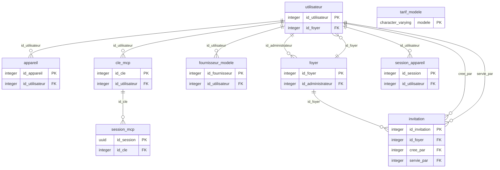
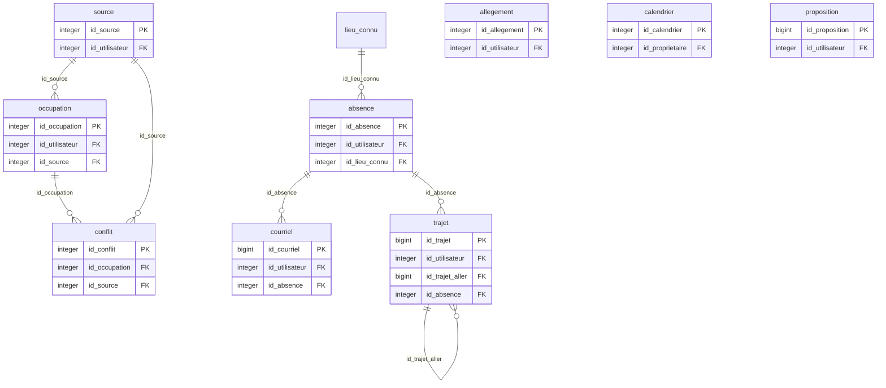
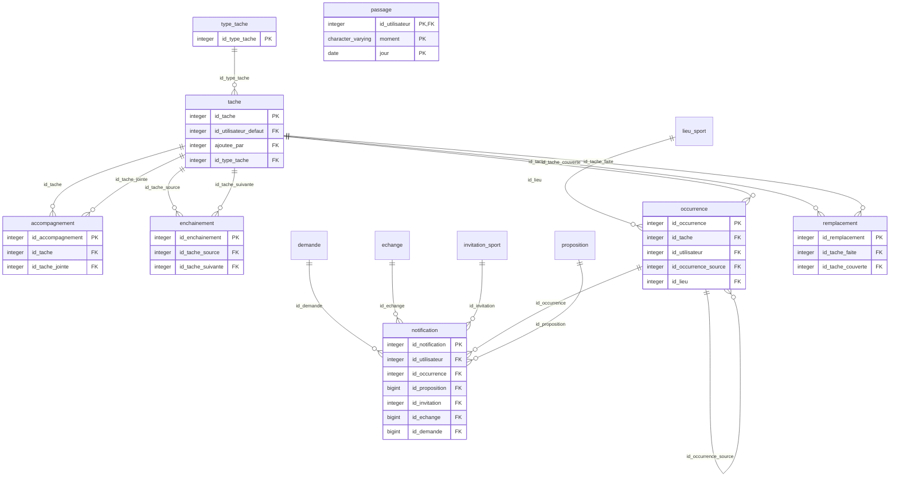
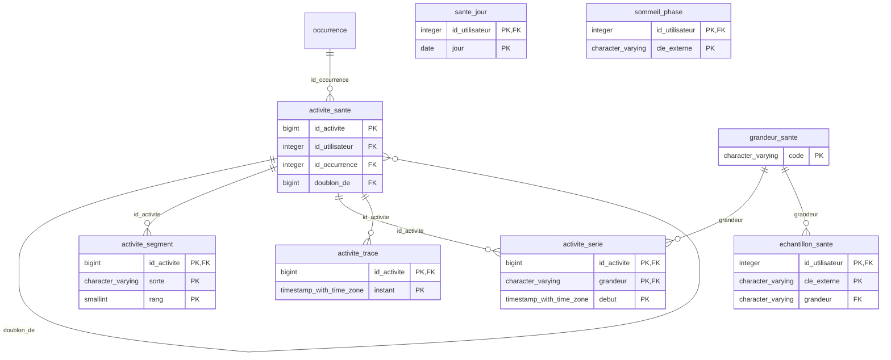
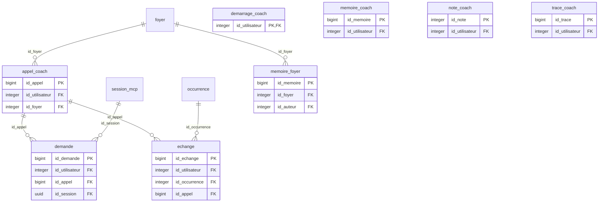
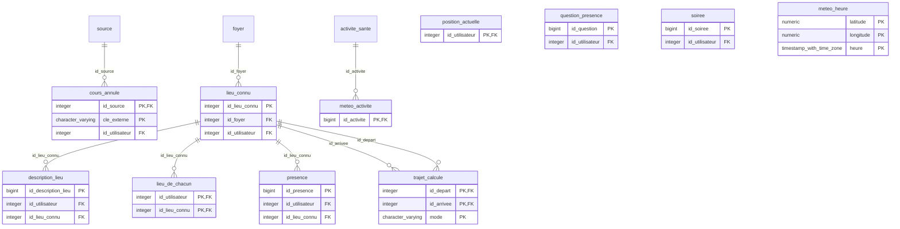
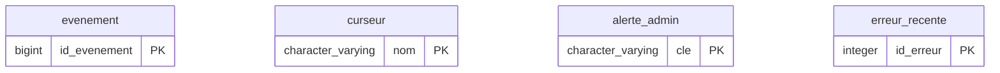

# Le schéma de la base

Généré par `python -m outils.schema` depuis le catalogue de PostgreSQL, après les migrations : ne pas le modifier à la main. Chaque table montre sa clé primaire (PK) et ses clés étrangères (FK) ; une table d'un autre domaine n'apparaît que par son nom. Les liens vers `utilisateur`, que presque toutes les tables portent, ne sont dessinés que dans le premier diagramme.

80 tables, 125 clés étrangères.

## Le foyer, les comptes et leurs accès

- `utilisateur`
- `foyer` : FOY-1 : les personnes qui vivent ensemble et partagent tâches, maison et planning.
- `invitation` : FOY-3 : un code pour rejoindre un foyer, valable 48 heures et à usage unique.
- `appareil` : NOT-16 : un iPhone du compte, avec son jeton de notification Apple.
- `session_appareil` : CNX-11 : une connexion de l'appli, avec sa clé à elle. La base n'en garde que l'empreinte.
- `cle_mcp`
- `session_mcp`
- `fournisseur_modele`
- `tarif_modele`

## Le planning : sources, occupations, absences, trajets

- `source`
- `occupation`
- `conflit`
- `absence`
- `allegement` : PLA-16 : les périodes où quelqu'un a demandé à en faire moins. Pendant
- `calendrier` : Calendrier composé : une ou plusieurs personnes, une ou plusieurs familles
- `trajet` : Propositions d'horaires. Retenir un aller et un retour crée l'absence correspondante ; le billet, lui, s'achète ailleurs (TRJ-8).
- `proposition` : Suggestion de week-end, sans effet sur le planning. Devient une absence
- `courriel` : Trace de ce qui a été lu dans la boîte, et de ce qu'on en a fait (BIL-1).

## Les tâches de la maison et leurs occurrences

- `tache`
- `type_tache` : TAC-25 : les types de tâches du foyer. Nom, couleur, icône, et ce qu'une
- `occurrence`
- `enchainement` : La poussière déclenche l'aspirateur dans les 24 heures, et jamais avant elle (TAC-7, EXE-3).
- `remplacement` : Valider la tâche source solde aussi la tâche couverte, à la même date. La
- `accompagnement` : TAC-15, TAC-17 : une tâche en entraîne une autre le même jour, pour la même
- `notification` : Enregistrée d'abord, envoyée ensuite. Un échec d'envoi laisse la ligne
- `passage` : NOT-15 : le bilan, la relance ou le récap d'un compte, déjà servi pour ce jour.

## Le sport : lieux, plan, séances, exercices

```mermaid
erDiagram
    seance ||--o{ ajustement : "id_occurrence"
    seance ||--o{ bilan_seance : "id_occurrence"
    lieu_sport ||--o{ discipline_lieu : "id_lieu"
    exercice ||--o{ exercice_alternative : "id_alternative"
    exercice ||--o{ exercice_alternative : "id_exercice"
    exercice ||--o{ exercice_interdit : "id_exercice"
    limitation ||--o{ exercice_interdit : "id_limitation"
    occurrence ||--o{ fenetre_mesure : "id_occurrence"
    lieu_sport ||--o{ fermeture : "id_lieu"
    occurrence ||--o{ invitation_sport : "id_occurrence"
    occurrence ||--o{ invitation_sport : "id_occurrence_reponse"
    lieu_connu ||--o{ lieu_sport : "id_lieu_connu"
    exercice ||--o{ mesure : "id_exercice"
    fenetre_mesure ||--o{ mesure : "id_fenetre"
    exercice ||--o{ objectif : "id_exercice"
    lieu_sport ||--o{ ouverture : "id_lieu"
    objectif ||--o{ plan : "id_objectif"
    plan ||--o{ plan_semaine : "id_plan"
    occurrence ||--o{ seance : "id_occurrence"
    occurrence ||--o{ seance : "id_occurrence_remplacee"
    plan ||--o{ seance : "id_plan"
    exercice ||--o{ seance_exercice : "id_exercice"
    seance ||--o{ seance_exercice : "id_occurrence"
    exercice ||--o{ serie_saisie : "id_exercice"
    seance ||--o{ serie_saisie : "id_occurrence"
    seance_exercice ||--o{ serie_saisie : "id_seance_exercice"
    lieu_sport ||--o{ tache_lieu : "id_lieu"
    tache ||--o{ tache_lieu : "id_tache"
    lieu_sport {
        integer id_lieu PK
        integer id_lieu_connu FK
    }
    discipline_lieu {
        integer id_utilisateur PK,FK
        character_varying discipline PK
        integer id_lieu PK,FK
    }
    ouverture {
        integer id_ouverture PK
        integer id_lieu FK
    }
    fermeture {
        integer id_fermeture PK
        integer id_lieu FK
    }
    tache_lieu {
        integer id_tache PK,FK
        integer id_lieu PK,FK
    }
    profil {
        integer id_utilisateur PK,FK
    }
    depistage {
        integer id_depistage PK
        integer id_utilisateur FK
    }
    limitation {
        integer id_limitation PK
        integer id_utilisateur FK
    }
    objectif {
        integer id_objectif PK
        integer id_utilisateur FK
        integer id_exercice FK
    }
    pause {
        integer id_pause PK
        integer id_utilisateur FK
    }
    plan {
        integer id_plan PK
        integer id_utilisateur FK
        integer id_objectif FK
    }
    plan_semaine {
        integer id_plan PK,FK
        date lundi PK
    }
    seance {
        integer id_occurrence PK,FK
        integer id_plan FK
        integer id_occurrence_remplacee FK
    }
    seance_exercice {
        integer id_seance_exercice PK
        integer id_occurrence FK
        integer id_exercice FK
    }
    exercice {
        integer id_exercice PK
        integer id_utilisateur FK
    }
    exercice_alternative {
        integer id_exercice PK,FK
        integer id_alternative PK,FK
    }
    exercice_interdit {
        integer id_limitation PK,FK
        integer id_exercice PK,FK
    }
    serie_saisie {
        bigint id_serie PK
        integer id_occurrence FK
        integer id_exercice FK
        integer id_seance_exercice FK
    }
    bilan_seance {
        integer id_occurrence PK,FK
    }
    ajustement {
        integer id_ajustement PK
        integer id_occurrence FK
    }
    invitation_sport {
        integer id_invitation PK
        integer id_occurrence FK
        integer id_invite FK
        integer id_occurrence_reponse FK
    }
    fenetre_mesure {
        integer id_fenetre PK
        integer id_utilisateur FK
        integer id_occurrence FK
    }
    mesure {
        integer id_mesure PK
        integer id_utilisateur FK
        integer id_fenetre FK
        integer id_exercice FK
    }
```

- `lieu_sport`
- `discipline_lieu` : LIE-1, ADR-18 : les lieux choisis par discipline, avant les adresses. Ne sert plus qu'aux comptes sans lieu de sport avec adresse.
- `ouverture`
- `fermeture`
- `tache_lieu`
- `profil`
- `depistage`
- `limitation`
- `objectif`
- `pause`
- `plan`
- `plan_semaine`
- `seance`
- `seance_exercice`
- `exercice`
- `exercice_alternative`
- `exercice_interdit`
- `serie_saisie`
- `bilan_seance`
- `ajustement`
- `invitation_sport` : Une séance proposée à quelqu'un d'autre. Tant qu'elle est en attente,
- `fenetre_mesure`
- `mesure`

## La santé, envoyée par l'iPhone

- `sante_jour`
- `sommeil_phase`
- `echantillon_sante`
- `grandeur_sante`
- `activite_sante`
- `activite_segment`
- `activite_serie`
- `activite_trace`

## HAL : appels au modèle, mémoire, demandes

- `demarrage_coach`
- `appel_coach`
- `echange`
- `memoire_coach`
- `memoire_foyer` : HDF-4 : la mémoire du HAL du foyer, commune aux membres. Une ligne par version ; la dernière d'un étage est en vigueur.
- `note_coach`
- `trace_coach`
- `demande`

## Les lieux, la position, la soirée et la météo

- `lieu_connu` : ADR-1 : un lieu nommé, avec son adresse et ses coordonnées. Commun au foyer, ou à un seul compte.
- `lieu_de_chacun` : ADR-7 : le mode de trajet dit par chacun pour un lieu. Sans ligne, le mode par défaut.
- `description_lieu` : ADR-11 : la description d'un lieu pour un compte, ce que HAL lit pour choisir le lieu d'une séance. Une ligne par version ; la dernière est en vigueur.
- `trajet_calcule` : ADR-8 : le temps de trajet entre deux lieux connus, calculé par OSRM. estime : à vol d'oiseau, faute de calcul.
- `presence` : POS-4 : un passage dans un lieu connu, ou ailleurs (id_lieu_connu vide). Ouverte : en cours.
- `position_actuelle` : POS-4, POS-6 : la dernière position reçue, une par compte, écrasée à chaque envoi.
- `question_presence` : Une question de HAL ou un contrôle déjà faits, pour ne pas les refaire. cle : la présence, la séance, la demi-journée, la nuit.
- `cours_annule` : POS-11 : un cours dit annulé. La collecte saute sa clé, comme celle d'un conflit tranché.
- `soiree` : SOI-1 à SOI-4 : une soirée, repérée à minuit ou dite à HAL, et ce qu'on en a raconté. Au compte seul.
- `meteo_heure` : MTO-1 : les prévisions lues chez Open-Meteo, au centième de degré, heure par heure. Effacées après 48 heures.
- `meteo_activite` : MTO-6, MTO-7 : la météo du départ d'une course, et le vent rapporté à son tracé.

## Le journal et l'administration du serveur

- `evenement` : JRN : ce qui a changé, qui l'a déclenché, et dans quelle action. Une ligne
- `curseur` : Le dernier événement du journal déjà traité, par lecteur.
- `alerte_admin` : ADM-4 : un problème signalé à l'administrateur. Ouvert tant que reglee_le
- `erreur_recente` : ADM-3 : les erreurs écrites au journal par l'API ou le travailleur, gardées une journée.
